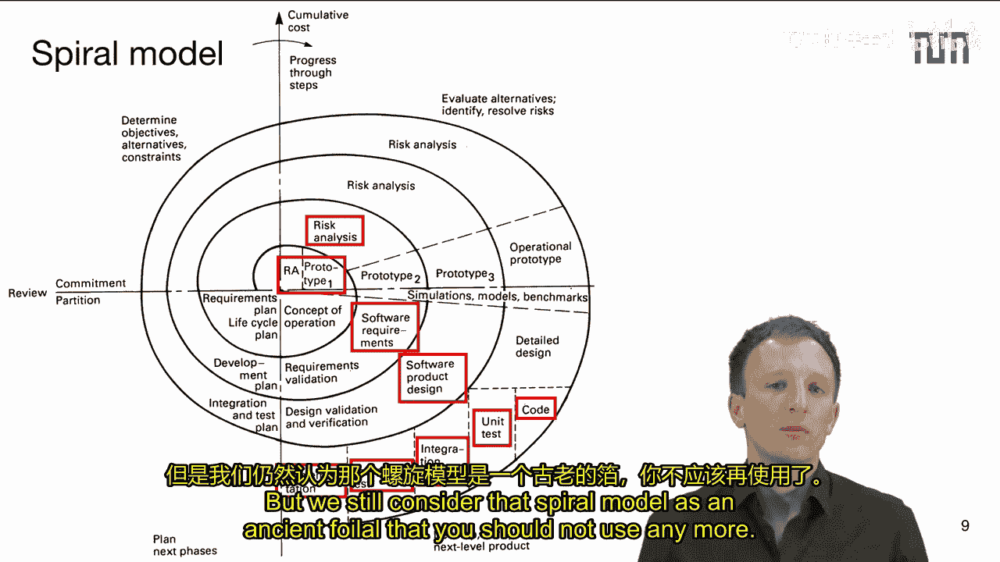
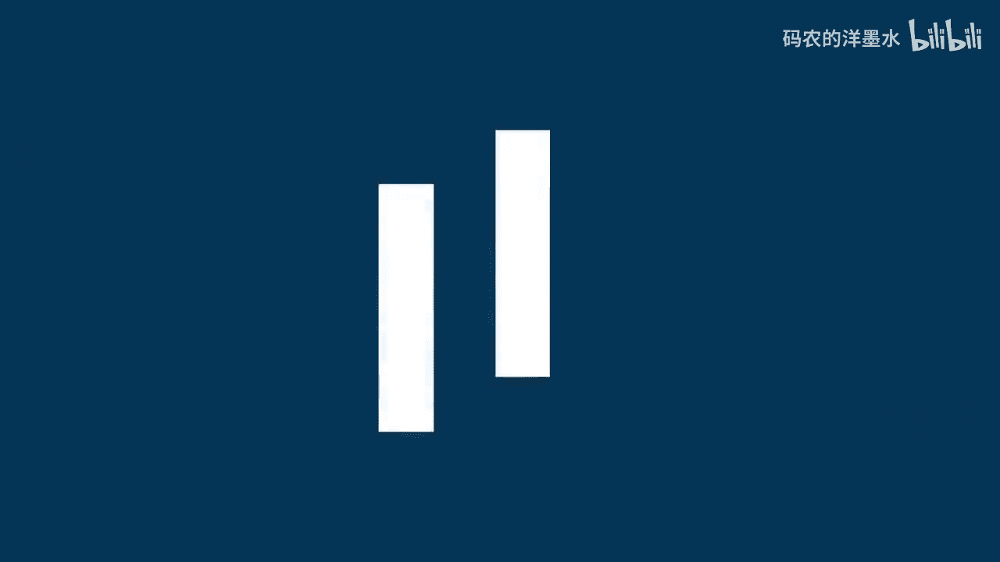

# 【全集】慕尼黑工业大学SEECx 软件工程基础 中英字幕 1080P p03 Lecture 1-3软件生命周期 -BV13sqGBLE64_p3-

Hello and welcome to the unit software Lifecycle models of the course So EngineerEssentials My name is Stefan and in this unit we will explain you typical software development activities so that you are able to describe typical software lifecycle models。

There are different questions in software development， such as what is the problem。

 how can we partition the problem， what is the solution to the problem。

 what are the best mechanisms to implement a solution， how is the solution constructed。

 is the problem solved， can the customer use the solution， or are enhancements needed。

And we have different software development activities that address these questions。

 such as requirements elicitation， which covers the question what is the problem？

Analysis allows us to partition the problem into smaller pieces。

Where we can then in this system design， define solutions for。

Detailed or object designs handles the best mechanisms to find reusable parts to identify patterns to implement a solution。

And the implementation covers the construction of the actual solution。In the testing activity。

 we find out whether a problem is solved。During the delivery。

 we actually address the question whether the customer can use the solutioner and maintenance covers the question whether enhancements are needed or whether we need to refine the software。

If we rephrase these activities in a verbal form， we got activities as we would use them in an UL activity diagram。

And now we can bring them into a certain order。A software lifecycle defines which set of software development activities you use in the project。

How they relate to each other and how they support the development of the software system。

It is also called a software process and answers questions whether you apply the activities in a sequence or in parallel。

 which activities you start with， and what is the activity that we end with。

A software lifecycle model is then an abstraction of the software lifecycle。

 it is also called a software process model and it allows us to understand。

 monitor and control the software system and to model these activities in a certain way。

Let's consider one example， one of the first software lifecycle models was the waterfall model。

And we see a simplified version in this slide。 It was originally defined in the 1970s by Royce。

And has a sequential flow of activities。 We start with eliciting the requirements。

 and only if we finish the full activity， we go to the next activity analyse problem。😊。

And only if we finish this one， we go to the of the system， we then design the objects。

 we implement the software， we test the software and deliver the software at some point。

 and then finally we maintain the software。So you see only if one of the previous activity is completely finished。

 we go to the next activity。And in case something went wrong， we have to go back。

 finish the activities again in a sequential order， and then we can only proceed。

This is actually a very old model， so we consider it as a dinosaur and we think that we should not use it anymore。

We can adapt the waterfall model and then come to the so-called we model if we turn up the second half of the flow and follow the letter we。

 we then focus a lot more on testing， as we have different testing activities we first test the source code units。

 we then test whether different subsystem subsystems integrate with each other。

 which belongs to the system of the design on the left side in the same horizontal line。

 and then we test the full system， which belongs to the activity analyze problems on the left side。

Finally， the customer tests the acceptance of the system。

 which belongs to the elicited requirements that he stated in the beginning。

While the remodel has certain advantages， we still consider it as a dinosaur that you should not use anymore because it's still very sequential and in case you identify a problem in the requirements later in the project。

 you have to go back all the activities and do the sequential order again。

So both the waterfall and the we model do not support dealing with changes during the project。

One of the first iterative models。Was。The spiral model。

And this one actually can already deal a little bit with changes。

It does not only have one iteration through all the activities that we have seen before。

 but multiple iterations， and in each iteration a prototype is designed。

And each prototype then refines the implementation of the previous iteration。

So the developers redo certain activities in order to improve their results。

The spiral model focuses on risk analysis。Before the developers proceed with the next iteration。

 they analyze all risks and might even quit the project。In the earlier phases。

 they focus on software requirements in later phases on the design， and then on the detailed design。

Then they address certain questions in software development。

But the team iterates multiple times over each of these activities in order to improve the created software artifacts。

 and this is already an improvement over the sequential models。😊。

But we still considered a spiralire model as an ancient fo that you should not use anymore。

In this unit， you'll learn typical software development activities and models that describe their relation and order to each other。

 such as the waterfall， the wheel model and the spiralre model that you all should not use anymore。

You should know them actually in the next unit we will cover more modern software development life cycles that we also want to use so see you in the next unit。

