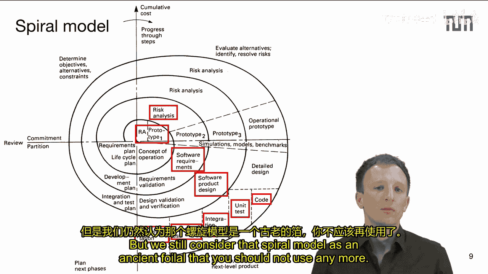

# 软件工程基础：1-3：软件生命周期模型 🚀

在本单元中，我们将学习典型的软件开发活动，并了解如何通过不同的软件生命周期模型来描述这些活动之间的关系与顺序。

## 概述

软件开发涉及一系列核心问题，例如：问题是什么？如何分解问题？解决方案是什么？实现解决方案的最佳机制是什么？如何构建解决方案？问题是否已解决？客户能否使用解决方案？是否需要增强功能？为了回答这些问题，我们有一系列对应的软件开发活动。

## 软件开发活动

以下是针对上述问题的核心软件开发活动：

*   **需求获取**：回答“问题是什么？”。
*   **分析**：将问题分解为更小的部分。
*   **系统设计**：为分解后的问题定义解决方案。
*   **详细/对象设计**：寻找最佳机制，例如识别可复用部件和模式，以实现解决方案。
*   **实现**：构建实际的解决方案。
*   **测试**：验证问题是否得到解决。
*   **交付**：确保客户能够使用解决方案。
*   **维护**：处理是否需要增强或改进软件的问题。

如果将这些活动用类似UML活动图的形式表述，我们可以将它们按特定顺序组织起来。

## 什么是软件生命周期？

软件生命周期定义了在项目中使用的软件开发活动集合、这些活动之间的关系以及它们如何支持软件系统的开发。它也被称为软件过程，并回答了以下问题：活动是按顺序执行还是并行执行？从哪个活动开始？以哪个活动结束？

软件生命周期模型是软件生命周期的抽象，也称为软件过程模型。它帮助我们理解、监控和控制软件系统，并以特定方式对这些活动进行建模。

## 经典生命周期模型

上一节我们介绍了软件开发活动和生命周期的概念，本节中我们来看看几个经典的软件生命周期模型。

### 瀑布模型

瀑布模型是最早的软件生命周期模型之一，由Royce在20世纪70年代提出。它是一个**顺序执行**的活动流。

其流程可以概括为：
`需求获取` → `分析` → `系统设计` → `详细设计` → `实现` → `测试` → `交付` → `维护`

该模型规定，只有当前一个活动完全完成后，才能进入下一个活动。如果过程中出现问题，必须返回到之前的阶段，按顺序重新完成相关活动后才能继续。由于其僵化的顺序性，它被认为是一个过时的“恐龙”模型，不应再使用。

### V模型

V模型是瀑布模型的一种变体。如果将流程的后半部分向上折叠，使其与前半部分的活动在水平线上对应，就形成了一个“V”字形。

V模型更加强调测试活动，其核心对应关系如下：

*   **单元测试** 对应 **详细设计**
*   **集成测试** 对应 **系统设计**
*   **系统测试** 对应 **分析**
*   **验收测试** 对应 **需求获取**

尽管V模型通过这种对应关系强调了测试的重要性，但它本质上仍然是顺序执行的。如果在项目后期发现需求问题，仍然需要回溯所有活动。因此，瀑布模型和V模型都无法很好地处理项目期间的需求变更。

### 螺旋模型

螺旋模型是首批迭代模型之一，它能够更好地应对变化。该模型不是一次性顺序完成所有活动，而是进行**多次迭代**，每次迭代都会构建一个原型，并对前一次迭代的实现进行细化。

螺旋模型的核心特点是**风险分析**。在每次迭代开始前，开发团队都会分析风险，甚至可能因此终止项目。在早期迭代中，重点放在软件需求上；在后续迭代中，则逐步聚焦于设计和详细设计。

开发团队会多次重复这些活动，以改进创建的软件制品。这相比顺序模型是一个进步。然而，螺旋模型仍然被认为是一个“古代化石”，在现代软件开发中已不常使用。

## 总结

在本单元中，我们一起学习了典型的软件开发活动，并了解了三种经典的软件生命周期模型：瀑布模型、V模型和螺旋模型。这些模型帮助我们理解了活动如何被组织和排序。需要注意的是，这些都属于较为传统的模型，在现代敏捷开发实践中已较少直接使用。在接下来的单元中，我们将介绍更现代的软件开发生命周期。