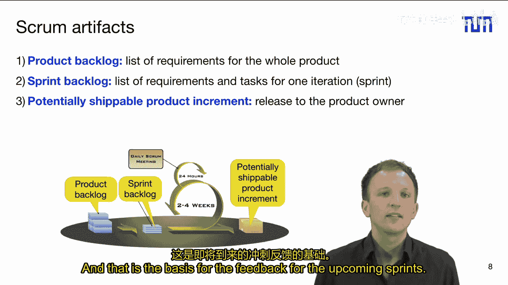
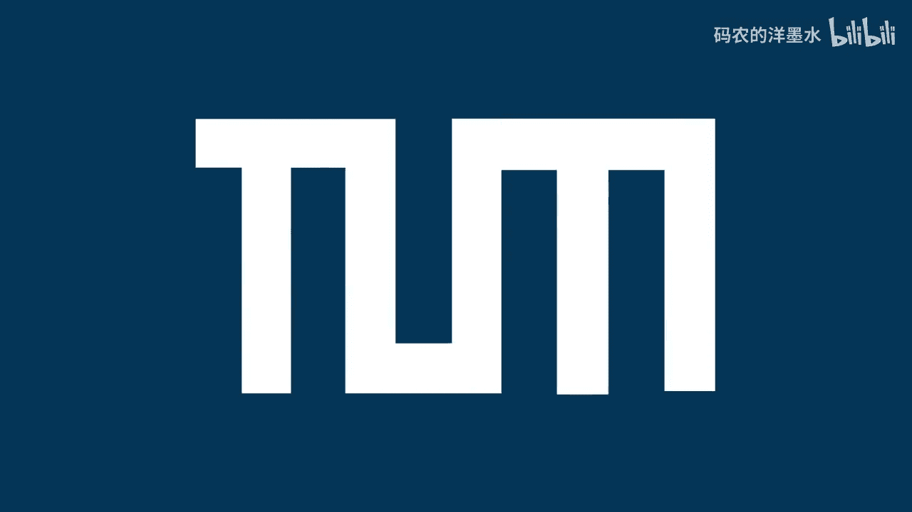

# 【全集】慕尼黑工业大学SEECx 软件工程基础 中英字幕 1080P p04 Lecture 1-4Scrum -BV13sqGBLE64_p4-

Hello and welcome to the unit Scrum of the coursese Soft EngineeringEssentials My name is Stefan and in this unit you will understand the difference between defined and empirical process control。

 and we will you explain the concepts of Scrum。In the last video we already talked about defined processes such as the waterfall model。

 the we model， or the spiral model， defined processes are planned and like in production lines where people wait for a certain ver activity。

 then they finish it and then the next one can proceed so。

Developers follow strict rules and avoid deviations。

 which are seen as problems that need to be resolved so that the production line works again。

In contrast， there are empirical processes that are not entirely planned。

 so you have a rough plan and you know the goals where you want to head to。

 but you do not plan every little activity instead you inspect the activities by doing retrospectives or reviews and then you adapt the activities like you see in the picture if you have a strong wave if you might all go to the right side of the boat and save the boat from falling apart。

One example of empirical process control is Scrum， which is actually the most popular Agile method and we see a little overview on this slide in Scrum we start with the product backlog where we have rough requirements。

 we put them into a sprint backlogs and work on them for two to four weeks。

 we have a daily scrum meeting every 24 hours and at the end of each sprint。

 we have a potentially shippable product increment。

Scrrum is a management and control process that focuses on early risk management because in each sprint review at the end of a sprint。

 we look what we have achieved and what we want to do in the next two to four weeks。

The developers deliver working software incrementally。

 so after each sprint we add functionality to the software and empirically。

 which means we adapt the process when it is required。

It's a simple framework for effective team collaboration。

Most projects start with a product owner and a list of rough requirements。

 these requirements are presented to the team on the Project kickickoff meeting on that day。

 each of the rough requirements is inserted into the product backlog which contains everything that should ideally get implemented。

At the beginning of each sprint， the team meets for the Sprint planning meeting。

 where the items from the product backlog have broken down into detailed tasks。

 Some of these tasks get assigned to the sprint backlog lock。

While others remain in the product backlog for future sprints， during the sprint。

 the developers will implement the tasks in the Sprint backlog and present it to the product owner in the Sprint review meeting。

The team then also has a separate sprint retrospective。

 where feedback is presented on how the team collaborated together。Summing up。

 you have a product backlog with roof requirements which gets specified into the Sprint backlog。

 implemented in two to four week cycles， and finally get integrated into the potentially shippable product implementcrement。

A scrum sprint is a time boxed activity。During which the team creates a potentially shipable product increment。

Sprints have consistent durations throughout a project。

 They start with a sprint planning meeting and end with a sprint review meeting。

 and then a new sprint starts immediately after the conclusion of the previous sprint。

 so we ship the product increment。And then we start with the next sprint planning meeting。

 we again do the sprint， have a sprint review meeting， ship a product increment， and so on。

 and what you can already see in this slide is that it's very likely that you put the Sprint one review and the Sprint two planning meeting。

 for example， together so that you combine the team members in a large meeting to save time。

As ScM team consists of three different roles， we have developers。

Who are organized in the development team， a development team is self organizing。

 which means they pull the tasks， they estimate the tasks， and they decide what they are working on。

And the development team is also cross functional， which means we have different experts， an analyst。

 a developer， a tester， a release manager， everything what is required for the project success。

 and the developers work on the product increments。 So they really it realize the。

Spprint pack of items and turn them into a potentially shippable product increment。

The second role is to Scrummaster， who is a moderator who resolves impediments。

And iss responsible that the development team follows this scrum framework。

He's asking questions whether the team goes into the right direction。

 but he's not a traditional project manager who decides everything who estimates and who forces the team to work on certain tasks。

 and finally we have the product owner who still liaison to the outside world to all other stakeholders that are interested。

 and who gathers all the information to define the product。

 to define the importance of certain requirements by prioritizing them。

And who is responsible for the results of the project？

You could also think of him as a requirements engineer because he has to get all the information for the requirements。

In Scrum， we have different meetings and we want to quickly show you these meetings on the Scrum overview。

 We have the project kickoff meeting where we create and prioritize the product backlog together。

We have the Sprint planning meeting， where we create the sprint backlog in order to start the sprint so we refine the requirements。

From the product backlog。We add more details to them and we select the two or three or four most important backlog items negotiate with the product owner about how many of them we select and we put them into the screen backlog。

During the sprint we have daily Scrum meetings every day。

 which are 15 minute stand up meetings where we share status， discuss impediments。

 and promise tasks that we will resolve until the next meeting。In the spring review meeting。

 the developers demonstrate the realized backlog items to the product owner who provides feedback and who decides whether the backlog items are realized。

 finished or not。And we also identify changes， we identify new requirements that we then put into the product back。

And sometimes we also have a sprint retrospective after this sprint review meeting。

 which is actually recommended， we inspect this sprint and find improvements for the next printprint。

Scrrum also has artifacts， for example， the product backlog。

 which is a list of requirements for the whole product。

But these requirements are not defined in detail they are kept weak to keep the effort for the requirements elicitation low because we don't want to end up with analysis paralysis。

We have the sprint backlog， a list of requirements and tasks for one iteration。

 for one sprint that is so detailed enough that the developers have all the information to realize and implement requirements。

And we have to potentially ship up a product increment at the end of a sprint that is released to the product owner。

 and it is potentially also released to the end users of the software。

 and that is the basis for the feedback for the upcoming sprints。

In this unit you learned the differences between defined and empirical process control。

 and you also learned a modern software lifecycle model namely Scrum and its concepts， meetings。

 and artifacts。See you in the next tune。

