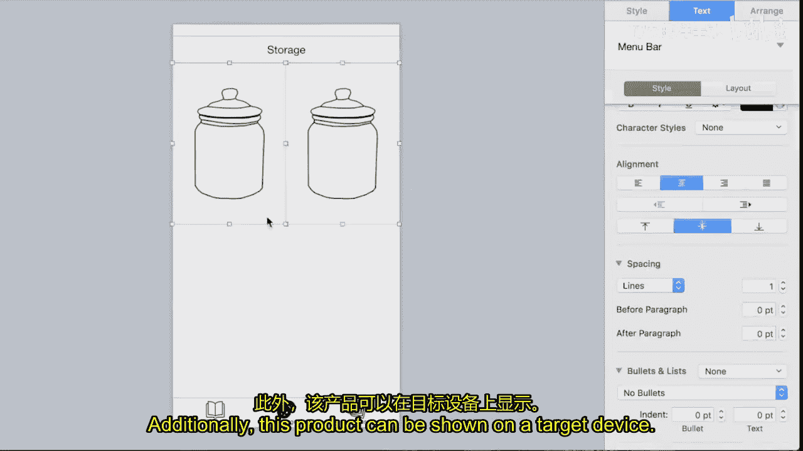
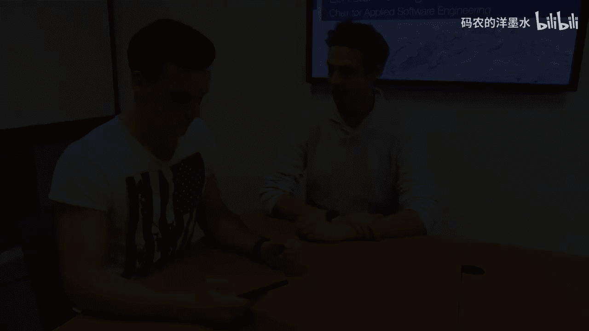
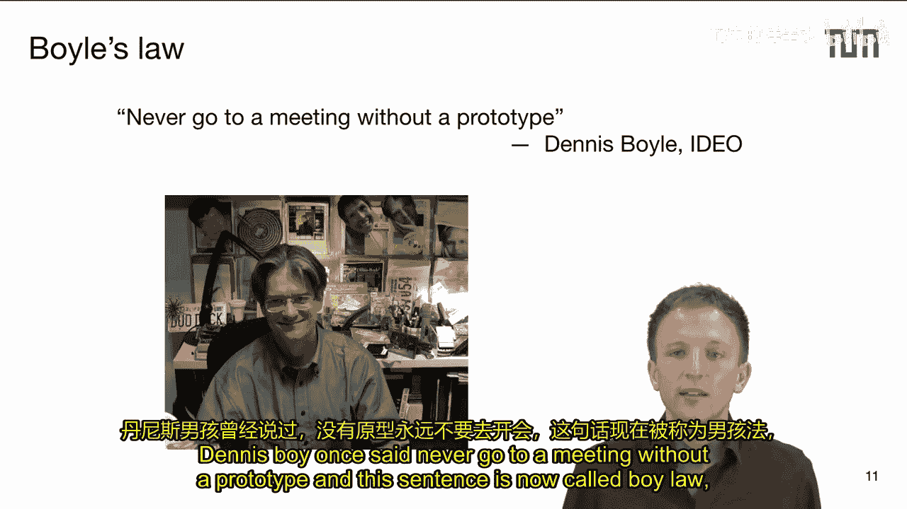

# 【全集】慕尼黑工业大学SEECx 软件工程基础 中英字幕 1080P p05 Lecture 1-5原型设计 -BV13sqGBLE64_p5-

Hello and welcome to the Uni Prototyping of the Co Soft EngineeringEssentials My name is Stefan and in this unit you will learn to recognize the importance of prototyping for software development so that you understand why prototyping is necessary。

😊，You will be able to explain the iterative prototyping process from low fidelity to high fidelity prototypes。

 and you will be able to differentiate different types of prototypes such as horizontal versus vertical after this unit。

But let's consider first why prototyping is necessary Soft development deals with complex systems。

 the design of user interfaces for these complex systems is hard because the developer is not the same person as the user。

The developer might have a different understanding about the system and might not understand whether a user actually needs。

Because software engineers communicate mostly with other developers。

They don't really get into touch with users to know what they actually want。However。

 user interface development is about communicating with users。

 even if developers don't directly get into touch with them。On the one hand。

 the user is always right because he's using and potentially buying the software。

 but on the other hand， the user is not a designer so he does not necessarily know how the software should behave in the user interface。

Getting a user interface right takes a lot of development effort。

 in fact studies have shown that about 50% of design。

 implementation and maintenance efforts go into the development of user interfaces。

Prototyping is an iterative approach to design good user interfaces it helps us to communicate with the user to understand their needs and to obtain feedback to improve the user interfaceDevelop first start with low fidelity prototypes to get a feeling about the concept of the user interface and to understand its navigation flow。

Low fidelity prototypes are usually drawn or sketched on paper or whiteboards and are easy to produce because they don't need to include all details Developers show the low fidelity prototypes to users or customers。

 obtained feedback and use the feedback to improve the low fidelity prototypes。

If the developers agree on the main user interface concepts， they switch to high fidelity prototypes。

 these look like the real system and focus on details such as the position of buttons。

 what kind of colors are used or the alignment of the user interface element。

If everyone agrees on the high fidelity prototypes。

 the developer can then start to implement the actual application based on the prototypes which act as an agreement between developers。

 users and customers。In this slide， you can see an example for low fidelity prototypes on paper on the left。

 which are transformed into a tool called Basmic that lets you execute the low fidelity prototypes directly on the target device。

 in the middle， in this case， a mobile application。On the right。

 you can then see the corresponding high fidelity prototype that has a similar layout。

 but deviates in many little details from the low fidelity prototypes on the left。

Let's compare the advantages and disadvantages of low and high fidelity prototypes。First of all。

 low fidelity prototypes are easy to produce because they don't focus on all the details you can just sketch them on paper they also produce more feedback because users and customers have the feeling that they can still change a lot because they don't look like the finished system。

And developers or designers do not decide so many different design decisions。

Disadvantages on the other side are that we cannot reuse them and that important details are ignored so we don't get feedback on these important details such as the color or the alignment of specific elements。

That's where high fidelity prototypes come in， they are more realistic and more detailed problems can be identified。

They are also more impressive so the customer probably likes them a lot more than the low fidelity prototypes that look more sketchy。

 however， this can also lead to more effort in the development to get them to such an impressive state and it can happen that you get less feedback because customers and users think that the system is already finished and that their changes lead to a lot of development effort even if you just draw the high fidelity mockups so they lead to high expectations。

 especially if you have interactive prototypes。They are more distinction instead of just having low and high fidelity prototypes。

 we can distinguish between how long a prototype is used and in which stage it is actually used Pros can be for internal audiences。

 for example other developers or designers or external audiences such as the customer and the user。

They can be drawn digitally on a computer or using physical mediums such as paper or styrofoam。

Another distinction is between evolutionary and revolutionary prototypes。

Evolutionary prototypes are further reused for the incremental development of the application。

 for example， extreme programming。And revolutionary prototypes are thrown away。

 and we can distinguish between low and high fidelity as discussed before。Finally。

 we can distinguish between the scope of prototypes。

 we have horizontal prototypes and vertical prototypes。

 let's have a look at horizontal prototypes first， let's consider an example where we have four different functional requirements and three layers in which we implement our system。

 a database layer at the bottom middleware layer in the middle and a user interface layer at the top。

If we do horizontal prototyping， we would， for example， first， completely implement a database。

 and only after it is finished， we go and implement the middleware and then the user interface。

So we have a bottom up approach in this case， but we can also have a top down approach。

So we show a wide range of requirements in our prototypes。

 and this is typically used in traditional more linear processes。

Where we do not have a full implementation of the requirements until the end of the project。

 because only all the horizontal layers are implemented， we have the full system。

Let's have a look how vertical prototypes are created with the same example， again four requirements。

 three layers， instead of finishing the whole horizontal layer。

 we actually implement one functional requirement through all the different layers， user interface。

 middleware and database， and we create an executable prototype。

That we could potentially already ship to our users。

We then add more functional requirements as to incrementally increase the software functionality。

And produce more prototypes after time。And this is also called vertical integration。

Vertical prototypes show a small range of requirements。

 but therefore they show the full implementation of these requirements and users can already try out these requirements and give feedback。

We used them for vertical integration， mainly in agile processes。In the next slide。

 you will see an explanation video how you can actually create prototypes。In this video。

 we show you how low and high fidelity prototypes look like and different stages of the prototype development process。

Now we will look at the first meeting between customer and developer discussing about the future product。

Hey friend， how you doing He Max， thanks for coming Yeah。

 you're welcome So let's talk about the idea I talked you about last week Okay yeah what's about my cookie app。

 I want an application where I can all my favorite recipes in Okay so how should it look like I have three tap in mind Okay first tap should have all the favorite recipes so I can make my cookies immediately the second tap should keep track of where I stole all my cookies I always lose them and the third tap should have all the photos of my favorite cookies displayed in a beautiful layout。

All right， I think I got all information I need， so I will build the prototype and then come back to you in a few days soundss perfect Thank you all right。

At this point， the developer starts working on the low fidelity prototypes。

These prototypes are mostly done on paper， always some mock up2， for example， bsamic。

Low fedelity prototypes are very useful at this stage。They are quickly created， easy to adapt。

 and the customer can get a better idea of how the app will look like。Hey Frank。

 I thought about the ideas I wrote down last meeting and I came up with a low fidelity prototype nice。

 so you told me that you want three main features so I split them up into three different views。

In the first view， you see all your recipes。 And if you would click on one recipe， for instance。

 I would say that I can build an overview with a bigger image and all the ingredients。 Yeah。

 sounds like a great idea。 so on the second view， I would simply display all your jars with the cookies inside and on the last view all your favorite images。

 Yeah looks good too but they would really like a little bit more information on the storage screen of'one Okay so what informations are you thinking。

 but I would really like a number which how many cookies are in each jar and maybe also which type of cookies in each jar。

 Okay， yeah， no problem I could do that。 but if you're good with a basic design。

 I would say that I would build a high fidelity prototype and show it to you in our next meeting Yeah sounds like a plan。

 See you in the next meeting。As the feedback from the customer was over a good and not so many changes are needed。

The developer can directly continue with the creation of high fidelity prototypes。

This prototype gives us a feeling that the app is already done， but in fact。

 it still misses all the functionality。Additionally， this product can be shown on the target device。

I integrated the feedback from our last meeting and I created a nice high fidelity prototype for you By let me take a look yes sure as you can see we still have three views on the first view you see other recipes and if you click on one recipe for instance。

 you get a nice overview with a bigger image and all the ingredients。On the second view。

 you see all your jars， and as you wanted me to integrate。

 there's a title for HR and the amount of cookies。On the last screen。

 they are all the pictures of your favorite cookies and if you want to add a new one。

 you just press on the plus sign to the top right and can take a snap nice。

 looks perfect When can we upload this to the app store no this is just a prototype so there is no functionality behind it。

 but I will implement it Nice looks like a plan。After this explanation video where you have seen how to create prototypes。

 I want to finish this unit with a recommendation。Dennis Boyle once said。

 neverever go to a meeting without a prototype， and this sentence is now called Boy's law。

 so you should stick to it。

In this unit you learn the importance of prototyping for software projects。

 you are able to explain the iterative prototyping approach from low to high fidelity pros and you are able to compare different types of prototyping such as horizontal and vertical pros see you in the next unit。

