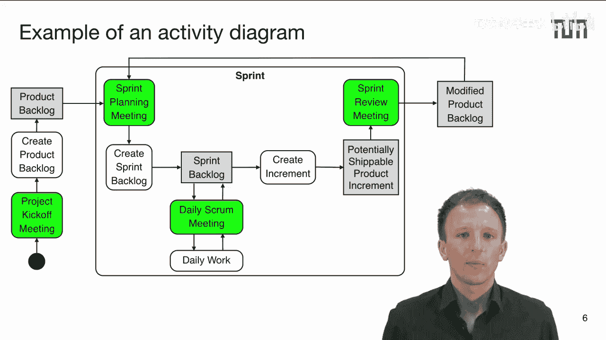

# 【全集】慕尼黑工业大学SEECx 软件工程基础 中英字幕 1080P p06 Lecture 1-6UML活动图 -BV13sqGBLE64_p6-

Hello and welcome to the Uni UML activity diagram of the course Soft EngineeringEssentials。

 My name is Stefan and in this unit we will talk about a UL diagram taxonomy and you will get to know UML activity diagrams。

In UML we distinguish between structure diagrams and behavior diagrams structural diagrams can be。

 for example class diagrams， component diagrams， object diagrams。

 deployment diagrams or package diagrams， and behavior diagrams can be activity diagrams。

 these are the topic of today's unit， use case or state machine diagrams。

 or we can further distinguish in action diagrams， to sequence diagrams or communication diagrams。

Gray diagrams in this figure are abstract diagrams。

 this means that they cannot be instantiated and rather denote the different types。In this course。

 we will cover six different diagram types that are highlighted in green。

 and today we will start with activity diagrams。The purpose of activity diagrams is that they show the dynamic behavior by displaying a sequence of actions in a specific order。

 They show the behavior of a system during analysis。

And they can also be used to model business processes or software lifecycl models。

 as we have seen in an earlier unit。So you could， for example， model a software engineering process。

Such as the waterfall model， the we model， or scrum with an activity diagram。

Let's have a look at the different activity diagram elements。 First of all。

 we have an activity which is a larger unit of work as we have learned before。

 that consists of multiple actions。Actions are also drawn as rounded rectangles so we cannot distinguish them easily from activities。

 but actions should always be written in the form perform something in a verbal form。

We also have objects in an activity diagram that are used as inputs to a certain action or that are created during the action so that they act as an output and we can have a control flow between multiple actions or actions and objects by using simple arrows。

We have an initial note where the process actually starts。

And we have a final node where the process actually ends。

 and sometimes we can have multiple final nodes depending on the actual flow。

We can also use decision and merge notes as alternative actions where either one of them depending on the condition in the route is actually performed。

 another possibility are fork and joint notes， which denote parallel and concurrent actions that take place at the same time。

 and that are synchronized using the black lines so that we can only proceed if all the actions are performed。

Let's have a look at one real example of an activity diagram where we model how the software lifecycl Scrum actually works in Scrum。

 we serve with a project kickoff meeting and in this example all the meetings are inserted as greenly highlighted activities。

We then continue by creating the product backlog， which is already part of the project kickoff meeting。

 so we have an output object product backlog。Then we start a larger activity that we call sprint。

That we can decompbo into multiple actions， and each sprint starts with a sprint planning meeting where we create the sprint backlog。

 So we have the sprint backlog object。Every day we have a daily Scrum meeting where we discuss about our daily work。

And at some point in the sprint， we create a product increment。

 so we have the object potentially shippable product increment that we show to the product owner in our sprint review meeting in order to obtain feedback。

That is used to modify the product backlog。And this product backlog is 10。

The input object for the second Sprint planning meeting。

So here you can see an example of what you can actually do in UL activity diagrams。

 and this is a rather interesting example。Try to understand and try to recap it。

In this unit we talked about UML activity diagrams。

 you learned the most important elements of these diagrams， and you saw an example。

 see you in the next unit。

