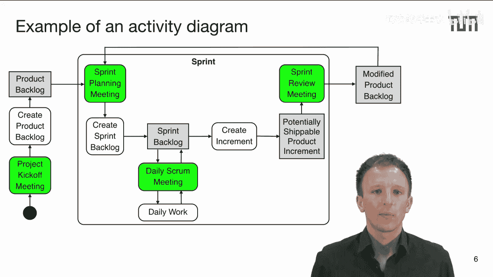
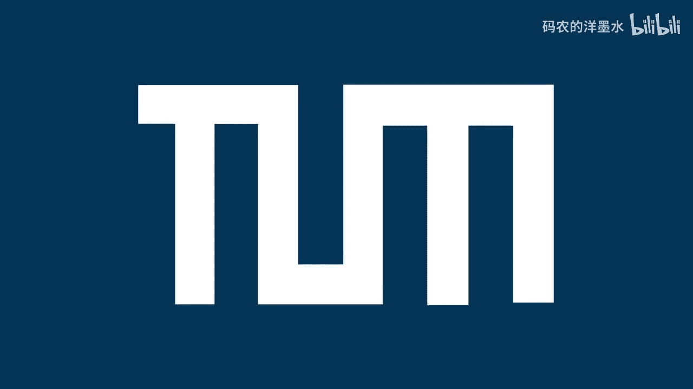

# 软件工程基础：1-6：UML活动图 🎯

在本节课中，我们将学习UML（统一建模语言）中的一种重要行为图——活动图。我们将了解其基本概念、核心元素，并通过一个实际案例来掌握如何绘制和理解活动图。

---

## UML图分类概述

在UML中，图主要分为两大类：**结构图**和**行为图**。

结构图用于描述系统的静态结构，例如：
*   **类图**
*   **组件图**
*   **对象图**
*   **部署图**
*   **包图**

行为图则用于描述系统的动态行为，例如：
*   **活动图**（本节课重点）
*   **用例图**
*   **状态机图**
*   **交互图**（可进一步细分为序列图、通信图等）

在UML规范中，部分图是抽象图，它们不能被直接实例化，而是用于定义不同的图类型。在本课程中，我们将重点学习其中六种图，而今天就从活动图开始。

---

## 活动图的用途

活动图的主要目的是通过展示按特定顺序排列的一系列动作，来呈现系统的动态行为。它在系统分析阶段用于展示系统行为，也可以用来为业务流程或软件生命周期模型建模。

例如，你可以使用活动图来建模一个软件工程过程，比如瀑布模型、V模型或Scrum。

---

## 活动图的核心元素

上一节我们介绍了活动图的用途，本节中我们来看看构成活动图的具体元素。理解这些元素是绘制正确图表的基础。

以下是活动图中使用的主要元素：

*   **活动**：一个由多个动作组成的、较大的工作单元。
*   **动作**：也绘制为圆角矩形，与活动形状相同。动作描述应以动词形式书写，例如 **`执行某项任务`**。
*   **对象**：在活动图中用作某个动作的输入，或在动作执行过程中创建并作为输出。
*   **控制流**：使用简单箭头表示多个动作之间，或动作与对象之间的流向。
*   **初始节点**：表示流程开始的位置。
*   **最终节点**：表示流程结束的位置。根据实际流程，有时可能存在多个最终节点。
*   **决策与合并节点**：用于表示条件分支。根据路径上的条件，执行其中一个替代动作。
*   **分岔与结合节点**：用于表示并行和并发动作。这些动作同时发生，并通过黑色同步条进行同步，确保只有在所有并行动作都完成后，流程才能继续。

---

## 活动图实例：Scrum流程建模

了解了基本元素后，我们通过一个具体的例子来看看如何应用它们。本节我们将分析一个用活动图建模的Scrum软件生命周期流程。

在此示例中，所有会议都被标记为绿色的活动。

1.  流程从**项目启动会议**开始。
2.  在项目启动会议中，会创建**产品待办列表**，这是一个输出对象。
3.  随后开始一个名为**冲刺**的大型活动，它可以分解为多个动作。
    *   每个冲刺以**冲刺计划会议**开始，并创建**冲刺待办列表**对象。
    *   每天举行**每日站会**，讨论日常工作。
    *   在冲刺的某个阶段，会创建**产品增量**对象。
4.  在**冲刺评审会议**上，向产品负责人展示这个**潜在可发布的产品增量**，以获得反馈。
5.  获得的反馈用于修改**产品待办列表**。
6.  修改后的产品待办列表又成为下一次冲刺计划会议的输入对象。

这个例子清晰地展示了UML活动图如何用于描述一个迭代式、增量的开发流程。

---

## 总结

本节课中，我们一起学习了UML活动图。你了解了活动图在UML分类中的位置、它的主要用途、构成图表的核心元素（如活动、动作、对象、控制流及各种节点），并通过Scrum流程的实例加深了理解。请尝试回顾并理解这个例子，它很好地展示了活动图的实际应用价值。