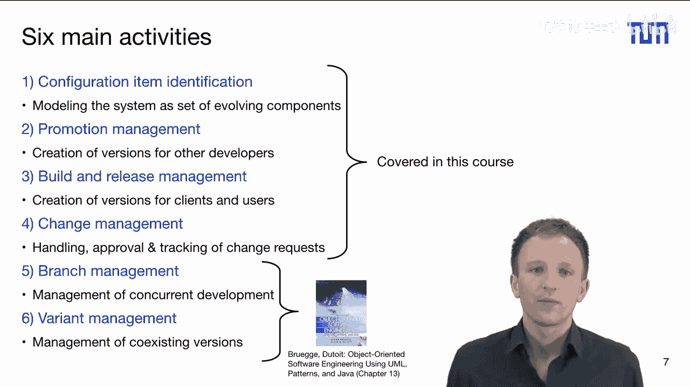

# 【全集】慕尼黑工业大学SEECx 软件工程基础 中英字幕 1080P p07 Lecture 2-1软件配置管理part1 -BV13sqGBLE64_p7-

Hello and welcome to the unit Soft configuration management。

 One of the course software engineeringEssentials。 My name is Stefan， and in this unit。

 you will learn why software configuration management is required， in particular。

 in large software development efforts， you will be able to explain the differences between a promotion。

 a release and a revisionmissioner。😊，To understand what software configuration management is and how it works。

 you must understand why it is essential during the development of a project。Let's look an example。

We want to introduce you to Maria and Barbara to developers who working together on the Cook app you already saw in week1。

 Maria was already working on a new feature to create your own recipes and now once to integrate her coat with the work Barbara is doing on the recipes screen。

Using a newest B stick， she hands over her coat to Barbara and asks her if she could merge it with a current version of the coat。

 Barbara agrees， but unfortunately， they were both working on the same file。

 and Barbara needs to rewrite and restructure a lot of code to get the whole project compiling again。

Maria leaves the office for a meeting with the customer。

 and Barbara is taking on the challenge to get the project working again。

When Maria comes back from the customer meeting， she brings along a new change request。

 The customer now wants the recipes to be displayed in a completely different way。Barbara。

 who still hasn't fixed the problem， wishes she could wrote the latest broken copy so he would have a compellingiling baseline to start development on the new feature。

And even if they had a compelling project， they couldn't even release to the customer as their colleague Ben。

 who is responsible for the releasing process is still on holiday。 As you can see。

 Maria and Barbara are really struggling with the development work flow。

And this is where soft configuration management comes into play。

Softer configuration management helps you to keep track of versions， for instance。

 when you're working with multiple people under the same code page。

 it is useful to keep a history of all changes from every developer。

So if something goes wrong or someone simply wants to go back to a previous version。

 those changes can be easily located and reversed。Additionally。

 it is possible for multiple people to work on the same file without spending hours me those changes。

Change management helps to deal with change requests。

 and when the team decides to release the customer built in release management can automate the creation and delivery of software in a repeatable and reliable process。

Let's see how soft configurationflagration management can help Maria and Barbara in their work and how it can improve their workflow。

When Barbara finishes her work， she commits her changes to the central repository。

 Maria can merge her feature into the repository once she has finished her work。

Even if they need to implement a near feature， they can simply ruin their changes or save their current status。

And once a version is finished， they can release it to the customer with little effort as they incorporated the benefits of built and release management。

Mararian Barbara agreed to take advantage of all aspects of software configuration management。

 from now on。If multiple people work on software artifacts during a project。

 it must be possible to store more than one version of the artifact in particular if these artifacts are changing frequently。

Developers change source code and documents and want to restore specific versions or review the differences between multiple versions。

They want to be able to release software multiple times which might run on different machines and operating systems in the target environment。

To summarize， there is a need for coordination， and this is what software configuration management is about。

 It manages evolving software systems and controls the costs that are involved in making changes to these systems。

Not every change to the system is useful and valuable。

If you develop the high quality software and you introduce Bs in a minor version update or the changes that you introduced lead to a crash in your application。

 your users would be quite unhappy。Before we start going into details about the different activities。

 let's first define what software configuration management actually is。

 it encompasses disciplines and techniques that are required to initiate。

 evaluate and control changes to the work products of a software project。

It has to be done during a project and even after a software project in the maintenance phase where end users are already using the application。

It is also called a project function， this means it spans the whole duration of the project from the beginning to the end。

It has the goal to make the technical and managerial activities more effective and can be administistered in several ways。

 organizationwide in the whole company， project specific。

 tailored to each project distributed among multiple project members， or a mixture of these styles。

There is an IWE standard 828，-2012 that describes configuration management in systems and software engineering。

 and the concepts in this unit are based on this ITBE standard。Let's introduce some terminology。

First， what is a version？A version is a specific instance of a so called configuration item。

 for example， source code files， hardware， and any other items that you have in your project。

Usually they have a timestamp and other metadata to identify the specific version。Uniquely。

Different versions then have different functionality or different content。For example。

 you could have an application that only supports one functional requirement in version 1。

And that supports multiple functional requirements in version 2。

A release is a formal distribution of an approved version。

If the version of the configuration item reaches a defined quality。

It can be distributed to external stakeholders like end users or customers。

A revisioner is a minor change to a version， usually a version that was already released before。

 and then the revision only corrects errors in the design or in the source code。

 but does not affect additional functionalities。The term baseline describes work products that have been formally reviewed After this review they can only be changed through a change control procedure or through a changed workflow。

This allows the team to ensure a defined quality because someone in the team， for example。

 a change manager has to decide whether change is valuable and should be introduced or not。

Software configuration management consists of six main activities First Conration item Ident deals with modeling the system as a set of evolving components。

 software， hardware and anything else that is required for the software project。Second。

 promotion management deals with the creation of versions for other developers inside of the team。

 when the developer finished a task and created a configuration item。

 he can promote it so that other developers within the team have access to it。Third。

 build and release management deals with the creation of versions for external stakeholders。

 clients and users， for example， it defines how often the team releases and how the releases are created and made available to the users。

Fourth， change management is about handling， approving and tracking change request to know exactly why a certain change was necessary and who actually was involved in changing certain configuration items。

There are two more activities， fifth arrangement， branch management deals with the concurrent development and sixth variant management tries to manage。

Coexisting versions， for example， multiple versions of a product for different customers that are based on the same base components think about different Windows 10 instances for students。

 home users or companies。In this course， we focus on the first four activities。

 and you can read more about it two other activities in the book。

 Object Oriented Software Engineering usings UL， Pats and Javava by Band Bruke and Ellen Tutoa in Cha 13。

In this unit you'll learn why software configuration management is important。

 you can now explain the differences between version， releases and revisions。

 and you have heard about the six main software configuration management activities see you in the next unit。

