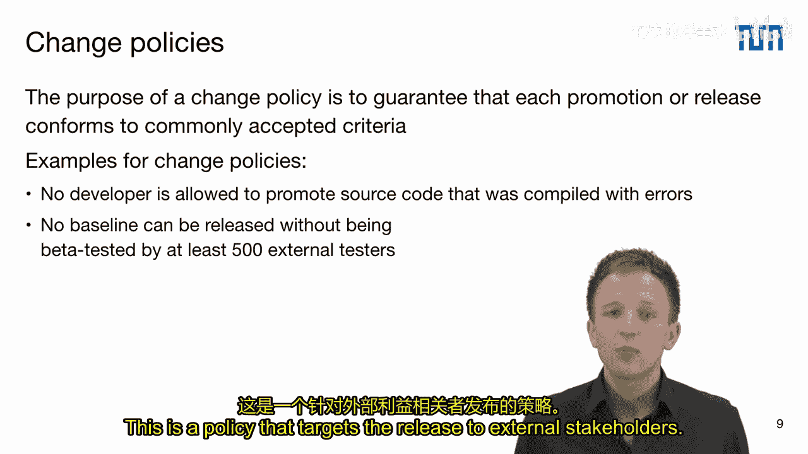

# 【全集】慕尼黑工业大学SEECx 软件工程基础 中英字幕 1080P p08 Lecture 2-2软件配置管理part2 -BV13sqGBLE64_p8-

Hello and welcome to the Uni Software Confiration Management2 of the course's So EngineeringEssentials。

 My name is Stefan and in this unit you will get to know the differences between internal promotions and external releases and you learn to describe a typical workflow for change requests。

We already talked about six different activities in software configuration management in the last unit。

In this unit， we cover the first， the second and the fourth activity。

Build and release management is covered in its own units later in the course。

So let's start with configuration item identification。

A configuration item is an aggregation of software， hardware。

 or both that is treated as a controlled item in the software project。

This means that we are able to change these items and create versions for them Ex are source code files。

 drivers for test cases， different documents that need to be created during the analysis or design phases of the project。

 for example， a user manual that might be under configuration。

You also want to know which system configuration was used in a release， for example。

 which compiler was used， which operating system was used。

 and which development environment was used。However。

 not every entity needs to be under control all the time。

 Configuration item identification deals with two issues。

 The first one is which elements should be selected for configuration management。That is。

 what should be under configuration control。Do you really want to store versions for everything that is created in the development process？

The second issue is when do you start with configuration control in the earlier days of software engineering。

 it was an activity and developers did it whenever they wanted to do it in the project or when it was necessary。

Nowadays， it is a project function， and developers and managers have to deal with it from the beginning to the end of the project。

 However， this does not necessarily mean that everything is under control in the beginning。

 You can also change what is under control during a project。

 but you should start in the beginning to select tools。

Techniques and workflows and think about what you want to control and what you don't need to control。

This is especially important in large projects where thousands of entities are created that must be uniquely identified and where a lot of different developers participate who do not know all details of what other developers are working on。

If you start with configuration items too early in the project。

 you might however introduce bureaucracy because if you have a document。

 it might not be necessary to control every single change of a word in this document。

If you start too late after the document was already finished。

 it might lead to confusion or even chaos because people cannot identify to which software version a certain document or a certain version of this document belongs。

The second activity that we want to talk about in this unit is promotion management。

A promotion is a version that is made available to other developers， for example。

 when a developer commits changes into a version controller system。

This is already a promotion because other developers can access the changes and can apply the changes to their own working copy。

In contrast， a release is a version that is made available to external story stakeholders。

 for example， users。Promotions can become releases。

 and this is where promotion management and release management are related to each other。

A release is， for example， a potentially shippable product increment at the end of a sprinted scrum that is shown to the product owner。

It denotes that a configuration item has met certain quality criteria that are usually defined by the quality control team and that can be used to review whether their release meets these quality requirements。

If you release software to beta testers for finding additional faults and assessing the perceived quality of the system。

 you might be able to discover and repair these faults。

 then you can create small revisions and include this into the official release that is finally shipped to end users。

Promotion management then defines workflows， activities and best practices when and how to create promotions。

 We will cover more about that in the unit distributed version control。

Let's quickly recap the concept that we learned so far and let's put them into an object model because as software engineers we communicate with models。

 and this is also a nice exercise for you to understand whether you know the terms and their relations in the right way。

We start with controlled item that can either be an aggregation of multiple controlled items or a single configuration item。

We used a composite design pattern to model that we can have multiple excgregations in arbitrary width or depth。

An aggregate can then aggregate other aggregates。 Think about folder structures that include other folders and files in an operating system。

Each control item can have a versioner， and a version can either be a release that be officially shipped to external stakeholders。

Or a promotional that is made available to other developers within the team。

Or a revision that usually handles bugs and small problems in the release。

If we put all these terms together， we have the object model and can communicate more easily as software。

 We skip the third activity build in release management because we cover it in a later unit。

Therefore， we continue with change management， the handling of change requests。

 Let's consider an exemplary change workflow。A change is required， for example。

 a user requested a change with feedback。We first need to identify which controlled items need to be changed to create a change request or short CR This can be very formal in a change request form with a lot of attributes。

 but it can also be very informal， for instance， in an email where a customer states that he wants to change a button in the user interface。

The change request is then evaluated against requirements， project constraints。

 and might be reviewed by certain team members， whether it is incomplete or whether it is complete so that we can investigate preliminary what kind of changes we need to accomplish。

A change manager or short CM， then reviews whether the team can actually implement these changes and whether the change request can be handled in one of the next development iterations。

There are two cases we can either re the change request and inform the requester that the change is not possible right now。

 the other option is that we approve the change and assign it to developers so that they design and implement and test the change。

After it is implemented， there should be an audit to control whether the changes follow the quality requirements that are defined。

If this is not the case， developers need to fix the problems that were found in the audit。

If the audit is O， a new baseline， a version that follows defined quality requirements is created。

 Remember， this baseline can only be changed through a change management procedure。

 such as the one that we have just seen in this slide。In order to control a change request。

 change policies are required。 The purpose is to guarantee that each promotion or release conforms to the commonly accepted criteria that are defined in the team。

Whenever a promotion or a release is performed， one or more policies apply。

 such as the following two examples In the first example。

 no developer is allowed to promote source code that was compiled with errors or warnings。

This is already a best practice for distributed version control as well。 In the second example。

 no baseline can be released without having been beat out testedest by at least 500 external testers。

 This is a policy that targets the release to external stakeholders。

In this unit， you learn to differentiate internal promotions and external releases We also covered configuration item identification and discussed an example for a typical change management workflow。

See you in the next unit。

