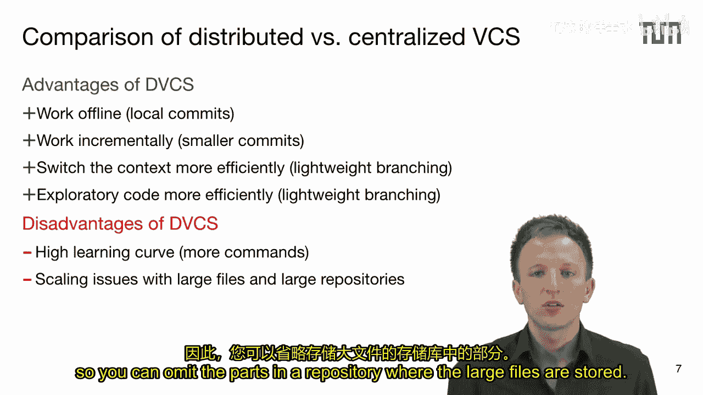

# 【全集】慕尼黑工业大学SEECx 软件工程基础 中英字幕 1080P p09 Lecture 2-3 版本控制系统 -BV13sqGBLE64_p9-

Hello and welcome to the Uni version Control System of the Cose Soft EngineerEssentials。

My name is Stefan and in this unit， you will learn different architectural styles for version control and we will compare centralized and distributed version control。

Version control systems or in short VS are part of promotion management in software configuration management because they allow developers to make their versions available to other developers。

In the history of version control， different approaches existed starting with local version control systems such as RCS or CVS that only stored versions on a local computer without any connection to other computers Later centralized version control tools allowed collaboration between developers。

 for example， subversion。Nowadays， distributed version control tools such as Git are mostly used。

 where developers can also send changes to each other without a remote repository。

Version control allows many developers to collaboratively work on configuration items in a given project。

 for example， source code and XML files。Developers create version by committing the changes of the files。

 and these versions are stored in a commit history so that developers can restore previous versions easily。

This also allows to see how configuration items changed over time and who actually changed a certain item。

 for example， a line of code in a class。Distributed version control。

 also known as decentralized version control provides more flexibility because developers can also work offline and it allows more features such as local branching and offline committee。

Let's start with the first architecture for aversion control， the monolithic architecture。

Programmers have a local version database that keeps all the changes to a file under revision control on the local computer。

They can check out files， change these files， and create new versions of the files。

 including these changes。There is no server computer included and developers would need to copy the files on external disks or USB sticks in order to exchange them。

An example for local version control of the monolithic architecture would be RCS。

The next architecture is the repository architecture。

 a single server contains all the versions and multiple programmers visualized here with computer A and computer B can check out files from the server to their local computer。

If they change these files， they commit their changes back into the central server that includes the version database this means that developers can only create versions if they are connected to the central VS server One advantage of this approach is that administrators have fine crane control over which developer can do what。

One problem is that there is a single point of failure。

 if the central version control server crashes， the developers might lose all the versions in their commit history。

Then it would not be possible anymore to restore older versions。

An example for centralized version control is subversional。

 which is still used in a lot of companies and projects nowadays。

Peer to peer architectures for version control solve the single point of failure problem of central version control。

Each developer computer fully mirrors the version database。

 which we call repository to their local computers。

This means that each developer can access all versions locally without a connection to the server computer。

 if the server dies and the developer still has a full copy of the repository。

 all versions can be copied back to the server computer。

This approach allows developers to work offline on their own versions and to create commits and branches locally they only need to synchronize the commits and branches with the server computer in case they want to promote their versions to other developers。

In addition， they could also bypass the server computer and send the changes for a new version directly to another developer。

An example for a peer2 P architecture and version control is the nowadays mostly used distributed version toolgit。

Let's quickly compare distributed and centralized version control。

The advantages of distributed version control are that developers can work offline and produce local commits without having a connection to the remote server。

 they only need to synchronize the commits in case they want to share them with their fellow developers。

Distributed version control usually leads to smaller commits because developers can work incrementally and commit their changes more often as the commits are faster。

Developers can switch the context more efficiently due to lightweight branching。

They can create branches locally。Then only the changes between branches are stored and not all files and folders of a branch are copied as it was in centralized version control。

This also leads to the advantage that developers can explore multiple versions of their code more efficiently when they create branches。

However， distributed version control also has disadvantages；

 the learning curve is higher because developers need to use more commands。

Developers also need to check out all files and all versions of a repository on their local computer。

 which can lead to scaling issues in large repositories and when large files are stored in the repository。

Centralized version control usually allows to check out parts of the repository， for example。

 only a certain folder， so you can omit the parts in the repository where the large files are stored。

In this unit about version control systems， youll learn to explain different architectural styles for version control and you saw the advantages and disadvantages of distributed version control so that you can compare it with centralized version control see you in the next unit。

