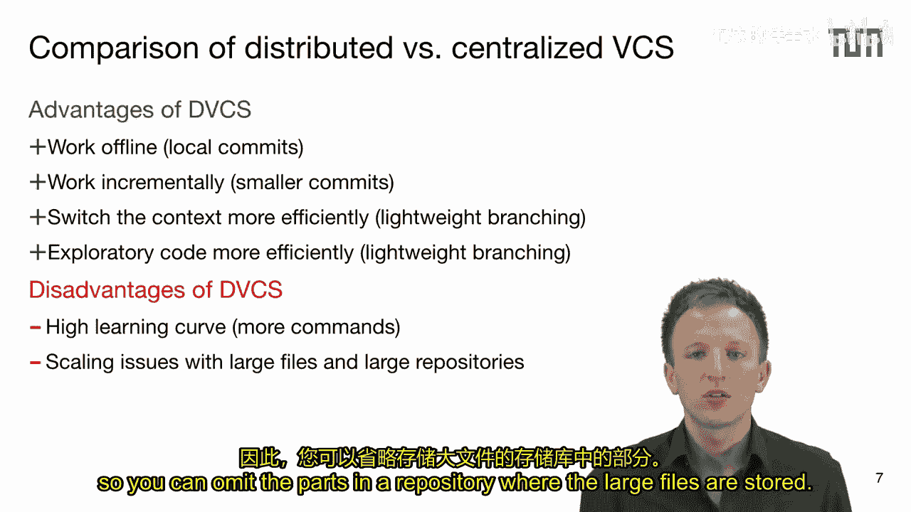

# 软件工程基础：2-3：版本控制系统 📚

在本节课中，我们将学习版本控制系统的不同架构风格，并比较集中式与分布式版本控制的优缺点。

版本控制系统，简称VCS，是软件配置管理中发布管理的一部分。它允许开发者将自己的版本提供给其他开发者使用。在版本控制的历史中，存在过多种方法，最初是如RCS或CVS这样的本地版本控制系统，它们只在本地计算机上存储版本，不与其他计算机连接。后来，集中式版本控制工具（例如Subversion）允许开发者之间进行协作。如今，主要使用分布式版本控制工具（如Git），开发者甚至可以在没有远程仓库的情况下相互发送变更。

版本控制允许多名开发者在一个给定项目中协作处理配置项，例如源代码和XML文件。开发者通过提交文件的更改来创建版本，这些版本存储在提交历史中，使得开发者可以轻松恢复之前的版本。这也能让我们看到配置项是如何随时间变化的，以及是谁实际更改了某个特定项，例如类中的一行代码。分布式版本控制，也称为去中心化版本控制，提供了更大的灵活性，因为开发者也可以离线工作，并且它允许更多功能，如本地分支和离线提交。

## 架构风格对比

上一节我们介绍了版本控制的基本概念，本节中我们来看看几种具体的架构风格。

### 单体架构

在单体架构中，程序员拥有一个本地版本数据库，该数据库在本地计算机上保存对受版本控制文件的所有更改。他们可以检出文件、修改这些文件，并创建包含这些更改的文件新版本。此架构不包含服务器计算机，开发者需要将文件复制到外部磁盘或U盘上才能进行交换。

以下是单体架构本地版本控制的一个例子：
*   **RCS**

### 仓库架构

仓库架构包含一个单一的服务器，该服务器保存所有版本。多名开发者（此处以计算机A和计算机B表示）可以从服务器检出文件到本地计算机。如果他们修改了这些文件，他们会将更改提交回包含版本数据库的中央服务器。这意味着开发者只有在连接到中央VCS服务器时才能创建版本。

此方法的一个优点是管理员可以精细地控制哪些开发者可以执行哪些操作。但存在一个问题是单点故障：如果中央版本控制服务器崩溃，开发者可能会丢失其提交历史中的所有版本，从而无法再恢复旧版本。

以下是集中式版本控制的一个例子：
*   **Subversion**（现今仍被许多公司和项目使用）

### 对等网络架构

版本控制的对等网络架构解决了集中式版本控制的单点故障问题。每台开发者计算机都完整地镜像版本数据库（我们称之为仓库）到其本地计算机。这意味着每个开发者无需连接到服务器计算机即可在本地访问所有版本。如果服务器宕机，而开发者仍拥有仓库的完整副本，则所有版本都可以被复制回服务器计算机。

此方法允许开发者离线处理自己的版本，并在本地创建提交和分支。他们只需要在希望将自己的版本推广给其他开发者时，将提交和分支与服务器计算机同步即可。此外，他们还可以绕过服务器计算机，直接将新版本的更改发送给另一位开发者。

以下是对等网络架构版本控制的一个例子：
*   **Git**（现今最常用的分布式版本控制工具）

## 集中式与分布式版本控制对比

了解了不同的架构后，我们来快速比较一下分布式和集中式版本控制。

分布式版本控制的优点如下：
*   开发者可以离线工作，并在没有连接到远程服务器的情况下进行本地提交。他们只需要在希望与同事共享提交时才需要同步。
*   分布式版本控制通常会产生更小的提交，因为开发者可以增量工作，并且由于提交速度更快，他们可以更频繁地提交更改。
*   由于轻量级分支，开发者可以更高效地切换上下文。他们可以在本地创建分支。然后只存储分支之间的差异，而不是像集中式版本控制那样复制分支的所有文件和文件夹。这也带来了一个优势，即开发者在创建分支时可以更高效地探索其代码的多个版本。

然而，分布式版本控制也有缺点：
*   学习曲线更高，因为开发者需要使用更多命令。
*   开发者需要在本地计算机上检出仓库的所有文件和所有版本，这可能导致大型仓库或仓库中存储大文件时的扩展性问题。

集中式版本控制通常允许检出仓库的部分内容，例如仅某个特定文件夹，因此可以省略仓库中存储大文件的部分。

## 总结

在本节课中，我们一起学习了版本控制系统的不同架构风格，并了解了分布式版本控制的优缺点，以便你能将其与集中式版本控制进行比较。