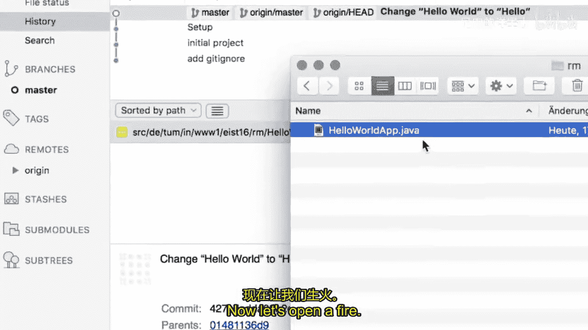
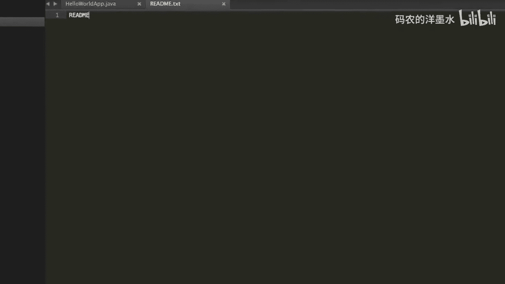
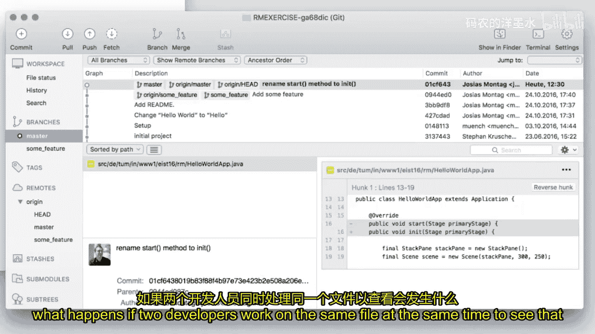
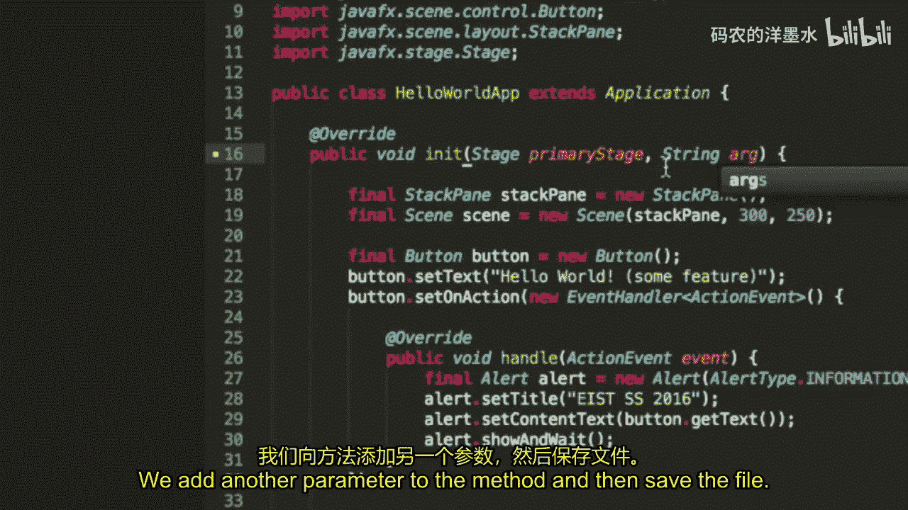
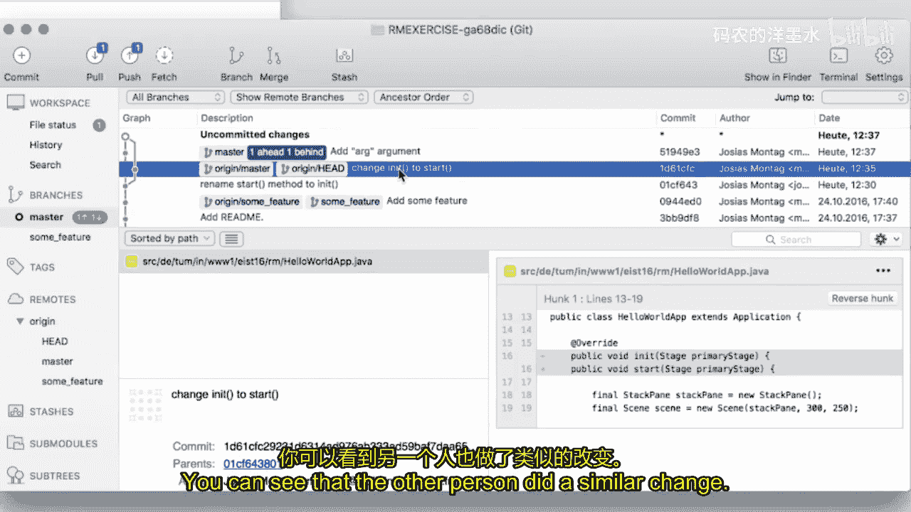
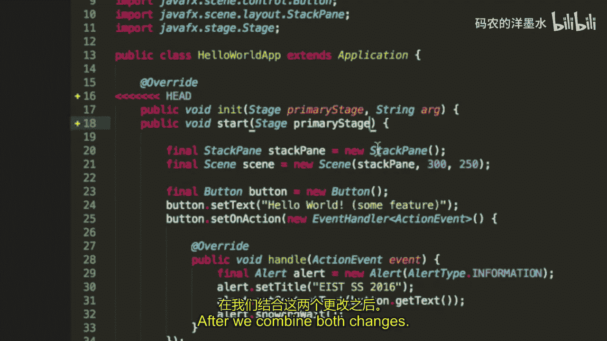
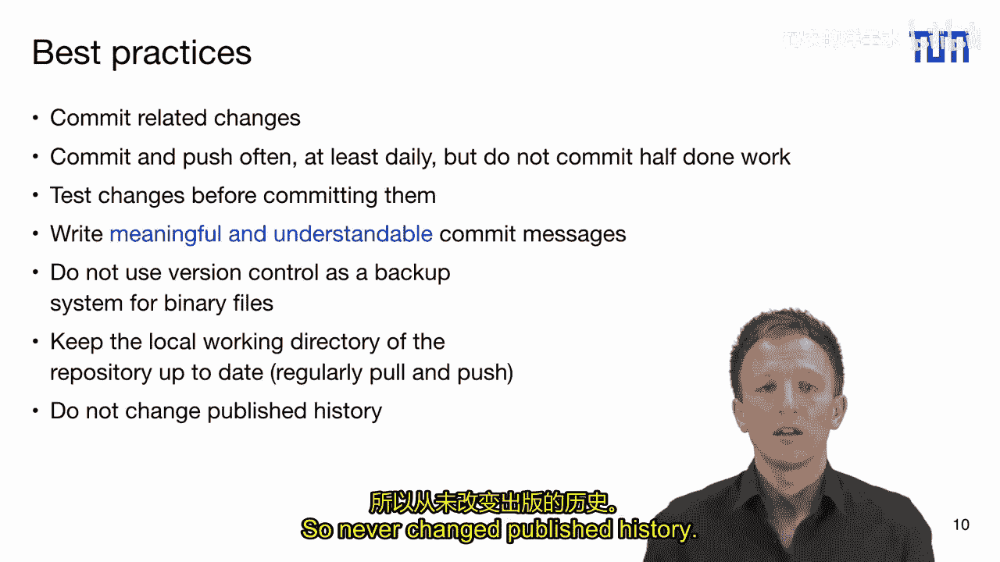

# 【全集】慕尼黑工业大学SEECx 软件工程基础 中英字幕 1080P p10 Lecture 2-4分布式版本控制 -BV13sqGBLE64_p10-

Hello and welcome to the unit Dised version control of the course softwareft EngineerEssentials My name is Stefan and in this unit you will learn to apply distributed version control in the tool source tree。

And you will understand different Git commands and best practices for distributed version control。

Let's see how distributed version control works， there is a remote repository。

While there can be multiple remote repositories， in most cases。

 there's only one developers have a local repository on their computer and interact the act with this local repository in order to obtain changes from the remote repository and in order to upload their changes to the remote repository。

Other developers connect also over their local repository to the remote repository so that they can exchange files and changes on these files。

 there might be even more developers who also join the team。In addition。

 most of the distributed version control repositories such as GitHub or BitBcket offer a web interface where developers can also access the files in the browser and even change some of the files in the browser。

Let's now look into the different commands of Git The first use case is that a developer wants to share his changes。

 the developer created new files in his working directory and wants to store them in the local repository so that other developers can then later access them。

To achieve that， the developer needs to commit the changes from the working directory to the local repository。

A git commit then contains all changes between the previous and the current version。

Before the developer can actually commit the files。

 he needs to select the changes in the working directory that he wants to commit。

Marking the changes is achieved by adding the files or parts of files to the staging area using the command GitE。

Where the developer now executes the command Git commit。

These changes are committed into the local repository。However。

 the files are not yet shared with other developers because they are still only available in his local repository。

To finally share the committed changes， the developer needs to push the changes stored in the commit to the remote repository this promotes the changes to all developers who have access to the repository。

After that， other developers can see these changes and download them to the local repository and Work directory。

In this slide， you can see an overview of the most important Git commands。😊。

Git@ selects the changes of the working directory and adds them to the staging area so that they are marked for a commit。

Didit commitmit creates a new versionner。And applies to selected changes in the staging area to the local repository。

 so we have one additional commit。DidPush now uploads all new local commits to the remote repository。

This only works if the remote repository does not contain newer commits。If this would be the case。

 the developer first needs to pull these new changes from the remote repository to the local repository。

Using Gi pull。G pull is a combined command。It first executes Git fetchtch。

 which downloads all new commits from the remote repository to the local repository。

And then it applies these changes in the new commits from the remote repository into the working directory using the command git mergech。

In the simplest case， the changes are just applied to the working directory directly。However。

 if there are conflicts， then the developer needs to choose which version of the changes should be used。

A conflict always occurs if two developers change the same line in a file independently。

You can avoid merge conflicts through good communication and a small amount of changes in your commits。

After the merge has succeeded， the local repository contains an additional merge commit。

The developers needs to push these changes to the remote repository so that other developers can access them。

When developers join a project， their first interaction with Git is that they clone the remote repository。

The command gi clone initializes a local repository。

And the working copy and is' also a combined command。

It first fetches all commits of a remote repository。😮，In order to create a new local repository。

After that， the command Git checkout， creates the working copy by adding all files and folders in their last version。

Now you can see in action how you execute these commands in sourcetry。

This is a short tutorial how to use Sotry。First， you clone the remote repository。

You click clone from URL。Paste the repository URL and optionally change the local path of the repository。

Then you can click on clone。In the main window， you can see the existing commit history of the repository。

You can now open and edit files in the working copy on your system。In the main window。

 you will find the Fpot。Fetch will download remote changes into your local repository。

 but will not merge them into your working copy。In this case。

 you can see that someone else committed changes into the remote posterory， called， Or。

 Master on Southtry。By clicking on the commit。You can see the changed files on the left side and the changes within one file on the right side in the unified diff short for differences。

Red lines with a minus in front were removed from the file。

 green lines with a plus were added to the file。In the commit history。

 you see that the local repository is one commit behind the remote repository。Using pool。

 you download the changes as a fetch。And then merge them into the working copy。

This means that changes in the remote repository are synchronized with our local repository and with our working copy。

Now let's open a fire。

And create some changes。We save them， and we also want to create a new file。

If you switch back to S Street， you can see S Street detected uncommitted changes。

On the file status tab。You can see the changed Java file and then newly created readme。 TxT。

By clicking the checkbox in front。The file staged， staged files are changes which are marked for being committed into the local repository。

You can stage single changes in the file or all changes in the file。

Now we want to commit these changes to share them with our developers。Therefore。

 we have to enter commit message。The commit message should always be meaningful and describe the changes as comprehensively as possible so that other developers immediately know what has changed。

If we switch now to the commit history tab， you can see that our local repository is one commit ahead of the remote。

Using pushush， we can now upload our commit to the remote repository。After that。

 you can see in the commit history that the remote and the local repository are synchronized。

You might ask yourself what happens if two developers work on the same file at the same time。

 to see that we open the Java file to change the init method。

We add another parameter to the method and then save the file。

We staged the change and committed with a meaningful commit message。嗯。With the checkbox below。

 we can directly push the commit into the remote repository。Now we get an error message。

 Our commit was rejected because the remote repository contains an additional commit。

And we did not pull yet， which means another developer pushed into the remote repository while we were implementing our changes。

It cannot handle two commits at the same time in a remote repository。Therefore。

 it rejects a second one。To fix the problem， we first have to pull the remote commits of the other developer。

 which automatically merges them into our local working copy。If there are no conflicts。

 you do not need to manually merge。In this case， however， the automatic merge did not work。

 and we get an error message。This means we have to merge manually。

We can look into the commit to see which changes actually caused the conflict。

 you can see that the other person did a similar change。

 he renamed the same method that we change our commit if you open the Java file again we see the conflict our changes are these ones。

We added the new argument to the method， the changes by the other persons are below。

Now it's our job to merge the conflict manually and to combine both changes。

After we combine both changes。

You can save the file， can proceed with the merge commit in Saltry。

And can finally push to the remote。And that's it。We have now covered the most important functionality of the So street grid client。

And we have successfully solved the merge conflict。

After you have seen how you interact with Git in action using the tool sourcetry。

 let's now define some best practices for the interaction with distributed version control tools。

First of all， developers should commit related changes so that other developers can easily recognize what has been changed。

Related changes means that developers do not produce a large commit with all changes in their working directory。

 they rather should create multiple small commits that can be reverted in case this might be necessary。

For example， all changes in one class can be combined into a one commit or changes to one specific functional requirement can be combined into one commit。

Developers can have as many commits in their local repository as they want。

 and they can then push all these small commits at the same time to the remote repository。

Developers should commit and push their changes often so that other developers can immediately work with these changes and apply them。

This avoids complex merge conflicts in case multiple developers work on the same files。However。

 developers should not commit half done work。This means they should test whether their local changes compile and whether all test cases pass。

 otherwise their fellow developers will have severe problems because they might not understand the changes and they might not be able to fix compile and test errors。

In the first case， other developers can work anymore if the compilation is broken。

It is very important to write meaningful and understandable commit messages because this is what other developers see first if they want to apply the committed changes to their working copy。

If they don't recognize immediately in the commit message what actually has been changed。

 they need to go through all the changes in order to understand what was changed and how this might impact their work This might be cumbersome。

 take a lot of time and lead to  errorss。Do not use version control essay backup system for binary files。

 rather use dependency management systems such as maven or graadle。

 because binary files produce a lot of changes in terms of storage。

 and you cannot compare multiple versions of these binary files。

Keep the local copy of a repository up to date。That means regularly pull changes of other developers and also regularly push changes so that other developers can keep their local repository up to date。

Finally， distributed version control tools tools such as Git might allow you to rewrite the published history in the remote repository。

 but you should really never do that because this will definitely lead to severe merge conflicts if other developers have already applied these changes in their local repository。

 so never change published history。

To summarize this unit， you'll learn how to interact with Git in Stry and you have seen the most important Git commands。

We also explain best practices how to interact with distributed version control。

See you in the next unit。

