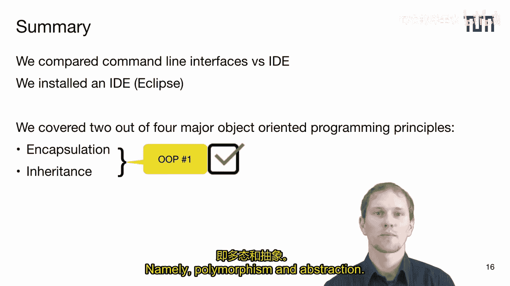

# 【全集】慕尼黑工业大学SEECx 软件工程基础 中英字幕 1080P p11 Lecture 3-1面向对象编程基础part1 -BV13sqGBLE64_p11-

Hello and welcome to the unit Basics of Ob Oriented programming one of the Co soft engineeringEssentials My name is Jan and in this unit we will explain you how to install and run the Eclipse ID also we will dive into two out of four object oriented programming principles in this unit by using the Java programming language and finally we will show you how to apply those principles so what about our assumptions about your existing knowledge。

We assume that you have experience with at least one imperative programming language， for example。

 Java C++ C Pascal or C， and also you should be able to adapt this syntax to the Java syntax。

 So let's start with the question， why do we need an integrated development environment？

If you ever tried to compile a project spanning multiple source files in different folders or packages。

 and you did that task manually， you most likely know how hard it is to deal with a class pass issues which may occur or also making sure that all the dependencies are used during compile time。

 Also using an editor without synt highlighting compile and error detection or outer completion just prohibits you from developing fast and efficient。

There are many more reasons why an integrated development environment is a good idea just to name a view。

 detecting errors easier during development， team goal operation is made more easy and also refactoring and structuring your code is easier。

So let's have a look at our explanation video， which explains you how to install the Eclipse IDdeE。

This is a short tutorial and how to use eclipse and start your first Java project。

Eclipse is an IDE short for integrated development environment。

 which is widely used for Java projects。To get eclipse， go to eclipse。

org and download the latest install up for your platform。The first time you launch eclipse。

 you're prompted to set up a workspace。Workspace is a place where all your projects are stored。

When you start eclipse， the first thing you'll see is the welcome screen。

You can use importmport existing projects to import an existing Java project into your workspace。

This is the recommended way to open the programming exercises of this course。For now。

 we want to create a new Java project。You can choose a name and you will see that Eclipse automatically creates a project folder in our Workspace folder。

Eclipse initializes our project and creates a folder for the source files。

As we did not create any classes yet， the folder is empty。Before we create a class。

 we want to create a package， therefore use the package icon in the toolbar。

Java packages are namespaces that organize a set of related classes and interfaces。

For a programming exercise， you can choose any name you like。

 Eclipse will create a package folder in our source directory。Now let's create a first class。

 therefore we use the class icon in the toolbar。Weant to create a class called student and want the class to be public。

 so relieve all modifiers as they are。You can see that Eclipse created a student。

 Java file for us and initialized an MP class。Next。

 let's add attributes to the class that represent the name of the student。

And add a method that prints out the basic information about the student。Each time you type a dot。

 eclipse is suggesting possible ways to autocomplete the statement。To choose one。

 you can simply press enter。These suggestions are useful to find methods you don't know the exact name for。

If eclipse detects impossible compile error， it will warn you and underline the statement and display a red X next to the line where the error occurs。

You can hover over it to get some more details about the problem In this case。

 it's a simple syntax error we just need to add a same McCllln to fix the problem。

The student class doesn't have any constructors at the moment。Of course， we could write one manually。

 but eclips can help us and can generate certain code parts for us。

Click the menu item source and generate Conor using fields。In the window。

 we select the attributes to be initialized with the constructor and eclipse generates the constructor automatically for us。

Java projects need to have a main method to be executable。 Therefore。

 let's create a class that incorporates a main method and call it app in the dialog。

 you can see the option to automatically generate an empty main method。In our main method。

 we want to create a new instance of student assign the name。

 and we want to execute the print out info method。The first version of our project should be finished by now。

 and we need to test if everything works as expected。To run the code。

 we need to press the green Play button。But， unfortunately。We will get an error in the console。

The reason is that Java doesn't know which class the main method is located in。To configure this。

 we use the smallarrow besides the Run button and click on run configurations。

Eclipse automatically generates a new configuration for us。

The only thing we need to do is to select our main class， in our case， it's called app。

Now let's run the code again and the little project behaves as expected。In this explanation video。

 learn the basics how to use eclipse and execute your first project。

So why do we need object oriented programming。By now。

 you should have installed the Eclipse I D successfully and run your first application， Hello world。

😊，In the upcoming minutes， we would like to focus on the reason why we need object oriented programming。

But first， we would like to start with some background information about an important principle which also holds for software development。

 The principle of divide and conquer。 It can be found as a political instrument。

 but also as an instrument of strategics in war。 So Su described the principle by basically saying。

 if an enemy army is twice as the size of yours， you should be able to divide this army to have a chance in combat。

 So how do we apply this to software engineering。 in software engineering。

 we decompose our system to be built in smaller subsystems。

 So they can be realized actually by an individual developers or teams。

The object oriented programming paradigm helps us to divide and conquer our system to be built by using four major principles。

 namely encapsulation， inheritance， which will be covered in this unit。

 as well as polymermorph friin and extraction， which will be covered in the next unit。

So let's start to focus on encapsulation inheritance in this unit before coming to polymorphism instruction and OP2。

And capsulation means。That we are able to group a certain structure and functionality of our software to be developed into single elements。

 Those elements are called classes。😊，Java supports encapsulation by using classes including attributes for its structure and methods for its functionality。

Let's have a look at some classes and code examples。So here we have the class student。

 which holds the attributes， major subject， minor subject。

 and the course list for structuring the student。We also have methods like Jo course or tro course。

Which describes his functionality。As one can say that objects are concrete instances of classes。

 therefore classes can be seen as a blueprint for creating objects with specific initialized attributes。

To create these concrete instances， Java uses a so calledled constructor method。

The constructor is a special method which does not has a return type。

And carries the name of the class。Let's say we have a student class and we would like to create a concrete student instance or student instances。

 namely Dave and Matt。First， we create the constructor method， remember。

 the constructor method does not have a return type， and it contains the name of the class。

So the constructor looks like the following。There's no return type。

And the name of the constructor is called student。It takes the argument's major subject and minor subject to initialize the values of those two attributes。

It also creates an empty list of courses for the student instance。By default。

Each created class has also called default constructor， which is implicit。

Yet it typically does not do what you expect it to do， why？

Because it's not initializing any concrete values of your attributes。

 you need to specify your own defined custom construct to initialize all the needed attributes。

To set them properly， as seen in the slide before。So we learned about encapsulation and the construct method which helps us to initialize objects from classes。

Let's have a look into the next principle for today， which is called inheritance。

Inheritance allows us to reuse attributes and functionality of existing classes by denoting the class as a superclass of another class。

Let's have a look at such a super class to class hierarchy。Let's get some realor examples on that。

Each car is a vehicle。And each motorbike is also a vehicle。

So both car and motorbike can be seen as child classes。

 whereas the vehicle class can be seen as super class to both of them。喂。

Because they all share the same structural information， for example， wheels。

They also share the same functionality， for example， to move or start the engine。

But both can have additional attributes or functionality with a super class。

 we try to find a common denominator of child classes to reuse as much code as we can。

 but we are not limited to those elements。So how does it work in Java？

Java supports inheritance by creating an inheritance hierarchy of super classes and child classes。

In Java， there is only one superclass allowed per child class。

We use the keyword extends to establish such a hierarchy。

 Let's have a look at the according Ul diagrams， in their specific Java code。

This UML diagram denotes an inheritance relationship as an empty triangle on the association。

Where asked the class the triangle points to is a superclass。

And the class that association starts from is subclass。In Java code， this looks like the following。

First， we define the superclass with all of its attributes and methods。

Then we define the subclass with additional attributes and functionality， if need be。Finally。

 we link those classes using the X keyword。To reuse attributes of a superclass。

 we have to delegate the initialization of existing attributes from the subclass up to the superclass constructor。

We use a superconor， call， and pass values from the subclass to the superclass。So first。

 we create the person class。Which is our super class。And then we create a student class。

 which is our subclass。Remember using the keyword extends to build a class hierarchy。Now。

 when we call the student constructor。We're going to pass the values to the Per constructor。And here。

 your values are set。Afterwards， we are going to set additional values inside the personal instance。

So subclasses can access non private attributes and methods of a respective superclass。

If subclasses do not declare a method， the Java compiler tries to look for this method inside the superclass hierarchy。

 let's have a look again at our person in certain example。

 we declare a student as well as a person instance。

 accessing the first name is possible for the student as well as for the person instance。

 hence the student is reusing the first name attribute from a superclass person。

Accessing the print personal information method is also possible for the student as well as for the person class。

Hence， the student is also reusing the print personal information method from a superclass person。

In the unit object oriented programming too， we are going to cover in more detail how this mechanism exactly works by introducing a new term called method signatures。

 so stay tuned。There's one last thing about object oriented promag principle inheritance。

Be aware that inheritance relationship only holds in one direction。 What does that mean。

In our example， every student is a person。But not every person has to be a student。

This implies that this is only possible to make assignments from a more precise or specialized type。

 namely the subclass。To a more generic type， it's superclass。So in this unit。

 we compared to command line interfaces versus an integrated development environment。

You learned how to install eclipse and start your first project。

 and also you learn to apply the object oriented programming paradigms and capsulation and inheritance。

In the next unit， we are going to cover another two important principles of the object oriented programming。

Namely polymorphism and abstraction。

So that's it for the basics of object oriental programming1。

Thanks for watching and see you next time。Yeah。

