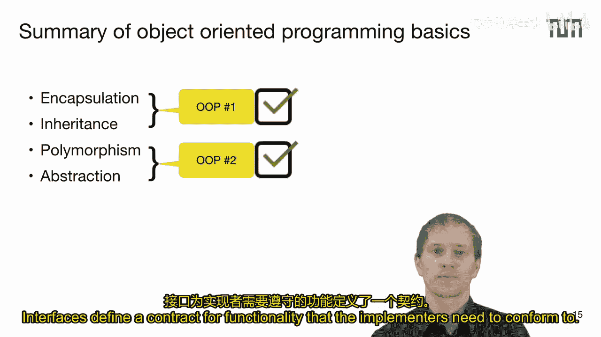

# 【全集】慕尼黑工业大学SEECx 软件工程基础 中英字幕 1080P p12 Lecture 3-2面向对象编程基础part2 -BV13sqGBLE64_p12-

Yeah。

Hello and welcome to the unit basicsic of Ob Oriented programming2 of the course Soft EngineeringEssentials。

 My name is Jan， and in this unit you will learn more about the two last missing object oriented programming principles of the course。

 namely polymorphism and abstraction， and you also will learn to apply those principles。

So our assumption is you have already watched OP1， Let's recap O 1 in 30 seconds。

You learn about encapsulation， which allows you to define classes。

Which gives the code structure by using attributes and functionality by using methods。

 and also allows you to instantate objects based on the classes。

Inheritance allows you to reuse existing objects and existing structure and functionality by implementing an inheritance hierarchy between so called superclasses and subclasses。

In this unit， we will focus on polymorphism， which builds on top of inheritance and abstraction。

So we learned in OP1 about encapsulation and inheritance。

 and now we're going to focus on polymorphism and abstraction。Let's start with polymermorphism。

In this unit， we want to cover a new concept， a set， which is called polymorphism。First。

 we wanted to know what polymorphism is。Basically， it extends inheritance and is not only reusing or accessing attributes and methods from superclass。

 but it also allows you to modify the functionality by overriding methods and procedures of a superclass。

What overwrite means， we'll come in the next slide to it。

But before actually applying polymermorphism， theres one more important concept you have to understand。

 This concept is called signatures or method signatures。So why do we need method signatures。

 A signature uniquely indeed  identifies a method and therefore makes sure the compiler knows which method to call。

A method signature in Java is based on a method name。And itss parameters， and their type order。

Let's examine some of the examples with different method arguments。

So we have the print personal information which doesn't take any input parameters。

Then we have print personal information， which takes one input per meter， which is a string。

Then we have to print personal information， which takes two parameters。

 one integer age and one string name。And last but not least。

 we have to print personal information which takes a string name first and then integer H。

So all these method signatures actually go in the direction which is called overloading， right。

 so basically we have the same name but using different input parameters。Also。

 it's not allowed to use the same name and the same input parameters in the same class。Why。

 because the constructor has uniquely to identify which method to call。

So we learned that it's not possible to actually redefine the same method signature consisting of a method name at parameters inside one class。

However。It is actually possible to redefine the same method signature in different classes or even in a class hierarchy。

This concept is called polymorphism and is an extension towards inheritance。

 So let's have a look at an example。In order to start the development of our app first。

 we create the base class person。A person has a first name or last name and a birthday as attributes。

 we can invoke the method and info a person to print personal information。Concerning people。

 we distinguish between lecturer and student。Vectra and student have the same attributes as a person。

Additionally， a student is in a certain semester。Now we do not want to write the same code three times。

 so will lecturer and student inherit from the person class。

 that means that both classes have the same attributes as their super class Also we can invoke the print method on both subclasses。

However， if we print our students information， we would also want to know their current semester。

That is why we override the print info method from person in the student subclass。

 If we then call the print info method on a specific student object。

 we get more specific information than if we do the same thing for lecture object。

 This concept is called polymorphism。Let's take a look at what that means in more detail。

If you trigger the print info method on a lecture object。

 the compiler starts to look for the bright methoded signature in the bottommost class， in this case。

 the lecturer。As the lecture class does not have a print info method。

 the compiler moves up one step in a class hierarchy。The person class does have a print in method。

 which is stand triggered。 This concept is called inheritance。

If we trigger different print info method on a specific student object。

 we find it right at the bottom of theque tree in the student class。 This is called polymorphism。

 It extends the concept of inheritance。 polylymorphism allows you to interpret the same word or symbol correctly in different situations based on a context。

 In this case， a student。But what happens if you try to invoke a nonexent method on a student？

During compile time， the compiler searches for the method signature first in the student class。

As this method does not exist there， it goes up one step in a class hierarchy。

Person also does not have a method study， so we get a compiler error。Here in the person class。

 we have to print personal information with no parameters。Also。

 we have the student class with a print personal information method also with no parameters。

That basically means we're going to override the functionality in the person class inside of the student class。

So let's compare again the concept of inheritance with the concept of polymermorphism to highlight how this extension could look like。

When using inheritance， we reuse the existing behavior of the person class inside of the student lectureate class。

When we call the method print personal information In the student or lecturer。

 the actual implementation inside the person class is executed。

Due to the lack of implementation inside of the SEEP classes。Therefore， we reuse existing behavior。

For polymerphy that， we overwrite the print personal information method inside the student and lecturer class。

So this time when we call the print personal information inside the student or lectureate class。

The actual implementation inside the subclasses of either student or lecturer is called。Therefore。

 we modify the existing behavior of the person class。

Let's have a look on polymorphism inside of code。In Java code。

 we use the keyword extends to establish an inheritance hierarchy。 Well， there's nothing new here。

But this time we overwrite the function given in the superclass person inside the student class。

How do we do it？Well， we just implement the same method with the same name and the same parameters inside of the student class。

In addition， we can add an optional compiler information which declares that we really want to overwride the signature from the superclass person。

Let's talk a little bit more about aesthetic static anddynamic types。

To use implemented attributes and overwritten methods of our superclass person。

 we simply can access its values and function as follows。

So how do we actually access the algorithmrithm methods Well， actually。

 theres exact same way that we would be inherited。This time， however。

 we can distinguish between the static type and the dynamic type of an instance。

The static type was a type defined during compile time。

Whereas the dynamic type can change during runtime。In this case。

 we have a person as a static type for both the variable student and lecturer。

The dynamic type is student for the student instance and the lecturer for the lecture instance。

So what happens？The compiler tries to execute a method first in the dynamic type of a class。

And if it can't fight its method signature， it does a fallback to the superclass。

If it can't even find a signature in the superclass， a compelt error is presented。

Let's start with our last object oriented programming principle for this unit。

 which is called abstraction。In abstraction， we define abstract structures withhold common states。

 attributes or behavior， which can be reused in concrete instances of the abstract definition。

Let's have a look at the real world example。A real world example would be the class shape which holds general purpose information about many different geometric shapes。

However， a shape itself does not really exist， or in other words。

 a shape is always a specific representation of either a triangle， a recangle。

 or any other concrete form we know。So abstract classes in Java can be even more restrictive and forcing actually that we're just using subclasses and not in superclass。

 which are defined。Then we call these super classes abstract。

So how we define such an Etch glass in Java？Well， in Java。

 we are going to use the keyword abstract to create an abstract class。Furthermore。

 we can even specify abstract methods。When defining abstract methods。

 we even forced subclasses to overwride the method definition。In other words。

 you could say we forced polymorphism to the subclasses。

If you look carefully at the definition of the abstract method， print personal information。

 you can see that the method is not actually implemented and does not contain any curly brackets or just a semiic colonlon。

This is an abstract method that can be seen as a contract。It only defines the method signature。

 but not its functionality。A method that only declared， but it's not implemented。

Let's have another look at an example。The following sample shows an inheritance hierarchy with an abstract superclass person。

Even if the person class cannot be instantiated， a superconstructor call from student and lecturer towards person is possible。

When showing a UML class diagram， a class can be noted as abstract by using an its font。Also。

 it is possible to still use the superconstructor to set attributes in the abstract superclass。

However， it is not possible to instantiate that abstract superclass anymore。

Only concrete subtypes are available for insiation。

Theres also another concept of using abstraction in Java。In addition to abstract classes。

The principle of abstraction also allows to specify interfaces。

Interfaceith specifies an agreement what has to be implemented。

 but not define how it has to be implemented。Similar to abstract methods。

 interfaces define a method step。Yet the functionality has to be implemented by the implementers of the given interfaces。

In UML， the interface stereotype denotes that we're talking about an interface and not a normal or abstract class anymore。

Also， the implementation agreement in the scenario。

 the methodthod updatedate course list has to be followed inside of student and the lecturer class。

So how do we define an interface in Java。There are two new syntax keywords we need to work with interfaces。

 the keywords interface and implement。First， we define the interface using the new keyword interface。

 which replaces the usual class keyword。Second， we define method steps to describe the functionality that has to be implemented for all instances using the interface。

Third， we specify that we want to implement the interface by adding the new keyword implements。

 plus the name of the recording interface we want to implement。Fourth and finally。

 we have to overwride the given method in this case。

 update course list in all instances using the interface。

Let's summarize voice what has been covered in this unit。First。

 we talked about encapsulation and inheritance and O P1。And second。

 we talked about polymorphsism and extraction， where polymorphsm allows overriding methods using the same signature from superclass in its subclasses to modify actually existing functionality。

And if a superclass method is not overwritten， inheritance is used。

So polymorphism can be seen as an extension towards inheritance。Last but not least。

 we learn about abstraction。Abstract class definitions allow abstract specification of classes to achieve generalization。

The initialization of those abstraction is not allowed， and therefore subclasses are needed。

 interfaces define a contract for functionality that the implementers need to conform to。

So that's for the unit basics of object oriented programming too。

 Thanks for watching and see you next time。😊。

