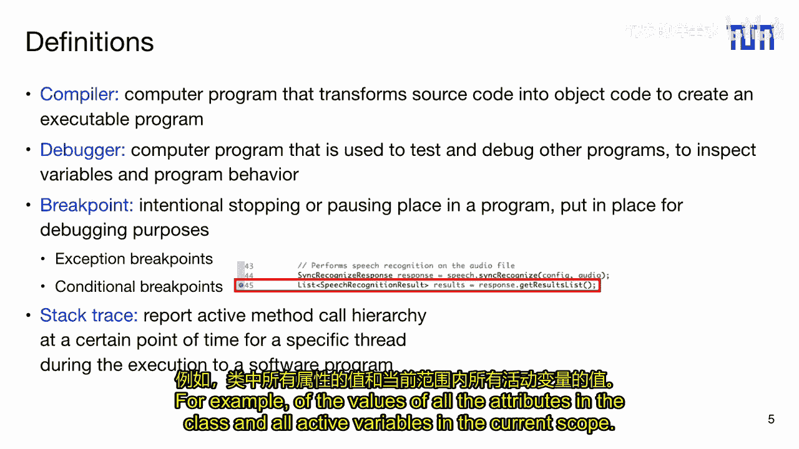
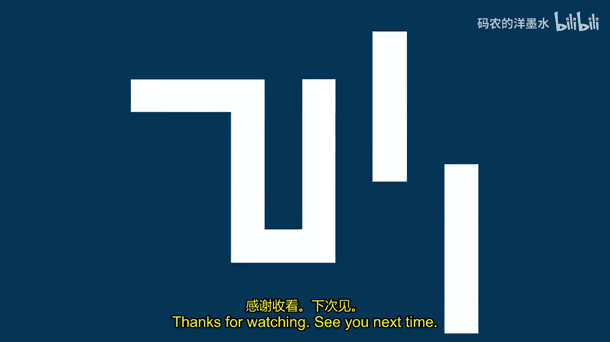

# 【全集】慕尼黑工业大学SEECx 软件工程基础 中英字幕 1080P p13 Lecture 3-3调试 -BV13sqGBLE64_p13-

Yeah。

Hello and welcome to the Unitybugging of the course Soft EngineeringEssentials， My name is Jan。

 and in this unit you will learn what is meant by debugging。After this unit。

 you will be able to debug your source code and eclipse and know why it is important。

Debugging is a technique to find problems and unexpected behaviors of programs in source groups。

The terms buck or debugging a popular attribute to Grace Hopper in the 1940s while she was working on a Mark2 computer at the Harvard University。

 her associates discovered the monthth， stuck in relay and herby impeding proper operation。

In the early days， debugging was a cumbersome process nowadays however。

 with interactive debugging tools integrated onto IDEs such as Eclipse。

 debugging became easier and software usage and execution of test cases can be monitored and traced。

Let's have a look at our explanation videos highlighting how to use debugging environment inside eclipse。

We will now have a look at thelipse debug interface to do so。

 we will use a few functions from the OOP exercise。We start by creating a random date list。

 start with the merge algorithm and print to the console。As usual。

 we click the Run button in ac clipse to execute it。But when we do so， a parse exception is thrown。

 which you can see in the console。The message that got printed is called the call stack。

It shows you which method invoked the exception that was flown。

 we see that the main initial entry point was line 90 at the main methods。

 so we set the breakpoint there。In order to trade， we run the code in debug mode by clicking on the end icon and confirming we want to switch the perspective。

In this window， you can see the user code。Outline and console at the bottom part。

 but also the debu controls on the upper part on the left side， you can see all active threats。

 you can extend them to see their respective call stack。On the right。

 you can see all variables and their values which are active in the current coco。

You can also view all the breakpoints configured in the code by selecting the main thread。

We can now step through the code。For that we have the buttons on the top， resume。

 continues the execution of the code， possibly until the next breakpoint， terminate。

 closes the complete execution。Step into， steps into the function at the active green line while step over executes the function without going inside of it。

Step out， steps out of the current function。We continue by stepping into the create random date list function。

We can now step over a few lines and see how the variables being updated on the right。

After iniating the date format object， we noticed the  error。

The date form an object was instantiateated with a dot。When we parse the lowest state object。

 it is foed with backlashes， which is why the parse exception gets thrown。

We can now simply fix the error and save the code， this is called a hot replace and eclipse will automatically step out of the function to reseted state。

 we can nonetheless continue debugging and step into the function again。

Notice that we can now step over the line that was following the exception。

In order to illustrate the difference， we will leave the error in the next line。

You can now see how the power exception gets thrown at the simple day format class。

We terminate the execution， switch back to the normal Java interface， fix the code， and run it again。

You can now see how the dates get printed in sorted order to the console。

Let's come back to the definitions we already learned in the explanation video。A compiler。

 which is a computer program or a set of programs that transform source code written in one programming language。

 usually the source language。Into another computer language， the target language。

Which the letter often has a binary form or is known as object code。

The most common reason for converting source code is to create an executable program。

Then we have to debugger， the debugg is a computer program that is used to test and debug other programs。

 so the target program。Debugggers offer a more sophisticated function。

 such as running a program step by step。Stopping at some event。

Or specified instruction by the means of a break point and tracking the values of each of the variables。

Some debuggs have the ability to modify even a program state while it's running。

It may be also possible to continue execution at a different location in the program to bypass a crash or logical error。

The bugggger introduced additional latency and memory consumption， of course。

 thus decrease the performance of the system。So it might not be suitable to detect problems in performance critical systems。

Then we have to breakpoint。A breakpoint is an intentional stopping or pause in place in the program。

Put in place for debugging purposes。There are two different types of break pointss。

 exception break pointss， and conditional breakpoints。In practice。

 a breakpoint consists of one or more conditions that determine when a program's execution should be interrupted。

And last but not least， there's a stack trace。This dictates is a report of an active method called hierarchy at a certain point of time for a specific threat。

During the execution of a software program。Each method keeps record of its state。For example。

 of the values of all the attributes in the class and all active variablesials in the current scope。

So in this unit， we have introduced the term debugging and bug。

 showed you how to use eclipse IDide E debugging the environment。

 and also introduce definitions for the most important concepts of testing。Thanks for watching。

 See you next time。

