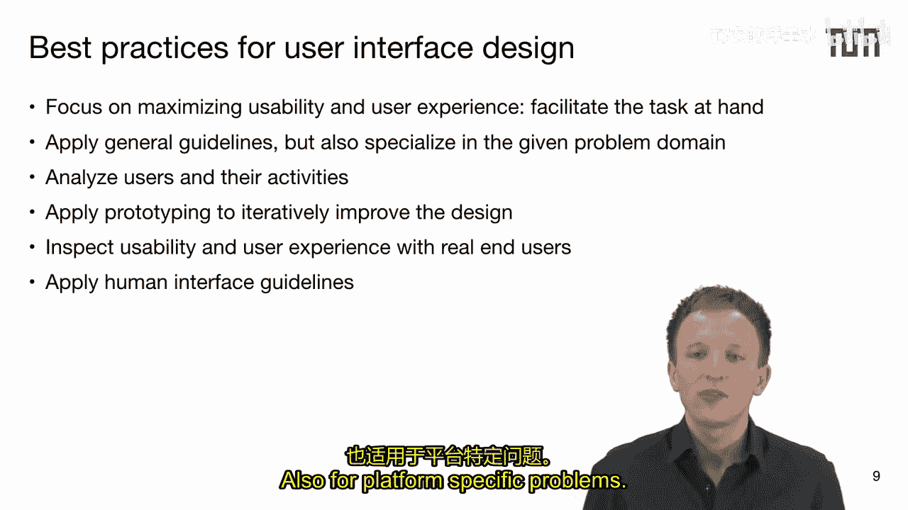
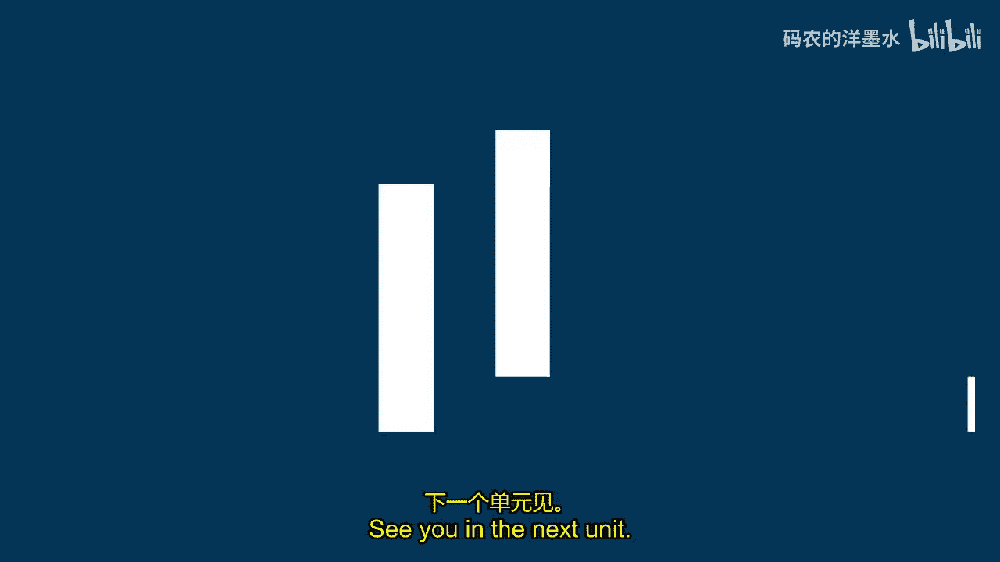

# 【全集】慕尼黑工业大学SEECx 软件工程基础 中英字幕 1080P p14 Lecture 3-4用户界面设计 -BV13sqGBLE64_p14-

Yeah。

🎼，🎼Yeah。Hello and welcome to the Uni Use interfaceface Design of the course Soft EngineeringEssentials。

My name is Stean and in this unit， you will learn the concept of boundary objects。

 design simple user interfaces in Java FX， and after the unit you will be able to explain best practices for user interface design。

Let's start with a motivation why user interface design is important。

You can see an example of a completely clatuttered user interface in a car here。

Would you be able to drive then。So the interface design is quite hard。

 and this problem is relevant for any systems where software controls hardware。

The development consumes a significant portion of the resources。

Surveys actually found that user interface code accounted for about half of the time put towards design。

 implementation and maintenance。 It constitutes about half the code of the whole system。

Developing complex software that is still usable is a hard problem and can only be solved by using different techniques and practices。

 and it's not a solution if the user uses 10 different systems because he wants to have specific features from all of these systems。

 so we really have to develop one system that fits to his needs。It sounds paradoxical。

 but to get a user interface right， failures are helpful。Design is an iterative approach。

 and Henry Provvsky that you can see in this slide found that better information comes from designs that fail rather than from those that succeed。

The reason is that failures such as a collapsing bridge。

 lead to investigations that analyze the problems。And find better alternative approaches without such failures。

 satisfaction sets in and designers do not innovate any more。

There's a famous quote Pi Perovsky that successuc in engineering is defined by its failures。

 so only if you learn from your failures， you can be successful in the future。

This culture is important in software engineering in general。

 and in user interface design in particular， the term successful failure describes this idea。

Prototyping is a technique to identify failures in the user interface designed early in the software project。

Prototypes are influenced by the requirements of the system and can be evaluated with users to find the most suitableable representation of the user interface。

While the requirements lead to the software system。

 the prototype can be used as basis for the user interface。

That hides the complex details of the software system to the user。

And that makes the software usable and that provides a nice user experience。

To get the usability and the user experience， right？

We have to consider the concept of boundary objects which represent the interactions between users and system and are part of the user interface。

Examples are labels， buttons， tables， and lists which are laid out in view hierarchies using different layout constraints。

Standard libraries and frameworks provide a rich variety of standard controls such as the button that you can see here。

So there is no need to implement APPA。Developers can reuse the existing implementation of boundary objects and configure their attributes and their behavior。

After， for example， instantiating a button， a developer can change its size， color， shadow。

 and other attributes。He can also manipulate the behavior by implementing so called actions or also called callbacks。

Then in this case， the main threat loop waits until the user actually clicks the button on the hardware and invokes the click method on the button object。

The button forwardboards this call to the handle button click method in the view controller of our application。

 which can then react to the click and trigger a specific functionality of the software。

This is a nice example to understand the behavior of frameworks， they allow customization。

 but then they call the application when certain actions are required such as reacting to a button。

Chava FX is a standard library extension for Java with a variety of rich UI controls。

It is integrated into Javava 8 and consists of a scene builder application。This application。

 which can be integrated into eclipse and Nebes， allows to create a user interface using drag and drop。

And generates a socalled Fxml document that describes the interface using an object oriented model comparable to a class diagram in the background。

 so you describe in this document what kind of user interface elements you use and how you configure them and。

Which classes in your application actually respond to actions on the user interface？

Chave Fix is powerful and flexible and allows to control the design of an application using a syntax similar to CSS。

 which is used in HTML Al pages， so it's quite familiar to many developers。

In the following explanation video， you can see Java FX and the scene builder in action。

In this explanation with you we are going to show you how you can create user interfaces using Java F and the SmBuilder。

 first we need to install Java FX and the SmBuilder。

 you can find the instructions for this next to this video to get started first to create a new Java FX project。

Open eclipse。And to a context， click the project Navigator， select new and then project。

 use Java F X in the new project screen and select Java FX project。

 Click on next and add a name for your project。we call our project s eEC c x。

Click on finish and your project should appear in the project editor Exp project。

 and you can see that Eclipse automatically created a main file for us to create a user interface。

 you need to create an f Xml file。 This file restore all the information about our user interface and can be edited with the scene builder。

 Let's create such an fxml file for this to a context click on the default package and select new and other to use Java f in the new screen and select new F Xml document。

 set the file name to main screen and press finish to save the file。

 As you can see the file is just a simple Xml file and can be conveniently edited with the scene builder to open the file in the scene builder。

 Con click on the file and select open and scene builder。

 This below my new file and you can see a nearly empty canvas to add elements to the canvas。

 select the rude view in the document structure and change its size to 300。00To do that。

 take a look at the options shown on the right。Select the properties editor of the root view in change preferred width and height to 300。

 You can see that the root view is displayed in the center of the seam builder。

 and we can start adding new elements to it。For our user interface。

 we need to add a button in the label。 each time we press the button。

 the number in the label should be increased to add the label and the button go to the library on the top left and select the label。

 You can simply drag the label out of the list onto the view。

 The scenem builder will automatically show lines， which help you to align a user interface in a nice way。

 Next， we need to add a button。 search for a button in the library and drag the button onto the view。

 Let's rename the button to increase and set the text of the label to0。 our initial value。

 As already mentioned， you can use the grid lines to align the UI elements on the canvas。

 We align the button and the label in the center of the main view。

 You need to save a changes so that they appear in the fxl file to do that。 select file and save。

 You should see a message that the file will successfully save。

 Let's close the scene builder and take a look at the changes in the Fxl file。

 You can see that the two elements were added to the file。Actually display the view。

 We need to change the start method， which is called by U I will be displayed in the main file。

 We replace the code in the T catch block。 At first， need to load the FXMl file。For this。

 we need create an F XMl loader and pass the name of our file in the second line。 After that。

 we create our scene and display it with the show method at the end。 Even an  error occurs。

 you print at the description for this code to work。

 You need to import a few libraries connected to F XMl at the top of the file。

 Let's run the code and see what we've achieved so far。 As you can see。

 the view we created gets displayed。 But the button actually has no use。

To execute code when you press a button， we need to specify which method is called。

 Let's create a new class called controller， which will incorporate all the functionality needed to handle our user interaction。

 You first need to add some additional lines of code to the class。

 Let's take a look what we have added here。 At first， you can see the attribute called text label。

 which will be connected to the label in the interface。

 So let the same to know that this can be connected to an element in the user interface。

 We need to add the annotation at F Xml before the attribute。 Next， need to add a method。

 let code when the button is pressed。 We call the method increase then at the same at F Xml annotation。

2， The method takes an action event sent from the button， which you won't actually use。

It can be used to transfer additional information between the UI and the code。

The method itself reads the integer value of the label。

 increases it by one and sets the label's text to a new value， as in the main class。

 need to import a few components to use all functionality in our code。 Now。

 let's connect the controller and the interface to do that。 Let's open the scene builder once again。

 on the button left， you can select the controller and the document inspector under the subcatere controller。

 the scene builder automatically suggest our controller。 Next。

 we need to connect the label in the button to the code。

 Select the button and navigate the code sub heading in the inspector on the righthand side。

 Select the increase function in the unactction field。 Second。

 select the label and navigate to the same inspector。Under Fix ID。

 the steam builder automatically suggests the text label as a possible connection。

 selected and save the file。 When we take a look at the FXMl file。

 we can see that the controller as well as the connections to the label and the button were added to the file when they run the application once again。

 you can see that the button now actually works and the number is increasing every time。

The symbol not only offers a possibility to add UI elements to the view。

 but also has the capability to configure the UI elements。As an example。

 you can change the text color of the button to red to do that。

 select the button under the properties inspector， and you can change a text color of the button to red。

 saveve the changes and run the project once again。

 And you can see that a text color changed accordingly to some this explanation video up。

 We showed you how you can create user interfaces using Java F X and the scene builder。

We've also shown you how it can connect your eye elements to code and how you can configure them for your needs。

There are different best practices for user interface design。

User interfaceface design or user interface engineering is the design of user interfaces for machines and software such as computers。

 home appliances， mobile devices， and other electronic devices with the focus on maximizing usability and user experience。

The goal is to make the user's interaction as simple and efficient as possible in terms of accomplishing user goals。

Which is then also called user centered design。Good user interface interface design facilitates finishing a task at hand without drawing unnecessary attention to itself。

Interface design is involved in a wide range of projects from computer systems to cars to commercial planes and so on all of these projects involve much of the same basic human interactions。

 yet also require some unique skills and knowledge as a result designers tend to specialize in certain types of projects and have skills centered on their expertise。

 whether that be software design user research， web design or industrial design。

User and task analysis allow developers to understand the specific problems and workflow of user activities before they start developing the first prototypes Prototyping then allows to learn from failures in the interface design early in the project and to iteratively improve the user interface。

Usability inspections allow to understand the problem of users with an existing system and its user interface and to find alternative approaches that improve the user experience。

Human interface guidelines describe best practices for general usability problems and。

Also for platform specific problems。

In this unit， you learn the concept of boundary objects and you applied user interface design using Java FX。

And finally， we also talked about best practices for user interface design。See you in the next unit。

🎼，🎼。