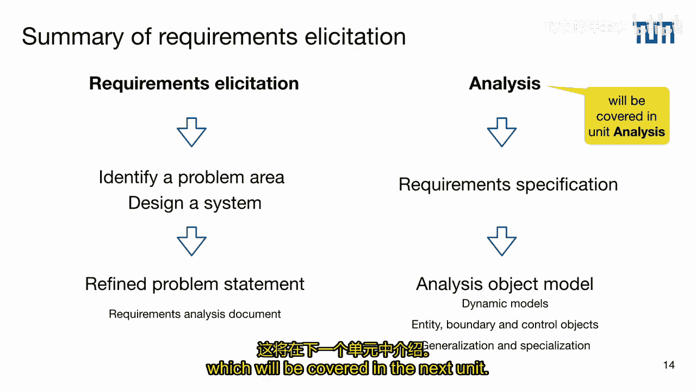
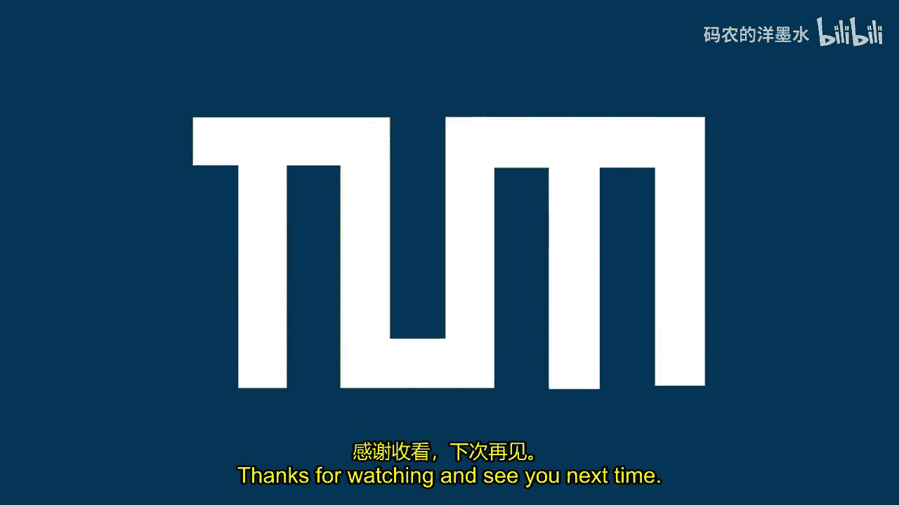

# 【全集】慕尼黑工业大学SEECx 软件工程基础 中英字幕 1080P p15 Lecture 4-1需求获取 -BV13sqGBLE64_p15-

Hello and welcome to the unit requirementsqui and Iitation of the course Software Engineering Essentials。

 My name is Jan， and in this unit we rely on the book Object oriented So Engineer usings Paterns。

 UML and Java by Bern Bruger and Alan Detoir in its third edition。

Information about requirements of elication can be found in chapter 4。

So let's talk about our learning goals for today。First。

You will understand what requirement solicititation is and why is it needed。Second。

 you will be able to understand the main activities included in requirements an elicitation。Third。

 you will be able to apply the main activities of requirements and eation for future projects。Fourth。

 you will understand the terms， problem statement and requirements which we will be covered in this unit。

Fifth， you will be able to apply heuristics to great scenarios and use cases。

Let's get started with number one， why do we actually need requirements and elicitation？

Requires and solicitations focused on the description and the purpose of the systems to be developed。

The client， developers and potential users identify a problem or even a problem area and therefore define a system to address the identified problem。

Such a definition is called the requirementsqui and specification。

And it serves as an agreement or contract between the client and the developers。

The requirement specification is structured and formalized during the analysis phase。

 and it's based on a so called problem statement， which is described during requirements of elicitation。

So first we have to understand what a problem statement is。

The initial problem statement is most likely generated during or even before the project starts。

Hence， it has been created by a person which is not necessarily a developer。

 but he or she has an idea which could be developed in the future。Therefore。

 the first real problem statement can even be thought or weak description of a system to be built。

It describes requirements decomposition in multiple subsystems as well provides a communication infrastructure to address certain issues。

The problem statement also describes the current situation。

 the functionality support and the environment in which the system should be deployed。

 It also defines the deliverance expected by the client， together with the delivery dates。

 a set of acceptance criteria。The problem statement may also specify constraints on the development environment。

 such as the program leverage to be used。 Usually， it is developed by the project manager and decline client as a mutual understanding of the problem to be addressed by the system。

However， the problem statement is not precise or complete specification of the system。Instead。

 it is a high level summary of two project documents to be developed。

The requirements analysis document and the software project management plan。

Requirements can be divided into two major categories。

 namely functional and nonfunctional requirements。Functional requirements are composed of multiple functions。

Whereas a function can be described as a set of inputs。

 the behavior of the system and its given outputs。They should be precise， correct， complete。

Consistent and unambiguous。Nonfunction requirements are aspects of the system not directly related to its functions。

They can span a number of issues starting from the user interface look and feel to certain response time requirements and other security issues。

Also， be aware that nonfunctional requirements should be defined at the same time as functional requirements。

Because they have as much impact on the development and cost of the system as functional requirements。

Let's have a look at some examples for functional requirements。

Given from our university app problem statement in the following。

4 functional requirements can be found。First。Searching the course。Second， check the course details。

Third。Updating a student's profile。And fourth， adding comments to start or participate in a discussion。

As one can see， some of the requirements are not necessarily precise or complete yet。

This comes from the fact that requirements of eitation is an iterative process。

 and therefore new requirements will be found。Others maybe will be refined and sometimes are even removed orthn。

Let's have a look on nonfunctional requirements。Nonfunction requirements are often called quality requirements。

 hence they not focus on the functions of the system。

 but on its quality in many different variations。The acronym herbs defined by A M。

 lists four major representatives of nonfunctional requirements。Usability。

How easy actually is it to use the system and how is the user supported in the sense of documentation。

 consistency， and on using the system？Reliability Is the system actually available 24/7。

 How many errors does the system produce in a given certain runtime environment？Performance。

 how fast is actually my system。Or is the system efficient。In the sense of， for example， battery use。

And supportability， how maintainable is my system actually， I it easy to test？

How flexible can it be integrated and modified？Let's have a look at some examples of nonfunction requirements。

Given from our university a problem statement， there are actually four nonfunction requirements that can be found。

The first one， intuitive usage。The second one conform to guidelines。The third， the target platform。

 and last but not least for the Beckckend system。As one can see。

 those requirements are not necessarily precise or complete yet。In addition to the Europe's model。

 there are so called constraints， also known as pseudo requirements。

They cover the requirements for implementation， for interfacing to legacyis other systems。

For operations。As well as for packaging requirements or legal aspects。

Don't be misled by the fact that these requirements are phrased of pseudo requirements。

 depending on the field of application， those requirements can play a major role to the software system in development。

Since we covered different functional and nonfunction requirements， as well as constraints。

 let's have a closer look on the different activities which will be covered during requirements and elicitation。

To create a proper description of our system to be built。

 we have multiple activities to gather and store information about our future system。

We start to identify actors during this activity， developers identify the different types of users the future system will support。

Then we identify scenarios。During these activities。

 developers observe users and develop a set of detailed scenarios for typical functionality provided by the future system。

Scenas are concrete examples of the future system actually in use。

Developers use these scenarios to communicate with the user and deepen their understanding of the application domain。

Afterwards， we identify use cases。Once developers and users agree on a set of scenarios。

 developers derive a set of use cases from the scenarios that completely represent the future system。

Whereas scenarios are concrete examples illustrating a single case。

 use cases are actually abstractions describing all possible cases。When describing a use case。

 developers determine the scope of the system。But there are three more activities for Re and elicitation。

We refine use cases found before during these activities。

 developer ensure that the requirements and specification is complete by detailing each use case and describing the behavior of the system and the presence of errors or exceptional conditions。

Then we identify relationships among use cases during this activity developers identify dependencies among use cases。

 they also consolidate the use case model by factoring out common functionality。

 this ensures that the requirement specification is consistent。And finally。

 we identify nonfunctional requirements。During this activity， developers。

 users and clients actually agree on aspects that they're visible to the user。

 but not directly related to functionality as stated in the slides before。

Let's have a look at our short explanation video。Scenaris enhance requirements elicitation by providing a communication tool that is understandable to users and clients。

You as a software engineer， can identify scenarios by observing the user or by asking questions to your client。

Scenaars describe interactions between a user and the system and focus on specific instances and concrete events。

They include a narrative description of what their user as an nctor does and experiences as it tries to make use of the system。

A scenario is in a concrete， focused in forward description of a functionality of the system from the viewpoint of NAectA。

Scenaars are typically structured in the following way。

 They have a name that enables us to refer to it unambiously。

 The participating actors indicate which actors are involved in this scenario。

The flow of events describes sequences of interactions step by step。

 They can be divided into a steps and system steps。 In this case。

 we described the scenario to join a course。 The participating actor is Jane。

In order to join a course， Jane selects that option and then chooses from a list of courses。

 which is displayed by the system， the East course。

The system then shows some details of the course and a description。

Daton reads the description of the cho and decide that she actually does want to join it。

Scears are very concrete and should not contain any abstractions。Nevertheless。

 you need abstractions to build a system。Therefore， software engineers turn scenarios into use cases。

Use cases describe all possible cases for one functionality and can be instantiated with multiple scenarios。

Therefore， a use case is an abstraction of a scenario that describes all possible flows of events in a more abstract way。

A use case involves a described functionality and does not include examples or concrete instances。

Use cases focus on completeness and ambiguity， consistency and correctness。

They additionally include entry conditions， exit conditions， invariance， and quality requirements。

Entry exit conditions， abstractions that enable developers to describe a range of conditions under which a use case is invoked。

Invari， state conditions that can be relied on during the whole use case。

 quality requirements are also called nonfunction requirements and the Sc system attributes。

Let's summarize what we covered in this unit during a Cri eitation。

 the client the developers and the users identify a problem area。

They also design a system that addresses this problem。This is done by creating a problem statement。

Yet this problem statement is neither a precise nor a complete specification。

 but a high level summary。It contains the requirements of a L document。In the next unit。

 we are going to cover analysis。In analysis， we described the definition of the system from the user's point of view。

During requirement specification， developers determine the functionality users need and how to find a usable way of delivering it。

The outcomes are so called analysis object model。Which consists of with dynamic models。

 different objects， as well as the concepts of generalization and specialization。

 which will be covered in the next unit。

So that's what the unit requires anilitation。Thanks for watching and see you next time。

