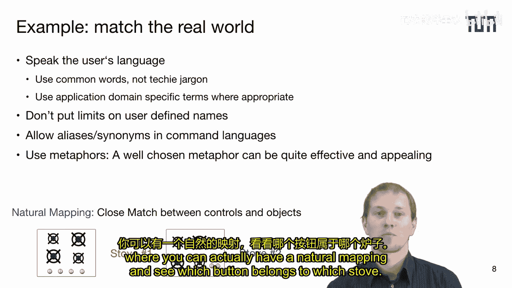

# 【全集】慕尼黑工业大学SEECx 软件工程基础 中英字幕 1080P p16 Lecture 4-2 可用性 -BV13sqGBLE64_p16-

Hello and welcome to the unit usability of the course Soft engineeringEssentials。 My name is Jan。

 and in this unit， you will learn about usability and understand its definition。😊。

You will be able to explain different aspects of usability and its key goals。

You also will be able to apply heuristics towards your usability concepts。

So why is usability important and why do we need it。

Some systems are hard to understand and therefore also hard to use。

 This phenomenon gets even worse when usability is not considered carefully enough。

Need some compared usability as being similar to cooking。Everybody needs the results。

 anybody can do it reasonably well with a bit of training， at least。

 and yet it takes a master to produce a gourmet outcome。Yet user interfaces vary。

 and sometimes it can be very challenging to interact with a given system。For example。

 older versions of Microsoft Word with a fully exped menu bar。 How can align my text to the left。

Or this control room of a reactor， how can I shut down the reactor or increase its output？

Usability can also be described in a more technical way。

It can be seen as a nonfunctional requirement。And the following question can highlight some of the aspects of usability。

What is the level of expertise for the user or did your user use the computer before？

What user interface standards are familiar to the user？Does the user know about buttons， dropdowns。

 menus， etc？What documentation should be provided to the user？

So does the user actually need a manual or documentation， or is a software self explanatory？

Usability is actually multidimensional， and it can be derived into five different categories。

Learnability describes， for example， how hard it is as a beginner to use the software for the first time or actually learn how to use it。

Efficiency describes if an advanced user is able to use the system efficiently。For example。

 after using the software for a while， does the user feel it's fast and easy to use？

Or can the user follow his or her industrial processes or dutiesith without being interrupted or slowed down by the system？

Memorability。Describes how easy it is for a user who actually learned already the system and hasn't been used for a while to get back onto it。

And then there is error handling， this describes if the application presents the user with a chance of error recovery。

For example， if no printer is connected， is there a fallback to the PDF export or a cancel button。

 or does the application just crash when you click on the print button。Satisfaction。

 or also known as user experience， describes if the application presents information in an appealing way。

Or in other words， is it actually fun to use。Let's have a look at our explanation video。

 describing what a system model， user model， and a user interface model is。

 and how do they correspond to each other。As a software engineer in a university app project。

 you have an idea of how the system would work。 You create use cases and the analysis object model to model the system and to communicate this idea with your team members。

 This model is called a system model。 It represents how the system internally works。

Your actual user also has assumptions about differentities of the Future University app。

Those assumptions are based on experiences and perceptions of the user which form a user model。

 The user model is a mental model which represents a person's understanding of how to use the app。

Mental models shape a person's behavior and actions。However。

 the user doesn't need to understand the complex details of the system model。Therefore。

 system model and the user model are different。To bring both models together。

 there is a third model that describes the user interface with elements such as buttons。

 scrollable lists， text tables， images and so on。This third model is called a user interface model and forms the interface between the system model and a user model。

It should be simple and easy to understand for the user and hide the complex details of the system model。

In order to come up with an easy to understand user interface model。

 software engineers create prototypes and markups and show them to the user instead of the whole system model。

 This allows them to refine the user interface model so that the user is able to use the app in the right way。

Nevertheless， the user is always right because he uses the app in the end and he has today with the user of his model。

The user's model， that is his understanding of how the application actually works， can be wrong。

 which would lead to difficulties in the use of the application。To deal with this problem。

 the user interface model is designed by UI designer Designers usually have a lot of experiences concerning user interface design and also have a specific idea in mind of how the user interface should look like and how users would use it。

 For example， that the app should be designed in an aesthetic and minimalistic way。

 This is called the design model。To create a system with a high usability。

 there are different techniques。Prototyping helps to come up with user interfaces。

 usability testing identifies problems of typically users and user interface heuristics provide best practices。

So let's talk about some heuristics which help you to make your application even more usable。

Eielsen proposed 10 different usability yearistic divided into four different groups。

Meet the expectations。The youth is the boss。Andandleris。And keep it simple。

Let's have a closer look at one specific heuristic。

 namely meet the expectation or matching the real world。

Nelsen proposes that you speak the user's language。So use common words。

 use application domain specific terms， so the user is familiar with terminology。

And don't limit yourselves in using user defined names。

 you should also allow synonyms or aliaasees to be used in command languages。Use metaphorce。

Which are also very important。And finally， make sure to create a natural mapping and therefore a close match between the controls and its objects。

If we have a look at the stove on the left hand side。

 it's very hard to determine which button actually regulates， which part of the stove。

A better example would be using stove2， where you can actually have a natural mapping and see which button belongs to which stove。

So this is the end for the unit usability。Thanks for watching and see you next time。

