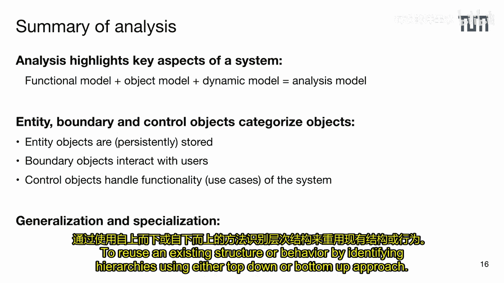

# 【全集】慕尼黑工业大学SEECx 软件工程基础 中英字幕 1080P p17 Lecture 4-3 分析 -BV13sqGBLE64_p17-

Hello and welcome to the unit analysis of the coursese Soware EngineeringEssentials。

 My name is Jan and in this unit， you will learn three major aspects of analysis。 First。

 you will understand the term analysis and how it's been influenced by requirements of elicitation。

Second， you will understand three different concepts of analysis， the analysis object model。

The entity boundary and control objects， as well as generalization and specialization。Third。

 you will be able to apply different analysis activities。So what's the purpose of analysis。

 Have a look at the drawing on the right。Well， either you see two faces looking at each other。

 focusing on the black color。Or you see of A focusing on the white color。In the end。

 this drawing is ambiguous and it depends on which focus point you prefer。

Since we want to create a model which describes our system。

 we don't want to have any ambiguity as seen in this picture。

This is exactly the purpose of analysis to create a model of the system which is correct， complete。

 consistent and also verifiable。This model is called the analysis model。

So we start from the requirements and eitation， go over to the requirements specification。

And describe the nonfunction requirements and the functional model and then start with analysis。

During analysis， we create a so called dynamic model and an analysis object model。

 These models can be used as a base for discussion going back towards requirements of eation and refining the existing models。

The final outcome of the analysis is a so called analysis model。

 which consists of the dynamic model and the analysis object model of the system to be built。

 The task of communicating information is most challenging during requirements。

 elicitation and analysis。The involved stakeholders have different backgrounds and expectations Use。

 clients and developers have different domains of expertise and use different vocabularies to describe the same concepts。

Furthermore， they all have different objectives when defining the systems。

Users want a system that supports stick current and work processes。

 whereas clients aim to maximize their return on invest。

The developer aims to deliver the system and time。Different expectations can lead to problems if。

 for example， the developer does not properly understand the needs of the user。

Due to this diversity of views and expectations in a project。

 stakeholders need to share information and report problems in a timely manner。

 and it is the job of the developers to initiate this communication。

Especially in large development projects， they are conflicting objectives and there is no communication mechanism that addresses all communication problems that might occur。

 however， there are few simple guidelines to follow。First， you have to define clear territories。

 that includes the assignment of specific roles。The analyst is the application domain main expert who modelsed the current system and communicates this to the client。

 The architect and integration role unifies use cases and the analysis's object model and is responsible for the communication within the developers。

Furthermore， clients and developers need to define clear。

 measurable and verifiable objectives and success criteria in the requirements analysis document or as part of the client acceptance criteria in the problem statement。

Rrainstorming that is putting all the stakeholders in the same room to quickly generate solutions and definitions can remove many barriers in communication and can lead to the definition of shared notations that support the communication。

Storyboards and user interface sketches often appear spontaneously during brainstorming sessions。

However， it is also important that precise and structured notations are used。

 Developers use use cases and analysis object models to communicate with other developers。

So as stated before， we need a form of formalization and standardization to deal with ambiguity。

 so we can use UML as standardized notation instead of drawings。

 yet this does not necessarily guarantee consistency。However。

 we can remove ambiguity on the modeling level。 there are many different UML diagram types which can be used for analysis。

Namely， the use case diagram， the class diagram， the state machine diagram and the sequence diagram。

 where the state machine diagram and sequence diagram won't be covered in this course。

 Let's have a closer look at the three different concepts during analysis。First。

 we have the analysis model which consists of the functional。

 object and dynamic model of the system to be built。Second。

 we are going to introduce the separation of objects into three different categories。Entities。

 boundaries and control objects。Third， we are going to detect hierarchies by using two different ways and apply object oriented principles like inheritance or polymermorphism。

Let's start with the concept of the analysis object model inside the object model we learned that we can apply a separation into three major categories。

 namely entity， boundary and control objects， Let's focus on the three different types。First。

 we have the entity objects which represent persistent entities or entities which should be stored by the system。

Second， we have the boundary objects which represent the interactions between the actors outside of the system boundaries and the system itself。

Third， we have to control objects which handle the realization of use cases。

Let's finish with the last concept of analysis， the concept of generalization and specialization。

So we learned about the analysis object model and the separation towards entity boundary and control objects。

 The last missing concept is generalization and specialization。 Let's start with generalization。

Generalization is the modeling activity that identifies abstract concepts from lower level ones。

Let's say we have our student and our lecturer class。

 we can identify a class person holding the first name and the last name attributes for both the student and the lecturer。

Let's continue with specialization。Specialization is the activity that identifies more specific concepts from a higher level one。

For example， we have identified the person class first and then realized that their student as well as an instructor is available and needs additional functionality like printing the personal information。

For example， matriculation number for the student or employment number for the lecturer。

Finishing up the three concepts of analysis。Let's apply the three major activities during the analysis phase。

First， we are going to identify entity， boundary and control objects using Abbott's technique。Second。

 we are going to identify associations， aggregates and attributes。And third。

 we are going to model inheritance relationships to reuse existing functionality。

Abbbott's technique is a powerful heuristic to identify associations， classes， attributes， methods。

 and even more by using a part of speech analysis。Let's start with a proper noun which depicts an instance。

 for example， Ellis。Then there's the common noun which depicts a class like a student。

Then we have to doing work。Which depicts an operational method， for example， create。

 submit or select。And there are many more for being work as inheritance。Having work。For recreation。

The modelal work for constraints， as well as adjective for attributes。

Let's have a closer look on how to apply Abbot's technique using an example of our problem statement。

Let's read through the functional requirement one of our problem statement。

A student can see all the courses of the current semester in its major and minor subject。

 he is able to join the course， which saves it into his course list。He can also drop a course。

Applying Abbot's technique， we can identify the following concepts。Student， which is a commonon。

 corresponds to a class course， which is also commonon， also corresponds to a class。

 There is the major and minor subject， which are adjectives which correspond to attributes。

 There is join a course which is a doing work which corresponds to an operation or method。

 Then there is his course list， which is a having work， which depicts an association。

And there' is drop a course， which is a doing webb going for an operation or method。

After identifying entity， boundary and control objects。

 it is time to detect associations between the different identified objects。

 Let's define the properties of an association。 Each association has a name。

 a role and its multiplicity。 The following heuristics can be used to find associations。 First。

 we examine I。Worb phrases to find association。 For example， a student has a course。

Make sure that you use precise names for your association and roles。

 Eli any association that can be derived from another association。 For example。

 a student has a course and a course as a student。 Finally。

 make sure that you are not using too many association and it makes your model unreadable After identifying associations。

 we can start to identify aggregates。 to do so， One has closely monitored the dependency according to the lifetime of the dependent attributes。

 We distinguish between a composition aggregation and a shared aggregation。

 Let's start with the composition aggregation。The lifetime of the aggregate depends on the whole。

For example， the earth is composed of mountains， the ocean and forests Without the earth。 however。

 neither mountains nor the forest or ocean can exist。

 The second association is the shared aggregation where the existence of the different parts is independent。

For example， a card consists of an engine and tires。

Yet you could remove the tires and reuse them for a different car。

 So the lifetime of the component is not dependent on the relation。Next， to identify associations。

 we can also identify attributes for individual objects using Abbot's technique or other heuristics。

Attributes have two properties。A name。 and a type。Heuristics are the following。

 identifydent as many associations as possible before identifying attributes to avoid confusing attributes and objects。

When identifying properties of objects， only the attributes relevant to the system should be considered attention again。

The student could not contain and attribute courses。

 as it is already modeled using the association inside of the diagram。

Another heuristics for an identifyingifying attribute is to start with associations and then insert your attributes afterwards。

Finally， we apply generalization to remove redundancy from the analysis object model。

If there are more classes showing the same attributes or behavior。

 those are consolidated into a super class in this scenario， the student， as well as the lecturer。

 has a first name and a last name and a birth date， which can be reused。

 the functionality of print personal information method is not reused hence student and lecturer providing their more specific implementations。

 Let's come to the summary of analysis。 in this unit， you learn in specific about the analysis model。

 which is composed of the functional model， the object model， as well as the dynamic model。

 you also learn about the separation of object and three major categories。 namely， the entity。

 boundary and control objects。Whereas entity objects are persistently stored。

 binary objects are used to interact with the user and control objects handle the functionality of the system。

Finally， you learn about generalization and specialization。

To reuse an existing structure or behavior by identifying hierarchies using either top down or bottom up approach。

 So in this unit， we covered analysis。

Thanks for watching and see you in the next unit。

