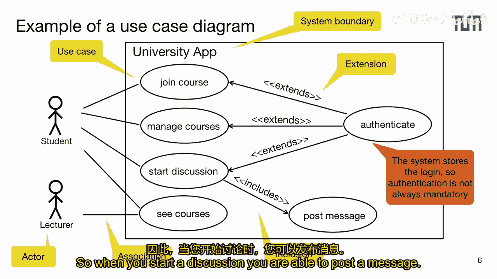

# 【全集】慕尼黑工业大学SEECx 软件工程基础 中英字幕 1080P p18 Lecture 4-4UML用例图 -BV13sqGBLE64_p18-

Hello and welcome to the Uni Use case diagram of the course Soft EngineeringEssentials My name is Jan and in this unit we would like to focus on the UML Use case diagram。

This diagram helps you to transform a customer specification in the form of scenarios to a so called use case。

So what's the purpose of the use case diagram， Well let's start with the definition what a use case is。

A use case focuses on the behavior of the system。 it does so by having an external view onto the system。

This external viewer component is called an actor， which typically initializes the use cases。

An actor is an external entity which can be a user， another system。

Or even the system's physical environment。The so called use case diagram combines multiple use cases。

 actors， and associations in one single diagram。In this unit。

 we will focus on the graphical UML notation of use cases。However。

 there is also a text or representation of use cases。

The textile representation consists different elements similar to the graphical notations。

We have the use case name， the actors of the system。Entry conditions， the flow of events。

 as well as the exit conditions。Let's have a closer look at the graphical notation of the UML use case diagram。

 The use case diagram as a graphic notation is composed of the system and the system boundaries。

Use cases， which are the actual functions of the system。

An actor which models a type of role played by an external entity or even another system that interacts with the system。

There are also different types of relationships。Associations。

 which are in a relationship between an actor and a use case。

That means the actor uses the this functionality of the system。

 and then we have two modifiers on relationships。 First， we have extends。

Which basicallys says that the behavior of the use case may be extended by the behavior of another use case。

 for example， exceptionally。And then we have to include relation。

 which implies that the behavior of the included use case is inserted into the behavior of another。

 including use cases。 This means that use case2 in this example has to be used by use case 1。

Let's have a look at a specific example first。We have our system boundary。

 which is the university app， then we're going to introduce actors， for example。

 the lecturer and the student which are going to use our system Afterwards we add different use cases so the functionality of the system。

 which could be join course， manage courses， start a discussion or even seeing the course list。

Now we need to add the associations which describe which of these use cases can be used by which actor。

Finally， we had the extensions we mentioned before。There is extend， for example， for a join course。

 manage course and start discussion， which depicts that you have to authenticate first before joining a course。

 manage your courses or start a discussion， but there also is an inclusion extension which is an optional additional use case。

 so when you start a discussion you are able to post a message。

So in this unit we covered the use case diagram， thanks for watching and see you in the next unit。

