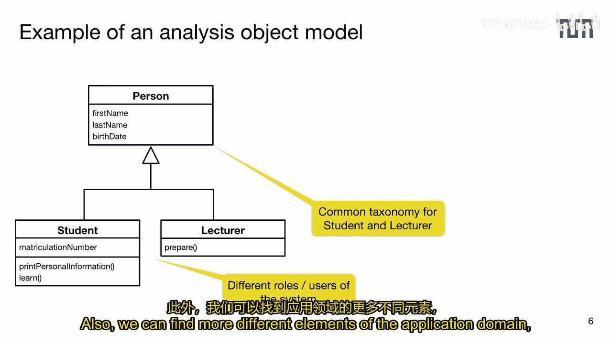

# 【全集】慕尼黑工业大学SEECx 软件工程基础 中英字幕 1080P p19 Lecture 4-5UML类图 分析对象模型 -BV13sqGBLE64_p19-

Hello and welcome to the unit Ana Ob model of the coursese So EngineerEssentials。 My name is Jan。

 and in this unit， we will cover the analysis object model。😊。

The analysis object model is represented by a class diagram。

 so it's a diagram which provides information about the structure of the system to be built。

Let's have a closer look on the UML class diagram， its purpose and properties。

Classes are abstract representations of concrete instances， also named objects。Classes。

 as we have learned already， encapsulate attributes and methods and therefore hold functionality of the structure of important elements of a system。

To connect classes， there are different types of so called associations。

 which can denote relationships starting from weak relationships， up to very strong relationships。

 even denoting a lifetime dependency to instances。Class diagrams finally can contain even more information like viibilities。

 method signatures and more。However， this is part of object design and will be covered later in this course。

 Also， it can be used for forward and reverse engineering entering object design。

So let's come to the purpose of the analysis object model which uses the class diagram。

 The analysis object model is used to model individual concepts of the application domain。

 so it can be seen as a visual dictionary of the main concepts visible to the user。However。

 it does not contain solution domain knowledge like the choice of the programming languages。

 these information are included in the system and object design phase of the software development lifecycle。

 in order to decrease the complexity and also hide solution details。

 it does intentionally not include visibility of attributes and method signatures。

 even if we already know these details。So which elements are actually covered by the analysis object model？

Let's have a closer look at the different available class diagram elements for the analysis object model。

We start with a class， which is shown as a rectangular box with a specific name of the class。

It also may contain attributes directly below the name separated by a line as well as method。

 which follows the attributes in another separate area。To describe the connections between classes。

 so called associations are used。There are different types of associations。

Inheritance denotes a super to subclass relationship。

Whereas attributes and methods can be used from the superclass without refining it in the subclass。

 there is aggregation which specifies a is composed of relationship。 For example。

 a car is composed of an engine and tires。Where the single components can exist independently from the aggregate。

And there also is the composition， which however specifies a consists of relationship。 For example。

 the earth consists of mountains and oceans。So the composite can't exist on its own。Finally。

 we have so called multiplicities， which can be denoted as stated to one to one， one too many。

 or many to many relationships。Let's have a look at a concrete example of an analysis object model。

 one purpose of the analysis object model is to find taxonomies induced from the application domain。

 so we have to student intellectual lecturer which are different roles or users of the system。

Now we can find a common taxonomy for the student and the lecturer， namely the person。

 also we can find more different elements of the application domain， for example。

 the course or the lecturer in this unit， we covered the analysis object model。

Thanks for watching and see you in the next unit。

