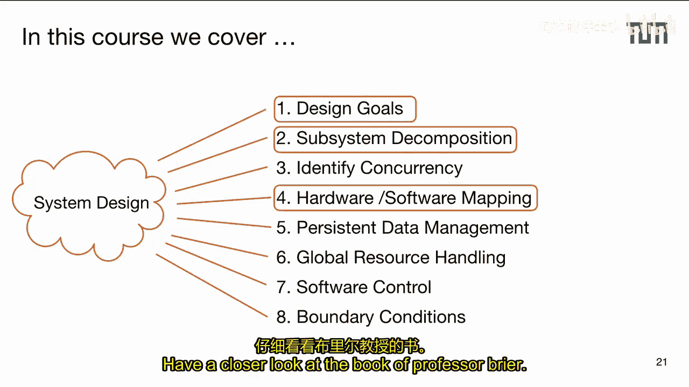

# 【全集】慕尼黑工业大学SEECx 软件工程基础 中英字幕 1080P p20 Lecture 5-1系统设计 -BV13sqGBLE64_p20-

Hello and welcome to the unit System Designs of the course Soft EngineeringEssentials My name is Andreas and we are heading from the analysis towards the system design After watching this video you should be able to remember the eight issues of system design activities which I'm going to introduce in a few seconds you will understand how we get from the analysis towards the design。

We will have a closer look at the three activities， design goal trade offs， subsystem decomposition。

 and the hardware software mapping。But first of all， why is it so difficult to design software？Well。

 during analysis， we focus on the application domain。

 we are really concerned about the problem we want to solve。

 whereas during design we are moving from the application to the solutions domain。

 The challenge we're facing here is that the solution domain is changing very rapidly。

 the half term knowledge in software engineering is estimated at about three to five years。

 Furthermore， the cost of hardware are rapidly sinking， and also the size of it its syncing。

 So think about， for example， the intercur chip， which has only the size of a thumbnail and offers various new applications in Marion。

 So what is system design all about。Starting from a problem。

 we want to get to an existing system that solves our problem in our manageable way。To visualize it。

 we have a problem on the upper right side and want to get to the system on the right bottom corner on our way between the problem and the solution we found ourselves in the activity of designing the system。

 And that's exactly what we are covering in this unit。 So how do we get there。

 We will apply the technique of divide and conquer。 First of all， we identify design goals。

 Our subsystem has to achieve。 Next， we model the new system design as a set of subsystem and address the major design goals。

System design covers eight issues。 First of all， the identification of design goals。 Second。

 we decompose the system into different subsystem， then the identification of concurrency so we identify parallelism processes and threats。

 Fourth， we have a look at the hardware software mapping， so we estimate the hardware requirements。

 we describe the tradeoff。 We allocate the processes and the physical connectivity between the different hardware。

5th， we have a look at the persistent data management。

 so we want to store persistent objects in a file system or a database。

 We define the data structures for the memory or secondary storage。At the global resource handling。

 we have a look at the access control， whereas in seven we have a look at the software control implementation。

And8 defines the boundary conditions where we describe the behavior at initialization， termination。

 and when a failure occurs。The title says how we get from the analysis to this design。

 We did quite a lot of things during analysis， and we map these now to the system design。

 The design goals represent the nonfunction requirements。 We came up during analysis。

 Subsistent decomposition represents our functional model。

 Concurrency and identification represents the dynamic model。Four and5。

 so the hardware software mapping and the persistent data management represents the object model。

The global resource handling and software control is also part of the dynamic model。

 The boundary conditions are part of the functional model again。

 So how does the analysis actually really influence the design。

Nonfunction requirements became our design goals。 The functional model of the analysis directly moves into the substem composition。

 The analysis object model is part of the hardware software mapping。

 and later on of persistent data management， and the dynamic model helps us to identify the concurrency。

 the global resource handling and software controls。

What we are going to cover in this course is not all eight of them。

 we only have a look at three of them， which we think are the most important ones。 First of all。

 we focus on design goals， then we have a closer look at the subsystem decomposition and we look at the hardware and software mapping。

 So let's start with design goals。What are design goals， Design goals， first of all。

 govern the system design activities。 They are one of the main parts during system design。

 So every nonfunction requirement out of the analysis and requirements elicitation becomes a design goal。

 Furthermore， additional stakeholders bring in their goals and they are formulated with respect to the design methodology。

 the design metrics and implementation goals。The problem with these design goals now is that they often might conflict with each other。

 so we have to come up with trade offs。Where we can satisfy either one or either。Other designs。

What are typically designed gold trade offs？For example， this of functionality versus usability。

 cost versus robustness， efficiency versus portability， rapid development versus functionality。

 or cost versus reusability。 Furthermore， it could also be that backward compatibility and readability might be a problem。

 We have a closer look， and we give you some examples for these tradeoffs。 First。

 functionality versus usability。The question you should ask yourself is whether a system with 100 function is really usable。

Well， we don't think so and some systems or applications are even not usable with two functions。

 We show you an example of the application Fourquare Fourquare has basically two core use cases。

 first of all， is checking in into locations and therefore sharing your location with your friends and second of all。

 a use case to find the best rated venue nearby。So on the left side。

 you can see the app icon on Foursquare。 And then we found a typical conversation about Foursquare。

 and they say， how can I use Foursquare？ Well， then someone explains， well。

 you can share your location with your friends and you can find the best venues。

 But then the other one says， okay， that's cool， but I don't want to share my location。

 I don't feel comfortable with it。 So what happened。

 Foursquare split up the functionality in two different apps。 First of all。

 we have the Foursquare application where the user can search for the best rated venues。

 And second of all， we have a completely new application called Swarm。

 where they apply the core concept of checking in。The next example we want to show you is cost versus reusability。

So we assume that you model an association between two glasses in a one to one multiplicity。 Well。

 that's easy to code， and the test is not that expensive， but it's not very reusable。

 When we move from a one to1 association to a many to many association。

 There is additional efforts for coding and testing to put this in a real life example。

 we compare shopping bags。 on the one hand， a plastic ones and on the other hand， are cotton ones。

 Well， yes， the plastic ones are more cheap， and the cottons ones are more expensive。

 but you can use the cottons ones more often。 So we achieve a higher grade of reusability。

We're slowly moving towards design patterns and design patterns help to get rid of this tradeoffs。

 so these tradeoffs might no longer be painful for you。

 and we can achieve reusability with low cost when we apply design patterns。

Coming back to the overview， we had a look at design goals。

 we now move forward to the subsystem decomposition。

We split our system into different subsystem layers and apply architectural styles。

What are subsystem and services Subsystems are a collection of classes， associations。

 operations and events that are closely interrelated with each other。They somehow belong together。

 the classes of the object model we found during analysis are the seeds for the subsystems。

On the other hand， we have services which。Is a group of externally visible operations that are provided by a subsystem。

 They are also called subsystem interfaces。 Other subsystems can use these interfaces to interact。

 So the use cases of the functional model are the seats for the services。Remember。

 object of the classes of the object model are seats for the subsystems， on the other hand。

 use cases in the functional model are the seats for the services。

We have a look now at coupling and coherence of subsystems。

 Our goal is to reduce the system's complexity while we still allow change and remember change is the only constant。

 how do we do that First of all， we can measure the dependency among classes。

What we call coherence and high coherence means that classes within a subsystem perform similar tasks and are related to each other with many association。

Low coherence means a lot of Michelcellaneous and auxiliary classes and almost no association。

In contrast to coherence， coupling matches the dependency among subsystems， so we have coherence。

 dependency among classes and coupling dependency among subsystems。

The question we should ask ourselves， what makes good system design？Well。

 we want to achieve high coherence， so the dependency among the classes can be high and we want to go for low coupling so that we are capable of changes within one subsyimem that do not affect other subsystem。

How can we measure the interdependence of cohesion and coupling？

Cohesion measures the interdependence of elements within a subsystem。

 whereas coupling measures the interdependence between different subsystems。

 We brought a graphic for you where we want to represent this cohesion and coupling measurement。

 The gray boxes represent actually subsystems。 Whereas the black dots are elements or classes within one subsystem。

 You can see the connection between the elements across subsystems。

 We have high coupling and we have low cohesion。The graphic now stays the same。

 but what changes is the connection between them， so we have very less connections between the subsystem。

 we have low coupling， and we have connections between the classes within a subsystem。

 we have high cohesion。How to achieve high coherence and low coupling Well high coherence can be achieved if most of the interaction is within the subsystem rather than across the subsystem boundaries。

And low coupling can be achieved if a calling class doesn't need anything to know about the internals of the call class。

 So remember and keep in mind the concepts of information hiding we've already covered。

To come up with a proper substem deupposition， there are architectural styles and architects for the software design。

During the subsystem decomposition， we identify subsystem services and their relationships to each other。

 An architectural style can be applied and represent a pattern for a subsystem decomposition。

 The software architect is basically the instance of an architectural style。

 You will learn more about these architectural styles and architectural patterns in the unit architectural patterns。

We are moving now to the hardware software mapping。

What does hardware software mapping mean and how do we use it during system design。

 We address two questions， how should we realize subsystem and should we use hardware or software therefore。

 and how do we map the models onto the chosen hardware or software？First of all。

 they are control objects， they have to move to specific processes。

 so we have to define if the computation rate is too demanding for a simple process。

 or if for example you can get a speed up by distributing objects across several processes。

 we also define how many processes are required to maintain a steady state load。Furthermore。

 we have entity objects which are matched to the memory。

 so we might ask the question if there's enough memory to buffer bursts of requests and we deal with boundary objects which are input output devices in the hardware software mapping。

To visualize the results of the hardware software mapping and the subsequents decomposition。

 there are two types of UMl diagrams which help us。 First of all， the component diagram。

 which illustrates the dependency in between components at design time， compilation and runtime。

Have a look therefore at the unit component diagram where we have a closer look at it。

And we have the deployment diagram which illustrates the distribution of these components on concurrent processes。

At runtime， so the deployment uses nodes and connections to depict the physical resources in the system。

 so in the component diagram， we are hardware independent or manufacturer independent。

 whereas in the deployment diagram we really nail it to actual hardware and software。

 We also have a unit for the deployment diagram， have a look at it。

So we covered the three for us most important things， design goal， subsystem decomposition。

And hardware software mapping， regarding the five other issues。

 have a closer look at the book of Professor Brugeger， there's quite a lot of stuff about in it。

To summarize this unit， we had a closer look at system design。

 where we reduce the gap between the problem and the existing system。

 We define what are design goals and that they describe the important system qualities and the values against which alternative designs are evaluated。

 We have shown you some design trade offs and gave you examples for it。

We had a look at the subsystem decomposition where we decomps the overall system into manageable parts by using the principles of cohesion and coherence。

We covered the hardware software mapping where we describe how subsystems from the substem decomposition are assigned to hardware and off the shelf components。

 for example， that's it for this unit， system design， see you the next time。Yeah。

