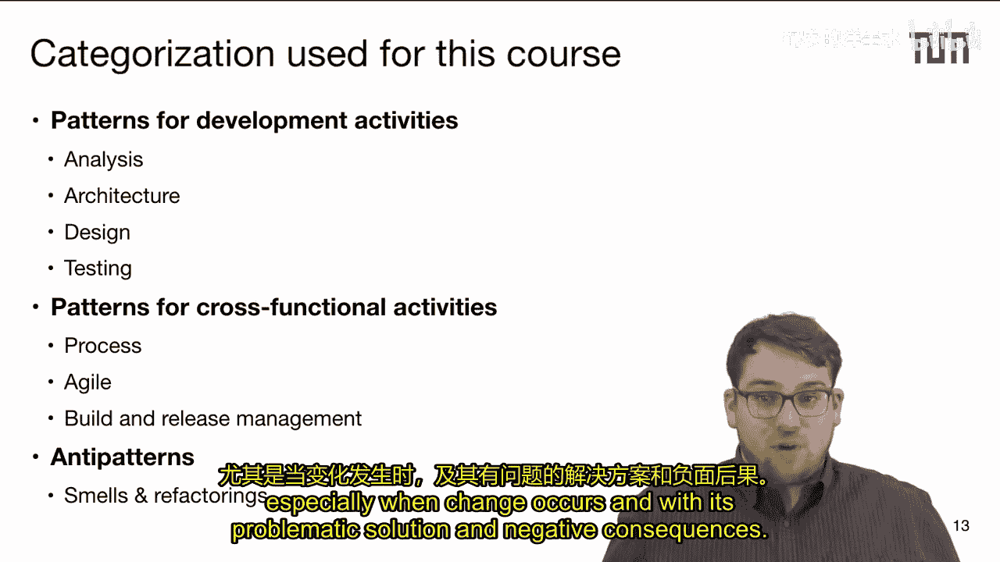

# 【全集】慕尼黑工业大学SEECx 软件工程基础 中英字幕 1080P p21 Lecture 5-2模式 -BV13sqGBLE64_p21-

Hello and welcome to the unit about Pats of the course Soft EngineeringEssentials My name is Andreas and in this unit you will learn what patterns in software engineering actually are and why you should care about them。

😊，Patterns are a fundamental concept and they are helpful in managing software engineering knowledge Patts are useful knowledge pieces and help us to build complex software systems in the context of frequent change by reducing complexity and isolating the change。

After this session， you will be able to understand why patterns are useful in software engineering。

 you are able to analyze the difference between a pattern and an algorithm。

 and you will remember the categorization of patterns we use in this course。First of all。

 we want to have a look at the difference between an algorithm and a pattern。

 an algorithm describes a method for solving a problem using a finite sequence of well-defined instructions for solving a problem。

 so we're starting at an initial state， the algorithm proceeds through a service of successive states and eventually terminate into a final state。

 what is especially important we want to solve a problem using a finite sequence and we have welldefined instructions。

When we have a closer look at patterns， the definition says that a pattern describes a problem which occurs course over and over again in our environment and then describes the core of the solution so that the problem in such a way that you can use it a million times over and over again without ever doing it the same way twice let's stated by Christopher Alexander。

The importance here is what is the difference to an algorithm。

 a pattern describes a problem and not the way how to solve the problem and this problem occurs over and over again and describes the core of the solution the difference is that the solution is always different。

To clarify the difference between an algorithm and a pattern。

 will present your video of solving a rubbiik's cube。

 there's a finite sequence of predefined steps you have to apply in our case you have to turn specific elements in order to solve the problem。

Getting back to Christopher Alexander， who defined patterns。

 he said that a pattern is a three part rule which expresses a relation between a certain context。

 a problem， and a solution。So who is Christopher Alexander。

 Christopher Alexander is not a software engineer， he's a real architect。

 he was born 1936 in Vienna and has built over 200 building projects and created the book a pattern language。

His philosophy is that buildings have to be built for thousands of years by users who are not architects。

 users know more about what they need from these buildings than basically an architect good buildings are based on a set of design principles that can be described with a pattern language。

 so also Alexander's patent are not about software engineering。

 they are about real architecture planning， but we can apply the concept of Alexander also for software engineering。

Let's have a look at the formal pattern definition for software engineering。

A pattern consists of two parts， first of all， a problem and second a solution。

We can furthermore split up the problem and elaborate it in terms of context and a set of forces。

Regarding the solution， it resolves these forces of the problem with benefits and consequences。

To be considered as a pattern， as we've seen in the definition。

 the solution must be applicable to more than one specific problem。

 which is represented by the multiplicity here。Solutions usually generate follow on problems。

 and this follow on problems can be again elaborated in terms of context and forces。

 which may lead to the applicability of further and even other patterns。

There are three schemata for describing patterns。 First of all。

 the alandrum from derived from architecture and from Christo Alexander。

 Then there's a gang of four around Ericri Gama， which defines a schemata， including name， intent。

 also known as。Motivation， applicability。Which are all defined in the design patternss book。

And there's the G of5 around Frank Bushman， which has basically the same schemata for describing patterns as the G of  four。

 but have some different names and add dynamic behavior to it。For our course。

 well introduce the following three categorizations first of all。

 patterns for development activities covering analysis， architecture， design and testing， further。

 patterns for cross functional activities including process and HL methodologies and build and release management。

And last but not least antipattters with its smells and corresponding refactorings。

Patterns can become antipats， especially when change occurs and with its problematic solution and negative consequences。

That's it for this unit about patterns we introduced to the patterns we gave you first insight how to describe patterns and why you should care about them。

 We will have a closer look at design patterns and architectural patterns in other units。

Thank you and goodbye。

