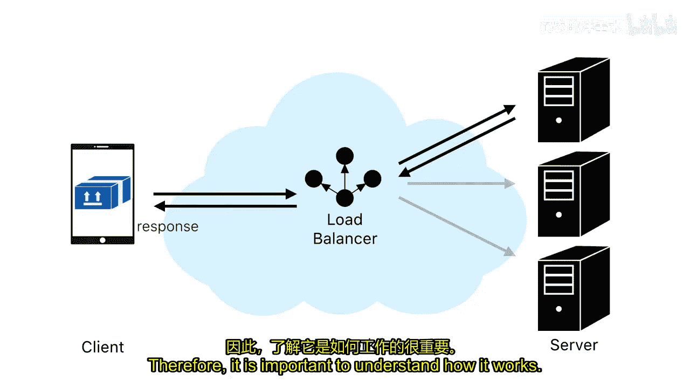

# 【全集】慕尼黑工业大学SEECx 软件工程基础 中英字幕 1080P p22 Lecture 5-3建筑模式 -BV13sqGBLE64_p22-

Hello and welcome to the unit about architectitural Patts of the course Soft EngineingEssentials My name is Andreas in this session you will understand what architectural patterns are and how to apply them during system design。

We will furthermore introduce the layer pattern， and you should be able to apply it afterwards。

 we will also introduce the client dispatch server pattern， as well as the model view controller。

 architectural style and show you the structure of them and possible application scenarios of these patterns。

So first of all， let's have a look at classical architecture， architectureit is an art。

 and if you want to invent a novel architecture， you have to be highly creative。For example。

 when we look at the opera house in Sydney， it has a special form of the roof。

 and also the Washington monument。 Washington D。 C has some kind of a special roof。

 which was innovative by that time。For the inventions of such an architecture。

 you have to have knowledge of the currently existing work and you have to have a lot of experience。

We will now have a look at traditional US houses。 First， there was the ranch style。

 basically a simple square house。 It evolved towards a T ranch style house。

 and we have another extension which is the raised ranch style。 So when picking a style。

 the main components and the layouts are defined。 An architect decide which style to apply based on the requirements a customer has。

He then changes the details according to the requirements of the customer。

An architect therefore reuses established engineering knowledge and saves time and money。

We apply this approach also for software and software architecture。Regarding the terminology。

 we have a closer look at the two terms architectural pattern and architectural style。

Bushman and the gang of five saw the following difference between the terms。

 and they defined that an architectural style only describes the overall structural framework for application。

 whereas an architectural pattern defines the basic structure of an application。

Styles are independent from each other， and pattern depend on smaller patterns。

Patterns are more problem oriented than architectural styles。 For our course， we use both terms。

 architectural pattern and architectural style interchangeably。

So our definition is that it's basically a pattern for the subsistant decomposition during system design。

The term circular architecture for us is an instance of an architectural style or an architectural pattern。

Let's have a look at the elements of software architecture。 First of all。

 we have so called components， also called subsystems。

 They represent computational units with specified interfaces。 For example， filter， databases。

 layers or objects。Second， we have connectors which are responsible for the communication between the components。

Protocols define how these components interact。 Examples are simple method， pipes。

 broadcasts or shared data。Always keep in mind what makes a good architecture。

 We have to be resilient in the face of change， so we want to achieve low coupling and high cohesion。

The architecture should guide you throughout the whole product lifetime。

 and we want to reuse this established engineering knowledge。

The gang of five came up with a pattern oriented architecture and created a taxonomy for it。

 so they separate into architectural patterns， design patterns， and idioms。

As we are currently in the unit about architectural patterns， we will just focus on this subclassus。

When it comes from much structure， everything is about decomposition， for example， layers。

 so each subsystem is represented by a layer of abstraction and pipes and filters。

 Each subsystem is a specific process except formula as a filter。

 and these filters are connected by pipes。Regarding the blackpo pattern。

 the subsystem represent knowledge experts who work together to solve a problem。

Where there is no known solutionution strategy for it。Moving forward to the distributed systems。

There， systems collaborate and run on different processes。

 For example here we have the broker pattern where distributed system interact via remote service invocations。

For interactive systems， we have two examples， the model view controller and the presentation abstract control。

We will have a closer look at MVC later on。Last but not least we have adaptable systems that are systems that devolve over time。

 So for example， the micro kernelnel where we have a minimal functional core。

 which is extensible and reflection where self awareness provides information about the system properties。

This is the total overview of the pattern oriented architecture。

 and we will now jump into one pattern， the layer pattern。

 which is a very very famous architectural pattern。To give you an overview of the layer pattern。

 we have the following diagram。On the left side， you can see the client and on the right side。

 the application， which is decomposed in several layers。

 So we have layer 0 starting at the bottom up to layer N。

 The client uses the most upper layer layer N in our case， and layer N calls the layer below them。

A very famous example for this layer pattern are the seven layers of the Ausie model。

 which are basically the foundation of all network connections。

The concept of the layer pattern was already introduced in 1968 by Dextra。

 so he defined the layers of the system where the THE stands for Tech H Anov。

Dex just said that an operating system is in hierarchy of layers。

 and each layer uses services only offered by the lower layers for the operating system。

 he defined five layers in total。 The layer 0， the scheduler is responsible for the multiprogramming aspects of the operating system。

 So， for example， it decides which processes were allocated to the CPU。 layer 1。

 the pager is concerned with allocating the memory to processes。

 layer 2 deals with the communication between the operating systems and the console。 In layer 3。

 all input and output devices are managed and in layer 4， the user programs。

 the processes that handle compilation， execution and printing of the user programs。

There are two variants of the layer pattern， a closed one and an open one。

 So what is the difference in a closed architecture。

 each layer can only call operations from the layer directly below。

 As you can see in the graphic layer 4， for example， can only call the operations of layer 3。

Whereas layer 3 can only call the operations of layer 2 by applying a closed architecture。

 we can achieve the following design angles。 First of all， flexibility。

 So a layer implementation can be exchanged easily with another layer implementation。

 That's especially nice when it comes to testability because only testing pairs of layers is necessary。

 We also gain maintainability。Within the open layer architecture。

 each layer can call operations from any other layer。

 as you can see in the graphic on the right side， layer 4 calls operations on layer 1， for example。

 the design goal for an open architecture is especially runtime efficiency。

There are benefits and disadvantages from the layer pattern。 First of all， the benefits。

 we can reuse layers， especially when we are in a closed architecture。

 and we can go for standardization because it's very easy to standardize single layers。

 We achieve low coupling， which is basically one of our goals for a good architecture。

 and we improve the testability。Regarding the liabilities。

 a local change in a lower layer may force changes in higher layers， and we have lower efficiency。

We're moving now to the very famous model View controller architectural style。

 which you will find quite often。The MVC architectural style decouples data access。

 our entity objects， and the data presentation， our boundary objects。

 subsystems are classified into three different types， Model subsystems maintain domain knowledge。

 view subsystems displayed to the user and controller subsystems manage the sequence of interactions with a user。

The model subsystems are developed such a way that they do not depend on any other view or controller subsystem。

 MVC is well suited for interactive systems， especially when multiple views of the same model are needed。

 MVC can be used for maintaining consistency across distributed data。

 We will show you the model of the MVC architectural style。Starting from the view。

 which needs data from the model， the view invokes the get data method。

Let's assume we have a view for our student's profile and the student wants to edit his profile picture。

 so we have to check the picture if it has the correct format and size， for example。

 This is done by the controller。 The view passes the user action in our case。

 the new image for the student to the controller where it is validated If everything is fine。

 The controller sets the new data to the model。There are also other ways， so for example。

 when we have a change in the model， the model can update the controller and forward it to the model。

 but it's also possible that the model updates the view。 Have a look at the multiplicity here。

 Several views can rely on the data of the model so we can make sure that the display model is consistent across several views。

Back at the overview， we now jump into distributed system and we extend the taxonomy of the G of4 by adding the client dispatch server pattern。

So it's in addition to the taxonomy of the G of four。

 but we think that this is a very important pattern。What are challenges in distributed system？

First of all， the connectivity， when systems are distributed。

 they have to find each other and then communicate with each other。 So a solution to solve this is。

 for example， the G dispatcher server pattern。Another challenge is heteroinity， so， for example。

 systems can use different programming language and can run on different platforms or use different protocols to overcome this challenge。

 you might apply the broker pattern or use microservices for it。

 we will not cover the Heinity challenge in this course。 Another challenge if the security aspect。

When it comes to access control， authentication and encryption。

But this is also not covered as hetero routineinity in this course。As I've already said。

 distributed systems must communicate with each other。 So when you design distributed systems。

 you have to make sure that you have a communication mechanism。

 There are basically two solutions for it。 solution A is that the components implement the communication mechanisms by themselves。

 So what's the disadvantage。 The client needs to know about the location of the server。

 and we have tight coupling then。 and therefore have a baty sign。

 An example for this is the simple client server pattern。Within solution B。

 the communication mechanism is placed in a name server。

We thereby decouple the clients and its servers the advantage of solution P we will call later on client Dispatch server is that the name server provides the location transparency and so the client does not need to know where the real server actually is。

To give you a deeper insight into this kind dispatch server。

 we've prepared a small explanation with you for you。

Let's take a look at how client survey communication would work for the university app。

If the user tries to join a course using the app， a list of courses should be displayed。

The list is stored in a server， a computer that provides a specific service to other computers。

 to clients， These services include hosting websites， providing files and access to data， which is。

 for example， stored in a global database。A client is a software component usually used by the end user that consumes a service made available by a server。

 As we are talking about distributed systems here， the client consumes the service through a network to retrieve the list of courses。

 University app In our case， the client sends a request to a server。 The server receives the request。

 process it and returns a response， which contains the list of courses。

This request response messaging mechanism is called client Ser。This mechanism works as inronously。

 the client waits for a response， but the use interface should not be blocked so that in case of large requests in long network delays。

 the user can still work with the app and doesn't have to wait。While requests usually succeed。

 they can also fail and result in an error。 If the user for example。

 clicks to View profile that is not logged in yet， the server rejects their request and returns an authentication error that client then first has to sign in beforeic request succeeds。

A server can receive requests from more than one client。

 but services can only process a limited amount of requests at the same time。

Clients have to know the server's location to be able to send requests to communicate。

 all components must have a common language and they must follow rules so that both the client and the server know how to handle requests or responses。

Therefore， clients and servers are tightly coupled。

A better and more common solution is the so called client dispatcher server pattern。

 A dispatcher component acts as an intermediate layer between clients and servers to decouple client and server。

The dispatcher allows the client to refer to the server by name instead of the physical location。

 which leads to location transparency。 The server has to register itself of the dispatcher。

 The client requests a connection using the server's name as an identifier。

 The dispatcher then locates the corresponding server and establishes a connection。

 The server accepts a connection， and the dispatcher establishes a channel between the client and server。

 The client can then send its request to the server。For example， if you type in eds。

 org in your browsers location bar， this identifier is mapped by a domain name system to the service IP address。

 and then the requested service of the server is called If too many clients consume the service of a single server at the same time。

 their requests will be cute and the clients have to wait longer until their request is handled。

To prevent long response times， if hundreds of clients access a server at the same time。

 services need to be scalable。If they are multiple servers。

 a dispatcher can also function as a load balancer between the server instances。

A load balancer then determines which server instance has theus number of requests in a queue and forwards the request to the server instance。

Load balancingcing can also follow different policies such as random selection and roundundrobin。

The Kin disspatcher server pattern， which many people just call Kin Ser。

 is one of the most frequently used architectural styles and is widely adopted。 Therefore。

 it is important to understand how it works。

That's it for the unit about architectural patterns。

 We gave you an overview of the architectural patterns and gave you more insight on the layer pattern andVC and the client dispatch server pattern。

 See you the next time。