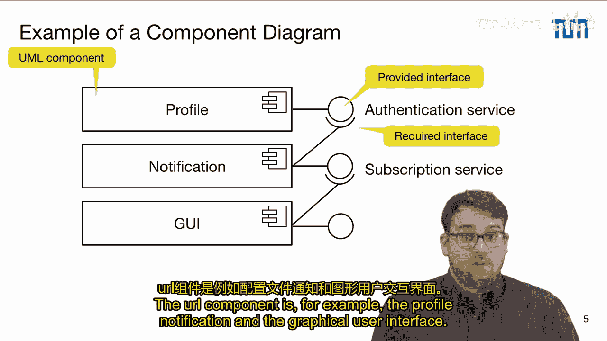

# 【全集】慕尼黑工业大学SEECx 软件工程基础 中英字幕 1080P p23 Lecture 5-4UML组件 -BV13sqGBLE64_p23-

Hello and welcome to the short union about UML componentent Dis of the course So EngineerEssentials。

 My name is Andreas， after the session you will understand UML component diagrams and are able to apply these diagrams。

The component diagram is a structural diagram and is used during the phase of system design for the following purpose。

We want to model the top level view of the system design in terms of components and dependencies among these components。

Components are depicted with a box， the name of the component in it and an icon。

 representing that it is a component， as you can see on the right side of the slide。

The dependencies represented as edges in the graph are the connectors and are shown as dashed lines with errors from the client component to the supplier component。

The types of dependencies are language specific。Now we have components and connectors which are part of an itural style Component diagrams are also informally called software wiring diagrams because they show how the components are wired together in the application。

UML component diagrams use so called UMl interfaces to describe the dependencies and connections between components。

 These interfaces are represented as lollipops and sockets。

 A U MMl interface describes a group of operation。It's not a single separation。

 it's a group of operations that are provided or required by UML Comp。

So we separate between provided and required interfaces。 A provided interface is noted as a lollipop。

 as you can see on the slide， and the required interface uses a socket notation。

 so a socket notation can adapt to a lollipop。 Furthermore， we have ports。

A port specifies distinct interaction between the component and its surrounding。

Ports are depicted as simple small squares on the sides of the classifiers。

We show you a small example which is part of our university app。 We have three UML components。

 the profile， the notification， and the graphical user interface。

 The profile has one provided interface， the socalled authentication service。

 where the notification component can authenticate we have a required interface from the notification which uses the provided authentication service of the profile。

The UL component is， for example， the profile， notification and the graphical user interface。

That's it for this short unit about the component diagram。

 there's also an exercise for you where you have to apply the component diagram and model the subsystems of the university application in more detail Thank you for your attention and see you the next time。

