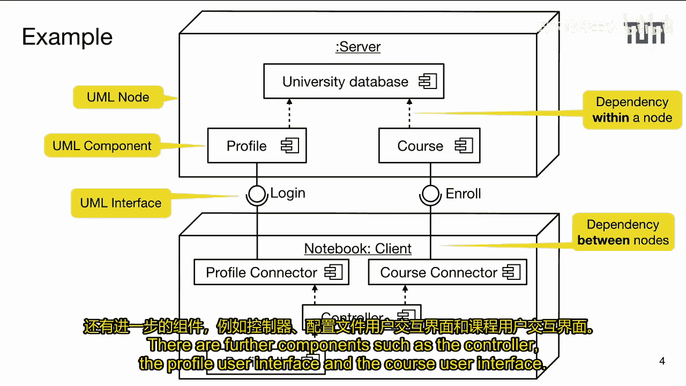

# 【全集】慕尼黑工业大学SEECx 软件工程基础 中英字幕 1080P p24 Lecture 5-5UML部署图 -BV13sqGBLE64_p24-

Yeah。

Hello and welcome to the unit about UML deployment Di of the course Soft EngineeringEssentials。

 My name is Andreas and in this session you will understand what UL deployment diagrams are and how and where to apply them。

😊，Deployment diagrams are structure diagrams， and you can find them on the left bottom。

 They are used during system design， and you can map components to actual hardware and software。

 Ul deployment diagrams are useful for showing a design after the system design decisions have been made。

 so we consider the different design goals。 We decomposed our subsystem。

 We had a look at the concurrency and we already did the hardware software mapping。And therefore。

 exactly we use the UL deployment diagram to present it。

A deployment diagram is a graph of nodes and connections。

 so called communications associations In our example， we have two nodes， a client and a server。

 and nodes are shown as 3D boxes and it is an instance so we underline it。

The connections between these nodes are solid lights and connect the different nodes and nodes may contain components。

 and that is a convention we use in this course。We brought you an example where we took the components we created in the component diagram and put them in nodes。

 so the two nodes are the server and the client， the component profile is running on the UL node server and is offering the login service。

 which is noted as a lollipop interface。The profile component is running on the client。

 in our case it's a notebook and is making use of the login service。It's depicted as a socket。

 Furthermore， we have the course component offering the enrolled service。

 which is used by the course connector， as you can see。

 dependency between nodes are depicted as solid lines。

Let's add the university database component and show the dependency between it and the profile and the course component。

Depenencies within a node are depicted as dashlights。

There are further components such as the controller， the profile user interface。

 and the course user interface。

That's it already for this unit。 we gave you a brief introduction to UML deployment diagrams。

 how they look like and how the notation of them is and why we use them and how to use them。

 Thank you and goodbye。

