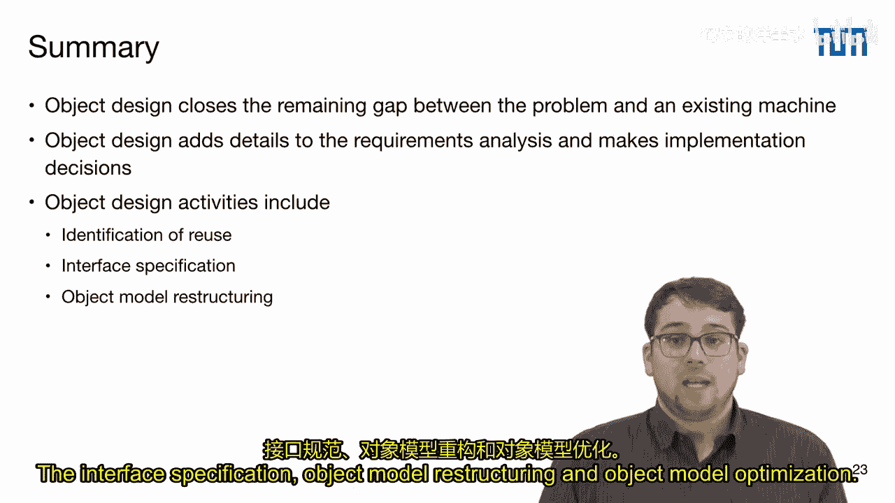

# 【全集】慕尼黑工业大学SEECx 软件工程基础 中英字幕 1080P p25 Lecture 6-1对象设计 -BV13sqGBLE64_p25-

Hello and welcome back to the course Soft EngineeringEssentials My name is Andreas and in this unit we will have fun with object design。

😊，This unit is based on chapter 8 and9 of the object oriented software Engine book。

 refer to it for more detailed information。Where are we currently in the development process。

 we started with a problem statement and elicited requirements。

 so functional and nonfunction requirements during the analysis。We created a functional model。

 including use cases， the analysis object model with taxonomies。

 We then created a subsystem decomposition and identified components and hardware notes for our system。

 The final application will run on an existing machine in the target environment。 In our case。

 it's a student's notebook。 and it will be implemented in Chaba。

 which can be seen as a virtual machine providing a runtime environment and existing components such as a user interface or mechanisms for client server communication。

We reuse this components as we don't have to build everything on our own。

 These components are also called cutts， commercial of the shelf components。

The problem we're now facing is that there's still a gap between the analysis and our actual application on a student's notebook。

 so the question is how do we fill this gap， the answer is with object design。

We are one step ahead of the actual implementation， and we are preparing everything for it。

 We take our system model。 We came up during analysis with our design decisions we've met and transform and optimize it。

 We identify several Ris possibilities and ask ourselves the question whether we should build or buy specific components。

 We are investigating alternative ways for implementing the model and thereby always keep an eye on our design goals。

 such as minimizing the execution time， The memory or other measures of cost。

 Object design serves as the basis for the upcoming implementation。😊，After the session。

 you are able to understand the need of object design。

 you can apply different activities during object design and remember the different types of reuse。

Let's get back to the problem of the gap。So design means closing the gap。

 We want to give an example how nature closes gaps。

 The San Andreriaas fault is a continental Trans fault in California。

 It is the tectonic boundary between the Pacific plate and the northern American plate。

 So what do we have here， We have a subsystem1， which is the rock material from the southern Sierra Nevada Mountains。

 which is moving to the north， and we have a subsystem 2， the San Francisco Bay area。

 which is moving to the south， and in between there' gap， and actually that's our subsystem 3。

 Nature is filling this gap with water， the San Andreas Lake。

In object oriented software engineering there are four activities which can be applied in order to close this gap。

 First of all， we have reuse， reuse， reuse and reuse。

 the more you can reuse the faster you can close the gap between an existing machine and your problem。

 making use of inheritance and off the shelf components as well as design patterns enables us to reuse existing software engineering knowledge and components that are already available。

Second activity， the detailed interface specification。

 more and more developers will get involved into the project。

 and they will refine and change many objects and the interfaces。

 The detailed specification is for developers to communicate clearly and precisely about increasingly lower details of the system。

😊，Activity 3 and4， object model restructuring and optimization transform our model to make it more clear and extensible within these activities。

 we also keep an eye on the nonfunction requirements and try to fulfill them。

All a point1 and 2 are focusing on res and specification。

 whereas 3 and 4 are more towards mapping the model to real code。 Let's have a look at reus。

Our problem is as already said we want to close the design gap and we have the following goals。

 we want to reuse existing classes。 We want to reuse existing interfaces as well as reusing design knowledge from previous experiences。

 There are two techniques for it。 First of all， composition where a new class is created by the aggregation of existing classes and the new class offers the aggregated functionality of the existing class。

 It is also called black box reuse。Second technique is inheritance。

 so a new class is created by subclassing。 The new subclass reuses the functionality of the superclass and may offer new functionality。

 This is also called white box reuse。Let's have a look at an example of composition also called black box3s。

 we have toppped the requirements analysis and on the bottom the object design。During analysis。

 we talk the language of the application domain and during object design。

 we talked the language of the solution domain During analysis， we came up with a class command。

 so for a discussion students can add command when we have a look at the object design。

 a comment actually consists of an image and text field and a label。

 So this is how a command could look like， as you can see。

 we have an image of the user who is posting the command we have a text field where the user actually can insert his command and a label representing the name of the user。

Let's have a look at the use of inheritance。 We use inheritance to achieve two different goals。

 First of all， the description of taxonomies。 and second of all， the interface specification。

 the description of taxonomies is to used during requirements analysis。

 and we identify application domain objects which are related in a hierarchy。

 The goal is to make an analysis object model more understandable。

 When we have a look at the interface specification。 it is used during object design。

 and we identify the signatures of all included objects。

 We apply it to increase the reusability enhance hence the modifiability and the extensibility。

 There are two ways to discover inheritance association， first of all。Generalization。

 generalization means the discovery of the inheritance relationship between two classes where the subclass is discovered first。

 So， for example， it is often used in science and engineering。 For example， in biology。 First。

 we find individual animals， such as an elephant and tiger or a lion。

 And then we discover that these animals actually have common properties and we gave this common properties names。

 namely a mammal。Specialization means that the discovery of an inheritance relationship between two classes is done where the superclass is discovered first to give you an example out of the physics。

 the quartz theory postulates the existence of certain particles after the theory was formulated。

 people started searching for those particles and found them。

We came up with a model for inheritance and as already said， inheritance is used during analysis。

 as well as during object design。 This is often confusing。

 The taxonomy we're creating is during the analysis activity and the inheritance for reuse is during the object design activity。

 We will have a closer look at specification and implementation inheritance。 First of all。

 we have a closer look at the different terms。 I inheritance is subclassing from an implementation。

 The implementation functionality can be found in the superclass and we reuse this implementation functionality。

 We give you an example for it。So we have a class that is already implemented and that does almost the same as our desire class。

 for example we have a list， but we need a stack， the list class is already implement。

 so what about subclassing stack from list and implementing push and pop using the implementations of add and remove。

Well， seems like a plan， but we might have problems with the implementation inheritance。

 as the inherited operations may exhibit unwanted behavior。

The availability of add and remove as they are public options may cause problems。

Having a look at delegation， what does delegation mean。

 catching an operation and sending it to another object where the functionality is already implemented with regards to reuse。

 we implement the functionality within another object。Short example。

 delegation is a way of making composition as powerful for reuse as inheritance。

 We have three objects involved in the delegation。 The client who is calling the receiver。

 the receiver who is sending the quest to the delegate and the delegate who is executing the request。

 The existence of the receiver makes sure that the client cannot misuse the delegate object。

 Let's compare delegation and implementationheritance。

 Inheritance extends a base class by new operations or overriding an existing operation。

Delegation catches an operation and sends it to another object。 You can see on the left。

 we have delegation。 On the right， we have theheritants from list and stack。

 So what do you think which of the approaches is better。Well， in this case。

 we think that inheritance is not the right choice。

 we would go for the delegation as it's more clear and we don't face problems regarding add and remove methods。

Delegation comes along with some advantages， it is flexible because any object can be replaced at runtime by another one。

But unfortunately， delegation is inefficient because objects are encapsulated。

 Inheritance also has several advantages。 It's straightforward to use and it's supported by many programming languages。

 Furthermore， it's easy to implement new functionality in the subplus。

But there are also disadvantages， inheritance exposes a subclass to the details of its parent class。

And a change in the parent class implementation forces the subclass to change。

 which requires recompilulation。Back to the terminology， there's one more thing。

 the specificationheritance。It's subclassing from a specification where the specification is an abstract class。

In this abstract class， all the operations are specified but not yet implemented。

 so we are reusing the specified functionality in the superclass。

 This we already covered in the unit about object oriented programming too。

Having a look at the activities of object design， we cover the use of inheritance and in case there are any off the shelf components which can fill the design gap。

 there's no need for implementation。We can solve our problem with already existing components。

The use of design patterns is covered in the unit about design patterns。

 and we're moving now to interface specification。When we have a look at the developer。

 the developer can have three different roles。 First of all， there's the class user。

 the class implementer and the class extender。 They all have different use cases regarding different classes。

 The class user is actually the one who is calling a class。 So for example， we have a class lecture。

 and somebody is using it and calls methods on the class lecture。

 We have a class implementer who is realizing the class。 He's the one who is really implementing it。

The class extender refines the class， so we have a super class， for example person。

 and the class extender is extending a subclass student。To clarify this， we came up with an example。

 we took out of the analysis object model， and we compare the user。

 the extender and class implementer。 So the developer responsible for the implementation of a person is called class implementer。

 For example， if you want to calculate the age of a person。

 after the person has inserted his birthday， we have a method to calculate the age。

 The method can be private， and this method can set the value。

 the calculated value to an appropriate attribute H for example。 When we have a look at student。

 the developer responsible for the implementation of student is a class extender of person。

He has to make sure that the visibility information is protected so student can access this information as it's protected。

 No one else， only the subclass can get this information about the age when we have a look at the course。

 The developer responsible for the implementation of it I a class user of exam in order to set the participants for an exam。

 for example， exam needs a public method to set the participants， which can be invoked by the course。

How to precisely describe this interface， you will learn in the UniiL diagrams for object design。

 have a look at it and learn how to transform an analysis object model into a class diagram which is appropriate for object design。

Always keep in mind the different roles of developer and design your interfaces accordingly。

While a point3 and 4 are not covered in this cause。

 we recommend to have a look at the book of Professor Brugeger and look at the refactoring sections of the website sourcemaking dot com。

Now， short summary of the unit。So object design is there to close the remaining gap between the problem and the existing machine。

Object design adds details to the requirements analysis and makes implementation decisions。

Object design activities include identification of reuse。The interface specification。

 object model restructuring， and object model optimization。

That said for today， in this unit， we covered object design。

 we had a look how we can close the gap and reuse already existing software engineering。

 See you in the next unit。