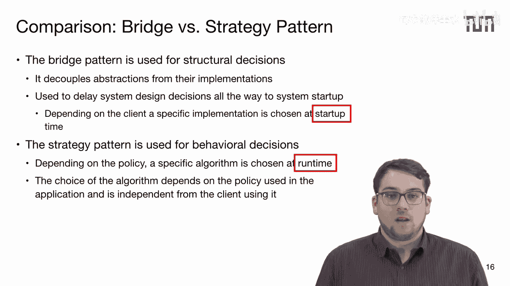

# 【全集】慕尼黑工业大学SEECx 软件工程基础 中英字幕 1080P p26 Lecture 6-2设计模式 -BV13sqGBLE64_p26-

Hello and welcome to the unit about design patternss of the course softwareft EngineEssentials。

 My name is Andreas and in this session you will understand why design patterns are useful in software engineering。

 especially during object design in order to deal with change。😊。

You will get to know different types of design patterns。

 and we will show you the bridge pattern and the strategy pattern in more detail。

Why should we care about patterns， Pat address nonfunctional requirements。

 and especially when you have a look on the right side。

 we're dealing with design patterns in this session we're focusing on reconfiguration。

 one of the nonfunction requirements， and we can achieve the shconfiguration by using the bridge pattern or the strategy pattern。

Short recap。 Why are design patterns good， They are generalizations of detailed design knowledge from existing systems。

 and they provide for you and for your team a shared vocabulary。 So， for example。

 when a team member of you says， hey， we can do this with a strategy pattern。

 you immediately should know how to apply the strategy pattern。

 how the model does look like and what benefits you can achieve。

 Design patterns provide reusable designs mainly implemented by polymorphism and delegation。

 All these design patterns and some architectural pattern use this combination of polymorphism and delegation。

The gang of4 describes three types of design patterns。

 and we will also use these three types in our course。 First of all。

 there are structural patterns which try to reduce the coupling between two or more classes。

 It introduces an abstract class。 for example， to enable future extensions and encapsulates complex structures。

 Second， the behavioral patterns。 So they allow you to choose between algorithms and the assignment ofresponsibilities to objects。

 So the question is who does what？ That's part of behavioral patterns。

 It furthermore simplifies complex control flows that are difficult to follow aron term。 Third。

 we have creational patterns。 They allow us a simplified few from complex instantiation process。

 They make your system independent from the way objects are created and composed as well as represented。

 So this is the textual form of the taxonomy。 Now， we put it in。Bgraph。

Here you can see our superclass design pattern， we have three types of structural patterns。

 behavioral patterns and creational patterns， and what you should really keep here are the three different types of design patterns and the categorizations of the examples。

Sdrickcap structural patterns are concerned about class communication。

 behaviorvial patterns are about class and object composition。

 and the creational patterns are about class instantiation。As promised in the introduction。

 we will now dive into the bridge pattern and that's what we're going to do now。

The bridge pattern allows us to postpone design decisions to the startup time of a system。

So why is that of interest？Because we have a problem that many designs are already made final at the design time or a compile time。

 so it's complete in the response of a developer， for example。

 that he makes sure which design to follow。Nonetheless。

 ofmed us desirable to delay these design decisions until runtime。 So we give you an example for it。

 We want to support two different types of clients。

 Cllyde1 uses basically a very old implementation of an algorithm。

And client2 uses a modern implementation of it。The bridge pattern allows us to delay this binding between interface and its implementation to the startup time of the system。

 the compiler doesn't have to decide which algorithm to use that is done at startup time。

 so how do we do that， for example， in the constructor of the implementation of a class。

We now show you the official ural diagram。 As you can see on the left side。

 We have the abstraction interface on the right side， the implementer interface。

 and there's delegation between them。 We further， have hierarchies on both sides。

 realized with inheritance， the refine abstraction 1 and the Ref abstraction 2， for example。

On the right side， the concrete implementer 1 and concrete implementer 2。

 So abstraction and implementer are connected by delegation， which enables the dynamic binding。

The taxonomy we're creating on the left side is basically a taxonomy in the application domain。

 whereas on the right side， the taxonomy is a subclass in the solution domain。 so as I said。

 we can now reconfigure the system at startup time depending on the client。

To explain the bridge pattern in more detail， we created a short interactive video for you。

In this explanation video we are taking a closer look at the bridge pattern。

 the bridge pattern is a structural pattern that is used to decouple an abstraction from its implementation so that the tool can evolve independently。

 the bridge pattern offers you the possibility to connect elements from the application domain to elements from the solution domain。

To use a metaphor of a bridge， you can imagine a bridge connecting two different shores。

 the application domain and the solutionl domain， but now let's look at an example so we can get a better understanding where the bridge pattern is used and what it is useful。

To explain the bridge pattern， they use the S EECX course and its exercises as an example。

Exercises are the elements in the application domain and can be finished by a student。

Once an exercise is finished， it has to be evaluated。The avi is not done by the exercise itself。

 but by an assessment algorithm or technique， this is a solution domain of art taxonomy。

 a clear benefit of the bridge pattern is the decoupling of the implementation so that it is not bound permanently。

The evaluation algorithm can be chain runtime， even if the exercises are already recreated。

 like many other design patterns， the bridge pattern uses encapsulation。

 aggregation and inheritance to separate different responsibilities into different classes。

 exercises can be subclassed and refined into different types such as quizzes or programming exercises。

 The same effect can be achieved by subclassing the assessment class and its well defined interfaces。

 There are different assessment techniques or algorithms that are using the same super class assessment exercises and assessment techniques can be developed independently。

 and if something is changed the concrete abstraction classes stay the same。

 and the communication is not defected， taking the metaphor of the bridge pattern into consideration。

 each side of the river can develop independently， but both are always connected by a bridge and traffic can pass the river。

Next we will have a look at behavioral patterns， and for this， we picked out the strategy pattern。

You need the strategy pattern when there are situations where different algorithm solution exist for a specific task sounds familiar to the bridge pattern。

 right， but we will figure out the difference later on。 For example。

 think about our problem statement。 We have a list of students which should be sorted after name or field of studies。

 We have different algorithms to sort them。 bubble sort， quick sort or merge short。

 So the three different variances of this algorithm， De tradeoff between space and time。

 So one might be faster。 The other one needs more power or the other one needs less power。

 but it's not that fast。 based on the current context。

 we are able to select a specific implementation at runtime。

Different algorithms will be appropriate for different types。 So， for example。

 if an algorithm is slow but can be implemented fast， it's applicable for rapid prototyping。

On the other hand， we have an algorithm that is fast。

 but takes time to implement for the delivery of the final product。

In case we want to add a new algorithm， we want it to be easily added without disturbing existing applications that are already using other algorithms。

Let's talk QML。 This is the diagram of the strategy pattern。

 The strategy in the middle performs a common interface。 The concrete strategies， A。

 B and C implement the concrete algorithm and adheres to the interface defined by the strategies。

On the left side， the context is configured with reference to the strategy。

And delegates the call of the client to the strategy who is in charge for choosing the strategy。

You can see the policy sets the strategy and invoke select strategy on the class context。

The client calls execute algorithm on the context。 The execute algorithm method is using the strategy reference and then invokes perform algorithm。

So the policy defines which concrete strategy to use and the client decides when to perform the algorithm。

Next， we want to show you another interactive video about the strategy pattern。In the university app。

 students can view the courses as a course list of the current week。

 displaying the courses just by name is not very useful。

 so we add dates and times to the list so that students will be on time for their classes One requirement is to sort the list by date。

 otherwise students would have a hard time finding their next class。To sort the courses after dates。

 we have to select a sorting algorithm， there are multiple sorting algorithms with different performance and memory characteristics。

 for example， Quick sort， merge sort and bubble sort。

We want our app to be efficient in other words we want to address the design goal performance；

 there are situations in which distort sorting algorithms perform differently Overot is simple。

 does not take additional memory but would be too slow for large course lists because it needs a quadratic time Quicksot is very fast for large course lists as it needs endlock end time。

 but it consumes more memory。Therefore， we want to support multiple algorithms and choose to write one at runtime If the course list has more than 10 courses。

 we use Quick sort otherwise we use bubble sort but how do we implement such a behavior we could implement a sort method that we used throughout the project use inheritance and overr to select the different sorting algorithms however。

 if you want to add more sorting algorithms the code would become complex how to understand and how to maintain a better solution in this case is the strategy pattern which defines a family of strategies in this case sorting algorithms each following the same interface it encapsulates all strategies in the same interface and makes them interchangeable the right strategy。

 the right sortaring algorithm can be chosen at runtime let's take a look at how that works in detail First。

 we define the sort strategy interface and the concrete strategy implementations In our case。

 bubble sort and Quick sort。Both inherited from the sort strategy interface and implement a perform sort method。

We also have to consider the context of the operation， in our case， the length of the course list。

The policy selects which strategy to choose and which situation based on this context。The client。

 in our case， the user interface then executes the Per sort method on the sort strategy interface and due to context。

 in this case the course list has less than 10 entries， the right strategy is chosen。

So let's compare the bridge and the strategy pattern。

 The bridge pattern is part of structural patterns and is used for structural decision。

 It decouples the abstraction from the implementation and is used to delay the system design decision all the way to the system startup time。

Depending on a client' specific implementation。It is chosen at startup time。

 which implementation to use。In contrast， the strategy pattern is part of behavioral patterns。

 so it is used for behavioral decisions。Depending on the policy。

 a specific algorithm is choosing at runtime， not at startup time。

 the selected algorithm is dependent on the policy used in the application。

 and the policies depend on the client using it， So to get the difference between the bridge and the strategy pattern。

 the bridge pattern is choosing the algorithm at start time。

 whereas the strategy pattern is choosing it at runtime。

We are at the end of session about design patterns。 Hopefully。

 we could motivate you for the usage of design patterns as they are really fundamental for every software engineer due to time reasons。

 we just introduced two concrete patterns， namely the bridge and the strategy pattern in case you want to learn more about patterns。

 Have a look at the book of Professor Bruger， or at the design pattern book of the G of4 by Eric Kamar。

That's it for now， see you the next time。

