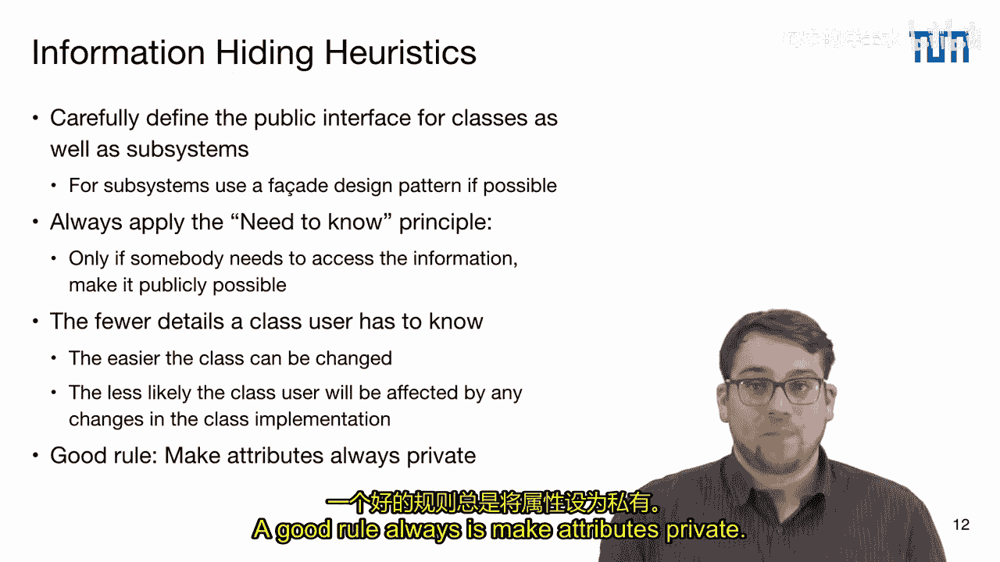

# 【全集】慕尼黑工业大学SEECx 软件工程基础 中英字幕 1080P p27 Lecture 6-3UML类图 -BV13sqGBLE64_p27-

Hello and welcome to the unit UML class diagrams during object Design of the course Software EngineerEssentials My name is still Andreas and in this session you will learn how to transform an analysis object model into an object design model。

😊，Having a look at the UL diagrams within East。We cover again the topic of class diagrams and you might wonder why。

 because we already introduced them during the phase of analysis。

 but now we are reusing this type of diagram during the phase of object design where we are currently。

We will not cover on the not of the diagram， we will focus more on the intention of the diagram during object design。

We presented two activities to enrich class diagrams during object design。 First of all。

 we're adding solution domain specific classes， attributes and methods。 Second。

 we show you how to specify interfaces with regards to signatures。

 visibility of attributes and methods。 Let's start with adding solution domain specific classes。😊。

As already seen in the unit about object design， we extend our model that we came up during analysis with solution domain specific classes。

 our common class got extended and now has an image a text field and the label to represent a comment of a student in the user interface。

 so you can see which was basically one class command in the analysis now gets four classes within our object design。

Beneath adding domain specific classes， we furthermore add solution domain specific attributes and methods to our class course。

We pick an ID， for example， that is needed in order to handle identically named courses， for example。

 we also add an update method， which will be required and invoked after a student has enrolled for a course。

 So we add specific attributes and methods for the implementation。

 we will show you these two examples， Now， when we apply the state pattern during object design。

We are applying the state pattern here for the creation of the object model。 For example。

 a course can be in different states and according to a specific state。

 a student can enroll for a course or not， we created an interface called course state and implemented the three concrete states which are open for enrollment running and closed。

 only when courses are in the open for enrollment state， students can enroll for this courses。

 Otherwise， this is not possible， As you can see， we added one interface and three classes to the object model。

 So the analysis model is more and more becoming our object design model。

For the creation of the object design model we have to specify interfaces during the analysis we already specified interfaces so we came up with attributes and apparration。

 but there was no need to specify types or parameters。

 we covered this in the unit about class diagrams。During object design。

 we specify interface by adding type signature information and visibility information。

 We start by adding the type signature information。😊，Starting again with our course class。

 we came up during analysis， we have the methods and attributes with our type information。

 You can add them during the analysis， but it's not required when we have a look at the object design model now。

 as you can see depicted and blue， we added specific type signature information for our attributes For example。

 an interteger for the required semester or parameters for students to enroll with the return while you avoid during object design we have to specify the signature for each method and the type of all attribute as a next step。

 we add visibility information to our diagram。So perhaps you might remember the diagram on the right side。

 we already introduced it in the session object design。Our developer can have three roles。

 first of all， the class user， the class implementer， and the class extender。

 depending on the role you have to define different visibility informations in your UML class diagram。

Starting with a class user， he's dealing with public attributes and methods that can be accessed by any other class。

 so he defines the attributes and methods as public depicted as a plus sign in the UML diagram。

Second， the class implementer who deals with private attributes and methods that can only be accessed within a class。

Defined as private and marked in U Ml with a minus sign。

 The classicer deals with protected attributes and methods that can be accessed by the class in which they actually are defined and by any descendant of the class。

 This is marked with a hash sign in the U Ml diagram。

To map the UML visibility to Javaer is easy because UL viibilities are very similar to the Java visibilities except for the packaging rules。

We'll give you an example of how to add this visibility information and we're going therefore back to our course example。

 you can see that we don't have any visibility information currently when we move to the object design。

 we add different signs for the visibility。For example， the minus for the attribute course ID。

To fill the gap between the analysis and the implementation。

 we give you an example how you can map the visibility in the UMl diagram to access modifiers in Javava。

 Our course class now has the visibility information and the signatures and we map this to a class course written in Chava。

As you can see for the course ID， for example， and the enroll method。

 we added the signature information that werere passing students and the course ID of type integer。

And we added visibility information， for example， that the update method is a private method for the direct mapping。

 you can see course I E was mapped as int in the Ul diagram and now becomes type interteger。

 whereas the minus in the Ul diagram， which stands for private。

 becomes a private method in Javava information hiding is not a major issue during analysis。 However。

 during object design， it is。 we give you some heuristics for information hiding。 First of all。

 carefully defined the public interfaces for classes， as well as subsystems。

 apply the facade design pattern wherever it is possible。Always apply the need to no principle。

 so only if someone really needs access to the information， make it publicly available。

The fewerer details， the class user has to know the easier the class can be changed。

 and the less likely is that the class user will be affected by any changes in the class implementation limitation。

A good rule always is make attributes private。

That's it for this unit。 We hope it is clear now how to transfer the analysis object model to an object design model。

 You're currently straight ahead before implementation， and we have prepared everything。

 Thank you very much。 and see you the next time。

