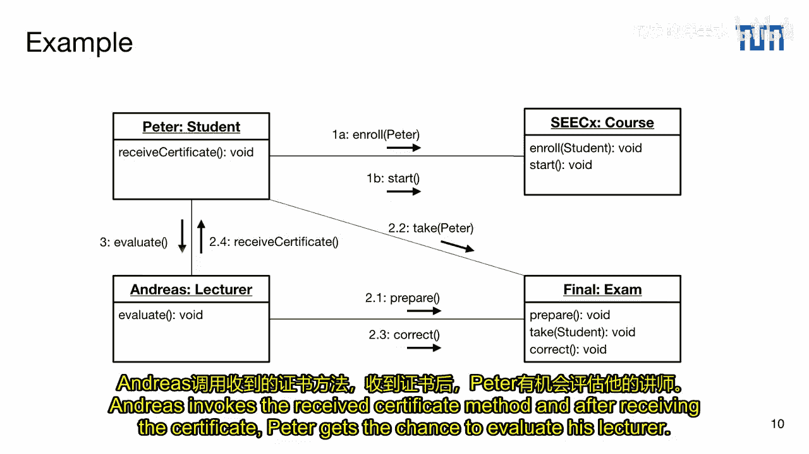
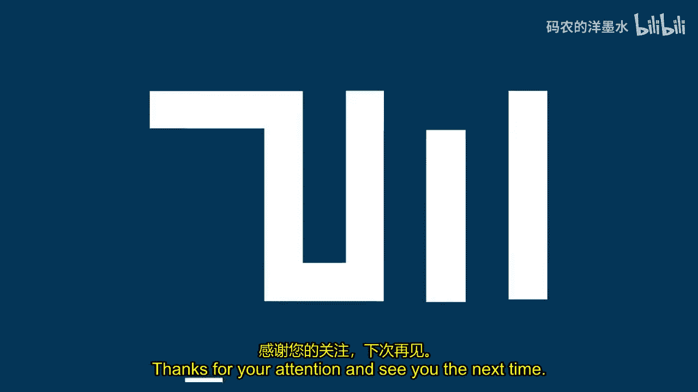

# 【全集】慕尼黑工业大学SEECx 软件工程基础 中英字幕 1080P p28 Lecture 6-4通信图 -BV13sqGBLE64_p28-

Hello and welcome to the unit UML communicationic diagram of the course Soft EngineeringEssentials。

 My name is Andreas。 In this session， I will show you how to transform structural class diagrams to behavioral communication diagrams。

 The taxonomy of UMl diagrams in Seix visualizes the different intentions of the diagrams。

 Class diagrams as a subclass of structure diagrams on the left side and communication diagrams as interaction diagrams on the right side。

 So let's compare them。😊，How do we get from class diagrams to communication diagrams Class diagrams show the layout of classes and their associations。

 whereas communication diagrams show the interaction between multiple objects。

 objects are instances of classes。The communication diagram illustrates the flow of messages between the objects using the same layout as the class diagram。

Just to mention UML sequence diagrams， we will not cover in this course。

 these sequence diagrams use livelines and we prefer communication diagrams instead of sequence diagrams。

How to get from classes to objects， starting with our class course with the aggregates name。

 times and the methods enroll， drop and start。 We now create an instance of it called object。

 and we visualize it。 first of all， with a column at the headline before course。 Second of all。

 it's underlined and optionally， you can also name it。 So， for example， give it a name in our course。

 the Seig course。To show messages within communication diagrams。

 we have three different types of messages。 First of all， sequential messages。

 second conditional messages and third concurrent messages。 in contrast to class diagrams。

 all types of associations within a communication diagram are transformed into simple lines without multiplicities。

 So let's have a look at the sequential messages first。Peter， the student。

 wants to enroll for the SEX course， so he invokes the enroll method。

 the arrow indicates the direction of the communication。 After a while， Peter decides， okay。

 I have a lot of other things to do， I want to drop the course， so he invokes 1。2 the drop method。

Having a look at conditional messages， these messages mean that it can invoke a method only if some specific requirements are fulfilled。

 For example， to take the E X course， you have to have specific semester。

So Peter needs to be at least in the fourth semester because Ses， for example。

 needs students higher than the fourth semester， so he can evoke the en method。

Last but not least the concurrent messages in communication programs， they are executed in parallel。

 so for example， PE enrolls with 1A into the course and at the same time with 1 B， the course starts。

How to get from this class diagram to the communication diagram。

 we have on the left side now actions and on the right set an example for it。 First of all。

 all the steps from the event flow from one of the scenarios。 For example。

 Peter joins the course Ses and we have to instantiate the participating objectss。

 So Peter is the student and Ses the course。 Then number the messages from each of the steps of the event flow。

 So first of all， Peter has to enroll and check if there's a corresponding method in the receiver of the message。

In this case， now on the right side， the SX course doesn't have any method to enroll。

 so we check it and refine our class diagram and add a public method to the receiver。

Last but not least， we draw the message from the sender， starting from Peter to the receiver。

 the SEX course。To give you a more sophisticated example， we came up with a small story。

 Peter wants to join the SEX course and therefore enrolls in the course， and when he enrolls。

 it also starts Next of all， Andreas， the lecturer， starts to prepare the exam Peter has to take。

After the preparation。Peter takes the exam and Andreas has to correct it in order to get a certificate for Peter。

Andreas invokes the received certificate method， and after receiving the certificate。

 Peter gets the chance to evaluate his lecturer。

In this unit we covered UML communication diagrams。

 we showed you how to get from a structure class diagram to dynamic communication diagrams representing the interaction between objects in terms of messages thanks for your attention and see you the next time。

