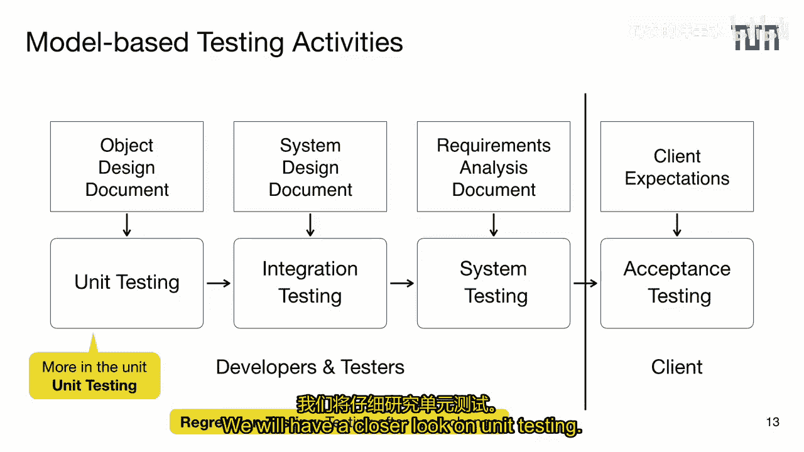

# 【全集】慕尼黑工业大学SEECx 软件工程基础 中英字幕 1080P p29 Lecture 7-1测试 -BV13sqGBLE64_p29-

Yeah。

Hello and welcome to the unit about testing of Co Soft EngineingEssentials。

 my name is Andreas and in this session you will learn what is meant by testing in the software lifecycl。

😊，After this unit， you will understand the difference between a fault， a failure and an error。

 as well as the taxonomy for fault handling techniques。

 we will have a look at the testing activity unit testing and touch upon integration and system testing。

First of all， why do we actually have to test our software Well in history there were a lot of examples which could have been prevented in case of proper testing。

 I picked out one example， the F16 Cha plane during one of the tests of the plane。

 it flipped over when crossing the equator。It happened because the system could not handle negative latitudes。

Why did this actually happen Well， the engineers reused the autopilot software from a rocket and for a rocket。

 the orientation is not really important，Nonetheless， for the F16 it is In the best case。

 the pilot of the chat probably just will get a headache when crossing theequta but hopefully nothing more will happen you can find more stories on faults failures and errors on the linked web page。

 The difference between a fault a failure and an error。It's explained to you in an interactive video。

Even though the words for error and failure sound somewhat similar。

 there's a significant difference between them in the context of software testing。

A failure is any deviation of the observed behavior from specified behavior， for example。

 a cr of the system。If the system is in an error in a state。

 any further processing can lead to a failure。 A fault is the mechanical or algorithmic cause of an error。

 or in other terms， a bug。For example， let's take a look at train tracks。

 The specification states that a track supports moving trains。 However。

 if a train arrives and stops right before point A， the system is in an error in the state。

 Any further movement will certainly lead to derailment and thus to a failure since we specified that moving trains shall be supported。

But where's the fault， in this case， it most probably lies in the communication between the workers。

We introduce now a taxonomy for fault handling techniques。

Ford avoidance uses methodologyology to reduce complexity。

 it uses configuration management to prevent unconsistency。

 as you can see in the unit about software configuration management。

 we apply verification to prevent algorithmic faults。Talking about fault detection。

 we talk about testing and debugging。 Testing is the activity to provoke failures in a planned way。

 debugging means finding and removing the cause of an observed failure。

Testing can be further split up in the three activities of unit testing。

 integration testing and system testing for for tolerance。

 we are dealing with exception handling and modular redundancy。Let's have a closer look at testing。

Testing is often seen as dirty work。But in order to write effective tests。

 a tester needs several things， he needs detailed understanding of the system as well as the application and the solution to knowledge。

He needs to have knowledge of the testing techniques。

 he also need skills to apply these techniques in an effective and efficient manner。

Testing is done best by independent testers， that's also the reason why organization build up separate testing teams or even outsource testing because four eyes find even more false than two eyes。

We are following the single responsibility principle here。

 so each person should have only one responsibility。

The problem is that developers often develop a certain mental attitude that the program should work in a certain way。

 and in fact it does not。Developers often stick to the data set that makes the program work with the attitude。

 so they think don't mess up my code。A program often doesn' not work when tried by somebody else。

 so you can often hear the sentence on my machine， it works。

Have a look at the following video to get a better understanding of the difference perspective of testers and developers。

The aim of testers and developers is the same to provide a quality product to the clients。

But their way of thinking is different。😡，Tess and developers are not different。

 but they follow a different path to achieve the same goal。Develop a thing。

How can I make the application？Tess think how can I break the application？

The good tester is one who is comfortable with conflict。

Many times it's very hard to pinpoint the source of a book。 it may be a coding book。

 documentation book， design book， or may not be a bug at all。

But it's the job of the tester to report every book。

A good developer is one who takes feedback in a positive and constructive manner。

 diagnoses the problem and keepbus it。But developers often avoid conflicts and that causes obstacles。

Let's take a look at the example。A developer implemented a form for entering user input on his machine。

 it works perfectly fine。The tester discovered a bug that the user could submit the form without entering any input。

Even though this behavior was not defined in the problem statement。

 it should be obvious to the developer that he has to validate the user input before the form is submitted。

The developer argues that the validation is a lot of work。

 but finally agrees with a tester and implements the missing parts。

In order to create the positive result， testers and developers have to work together。

What constitutes successful testing？Testing is successful when it uncovers failures。

 The goal of testing is not to have a bunch of passing test cases。

 The important test cases are the ones that first fail and lead to a more robust system。

 A tester should not limit himself to the standard cases。 Also investigate on the edge cases。

 and try out the unexpected behavior。 For example， a tester enters the wrong date in the form and reviews how the system behaves and whether it can handle the wrong input。

There are two ways to express the success of a test Option A is the test was successful because it generated a failure。

 so that's what we also think is a good test When the test goes read and does not pass because we can see。

 okay， we have a problem in our code。Option B is the test was successful because it did not generate a failure。

 we refer to this when a test passes， but we think that it's not a successful test in case because it does not generate a failure。

These two expressions are quite often mixed up。We're now heading to the test model。

We use the word test model similar to the system model。 it is a set of classes and association。

 and the job is actually to do the test。The test model consolidates all test related decision and components into one package and consists of test cases。

 which are descriptions of the testing activities to be formed。

 They are derived from scenarios and use cases we did in the analysis。

 They are also simply called tests。We also have a test driver。

 which is the program that executes the test cases。

 The input data is the data that is needed for testing。

 then the oracle comes into play and the oracle compares the expected output with the actual test output from the test When we talk about test harness。

 We talk about software components of frameworks that allow us to run this test under varying conditions and monitor their behavior and outputs。

 This test harness is also often simply called test framework。

We will have a closer look at C unit as a testing framework in another unit。

From the test model removing moving to model based testing。

 the idea of model based testing is that testing is totally model based。

 You have the system model which comes out of the analysis。

 including the use cases and the dynamic model， as well as the object model。From this model。

 you generate your test model。So your model based testing technique is where the system is used for the generation of the test model。

Another definition you have to know is system under test short SUT， it is usually part of the system。

 so it's not the whole system， it can be a single class。

 it can be a collection of classes as a subsystem If the system under test consists of the whole system model。

 we actually do system testing。At very end is test driven development。

 so we turn it the other way around。 we create the test model first before we create actually the system model。

Model based testing has some advantages we want to use。 First of all。

 we can increase the effectiveness of testing。 We can decrease costs and achieve better maintenance。

 We reuse artifacts we already did during analysis， system and objective design on。

 so we created the models we can reuse them。And we can trace our requirements。

 starting from the requirements allitations up to the actual real implementation。

We already mentioned that test driven development。 Let's have a closer look at it。

 Test driven development is a software development process that consists of very short development cycles。

 First of all， the requirements are turned into very specific test cases。

 This tests will not pass as we have written no code。 therefore so far。 In step 2。

 we write the code to pass the tests。 As a third step。

 we refactor our code and we restructure the existing code and alter its internal structure without changing its external behavior。

 So all tests should still pass。As promised already， we're going one level deeper now into testing。

 we'll touch unit testing， integration and system testing。Unit testing is also called module testing。

 and what we do there is we test individual components， classes or subsystems。

 The goal is to confirm that the component of subsystem is correctly implemented encode coded and carries out the intended functionality。

The foundation for unit testing is our objectic design document。Next。

 we're heading up to integration testing。 we're testing collections of subsystem and eventually the entire system。

 The goal is to test the interfaces among these subsystem， Foundation for integration testing。

Is the system design document？Next， we're into system testing。

 so we're testing now the entire system。Our goal is to determine if the system meets the functional and nonfunction requirements which are described in the requirementsqui analysis document。

Last but not least， acceptance testing， we evaluate the system that is delivered by the developers。

So we want to demonstrate the system and show that the system meets the expectations of the client and is ready to use。

Unit testing， integration testing and system testing are carried out by developers in testing。

 whereas acceptance testing is done by the client。What about regression testing？

Regression testing is a type of software testing that verifies that software previously developed and tested still performs correctly even after it was changed。

 so we will perform all tests previously mentioned after each change。 That's regression testing。

 We will have a closer look on unit testing。

In the unit about it。That's it for today。 In this unit。

 we have shown you why it's important to test software。

 We clarified the terminology regarding faults， failures and errors。

 We introduced the taxonomy for fault handling techniques and had a quick look at testvan development。

We also introduce the four testing activities， unit testing， integration testing。

 system testing and acceptance testing。 Thanks for watching and see you the next time。

🎼。