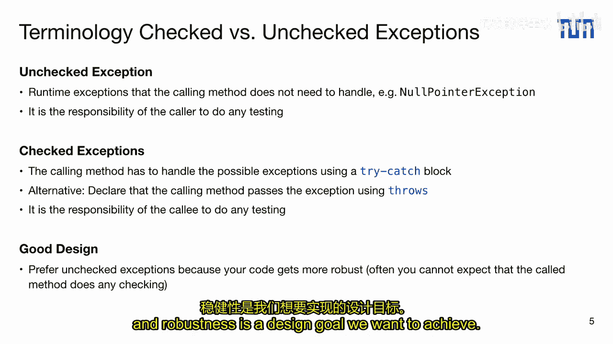

# 【全集】慕尼黑工业大学SEECx 软件工程基础 中英字幕 1080P p30 Lecture 7-2异常处理 -BV13sqGBLE64_p30-

Yeah。

Hello and welcome to the unit about exception handling of the coursese Soft EngineeringEssentials My name is Andreas and in this session you will learn more about exception handling why it is useful and how is it done within Chaba。

😊，Having a look at the taxonomy for fault handling。

 you can find exception handling as a subclass of fault tolerance。

 So exception handling is a mechanism by which a system treats an exception。In computers， as in life。

 things go wrong occasionally。When things go wrong， you need to do something about it。

 In the simplest case， you can stop or stop the program with an error code。

 The problem is that the part of a program that spots an error isn't always the part that can figure out what to do about it。

 When such a routine finds an error。 It needs to let its column know and the column may pass the error up the chain in many languages。

 special output is used to indicate this error。 Javaba has a better way。 Excepts。

 Excepts are better because they clearly separate normal processing from error processing。

 This makes programs easier to understand。The challenge we face as a developer。

 we have to foresee failures and must ride exception handling code therefore。Operating systems。

 virtual machines or services usually create only generic exceptions， which have to be handled。

 For example， division by0 or very common the null point exception。

 Let's have a look how to handle exceptions in Chava。

Let's consider first a bad example without exception hand。

 We have a class account with a private field balance and a method withdraw。

 which takes the parameter amount。What withdraw actually does if the amount is greater than the balance。

 he returns an  error code。 and if not， he subs the amount from balance and returns 0。

 Why does he actually return 0 Because this integer value is something like an  error code。

 So the method is returning0 in case。The withdrawal is not valid。 He returns-1。

Let's have a look how to properly handle exceptions with Chava。 We still have our class account。

 we still have the balance， and we still have the withdraw method。

What changes here is that we declare that the withdrawal method throws a balance exception。

 What does that actually mean， Well， when the amount is greater than the balance。

 it throws a new balance exception。 Let's compare these two examples。

 When we have a look at the first example。 We can see that the return value of the withdrawal method is an inte。

 which is basically our error code。 The new withdrawal method has no return value。 It returns void。

 So that's cleaner。 How to invoke this withdrawal method， which throws a balance exceptions。

 we have a trycach block where in the tried block， the account method withdrawal is invoked。

 And in case we have a balance exceptions， we just print out not enough money。 So， for example。

 a bank customer isvoking the withdrawal method。 Who is actually responsible for dealing with the error。

 Well， the bank customer is responsible for the handling the exception because it is a checked exception。

What actually is a checked exception and what is an unchecked exception。 First of all。

 unchecked exceptions。 unchecked exceptions can be handled by calling the method in the trial block and handling the exception a catch block。

 When we talk about unchecked exceptions， we talk about runtime exceptions that the caller method does not need to handle。

 For example， a nowll pointer exception。 It is the responsibility of the caller to do any testing。

Having a looked at check exceptions， the calling method has to handle the possible exceptions in a dry catch block。

 like we did in the previous example of the account。

 alternative is that we declare that the calling method has the exception using throws。

 So it is the responsibility of the callee to do any testing。

 What does that actually mean for our design and how can we come up with good design。

So prefer unchecked sections because code gets more robust。

 Often it is the case that you cannot expect that the call method does any checking and robustness is a design goal we want to achieve。

In this unit we looked at the exception handling， why it is useful and how it is done in Chaba。

 we also showed you the difference between a checked and an unchecked up section thanks for watching and see you the next time。

