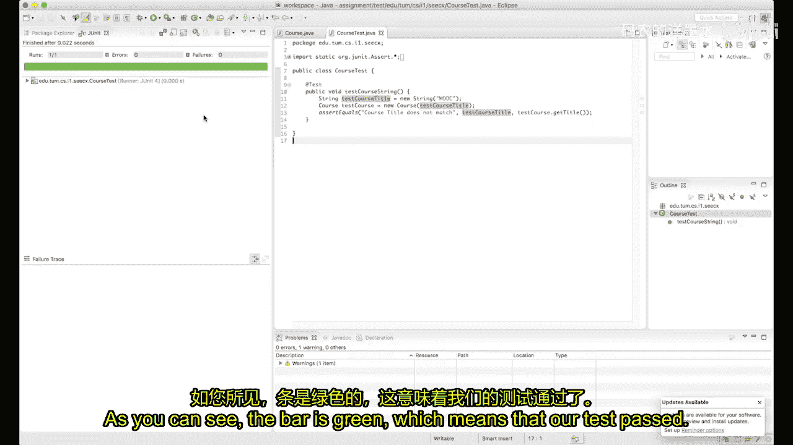

# 【全集】慕尼黑工业大学SEECx 软件工程基础 中英字幕 1080P p31 Lecture 7-3单元测试 -BV13sqGBLE64_p31-

Yeah。

Hello and welcome to the unit about unit Test of the course softwareft EngineerEssentials My name is Andreas and in this session we will have a look at unit testing and how it is done with the testing framework J unit。

😊，We are currently here at unit testing， a subclass of fault detection。

 so we want to uncover possible faults。You might remember this illustration。

 I just wanted to remember that the object designed document is the foundation for unit testing。

 Our goal is to confirm that components or subsystems are correctly implemented encode coded and carry out the intended functionality。

 So how do we create unit tests in Cha。 We use J unit。

 chair unit is a Javava framework for writing and running unit tests。 It consists of test cases。

 test suites and provides a test runner。It was initially written by Kentpeck and Ericric Gama and for those of you who heard this unit about patterns might remember Eric Gama。

 so the approach they took is written if test first and patternbased development approach it is open source。

 you can find it on GitHub and you can find the web page on it and J unit uses annotations to control the execution of test cases。

The comparison between the expected and the observed behavior is validated by assertions when we introduce the test model。

 we introduce the oracle， so when we talk about the comparison between the expected and the observed behavior。

 that's actually a test oracle。And chair unit。It is a complete framework which includes everything we need。

 We will now have a closer look at annotations and assertions。

Annotations are a form of syntactic mat data that can be added to your Javava source code。

 This is heavily used within share unit。 First of all， we have the annotation at test。

 which identifies a test method， for example， our example test here。 Furthermore。

 we have another annotation where we expect an exception。

 This test tests if the test method throws the exception。

Another example is when we add time out of 100 milliseconds。

 So if the test takes longer than 100 milliseconds， it will fail。 We have the before annotation。

 which is invoke before any tests so we can set up some stuff。

 or we have the after annotation where we can do things after running the tests。 Furthermore。

 we have the before class and after class annotation。

 This is invoked before the execution of alt tests or invoked after the executions of alt tests in this methods。

 you basically do time intensive activities such as setting up the database or afterwards cleaning up。

We will now have a look at assertions in Cha unit。 we start with the assert true assertion。

 so we assume that the condition is true。When the condition is true， the test will pass。

 if the condition is false， the test will fail。Like the first assertion。

 a assert false is working in the same way。Message here for a search shoe is an optional parameter。

 so if the test fails， this message is shown as output。The third assertions， we have is fail。

 This always leads to a failure and shows the given message。 We have our assert equals assertion。

 which compares the value of two objects of primitives。

 So he compress the expected and actual wellow。 So if the expected and actual value are the same。

 the assertion is true and the test will pass。With a certain null and a certain nu null。

 we can check whether an object is null or not。Depending on what we expect。

 we use the assert null or assert nu null method。For further details of assertions。

 have a look at the J unit Asion documentation there are a bunch of other assertion methods we just wanted to give you first insight into the most important ones Next up is an explanation video showing you how to write this tests in eclipse。

In this explanation video， we will show you how you can create your first J unit test case an eclipse for a feature of the university application。

JUnt is the unit Test framework for Java that allows you to write test cases quickly。

For this purpose， we will reuse the implementation of the course class from the object orientated programming one exercise and open it。

We covered already how you can create a project and how you can create classes。In this video。

 we will show you how you can create test cases。First。

 we create a folder for tests in our workspace with the type source folder。In this folder。

 we create a new Java package for tests corresponding to the development packages name to split our implementation code and our test code。

Now it's time to create our first J unit test case with a newly created test package。

 we call it course test as we are going to test the behavior of the course class in this tutorial。

The system on the test is the Co clause， which you can search for and select with the browse button next to the input field。

We click next and define the methods we want to test from the course class。In this case。

 the course constructor with the variable of the course title。

We create our J unit test case by clicking finish。The default implementation created by Eclipse。

 the test case， is defined to always fail with the error message not yet implemented。

We replaced this implementation by our own， which creates a new course。

Using the constructor course with the attribute title。

We create a string variable called test course title。

 which we set to MOO and pass it to the constructor as an argument。

The test case checks whether the course title is passed to the constructor and is currently stored in the class object。

In order to do that， we compare the test scores title with the title from the test scores object within the assertion。

We execute this test case and make sure that we want it as a J unit test case。

We can achieve this by other run button at the top or by right clicking the class and select Runun S J unit Test。

We now see that the test case doesn't pass， which is displayed by a red bar and one failure on the left of the eclipse window。

If you select the file test， you can see the error message below。

It says that the value MOO was expected， but instead the value now was provided by the title attribute of the object test scores。

To fix this error， we open the course class and navigate to the constructor。

There we can see that the developer did not set the title variable to the title submitted in the constructor。

 but instead another variable long title。We change this and save the file。

Now we switch back to the course test and rerun our test function。As you can see。

 the bottom is green， which means that our test passed。

That's it for today， we introduced Cha unit as unit testing framework for ChaA。

And showed you some annotations and assertions provided by the framework。Thanks， and goodbye。

