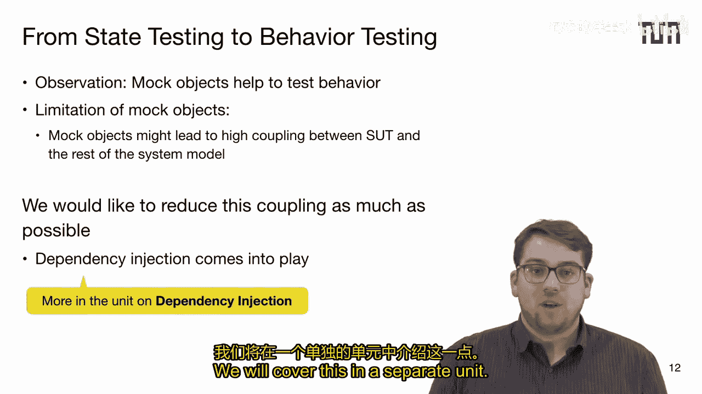

# 【全集】慕尼黑工业大学SEECx 软件工程基础 中英字幕 1080P p32 Lecture 7-4模拟对象模式 -BV13sqGBLE64_p32-

Yeah。

Hello and welcome to the unit about the mock object testing pattern of the course So engineeringEssentials。

 My name is Andreas。 In this unit， we will talk about object oriented testing。

 which you will hopefully understand after this unit。 We also examine one testing pattern。

 We have a closer look at the mock object pattern and give you examples for it。

 You'll get a basic introduction to the easyym framework。

 a framework which is using the mock object pattern， and I will show you how to apply it。

 Let's get things started。😊，In the last year it's about testing， we introduced unit testing。

 and what we observed there is that we can test the state of a system under test with unit tests。

But as we do not want to test only the state of the system under test。

 but also interactions with other components of the system。

 we have to think about a slightly different approach。 For example。

 the interaction between a student and a course in our university app。 So how can we test。

 for example， what happens if a student enrolls for a course。

 The problem with unit tests now is that you can test classes and components perfectly as long as they have no dependencies to other classes。

 but in that case， they have dependencies。 All collaborators of the system under tests have to be implemented。

 Otherwise， proper testing is not possible to overcome this problems。

 we will introduce object oriented testing and mock objects。

What is object oriented model based testing， We start with the system model。

 The system model contains our system under test， the classes or components we wanted to test。

 The system under test model does not exist in isolation。 It collaorrateates with other objects。

In the system， the so called collaborators。The test model is derived from the system under test in the context of model based testing。

 as we in the previous unit， to be able to interact with collaborators。

 we add objects to the test model。 These objects are called test doubles。

 Test doubles are substitutes for the collaborators during testing。

The purpose of the test doubles is to make the system under test belief it is talking with real collaborators。

 The name Dos comes from movies。 The stumpt double replaces the movie actor when it becomes dangerous。

In the context of software engineering， test doubles should be used when real collaborators in the system model do not yet exist。

 are too awkward or too dangerous to work with。I will now show and explain to you a taxonomy for doubles。

Doubles or test doubles is a generic term for any kind of object used in place for real object for testing purpose。

Dummies are often used to fill perimeteralists passed around， but never actually used。

 Fakes are working implementations that contain a shortcut。

 which makes it not suitable for production code。 An example， therefore。

 is a database stored in memory instead on a disk。 Steps provide canned answers to calls made during the test。

 They always provide the same answer， for example， a random number generator that always returns 3。

Mock objects are able to mimic the behavior of the real subject；

 they know how to deal with a specific sequence of calls they are expected to receive。

Out of these four kindss of doubles， only marks insist upon behavior verification。

 The other doubles can and usually do use state verification。

Marox actually do behave like other doubles as they need to make the system under test。

 believe its talking with real collaborators， but marks differ in the setup and in the verification。

Good design， especially crucial when it comes to the mock objects， why， well。

 the real object or subsystem must be specified with an interface and a class for the implementation。

Let's refer this to our university app。We take a part of our system model for the university app。

 we want to unitest the enrollmentment service， which is our system under test。

 so we create a test class enrollment service test which tests the successful enrollment of a student and enrollment where in failure occurs。

The enrollment service is used by a user interface component to enroll students for courses for simplification。

 This class only has this one method for the moment。

 We have dependencies towards the class as student in course。

 The problem now is that the class course is not implemented by now。 That's why it is marked red。

 We already implemented the enrollment service and contest it。

 but course is not ready so we cannot properly test enrollment service。 That's bad。

The mock object test pattern is based on the idea to replace the interaction with the collaborators in the system model that is coer with the mock objects。

 These mock objects can be created at setup time。 Apparently we don't have a good design right now。

 as we did not specify interface for the class course， so let's do this now。

Let's have a look at the form definition of the mug object pattern starting from an interface。

 that's what we did on the last slide in order to improve our design。The mock object pattern。

 a mock object， the collaborator mock replaces the behavior of a real object called the collaborator。

 There are several reasons why we want to replace the behavior of a real object。For example。

 a unit test needs to test an object with non deterterministic behavior， so for example。

 the current weather temperature， which is always different or changing。

Or specific behaviors are hard to trigger。 So for example， you're dealing with a network error。

Or object has a user interface， or the object is the user interface itself。

Or one of the most common reasons is that the real object cannot be tested because it does not yet exist。

 As you can see， these are problems that happen quite often and you will face them and that's where you have to apply the mock object pattern。

A mock object can be created at startup time with a factory pattern。

 We have not introduced the factory pattern in the unit about design patterns， but if you want to。

 you can have a look at the book of the gang of4 and look it up。

We will use a framework for creating the sms， so we do not really have to care about the factory。

Mock objects can be used for testing the state of eventl objects。

 as well as the interaction between objects as they mimic the behavior of real objects。

It enables us to test the interactions of the system under test with its collaborators and check if it behaves as expected。

The use of mock objects is based on the record replayment effort。

 Now you might think what the heck is the record replayment effort。 I'll give you an example for it。

 Think about a tap take first first we record something on tape and then we can play it。

The mock object pattern uses this metaphor。 Let's have a closer look at it this。

Assume you want to rehearse a musical， which requires an choir and an orchestra。Most of the time。

 the orchestra will not be available as it is too expensive when the choir practices。

 but the choir needs the music played by the orchestra when rehearsing the musical。

 The orchestra is not there when you need it。 So what to do。 Well， the orchestra records the music。

 That's what we refer to as a mock。 when the choir is p。 Now， it is using the record。

 respectively the mock and place the recording。 So we can rehearse the musical。

 Let's put this in the context of the mock object panel。

 The orchestra is a class which is not available or expensive to set up。

 So it's our mock object and part of the test model。

The choir is the class we want to test our so called system under test。

In order to properly test this， we have to walk through five steps first we create the mock object。

 in this case， the orchestra， we specified its behavior， we let it play and record it。

We make the recording ready to play so the choir can use it， the choir is practicing。

 so the system under test is executed and uses the mock of the orchestra。

We compare the observed with the expected behavior。

 so we check if the singing of the choir fits to the playing of the orchestra。

Let's bring the orchestra example and the mock object pattern to our university app。

We need a course to test the enrollment service， so we virtually introduce a class course mug following the interface course。

 We will just need the enr method， as this is the method that will be invoked by the enrollment service。

The course mo is part of the test model and will not exist in our system model。

 We will use the easyy Mo framework to do this in our Java cup。

EasyM is an open source testing framework for Chawa， which is making use of the mock object pattern。

EasyMC provides dynamically generated mock objects and runtime without implementing them。

EasyMck uses annotations to define the system under test and mocks。

A test subject annotates the class， which is under test。

 and at Mark annotates the object we want to mock。To specify the behavior of a mock。

 the easy mock framework provides the exact method。 In this example， we expect that the method food。

With an example parameter is in and that it will return an inteer。

To set the mock object ready to play， one have to invoke the replay method。

Further documentations and examples can be found on the website， easymark。org。

Getting back to our enrollment service。 First， we define our system under test。

 Eymark is using the at testest subject annotation therefore。

Then we define a mock object for each collaborator， in our case， the course。

 we compare this with the orchestra。 we are creating the mock object here As a next step。

 we specify the expected behavior which is done by expect。In step 3。

 we make the mock object ready to play by invoking the replay method of the framework with our mock object as peri。

Step4 then executes the system under test， in this case， the enroll method of the enrollment service。

Lastly， we compare the observed behavior with the expected behavior。

 in this case we assert that the number of courses a student has has increased by one as the enrollment while the enrollment service was successful。

These are the same five steps as we have introduced for rehearsing the music。

 so keep the music in mind when you apply the mock object pattern。

We are still on our journey from state testing to behavior testing。

 Mo objects help us to test behavior and interact with collaborators。Nonetheless。

 mock objects have some limitation。 For example， mock objects lead to high coupling between the system under the test and the rest of the model。

As we want to reduce this coupling as much as possible。

 we are searching for an alternative way to deal with this。

 The concept of depend in check comes into play， which helps us to reduce coupling。

We will cover this in a separate unit。

Short summary of mock objects and the mock objects pattern unit tests allowed to test the state of an object。

 mock objects are test doubles that are able to mimic the behavior of a real object。

 So the mock object patterns enables us to test state and behavior Fraworks for mocks are available in major programming language。

 and we gave you an introduction to easy mock。That's it for this session， thanks for watching。

