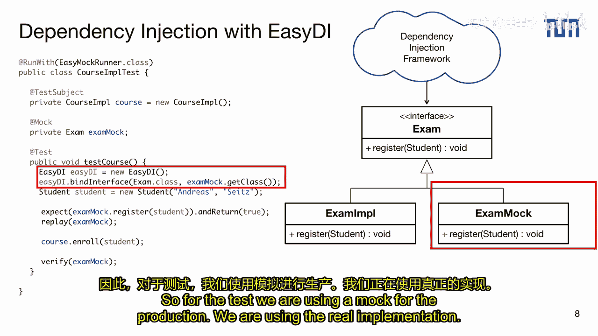

# 【全集】慕尼黑工业大学SEECx 软件工程基础 中英字幕 1080P p33 Lecture 7-5依赖注入 -BV13sqGBLE64_p33-

Yeah。

Hello and welcome to the unit on the Dependaceion section of the course Soft EngineeringEssentials。

 My name is Andreas。This is where we ended up in the last unit。

 We are still on our journey from state testing to behavior testing to overcome the limitations of the mockopic testing pattern。

 we will introduce dependency in check in this unit in order to reduce this coupling。After this unit。

 you should understand the concept of dependency in。

 we will also introduce ETDI as simple dependency in framework。The class course and its objects。

 which remote mock， are going to be finally implemented now， each course has an exam。

 which will be automatically created when the course is set up。

 This will be done in the course implementation constructor， as you can see in the code。

Life isn't always easy， and the interface for exam has been specified。

 but the implementation is still missing as your fellow developer gets sick or something like that。

As we have already learned， we can apply the mock object pattern again。

 The problem we are facing here right now is that we explicitly call new in the constructor。

 of course， implementation， and therefore cannot dynamically change between the mock and the real implementation later on。

 So if we set the field exam to an object exam implementation。

 It cannot attest the cause implementation with a mock exam。

 It is impossible to switch the exam to the mocked one without modifying exam。

We have high coupling here。Can we unit test course implementation with both a mock exam and the real exam implementation without modifying the course implementation class itself？

Yes， we can。 And that's what an dependency in check framework does。 First of all。

 we remove the dependencies from cause implementation to exam implementation and exam mock。

We want a mechanism that allows us to switch between different kinds of exams easily。

The course implementation only knows the exam interface。

 it only undirectly knows about the concrete implementations。

These concrete implementation are instantiateated and injected by a dependency framework we will use EDI later on。

The binding is done by the framework。So we have no compile time dependencies to our implementations to get a better understanding of an injection。

 we show you a real world meta for an injection and map it to the concept of dependency and in the context of software engineering。

What is an injection？What is this， Actually， it's called a captain， okay。In cap。Has gem in。He。

 who actually has eaten this thing already。Okay， so if you， if you bite into a cap at the wrong。Spot。

 yeah， the gem goes outside on the other side， and you better have a napkin or something like that。

 So， but how does a c get into the gem， right， Sorry， How does the gem get into the cup。

You need a tool like this， okay。So， this one。You would tell that she was Je。 Okay， here's my gem。O。

We don't have a spoon。 not a baker here， but let's， this， that's mimic the action。 Okay。

 so I basically would put this in here。 Well， this one as well。And here， I've my injector， O。Sorry。

 now I need my cup。 Well， I'm very prepared。 Bro the cap as well。 just went to the bakery。Okay。T。

 he' is a captain， okay？So basically， how do you get it in。 Let。

 let me show you the spaghetti dependency solution。 Okay， in the spaghetti mode， you would actually。

 actually， also in software engineering， you would actually take the cap。

And you actually put it in two unit tests， right， So you have now unit number one， unit number  two。

 And now actually， it would be easy。Imine there's nothing in there。To put this gem inside the caps。

And then in typical unit testing， you test this first。 No jam， you test this jam in there。

 you put it together and you sell it。 But that's not a cap， right， because clearly。

 it shows that you have used two hves。 Okay， so that's a bad solution， including it's messy， but。

The injector allows you to do something better。 Okay。

 the injector would now take with my injector here， injector would allow you to basically。

 let's say this is still a full intact， though it would allow you to put this in and without destroying the cut except except for one whole。

 right， for one association for one dependency。 It allow you to do the same thing。

 So that's what you have to learn now in Java。So let's talk code。

 starting from the old course implementation。 We want to get rid of the new keyword。

 Here is the code for a course implementation that binds exam implementation to our field exam。

We use this code in our system model。There are also other frameworks such as chooseose from Google。

 written G UICE， it is using so called modules to establish the binding and configure it。

What we do with EDI， we create a new instance of the EDI class。

We directly bind the implementation of an exam input to the interface exam。

Then we set the field exam to the instance provided by the Depend In framework。

Let's have a look how to test the course implementation。

Cause implementation in this case is our system under test。

 we again use easyM to create a mock object for the collaborator exam within the test case。

 we bind the mock exam to the exam interface by using dependency check。

So the exam mock does not really exist。 We can mimic its behavior thanks to the mock object pattern and change the binding in the course implementation class by using the dependency injection framework。

 we use again， easy Mo to create the mock for the collaborator。

 The combination of easy Mo and easy D as dependency frameworks enables us to write unit test that bind exam to a mock object。

 which as actual chor or class does not exist。So for the test we are using a mock。

 for the production， we are using the real implementation。

That's it for this session， dependency in check and I was slow coupling between systems and tests with a dependency in pattern we introduced EDI as a framework for dependency in check。

 Thanks for watching。Yeah。

