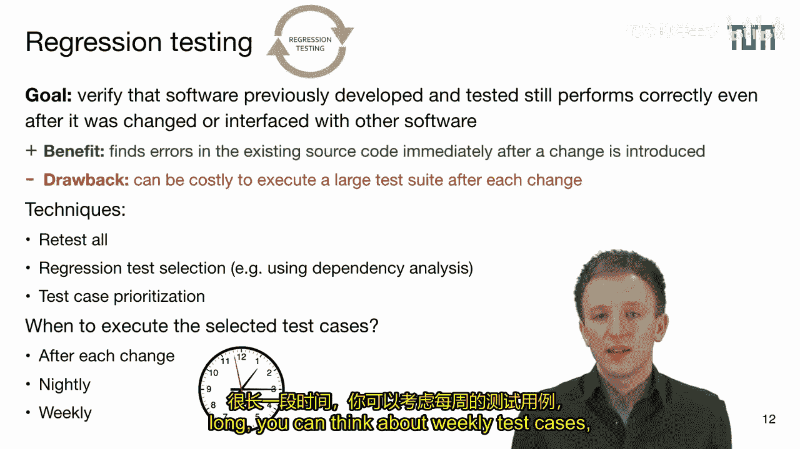

# 【全集】慕尼黑工业大学SEECx 软件工程基础 中英字幕 1080P p34 Lecture 8-1构建管理 -BV13sqGBLE64_p34-

Hello and welcome to the unit built management of the course Soft EngineEssentials。

 My name is Stefan and this unit， you will learn how build management helps develop us to compile。

 test and package their code into software builds that they can ship to their customers and end users After the unit you will be able to explain the idea of continuous integration。

 and you can describe the benefits of regression testing。😊。

Let's have a look at typical situations and projects which still occur nowadays。

 There's the developer on the one side in a development team and manager and customer on the other side。

 The customer says， for instance， the software is not working。

 and the developer then replies on my computer it actually compiled and worked。

This is a typical situation where the development environment and the target environment are different。

Another situation could be that the customer says， I don't like this design。

 And then the developer replies， the customer doesn't like the new design。

 Why didn't they tell me earlier， I wasted so much time on that。

This is also a typical situation for inefficient communication。

The customer could also complain that it's been a long time since the last release because the development team does not regularly release the software。

And another possibility would be that the manager does not know what's actually going on in the project and asks。

 what's the current status。So let's see why such situations can happen。

 It is still often the case that a development team only delivers once after the implementation was completely finished。

During the development， the team does not release the software and can obtain user feedback from customers or end users。

Developers need a lot of time to manually create a release and literally throw it over the fence to the customer。

 and then they don't care anymore about the use of the software。However。

 the development environment and the target environment are different。 For example。

 there might not be a stable internet connection when the end user works with the developed software。

 but during development， the developer always has a very fast internet connection。

Then there is a high chance that the software does not work as intended because the developer did not test under real conditions。

Another problem is that there is only little communication between developers and the customer。

 and if they communicate， they usually do that over former channels or with the project manager in between。

Software developers can do better。You can do better。

 Let's think about what is the actual goal of a software project。

 A software development team wants to create software that makes the customer and the users happy。😊。

But usually the developers don't know exactly how to make a user happy because because they cannot observe a user while using the software。

Therefore， it is important to create communication channels between developers and customers and users to allow developers to obtain feedback in order to improve the software。

Before developers can obtain feedback， they first have to transfer the source code from the development computers to the customer's device in the target environment。

To achieve this goal， build and release management comes into play。

 We already learned that developers stored their source code in a version control system。In addition。

 they can use continuous integration to integrate， test。

 and build the software after each change in the version control system。

 and this is where build management comes into play。With the idea of continuous delivery。

 they can go one step further and automate the delivery of the software to make sure that the software can be released reliably and at any time to customers and end users。

Continuous delivery is then the missing piece where release management closes the gap between continuous integration and the target environment。

Build and release management is a major activity in software configuration management that we already covered in an earlier unit。

It handles the creation of versions for external stakeholders， for customers and end users。

Buildt management is the main topic of this unit， release management is then the main topic of the next unit。

Let's start with some terminology。 Conin integration is a technique where the team members integrate their work frequently。

 usually each team member integrates at least daily or even more often， for example。

 every once in an hour， which leads to multiple integrations per day。

Continuous delivery is then one step further an approach in which teams keep producing valuable software in short cycles。

And where these teams ensure that the software can be reliably released at any time。

You can see an example of a so called build pipeline in this slide。

 the pipeline starts with unit tests that will be automatically executed after each change。

If all the unit tests pass， platform tests are executed。 If all these platform tests pass。

 the software is delivered to a staging environment。

An internal target environment where the developers can actually see if the software works as specified or not。

The actual deployment of the production is then done manually after all acceptance tests are passed。

This is in contrast to continuous deployment where every change that passes the automated tests is actually deployed automatically and incrementally。

So the step deployed to production is now automatic blue instead of red in the slide。

And continuous deployment is usually used for server applications or web applications。 For example。

 Facebook or Netflix use it in order to get even small changes of their web applications。

Within a few minutes from the development computers to the actual server so that end users can use it immediately。

And these companies nowadays do several releases per day， sometimes more than 100 releases per day。

Continuous delivery is， on the other hand， usually used for desktop apps and mobile apps。

 where developers won't have a manual step before they actually release the software to their end users。

Let's see how build management with continuous integration works in practice。

Developers interact with source code repositories by committing and pushing their code to the repository as we learned it in the unit about distributed version control。

This triggers a build on the continuous integration server， which consists of a compilation stage。

 multiple testing stages， and a packaging stage We call this a build plan where we configure our build pipeline。

Each integration is verified by an automated build to detect integration  errors as quickly as possible。

For each target environment， for example， different operating systems。

 the central build server delegates the build to socalled build agents， which compile。

 test and package the code on the actual target environment， for example。

 different operating systems such as Windows， Mac or UniX。

Build agents allowed to reduce the load on the build server and to scale continuous integration。

Before the build agent can compile the source code。

 it has to resolve the dependencies to external frameworks and libraries。

Then dependency management plays an important role。And if each change is tested。

 we call this regression testing。Resolving dependencies and regression testing are the topics of the next slide。

To resolve dependencies in Java， you can use maven。

 which is a build and dependency management tool that is open source。

 It's a powerful build tool with a lot of different possibilities。

The main idea is that you store libraries， frameworks and plugins in a central repository in the internet。

 which is called Maven Central to simplify the reuse of existing software components。

This prevents that you save compiled binaryary files in your version control system。Instead。

 you reference these frameworks and libraries and a development machine can download the libraries and frameworks as external dependencies。

The build server also downloads these external frameworks when it compiles the code。

 and this helps us to facilitate reuse。The main file in Maven is the so called PM file。

 the project object model in which you can configure how you compile your Java project， how you test。

 integrate， package， and deliver it。You can find more information on the maven website。

 they have a tutorial on how to start with Maven in five minutes。

 and we recommend that you go through it。You can also see a dependency example in the bottom right of the slide。

 dependencies can have other dependencies， for example， in this case。

 HTDP clientient is one framework that we use in our application。

 and it further depends on the comments logging library that we then can also use in our application。

This is an example of a P XML file where you can see how you configure the project to use external dependencies and how you configure it so that you can package。

 install and deploy the software， the packaging format is a Java file which standss for Java archive and which includes all the compiled class files and configuration data。

There is one dependency to an external framework Unire。

 a library that simplifies the connection to restful web services。

The example uses the maven Cha pluginin and defines the main class of the ChaA project。

Man allows different commands and then I will quickly explain you the five most common commands now。

Man clean allows to remove all created artifacts and to update the project dependencies。

May even compile， compiles the whole source code of the project and tells you if there are compilation errorss。

Man test executes the test cases using a suitableable unit test framework， for example。

 J unit and tells you if the test cases pass or fail。

Man Pack takes the compiled code and puts it into a distributed format such as the J file。

And finally， Maven deploy is responsible for copying the packaged file to the actual target environment。

 which is usually done on a built server。If we test each change to the source code。

 we call this regression testing。Its goal is to verify that the software that was previously developed and tested still performs correctly even after it was changed or interfaced with additional software。

The benefit is that developers find errors in the source code immediately after that change is introduced because all the test cases will be executed。

And developers can immediately see if one or more test cases fail。

 and then they could fix the problems。A drawback is that it can become costly to execute a large test suite after each change。

If there are 100 test cases and 50 small changes per day。

 you actually need to execute 5000 test cases and you might not have the infrastructure to do that。

So there are different techniques for regression testing。

You can always retest all test cases while this is expensive。

 it ensures that there are no errors due to the modified code。

You can also regression and taste a selection of test cases。

 then you only run a part of the test suite to save time and costs。

It is important to identify the tests that correspond to the source code change， for example。

 using dependency analysis。Then only test cases are executed that belong to the software subsystems that have been changed。

You can also prioritize test cases and only execute the most valuable test cases set up and for subsequent versions that you have identified before。

In addition， you can think about when to execute the selected test cases One possibility is after each change。

 however， if you have too many test cases and this would take too long。

 you might think about nightly tests。And if you have such a big software and such a large test suite。

That even nightly tests take too long， you can think about weekly test cases executions。

In this unit， we covered the topic built management and in particular continuous integration。

Make sure to apply regression testing and to develop automated test cases to ensure the quality of your software。

See you in the next unit。

