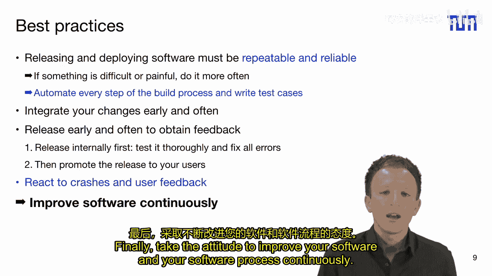

# 【全集】慕尼黑工业大学SEECx 软件工程基础 中英字幕 1080P p35 Lecture 8-2发布管理 -BV13sqGBLE64_p35-

Hello and welcome to the Uni release Management of the coursese Soware EngineeringEssentials。

My name is Stefan， and in this unit you will learn how developers deliver their software builds to end users and customers。

After the unit， you will be able to explain the idea of continuous delivery。

 You can describe the benefits of release management。

 and you will understand why feedback is important in the software development process。

Let's start with the term releasease management。The main goal is to produce valuable software in short cycles and to ensure that the software can be reliably released at any time。

Releasing means to take the source code off the development machine， compile， test， package。

 and deliver it into the target environment， preferably automated。

The role of the release manager then comes into play， who has multiple responsibilities。

The release manager is a facilitator， AliS between different business units to promote a smooth and timely delivery of software products or updates to these software products。

He also coordinates the different artifacts of the project， for example， source code。

 branches in a version control system， and he's responsible for the other team members and different software components。

One important aspect of release management is to automate and improve the process of software delivery。

Development and operation departments have to work closely together to achieve this goal。

 the focus of this collaboration led to the term DevOs。ThereforeFOPS stands for development plus Ops。

 and it emphasizes the communication and collaboration between these two departments and focuses on autoizing as many parts of the software delivery as possible。

They are developers in the development department。Testers in the quality assurance department and operators in the I operation departments that all have a different look at the software project。

 but that have to work together to achieve the best。Success。Then the release manager。

 which is the role with in a software development team。

 acts as a lia here between these involved departments， and this is what DevOs stands for。

Continuous delivery has different benefits and challenges。

 and we want to quickly go through them now。One benefit is accelerated time to market of the software continuous delivery means to release as soon as possible after you started with the project。

 and this can lead to market advantages against competitors if the software is available earlier。

Continuous delivery helps to build the right product because user feedback is possible。

 which improves the product quality and the customer satisfaction。

Another benefit is to improve productivity and efficiency of the team because all steps that are required to create and release the software are automated。

Depending on a development environment， this can save a lot of time and effort。

Continuous delivery also reduce the risk of release failures because it cannot happen that manual steps are executed wrongly。

 or that a responsible person for manual release in the team is not available due to vacations。

Everyone in the team could create a release by starting the process。

 there are also challenges for continuous delivery， for instance。

 an organizational challenge due to bying interests in different departments of an organization。

It might be quite hard to come up with a solution that fits to all these different departments。

Traditional processes such as the waterfall model or the wemod might hinder continuous delivery because different large activities like requirements elicitation。

 analysis， design and implementation have to be completed until the software can be delivered。

It might also be difficult to maintain source code as a technical challenge。

And to tailor different delivery workflows in heterogeneous project environments。

If you need to support multiple target environments， for example， Android， iOS， Windows。

 MacOS and Uniix and even multiple development environments， Java。

 Swift and other programming languages， you need different build and release pipelines。

 scripts and tools， if these environments change you to software updates。

All scripts need to be updated as well， and reuseed between the platforms might be limited due to different programming languages and tools。

Let's think again about our initial goal。 We want to obtain feedback from the user。But until now。

 we only talked about how we can actually get source code from the developer to the users。

 We only talked about release management。And build management。

 But we also want to think about how we handle user feedback during development。

 And this is something that we want to show you in the following explanation video。

The goal of each software development project is to deliver software to users。 However。

 it makes a huge difference if we only deliver the software when it is completely finished。

 or if we start delivering it early in the project to obtain user feedback and to improve the software by addressing this user feedback。

 Let's have a look of a typical continuous delivery and feedback loop。

At the beginning of the project， the development team and the product owner collect the most importance of the requirements in the project kickickoff meeting and put them into the product backlog。

At this point， the requirements are still widely described to keep the effort for requirements analysis small。

In the Sprint planning meeting， the development team and the product owner refined the most important requirements and put them into the sprint backlog。

These requirements are precisely specified so that developers can implement them in the following sprint。

 which is two to four weeks long。The team promises so many backlog items that it can completely realize and deliver all of them。

Therefore， it might put some of the specified backlog items back to the product backlog。

Within this printprint， the team concentrates to fully implement the selected sprint pe items。

And to integrate them into a potentially shippable product increment。At the end of the sprint。

 this product increment is delivered to the customer and users， for example， in a version we want。

Users and the customer can now easily and comfortably install and try out the software on their own computer。

While trying out the software， the customer verifies whether all sprint backlog items were realized completely and correctly。

He provides feedback to the team if this is the case for each single bank item。In this case。

 the customer is happy with two of the realized backlog items and found problems in the third one。

In addition， there is a change request for the second backlog item。

The team analyzes and prioritizes the received feedback。

 It cannot immediately realize larger change requests。 Therefore。

 it puts those back to the product backlog so that it can accomplish them in a later sprint。

But the team can immediately correct smaller issues such as Bs or UI design problems。

It uses the workflow for continuous delivery to create a new version V2 that is again delivered to the customer and users。

The customer can now immediately verify if the feedback was implemented correctly。

 He is now happy because the third sprint backlog item is also completely and correctly realized。

This workflow for regular releases and user feedback allows a continuous communication between developers and users and therefore improves the quality of the developed software。

Let's have a look at an example for a build and release management workflow that includes feedback。

A developer first commits and pushes code into the version control server。

A continuous integration server regularly pools these changes or is notified by the version control server so that it can check out compile。

 test， and package to build。The continuous integration server notifies the developer about build status so that the developer can fix potential problems。

Then， a release manager。Who can at any time manually release the most current software build。

Uploads the software to a continuous delivery server。

This notifies all end users that there is a new release available so that they can download the software to their own device within the target environment。

Users are then able to provide feedback if the software includes a feedback mechanism。

This feedback is then uploaded to the continuous delivery server and stored as an issue in the issue tracking software。

Which notifies developers that there is new feedback。Please note that in this workflow。

  errors are not shown。And this workflow has to be tailored for each platform and each project。

Let's finish this unit with some best practices for build and release management。First of all。

 releasing and deploying software must be repeatable and reliable。

If something is difficult or painful， don't do it manually， do it more often and automate it。In fact。

 automates every step of the build process and write test cases that can be executed automatically。

Integrate your changes early and often using version control and build management。

And release your software early and often so that you can regularly obtain feedback。

Then you don't waste time designing the wrong interfaces or producing wrong software。First。

 release the software internally， for example， to a staging environment。

Test it thoroughly to fix all remaining errors and then promote a release to your users。

React to crashes and to feedback so that your users feel that their feedback is valuable and it influences the quality of the software。

Finally， take the attitude to improve your software and your software process continuously。

In this unit， we covered the topic release management and in particular continuous delivery。

 make sure to automate the delivery of your software。See you in the next unit。

