# 【全集】加州大学伯克利分校 Web3：零知识证明 区块链技术与隐私计算 中英字幕 1080P p01 Lecture 1 - 课程概述 -BV1bCrpB2E7Q_p1-

Hi everyone， I'm giving the first lecture in the course on zero knowledgege proofs and my lecture will be an introduction to Ze knowledgege interactive proof。

😊，And I'm very happy to be co lecturing with Don Bnet， Don Song， Justin Taylor， and New P's Zang。

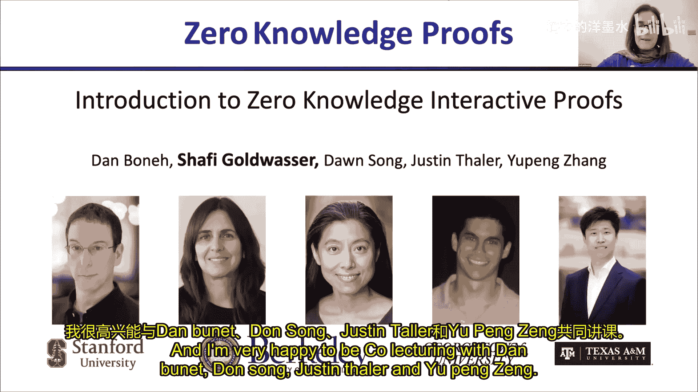

So we're talking about proofs let's starts with classical proofs。

 so when we think about classical proof we think about these various esteemed provers， Gas， Euclid。

 Amy MacNur， Alan Turing and our own Steve Cook and we think about theorems。

 the kind of theorems that you learn perhaps in geometry in class where there's a bunch of axioms。

 there's a claim that you're trying to prove or theorem。

 you make a sequence of derivations from the axioms and then eventually you declare the theorem is proved could be the prime number theorem the the Tioreian theorem and so forth。

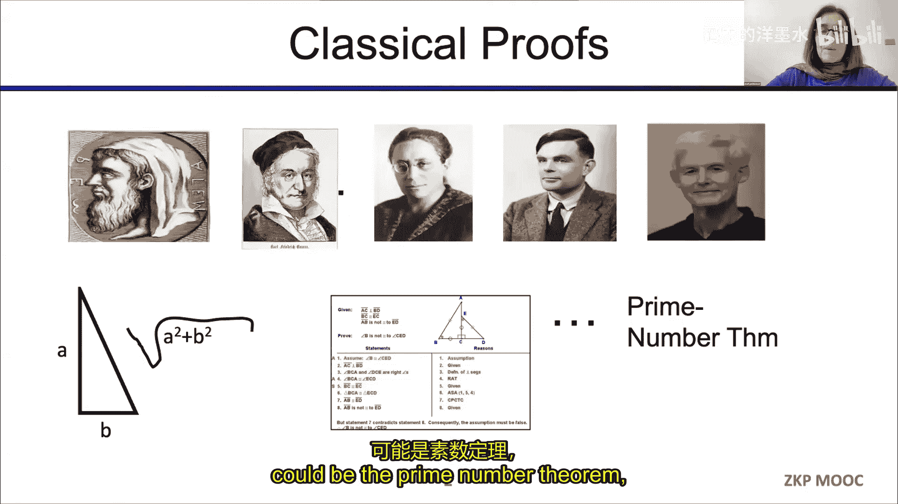

But today， we are going to think of proof as an interactive process where there is the prover。

 but maybe more importantly for our study， there is a verifier。

So there is an explicit reference to who it is that's reading the proof and verifying it is correct。

And we think about this。As follows， there's a claim which is an input to both prover and a verifier。

 both of the prover and the verifier are actually algorithms。

And the proveover sends a string which we will refer to in this slide as the proof。

 the verifier reads this， so if you would like to think about that geometric proof。

 verify as the teacher reading your proof and at the end accepting is it correct or reject。

 accepting the claim as being proved or not。In fact， in computer science。

 we often talk about efficiently verifiable proofs or NP proofs。

 and those are proofs where the string that the prover sends to the verifier is short。

And the ferifier in addition doesn't have all the time in the world to read it he has polynomial time now to be more explicit what does he mean by short what do we mean by polynomial what we mean is that the string that prove sense of the verifier is of size polynomial in the length of the claim so we think about the claim is string x binary string the message here is string binary string W the length of W is polynomial in the length of x so if it takes 100 bits to describe the claim。

W's length should be polynomial in 100 and the verifier's time is also polynomial in the length of x。

 so it could be linear， just the length of x quadratic length of x squared or the length of x equal to 100 as long as it's a polynomial function。

Again， the verifies an algorithm takes as input both x， the claim， and W。

 the proof string does some processing and at the end decides what to accept or reject。

 we often say either accept or one and when we say reject it's either zero or reject。

 I'll use those interchangeably。What are some examples and these are going to be important examples for the duration of the class today one example might be of an NP proof and ac claim is that the proof is trying to convince the verify that a particular number n is a product of two large primes this is an interesting claim because the verifying polynomial time。

We don't know of a procedure for it to be able to convince himself that n is a product of two large primes。

 so we need the help of a prover， perhaps an all powerful prover。

 certainly more powerful than polynomial time again for this portion of the class。

I don't pay any attention to how much time it took the prover to come up with proof all the attention is going to be devoted to how much time it takes to verify a proof once it's sent Later we will decay our attention to the kind of claims that can be proved by a polynomial time prover who knows maybe some extra information which enables it to convince the verifier of the correctness of the claim So for now let's go back to n is a product of two large prime what's the proof Since the prover's time might take a long time。

 we don't care about that we just take attention to how much time it takes to verify the prove of just factors n let's say the two prime divisors are P and Q sends it over to the verifier What does the ver have to do is to multiply p times  Q and C that it gets n back multiplication is an easy operation polynomial time any has to check the P and Q both primes and that's also an easy operation we know how to do in polynomial time and if that's the case except otherwise。

jectSo after this interaction， what does the verify really know he knows that the claim is true and is a product of too large prime he knows as something extra he knows the primes themselves is actually more than was necessary。

In order to convince yourself that n is the product of two large primes or is it is there some other way to do that we will see in a couple of slides that there is。

 but let's look at a few more examples， second example。Now。

 the prover is trying to convince the verifier that a number y is what we call a quadratic residue mod a modulus n。

 So the input to these two。Prover and verify is a pair y and n and the claim is y is a quadratic residue mod n What does it mean to be a quadratic residue。

 it means that if you look at the equation y is equal to x squared mod n。It's solvable。

 that is there exists in x and it's an x that's actually essentially between one and n and furthermore it's what we call relatively prime to n so there is no divisors in common between n and X。

That's a solution to this equation， so there is an x。

Suchuch that y is equal to x squared mod n and what would be the proof of that well maybe the verifier can do it themselves。

 it turns out that this is a very hard problem， so it's hard， for example。

 to find the square root of y mod n。Because if it was an easy poly time。

 the verify wouldn't need the prover。😊，How hard is it， it's as hard as factoring and a well known。

Hard problem for classical computers but the prover as we said he's so powerful or she in this case。

 so she finds out an x sends it over to the verifier the verifier squares mod n compares the c if it' equal to y and if so it accepts else it rejects again it's an NP proof there's a short string x that will convince the verifier to accept when the claim is correct。

What happens after this interaction？The verifier is convinced that indeed there exists in x such a y is equal to x squared mod n。

 but he also knows x， he knows the square root of y。

Last example before we start defining this more generally。

Here the claim doesn't talk about numbers he talks about graphs。

 they are two graphs turns out if you look more carefully in these two graphs they are actually isomorphic to each other in plain English that means they are the same graph but drawn a little differently and formally it means that there's a mapping from the vertices on the graph of the left to the vertices of the graph on the right so that if you take this mapping which we call the isomorphism。

I from numbers one up to you know 10 on the left to numbers one up to 10 on the right vertices are from the left to the right。

 it will be the case that。Essentially the one on the left。

If you map it with isomorphism through a vertex on the right， let's think of it as one。

 similarly the two on the left to the two on the right。

 if there's an edge between the one in two on the left is also going to be an edge between the vertices that these two are mapped to on the right and that's true for every pair of vertices。

 that means that these two graphs are isomorphic to each other and that pi is an isomorphism。

So how hard it is to describe how long is pi is it polynomial size in the size of the graph， yeah。

 essentially it assigns for every vertex a name on the other of the graph。And that's just， you know。

 essentially if they're n vertices， it's length n and how much time does it take to verify to check it。

 it has to go for every pair of vertices on the left。

 check if there is an edge between them on the left there's also an edge between where they were mapped on the right。

And if there's no edge between them on the left， there should be no edge between them on the right。

After the interaction， the verifier。We'll believe the two graphs isomorphic if you got a goodzomorphism。

 but he also knows an isomorphs。So。All of these examples are examples of NP proofs now of course we are not interested in a particular number n or particular number y or particular pairs of graphs we're interested in the problem more generally and we call this a language that is all the ends which are product the two primes that's the language of。

Composite numbers which are product two primes or all the ys and n pairs such as Y the quadratic residue mode n in other words we're interested in languages formerly a language is just a set of binary strings X that satisfyises some property and an NP language is defined to be this goes back to co and NP completeness is defined to be those sets of strings the L is an NP language if there is some verifier V。

Who runs in polynomial time， polynomial the length of the X。

 such that both two conditions hold and that is completeness and soundness。

What doesn' it mean that completeness holds， it means that when x is in the language。

 if you're talking about a claim or in the example， let's say or composite numbers when and。

When the language is a language of composite numbers which are product2 primes and we're given such an n。

 then there has to be a polylo proof or witness W， the proof of consent to the verifier such that the verifier examining x and w will accept。

So but completeness is not enough， we also need soundness and that is to make absolutely sure that when x is not in the language。

 for this example， n is not a product of two primes。

Then there is no witness that we'll convince the verifier to accept， in other words。

 for all strings W that approvalr may send to the verifier。The verifier will reject。

So we usually talk about。Completeness allows honest provers to convince the verifier。

 soundness ensures that regardless of what achieving prover is trying to do。

 he will not be able to convince you the correctness of an incorrect claim。

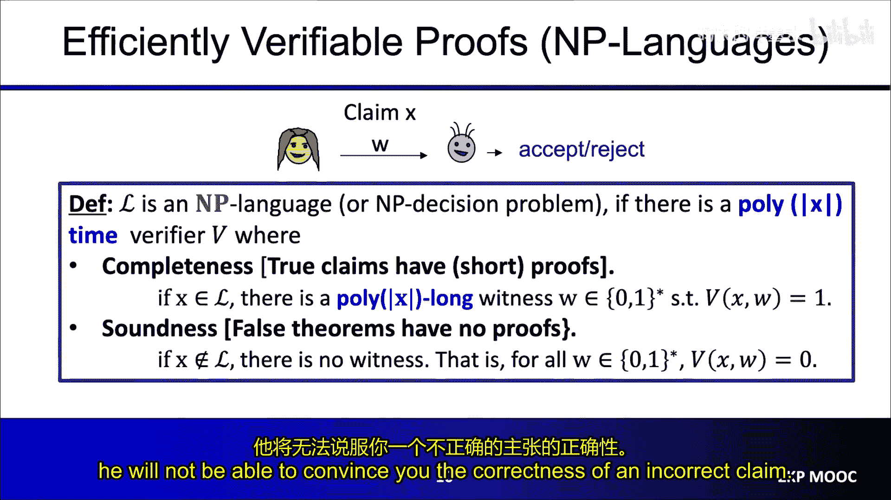

But our question in this course is not about NP or NP completeness。

 but rather we're asking is there some other way to prove these type of theoremms can prover for example。

 convince a verifier that why is a quadratic residue without sending a square root so this is the question to motivated Sa McCli Charlie Racoen myself to study zeroonnal proofs in the early 80s and this is a process that took about three years and the answer is yes。

And the main idea， even without getting into the mathematics。

 is the way that the prover will convince the verifier that the claim is true without giving away the NP proof。

In the example of the square the why is a quadratic based what in without giving the square root is to prove instead that I could prove it if I felt like it。

 so I'm not going to prove it to you， but I will prove that I could prove it。And somehow。

Being able to prove that I could will imply that at the end， the verifier will be convinced。

And yet he will not know a square root， he will not know the factors of n he will not know an isomorphism in fact。

 he will get zero knowledge in addition to the fact that he claim is true Of course we will need to define what it means to be zero knowledge precisely。

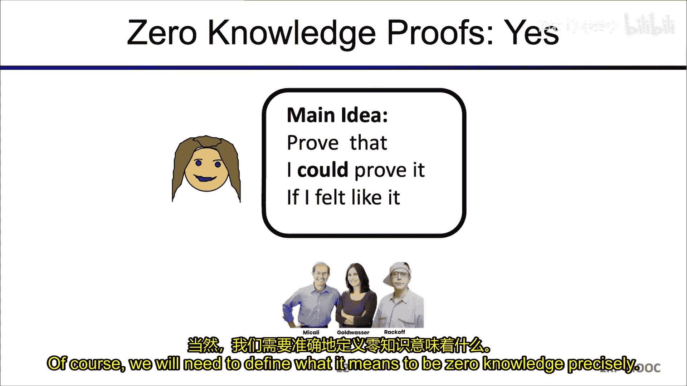

So。Before we define it， I want to give you an idea of how possibly you can prove something is a square root or the two graphs are iszomorphic and so forth without actually giving the isomorphism or giving the square root and I'm going to start。

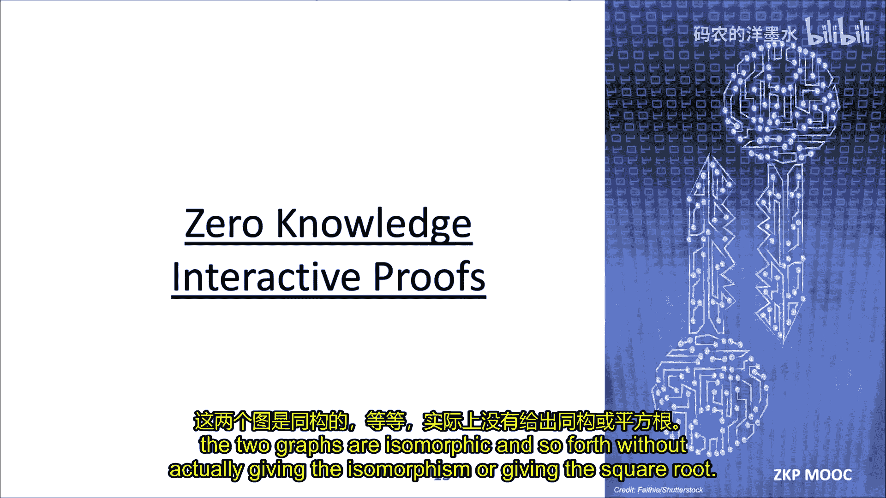

Just letting you know that this is no longer going to be up a prover sending a string W to a verifier we're going to need to change the proof model we're going to need two new ingredients。

 one of them is going to be interaction rather than the verifier just passively reading the proof he's going to have to be engaged in a nontrivial interaction with the prover so like you see in this picture there'll be messages going back and forth prover sending a message to a verifyifier verifyifier answers back back and forth back and forth might be three steps might be two steps it might be length of X steps but it will be polynomial number of steps it will be more than a single message from prover to verifier。

Later on in this class， we will see that there is a way to remove。Much of this interaction。

There will still be， in a sense， at least a single message approved the verifier and some preliminary stage。

 but for now we have interaction。Interaction is not enough we also have randomness what do we mean by that we mean that the verifier is not just going to be a deterministic algorithm evaluating what he'd received from the prover he's actually going to be allowed to toss coins as a primitive operation。

And his question to the prover will depend on the result of tossing these coins。

Another way to say that is that these questions are somewhat unpredictable because if they were all predictable。

 the prover could have anticipated them and just sent him them。One string w in advance。

 but since they are unpredictable after the proveer sends a message。

 the verifier may ask depending on his coin tosses many different options and the prove were supposed to be able to respond to all of them。

What is inherent in the fact that the verifier tos randomness is that we're also going to be willing to accept a small probability of error what does that mean we will get to the formal definition in a few minutes informally what that will mean is that whereas in geometry class when you gave the teacher proof they checked it and it was supposed to be 100% correct。

We are going to have as a formal part of the model。Allow a small probability of error。

 but it's going to be quantified and you're going to have to be able to show that your error is smaller than one over I don't know of a graous number or a negligible error orll get to that in a minute For now the proof model is changing it's interactive。

It's probabilistic meaning the verifier canos coins that means that there's a lot of possible interactions that will come up between prove and verify so there are a lot of possible executions it's still going to be the case they both get input which is the claim。

And at the end of this question answer period， the verifier will take the history of the interaction。

 the coin houses that is made， run an algorithm， and decide whether to accept or reject。

Let's look at the first example， the first example is not going to even be mathematical。

But it will be something from。Sort of the physical world。

 the claim here will be that this particular page right in front of us has two colors rather than a single monochromatic color。

And the scenario that I would like you to keep in mind is。

 let's say the prover can tell colors apart， but the verifier is colorblin。

And the prover is trying to convince the verify that this particular page has two colors。

He's not going to enable him to see colors for the future。So in some sense。

 all he's going to convince him is that this page is two colors and nothing else， so in that sense。

 it will not be transferring to him anything beyond the cl how。So here's the first step。

 the first step is the verifier uses his coin。Flips the coin and with the following idea。

 if the coin lands on heads。😊，He takes the page and flips it over。And if it lands on tails。

 he doesn't change the page at all， let's assume that he tossed the coin and indeed it was heads so he flipped the pages so that it what earlier was purple in the top now it's on the bottom and now he does this in the privacy of his own home not showing the prove the results of his coin but what he does is he sends the coin the page over to the prover。

The po now looks at this page he knew what the page looked like before。

 and he's now sees what the page looks like now， since the po can distinguish colors。

 he can tell whether the coin landed on heads or tails， right？And indeed。

 that's exactly what he says， he sets out。He checks whether the page was slipped or not。

 he writes the value of。The new coin coin prime to be heads if it's flipped tails otherwise then he sends back coin prime。

 he says， listen， I think you tos coin prime。别须。The verifier， the rule right now is the verifier。

 if indeed。😊，The coin that the verifier to is equal to the coin prime that the prover thinks he tossed。

 he says， well， h it looks like the prover。Could tell whether the page was flipped or not。

But he couldn't tell if it was only a monochromatic， so there must be two colors on this page。

 I accept the claim is true。Of course， if the coin that is sent over is different than what he flipped。

 he says， well， he couldn't even tell that it flipped it。

 there's certainly not two colors there I reject。Let's try to analyze this for a minute。Clearly。

 if there are two colors and the prover follows this procedure。

 then the verifier will always accept because the coin prime will always equal to coin。

If there's a single color， the provet cannot tell whether he flipped or not。

He could still try to guess he's a cheating prover， whether the coin landed on heads or tails。

 and he has a 5050 chance of guessing correctly。So the probability that he sends the correct coin is a half at most。

And if the ver accepts in this case， the probability the verify accepts incorrectly because Justices Poer was lucky。

 but there's a single color on this page is one half。😊。

So if there' are two colors you will always accept if there's a single color the probability accepts it less than a half。

 there's a gap between them， but you might not like these odds。

 say what I'm going to accept incorrect statements， claims with probability you have。No worries。

 you can repeat this process again and again each time the ver process a new coin decides whether to flip or not since the result。

And so forth and now what is the chance that the prover in case there is only a single color so it's it's not correct claim。

Hes able to provide the verifier each time with with the correct coin he tossed it's one half the first time it's one quarter to be able to do this twice in a row it's one eighth to do this three times in a row and it's one in two to the k if you repeat this k times so the probability that the ver except after k iterations of this is very very small。

So what has happened here， I was able to convince a colorblind verifier of whether the page has two colors or not so that he always will accept on their two pages and he will。

Except that there's two pages incorrectly with extremely small probability。Okay。Let's see this again。

This idea， a little bit different of using interaction and randomness to be able to convince someone。

Of this time a mathematical statement without transferring sort of the obvious NP proof over。

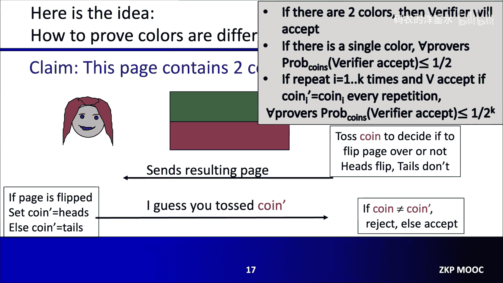

So the next example is an example that we started with and that is。

The input to the prove and verifier is a pair n and y， such that there exists in x。

 such that y is equal to x squared mod n， or is it the prover is trying to convince the verifier。

 Then indeed this pair N Y is a member of this language， the Q R language。

 the quadratic residues language， those y is such that y equals the x squared mode n for some x。

How would you convince the ver of this case without giving him a square root？Here at Huros。

 the prover is the first step chooses a random value one r between one and n in fact。

 to be absolutely correct， this r is supposed to be between R and N and。

Have the greatest common divisor with N， which is one。

 meaning there's no common divisors between R&N。For those who don't want to really dwell into this。

Let's just think of it as a random number between one and n。

And then what he sends to the verifier is r squared， doesn't send R， he send r squared。

 and let's call it s， sends S， and he says to him， listen。

If I gave you both square root of s and a square root of s times y， where y is the input。

Then you would be convinced the claim is true because if s has a square root and s times y has a square root。

 then also y itself has a square root， not then， but if I did that。

 that's like sending you a square root of S would be R square root of s times y would be r times x。

 then you would know a square root of y。You would know x just take r times x divided by R。

And the whole point here is I don't want to give you both。

 so what I'm going to do is I'm only going to give you either squares or Scs times y。😊。

But I want to convince you that I could have given you both square roots and the way I convinced it to you is I tell you。

You get to choose。You can choose to get a square root of S or square root of S times y your choice。

 and I will be able to answer either question， but I'm only going to answer one now if the ver is smart。

 the way to choose which he wants is going to be to flip a coin。Not to decide this deterministically。

 but flip a coin， so then with 5050 chance he will。In case the prover is cheating。

 ask for an equation that the prover cannot solve why because if the prove is cheating。

 it cannot solve both。Finding a square root of S and a square root of S times y。

 because in that case it's not cheap。So the fact that he can do both means he's not eating。

I will flip Bitcoin coin as a verifier to choose。A challenge hey give me square root of s or hey give me a square root of S times y he's supposed to do that so if I my coin turned out head so one the prove is supposed to give back the square root of s which is r and if the coin was tailed is supposed to give the square root of S times y which is r times the square root of y or r times x that's the square root of y。

The verifier checks that he got the right answer， so he will accept only if indeed when he takes what he got backs and squares it。

 he will get back and answer for what he asked for so if it was heads Z s for square root of S that in that case it's S times y to the zero just s and if he asks for tails。

 he wants the square root of s times y。Let's analyze this again。

 if the claim is true and the prover acts according to the protocol。

 the ver will always accept because the prover can always give a square roots of s and a square root of s times y again the prover is so powerful。

 he knows the square root of y。He can because he's all powerful in fact that's only the only thing he needs to know but what happens when the claim is false soundness is always the thing that's harder to show if the claim is false okay then no matter what the prover does the probability that he will be able to solve both equations。

He can't solve both equations because so one of them。

 so what's the probability I asked him to solve the equation that he knows how to solve。

 it' it most have。Again， maybe a half is not enough for you repeat this100 times。

And the probability that the verify can100 times。Be so unlucky as to choose exactly the equation the prover can solve and not the other one which he cannot solve in the case with the Callamus pulse is going to be vanishing with a number of trials。

One half， if you try once， one quarter， if you try twice。

 one eighth if you try third time and one in two to 100 if you go 100 times and if you wanted to go K times it's one in two to the K。

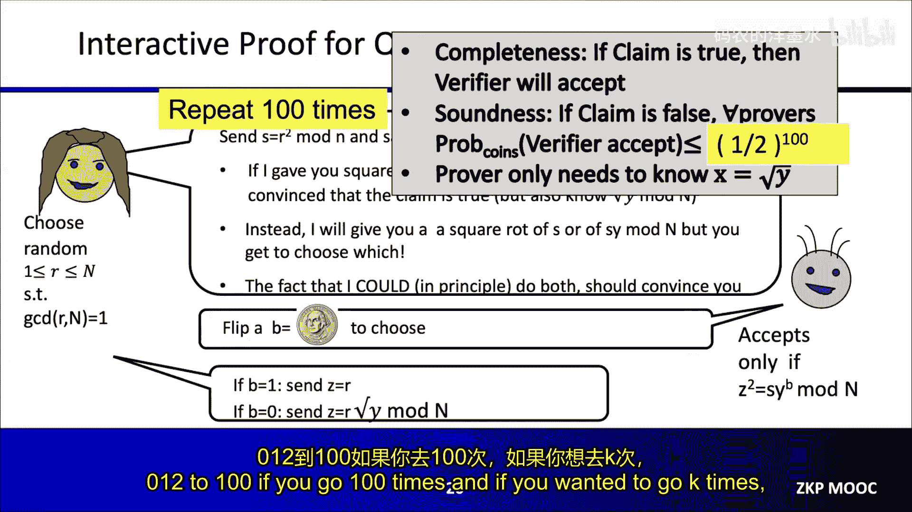

So。What happened here？I can convince。The verifier to accept when the claim is true， it's very。

 very unlikely I will convince the verifier to accept when the claim is false。

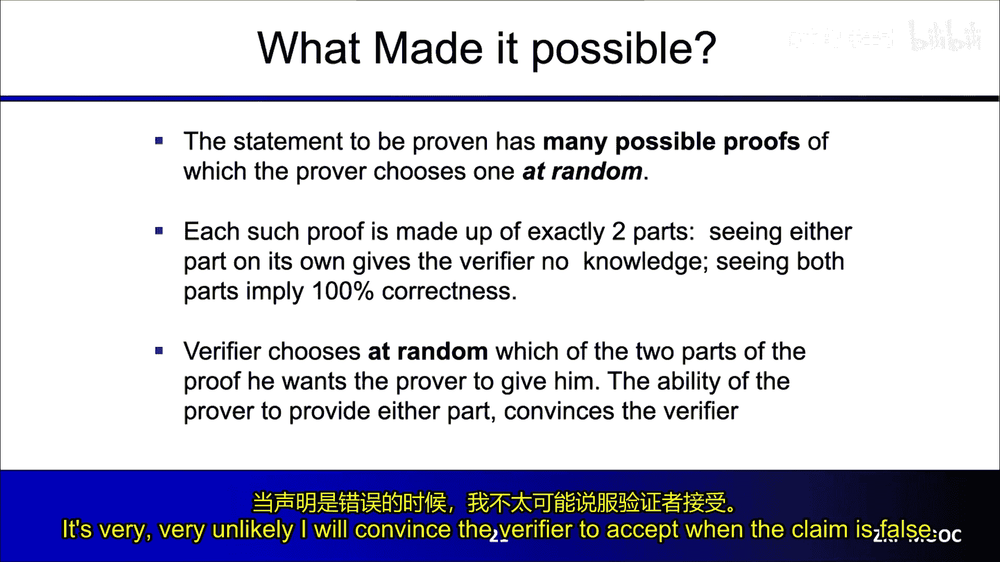

And I never， if you think about a transfer at the square root of x。

 because every time I just give him。A random R， which is square root of s or a random R times。

You know， the original x or the square root of y random types of square root of y is random when you reduce it mod in。

So it gives essentially I'm sending him random numbers which are independent of each other。

 even if I repeat the standard of times because each time I start again with a verifier with a prove of choosing a new R so what made this possible？

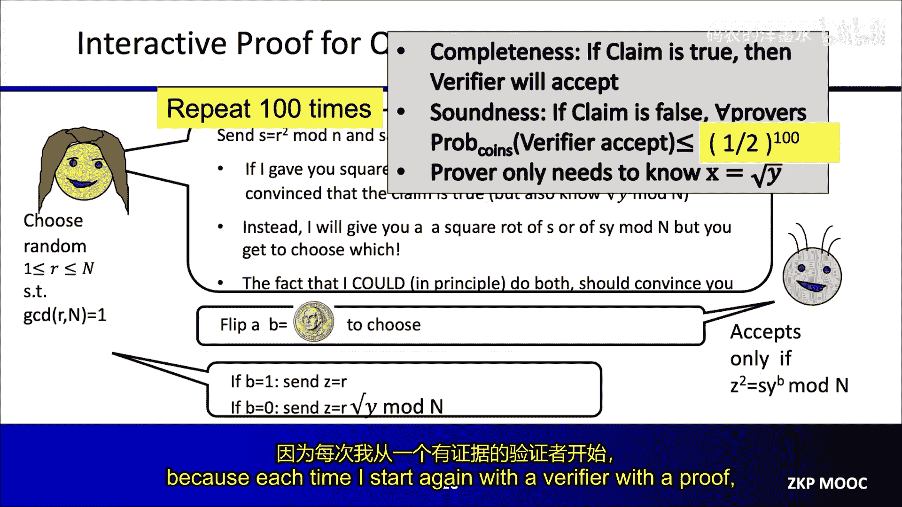

Here's one intuition。 There is lots of possible execution， so there's lots of possible。

Interactions or proofs and the prover essentially chooses one of those many possibilities in the first step when he sends r squared。

 he's sort of choosing one of these many possibilities at random and each in every proof of these many random proofs is made of exactly two parts。

One part is when I ask to see the square root of S and one part is when I ask to see the square root of s times y seeing either at square root of s or the square root of s times y gives nothing if the ver could have seen both。

 it would imply 100% correctness and the ver chose at random。

 which of these half c wants to see the square root of s or the square root s times y？

The ability of the prover in principle to provide either part or convinces the verifier。

That the prove could have answered both and therefore the correct。The claim is correct。

Let's define this precisely。All right。So we have。P and V。

 and they are an interactive proof or a language for set of statements if again V is polynomial time but this time probabilistic polynomial time。

And there is completeness in soundness。 if the claim is true or X is a member of the language。

The verifier will always accept。 and soundness now has been modified。 If V is not， If x is not true。

 the claim is incorrect or x is not a member of the language， then for all cheating prover strategy。

 no matter how hard they worked， the verifier will not accept except with negligible probability。

 like the one in2 to the 100 or one in2 to decay。What to the length of eggs？

Let's introduce a little bit of a notation， so this is a sorry this is a cheating prover。

 every cheating prover strategy will only help the prover to convince the verifier with negligible probability。

So a bit of notation。We use the following notation， we talk about the probability that PV。

 so open print PV close print on x， except in the case of x equal to L x is an L completeness is probability one。

And in the soundist case， we say that for all cheating provers P star。

 the probability that P star interacting with me on input X。

Probably that accept is negligible what's a negligible function of length of x。

 that's a function that grows you know slowly than any one over polynomial for so that' wanting to do the length of x is an exponentially small function so it's smaller than one over polynomial for any polynomial。

Interestingly。Step back and you think yourself is this reasonable to call this an interactive proof。

 I claim that this is ultimately what a proof is it should convince the ver of correct theorems and it should not convince them of incorrect theorems。

If you only are managing to convince him with。A probability that is so small that in one in the lifetime of the universe。

 it's not going to happen。It's good enough for me and that is ultimately what a proof should be。

 it should convince you of correct theorems and not convince you of incorrect theorems and an event that will take time in one in avogod's number one in the lifetime of the universe of convincing of an incorrect theorem essentially never happens。

All right， by the way interestingly is that when you have an exercise a homework and you're coming up with an interactive proof。

 sometimes it's going to take a lot of work to get。

You have verify always accept correct theorems and not accept correct theorems with negligible incorrect。

And accept incorrect theorems with negligible probability。

You don't have to work that hard You just have to show that completeness holes with probability C and soundness。

This does not hold it most holds with probability S for C and and S， which are。

A polynomial apart so this will be equivalent to achieving probability one for C and negligible for s this can be shown in some standard technique of using repetitions。

So we define what an interactive proof of language is。

 we also can talk about the class of all languages that have interactive proofs and in the same way that we talked about NP as being all those languages for which there is an NP proof。

 we will talk about IP as all those languages for which there is an interactive proof again the proof runtime might be very slow。

But the verifier has to be polynomial time， probabilistic polynomial time。All right。

 we have defined what an interactive proof is。😊，But what about zero knowledge？

How do we define your knowledge， what is even the intuition of what should be your knowledge。

 so here's the intuition。I want a zero knowledge interactive proof to be the kind of proof such that whenever the statement is true。

Then you know the verifier goes through a proof， interactive proof of the prover。

 and at the end he's convinced with high probability that the claim is true。

 but in addition to that he has a history of interaction， he has the coins that he's tossed。

 maybe you've given him so much during this interactive proof that now he can compute a lot more than he can compute before。

So for the example of the N， you know， proving that n is a product of prime perhaps after the interactive proof。

 you can factor a number or compute square root or finalize amorphism。

 we will say that the interaction with zero knowledge if what the verifier can compute after the interaction is essentially the same of what he could have computed before。

 namely the interaction has not increased the computational power or had allowed the ver to compute more than he could have computed before。

Furthermore， we want this to be true， not just for the honest Ver follows a protocol。

 but for any verifier even。And a devious malicious adversary adversarial verifier this is slides and intuition。

 how do we mathematically capture this？Let's try。Again， we're going to do this slowly。

So first of all， I want to say。This verifier has some sort of view and I want to。

You know so he's learned that after the interaction that a theorem is true with high probability。

 but he's also gotten a view and that's the transcript you know the answers and questions plus the coinsy tossed we will define this formal variable which is view sub V of PV on x and that is a random variable what I mean by that is that there's a lot of possible。

Values that this variable can get and this is a probability they are distributed over the coins that V and p both tossed remember let's say in the example of showing that y is a quadratic residue the prove task coins select R the ver task coin to select whether he wants to see the square root of r squared or square root of r squared times y so those are all possible executions these are all possible assignment or this variable can get okay so this is a the verifiers view I will say。

对对。That this view gives the verifier nothing new if the following is true and this is called the simulation paradigm this is some the simulation paradigm has started with the concept of zero knowledge it's used all over cryptography today。

What is the simulation paradigm idea？We say。That the real view。

 so if we look at this blurb or this great blurb that I call real view， which is essentially。😊。

This is a probability distribution， the points in this space are all the possible histories of interactions between proveover and verifier plus the verifiers coin I say that this。

View gives the verifier nothing new if he could have actually simulated。It on his own。

Sitting with his laptop or his computer at home， not talking to any proveer。

He could have come up with a simulated view， so this is again a probability distribution he can essentially sample these simulated views himself。

And what has to be true about the simulated view in terms of relation to the real view is that if there's someone else out there。

 like let's call him the polynomial time Disuisher。

And he's pressing a button saying he's give me a sample in the distribution that you have。

I'm trying to determine whether I'm talking to the real view or I'm talking to the simulateimd view。

I'm just going to keep pressing the button， getting views。And at the end。

 I should tell whether all the views I got were from the real view or all the views I got from the simulated view。

If a distinguishuer can't tell this apart。Can't tell better than essentially 5050， I say。

That these two views are computationally indistinguishable。

 he just upon lot the time distinguishuer cannot tell them apart。Let's。Tew into this a little bit。

Further。What does it mean the two？Distributions to probability distributions are computational distinguishable in our case here。

The two distributions are the real views and these simulated views but it doesn't have to be to be applicable to this particular setting we can talk about computational and distinguishability is a notion more generally where again there are two distributions in our case there were views but there could be just two kbit strings and the game is there's a distinguisher on the other side of the wall and he can press a button and get samples always from either all the samples from distribution D1 all the samples from distribution D2 and his wish is to distinguish which is the case we say that these two distributions are computationally indistinguishable if for every strategy this polynomial time distinguishisher employees for all distinguishuisher algorithms。

Even after receiving a poly number of samples from D， the distribution sub either one or two。

 the probability that he can guess what is， whether this was distribution one or distribution two is less than a half less neg。

 negligible and what there's some sort of security parameter， which I call K here。

 which might be the size of the strings of the samples， the size of the sample string。So。

Back to zero knowledge。Here' is a definition， an interactive protocol。

P and V is0 knowledge for language L if there exists a simulator and algorithm SIim。

 such as for every X and L， so I'm only requiring it when the theorem is correct。

Only when x is an L and y， because you do get something， you get that x is an L。

This's a detail aside， so I require that the following two probability distribution are polynomial time indistinguishable the first is the real view。

Now the verifier gets during an interaction， the second is an output of the simulator the simulator here is taking x as an input just the x he doesn't have any square root of y or any secrets just the input that both P and Vc。

You notice here that there's another input to the simulator which is just one to the power lambda。

 this is essentially a technicality it's because we want to make sure that we allow the simulator to run enough time poll time and sometimes when x are really small that doesn't give them enough time but。

Really， for all practical purposes， if we're thinking about large x's， forget about this one。

So both of them， the simulator runs in polymerial time to be zero knowledge means that these two distributions should be computationally distinguishable。

And that will make a protocol PV a zero knowledge interactive proof if it's complete， if it's sound。

 so it satisfies completeness and soundness and zero knowledge according to this definition。Almost。

Two caveats we're going to let this Sim guy this probabilitybility polyial time run in expected polynomial time what that means is that it might that the simulator might expected polynomial time essentially means that if you take the expectation of how much time the simulator runs over all possible randomness of the simulator it's going to be a polynomial time what essentially that means is that there might be some very very unlucky coins for the simulator which will take a long time to run but。

Typically he's going to run in poly oil time this is something that you guys should know it's and that is the definition of expected poly oil time。

One more caveat。In this definition， I never said anything about the verifier。

 I just said that a particular pair of P and V is zero knowledge if the following conditions hold。

 but we want this to hold really the zero knowledge property for every verifier。

 even a cheating verifier。So the real final definition has to take into account the possibility that the ver might be a liar and might be trying to get knowledge when he shouldn't。

 so he's not honest， so we finally get the definition that a protocol is zero knowledge for a language L if for every V star working with P。

Okay， there exists poly normalal type simulator。Such that the view and the simulation are computationally distinguishable and I'm using this squiggly equality to mean computationally distinguishable。

 so these might be different probability distribution， but the distinguisher cannot tell them apart。

All right， so let's rest a second so PV is your knowledge if for every V star there was no matter what V star does。

Actually we could have simulated this in our own what does this capture the intuition that what the ver can learn during the interaction doesn't add any computational power remember our original intuition was。

That what you can compute before and what you can compute after is the same The reason is because we say the following listen。

 maybe there is a V star really devious one who can get something out of the prover。

Bings the orard says no， if such a V star exists， then we could have computed this before because a simulator could use that Vstar to come up with a simulated。

Distribution， which is more than what the view is。But the zeroage requirement says that that's not possible。

That for every V star， there will be a simulator。It can achieve the same distribution and essentially computational equivalent to what can happen in the real view。

 and therefore the real view did not add any computational power。All right。By the way。

 this is what's called a computational distinguishable zero knowledge。

 sometimes people use the notation C ZKC for computational。

 but there other flavors of zero knowledge， you can also ask for a perfect zero knowledge definition。

 so when real distribution and a similar distribution are identical or maybe statistically close。

So a perfect zero knowledge is a special case when if you look at the view of the verifier and then we can actually simulate it perfectly。

So the simulated view and the real view are the same and that means that they're indistinguishable for any algorithm。

 so this would mean that when you can prove perfect x knowledge is an unconditional result because usually when we only prove computationally x knowledge we make some assumption that there's some computations which are hard whereas with perfect it's just perfect x knowledge is no difference between what we can learn during the view during the real interaction and what we can learn from a simulation。

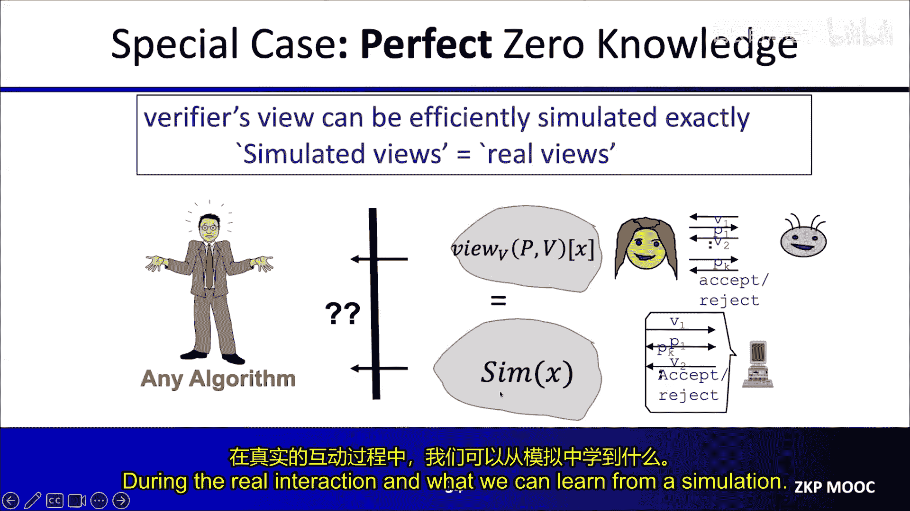

Let's work through a simulation now that we have a definition。

 recall the protocol for cordriatic residues， so the prove percent are squared you asked for either seeing r or r times squared root of y you got back an answer he checked it。

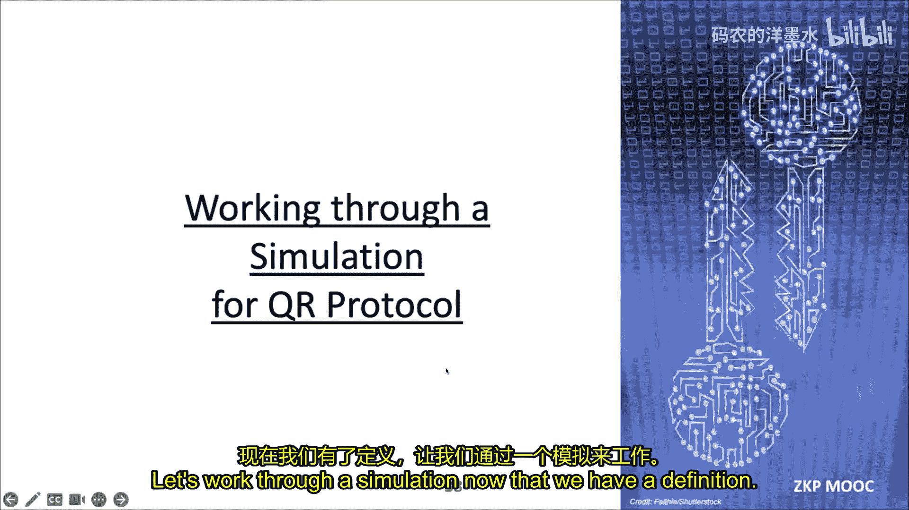

So what's the view here， the view is S that's the first message B second message and Z third message and order the coin tosses R B so it's anyway included it's sBZ how do we simulate that well we're going to simulate this a little bit in a different order after world the simulator can't just choose an R and send himself a message I mean he could but then if you toss a coin so you only know how to return R you don't know how to return r times square root of y。

So how are we going to get a simulation， the idea is as follows。

And we're going to show a simulator just for an honest verifier and in fact。

 the simulation is going to be a perfect xology simulation。😊。

What the simulator is going to do is rather than really go in the order that the real interaction is is that he first going to choose the question of the verifier and he's going to do that just the way an honest verifier would do it picks random bit B then is going to actually pick the third answer which is is going to pick a random Z notice that Zd actually is just a random number except in this case it' R in this case it's R times x so the only thing that remains is to make sure that I can figure out for which S would have been Z the right answer。

And note that this equation S equal to z squared over y to the b mod satisfies exactly what S should be。

 why is that， let's look at this。Let's plug in b equal to0， in which case s is equal to z squared。

 that's exactly what it should be in the case that b is equal to zero， z is the square root of S。

What about when is equal when b is equal to1 then i'm letting s to be z squared over y is that correct let's think about it if you look at z here it's supposed to be in the case of b equal to 1 r times x and what's the relation of r times x to S the relation is that if I square this I should get S times y and that's exactly the case here if I square z I get S times y。

So。Lo and behold， I was able to come up with a triplet， which is identically distributed。

As what the view of the verifier honest verifier is doing an interaction obviously this doesn't convince me of anything it's not that I actually got an r squared and then I asked a random be and got the response I did this in my basement in a simulation。

But the view is identical。Now， what about when the bearfire is not honest？

So what about the case the general case where the verifier might not be tossing a coin and sending over that's a little bit of a problem what if this。

You know adversarial verifier。Was the kind that when he saw some S。

 he did some very complicated function or computational S and depending on the result of his computation would ask in particular be。

Then he might have gotten something interesting depending on his computation。😊，Well。

 I will show you that even if he was an adversarial， very complex computation。

 I could still get the same。View that he did。Using a simulator， how is that？Again。

 I will pick a random B， even though he doesn't feel like things are random。 but wait。

 I'm not done yet。 I pick a random B。 then I pick a random Z。

 And now is when I do something different。 I say to myself。All right。I will， for a minute。

 suppose that， indeed。B would have been what he will ask me the bad guy， the adversarial guy。

 and I will compute S accordingly。And now I will actually send S to this bad guy what does it mean send remember the simulator should work correctly for every V star for every bad guy V star the simulator has access to V star the intuition is that no matter how powerful the verifier is hes polynoial time and I have to come up with a polynoial time simulator so he polynal time program can。

IHave access to any other parliament time program， including this verify。

So what I do is now is I run this verifier， the bad verifier on the input NY and first message S and see what he asks for if I was lucky he's going to ask exactly the bit that I prepared for and I know how to answer。

But he might not do that in which case I can't really output SB Z because I just don't know the answer the correct answer what do I do then I start again。

 I go to step one， I again pick a random bit， I again pick a random Z I then compute S and now I ask V star on this new NY and S why am I hoping that this time it's going to be better。

I don't know if this time is going to be better， but I do know that whatever it is that V star is doing is this is a fixed behavior。

 but my B was chosen at random， what's the probability that a random bit will equal a fixed behavior 50-50 and that means that within two trials I will be lucky enough to hit on the question the V star would have asked。

I suggest that you think about this more deeply and improved to yourself and the expected number of repetitions is two before I can output a triplet SBZ。

And this is why we require theimulator to be expected poly on real time。

 so within expected two trials， I will be able to output something that is exactly the same distribution as would have happened in the real interaction。

All right。I want to say that actually if you think about this a little bit deeper。

 you realize that not only the prover convinced the verify that y has a square root。

 he actually proved that he knows how to what that square root is because if he can answer what the square root of s is and what the square root of s times y is he could actually answer the square root of y。

 he never does， he always gives you only the square root of s。

 which is just random or the square root of S times the square root of y， which again。

 the square root of s masks the square root of y， but if you could do both he does actually know how to do a square root。

😊，Of why。So what's hiding in here is some definition of what it means for a machine to prove to you they know something。

Let's try to define that formally， We will say that a proof system is a proof of knowledge。

 it's not just a proof that something is true or false。

 but it's a proof of knowledge for a language if the following is true。

Okay so let's think for a second how would you define that a machine knows something maybe the first definition would come to mind is that it has some register and and that square root is written in there or whatever it knows is written in there。

 but it's not always the case。The way that we want to define that you know something or a algorithm knows something is that if I could run that algorithm on multiple inputs。

 I could eventually compute that thing that the algorithm knows。ok。So。

Since the proveover is an interactive algorithm， running it multiple times means that it can send me messages。

 I can ask questions it send me a message it， ask questions so I can run executions with the prover multiple times if at the end I can extract W that is the definition to means that the prover newW。

And that's how we define proof of knowledge， we say there exists a knowledge extractor algorithm。

 this extractor。That can run a protocol with prover such as an expected polynomial time this extract running prover the notation is E to P。

 So he sort of has access to the prove almost as an oracle on x will output。The witness W。Now。

 I want to make one thing clear is that when I say that the extractor runs P multiple times。

 I can actually make it run so that he always in every execution he ask me the first same message so it's like saying I can rewind in to run to get started from the same starting point。

On the same randomness this is calling the rewinding technique。

 which is something that happens all the time when we talk about zero knowledge that is usually the technique to prove that something is zero knowledge is and that is zero knowledge proof of knowledge if we can rewind someone multiple times and eventually extract something from them。

It will mean that they knew it and twiing with。U。So here is some technicality which I'm not going to cover。

 but it is the more precise definition of proof of knowledge it takes into account what was the probability that the prover managed to convince the verifier to accept。

Essentially， if the probability is greater than alpha， we have always in this lecture。

In the case x is in the language， then the probability is always one。

 but sometimes you will have example when the probability is not one。

 it might be just greater than two thirds， then well just require the extractor to run in expected time one over alpha which running in two thirds。

把你头老没。Which will be polynomial still。An example of extraction。

I said that the examples of quadratic residues， the prover actually knows a square root x of y mod n。

To technically show that he knows we have to satisfy the definition so here it goes here's the extractor The extractor starts running with the prover The first message of the prover is R squared mode for some n what does the extractor do first step it receives S and it asks the。

Heads。Or zero and gets back in R， so it stores our and now he rewinds to the first step again。

This time， though， when he gets S， he asks for tales。

or be equal to one to zero and he gets back r x mode now he has run two executions first time asking for heads second time asking for tails you got two answers r x and r can divide and extract the square root of y mod so there's definitely an extractor so by the definition。

We have just shown here in this slide that the prover knows as squirre root of why。

And let's try it for graphs， so graph isomorphism， which we discussed before。

 what would be the interactive proof， the zero knowledge interactive proof for graph isomorphism。

 let's go through that it's going to be surprisingly similar to the square root example。

 even though we're talking about graphs when I say similar。

I don't mean that it's the same message as going back and forth， but the idea is quite similar。

 what is the idea？So now we're talking there's paragraphs G0 G1。

 the prover is this all powerful guy he knows actually in this example， an isomorphism。

 he was to convince to verify that isomorphism exists without giving that isomorphism。

 how does he do it？Here is is what he does he says to the verifier listen i'm going to forget about the proof for a minute。

 let's just say what the interaction is he says to the verifier I'm going to produce a random graph h。

Okay， like a third graph。So that I can give you an isomorphism either from G0 to H or I can give you an isomorphism from G1 to H。

 these are two different isomorphism。But the conclusion is， if indeed I could do both。

Then there's actually the isomorphism from G0 to G1。

 so you see that very quickly here on the left on the side。

 if h is gamma0 ismorphism from G0 and h is also an isomorphism from G1 gamma1。

 then you could go directly from G0 to G1 by taking gamma1 inverse of gamma0 composition of these two isomorphisms。

Now， the point is again。He's not going to do both。 He's only going to give him either as amorph for G0 or G1。

But he lets the verifier choose which it is。 And the fact that he will be able to do both should convince the verifier that there is an isomorphism from G to G1 with high probability。

 If we break it down into the interaction。The prover sends the verifier the new graph H。

 The verifier tosses a coin， asks he therefore is amorphfs from G0。

 is amorph from G1 or is amorphfism from G1。 The prover supposed to supply what he was asked for。

And the verifier can check that he got the right thing and only then accept。Otherwise， reject。

If the statement that G0 was isomorphic to G1 is true。

 the prover will be able to answer and the verifier should always accept if the statement was false。

 the probability the verifier will catch a mistake that is we will ask to see isomorphism from G0。

And the prover won't be able to supply it because there's either just anizedmorph from G0 or from G1 maybe from none。

 the probability， the verifier will catch a mistake。Is greater or equal than a half。

 And if we do this 100 times， the probability will be。Catching a mistake will be very close to one。

1 minus1 into two 100， or if you repeat K times1 minus1 in two to decay。

I leave it as an exercise to you that is perfect zero knowledge。

It's going to be essentially trivial if you understood the quadratic residue example to come up with the perfect xology proof here。

I encourage you to do that。It's also not just a zero knowledge proof。

 but it's a zero knowledge proof of knowing an is is amorphion， so it's a proof of knowledge。Again。

 to show that， you have to show an extractor。Let's show an extractor。

Extractive algorithm is allowed to run the provever。 Let's do it。 The prover sends you a graph H。

 What do you do First， you set the coins to heads and you get back an answer。

 which is an isomorphism from G0 to H。 Second， you rewind。 you start again with the same H。

 at this time， you ask for tails。 and he will give you an isomorphism from G1 to H。

And now you can combine the isomorphism from G0 to H with the ismorph from G1 to get a direct isomorphism from G0 to G1。

The end， we are able to extract the isomorphism and therefore we know that this was a proof of an acknowledgeable an isomorphism。

Great。😊，Why did I talk about proofs of knowledge because it gives us immediate corollary in application and that is the first application that Fchemir proposed few months after we wrote the paper about。

Zero knowledge for identity theft。And they're saying， look。

 Alice wants to prove over the Internet that she is Alice to Bob， Bob could be Amazon say。

Over the net means something could be listening， but even more interestingly。

 suppose nobody was listening， but Amazon had to store all those passwords in order to recognize Alice when she comes in。

 what if somebody breaks into Amazon， you don't want those app passwords into clear。

You don't even want those passwords encrypted because maybe the encryption that Amazon does one can sort of。

Do a birthday attack or's a lot about other attacks that you can on a password file。

Is it possible that Alice can convince Bob shes Alice？In a different mechanism。

 without Bob actually being able to turn around and convince someone else。

That they are us without a breaking attack， and the answer is yes。

 zero or not proofs gives you the mechanism。Now we think about the password of Alice as knowing the proof of a hard theorem。

So you can think of Alice as someone who takes an x， squares it， calls that y and says， hey。

 I know a square root of y mod N， that's a hard theorem， but whoever knows it， that's Alice。

How does he convince Amazon， a mainframe an ATM？Someone just wants to know that Alice is the right person。

 but shouldn't really know Alice's。Proof for the heart theorem。I they are outproof。

 so they would go through a few steps of interaction at the end of which it says，mm。

 she knows a square root。She' just given me a zero knowledge proof of knowledge。

 and that identifies her。So somehow。It's possible to verify that Alice knows the proof without knowing the proof yourself。

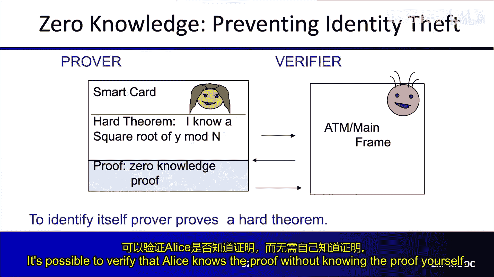

It's not the only example。Of an application， but in order to get many more applications。

 including applications in the realm of blockchains。

We need to do one more thing and that is a big thing we've seen the example that two graph are is amorphic we've seen the example that y is a quadratic residueid modein。

But there are lots of other languages。So let's ask a really big question。

Do all N libraries have a zeroology interactive proof？Whoa， that would be amazing。

 but how we're going to do that， we're going to go for every single NP language and show that they have a zero knowledge proof。

 no。

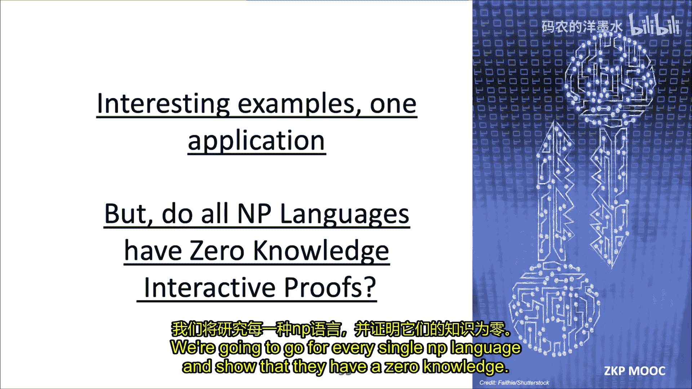

So in 1986， Goldrach Mialley and Victorerson showed that if one way functions exist。

 then every language in NPP has a zero analog to active proof。Let's dwell on this statement。

 there is a condition here when we showed that graphiteomorphism has perfect zero knowledge or quadratic residue is a perfect zero knowledge。

 there was no condition。Here the condition is that one functions exist。

This is essentially the simplest condition or the simplest assumption that we use in cryptography。

It will be covered in the supplementary material， but for now let's just assume that factoring is hard or discrete logs are hard or biline maps are hard。

That will be an instantiation of one way function and then they showed that for every language and entitypathpy there is a zeroology interactive proof。

 a computational zeroology interactive proof， it won't be a perfect one。

 but it will be using the general definition of computational there were two main ideas in the proof。

The first key idea。Is to show that an NP， an example of an NP complete problem that has a zero knowledge interactive proof。

 that will be sufficient to establish that every language in NP has a computational zero knowledge interactive proof。

😊，Why is that。Due to NP completeness reducibility， if an language is an NP complete。

 then every string x can be reduced， let's say if we're talking about the three coloring NP completete language。

 every instance x will be reduced to a graph G sub x such that if x is in the language。

 then the graph is threecolable and if x is not in the language， then the graph is not threecolable。

That means that if I had a way now to have a。Theonage interactive proof of whether the graph D sub x is three colorable。

It will。Also implied that I have a theology attractive proof of x being in the language for every language which is in menP。

So what they showed in their paper is as zero knowledge interactive proof for a particular NP completelete problem。

 the three coloring problem， and I'll show you in a minute how to do that。

But they needed one ingredient and that is。Where the one way functions come in。

 they needed essentially a to use the one way function to get a primitive cryptographic primitive called。

A commitment scheme。And that is the second idea， so one we functions imply actually a big commitment scheme。

 what's a commitment scheme， essentially a commitment scheme or commitment protocol。

Is a pair of protocols a commit protocol and decommit a commit protocol takes as input an m usually I want to think of m as a bit it's either zero or1 and essentially metaphorically puts m in an envelope。

 seals it so it's an opPEC envelope there's a sender and a receiver the sender commits the receiver gets the envelope can't tell whether there's a zero or one being committed to。

Then there's a de commitit protocol where the receiver can actually open the envelope and show。嗯。

The sender opens the envelope and shows the receiver that what was in there was either  zero or one。

The properties of these two protocol is that they satisfy hiding and binding。

 hiding means that while it's committed， you can't tell whether it's01 better than 50。

50 and binding means that when you open the envelope you can't have committed to zero and open to one。

Whatever it is youre committed to， you are actually bound it to reveal it。嗯。

We can go in a little bit more detail here talking about exact definition for hiding and that is that really the view of the receiver when you commit to a bit B or a bit B prime is computationally indistinguishable and binding is that you are not able to decommit to two different values B and B prime what is an example of how to get a bit commitment scheme the simplest example is using encryption you can think of commit as the sender essentially encrypting the bit if you want to commit to a bit B you encrypt a bit B and you can think of decommiing then is。

Giving the receiver either the decryption key or the randomness you use in order to encrypt the B B it's very important that it will be a randomized scheme for hiding to hold because I really want't be able to hide very strongly so you cannot tell apart with what you've committed to a zero or1 and for that you need a probabilistic encryption scheme。

So let's go to the main act and that is how do you show that a graph is three colorable without giving the coloring。

 in fact， in computational zero knowledge。😊，Having access to this commitment and decommitment primitives here's the idea so the prover again he knows all he doesn't only have the graph like the verifier and the proveer both have the graph he actually has a coloring。

So let's say he has a coloring of the vertices to red。Blue and green or。

We can call these colors the zero color， the one color and the two color。The first step。

 where the prover does， is very different， by the way， than the protocols we've seen before。

 What he does now， he picks a random permutation。It is a step that's unclear why。

 but well explain it in a minute， rather than using the original coloring he takes actually a permutation of those three colors so there's six permutations of that like red could be now blue blue could be green。

 green could be red or any of the other five possibilities so you pick random permutation of those colors and now you go to all the vertices of the graph and you recolor them。

With take the old coloring and give recolor it according to the random presentationut that you chose。

Now the graph is three colored if the poo is claiming a correct proof。

There is a three coloring and you just colored it again with a sort of permutation of this three coloring and now what the proveer does is he commits to each of these colors by running a commit protocol in other words he sends to the verifier。

 a commitment to for every vertex it will be their commitment to red to blue or to green a commitment means it's hidden the verifier gets this but he can't tell what the heck are the colors。

What the verifier now does is the following he thinks to himself， well。

 either this is a proper coloring or it isn't if it isn't it means theres exists one edge in this graph that doesn't that if you look at the two end points。

They are going to have the same color or maybe some other color altogether。

But to be a partatory coloring means that you only use red。

 green and blue and for every edge the two endpoints are different colors so what the verifier says I have no idea which one of these addresses is wrong。

Maybe they're all correct but I am trying to catch the mistake So what I'm going to do is I'm going to select a random edge among all the edges and I'll send it to the prover and I'll say you see this edge I want you to decommit the colors at the endpoints of the two endpoints of this edge and that's exactly what the prover is supposed to do is's supposed to sort of open the envelopes that have to do with vertex A and vertex B and now there's the edge A B has been decommitted in some sense。

 the colors of the endpoints and verify of course if the colors are not two different colors he rejects immediately。

Otherwise， he goes back to step one and repeats it again and after caters， maybe Ks 100。

 if he never rejected， he never found an edge that has。

Anything but two different colors he will accept， let's analyze this。

I will analyze in the next slide， but I want you to think for a second about the zero knowledge aspect。

 What has the verifier found One iteration we found colors。Over at single edge。

But what about if the second iteration and someone asked me in class。

 maybe you can build up after 100 iteration or。More partial coloring or maybe the entire coloring no and that is why why because in step one remember I took I picked a random permutation of the base coloring why did I do that I did it so that even though i'm repeating this again and again and again each time selecting maybe different edges the verifier selecting different edges the colors mean different things whereas before blue meant blue now when I put a random permutation of the colors blue might mean something completely different。

In fact， you can prove that these colorings are uncorrelated between repetitions Okay。

 so we need to prove that this is。Zero knowledge we need to prove completeness soundness and zero knowledgeness completeness what does that mean if the graph is threecolorable that the prove an honest prover can always convince the verifier to accept yes because you can always color it properly and no matter what edge is being requested you can always give the proper color what about soundness。

If the graph is not recolable。 now， think about it。 no matter what the proveover P star does。

 there is one edge there that's not properly colored。

 What's the probability that when the verifier chose that random edge。

 he will actually hit on the wrong on the edge that is not properly colored。 Pretty small。

Maybe everything is well colored except for one edge， what's the chance you get that edge？Well。

 the chance is one in the number of edges。 so the probability that after one trial。

 one iteration of this， the probability the verifier will accept when the graph is not three colorable is pretty good。

 it's 1 minus1 in E。 that's not good enough， we want the probability that accepts to be small in this case。

 So repeat again， but how many repetitions twice won't be enough。

Because1 minus1 in E times 1 minus1 in E。It's a little smaller than  one minus1 in E， but not much。

 but if I repeat this a number of edges number of times。

 then it will disappear exponentially we will have one in natural log to one in little E to the number of edges and that is an exponentially small probability and we get this gap between completeness and the soundness you will always accept the ver will always accept when the graph is recolable and you will accept with exponentially small probability when the graph is not threecolorable。

Now zero knowledge， as I said it's easy to see informally it's messy to prove it formally so how do we see it at least let's give give you some hiling of the proof。

And let's do it for the honest verifier so the honest verifier computational theology works like this This is the simulation the simulation again works in random in a different order rather than first。

Taking a coloring and committing， how can you do that the similarulator doesn't know color。

 there's no way you can do that。Can't even get off the ground。

 so what the simulator does is it chooses at random in advance the challenge of the honest verifier。

Which is just a random edge then it chooses。A bunch of colors which really don't matter。

 he can color the whole graph in the same color， except for that edge that in the lucky execution the verifier will ask him that's the AB edge and it colors it in two different colors。

 two different random colors。And what is the simulated view outputs， it commits to the transcript。

 which is a budget commitments， okay？The commitments are not supposed to give anything to a computationally bounded distinguisher because they're just commitments or if you think about how we implement the commitments a bunch of encryptions。

So you can't see anything then you give an edge the honest verify put the random edge and then you have a commitmentit transcript to those colors and the the commitment transcript will give two different colors to A and B because my commitment made it so that I essentially。

The only colors that were different were on that edge A and B。This is exactly。ACo share transcript。

But is it not really if you think about what has been committed to is not a legal coloring。

 so this transcript is very different than what happens in the real interaction。

 but it is computationally indistuable and that depends on the hiding property of the。

Commitment protocol。So what does the simulation look like， the simulation， which doesn't talk about？

Honest verifiers， but for every verifier that's harder it's here。On the slide。I will leave it for。

The TA to discuss in the supplementary lecture。The upshot of this now that we know that all of NPp can be done。

It has an interactive zero knowledge proof。It means that we have many， many。

 many examples which are interesting for us， as many as there are NP languages。Obviously。

 we can use this protocol also for statements we already know perfect xonology for。

 but we can get a stronger guarantee with perfect xonology。

But the more interesting cases is when we don't know a perfect xology protocol and we have to go through this three coloring protocol。

 so an example， any satisfiable balloonolein formula。

To prove that it has a satisfying assignment can be done in zero node without actually giving the assignment。

Given an encrypted input。E of X and a program program progue I can prove to you in zero knowledge that if you ran this program on an X that you only see the encryption of you will get y in fact I can give you an encrypted input and encrypted program and prove to you that if you ran that program on the input you would get back Y and that is without revealing the input or the program Why is that important here applications。

First major application that they already noticed in the original paper is a protocol design application。

Essentially， this is a tool to enforce owner's behavior in cryptographic protocols without revealing any knowledge or information。

The idea is the following， suppose you take a protocol and you've proved that if all players follow honestly the protocol steps。

 it's a safe secure protocol。Now you run it in the wild， the players may not follow the protocol。

 but you want to make sure that you can still use your security proof what do you do you tell the players okay。

I want you， along with every message you send to give me a zero knowledge proof zero knowledge interactive proof。

 possibly。That the next message that you're sending。

 that is the message you're sending is what you should have sent， if you were honest。In other words。

 it's what the protocol rules would tell you to send on the history of communication so far and your internal randomness are and maybe some other internal inputs。

How do you prove that in zero knowledge， essentially you commit to the random internal randomness。

 you commit your internal secrets once and f when the protocol starts。

 and then every time you send a message， you attach a zero knowledge proof。

That on these committed randomness， on these committed private inputs。

 this is the right message to be sent。 Why can this be done Because that is an entry statement。

 So if you think about the language， there exists some randomness such that the next message is what is equal to the protocol on the history of communication in R and。

In fact， R has been committed to that's an NP state。Again， it's a mouthful。

I advise you to mill over this。But it is an amazingly powerful tool。

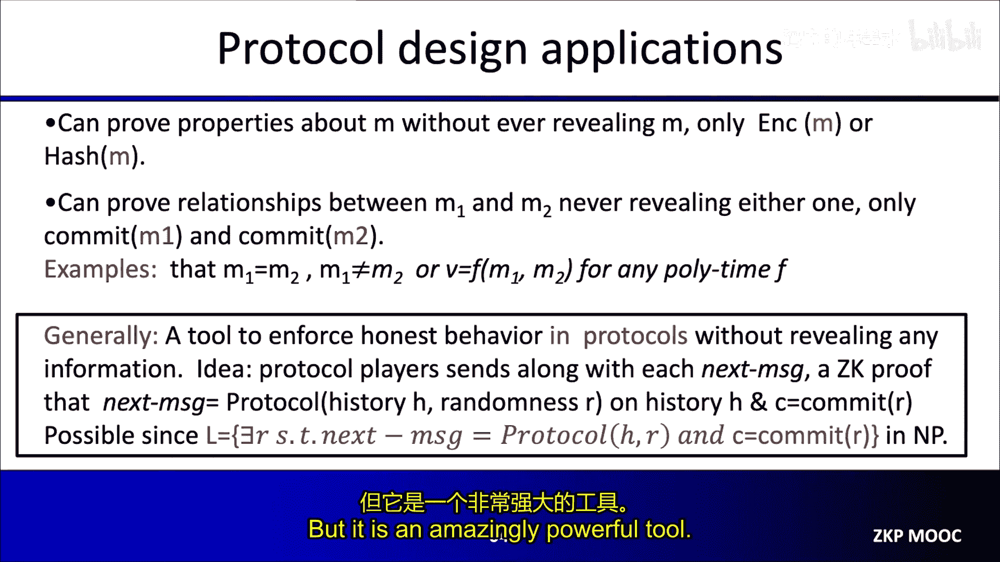

Zion note has been used for many things， you know， in the 80s it was mostly。

The two applications I already mentioned， which is identity preventing identity theft and a tool for protocol transformation from。

Honest to dishonest players， but since then it's been used in the context of computation delegation if you want to delegate computation to the cloud but only give the cloud encrypted data。

It's even been discussed as a tool for nuclear disarmament that's a very interesting application of the concept of zero knowledge that actually nuclear physicists have been。

At least about 10 years ago， there was a lot of work in this field。

People have suggested to use it in the context of forensics to prove， for example。

 that your DNA is not the DNA that's on the crime scene without revealing your DNA。

 but in the context of this class and the huge boom that has happened to zero knowledge， it's mostly。

Started with a paper by Ben Sison， Kisa and others on how to do Bitcoin in a private and anonymous manner。

 so adding ZK proofs in the context of cryptocurrency。More recently。

 there's some work by Bamberger and Rebecca Wxler and Ron Conney。

Evan Zimmerman and myself that shows zero knowledgege might be a very important tool in the context of the legal domain where there's many verification dilemmas in a law that necessitate right now revealing a lot of information that you might not want to reveal and zero knowledge can be used instead。

The last thing I would say is that zero knowledge has been not only useful for。

Cpttographic type applications， but it's actually been sort of revolutionary in the context of complexity theory。

And in fact， it's not so much zero knowledge， but really the concept of interactive proofs。

 so I'm going to spend the last five minutes talking about that before we end the class today。

So when we talk about what's efficiently solvable what's an efficient algorithm。

 we usually talk about P polynomial time things that run in polynomial time or things that run in polynomial time plus coins when we talk about efficient what's efficiently verifiable we used to talk about NP but in this lecture I suggested a new form of。

Proof an interactive proof where essentially you take NP and you add interaction and randomness on the part of the verifier。

Notice that。Our verifier。Was pretty simple in the perfect Xology examples。

 he was just choosing a coin and sending it over。And also in the N3 coloring zero knowledge proof。

The verifier shows a random edge。Is there something more sophisticated a verifier can do。

 Here' is an example。I'll show an example of an interactive proof。😊。

For a statement which is not an NP statement where the。

Verifier is doing something a little bit more than just tossing coins。Okay。

 and this will answer two questions at the same time。

 one is can you interactively convince a verifier in polynomial time of statements that we don't know how to convince？

Using a classical old NP proof， you know， just sending a witness and the answer is going to be yes。

And， second of all。Is there something else that verifyifier can do except for tossing coins and the answer？

For the next minute will be maybe let me show you an example。

 suppose I wanted to prove as a prover to the ver that actually these two graphs which are different from the other graphs are not isomorphic to each other。

Is this any different in the previous painting？Victor， yes。

 I've added an edge here on the left graph G0 between7 and 4 and on the right between 4 and 10。

What adding this edge has done is we've maintained the number of vertices and edges。

 but it's no longer true that these two graphs are as emotionalmorph to each other。

How do I prove that to the verifier？Think about it for a minute。I。😮。

Can't give an isomorphism because they're not isomorphic。

 I guess one thing to do is to go through all possible isomorphisms。

And to show one by one that neither one of them works or none of them work。

But there are a lot of isomorphism， so that is going to take a long time there's an exponential number of isomorphism and factorial。

But I want to convince an efficient verifier。So even though I don't have a short proof to send over like an NPI proof。

I will show you how to convince an efficient verifier。

Interactively that two graphs are not isomorphic to each other so that completeness and sound is whole and also their knowledge actually。

Here's the idea。Let me fill everything in and then。Go through it。Step one。

 the verifier flips so the input is two graphs g0 to G1 and the claim is that they are not isomorphe with each other。

 there is no isomorphes and that maps the vertices of G0 to G1。Step one。The verifier flips a coin。

Zero1 and he does that in order to select either GZ or G1 and he also picks a random isomorphosis。

Okay a permutation of the indverseities and then it applies this isomorphism to either to the G sub the coin so let's say if the coin was0 it applies it to g0 of the coin was one it applies it to G1 that gives them a graph H which he sends over to the prover now this graph is an isomorphic copy of G subub C。

Notice that if the two graphs were isomorphic， so it was an incorrect claim。

 this graph actually hs isomorphic to G0， but it's also isomorphic to G1。😊。

How does a provenover note？Wwhichch is the case where if the two graphs are not ansmorphic to each other and he's an all powerful person。

 remember that's how we were thinking about the prover。

 just he just examines whether H is isomorphic to0 or G1 and he tells back to the verifier。

Which is the case？If the verifier knows whether he took an rhsmorphism of G0 or G1。

 if B is equal to his coin。He's happy。 If B is not equal to his coin he immediately rejects。 He says。

 hey， this guy couldn't tell whether there was an isomorphic or G0 or G1。 He must be a liar。

 These two guys must be isomorphic to each other。 I reject。😊，However， as usual。

 he could have been lucky， he could have guessed the right coin。

 even though H is isomorphic only to both G021， he could have guessed that the coin flip was zero say and convinced。

The verifier or at least not convinced the verifier。

or left the verifier ambivalent so the probability that he succeeds to do that is going to be at most a half we do this as usual K times the probability that you will always gets the result of the coin of the verifier is half the first time a quarter twice in a row and a three times in a row and one in two to decay K。

K times in row， so when the two graphs are isomorphic。

 you'll catch them when they are not isomorphic， he can always convince you it's the completeness and soundness hope。

But does I zero knowledge hold in this protocol let's think about it even intuitively before we try to do a simulation and fail he doesn't why is that because the honest his verifier yes。

 the honorifier no problem but if the ver was not honest maybe he didn't just take a random H apply it to the G sub C and fan over age if he was honestly did that all he finds back is the result of his coin。

which he knows if it's what the coin was， but maybe he's a cheater if he's a cheater he might be sending Hs here that he just wants to he's finding out that this graph H is isammorphic to G0 or g1 right so when in dishonest verify he's working with an honest prover who's giving him。

Essentially is's telling him whether this new H is amorphic to g0 or G1。

 this is knowledge that I don't know how to simulate and in fact。

 this is an example of a protocol which is an interactive proof。It's non trivially interactive proof。

Like it convinces the verifier we don't know how to convince the verifier of non ismorphism with an NP proof。

 but it's not zero knowledge， we will need to modify it to be zero knowledge。

How do we modify it to be zero knowledge the verifier essentially before the prover answers we'll have to prove to the。

V to the prover， so now we sort of a switcher rule。

He's going to send them H and then he will prove to him that actually he knows。

That he really did these steps， he really applied this。This isomorphism to G sub C。

And it's beyond scope here， but there is a way for the verifier to do that。嗯。

What's interesting about this protocol is that it was very important for this protocol to work that the verifier here did more than just flip a coin he actually picked he flipped the coin you picked this random arm and he didn't reveal to the prover the result of his coin asses it's actually kind of interesting that the prover is the one who gives back B。

 but the verifier flips up coins in secrecy and then sends over H If you think about it this actually is very similar to the example of the colorbl in the beginning of the lecture The issue is is that it brings up a general question and that is。

A question that came up around the same time that the Ze knowledge paper came there was a proposal of something called an Arthur Maryland game by Bob bye and Moran。

 which is。An interaction between a prover and a verifyifier he called a Mern and Arthur。

 the difference was that Arthur wasn't a pbilistic vulnerable time algorithm that to coin and did computation。

 he was just a coin tosser， he threw coins， get back through coins got back。

This was the case actually in the perfect xoonology proofs that we've seen and also in the three coloring case。

 but it was not the case。For this last example that I showed you。And the question was asked。

 is it really a case that maybe you can prove more theorems？Like non isomorphism。

 if you let the verifier Arthur hides his coins， or in other words， is IP interactive proofs？

More powerful than Arthur Mellon， what he called they called Arthur Mellon games is the privacy coin necessary in order for the。

嗯。hoover to convince statements which are not an NP the answer was no。

 actually you can take any interactive proof like the one we just showed to graphize ofmorphism and turn it automatically to a system where the Arthur or the ver only ittosses coins turns out that this transformation is such that it makes it so that even if Maryland was efficient to begin with you will become inefficient。

 but again this is for a complexity course。There are lots of other questions people asked and that was how exactly powerful are interactive proofs okay so you can do graphno ismorphism can you do more than that the answer is that you can do actually a lot more than that。

😊，But before I show you that， I want to say that protocols where Arthur or the verifier is only a coin toer are very interesting protocols in practice。

Because it has been suggested by Fiat and Chameir in a paper on。

Suggesting something called a Fia Chamir paradigm， or at least since then we call the F Chamre paradigm is that when you have a protocol where the whoover is sending。

Messages， but the verifier always doing isc sending coins。

 you could possibly get rid of interaction now getting rid interaction is a big one。

If we can transform all this to like the poer just sending a string， it would be amazing。

 How could you get rid of interaction。😊，The suggestion of F Mio was this they said let's assume for a minute that we had access to some H big H which we think of as a cryptographic hasush function again this is for the supplementary material for the purposes of my lecture let's just think of H as a random orle What does that mean H basically I can apply it to a string and get random coins something that really looks unpredictable。

谢谢。Then if such an age existed， what the prover can do。Is say， well。

There's some interactive proof and let's say we prove completeness and soundness about it what I can do instead of really interacting sending a one getting back coin sending a2 and so forth what i'll do is I will。

Send you a string which is my first message A1 and instead of waiting for your message with coins I will by myself apply big H to this hash function to my own message。

And since I'm。Told this H really just takes the message and output something that looks random。

 I will now view this as your question， your coin question and answer that and this transcript rather than a1 coins a2 it's a1 the result of applying the hash function to a1 a2 should be just as good and the verify can run his decision procedure on this history rather than on a true interaction and then decided to accept or reject。

 it should be satisfy a completeness and soundness in the same way as a real interaction day a lot of people use this featurechemere in practice this paradigm it's a heuristic Why do I say it's theuristic because we don't really have such cryptographic hash functions that take a string and give me something at random that is an idealization it's called a random oracle model but it is used in practice all the time。

Okay。What you can say that if H ist behaving like a random oracle。

 then completeness and sound is two hold。

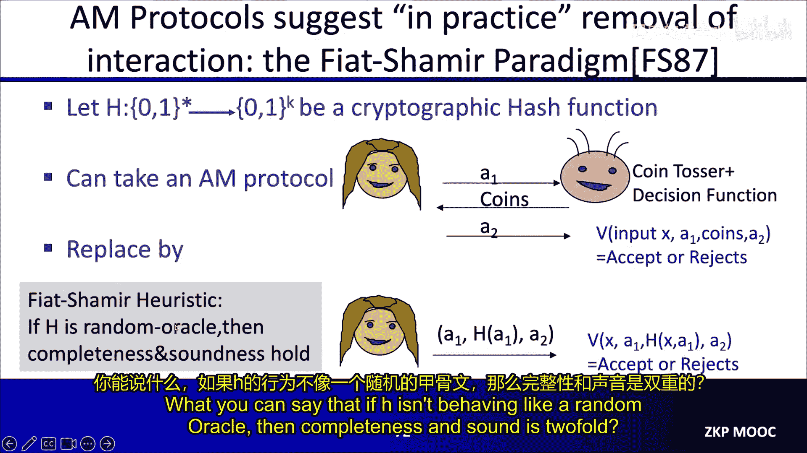

All right。Warning， this does not mean that all interactive xology proofs can be made non interactive。

Okay， even though IP is equal to A， it's not true that all interactive proof protocols where the。

Verify hides this coin can be turned into zero knowledge interactive proofs where Arthur doesn't hide his coins。

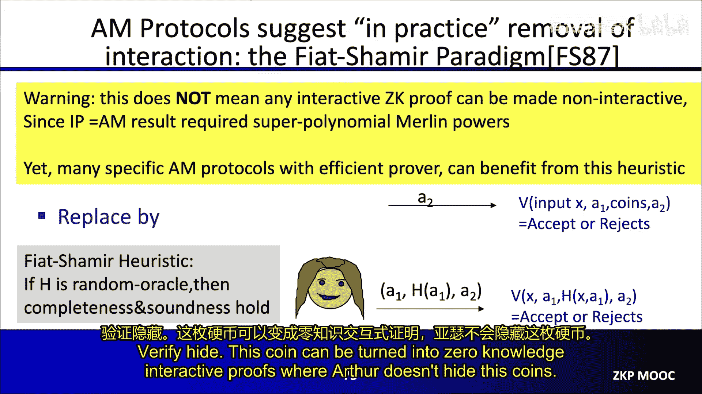

But it can benefit many protocols。And just one other thing is notice that what I did here in this slide。

 I looked at a case where the first message is from Mer， the second message is coins。

 but in some of the protocols we've seen the first message is actually from the verifier then how do you make that noninteractive well usually what happens is and that is going to be used in the course extensively is that we will post the first message coins as sort of a publicly chosen randomness for all to C and then apply the Fham mirror heuristics to get noninteractive proofs。

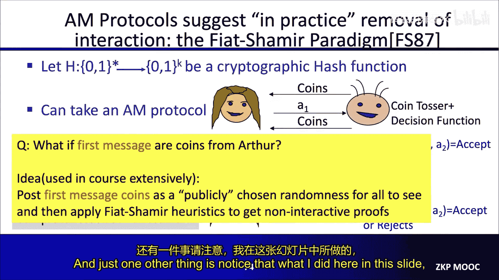

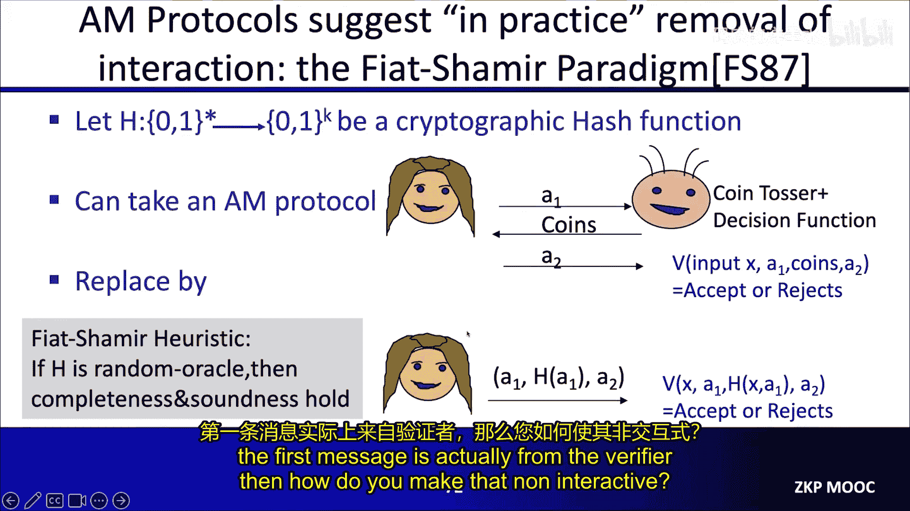

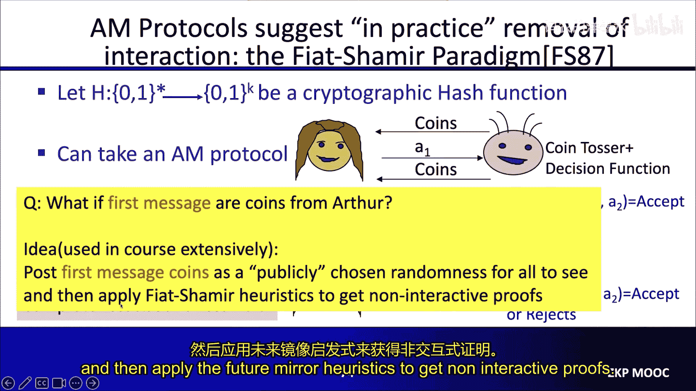

The notion of。Intertractactiveive proofs has been really a catalyst of complexity theory。

Because it was the first time that we really decoupled correctness from the knowledge of the proof and it enabled people to ask a lot of new questions about the nature of proof。

These questions have been asked and some of them have been answered for the last 30 plus years。

 and it's leading up to actually current research on you know provably outsourcing computation and some research and quantum computation。

 some highlights。Well。Classically before interactive proofs。

 the notion of efficient verification was NP that is that there exists a solution。

 so I just send you the solution and you as a verifier check it。

We didn't know how to verify whether CO&P statements were correct like the two graphs are not isomorphic to each other Co&P are the complement NP languages。

To count how many solutions are there to a statement， so for example。

 if you have a boolean formula how many and you want to find out does there exist a solution that's an NP statement there exists no solutions that's a Co NP statement there are exactly you know 37 correct solution that's what's called a sharpp statement we don't know how to convince a verify of that efficiently using an NP proof。

Or even a more complex statement where you have an autoational quantifier is like for all x。

 there exists a y for all x2， there exists as z and so forth。

We have no idea how to convince upon all time approver of such statements。However。

 if we use interactive proofs， it turns out we can。 So just by adding interaction and randomness。

 it has been shown in an amazing paper by Fort now Karoff。😊，嗯。え？

A El Den Nisan and then by Shamir that。You can convince a polynomial time probabilistic verifier with a very powerful prover。

 but a polynomial number of messages that。🎼Even statements in peace space can be proved using an interactive proof not only that。

 but people have thought they said well interaction helps coins help maybe there's other ways to define proistic proof system and in fact in the joint paper with Benor Killian and vierson we came with one such statement and we said you know？

One prover， we were able to do preSp， what if we add another one？

So the beginning let you say why would one2 be better than one， I mean， they're all powerful。

 What does that add， The idea was that we will let these two provers。

 This one will interact with the verifier and this one will interact with the verifier。

 but they won't see each other's messages and we likened it as if there was an interrogation of these two provers like interrogating someone in the crime。

 What's the crime， There's a claim。If the claim is true， there is no crime， if the claim is false。

 and he's trying to convince you that it's true， there is a crime。

 there's a bug in the proof you're trying to find it。And we were able to show indeed。

 that if you use this kind of proof system， you can get unconditional zero knowledge。

 so perfect zero knowledge for all of NP。But more interestingly。

 it turned out that in some incredible sequence of events。

 it was shown that two provers can actually convince you of even more statements than piece based the kind of intuition is the power of two provers which are in different sort of interrogation rooms is that you can catch inconsistency so they have to be consistent for you to accept their proof of a claim and catching inconsistency is an incredibly powerful device and it fact it's been shown you can even convince a polynomial time verify of non-deterministic exponential time statements。

This has led to sort of you know， incredible theorem called the PCP theorem saying that even if you stuck back to NP statements back to the usual good old。

NP statements where you have short witnesses for， there is a way to verify them。

Being correct with very high probability by only reading a constant number of bits of the proof so this is like going somewhere completely different。

 but it is a result of interactive proofs。Because we are allowing the verifier to make an error。

 we' are allowing him to toss coins and what has been shown is that by coming up with a sort of very different mechanism。

For writing proofs down you could write them in such a way that you could only need to read a few random locations in order to find an error it's another way to think of a two proof proof system as I said it had an impact on quantum computing and one of the beautiful results there is a result of some people from beerkeley Uish Brazzirani and others and that is。

How do we know that a quantum computer is actually using quantum power if we only have classical powers？

And what they showed is a way to take essentially acclaimed efficient quantum computation。

Two copies of it， likening the two provers， make them sort of sit in separate rooms。

 but be entangled and show how you could convince a classical verifier of the correctness of the computation。

A by choosing coins and by using entanglement and then this leads up to something very。

 very recent showing that actually if you have two provers not necessarily efficient quantum computers but two quantum。

Computers who might be taking a long time， they can convince a classical verifier。

Of languagegus which are all they recursively innumerable languages this's kind of an amazing statement and it's an amazing theorem there's a lot of buzz around it today。

😊。

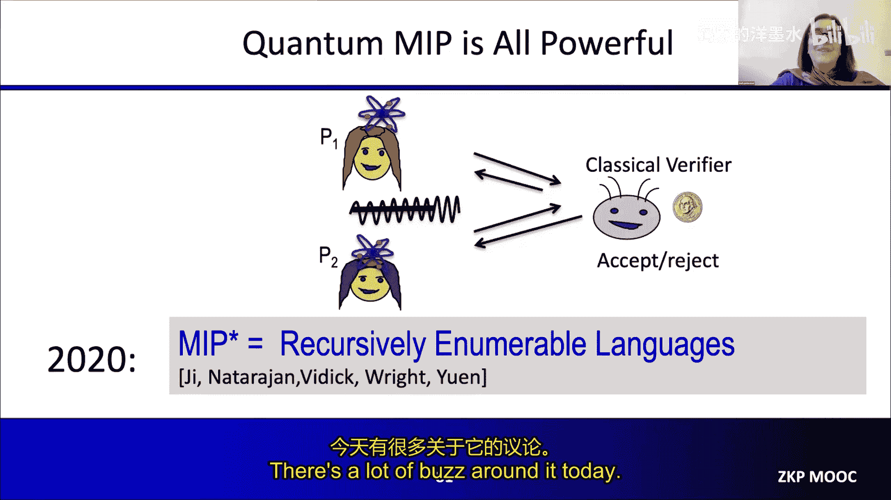

All right， thank you。