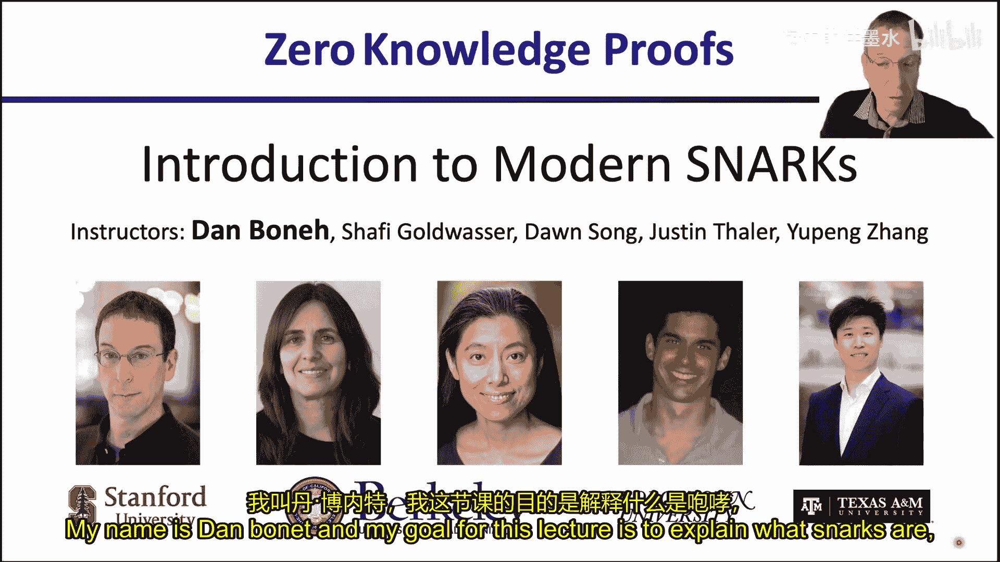
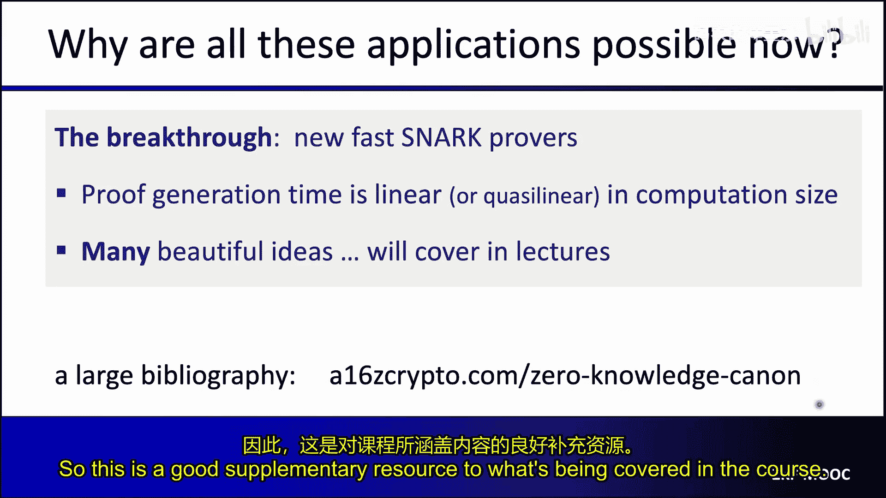
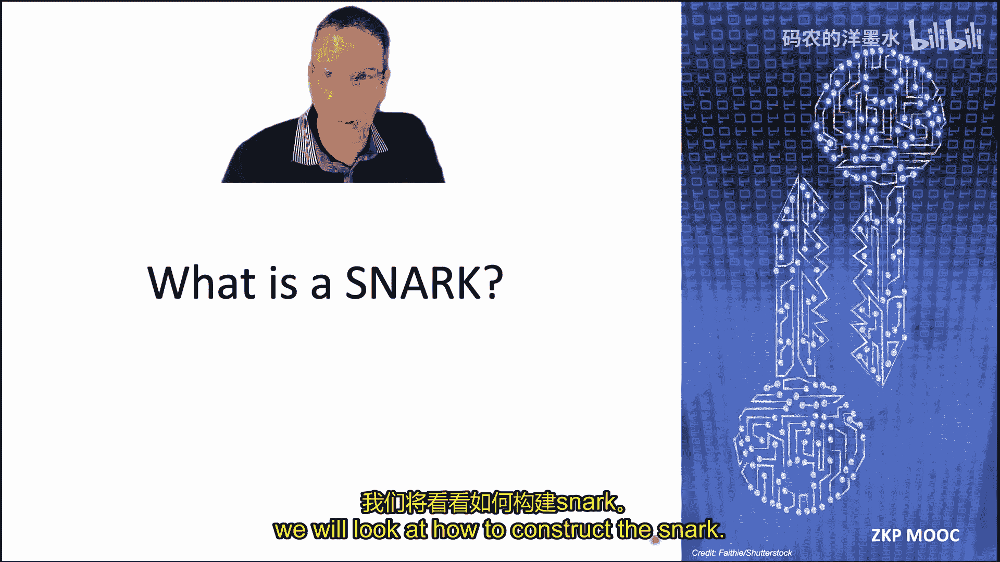
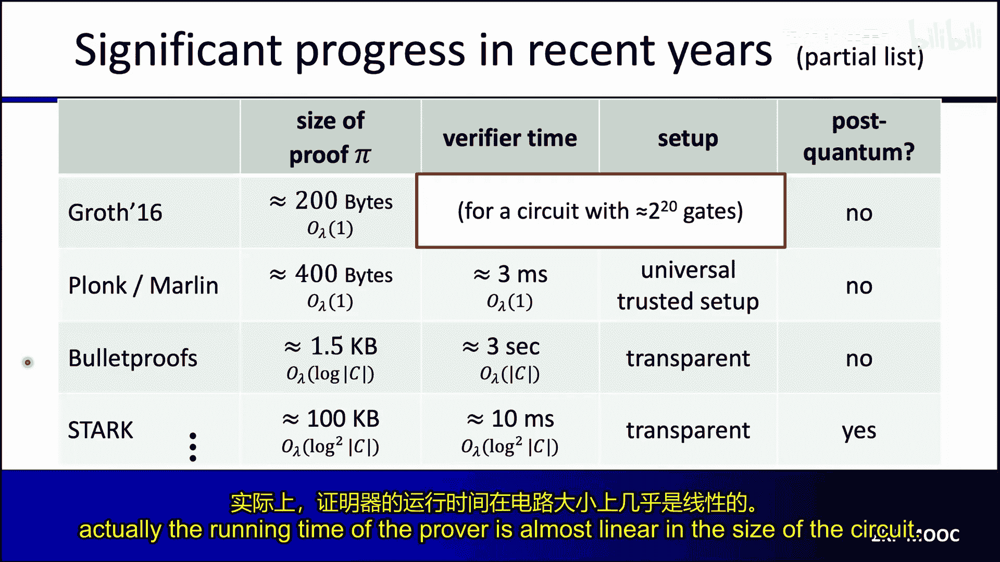
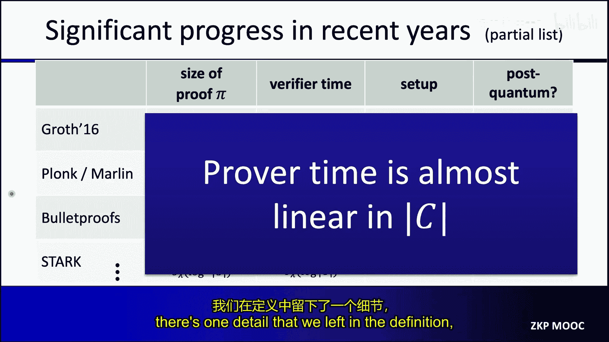
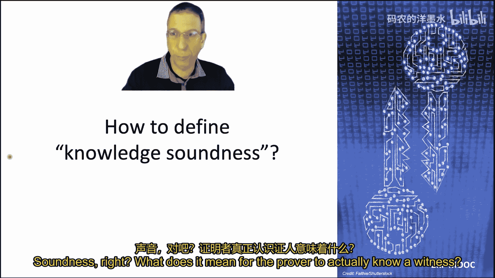
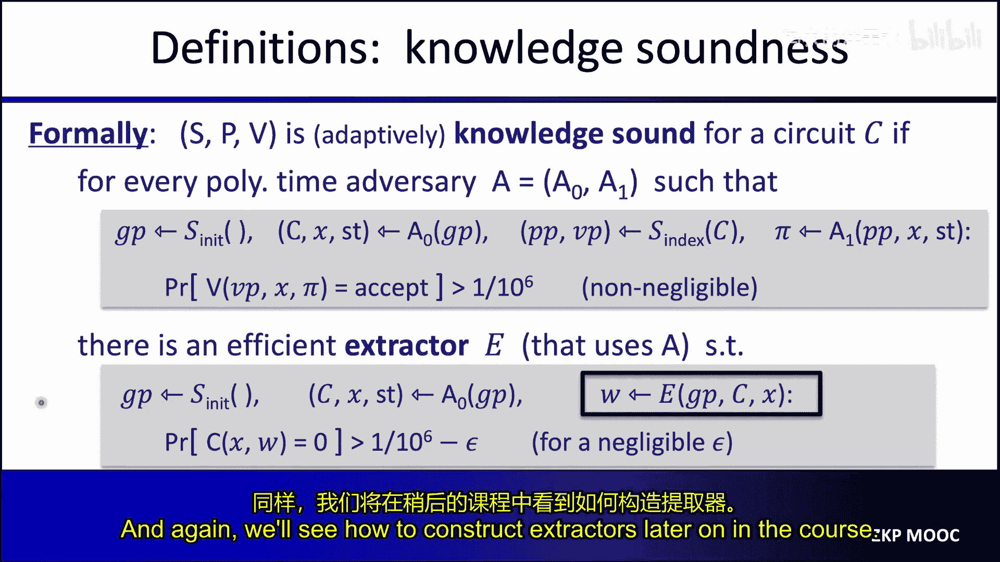
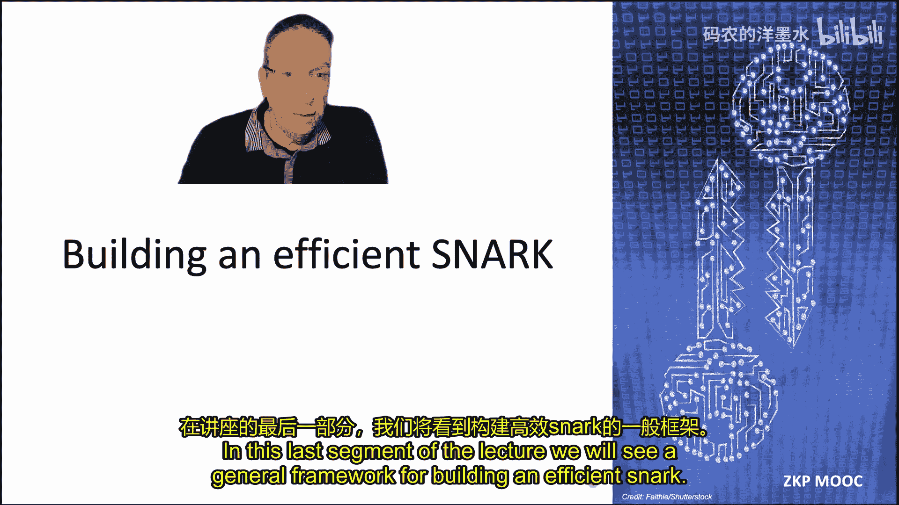
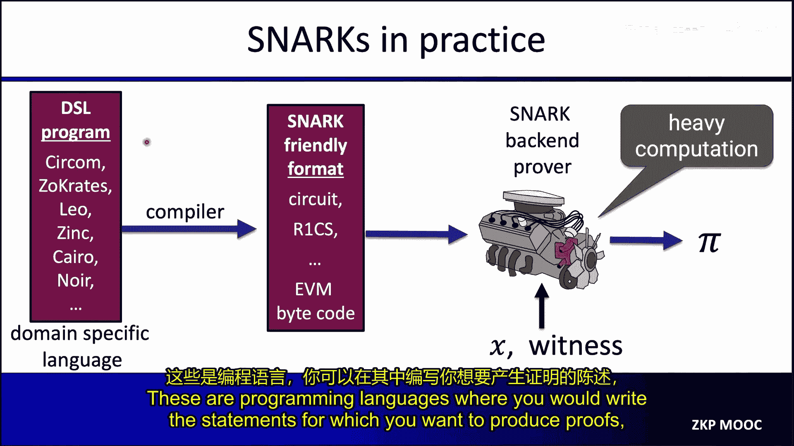
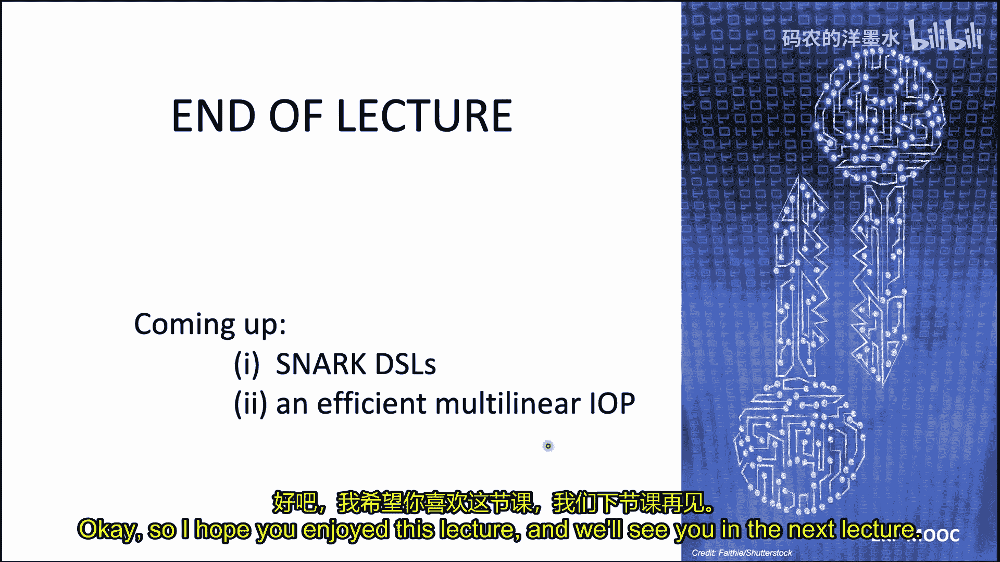

# 【全集】加州大学伯克利分校 Web3：零知识证明 区块链技术与隐私计算 中英字幕 1080P p02 Lecture 2 - 现代 SNARK 构造概述 -BV1bCrpB2E7Q_p2-

Welcome， everyone to a second lecture in our0 knowledge mooc。 In the last lecture。

 we looked at interactive zero knowledge protocols In this lecture。 and for the rest of the course。

 we will look at noninactive protocols and their applications。 In particular。

 we will focus on snarks which are succinct noninactive proofs。

 My name is Dan Bonet and my goal for this lecture is to explain what snarks are。

 what they are good for and how to construct them。 So let's get started。 First of all。

 I want to give you a little bit of intuition about what srks are and what they are good for。

 So a snark fundamentally， is a succinct proof that a certain statement is true。

 So what do I mean by a statement， Well， a typical statement we might want to prove is， for example。

 I know a certain message M says that if I hash this message using the hash function。 shot to 56。

 I get 0。 So I am the prover， I'd like to prove to you that I know such an M that shot to 56 of M is equal to 0。

😊。

A snark is basically a proof that allows me to convince you that I know such an M。

 the proof should be very short and it should be very fast for you， the verifier to verify。

The trivial proof is where I simply send the message over to you。

 but this trivial proof is not a snark。 right， If my message M is large。

 let's say it's a gigabyte of data， then my proof is huge because I'm sending you a gigabyte of data as a proof。

 And also， it takes you quite a while to verify the proof because you have to rehash now a gigabyte of data。

 So you， the verifier have to work quite hard to verify that my proof is correct。 in a snark。

 the proof is always short， and it's always very， very fast to verify。

 It sounds counter ortuitive that we can do this。 I can convince you that I know a message M。

 even though my message could be a gigabyte long， I know a message M whose hash is0。

 but I can do it using a very， very short proof。 that takes you very little work to verify。

 That's the magic of snarks。 that we can actually do this。😊，Now。

 we might want to add another property to a snark， which makes it into what's called a ZK snark a0 and all its snark。

 where， in fact， not only is the proof short and fast to verify the proof also reveals nothing about the message M that I know。

 So in other words， we treat the message M as secret。

 and I want to make sure that I can convince you that I know such an M。

 but I want to reveal nothing new about the message M。 Now， currently。

 there's massive commercial interest in snarks。 I only listed some of the companies who work in this area in the top row。

 I listed some of the companies who are building snark software in the second row。

 I listed some companies who are using snarks and in the third row， I listed hardware companies。

 some of the hardware companies that are building Snark accelerators。

 We'll see why S snark accelerators are needed in just a minute。

 And I have to say this is only a partial list There are many。

 many other companies who are now using Snarks。 Yeah。

 so this is quite remarkable to see that this concept of a snark has actually gotten quite a lot。

Of traction in industry。 And that's why there's such an effort to make snarks as practical as possible。

 Now， why is there so much commercial interest in this area right now。

 The reason dates back to the beginning of the study of proof systems back in the late 80s。

 early 90s and in fact， is a very elegant paper from 91 by byfortno 11 and Sety in the introduction to this paper they say that using these proof systems a single PC can monitor and verify the operation of a herd of supercomputers that are unreliable and running untrusted software。

 Now， what they meant by a single PC is actually a computer that's very slow and very expensive to operate。

 And instead of supercomputers these days， we would say GPus。

 And so the point of this work is that a slow and expensive computer can verify the work of a GPU。

 Now， for many years， it wasn't exactly clear， where is a slow and expensive computer。

 all of our computers are getting super fast。 Even our phones are becoming super fast。

So what is exactly a slow and expensive computer， Well that has actually appeared in the last couple of years in particular。

 the example of a slow and expensive computer is a layer1 blockchain which is you know can be viewed as a computer but it's actually quite a slow computer and it's quite expensive to operate。

So let's look at some of the applications for these snarks。

 Well'll start with applications motivated by blockchains。

 And the first one is this idea called outsourcing computation。

 It's interesting that for this particular application there's no need for zero knowledge。 Yes。

 so there are no secrets here here we are just going to be using the fact that the proofs that snarks generate are short and fast to verify。

 The first example， which you may have heard of is basically scaling the blockchain using what's called a Z K roll up。

 So here， the idea is that an offcha service can process a batch of 100 transactions or maybe even 1000 transactions。

 and proof to the L1 chain that all the transactions in the batch were valid transactions and all were processed correctly。

 What do we mean by valid transactions。 These are transactions that are properly signed。

 They properly transfer funds around and so on。 So the L1 chain doesn't actually have to verify these hundred transactions1 at a time。

 All the L1 chain has to do is verify this succinct proof that's very short and very fast to verify。

 So by doing this， we actually are able to。😊，The speed of the L1 chain by a factor of 100。

 because instead of verifying 100 transactions， the L1 chain just verifies a short proof。

Another application comes up in the context of blockchain interoperability where our goal is to bridge blockchains。

 Yeah， we'd like to move an asset from one chain to another。

 and the way we do that is basically by having the source chain lock up some asset and materializeized on the target chain to do that。

 the target chain has to be convinced that the source chain really did lock up that asset。

The way we do that is basically by proving to the target chain that， in fact。

 the consensus protocol on the source chain agrees to the fact that the asset has been locked up on the source chain。

 And again， the way we do that is by producing a snark that actually proves the state of consensus on the source chain to the target chain。

 so the target chain will just verify a snark that the state of the source chain is what it claims to be。

 And if so it will materialize the asset on the target chain。 So here we're again。

 using the fact that the snarks are short and fast to verify because the target chain doesn't have to run the entire procedure for verifying consensus of the source chain。

 it just needs to verify a short proof that was generated by an offcha service。

 which convinces it of the consensus state of the source chain。

What's interesting is that in both of these applications。

 it's critical that the proof be noninactive。 This proof is going to be verified by a large number of blockchain validators。

 And so for that， it's crucial that the proof is non interactive。

 We can't have the prover interactively proof to each and every validator that the statement is correct。

 non-inactive proof allows all these validators to verify the proof where that ever interacting with the proof。

 Another set of applications for snarks in the blockchain area does require privacy。 And for this。

 we would use a Zk snark。So these applications have to do with privacy and the question is how to process private transactions on a public blockchain What's a private transaction。

 a private transaction is a transaction where when the transaction is posted on chain。

 the transaction data is actually encrypted or maybe it's committed to on chain。

 but the point is the transaction data is not available for the public to inspect。

 unlike on many existing blockchains where transaction data is available for the public。

Now the transaction data is not available for everyone to see。

 we need to attach a zero knowledge proof to argue that a transaction is valid that is properly signed by the originator。

 that no money is being created and no money is being lost and there are a number of projects that actually exactly use ZK Snarks for this purpose。

Another example where privacy is needed is in the context of compliance， where again。

 we're posting encrypted or committed transactions on chain。

 so transaction data is not available for the public to see。

 and yet the originator of the transaction would like to prove that the transaction is compliant with local banking law。

And so again， this is done by attaching zero knowledge proof to the transaction to argue that banking laws are followed and the private transaction is compliant。

 and there's a company called espresso that's actually deploying those kind of systems。

 another example where Zk srks are needed is when proving that an exchange is solvent。

 So let's say that an exchange once to prove that it has more assets than its obligations to its customers。

 It would have to prove what its obligations are， and it would have to prove what its assets are and prove that the assets are more than the obligations but it would like to do all that in zero knowledge。

 so is not to reveal how much assets it has and not to reveal its customer obligations。 So again。

 this is a very elegant obligation of zero knowledge srks and there's a company called Rposa that's deploying these types of srks。

Now what's interesting is that these blockchain applications are driving the development of ZK S snarks。

 but in fact， there are many， many non-block applications for this technology。

 So these nonblockin applications are benefiting from the fact that blockchains drive so much of the development of S snarks。

 I want to show you one example application that has nothing to do with blockchains。

 but it's a really elegant application of ZK snarks， and this has to do with fighting disinformation。

So here's the problem。 The problem is that when you look at a newspaper article。

 these articles often have images embedded in it。 The problem is that the article might be about one event and the image in the article might come from a completely different event at a completely different place at a completely different time。

 This is happening so much so that newspapers are struggling to actually educate their readers on how to identify misleading images in newspaper articles。

 And again， this is happening again and again and again and again so much so that these news organizations are trying to educate the public about how to tell that pictures and videos are authentic。

 The industry is also developing technological solutions to this problem。 And in particular。

 there's a recent standard called C2PA， which stands for content provenance and authenticity whose goal is to provide authentic provenance for images in newspaper articles。

 So let me explain how C2PA works。 The idea is basically to embed in every camera a secret key that's going to be embedded by the manufacturer。

The idea is that the secret key is embedded in the camera in such a way that it cannot be extracted from the camera。

 So let's assume that can actually be done。 And there is a secret key in the camera that cannot be extracted from the camera。

 Now， every time a C2 P compliant camera takes a picture。

 It will go ahead and sign the picture along with all the metadata associated with the picture。 Yes。

 so the location in the timest for when the picture was taken is going to be signed using this secret key and it is simply going to be embedded in the raw image data that's generated by the camera。

 Now， when the image is embedded in an article and sent over to a reader。

 the reader's laptop can simply verify the signature on the image and show the metadata。

 the location timest to the reader so that the reader knows that it's looking at article with an image that's taken at the time and place that's claimed by the article。

 Unfortunately， there's a problem with this standard and the problem is what we call postpro。

 These new cameras capture very。😊，Resolution images but when newspapers embed images and articles。

 they downs sampleample the images so as not to waste so much bandwidth when sending the image to the end user and so you know they might rescale the image to a much lower resolution。

 they might crop the image they might grayscale the image and in fact。

 the associatedsociated Press has a list of a few operations that newsrooms are allowed to apply to images like resizing cropping and gray scaling。

Now， the problem is， of course， that when you send a processed photo to the laptop。

 the laptop can no longer verify the C2PA signature on the image， right。

 to verify a signature on an image， you have to have the original image data。

 otherwise you can't verify the signature。 So now we have this problem that the signature exists。

 but the laptop isn't given the original image data so it can't verify that the signature is valid。

So snarks actually give a perfect solution to this problem。

 And so let me describe how this would work。 The idea is that instead of embedding a signature in the image。

 we're going to replace a signature by a Z K snark。 What does this snark do。 Well， let's see。

 So the laptop actually has the processed photo and the list of operations that were applied to this photo。

 So， for example， downsizing gray scaling cropping and so on。 Now。

 what the editing software in the newsroom is going to do is it's going to generate a Z K snark proof Pi。

😊，That proves the following statement。 It proves the newsroom is going to prove I know an original image and I know a signature on this original image such that the signature is a valid C2 P A on the original image。

The photo that I sent you write the edited photo is the result of applying the authorized operations to the original image and the metadata in the photo that you received is actually equal to the metadata in the original image。

So this is what the Z K snark will prove。 Basically it proves that the photo that the laptop is looking at has the same metadata as the original photo。

 The original photo is properly signed， and the only operations that were applied to the original photo is cropping or resizing and such。

 Now， the laptop will verify this Zk snarrk proof。 And then if it's valid。

 it will show the metadata to the user saying， yes， this image was taken at dislocation at this time。

So how well does this perform？ Well， these proofs are succinct。 They're actually quite short。

 less than a kilobys per proof。 And they're also very fast to verify。

 So the browser can verify a single proof in about 10 milliseconds。 So quite fast。

 And the remaining question is， how long does it take to generate these proofs for the newspapers。

 remember the newspaper has to generate one such proof for every image。

 So if it has 100 or 1000 images to process per day。

 it basically would have to generate like 100 or 1000 such proofs every day。 Well。

 the images that come out of these sony cameras are fairly high resolution or about 6000 by 4000 pixels。

 And even for such high resolution pictures， proving that resizing cropping and gray scaling was done correctly。

 only takes a few minutes and a suitable machine。 So quite a reasonable running time。

 but here are two points that I'd like to make。 The first one is that proof generation is a highly parallelzable operation。

 So if the newspaper wanted to generate these proofs faster。

 it could simply throw more machines at the problem， And now， instead of taking a few minutes。

 maybe it only take a。😊，Second with enough machines。

The second point I'd like to make is that here for this application it's crucial that the proofs are noninactive。

 You notice the newspaper is not proving this fact interactively to every reader of the newspaper。

 No， the newspaper is generating a single proof which is then sent to all the readers and then every reader on its own can verify that the proof is valid and that the resizing cropping and gray scaling was done correctly。

I'd also like to mention that generating proofs for such large images is that the boundary of what we can actually do efficiently。

 we'd like to also generate proofs of correct manipulation for large video files。

 but doing this for large video files is currently beyond our capabilities。

 but who knows this field is advancing rapidly and maybe in the future we would even be able to generate such proofs for large video files。

And so to conclude this topic， I'd like to mention this very elegant paper called Photoproof by Navaan Troummer back in 2016 that already started looking at how to do proofs for correct image manipulations。

So the question is why are all these applications possible now。

 these are things that we simply couldn't do five or 10 years ago。

 So why is it that all of a sudden now we can generate proofs for these large statements in a reasonable amount of time and the breakthrough is really that the new generation of snark systems now support very fast provers in particular proof generation time is linear or maybe slightly more than linear what we call quasiline in the computation size and the fact that these new generation of provers work so quickly is exactly what lets us prove such large statements。

 This was made possible by a collection of very elegant ideas mostly on various ways in which we can prove properties of polynomials。

 So theres lots of beautiful ideas from algebra that actually make all this possible。

 So it's quite an elegant application of polynomials and algebra in general and that's exactly what we're going to be covering later in this lecture and in the coming lectures Now for those of you who want to learn more about this area beyond the topics that are covered in the course。

 I'd like to point to。Very large bibliography of survey papers and research papers and books that describe the area and everything that's been happening in the last couple of years。

 So this is a good supplementary resource to what's being covered in the course。

 So this brings us to the end of this first segment。 And so in the next segment。

 I want to show you what a snark actually is。 And then we'll talk about a general paradigm for building snarks。

 So I'll see you in the next segment in just a few minutes。

Welcome back everyone in this segment we're going to define more precisely what a snark actually is。

 and then in our third segment we will look at how to construct the snark。

So the first thing we need to do when defining a snarc is to fix what's called a computation model and the computation model we're going to use here is what's called an arithmetic circuit so let me remind you what an arithmetic circuit is basically we're going to start by fixing a finite field Now if you're not comfortable with one a finite field is don't worry all it is is just basically the set of numbers from 01 to up to p minus-1 where p is some large prime and I'm going to denote by capital f the set0 up to p minus-1 and of course you know that we can do addition and multiplication of elements in the set modular P and so the set with addition and a multiplication operation mod P is what we call a finite field of size p So we'll be using these finite fields throughout and the next thing I have to define is what is an arithmetic circuit So an arithmetic circuit is basically a function that takes is input n elements in the field and produces an element in the field as output。

Here I wrote down an example of an arithmetic circuit。

 You can see the input happened to be x1 x2 and one input happens to be fixed at the number one。

 And then there's a bunch of arithmetic operations inside of the circuit。

 So this is addition module P subtraction module P multiplication module P in out the output。 Now。

 if you basically trace what this circuit actually does。

 it's actually computing this polynomial in the variable x1 and x2。 So really。

 even though technically we define an arithmetic circuit as a directed acyclic graph where the inputs are labeled by variables x1 x2 and potentially by a scalar and the inner nodes are labeled by plus times and minus really。

 you can think of an arithmetic circuit as computing an invariate polynomial。

 but's it's more than just an invariate polynomial is's also a recipe for evaluating this polynomial。

 so that's what we'll say as an arithmetic circuit。 And in fact。

 I'll use this notation size of C to denote the number of gates in C。 So in particular。

The size of the circuit in this example is three because there are three gates in the circuit。Okay。

 there are lots of interesting arithmetic circuits。 In fact。

 arithmetic circuits can do anything that polynomial time computations can do。

 So let's look at some simple examples。 For example。

 here's a circuit that computes a hash function in particular， the shot to 56 function。

 right It basically would output 0 if shot to 56 of a message M happens to be equal to H and it will output nonzero otherwise what the circuit looks like is basically well。

 it just computes H minus shot to 56 of M。 So you can see if if H is equal to shot to 56 of M we get0。

 Otherwise we get non-zero。 And it turns out the size of the circuits。

 the number of gates that it takes to implement the functions shot to 560 is around 20000 arithmetic gates。

Yeah， so just using additions， multiplications and subtractions。

 we can implement the Sha to 56 function， and it takes about 20，000 gates to do it。

 and this is what we would consider a small arithmetic circuit。

 you can imagine a more complicated circuit maybe one that verifies digital signatures。

 So for example， here we have the signature verification circuit that takes us input a public key a message in a signature and output was 0 if the signature is a valid signature on the message M with respect to the public key Pk so you can build arithmetic circuits that even verify signatures and we can build arithmetic circuits that do much。

 much more complicated things of the type that we saw in the previous segment。😊。

Okay so that's what arithmetic circuits are。 last thing I'll say about our arithmetic circuits is that we often distinguish between two types of arithmetic circuits。

 structured circuits and unstructured circuits。 So an unstructured circuit is one where the wires can just be can just go anywhere。

 So you have a bunch of gates in the circuits and the wire just kind of wire up the gates however the developer once。

 But then there is a more structured version of an arithmetic circuit where really the circuit itself is kind of built in layers where theres one fixed arithmetic circuit that's just repeated over and over and over again。

 The input comes in at the bottom and the same operation is applied over and over again and then finally the output is computed。

 This operation M is sometimes called a virtual machine and you can think about it as one step of a microprocessor So the microprocessor is executed over and over again。

 So like each step here could be considered as one step of a microprocessor operation and finally we end up with a final output。

 And in fact， as we'll see some s techniques are。General， they apply to unstructured circuits。

 and some snark techniques only apply to structured circuits of the type that we see here。

Now that we understand arithmetic circuits， let's start defining snarks more precisely。

 Before we define snarks， let's start with narcs。 A Nrc stands for noninactive argument of knowledge and basically a narc is applied to an arithmetic circuit C。

 So what does this circuit Take as input。 Well， it takes a public statement， which well call X。

 and it takes a secret witness， which will call W。 Yeah。

 so we have a general arithmetic circuit that takes two inputs X and W and produces another element in this finite field。

Now the way the NArc works is basically there's a preprocessing algorithm。

 which we'll talk about more in just a second， but what this preprocessing algorithm sometimes called a setup algorithm does is it basically takes a description of the circuit as input。

 and then it outputs these public parameters which we'll call PP and VP PP are public parameters for the prover and VP or public parameters for the verifier。

And then the prover and the verifier will each take their own inputs right so the prover takes the public parameters for the prover along with the statement and the witness。

 the verifier takes the verify the verifier parameters and only takes his input the statement X。Now。

 what the prover will do is we'll generate a proof pi that in fact， C of x comma w is equal to 0。

 Okay， so the prover is trying to convince the verifier that it knows some w such as C of x W is equal to 0。

 and the ver algorithm will verify this proof pi in output accept or reject。 That's our goal。

So let's define this in a bit more detail。 Basically a preprocessing narc。

 noninactive argument of knowledge is a triple of algorithms S PV。

 where S basically takes the description of the circuit C and outputs the parameters that we talked about algorithm P takes his inputs。

 the parameters， the statement X and the witness W potentially a secret which is W produces a proof and finally takes his input only the statement X and the proof pi and decides to either accept a proof or reject a proof。

 Now， there's one small technical point that I want to make in that these all these algorithms in practice also have access to what's called a random oracle If you have taken a cryptography class and you know what a random oracle is。

 you'll know what I mean here。 if you have not and you're not familiar with the term random oracle。

 Just never mind for now will come back to it later。

 But I just wanted to make this one technical point。 If it's not clear。

 then just feel free to ignore it。Now， there are a couple of requirements that an narc has to satisfy。

 The first requirement is what we call completeness， which means that if the proof is valid。

 so in other words， the prover really does know a witness W such that C of xw is equal to 0。That。

 in fact， the verifier will accept the proof pi that the prover generated。

 You can see here the probability that the verifier accepts the proof is one。

 Sometimes this is called perfect completeness in that the verifier always accepts a valid proof。

The other property is more subtle to define。 And here I'll only define it informally and we'll come back to a formal definition in just a minute。

 which is to say that the narc is what's called knowledge sounds。 Okay so what does that mean。

 It means that if V accepts a proof from the prover。

 then the prover really knows a witness W such that C of xw is equal to 0。

 You notice I put knows in quotes because what does it mean for an algorithm to know something。 Well。

 what it means is that there exists some sort of an extractor that if the prover is able to produce a proof that's accepted from the verifier。

 then the extractor is actually able to extract a valid witness from the prover。 And again。

 we'll see what this means in just a minute。 but what I want you to understand for now is that the narc has to be knowledge sound。

 meaning if the verifier accepts a proof， the prover must know a w that makes C of x w is equal to 0。

AndNow optionally， we can ask the Nrc to satisfy the privacy requirement， namely。

 we could ask that the NRC easier your knowledge， meaning that everything that the verifier sees。

 yeah， the circuit， the parameters， the statement and the proof reveals nothing new about the secret Wi W。

So these are the three properties that we want our narcs to satisfy。

 So one thing you should notice is that， in fact， is's a trivial narc。

 The trivial narc is where the proof pi is simply equal to the witness W。

 and then the verifier can just rerun the circuit and verify the C of x W is equal to 0。

 so the trivial narc basically sends the witness W over to the verifier and the verifier checks that the witness is valid。

So a narc is actually not what we are primarily interested in。

 what we are primarily interested is a snark， which is a succinct argument of knowledge。

 So what is a snark a snark is a triple of algorithms SpV as in an arc。

 except we put additional requirements on the proof the proof that the prover generates must be short and in particular its size must be sublinear in the size of W。

 so the prover cannot just set the proof pi to be equal to the witness W that will be too long。

 we require that the length of the proof is sublinear in the length of w and the proof should also be fast to verify。

 meaning that the running time of the verifier should be sublinear in the size of the circuit。

 so the verifier cannot simply rerun the circuit C。

 its running time has to be sublinear in the size of the circuit C of course it has to be linear in the statement X because the verifier has to at least read the statement X in order to know what is verifying so we allow it to be linear X but it has to be sublinear in the size of the circuit C and here。

I wrote just an example of a sublinear function， maybe we want the length that proof to be the square root of the size of the witness and the running time of the verifier to be square root of the size of the circuit。

So basically， anything that does better than the trivialvial narc。

 where we simply send the witness over to the verifier is called a snark。However， in reality。

 we want to be more greedy。 And so a snark in practice actually is going to be strongly succinct。

 So what is strongly succinct means that means that not only is the proof sublinear in the size of the witness。

 it actually has to be logarithmic in the size of the circuit。 So very， very， very short proof。

 even if we have very， very large circuits。 and similar to the time to verify the proof should be at most logarithmic in the size of the circuit。

 again， we allow it to be linear in the size of the statement。

 because the verifier has to at least read the statement Now。

 in many of the snarks deal we're going to be looking at the size of the proof and the time to verify the proof in fact。

 is constant independent of the size of the circuit。

 which is kind of remarkable that no matter how complicated the circuit is， the size of the proof。

 the C of x w is equal to 0 and the time to verify that proof is basically independent of the size of the circuit。

😊，So now something should look fishy here because if you think about this for a minute。

 you realize the verifier actually doesn't even have time to read the circuit C right has to operate in time thats logarithmic in the size of the circuit C。

 So the verifier doesn't even know what the circuit C is。

 So how can it possibly verify a statement if it doesn't know what the underlying circuit is。

 and this is exactly why we need the preprocessing step what the preprocessing step does this algorithm S here is in some sense。

 it reads the entire circuit C， and it generates a summary of the circuit C for the verifier。

 So the verifier parameter is Vp。 their size is， in fact。

 that most logarithmic in the size of the circuit and really they act as a summary of the circuit that still allow the verifier to verify that c of xw is equal to0。

 It's kind of magical that is can be done that we can summarize a circuit in such a way that a verifier can still verify evaluations of the circuit at arbitrary points x comma W。

 but we'll see exactly。😊，How to do this。Okay， so that's what a snark is。

 It's a narc with very strong constraints on the length of the proof and the time to verify the proof。

And then basically， as we said， a snark is a nark that is succinct。

 and a ZK srk is a snark that is also zero knowledge， again， intuitively。

 meaning that the snark proof reveals nothing about the witness。

So let me come back to the trivial snark because this is such an important point。 right。

 So the trivial snark is not a snark。 So what is the trivial srk。

 The trivial snark is where the prover simply sends the witness over to the verifier as the proof。

 And then the verifier will'll check the C of x W is equal to 0 and we'll accept if， if so。

 So why is this not a snark。 Well， for three reasons。 First of all， the witness might be long。

 and we want a very short proof。 right， Again， the length of the proof should be most logarithmic in the size of the circuit。

Second， computing C of x W may be very hard， right。

 the circuit C could be a very complex circuit and simply recomputing C of x comm aW might take the verifier quite a long time。

 and it's very important for us that we have a fast verifier。And finally。

 we might want to keep the witness W secret， whereas in a trivial snark。

 we simply reveal the witness W to the verifier， which might be unacceptable。Okay。

 so we're going to have to do something much， much more clever to build srks。

 and that's actually what the rest of the course is devoted to。

So let's talk a little bit more about the preprocessing step， which is quite interesting。

 so here the preprocessing step is the step that generates these parameters for the prover and parameters for the verifier and we said that the parameters for the verifier act as a summary of the circuit for the verifier。

The preprocessing step often will take some random bits that will use to generate these parameters。

 And there are three types of setup procedure。 The first one is what we call a trusted setup per circuit。

 So here， this setup procedure has to be run afresh for every circuit that we want to preproces。

 And more importantly， it's really critical that the random bits are。

 are kept secret from the prover。 Yeah， So in particular。

 if the prover ever learns these random bits R that will allow it to prove false statements。

 which will be a disaster， because if we are able to prove false statements in the context of a blockchain that allows the prover to actually create money or steal and so on。

 So we always want to keep the random bits are secret from the prover。

 Often what will happen is this trusted setup will be run for the circuit that we want to generate proofs for。

 And then the machines that generated this random secret R will actually be destroyed so that nobody will ever know what the secret R is。

 Sometimes this is called a trusted setup ceremony。Kind of a complicated thing to do。

 And we'd like to avoid that as much as we can。So the second type of setup is better because now we basically get to split the setup procedure into two different procedures。

 what we call S in it and S index。 so S in it is something that's run once and for all。

 You notice it does not take the circuit as input。 It's just run at the beginning of time once and for all。

 and this S in it procedure will generate parameters， which will call global parameters or GP。

 The machines that participate in this process are destroyed once the process terminates so that the random bits R remain secret and are never known to anyone。

Then once we've generated the global parameters， then there is a fixed deterministic algorithm that will take a description of a circuit C and the global parameters and generate the parameters for the prover and the verifier。

 Anyone can run the algorithm and verify that the parameters for the prover and verifier were generated correctly。

😊，So the reason this is better is because after we run through our onetime trusted setup。

 we can then generate parameters for as many circuits as we want。

 So this is sometimes called a universal setup。 It's still trusted。

 because we still have to trust this in it procedure。

 but at least this one in it procedure can be used for many， many many circuits。 And， of course。

 the best of all worlds is where we have a transparent setup where the setup procedure doesn't take any secret data。

 So anyone can verify that it ran correctly and there's no need to run a trusted setup ceremony。

 So yeah， so this is kind of the ranking trusted setup per circuit is what we try to avoid。

 a trusted but universal setup is better， but a transparent setup， of course， is the best。

 So now let's look at a couple of srk systems out there。

 This is a very partial list and it only focuses on snark systems that are widely deployed。

 And it already gives us many of the flavors of snarks that we'll see during the course。

 So the first one is called growth 16。 It's due to growth back。😊。

2016 and you can see that it generates very， very short proofs。

 so the proofs are only 200 bytes irrespective of the size of the computation。 so even for huge。

 huge circuits， this is still going to be a 200 byte proof。

 The verifier time also you can see is constant independent of the size of the circuit。

 so it only takes one and a half milliseconds and maybe2 milliseconds to verify these proofs。

 However， this proof system requires a trusted setup per circuit。

 So every time we change the circuit we want to generate proofs for， we have to rerun the ceremony。

A better set of systems that came out in 2019， Cub Planc and Marland have slightly longer proofs。

 still constant size， just slightly longer，400 B。 The time to verify the proofs is slightly more。

 but still constant size independent of the size of the circuits。

 The benefit is now they have universal trusted setup。 Okay， so we run our trusted ceremony once。

 And then we can generate parameters for as many circuits as we want。

Then there are two more families I want to tell you about One is called bulletproofs。

 which actually has longer proofs。 so the proofs now are logarithmic in the size of the circuit and practice just translates to about 1 and a half kilobytes。

 However， verification time is linear in the size of the circuit。

 So you notice these are not strongly succinct snarks。

 They have short proofs but verification time is quite bad。 However。

 the nice thing about this proof system is it's transparent。 Yeah。

 it does not require a trusted setup at all， and the fourth category I want to talk about are called starks。

 so they have longer proofs。 you notice they are about 100 kilobytes for reasonable size circuits verifying the proofs is now still logarithmic。

 although worse than a planck or gross6。So this is actually a snark。

 you notice proof size and verification time are both logarithmic in the sides of the circuit。

 and it's a transparent snark。As I mentioned， there are many。

 many other proof systems and we will see many of those during this course， and in fact。

 we're going to go over the construction of these four proof systems in quite a bit of detail in the coming lectures。

What's interesting is that for all four proof systems。

 actually the running time of the prover is almost linear in the size of the circuit。

 as I mentioned before， the fact that these provers run in linear time in the size of the circuit is actually what enabled this revolution in snark proof generation。

So now that we have a better understanding of what a snark is。

 there is one detail that we left in the definition。

 which is basically how to define this knowledge soundness， right。

 What does it mean for the prover to actually know a witness W。

 So what we'd like to say is that if the ver of V accepts a proof from prover that means the prover knows some witness W that makes c of x W equal to0。

 But what does it mean for the prover to no W。 As I mentioned before informly。

 we say that P knows the witness W is somehow this W can be extracted from the prover。

 And the way we're going to do that is effectively by kind of torturing the prover until it actually gives us the witness that we want So let's see how we define this formally。

 like what does it mean to torture an algorithm。 So formally。

 we'll say that SV is adaptively knowledge sound for a circuit C。 if the following is true。

 So suppose we have a polynomial time adversary A。 So a here is going to act as a malicious prover that's trying to prove a statement。

Without knowledge of the witness。Wellll assume that the adversary A is split up into two algorithms。

 A 0 and A1， and these algorithms work as follows。 So， first of all。

 we're going to generate the global parameters from our global setup algorithm S in it。

And then we're going to give the global parameters to the first adversary algorithm a0。

 and the adversary will generate C and X。 This is basically the circuit and the statement where the adversary wants to forge a proof for for a technical reason。

 we also allow the adversary a0 to generate some internal state。

 We'll see what that's used for in just a second。Next， we're going to run the indexer algorithm。

 this S index algorithm on the circuit C， and that's going to generate the parameters for the prover and parameters for the verifier。

 And finally， we're going to run algorithm A1， giving it the prover parameters。

 the statement X and the state from a0 an algorithm a1 will generate a proof for us。

 And let's suppose that it so happens that when we give this proof to the verifier。

Along with the statement X， the verifier actually accepts with probability 1 over a million。 Okay。

 so what this means here is that the adversary a 0 a1 was able to generate a circuit in a statement X and produce a proof that the verifier will accept with probability 1 over a million。

If that's true， there should exist an efficient extraction algorithm E and this extractor E is going to going to work as follows。

 again， we're going to run the global parameter generator algorithm S in it。

 we're going to run a0 to generate C the circuit C in the statement X And now when we run the extractor the extractor is going to interact somehow with algorithm a1。

 and it's going to be able to extract a witness w from this algorithm a1。

 Yeah so how that works is something that we'll see later on in the course。

 but the point is this extractor is able to actually extract a witness from a1 and it so happens that in fact。

 the extracted witness satisfies c of x w is equal to 0 with probability roughly1 over a million minus perhaps some negligible value epsilon so again。

 what this definition says is if the adversary A is able to convince the verifier that it knows a witness W for a certain statement。

 C and x then there's an extractor that can interact with this。

Adversary A and actually extract the witness from a such that C of X W is equal to 0。

 you notice with about the same probability that the adversary is able to convince the verifier。

 Okay， that's the idea for how we define knowledge soundness。 And again。

 we'll see how to construct extractors later on in the course。😊。

Okay， so this brings us steady the end of this segment。 And in the next segment。

 we will see how to build an efficient srk。 So see you in a few minutes。 Welcome back， everyone。

 In this last segment of the lecture。 We will see a general framework for building an efficient srk。

😊。

First of all， let's quickly review what a snark is at least a syntax for a srk， so a snark。

 again a noninteractive argument of knowledge is made up of three algorithms。

 S and V the setup algorithm takes his input a circuit and processes it and outputs parameters with a prover and parameters with the verifier we said that the parameters with the verifier act as a summary of the circuit so that the verifier can run very fast even though it can't read the entire circuit。

 then there's a proving algorithm that takes his input the statement and the witness and produces a proof。

 there's a ver algorithm that only takes a statement and the proof and decide decide whether to accept or reject a proof and what's actually being proven here is that the prover knows a witness W such that C of xw is equal to0。

 and we said that circuits C actually are general enough that we can prove statements like I know a pre- image of a hash function or I know a signature in a particular message or my encrypted transaction is a wellform transaction。

And so there are lots of statements that we would like to prove using such snarks。

 Now we said that the point of a snark is that it's succinct。

 meaning that the proof size ideally is logarithmic in the size of the circuit may be even constant in the size of the circuit。

 and the verifier time should be at most logarithmic in the size of the circuit。

 Of course it can be linear in the size of the statement X because the verifier has to at least read the statement X。

 So that's our goal。 Now it turns out there's a very general paradigm for building these snarks。

 typically this is done in two steps。 We start off with what's called the functional commitment scheme。

 I'll explain that in just a second。 and we pair that up with what's called a compatible interactive oracle proof。

 Again， we're going explain what all these things are。 We put these two components together。

 and outcomes snark for general circuits。 So the result of putting these two together allows us to prove for any circuit C and statement X that the prover knows W such that C of xw is equal to0。

 Now， it turns out the functional commitment scheme is a cryptographic object， meaning。

that its security depends on certain cryptographic assumptions and the oracle proof。

 the interactive oracle proof actually is an information the object so we can prove security of an IOP unconditionally without any underlying assumption。

😊，But before we can get to combining these two objects。

 we first have to explain what each concept is， so let's do this in turn。

 starting with functional commitments。So to do that let me first quickly review what a commitment scheme is。

 so a commitment scheme is made up of two algorithms。

 there's a commit algorithm and a verify algorithm。

 The commit algorithm takes a message in some randomness as input and produces a commitment。

 This randomness R is chosen at random in some randomness space capital R so this allows the committer to commits to the message M and willll call COM comm the commitment string。

Then at a later time， the committer can open up the commitments by revealing the message and the randomness R and the verifier will run a verification algorithm that outputs either accept or reject and if it outputs accept it means that it believes that the opening of the commitment comm is in fact the message M。

Now， commitment schemes need to satisfy two properties。 One is called binding。

 The other one is called hiding。 bindingding just means that a malicious committer can't produce a commitment and two valid openings for this commitment。

 Once you've committed to a message， you can't open the commitment into two different messages。

 So once you've committed， you're bound to the message you committed。

 And hiding means that the commitment string itself reveals nothing about the committed data。 Yeah。

 so comm reveals nothing about the message M。So we call these properties the binding and the hiding properties。

 and then there is a standard construction for commitment schemes using a hash function where to commit to a message M。

 we hash the message M with some randomness R and to verify the opening of the commitment。

 we again rehash the given message and randomness R and verify that the result is equal to the commitment string And it turns out that for a suitable hash function H。

 this commitment scheme is in fact， hiding and binding。

 So this is just a very basic commitment scheme。 but in fact， we need something with more properties。

 and in particularly what we will need is what's called a functional commitment scheme。

 So let me explain what does it mean to commit to a function。

The first thing we're going to do is we're going to choose some family of functions F。

 So these are functions from the set X to the set Y。

 We fixed this set of functions and the commitment scheme will be four functions in this set。

Now the committer， which also happens to be the prover in our case。

 is going to have a certain function in this a function family and what he's going to do is he's going to commit to this function to the verifier。

 so he's going to choose some randomness and he's going to use the commit algorithm to commit to a description of the function using the randomness and he sends the commitment string over to the verifier so you can imagine this function is expressed as a circuit maybe as a C program。

 However the function is described， the prover will commit to this description and send the commitment over to the verifier。

At a later time， the verifier can send an element in the domain of the function， So an x in x。

 and the prover will send back the element Y and y。

Along with a proof such that the proof will convince the verifier that f of x is equal to Y and that f is in the function family F。

 if the verifier outputs accept， it means that the verifier is convinced that in fact。

 f of x is equal to Y where F is the committed function under the commitment string con F and that F is in the function family。

 and I just want you to get used to the notation here。

 I'll put f in a box to refer to the commitment string that is a commitment to the function F。 Yeah。

 so this f in the box here is another way to write cons sub F。

So let's look at the syntax for a functional commitment scheme in more detail， in particular。

 a functional commitment scheme for a functional family script F has a setup algorithm。

The setup algorithm will output some global parameters GP。

 Then there's a commit algorithm that will take the description of a function F along with some randomness and produce a commitment string and this commitment algorithm is supposed to be a binding and optionally a hiding commitment scheme for this family script F。

The hiding property will be needed if we're building a ZK snark for a regular snark。

 we will just need the binding property。What's important is that there's an evaluation protocol between a prover and a verifier where for a given commitment string。

 a value x in the domain of the function and a value y in the range of the function。

 it so happens that the prover takes as inputs the function F in the clear， the input x。

 the output y and some randomness and will produce a short proof pi will' see what this proof will prove in just a second the verifier will take the commitment string X Y and pi。

 but notice the verifier does not know what the function F is。

 the verifier only has a commitment to the function F and then we'll decide to accept or reject and what this evaluation protocol is itself is actually a snark for the relation that says F of x is equal to Y F is in the function family and if you run the commitment algorithm on the description of the function F and the randomness are。

 you get the commitment string co F。So here the public statement is the commitment string comm F。

 the value X and the value Y， these three values are known to the verifier。

 as you can see the verifier has comm F x and y。And what the prover is proving that it knows a witness。

 namely， it knows the description of a function F， and it knows some randomness R such that F of x is equal to Y。

 F is in the function family and the commitment to F comma R is， in fact， a commitment string。

 comm F。So all this is doing is allowing the prover to commit to a function in the function family script F。

 and later on the prover can prove that the committed function satisfies f of x is equal to y and that F is in fact in the function family script F。

So let's look at a couple of important examples of functional commitments， in fact。

 there are four important examples for building snarks。

The first one is what's called a polynomial commitment scheme。

 So what is a polynomial commitment scheme here， the function family is the set of all univevariate polynomials of degree at most D。

 Okay， this is what this notation refers to。 This is a univariate polynomial in the variable X。

 and the degree is at most D。😊，Okay so we're committing to a univariate polynomial in this function family。

 and later on we should be able to open this polynomial at any given point。😊。

Another interesting function family that we will want to build commitments for are called multiline commitments here we're committing to a multiline polynomial。

 So this is a polynomial in the variables x1 to xk。

 but in each variable the polynomial has degree at most one。

 So here I wrote down an example of a multilinear polynomial you can see the degree of this polynomial in each variable is at most one。

 So we'd like to commit to a function in this family and later we should be able to open the committed function at any point in the domain of the function。

😊，The third interesting function family that we will want to build commitments for are called vector commitments。

 So in a vector commitment， we commit to a vector。 In this case， the vector has dimension D。

 so D elements。 And later on， we'd like to be able to open any particular cell in this vector。

 so you can think of opening a cell as if we're committing to the function F that's identified by the vector U。

 And later on， given an index I we'd like to prove that this function at the index I evaluated to cell number I of the vector。

Alright， so you can see UI is entry number I in the vector that we committed to， and in fact。

 if you have heard of Merkel trees， Merkle trees are basically a way to implement a vector commitment scheme。

Finally， the fourth example， which generalizes the first three is called an inner product commitment。

 Sometimes this is called an inner product argument or IPA， where again。

 the idea is that we commit to a vector U and that defines a function F U this function F U takes as input of vector V and it outputs the inner product of U and V。

 This is why it's called an inner product commitment because we're committing to a vector and later we can prove that the inner product of the committed vector U with some chosen vector V by the verifier is equal to a particular value。

These are four important function families for which we will want to build commitment schemes。

 It turns that you can build any one of these four from any of the other four。

 but these are very important building blocks for building a ZK snrk。In particular。

 let's focus on polynomial commitment schemes。 Yeah our first example。

 So let's look at polynomial commitments here again。

 the prove is going to commit to some univari polynomial of degree at most D。😊。

And theval protocol basically says well， you know there are some public values U and V in the finite fields。

 these are just simple single elements in the finite field。

 and the prover shall be able to convince the verifier that the committed polynomial satisfies F of U is equal to V and the degree of the polynomial is at most D。

😊，And just to be clear， in this case， the verifier has an upper bound in a degree。

 it has a commitment to the polynomial， and it has the values U and V。

 the provers is trying to convince the verifier that the committed function F satisfies f of U is equal to V and it has bound a degree。

What's remarkable is because we want this proof to be a snark。

 this means that the proof size and the time for the verifier should be the most logarithmic in the degree of D。

So here again， the prover is convincing the verifier that f of U is equal to V。

 but the verifier only runs in logarithmic time in the degree of the polynomial。

In the next couple of lectures， we're actually going to see several constructions for polynomial commitments that are actually very important for building srks。

 but I just wanted to mention a few examples in case you want to look them up。

 we're going to cover many of these examples in the coming lectures。😊。

So using what's called a bilinear group， there are a number of polynomial commitment schemes。

 The most famous one is called Kzg10。 This one requires a trusted setup。

 so somebody has to generate the global parameters for the commitment scheme。

 But once those global parameters are generated， we can commit to arbitrary polynomials of bounded degree D。

 There's another commitment scheme called Dory from 2020 that actually does the same thing。

 but does not require a trusted setup。 It's a little bit slower。

 And this is why actually most systems use actually the Kzg polynomial commitment scheme。

There's a way to construct polygnmomic commitments using only hash functions。

 this is using a protocol called FRI， but we're going to talk about how FRI works in a future lecture。

 The only issue is that this generates relatively long evaluation proofs they would be in practice on the order of like 100 kilobytes。

The last two example I'll mention is we can just use elliptic curves， just regular elliptic curves。

 no extra structure required。 The polynomial commitment schemes that we get are called bullet proofs。

 The bullet proofs we end up with a logarithmic size proof so the proof is quite short。

 Unfortunately， the verifier time is actually linear in the degree of the polynomial so even though the proofs are short verification time is long。

 so this doesn't satisfy all the properties we want for a polynomial commitment scheme and finally I'll mention there's also a construction using what's called a group of unknown order called dark from 2020 which also gives us a way to construct polynomial commitment schemes without a trusted setup。

 but this commitment scheme is relatively slow so it has not gotten much traction in practice。

In practice， the commitment scheme that's most widely used is KZG10。

 and we're going to see in two lectures exactly how it works。

One thing that I wanted to stress is that the trivial commitment scheme is actually not a polynomial commitment scheme。

 So what is the trivial commitment scheme， The trivial commitment scheme is the way I commit to a polynomial F of degree D is simply by outputting a commitment to all the coefficients of the polynomial literally I use a hash function to hash the coefficients of the polynomial and that serves as the commitment to the function Now how do we do evaluation with this trivial commitment scheme the way we would do it is the prover will basically send the proof pi which consists of all the coefficients of the polynomial Yeah so you notice the proof pi here is of size d plus1 because we have to send all the coefficients of the polynomial in the clear the verifier will except if f of u is equal to v literally the verifier will evaluate the polynomial at the point U because now it has all the coefficients it can evaluate the polynomial checked that f of u is equal to V and check that the hash of the given coefficients actually match the commitment。

😊，Sting。So the reason this is not a polynomial equipment scheme is that a the proof pi is not succinct right its size is linear in the degree D and moreover。

 verification time is also linear in the degree D because the verifier has to literally evaluate the polynomial。

 What we are looking for in polynomial commitment schemes are polynomial commitment scheme where the proof size is logarithmic at most in the degree D and the verifiers time again is that most logarithmic in the degree D。

 What's remarkable is that the Kzg commitment scheme that I mentioned on the previous slide actually achieves a constant size proof independent of the degree D and the verifier's running time is also constant independent of the degree D。

 It's kind of remarkable that I can prove to you that a polynomial degree D satisfies F of U is equal to V and the proof is constant size independent of D and the time to verify it is constant size independent of D。

So now that we understand what polynomial commitment schemes are。

 we're going to construct them in the next few lectures， let's see how to use them。

 so we're going to look at a few useful observations about polynomial commitment schemes。

 So the first one is an observation that is literally at the heart of all snark constructions。

 This observation is literally what makes snarks possible。 but it's a very simple observation。

 So suppose we have a polynomial F that's the nonzero polynomial nonzero just means that it's not zero everywhere。

Suppose I sample a random element R in the finite field and I ask， well。

 how likely is my nonze polynomial to be zero at the point R Well how likely is that？

I'd like you to think for just a second and tell me what is the probability that F is0 at a random point R。

So I hope you realize that the answer is d over p。 and the reason the answer is d over p is because we know that the polynomial has degree at most D。

 Therefore it has at most d roots in the finite field。

 And so f of r is equal to 0 only when the random R hits one of the roots。

 But since there are d roots and there are p possibilities for R。

 the probability that d hits one of the roots is at most d over p。

 So what does that mean that means that suppose that p is some large prime， say 2 to the 256 and D。

 the degree of the polynomial is at most 2 to the 40， then d over p。

 we would consider that a negligible probabilitybilities。 In other words。

 a random polynomial of degree at most2 to the 40 at a random point is simply not going to evaluate to0。

 what this means is if I choose a random point in the field and it so happens that f of r is equal to0。

 then with very， very high confidence I can deduce that f is identically0。

 Yeah this just says that f is identically0 with。Very high probability。

So we end up with a very simple way to test that a polynomial is identically zero。

 simply evaluated at a random point and check if the answer is 0。What's remarkable again。

 is that this very simple observation is literally what makes Z K snarks possible。

 And now that we've stated these facts for Uniivaris。

 I have to show you a beautiful generalization of this fact。

 This generalization is called the Schwartz zipple demoipan lemma。

 which says that this condition here， probabilityity of f of R is equal to0 as it most d over P actually holds also for multivariate polynomials。

 not just for univariate polynomials。 As long as you interpret the degree D to be what's called the total degree of F。

 Yes， So what is the total degree of F。 It's the sum of all the degrees in the variables of F。

 So for example， the total degree of x squared y cubed is 5。😊。

And so it's quite remarkable that even for multivariate polynomials。

 if you choose a random input to this polynomial， the probability that the polynomial evaluate to0 is at most the total degree of the polynomial divided by P。

This lemma， the Schwartz zippolemma， will actually become useful in the next lecture。Okay。

 so let's make use of the fact that we have a zero test。Suppose we have two polynomials F and G。

 we note that they're both unvariate of degree at most D。

 and suppose we choose a random point in the finite field。

 and it so happens that these two polynomials happen to be equal at this random point。

Then I claim that with very high probability， we can conclude that these two polynomials are identically equal to one another。

 Why is that true？ Well， if f of r is equal to G of R。

 that means that f of R minus G of r is equal to 0。

 which means that the polynomial F minus G happens to evaluate to 0 at the point R。

 But we said that if the polynomial F minus G happens to value to 0 at a random point。

 then we can conclude that f minus G is the0 polynomial。 Yeah， it's always0。

 But if f minus G is a0 polynomial， that basically means that f is equal to G。 Yeah。

 so we can conclude that if two polynomials are equal at a random point。

 that means that these two polynomials are equal to one another everywhere。

And what this gives us is a very simple equality tests for two committed polynomials。 Yeah。

 so let's see exactly what the protocol is。 So let's look at the actual equality testing protocol。

 So here， the prover has two polynomials， F and G， these are univevari polynomials of degree at most D。

 and the verifier has commitment to these polynomials。

 so the verifier has a commitment to F and a commitment to G。😊。

The verifier wants to check that F and G are actually the same polynomial。

 So what the verifier can do is it can choose a random element in the finite field。

 send this random element over to the prover。 and then the prover can basically evaluate these two polynomials at this random point and send back the evaluation F of R。

 and a proof that the committed polynomial satisfies y equals f of R。

 An evaluation of G at the point R， which is y prime， and a proof that y prime， in fact。

 is equal to g of R。 And then the verifier will just accept if the two proofs pi f and pi g are valid。

 and it so happens that these two polynomials agree at the random point R。 And if so。

 it believes that the two committed polynomials are actually equal to one another。

 So it's a very simple protocol for testing the two committed polynomials are equal to one another。

 What's interesting about this protocol， by the way is you notice the only thing the verifier sends to the prover is just random bits。

 Yeah it doesn't send anything clever to the proof。😊。

It just sends a random field element to the prover and the response from the prover is always sufficient for the verifier to test that the two polynomials are equal。

So like you should be complaining about this protocol because throughout this whole lecture I kept telling you about how we're going to use non interactiveactive protocols。

 but here the protocol is interactive， you notice the verifier is sending something。

 the prover is sending something in response， this is what's called an interactive protocol。

So the question is， can we make this protocol non interactiveactive and it turns out we can。

 And in fact， when we make it non interactivetract。

 we're going to end up with a snark for any quality test。

 And so the way we make this very simple protocol noninactive is using a general tool called the fiiachmir transform。

 which says that any protocol in which the verifier only sends random data to the prover。

 Yet these are called public coin protocols， the verifier just chooses random field elements and sends them over to the prover。

 any such protocols called a public coin protocol， and in fact。

 any such interactive protocol can be made noninteractive。Now， technically。

 we have to be a little careful。 The theatmre transformation actually isn't secure for every protocol。

 but for the protocol that we just saw， actually it works quite well。

So let's quickly remind ourselves what the protocol looked like here。

 the prover has a statement X and a witness W。 The verifier only has the statement X。

 and our protocol had the following shape。 The verifier sent some randomness to the prover。

 the prover sent response and then the verifier checked that the response is valid So let's see what the themere transformation would do for this protocol the idea is basically we're going use a hash function and the prover is going to generate the verifiers random bits on its own using this hash function H。

 so let's see how this works here。 again， we have our prover and verifier。

 remember the statement X that the verifier has is the two commitments comm F and comm G and the prover has the witness which is the polynomials f and G in the clear What the prover will do is it will hash the statement X。

 in other words it will hash comm F and comm G to obtain the random challenge on its own and then it will compute the response to this random challenge and send the。

Response over to the verifier。 The verifier will also compute the challenge R by hashing Com F and comm G。

 and then it will verify that the response from the prover is correct。

 So you notice that the protocol became non interactiveactive because the only thing the prover is sending to the verifier is a single message that the verifier can verify on its own。

One always has to prove that the resulting protocol is knowledge sound for our particular protocol in fact。

 it's actually quite easy to prove the theorem that in fact what we just obtained is a snark。

 so in particular we require a D over P be negligable so that our equality test actually works and we have to model the hash function H as what's called a random oracle and in those settings one can prove that this is in fact a knowledge sound snark。

You notice by the way that as is this is not a Zk snark because the verifier learns the value of the polynomial f and G at the point R。

 so the verifier learns something that it didn't know before。

 It's not a Zk snark but it is a snark what's interesting is if we're using a succinct polynomial commitment scheme we end up with a very succinct proof this is a very short proof and the verifier is very fast。

 meaning that it runs it most in time logarithmic in the degree of the polynomial Now you should ask me what is this function H and I'll just tell you that in practice the function H is dis instantiated with the cryptographic hash function such as shot 2 56。

Okay， so this completes our discussion for now of polynomial commitment schemes， again。

 we're going to see exactly how to construct them in later lectures and we're going to see many more ways of using polynomial commitment schemes in our later lecture。

Okay， so now we can come back to our general paradigm that combines a functional commitment scheme with an interactive oracle proof to build a snark for general circuits。

So we understand what a functional commitment scheme is， it's a way to commit to a function。

 let's now next look at what is an interactive oracle proof。So what is an IOP。 Well， first of all。

 let's start by explaining what is the goal of an IOP。

 What it will do is it will basically boost a functional commitment for a particular function family into a snark for general circuits。

 And just to give an example of that。 imagine that we start from a polynomial commitment scheme for polynomials of degree at most D then using a polynomial IO。

 we can boost the polynomial commitment scheme and build a snark for any circuit that has the most d gates in it。

 So let's see more precisely what is an FIO。 Well let's fix our circuit。

 So Cxw is an arithmetic circuit and let's fix our statement X that's given as input to the circuit an FIO is a proof system with the very specific structure It will prove that the prover knows w such as C of xw is equal to0 as followss。

 First of all， we run the setup procedure that preprocessses the circuit C。

 the setup procedure will output public parameters for the prover and public parameters for the verifier。

 but in this case， the public parameters for the verifier based。

ically will contain a number of functions that in the context of an IOP。

 we will think of these as oracles for these functions。 but of course， later on。

 when we convert this into a real snark， these oracles for the functions will just be replaced by commitments to the functions using the functional commitment scheme So abstractly you should be thinking of the verifier parameters is containing a bunch of oracles that the verifier can query in practice these will be replaced by commitments that the verifier can then evaluate at any points of each choice using the prover's help So this is the setup procedure and then for the prover to prove that it knows w such as c of xw is equal to0。

 the prover and the verifier engage in the following type of protocol。 So here again。

 to remind you the prover has its parameters as input it also takes the statement and witnesses input。

 The verifier， of course， only takes the statement and the verifier parameters as input。

 It does not take the witness as input。Now the prover begins by sending its own function to the verifier。

 but of course again it's not going to send a function as is it's going to send an oracle to the function。

 which later on the verifier can evaluate at any point of his choice and again when we build an actual snark cut of this。

 this oracle is going to be replaced with a commitment to the function F1 committed to by the prover。

All the verifier does in this protocol is it just contributes random data。

 so it chooses a random element in a finite field。 I want to remind you again that an arrow with a dollar above it just means sample uniformly from the finite field。

 we send r1 to the prover。 The prover will send another oracle this time for a function F2。

 The verifier does the same thing will send random values to the prover and this will repeat itself for t rounds until eventually the prover sends its last oracle for the function F again。

 when we instantiate this into an actual snark， this will be replaced with a commitment for the function F and again。

 the verifier can evaluate to this function Ft at any point of its choice using the prover's help。

 And now the prover has completed sending functions to the verifier。

 what the verifier will do is it will run a specific procedure to decide whether to accept the prove or not。

 This verifier procedure takes as inputs， of course。

 the statement X and all the randomness that the verifier head sent to the prover。

And then it's also given oracle access to all the functions that were sent to the verifier。

 So you notice it's given access to the functions in the verifier parameters and it's given access to the functions that the prover is sent to it as part of the proof。

 And again， I want to stress that the verifier can evaluate any of these functions at any point of its choice。

 And that's exactly what it's going to do to decide whether to accept or inject the proof。

 So that's the structure of an IO。 And the properties of an Iop by now should be familiar to you。

 Of course， if the prover is honest and it really does know witness such as C of xw is equal to 0。

 And it's honestly following the protocol。 The verifier should accept the proof from the prover。

The IO should also be knowledge sound， which means that a malicious prover cannot convey the verifier that it knows a w such a c of xw is equal to 0 if there is no such w or if it doesn't know such a W And the way we prove that as we discussed before。

 is using an extractor here， the extractor is actually going to be given of course， the statement X。

 and it's given the functions in the clear。 It's not given commitment to the functions。

 it's given the functions in the clear， and this is because the functional commitment scheme is itself a snark so the extractor can extract the functions from the functional commitment schemes and then it now has the list of functions to work with and its job that is to extract a satisfying witness from this set of functions and random values sent by the verifier。

Now because the extractor is given so much information it's actually given the functions from the prover in the clear。

 we can actually build extractors that are unconditionally secure this is why we say that IOPs are information theore objects and that we can prove that they are secure without any additional assumptions。

And of course， we might also require that the IO be zero knowledge so that the IOP itself doesn't leak any information about the witness that the verifier didn't already know。

 So just to make sure this is clear， let's walk through a very simple example of a polynomial IO。

 so this will be an example of an IO that's built on top of a polynomial commitment scheme。Now。

 this example is a bit contrived， but it will show you what IOs look like。

 So the circuit we're trying to build an IO for is a circuit that tests containment。 Yeah。

 so the public statement is some set X。 The secret witness is some set W and what the prover wants to prove to the verifier is that the set X is contained in the set W。

 and these are all subsets of the finite field。 So the way the prover will do this is it will compute a univevariate polynomial F。

 We will denote the variable of the univariate polynomial f by capital Z。

 and what this univariate polynomial F is is basically a polynomial that happens to have all the elements of the set W as its roots。

 so that's exactly what we did here。 Every element in the set W is a root of this polynomial F。Next。

 it will compute a polynomial G in the same way that has all the elements of the set X as its roots。

 and by the way， because the verifier knows the set X as well。

 it can also compute the same polynomial。And finally。

 what the prover will do is it will compute the quotient polynomial。

 which is the polynomial f divided by the polynomial G。

 What's interesting is you notice that if the set x actually is contained in the set W。

 that necessarily means that the polynomial G is a factor of the polynomial F。

 therefore f over G will be some other unvari polynomial which we will denote by Q。

 So the idea here is the Q will be a polynomial， if and only if the set X is contained in the set W。

 if the set X is not contained in the set W， then f over G will not be a polynomial。

 then  Q will not be a polynomial。The next thing the prover does it is going to send oracles for the polynomial F and the polynomial Q。

 Now， again， when we compile this into a snark， these oracles are going to be replaced by a commitment to the polynomial F and a commitment to the polynomial Q。

Now， the verifier is going to choose some random value R。 And remember。

 it has to send the value R to the prover in this particular protocol。

 this is not going to play any role， but it is important that we send R to the prover to indicate that R is not secret。

 R is a public value that the prover actually knows。

 The reason this is important is because we're going to want to apply F chimere to this protocol。

And then finally， the verifier will decide to accept or reject as follows。

 What it will do is it will query the oracle F at the point R。

 So because the verifier has an oracle for the function F it can query it now at any point of this choice in particular at the point R and we'll get the value W again when we instantiate this with the actual polynomial equipment scheme。

 this would mean that R gets sent to the prover and the prover evaluate the polynomial f sends the result of the verifier along with the proof that the evaluation was done correctly but in the context of an IOP。

 we just say we're going to query the oracle F at the point R， the same thing with the polynomial Q。

 the verifier will query the oracle Q at the point r to get the value Q prime again when we instantiate this will become interaction with the prover with the prover provides the value Q prime along with the proof the Q prime is correct。

 Finally the verifier will evaluate the polynomial G that the computer over here by itself so it'll get a value。

And it will accept the proof if x times Q prime is equal to W。

Now one thing I want to emphasize is the fact that the prover was able to send an oracle for Q means the Q is in fact a polynomial。

 right the only oracles that the prover can send are oracles for polynomials。

 and so if Q were not a polynomial， then the prover could not have sent an oracle for this polynomial queue。

So why is a secure protocol。 Well， we have to prove knowledge soundness。 First of all。

 let's start with a very simple observation。 If we accept that I claim that with very high probability。

 the polynomial F is equal to the polynomial G times the polynomial  Q。 Why is that true？ Well。

 look at what this thing is checking here， Basically， we sample the polynomial f at a random point。

 the polynomial Q to random point and the polynomial G to random point。

 and then we're checking that these evaluations that are random point are equal to one another。 Well。

 early on in the lecture， we said that if two polynomials happen to be equal to one another at a random point。

 That means that with very high probability， they're actually equal to one another as polynomials。

 So the polynomial on the left is the polynomial G times Q。

 and the polyial on the right is the polynomial F。 So that means that F is equal to G times Q as polynomials with very high probability？

 But as we said， if F is equal to G times  Q。😊，That means that the polynomial G is a factor of the polynomial F。

 and that implies that x is actually contained in W as we wanted。 So if the verifier accepts that。

 in fact， it does mean that x is contained in W。This means that if the verifier accepts and the statement is correct。

 X is contained in W， but we need to do more， we actually have to extract the witness W from this proof。

 Well， in this case， the extractor is going to be given the statement X。

 the two polynomials f and Q and the randomness R that the verifier sends to the prover And so you can easily see how to extract the set W。

 simply the extractor will compute all the roots of the polynomial f of z and that will be the extracted set W and because G is a factor of F that necessarily means that x is in fact a subset of the extracted W。

So this gives us an example of an IOP where again， as you notice when we design an IOP。

 all we have to do is design what oracles does the prover send to the verifier and then where does the verifier query these oracles and for the last time I'll say that we can now instantiate the IOP by using a polynomial commitment scheme where these oracles are replaced by commitments from the prover and all these queries are replaced by basically sending the query point over to the prover。

 the prover does the evaluation and sends back the proof that the evaluation was done correctly。

 and then the verifier can decide whether to accept or reject the final proof。

So that's often called the compilation step where we compile the polynomial IOP into a snark using a polynomial commitment scheme。

And so now we are ready to describe what I like to call the IOP zoo。

 which is a very general way to build snarks for general circuits。

So if we're starting from a polynomial commitment scheme， we can use a polynomial IO。

 and there are many examples of polynomial Iops like Sonic maring Planck。

 These are things that we will talk about later on in the course。

 These are examples of Iops that can then be combined with a polynomial commitment scheme to build a snark。

 We can also start from a multilinear Iop。 So a multilinear Iop is an Iop that will be combined with a multilinear commitment scheme。

 Yes， and there are a number of multilinear Iops like Spartan clover hyperplck again we will talk about these in the coming lectures and finally。

 we might start from a vector commitment。 In which case we will need a vector Iop to build a snark。

 and there are example of vector Iops like start breakdown Orion， which we'll see later。

 the point is any of these Iops can now be combined with an appropriate functional commitment scheme。

 either a polynomial commitment scheme， a multilinear commitment scheme or a vector commitment scheme like a Merkel proof。

😊，And then the combination of the two basically will give us a snark。 and of course。

 you might be wondering， as I describe the IOP are interactive。

 whereas snarks are supposed to be non interactiveactive。

 So how do we transform the resulting proof system into a noninteractive snark and that we do basically using the fieldchmre transformation。

So this concludes our very general paradigm for building snarks。

 We start by constructing an interactive oracle proof that expects a certain type of functional commitment scheme。

 Then we construct that functional commitment scheme， we pair the two together。

 and that gives us a snark via the F mere transformation。

 That's the general paradigm and basically all modern snarks are built this way。

 some older snarks actually don't separate these steps into two separate steps。

 But the modern snarks are more modular in this way in that we separate the Iop construction from the functional commitment construction。

 And then when we put the two together。 This is how we construct a snark。😊。

Now to conclude this lecture， I wanted to say a few words about how snarks are used in practice。 So。

 of course， developers are not expected to write arithmetic circuits when they want to write their code that would be untenable completely。

 Instead， what developers do is they write their code in a domainspec language。

 and I listed a few examples of domainspec languages here。

 you will likely do your programming projects in Ccom or maybe Zcrs。

 but there are many other examples of domainspec languages that are used for constructing snark circuits。

 The next thing that happens is we use a compiler and what this compiler does is it compiles the given program into a snark friendly format like a circuit。

 but there are other snark friendly formats like something called r1cs。

 which we will see in a later lecture。 In some cases the code might be compiled just into an Ev and bytecode and that will be the actual input to the snark backend system。

 So then once we have a snaarrk friendly format that's where we actually apply the snaarrk backend prover which。

s input the public statement X and the witness and produces the proof pi as output。 Of course。

 this is exactly where all the heavy computation takes place。 And as I said throughout the lecture。

 there has been a tremendous amount of work on getting this last step here to work as quickly as possible。

So in our next lecture， we're going to look at a number of Snark DSLs。

These are programming languages where you would write the statements for which you want to produce proofs and in the lecture after that。

 we're going to see our first efficient multilinear interactive Oracle proof。

 which then combined with a multiline commitment scheme。

 will give us our first example of a real world sarrk。

Okay， so I hope you enjoyed this lecture and we'll see you in the next lecture。

