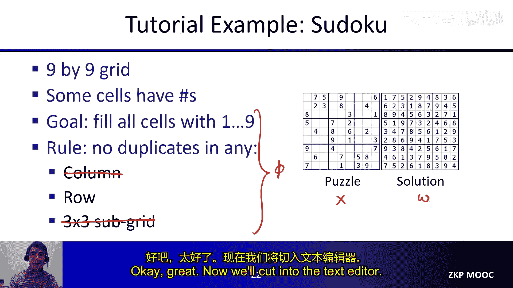
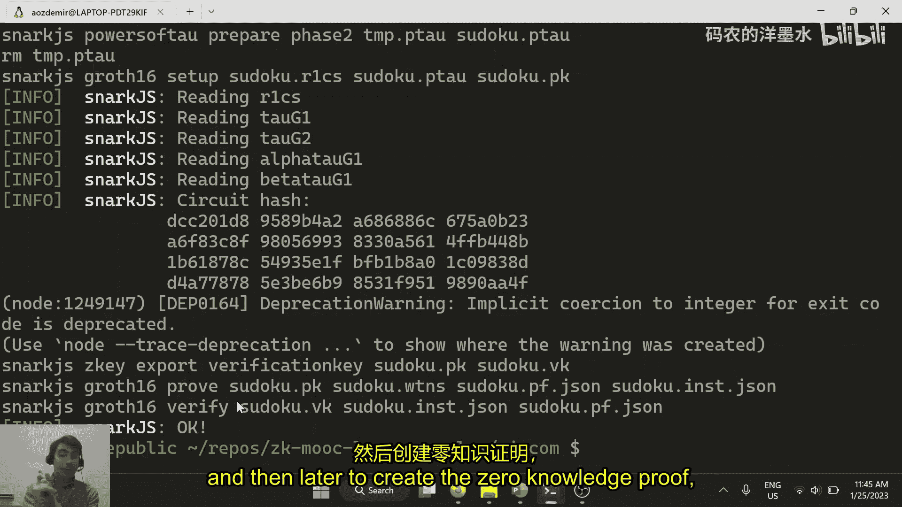
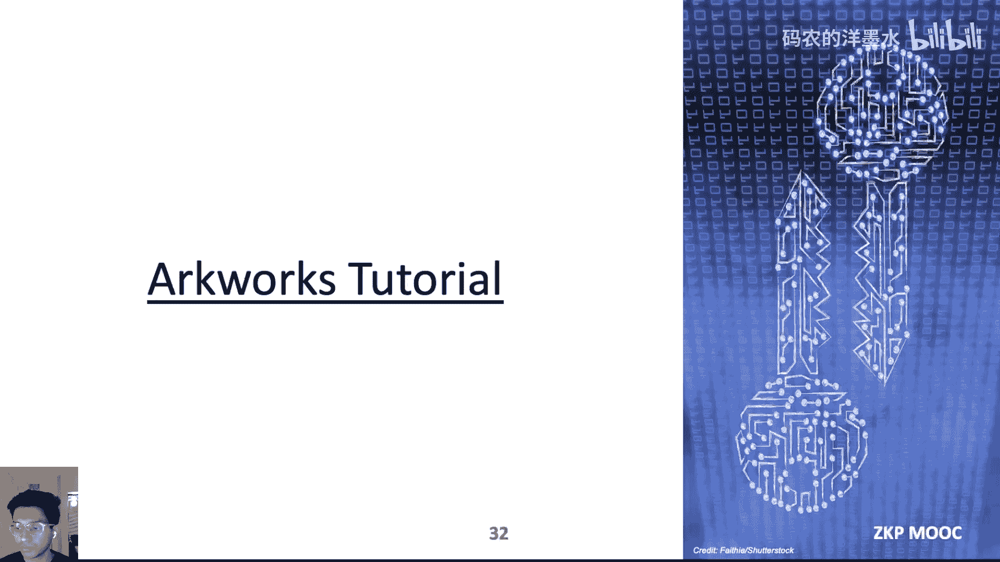
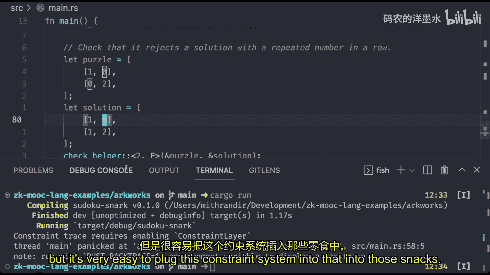
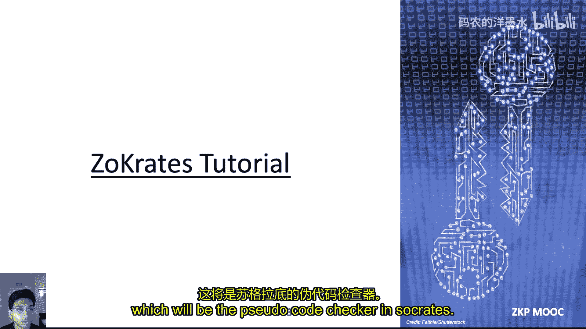
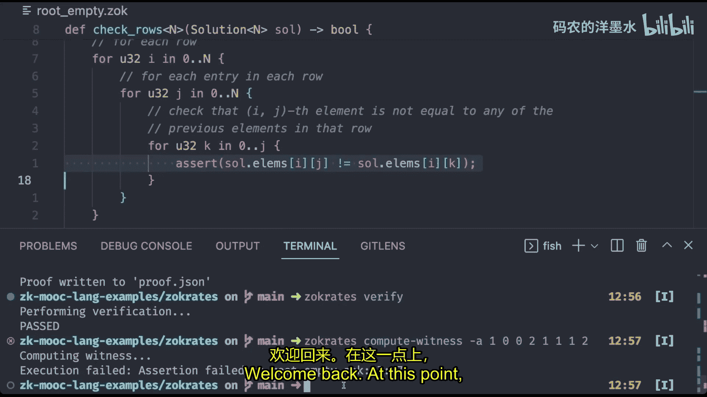
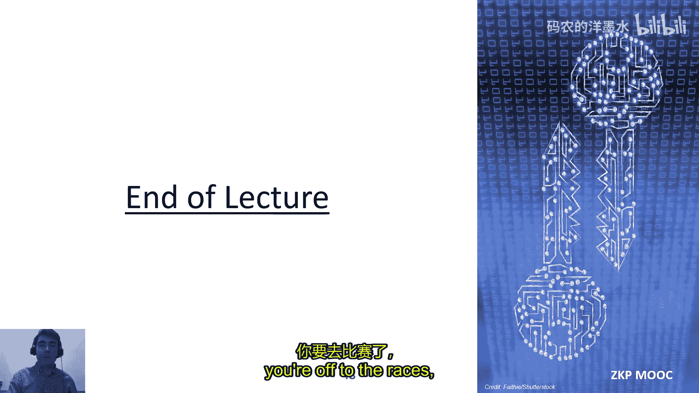

# 【全集】加州大学伯克利分校 Web3：零知识证明 区块链技术与隐私计算 中英字幕 1080P p03 Lecture 3 - 编程ZKP -BV1bCrpB2E7Q_p3-

Hello， hi everyone， I'm Prattiush， and together with Alex Ostemir。

 I'm going to be lecturing on programming zero knowledge proof systems。😊，All right。

 let's get started。So let's say you have an idea for an application could be a private payment system。

 could be a private voting application， you know， anything where you think a zero knowledge proof system might be useful。

So how do you actually get started expressing this idea and sort of implementing it？

So if you're a programmer， the first thing that comes to mind would be to try to implement your idea as a program in some high level programming language like say。

 a C or a Python。Or a Java or something similar， right？Unfortunately。

 Ze knowledge proves they don't understand these high level programming languages。

And instead understand things like constraint systems or arithmetic circuits right。

 so say we have somehow expressed our idea in this arithmetic circuit or constraint system form。

Then we can sort of feed this。Cit into say the Ze knowledge proof system setup algorithm。

 which will produce some public parameters for us， which we can then go ahead and use for proving and then later verification。

ok。But how do we actually go from our idea into this format that the Ze knowledge proof system understands？

Well， this is going to be the focus of this lecture。

 exactly how to take your idea and make it into a format which the Ze knowledge proof system。

Can understand and then prove。Okay。So in this lecture。

 we'll start by first doing a high level overview of what it means to program a zero knowledge proof and then dive into three different ways that you know prominent frameworks try to do this The first approach will be to use a hardware description language such as Ccom。

And it will describe you what the co operations and objects of this hardware description language are。

 and then we'll also do a short tutorial where we go over how you can implement a simple example of Sudoku inside this hardware description language。

The next approach that we'll take or that we'll show is how to use a library that's implemented inside an existing high level language In our case。

 it will be the Aworks library which is implemented in Ru so we'll。

Describe some common operations and objects that are sort of common to everything in this class of。

Library based approaches， and then we'll also do a shock tutorial which uses the AQX library to illustrate what this looks like in practice。

The final approach that we'll cover is actually a new language or the approach of describing a new language and implementing a compiler for it。

 which is intended to be oriented towards your knowledge proving。

So the language has constructs within it that correspond to operations that you would want to perform in your zero knowledge proof system。

 So we'll cover at a high level what such languages look like。 and then also。

Do a tutorial in one popular language called Socrates。Finally。

 we'll conclude by doing an overview of various prominent CKP tool chains。

 which fall into one of these three categories。And we'll try to do sort of a compare contrast of these。

 as well as an idea on how to。Unify all of these approaches as we move forward。Okay。

So before we start， maybe let's quickly recall what a zero knowledge proof system does a zero knowledge group system is a way for approval to convince a verify that some statement or predicate is true without revealing information about why it's true。

In more detail， a approver knows some predicate or claim phi。

 a public input X and a private input W such that phi on x comma W is satisfied。The verifier in turn。

 only knows the predicate and X。The zero knowledge proof allows the prover to show that the predicated satisfied。

 namely that phi on x comma W outputs 1 in a way that completely hides the private input W。Okay。

So this is， know nice in theory， but。If you want to implement something。

 we have to know what PI can actually express， what kind of computations can be captured by this predicate P。

The nice thing is that in theory， for many popular zero knowledge proof systems。

 Phi can be any NP statement。So for example， you could use Phi to prove the knowledge of the factorization of an integer。

 so your W， your private input would be the factorization and the public input would be the integer itself。

And P will just multiply the factorization and check that it equals the public input。

You could use Phi to show knowledge of a private key for some public key， which is a public input。

You could use it to show， you know the password for an account and you could show that。

You have a valid transaction， you can do basically you know， whatever you might imagine。

 you can use Phi to capture that。But all of this is in theory。

What does Phi actually look like when you sort of try to implement it。

So in practice5 in a format that the Ze knowledge proof system understands is going to be an arithmetic circuit over the public input X and the private input W。

Okay， so let's dive a little bit deeper into what an arithmetic circuit is okay。

 so arithmetic circuit， you can think of it as similar to a Boolean circuit you might be familiar with it from say your undergraduate classes。

But you replace the Boolean gates， such as and and ors with arithmetic gates such as additions and multiplications。

Furthermore all this arithmetic is performed over what's called a prime field。

 you can think of this as the integers modulos and large prime P， so your additional multiplication。

 they all happen in modullo P。The one example would be， you said p equals five。

Then addition mod 5 looks like if you want to add4 and5， you will get nine and then mod 5。

 that is four， Similarlyly， if you want to multiply 4 by four mod P， you'll get 16 mod5。

 which is just one。Okay， so basically it's like a boolean circuit， but all the operations。

 instead of being ands and O's and so on， they instead become additional multiplication。

Model of this crime P。Alright。Okay， so that sort of is the background upon which these arithmetic circuits are defined。

But how do you actually express any computation in themes？

So one way to view these arithmetic circuits。Is as a system of equations over the prime field。

So for example， once a system would be， I multiply the first private input by itself three times and I want to check so that equals the public input X。

And then I do almost the same thing with the second private input， I just multiply it by itself。

 I'm squaring the first one， the W1， and again I want to check that it equals the public input。

All right， you can basically express any polynomial over the field as an alphathmetic circuit。

And can I just talked about multiplications， but you can also throw an addition there。Alright。😊。

So that's one way to view arithmetic circuits right。

 but it's kind of difficult to visualize what this circuit is computing in this way。

 another way to view arithmetic circuits is as a directed acyclic graph or DG， right？

Here the nodes of this dag would be things like the inputs to the circuit。

 the gates such as addition multiplication， equality testing。

 and some constants which are sort of input into these gates as well right so that would be the nodes。

The edges of this graph are going to be wires with sort of carry values from one node to the next。

So a wire from multiplication gate into an addition gate will sort of carry the output of the multiplication gate as an input into the addition gate。

Let's see what this actually looks like by taking our example from the previous slide right so we want to express these two field equations as a dag。

For the first one。Rather for the second one， what we're going to do is we're going to multiply w1 by itself。

 so we're going to feed w1 into the multiplication gate twice。

 and then we're going to take the output of that multiplication gate and feed it as an input into the quality gate and similar similarly we'll feed x the public input as an input to the。

Equality gate also。 And here， all of these arrows they correspond to。诶。The wires of the tag， right。

So this is a sub circuitrcuit which corresponds to the second equation。

And the first equation we can express in a similar way， as you can see we are taking w0。

 feeding it into the multiplication gate， taking the output of that multiplication gate and feeding it as input into another multiplication gate。

 and w0 is again fed as the other input into that multiplication gate。

So the output of the second multiplication gate is going to be w0 times w0 times w0， so w0 cubed。

And finally， we'll check that this W0 cubed is equal again to the public input by drawing a wire from x to the quality gain。

All right， so this is one way to sort of visualize these arithmetic circuits。Okay。

 so this is one format which zero knowledgege proof systems understand on the next slide。

 Alex will cover another format which is very popular for modern zero knowledge proofing systems and that is called R1 CSs or a rank1 constraint system。

Okay， now it's time for us to get into the details of one particular predicate representation used by a zero knowledge proof。

 We're going to be talking about the predicate representation called a rank1 constraint system or R1 Cs。

 R1 C S is not the only predicate format that's used with Z KPs， but it is the most common one。

 and historically， its been the most important。 The definition of R1 C S is very simple。

 X is represented as L field elements。 X1 through X L。 W is represented as M L-1 field elements。

 W1 through W M L-1。And the predicate itself is just a set of n constraints or n equations where every equation has the form alpha times beta equals gamma。

 where alpha， beta and gamma are all affying combinations of variables。

 so you can think of this as a linear combination of variables， optionally with a constant added。

So let's look at a few examples of constraints that do and do not have this form。

 our first example is w2 times W3 minus W2 minus1 is equal to x1。

This is a constraint that does have this form。 Alpha is just W2。 beta is w3 minus W2 minus-1。

 and gamma is x1。So the most interesting of the aine combinations here is beta。

 It's a combination of W3， W2 and a constant， the coefficient for W3 is 1。

 the coefficient for W2 is 1， and the constant is 1。This is an acceptable constraint。

 Another acceptable constraint is w2 times W2s W2。 One constraint that's unacceptable is w2 times w2 equals x1。

So this is unacceptable， essentially because on the left hand side。

 you have three different variables all being multiplied together。

 so you have two products of variables， and that means that however you view alpha and beta。

 one of alpha or beta is going to have a product of variables inside it and that's not okay because alpha and beta each have to be aine combinations。

However， if we wanted to take this constraint， we actually can encode it using multiple rank1 constraints。

By introducing fresh intermediate variables。So we could say that W2 times W2 needs to be W4。

 where W4 is a new variable that we haven't used already。

And then we would say that W4 times W2 is equal to x1。So together。

 these constraints imply the constraint that we saw before， indeed， if you eliminate W4。

 if you substitute W2 times2 in for W4 and the second constraint， you get the original one。

But what we've done here is we've just split that constraint into two in order to reduce the number of nonlinear products per constraint。

So this is how you can see rank1 constraint systems in terms of n constraints。

 but it's also another way of seeing them an equivalent way of seeing them that is sometimes useful。

 and this is the matrix definition of R1 CSS。The definition starts very similarly。

 You view x and N W as vectors of field elements。But you define the predicate in a slightly different way。

 you say that the predicate is now defined by three matrices， A， B and C。

Such that the predicate holds when if z is defined to be1 concatenated with the x concatenate with W。

A Z element wise product with B Z is equal to C Z。 So A Z， B Z and C Z。

 those are three different matrix products。 And we're saying that the element wise product of the first two matrix products should be equal to the third。

If you draw this definition pictorially， you get something like this。

 I've got my matrix products A Z times B Z and E equal to CZ。

And the interesting thing about drawing pictorialally is that the correspondence between this definition and the rank one constraints becomes very clear。

Because you see when you take a matrix product， A times Z。

 you take Z and you compute its inner product with every row of a。

And so what that means is that every row of a is essentially defining a linear combination or more precisely an affine combination of the variables in x and W。

And so so if you look at a row and A， a row and B and a row and C， then those three rows。

 they define a single rank1 constraint。 So the height of the matrix， the matric is here。

 the height of A， B and C is exactly n， the number of rank1 constraints。

 and the width M is one more than the total number of variables。

 it's one more because the z vector includes this constant one。

So if this matrix definition is a bit hard for you to understand， that's all right。

 you can pause the video， take a look at it， but ultimately when people program zero knowledge proofs。

 they usually don't think about the constraint system that they're building in terms of matrices。

 usually they just think about it in terms of rank one constraints in terms of linear combinations and so we're going to get a little bit of practice working with those linear combinations right now。

And the way that we're going to get that practice is we're going to take this pictoral arithmetic circuit that I've drawn on the left。

 and we're going to turn it into a rank1 constraint system。

 We're going to use a very simple non optimal algorithm for doing this。

 And this algorithm just has two steps。 The first step is to introduce a new witness variable for every intermediate wire。

So that means since there are three intermediate variables， we're going to need three new witnesses。

 W2， W3， and W4。Now， in the second step， we write down a single rank1 constraint for every gate。

So each gate will have its own constraint will end up with four constraintss。

 Our first constraint is going to be for the upper multiplication。

 and that constraint is just w0 times w1 equals w2。

 So in general any multiplication you can write down a constraint of this form the first input times the second input equals the third input and that constraint is rank 1 because it's only a single multiplication。

Now let's do the addition。For the addition， we're going to write this down as W3 equals W2。

 the first input plus x0， the second input。So here this is a rank1 constraint because W3 is our alpha combination。

 W2 plus x0 is our gamma combination， and our beta combination is just one。

 so we've actually omitted it， we've left it implicit。

The next multiplication we handle like the first W1 times x0 is equal to W4。

And then our final gate is this equality constraint。 This equals。 and we can。

 we can just write that down。 W3 equals W4。 And once again。

 this is a rank1 constraint because the beta linear your combination is one。

 just like it was for our addition gate。Okay， so this is a nice example。

 the algorithm that we've shown by example here generalizes immediately to any arithmetic circuit。

 and it produces one constraint per gate。So if we zoom out， at this point。

 you've learned about R1 CSS rank1 constraint systems。

 a way of writing down a predicate so that you can write a zero knowledge proof about that predicate。

And so when we think about the problem that we have。

 our problem is going from high level ideas about the predicates that we want to be able to write our own knowledge Prot for。

Things like， I know the secret key for a public key。

 things like I know of a coin that's never been spent before。

And you need to be able to take that high level idea and then turn it into a rank1 constraint system。

 so this is pretty hard， in some sense this is like trying to take the idea of a photo sharing application and come up with assembly code that implements that application on your computer。

 the rank one constraint system， it's kind of like assembly。

And viewing the rank one contraint system like assembly is useful because it turns out that the same kinds of tools that we use to turn high level programs into assembly are going to be useful for churn high level descriptions of predicates into rank1 constraints。

That is we're going to be using libraries， we're going to be using compilers。

 we're going to be using programming languages。 we're going to be using domain specific languages。

And very briefly in the's talk， the rest of today's lecture。

 we're going to be going over different libraries， compilers， programming languages for this task。

But to drive from this point even more， the idea is that we're going to start with some high level code that high level code is going to include structures such as Booles。

 user defined structures， modules， functions。 We're going to feed this high level code into some kind of compiler or library that library is going to spit out rank one constraints。

 and then we can feed those rank1 constraints into our zero knowledge proof system so we we can produce a set of algorithm。

 prove algorithm and a verify algorithm。Lots of basically every real deployment of zero knowledge proof is built in exactly this manner。

 so to give you an example， the Z crashash cryptocurrency is built like this。

 the high level the core of the Z crashash cryptocurrency is this predicate that describes what it means to spend money anonymously。

And the description of that predicate is a circuit that involves ideas such as Merkel trees。

 petterson hashing signatures and logic that describes when and it is and is not okay to actually spend money。

And so the Zcash circuit is written down using a library called Bellman and what Bellman produces on its output side is a set of rank1 constraints。

 and then those rank1 constraints in the case of the sapling distribution of ZCash are fed into a zero knowledge proof system designed by Jan Grt in 2016。

 the systems called Grot 16。And then Gs 16 runs on the computer of everybody who uses Zcash。Okay。

 so that's one example of this pipeline in action and today we're not just going to illustrate this pipeline with the library。

 we're also going to illustrate it using other kinds of tools as well。

 so we're also going to look at a hardware description language as well as a programming language and its compiler and we're actually going to start with the hardware description language。

Now it's time for our first tutorial。 I'll be telling you about how to use sirrcom。

 which is an HDL or a hardware description language for R1 Cs。

 The tutorial is going to have two parts。 We're going to start with slides。

 We're going to see the basic syntax and ideas of sircom。

 and then we're going to hop into a text editor and write some sircom code together。

So let's start with the idea of sircom， The first thing to understand about Serrccom is that it is an HDL or a hardware description language。

 which is very different from a PL or a programming language。

You're probably used to using programming languages。

 you know that in a programming language you have objects such as variables。

 you can perform operations on them， and you can define functions and programs。

The kinds of actions that you can take with these objects are the actions you're used to。

 you can mutate variables， you can evaluate operations， and you can call functions or run programs。

 But in HDL， the objects and the actions are very different。 HDls are all about describing circuits。

 so the basic objects are wires， gates and circuits or sub circuitcuits。

And then the kinds of actions that you can do， you can't mutate things， you can't call functions。

 All you can do is connect wires and you can create sub circuitcuits and then perhaps connect your wires to the wires of the sub circuitcuits。

HDLs are so different from PLs because they were originally designed for a very different purpose。

 HDLs are actually used to design digital circuits， so for example。

 the processor and your computer was designed using an HDL， In fact。

 it was probably designed using ver log or system ver log which are the dominant HDLs。

 but it might have also or components within it may have been designed using something like VHL or chisel which which are other HDLs。

Generally speaking， VHDL differs system ver log differs from ver log and that system ver log includes more features as well as sort of tools for helping you verify that the circuit is correct。

 VHDL is more verbose and explicit than verrlo and chisel' is higher level than Vlog。But sircom。

 it's not an HDL for digital circuits， it's an HDL for R1CS。

 and so that means that the wires of sircom， the signals， those are R1CS variables。

 and the gates that you create are rank 1 constraints。

The final thing that I'll say about sircom before we dive into it is that ultimately every sircom circuit has two things that it needs to do for all of its signals。

 First of all， it needs to set a value for them， so it needs to set a variable a value for every variable。

And then second of all， and needs to create rank one constraints。

So let's look at a small for example。In this example。

 we're just going to be multiplying two field elements。The way that you create a template。

 the way that you create a circuit in Ccom is using the template keyword。 So here we say template。

 multiply， and then we have the body of the template。 multiply here is the name。Inside our template。

 we start by declaring the inputs and outputs to our template。

 so a signal in Sercom is a wire or an R1 CSS variable， and we have two input signals， x and y。

 and then one output signal z。Inircom， the way that you set the value of a new variable or sorry a new signal is using the left arrow operator。

 so the output signal z that's created by this template， so we need to set a variable for it。

 we need to set a value for it， and we do that by saying that Z left arrow x times y。

Or Z gets x times y。So while this sets the value of Z and the value that an honest prover will assign。

 it doesn't create any rank 1 constraints， you create or rank1 constraints separately。

So we're going to do that by saying that z triple equals x times y。

And triple=s is the operator for creating rank1 constraints。

 so there are some constraints associated with how you use it。 When you use triple equals。

 one side has to be a linear function of signals and the other side has to be a quad function of signals or a rank1 or a quadratic expression so the product of two linear combinations。

So one example of using triple equals in an invalid way is this。

 saying that z triple equals x times x times y on the right hand side here。

 we have a product of three variables， so this is not a rank one constraint。

If youre interested in the above example， we both set z to be equal to x times y and we also constrained z to be equal to x times y。

 and Crccom actually has a special operator that allows you to do both of those。

And the operator for this is a left arrow where there are two lines instead of one。

 So instead of doing left angle， dash dash， you do left angle equals equals。

 So this looks visually like the combination of the signal assignment operation and the constraint creation operation。

 and it is actually just both of those things。 So this is shorthand for Z gets x times y and z is constrained to be equal to x times y。

Okay， so great， we've just created our first sircom template。

 however sircom ultimately doesn't synthesize templates， it synthesizes main templates。

 so we have to tell sircom that this is our main template and we do that by declaring the main component and setting it to be equal to multiply。

And whenever you create a main component in Ccom， you have to tell sircom which signals are public and which are private。

 these correspond to the public data and the private data in their zero knowledge proof。

 The output if there is an output is always public。

 but the input is private unless you say otherwise。

 and so here we use sircom's syntax to say that X should be public。So with this main component。

 sircom is going to have the verifier no x and then the verifier will syn。This is a very simple。

 that was a very simple example， now it's time for a more complex one we're going to look at a slightly more complex template that's going to show off some of CirCO's meta programming features。

This template is going to check repeated squaring。 so we're going to check that if you start with x。

 you square at n times， then you get y。And so the first thing that we see in this example is a template argument。

 and it's an argument to the template itself。The thing to remember about template arguments is that template arguments are fixed at compile time。

 So whenever we run the compiler， we're going to specify a value of n。

 saying that we want to generate a circuit that checks， for example，1000 squareings。

You can do a lot of things with these template arguments because they're known in a compile time one of the things that you can do is you can declare an array of signals whose length depends on the template arguments。

 so here we've created n plus1 values in an array of size array called x's of size n plus 1。

 and we've set the first element to this array to be equal to x。So this is one thing you can do。

 you can create these arrays and then you can access these arrays at constants。

 Another thing that you can do with template arguments is you can create four loops whose bounds depend on template arguments。

 So here we're creating a for loop， the iteration variable is I it starts at 0 and it goes up to n。

 the template argument， and it does that in steps of1。

So this is an example of a loop in sircom the loop creates can declare an iteration variable， I。

 that iteration variable is going to be incremented at compile time。

 so when Ccom processes this template， when it gets to this loop。

 it's actually going to process the body at different times。And it's important that， of course。

 that the bounds of the loop are things like template arguments or functions that depend on them because those bounds are also evaluated at compile time。

So since our interest is in doing repeated squaring in every iteration of this loop。

 we're going to do one squaring。 So what we're going to do is we're going to access the next element of the array and we're going to say that it needs to be equal to the square of the previous element。

So yeah， that's what that line of code does。 And then after the loop。

 when you to set the output to be equal to the final element of the array because the final the element of the array now contains the result of doing n squarings。

 So we do that by saying that y gets and should be assigned should be constrained to be equal to x's of n。

And then， of course， we declare our main component。

 And now since our main component is going to be the result of a template that takes a template argument。

 we need to actually provide that argument。 So here our main component is going to check 1000 squareings。

Okay so this is a slightly more complex example， and it shows off how you can use variables。

 how you can use template arguments， and how you can use loops in Sirircom。

Now I want to tell you about two additional features。

 I want to illustrate how witness computation or how signal assignment is more general than R1CS。

 and then also I want to show off sub circuitcuits。

The example that we're going to use to get us started is the idea of creating a template that ensures its input is non zero。

 so the input here is called in， and we want to guarantee that in is not equal to 0。We can't。

 of course， do this directly because rank1 constraints assert equalities， not inequalities。

But one way to check that a value is non zero or to require a value be non zero is to require that it has a multiplicative inverse。

So to require that it actually has a reciprocal。And we can actually do that in circle so we can say。

 okay， we want a signal called inverse and we want inverse to be equal to one divided by n。

And when you look at that expression， one divided by n。

 one of the things that you should notice is that that is not a rank1 constraint。

 division has no place in rank1 constraints， but the left arrow in circumcom。

 the getsEs operation is more general than rank one constraints。 In fact。

 you can put pretty much any expression on the right hand side of a getsES operation。

Because the gets operation is just setting the value of inverse。

 It's not trying to create rank1 constraints。 And then in our nonzero circuit， on the next line。

 we can create the rank1 constraint that corresponds to the S operation so that that constraint is saying that one needs to be a product of n and signal。

So this fra constraint， of course， is only satisfiable if n is non0 because if n is 0。

 then the right hand side of the constraint is always going to be0 and the constraint is always going to be falsified。

So this template really does ensure that the input is non zero。And in order to write this template。

 we had to compute inverse separately from creating constraints over it。Okay。

 so that's an example of how we can do witness computation。Now。

 I want to show how you can include one template inside of another。

 And so we're going to do that by creating a tiny toy template that uses non0。So our toy template。

 we're going to call it main， and it has two inputs， A and B。

It creates a sub circuitrcuit using the component keyword， so we create a new component called Nz。

 which is going to be equal to the result of synthesizing the nonzero template。

 And then on the next line， what we want to do is we want to connect our input a to the input of our sub circuitrcuit and so we can refer to the signals of sub circuitrcuits using dot notation。

 So Nz dot in refers to the in signal inside the nonzero component or the non-zero template。Okay。

 great， so we just set a or we set the nonze input to B A。

 and then we also assert that a is equal a times b is equal to 0。

So in sum since a is nonze and a times b is equal to 0。

 this is just a roundabout way of saying B equals 0。 So of course。

 if you actually wanted to require B to be 0， you would just say that。

 but doing it in this roundabout way allows us to show how you use sub circuitcuits。Okay。

 great so this has been our introduction to Surrccom in terms of slides。

 so this is a very fast introduction to the syntax of Surcom。

 what we're going to do now is we're going to hop into a text editor and we're going to write some sircom code together。

The goal of the small example that we're going to program together is going to be to create a Sudoku light game。

 So if you're not familiar with Sudoku， Sudoku is a puzzle where there's a 9 by9 grid。

 Some cells initially have numbers on the left hand side I have the puzzles。

 you can see that some of the cells have numbers in them。

 some of them don't all the numbers If they're there are between one and9。

 and your goal is to fill in all of the blanks with the numbers。

 one through 9 so that no row has any duplicates， no column has any duplicates and no3 by3 grid has any duplicates。

So if you think about it， like the solution to the puzzle is just a 9 by 9 grid of numbers that satisfies the view constraints。

 there are no duplicates in any row， there are no duplicates in any column there are no duplicates in any 3A3 grid。

 and the numbers in your solution need to agree with the numbers in the original puzzle if there was a number in the particular cell of the original puzzle。

Okay， so in the language of a zero knowledge proof， the puzzle here is the public information。

 it's the X， the solution is the witness， the predicate is all these constraints。

 and in our tutorial we're actually not going to code up all of Sudoku we're only going to enforce that every row has no duplicates。

 ensuring that no column has any duplicates and that no3 by3 grid has any duplicates it's very similar but to keep the tutorial short。

 we're just going to do rows for now。Okay， great， now we'll cut into the text editor。

Okay， welcome back， so now we're going to hop into a text editor and work through writing a small sircom program together。

I'm doing this from the starter code in the zero knowledgege MO examples repository that you should have access to。

 So in my starting point， I've got this file， Sadoku。 Serircom that we're going to be editing。

You can of course， do this with whatever text editor you like。Okay， so here's the file。

And so what we're going to do in this files is we're going to create a sequence of templates。

 ultimately building a template that checks a solution to Sudoku。

 or at least that checks that you respect the row constraints of Sudoku and we're going to do this piece by piece。

 So the first template that we're going to create is called non equalal。

 And so what this template should do is ensure that in0 and in one are not equal to one another。

And the way that we're going to do that is we're going to check that in0 minus in  one is non0。

And we actually saw earlier the tool for checking at something as nonze。

 which is that we need to verify that an inverse exists， so we're going to declare a new signal。

 we're going to call this signal inverse， and we are going to set inverse to be equal to1 divided by in0 minus in one。

But of course， we also have to ensure that that constraint is respected。

 and so we can do that by enforcing that inverse times in0 minus in1 is equal to1。Great。Okay。

 so that's our first template。Now on to our next template。This template is called distinct。

 it takes an argument n and its inputs well its input is an array of n different signals and what it ensures is that each pair of signals in this array are not equal to one another。

 which ensures that every single element is unique。So all elements are unique in the array。

And we're going to do that by creating a bunch of components。Okay， so。

 and what we're basically we're gonna to do is just for every。

 we're gonna to do this very naively for every single pair， for every pair of of inputs。

 we're going to create a component that ensures that that that those two pairs or that that pair。

 those two elements are not equal to one another。 And so we're going do that using a for loops。

 we're gonna say， okay， first of all， let's。Have I， which is going to go up to n。

And then inside this， we're going to do another for loop。In J。

 and what J is going to do is it's just going to go up to I。Great。And so so for every pair。

 so Ij is now a pair of indices into this array， and for every pair。

 we want to create a non zero sub circuitrcuit and we want to wire it up to this pair of inputs。

 So we create the component by setting non equal。I J to be equal to a non equalal template instant staiation。

And then we have to connect our inputs the inputs to this non equalal component。

 and so we'll set in zero to be our input at location I。And we'll set in one。

To be our input at location J。And notice that I actually just made an error here I'm creating a component and I can actually use the equal sign for that。

 that's the right syntax for creating a component， but here I'm trying to connect to wires and you'll remember that the way that we connect wires both doing assignment and constraining is we use this left arrow with equal signs。

So this is the getsS and a and Constrains operator。Great， okay。

 so now we have something that we can use to check that and different values are distinct。

 This will be important for checking that our rows are distinct。

But what about what other constraints do we have Well in Sudoku we know that all the numbers have to be in the range 1 to 9 and it actually turns out that checking that a value is in a range and Ccom is quite painful。

 It's quite challenging。 And so I've actually done it in advance。

 we're not going to walk through it together right now。

 I will say about the structure that we use to do it。

 which is that we start by creating this template called bits 4 that essentially just checks that n fits in four bits more precisely。

 it ensures that in is in the range 0 through 15。 And it turns out that this is not so hard to do it because that is that range has width。

 which is a power of two。And so what you can do is you can just provide the bit decomposition that's this array of signals here。

 and then you can check that every element is0 and you can build this bit sum that essentially ensures that those bits when you sum them up with powers of 2 give you the input and then ultimately this ensures that that in is in this range 0 to 15 and then to ensure that in is in a range 1 to9 inclusive on both sides it suffices to check that in minus1 is in the range is 0 to 15 and to check that n plus 6 is in the range 0 to to 15。

So that's how we ultimately build this template one to9。Okay。

 but now let's actually get into into the Sudoku puzzle itself。Okay。

 so how does this puzzle work Well， okay，'ve we've got the solution。

 it's just going to be a 2D array of numbers。 We want to ensure that all those numbers are 1 to 9。

 and then we've got the puzzle it's going to be a 2D array of numbers。

 but now there can be some zeros and those zeros represent blanks。So what should we do first？Well。

 how about we start by just ensuring that everything is in the range 1 to9。

 so we're going to need a four loop， so we're going to do4 I equals0 I less than n I plus plus oh I guess I didn't say。

 but n here is going to be the dimension of the puzzle so really we're only going to care about n equals 9。

Okay， but so， but by making an a variable， perhaps we could use reuse this part of the code in the future to ensure that。

For example， a 6 by6 Sodoku puzzle is solved correctly。Okay， so we've got this。

 this double for loop and this double for loop is just going over the two dimensions of the puzzle。

 And what we want to do is ensure that every value is in the range1 to 9。

 So I'm going to need an array of components。 So component。In range。And N。

It's a two dimensional array because we want to have one component for every cell of the puzzle。

And so now what we'll do is I'll set in range I J to be equal to。hos。To be equal to a1 to 9。Template。

And then， I need to。Connect the input。 So I'm going to set the in。For this component。

To be both equal to and constrained to be equal to our solution。At location Ire。Great。

 so the whole point of all of this。 and' alwayss good to write comments。

Is to ensure that each solution cell。Our each solution number is in range。And this code does that。

Okay and so actually one thing that we should be able to do right away is test that a candidate solution is valid。

 of course this we're not done， we still need to check that the values inside different rows are unique and also that the solution agrees with the puzzle。

 but it's good to test your code as you go and already this is something that we can test because if our solution is valid then all the values should be in range。

Okay， so what is the next thing that we want to do？Well。

 perhaps now what we should do is we should ensure that the puzzle and the solution agree。

And so what I mean by that is that in every location， either the puzzle should be0。

Or the puzzle in the solution should be equal。The reason that it's or is that if the puzzle is zero。

 it's blank and so well anything in the solution will agree with a blank in the puzzle。

 but if the puzzle has a nonze value， then it's important that there's agreement。

So this is also going to be a two dimensional for loop。

 So we'll go ahead and copy that from our previous。Our previous loop。And how， how are we gonna。

 how are we going to do this， Well， it turns out it was a very nice way。It's suffice to say that。

The puzzle cell。Times。The puzzle cell minus the solution cell。Is0。If the puzzle cell is0。

 this is satisfied immediately because the left hand side of the product is0。

But if the puzzle cell is nonze。Then the right side has to be 0。 I。

e puzzle cell minus solution cell has to be 0。 i。e。 they have to be equal。

And so we'll just go ahead and write that constraint。

 so we'll say that the puzzle at location Ij times。The puzzle。

At location I J minus the solution at location I J。Needs to be equal to 0。Great。Okay。

 so we're making some progress。And now。What we have to do is check that every row。

Has at most one copy of every number。 So we need to use that distinctness thing from earlier。

And so once again， a 2D array seems useful。Our goal now is to ensure uniqueness。In rows。Great， okay。

 And so in to ensure uniqueness in rows， we're going to need some distinct components。

So let's declare an array component。Distinct。Of length n。And so。Let's see。

 So here J will be our iterator for different row numbers and I say I will be our iterator for different row numbers。

 and j will be our variable for different column numbers。

 And so if we want to ensure uniqueness in each row for every row， we need a new component。

 So here we're going to say that distinct。I。Is equal to。A distinct template in staation。O。

And then J now is going to be the different column indices。

 And so we want to do here is we want to say that。Distinct components， input。In particular。

 it' J input。Is going to be equal to our solution。That location， Ij。

So we're taking our cell and we're connecting it to our component。Good。Okay， and then at the end。

 we have our main declaration。Our main component is a Sudoku circuit with template parameter 9。

And the puzzle is public， and of course， the solution is not public。So great， we've just done that。

And so now I'm going to go out into the main file I'm back on my terminal。

 and we've actually what we've done is we've written a make file for you。

So I'll just print it out right now， here's our make file。嗯。Or maybe I should。And basically。

 what it does is it just runs all the different steps of the sircom compiler and the proof itself in order。

嗯。And so the first thing that we're going to do actually。

 is we're just going to run this forcon compiler。And so we can run the compiler just to check our code。

By running sircom and then passing it。The file。 and it's going to run。

 It's actually going to tell us that we have an error and our error is apparently on line 37。

 We had some unrecgnized token and ending curly brace when we should have had something else。

 So let's go ahead and open our file and go to line 67。 So we're now on line 67。

 and we're going to see why this curly brace was unexpected。

 And I bet this curly brace was unexpected because we forgot a semicolon。On the line before。

 so we've added that semicolon。 and now we're going to run our compiler again。And it's saying， okay。

 so you've created this component called distinct using or you've invoked this distinct template and you gave 0 parameters。

 but one parameter was expected。 So I can bet， I know what's going on there。

 I bet that distinct takes an argument for the size of the array。

 And it should be that the argument should be 9， or it should be n， but but we didn't give one。

 So we're gonna， we're going go do that。 So it's。Go down to the bottom， find that distinct component。

 Here it is。And we're going to set the argument to be in。Good。🤢。

So we've found two syntax errors and now， okay， great， so now it's telling us that we're okay。

So let's go ahead and let's run the make file and that's's going to go ahead。

 It's going to do a lot of things。 it's going to have to run the setup algorithm for the zero knowledge proof。

 which actually takes a while。 That's what all this time right now is doing。

 And it's going to go ahead and write our proof and it's going to go ahead and verify it。

 And you can actually see the make file printing out the commands that it runs。 So let's see。

 it's go。Well， I guess we'll look at the that reading make is kind of part。 so first of all。

 we run this powers of Tao ceremony。 we earlier the compiler outputed the Sedokuda R1CS file that represents the R1 CSS itself。

 So we do set up with the R1CS。And then we run our provinging and then we run our verification So if if you're interested in the details of like the steps that you have to run to compile your circuit and then later to create the zero knowledge proof。

 they're actually a little bit intercatet and you can find them in the make file in the starter code。

 but for now for our purposes this is the end of the tutorial we' successfully made a circuit that checked part of a Sodoku puzzle。

Okay， practice here again。So now we're going to cover the second approach for programming。

Constraint systems and in particular R1 CSs and that is the so called library approach。

So to recap on Ccom， it's this hardware description language for specifying R1 CSS。

 and a key feature of Ccom is that you get direct control over constraints。However。

 it's a custom language and this can be good or bad depending on sort of how well designed the HDL is and how easy to use it is。

Okay， a different approach to sort of。Programming EKPs。

 which gives you the same very direct control over constrained systems。Is to use a library。

 So in this approach， you define a library， which is。Implemented in some host language。

 which is usually a popular high level programming language such as Ru， Ocal， C++， go and so on。

 right？In all of the sort of。Libraries that sort of implement this approach。

There is one key type and that is a constraint system。

 so this constraint system object is responsible for maintaining state about the R1CS constraint system as you build it up and the variables and values assigned to the variables。

As you sort of are doing the constraint system generation。In a little bit more detail。

 the constrained system internally contains。The representation of the three constrained matrices， A。

 B， and C， as well as the values that are assigned to the variables。

 you know if there's any values assigned。The key operations that you can perform on this constrained system object are creating a new variable。

 which basically involves appending a new entry into this list of variables。

Creating a linear combination of variables， which corresponds to， for example， you know5。

Variable 1 plus2 variable 3 plus 3 variable 4 and so on and so forth， right。

 So basically any arbitrary linear combination of the variables in this list。Finally。

 you can add a constraint which adds a new entry into each of these three matrices。

Let's see what this actually looks like in sort of pseudo rust。For variable creation。

 you will have a add there function or method， which takes us input the constrain system so that it can mutate it and add a new entry。

 the visibility of the variable， whether it's public or private。

A value that's assigned to the variable in case you are doing proving。

And the result is a variable ID， which sort of is an identified or a handle on the variable which can be used later on。

For example， in linear combination， creation as well as in constrained generation。Okay。

 so in the process of， you know， when you call CS。 addva。

 a new entry is added into the variables list， which is consists of the Tple ID P commaV。

 so it contains the variable handle， the visibility and the value。ok。

Once you have a bunch of variables that you've gotten by calling CS。 adware。

 you can construct so called linear combinations。This is basically， as I said。

 a list consisting of coefficient comma handle pairs， right？

So what this looks like is you can use CS do0 to create an empty linear combination which contains nothing。

 and then once you have this empty linear combination， you can add the term to it。

By giving the coefficient C， as well as the variable handle ID as input。

 and then you'll get the modified LC represented here as LC prime。

And that contains the original terms of the L。Plus。

 an additional tone which corresponds to C times IDd。Right。So for example。

 if your original linear combination contained five comma。

V1 then and you and you call LC dot add2 comma V2， then your new LC prime will contain5 comma V1 and2 comma V2。

 all right。So it's basically just appending this pair of coefficient comma variable handle to the linear combination list。

Finally， the most important operation in a constrained system object is to， as we said。

 add constraints right， and this is this happens via this API CS dot constraint。

Whi takes N three linear combinations corresponding to the three matrices and adds a constraint which enforces that the LCC times LCB equals LCC once you sort of。

Substitute the values of the variables in place of their handles， right？So these LCCA。

BC are added to the A B and C matrices respectively。Okay。

 so this is quite a you know high level description。

 let's see what it actually looks like when you're trying to implement a common operation。😊。

And we'll take the example of performing a Boolean and okay。So it will define a new rust function。

 which takes as input to the constrained system， a variable representing the first input to the ant and another variable B representing the second input to the ant。

What we will do is we will。Construct a new variable result， which is a witness variable， right。

 So this is a shorthand for passing in the private。Visibility into the new V method。

And the value that's assigned to this variable is the value of a。And the value of B， right。

 So we just do the logical and between A and B。And that should be the value that's assigned to the result。

Okay， so we've created a new variable， but now we have to enforce that it's actually correct， right？

😊，That it actually satisfies the constraint that namely it is the and of A and B。To do this。

 we will first construct some linear combinations， and this is via this rust macro。

 which returns is shothand for returning and empty。A linearar combination。

Okay so we will create a linear combination containing just the term A。

 one containing just the term B， and the final one which contains the result okay。Finally。

 to enforce our and constraint。We will pass these three linear combinations into the enforce constraint or constraint method。

And this will enforce that a times B equals result。

So the reason why this is correct is if a has value0 or 1 or B has value  zero or 1。

Then the end of these corresponds basically exactly to the multiplication of these variables seen as field elements。

 right？So think about it if a is 0， B is 0， then0 times 0 is still 0。

 and then this corresponds exactly to the end。So the result must have also value0。

And if you sort of enumerate the other cases， you will see that it all works out。Okay， in the end。

 we sort of return the result variable and get our result as needed。All right。Okay。

 so this is not too complex， but it's kind of a lot of boilerplate that you might not want to repeat every time。

 right it can get tedious and error prone。And writing any complex algorithm。

 say such as signature verification in this style would be quite a pain。

So instead of programming are。Computations are programs us by enforcing manually the enforce constraint and new variable declaration and so on。

We instead want to leverage the power of the host language rust， for example。

 to be able to abstract away these low level operations， right？

So because the our host language provides abstractions such asstructs， enums。

 operator overloading methods， and many more， we should use these to allow better developer UX and here we can see one example of that What we'll do is we will wrap our variable in a dedicated type right so we'll have a Boolean struct。

And then we will use the operator overloading feature of rust。To allow in the future， just。

Doing literally writing A and percent B， then want to compute the end of two poololeian variables。

So we will put the same logic as what was on the previous slide inside the function body。

But sort of once we've done this， now we can use high level syntax。Okay。

Does it so does this approach actually work so yes， we can declare our variable boats you know。

 very nicely we just say it's a new witness or a new witness or whatever right。

 so we give A and B true and false。And then we can enforce that the result of A and B equals falses。

We have this very simple line right， so now we don't have to have manual calls to constrain。

And new variable and manual LC generation， we can just write A a B。Okay。

 so there's many gadget libraries， not all of them you know， use this approach to the full extent。

 they don't all try to use the language abstractions， but many of them do， right。Okay。

 so that's nice from the abstraction perspective， but what about are the expressiveness of the language in terms of enabling witness computation？

Now， the good thing is that because we are embedded in a host language。

 which is a general purpose language， we can leverage that power to perform arbitrary computations to actually compute and generate our witnesses。

 right？So， for example， instead of just providing true， we can actually say that the。

Value of this a witness variable is some random expression in this case，4 equals to equals5。

 which is going to be false and x less than y。There X and y are some other variables。

Or some other native host variables， right， So you can imagine putting whatever logic you want inside this。

 And the good thing is that。This logic is executed only when needed。

 only during proving and not during say setup when the value or the variable assignments might not even exist。

 right？So we're going to， if it's an expensive computation。

 we're not going to execute it unless it's needed。All right， so this was a high level overview。

 let's now dive into a tutorial on how we can use this approach concretely with one specific programming constraint programming library。

 which is in the Arcworks ecosystem。

Okay， so now let's dive into how we can implement as a doku checker。

Using the Arcworks R1 CSS constrained libraries， in particular we'll make use of the Arcworks R1 CSS standard libraries which contain constrained versions of many popular primitives such as integers。

 Booleions， equality， comparison and so on。Okay。So first。

 we have to define our puzzle and solution types， and here we are able to use rusts。

Type system and particular， we're able to define a puzzle which is generic over the size so any end by N。

Matrix works and is also generic over the underlying constraint field。

 we're not limited to a particular finite field， we can make it work with any finite field that we want to instantiate it later。

But anyway， the type that we want to put in here is basically an array of arrays。

And the element of the area is going to be。I sorry。And。

And by an array of array and the same thing goes for the solution。But we have to do those。

 we have to additionally specify the constrained field in here。And the same thing here。Now。

 puzzle and solution are both generic over the constrained field type， so any constrained field。

But's a。Okay， so we're going to repprise the strategy that we had in the circlecom。

Example and what we're going to do is we're going to do perform two checks first we have to check that each row contains only unique entries。

 there's no repeated entry in every row and then we have to check that the puzzle matches the solution and what this means is that we have to check that the solutions entries are within the particular range of one through nine。

And that they match。The entries in the puzzle。Okay， so let's take each task one by one。

 starting with the road checker。And let's so what we'll do in this is we'll iterate over。Each row。

Allright， and again here we're using rusts iteration syntax。

And then we're going to iterate over each row in turn。Over the entries in each row rather。

And basically this syntax says for the JF element， which is cell。

and were basically able to obtain this we are using rust iterator infrastructure Okay。

 so what we're going to do now is that we have an iterator over each cell in a row。

What we have to show is that this cell is not equal to any of the prior cells in that row。

 so we can do this by performing another iteration over the prior entries in the row and to get this list of prior entries。

 we're going to be using rust's slicing syntax what basically this says is give me the entries in row starting from zero and up to but not including J。

Okay。OkaySo now we have the cell and sort of every prior cell and what we need to do is check for inequality。

 so we need to check whether this is。嗯。Not equal to the prior cell。

 with the current cell is not equal to the prior cell。 And then we need to enforce that this is true。

That the current time is not equal to the prior cell。Sot condition is true。

So this is all that we need to actually specify our。啊。Example here。To in particular。

 to just check the rows are correct。So now we can move on to the next part of the solution。

 which is checking the puzzle matches the solution。All right， so we'll set this up in a similar way。

 we'll iterate。Over the rows and columns of the。Puzzle and solution。

But thanks to Ru's iterator syntax， we're able to iterate over both the puzzle rows and the solution rows at the same time as follows。

So what we're going to do is。We're going to first iterate over the puzzles。Rs。

 and we're going to zip that with the rows of the。Solution。And similarly。

 we're going to now reiterate over the entries in each of these rows at the same time。

 using again the。Different分认置。Okay， so we have this。

Now we have an iterator over every sort of corresponding entries of the puzzle and the solution。

 and the first thing we want to do is we need to ensure that。The solution。This S。

Is in the correct range， say one。Through n inclusive right in this case。

 n normal Sudoku n would be 9， so the range would be 1，2，3，4，5，6，7，8，9。

So what we're going to do here is we're going to first get a boan indicating whether。诶。

The solutions entry is less than n or less than equal to n right and then this has so this is one side of the condition the other ofal condition is that it is greater than or equal to the constant one right。

And so of these question marks are just some rest syntax。

 and now we need to enforce that this the end of these two actually equals true。

This is slightly more robust ghost than using， say。Socom are the next one that we'll see。

 which is Zcrates， but it's still pretty readable。And we can also try to leverage。Yeah。

 we can try to leverage rusts of operational load better here。 We didn't。

 R1 C a standard doesn't fully implement that yet。Okay。All right， so。

Now we've ensured that the solutions entry is within the appropriate range。

What we need to do next is ensure that the solution entry matches the puzzle entry。

So we need to ensure that either。The puzzle slot is zero。

 which means it is something that can be filled in by the solver。Or that。

The slot matches the equivalent。St in the solution。 So the solutions。Slot， if its as one。

 then it must be the same entry in the puzzle must also be one okay。And we'll enforce this by。First。

Checking that either。The puzzle entry is equal to the solution entry。Or if that's not the case。

 then we have to ensure that the puzzle entry is0， right？Okay， so now we have this R。

 which represents the whole condition， and we need to enforce that this is true。Okay。

 this is all that it takes。 so now we've enforced that the solution is in the correct range and that it matches the puzzle。

UAll we need to do is return OK to indicate that the puzzle that the function completed successfully without any errors。

And we'll do the same thing here as well。Okay， so we have an additional check helper function that's already written for us。

 what it basically does is it creates a new constraint system。

 allocates new variables for the puzzle and the solution。

 so for the puzzle it says it's a public input for the solution， it says it's a witness。Okay。

 and then we call these two methods that we just defined puzzle nacho solution and the check rows。

Finally， we check or we assert that the constraint system is satisfied。Alright。

This is basically just a helper function because we're going to be having two kinds of tests in our main。

So for the first test， we want to check that our solution that the code that we've written actually accepts valid solutions。

So in this case will define the puzzle to be 1002， and a valid solution to this puzzle will be 1，2，1。

2， right？嗯。The entries of the rows are distinct， there's no repetition。And。Yeah。

 the entries of the solution match the entries of the puzzle when necessary。

So we expect this check to pass。And let's try to see if that's the case right after going over the next check。

 which is to check that it rejects incorrect solutions， we'll come to this in just a second。

 let me just comment it out so that we can get the compiler running。So let's create a new terminal。

And here let's do cargo around。Opepen we forgot to save。And we have a slide bug， we forgot。

Some syntax here。 So this should be a。In。And if we save。And run again。

We should have everything compiling and we'll see that this assertion passes。

 it does not lead to an error， which means that our code accepts valid solutions。

Now let's comment out。The invalid solution， and now our assertion should fail again。

Let's try cargo running again and we'll see that it is unsatisfied。嗯。

Because this solution is invalid， in particular， it contains a zero entry。Right。

It should be the entries of the solution should be in the range one or two。Okay。

 so that sort of wraps it up and you can use the Aworks interface to。诶。

Use these constrained systems with any RNCs accepting ss such as Gros 16， Mali and Germany。

 many others， right？And I won't go into that here， but it's very easy to plug this constrained system into those snorks。

Okay， so after seeing that example of how to program the Sudoku checker in Socrates。

 let's now take a look at our next programming framework and that is。

Compiling a high level CKP specific language to R1 CSS。

We'll start by digging a quick recap of the previous two approaches and it'll serve as a starting point for the rest of this section。

So。HDLs and circuit libraries do have their differences。

 one being that circuit libraries use their host language。

 which can be a full featured programming language。

 whereas HDLs are limited to whatever custom language that they have specified。Right。

But despite this difference there are actually in terms of the core operations， you do。

 there are similarities。Namely， in both approaches。

 we have to explicitly create wires or variables and then explicitly write down constraints which enforce some conditions on these variables。

And you know， this is despite the fact that。We might be able to leverage the abstractions of our languages right so for example in Socom you could use templates in Arcworks you could use the rust programming language features。

However， at the end of the day， somebody somewhere has to write down code。

 which explicitly creates variables and explicitly constrains them。

So the question we should ask ourselves now is this is whether we are limited to this paradigm。

And thankfully for us， the answer is no。There is a more ergonomic way and that is。

To sort of design and specify a high level language， which has the niceities of something like rust。

But doesn't require us to explicitly program R1CS or reason about individual variables。

So we would specify， we would write down our program in this high level language。

 making use of nice features such as functions for loops， variables， arrays，structs， and so on。

Then we would throw this at a compiler whose task would be to take this representation。

 this textual representation and spit out R1 CSs， which consists of the familiar wires and constraints and variables and so on。

So this is a high level idea。😊，And let's take a look at how this manifests in one of the most popular ZK programming languages called Socrates。

🤧。So Zcrates。Suppose many popular features of languages such as know custom types。

 you can define a custom type as a struct or as a type alias， right？

And then every Zcrates program has a main entry point called the main function。

And inside this function and subsequent other functions。

 we can define new variables which have values that are used during execution or provingrov。

We can annotate the inputs to the main function in terms of their visibility。

 so in this case this function of this variable x is public and is known to the verifier。

And finally we can enforce specific constraints on these variables via the assert keyword。

 note that this is different from the sort of constrained method that we saw in the Arcworks approach here assert can take any Boolean expression as input it does not need to take a linear combinations as input but can take any Boolean expression in this case it's checking that x equals y0 times y1 but you could put whatever you wanted as long as it evaluates to true or false。

Okay。So this is a high level syntax in a little bit more detail。

Socrates supports a lot of advanced features such as generic integer generic type parameters two functions。

 so this allows this basically says that this repeated squaring function is generic over some integer argument。

Okay we can specify a arrays that can be mutated， for example。

 in for loops that have some fixed compile time known length and we can have if expressions as well as compile time known array aes。

 so the index into an array must be known at compile time。Okay。

 so put together all of these features allow us to have a very rich programming environment and write quite high level code。

So this is nice from a UX perspective。But what about expressivity do we take a hit here and the answer is unfortunately yes。

 particularly from the perspective of witness computation？

In more detail there is no way in Socrates to compute a witness during the execution of a program and instead all witnesses of private inputs must be provided as arguments to the main function right so this main function which is the entry point into a Socrates program。

 the arguments to that main function are the only places where we can specify。Private inputs。

So we cannot declare a private variable during the execution even of May。

 it must be declared at this point。All right。Okay， so how do these pros and cons play out in practice to investigate that。

 let's take a look at our next tutorial， which will be the Sudoku checker in Socrates。

Okay， so let's get started our task， as we know， is to implement a pseudodoku checker in this high level language called Zates。

 right？So we'll start as in the As example by defining our custom puzzle and solution types and just like rust。

 Zcrates also supports integer generics as we saw， right？So like in the Arcworks example。

 we're going to define our puzzle as a multidimensional array， two dimensional array in this case。

 so it's an array of array so each array is of size n。

So this works for the puzzle and for the solution。Allright。And again。

 now our strategy for implementing our constraints is going to be the same as before。

We're going to check that each row is unique and we're going to check that。

Then that the puzzle matches the solution。And furthermore。

 that the entries of the solution are within the required range。All right。

 so let's get started with our。Check row function。 Okay， so we're going to iterate over each row。

 So for you 32 I in。0 dot， dot。And so then the range 0 to n， including n minus1。

And then for each entry， can be。这ろ。Were going to do for you 32 J in0 do。And。And。

Now what we're going to do as before is check that the icona JF。Element。

Is not equal to any of the previous。Elements in natural。So to do this。

 we will instantiate yet another fall loop， but the range of this fall loop is going to be up to J。

So it'll be 0，1，2，3 up to J minus， including J minus1， those will be the values okay。

And so what we need to do is assert that the icona J element of。

The solution is not equal to this is Ls。Is not equal to any of the previous。嗯。Elements in natural。

All right， so here we're able to use， you know， to access the inner element of solve via this dots and tag。

 we're able to use array indexing。And we have our four loops for iterating over the compile and fixed range。

 an interesting thing to note here is that this innermost loop。You know， on the face of it。

 it looks like it has a variable number of iterations because J takes varying values。

 but the Zcrates compiler is able to figure out that actually the number of iterations of。

The number of sorry the value of j and in a particular iteration is going to be fixed right so you know say j equals 0 in the first iteration then the range of this fall loop will be from 0 to0 so the fall loop will not execute if j equals1 in the next iteration then this fall loop this inner fall loop will go from0 to 1 so the value of k will be 0。

And so on and so forth。 So basically。Each time。The in each iteration where basically the length of this loop is fixed。

Allright， okay， so at the end， we will return。True。

 just to indicate that our function completed successfully。Okay， so that's it。

 that's all we need to do to check uniqueness， it's very similar to the Arcworks code。

 but looks a bit more readable because we're able to use these native operators such as not equals and so on。

O。So that's that。 Now， let's move on to the next step。

 which is to check that the puzzle match of the solution and the solution entries are in the correct range。

 So we'll follow the same strategy。 We'll iterate over。For， sorry。And0 dot dot n。

 so we will literallyerate over the rows。And over each entry in。Peach你说。

And we're going to assert two things first， that。呃。The elements are in the correct range。Okay。

 so they greater than 0 and。They are less than。So let's say in this case。

 we only support Sudoku numbers， so this is going to be less than 10。Okay。

 this is the first assertion。 the second assertion is going to ensure that the puzzle matches the solution。

So we again， we have the same strategy as in the Archcox case。

We have to assert that either the this entry of the puzzle is zero。

 which is an empty slot and can be filled with anything。Or if that's not the case。

 then it must equal the corresponding entry in the solution。Okay。Yeah， if it is zero。

 then it can be filled with whatever value and we don't care about the value of the solution as long as it satisfies the check row function。

But if it is not zero in the entry in the puzzle is not zero。

 then it must equal the corresponding entry in the solution， and this is exactly what we're checking。

Okay， so then as before， we will return true to indicate that the function completed executing correctly。

Alright， and so our main entry point for the function or for the program in general is going to be this main method and it's going to take in public input。

 which is the puzzle This is known to the verifier and a private solution which is known only to the prover and then we'll pass these two into the。

Check rows and check puzzle matches solution。Functions。Okay， so this looks nice。

 let's try to try it out and we're going to open up a new terminal window。

So Zcrates has a few different commands that you can that need to execute to be able to generate a proof。

The first is to actually compile our program into R1 Cs。

 so we're going to invoke the compile command with input the name of the file。Okay。

 so we have a compile time error， and it seems like we forgot to put a semicolon。In our code。

 this is。You know， very common problem for anybody's program， C or C++ RRS。Anyway。

 so we once to fix that， we can see that it compiled and it requires a relatively large number of constraints even for a 2 by2 matrix。

 it requires 3，000 constraints。But no matter， you know。

 it's still quite small in the larger scheme of things。

So the next step is to invoke the setup command to be able to generate a set of public parameters that we can use to test our code。

 so we should not use this in production instead you want to use something like powers of Taotype setup ceremony。

 multipart Comp based ceremony。Okay， so here we're going to perform the setup and it's going to be for the default ZKP。

 which is Gro 16 al right， so we've done the setup and as you can see it's using Gro 16 the Gros 16 scheme and there are some。

One is here about malleability， we don't have to care about that for this example。

 the verification key and proving key have been written to these files and the setup is now complete。

Alright， the next step is to sort of。Compute the witnesses that we will use during proving okay。

 and to do this we have to provide the concrete instance of the puzzle as well as of the solution。

So the way to do this is there's a variety of ways to do this， you can read them from a file。

 you can read them from different file formats in fact。

 but what we're going to do here is we're going to pass the puzzle and solution as input on the command line。

And we're going to do this by。Sort of ordering our puzzle and solution in row major order。

 so this 1002 is going to be the puzzle， it means the first row is1 comma 0。

 the second row is 0 comma 2。And then we're going to pass in our solution。

 which is going to be one comma 2，1 comma2， so it's very similar to the Arcworks example。All right。

 so Zcrates computes the witness and basically this involves generating the values for any intermediate variables that are generated。

In the R1CS constraints。Okay so all those values are written into this witness file and then we can invoke the generate proof command。

 which will take this witness file， we'll take the provinging key and spit out zero knowledge proof。

 which is improved or JSON， which we can then verify using the Zcrates verifyifier and as we'll see the verification past。

We can try to pass as before and incorrect。Witness right but as we'll see here it Zcrates tries to plug in these values into the execution。

 it will fail in particular the check that we expect to fail is going to be the row uniqueness check。

And indeed， we'll say the assertion fail at line 17， that's exactly where we're having the failure。

Okay， so that wraps up Socrates and now I'll hand things back。To Alex for the rest of the lecture。

Welcome back。At this point， we've gone through three tutorials。 You've seen how to use Sirircom。

 how to use Arcworks and how to use Socrates。 And now we're going to take a few minutes at the end of the lecture to synthesize。

 We're going to think about differences and similarities between these different tools and the benefits and costs of using them。

The three different kinds of tools that we saw were first hardware description languages。

 which are the languages standalone languages for describing circuit synthesis。 Second。

 we saw circuit synthesis libraries。And third， we saw a programming language Socrates and a compiler that turns it into a circuit。

In understanding these three different classes of tools， HDLs， libraries and PLs。

 I think it's useful to view them as differing in two different ways。

The first axis of difference is the type of the language。

 whether the language is fundamentally about describing circuit synthesis。

Or whether it's about describing a program。So that's the vertical axis here， circuit versus program。

 The horizontal axis is whether or not the language has its own syntax。

 whether it is a standalone language。If yes， then the language has its own compiler。

 parser and so on。 And if no， then the language is embedded inside some host。

So a circuit synthesis library is an example of an embedded language for describing circuit synthesis。

 arc workss is like this， it's embedded inside the syntaxt of rust。

 and it describes explicitly how to synthesize the circuit。On the other hand。

 Ccom is also about synthesizing a circuit， but it has its own syntax， so it's a standalone language。

And then finally， Socrates or in general programming languages， they about describing a program。

They have their own syntax， and then they have a compiler that interprets that consumes the syntax and produces a circuit that has the same meaning as the program。

So this is one useful way to see these three different kinds of tools in terms of the kind of thing they describe circuit versus program。

 and in terms of whether they have their own syntax。

But another way to another useful way to understand these different tools is in terms of the benefits and costs of using them。

 the pros and cons。 And so right now we'll talk about some of the pros and cons of using sirircom arc workss and Socrates。

Let's start with sirircom。 The prose of using sirircom is that it has an elegant syntax。

 and it's very clear what the constraints are。 You have direct control over them。

 wheneverever you want to create a constraint， use this triple equality。

 or perhaps you use the double struck arrow。The con of using Sorccom is that it's hard to learn。

 at least for most people who come from computer science， a background。

 because it's not really a programming language， it's a hardware description language。

And the even bigger con is that Sirircon has very limited tools for creating good abstractions。

There's no notion of user defined structure。 in fact。

 the only kind of abstraction that you can create is the abstraction of a sub circuitcuit。

 There are no types that there's just signals and arrays of signals。

So if you want to create something like a boolean， there really isn't good tooling for doing that。

Now let's talk aboutrcworks， pro prose of usingrcworks is essentially that it preserves the clear description of constraints that Scom has。

 but it gives you all the expressiveness of a language like rust。And in general。

 whenever using a circuit synthesis library， you have all the expressiveness of the language that the library is written in。

The con is， of course that you need to know that language。

 so you need to know Ru or whatever other language the library is written in。And the library， well。

 it just synthesizes a circuit。 it doesn't really do much optimization for you。

 So it's up to you to optimize。 You really need to hand tune and get all of the constraints to be as few in number as possible。

The final class of tools that we looked at is the class of programming languages。

 we look specifically at Socrates， the pro of using a programming language is that it's out of all the options by far the easiest to learn because the semantics of a programming language。

 those are the kinds of semantics that we're used to， there are variables。

 there are functions these are things that we're familiar with。Program languages can also have very。

 very elegant syntax because they get to design the syntax themselves。

 they're not stuck to whatever rust or whatever the host language is using。

The con though of using one of these programming languages is that you have to give up some control and so we saw an example of this withzocrates。

 Zcrates doesn't allow you to describe explicitly how to compute intermediate witnesses you just write a program and all the intermediate witnesses are automatically generated and when the compiler is doing that well。

 it's fantastic when the compilerrs doing it suboptily it can be hard for you to optimize further。

Okay， so these are the pros and cons。And of Sircom artworkworks and Socrates。

But one of the things I want to say is that that circumcom artworks and Socrates。

 those are not the end all be all， in fact， there are lots and lots of tools for using zero own knowledge proofs。

In terms of hardware description languages， SurRcom is about it。

 a hardware description language is a very simple thing。

 and SurRcom is a very good hardware description language。

 so people haven't really found a need to make another one。But when it comes to libraries and PLs。

 there's a whole variety in terms of libraries， Arcworks is the rust library that we saw。

 there's also a S++ library called Gadgetlib， there's another competing Rut Library called Bellman。

 there's a library in Ocal called Snarky， there's another library in rust called Planunkish that doesn't produce rank1 constraints that produces constraints that can be used with the Planlunk proof system。

In terms of programming languages， there are also a number of competitors to Zcrates， there's Noir。

 LeO and Cairo， Cairo is interesting here because it also doesn't produce R1s。 Yes。

 it produces the kinds of constraints that you need to use a stark proof system。

 so it produces this thing called air， the arithmetic intermediate representation。

In terms of the history， these different tools and languages have been developed over the course of more or less the last seven years。

Here is the approximate date at which each of these tools was created。

And on the right hand slide you can see that the timeline continues to go off to the right because I don't think that we've seen the end of these languages。

 I think that over the course of the next few years。

 people will come up with still new languages for producing zero knowledge proofs。

 perhaps even somebody in this class well we'll have an insight。

 they'll see a better way to build a language for ZKPs and maybe their language will be on this slide one day。

One thing that I want to emphasize， given that there are so many different languages is that these languages they're not wildly different and the end of the day。

 they're all about programming zero knowledge proofs。

So many these languages they take in different representations。

 different source representations of the predicate。

 but ultimately they produce a fairly small set of different kinds of constraint systems。

 rank one constraint systems， constraint systems for plan constraint systems for Starks。

And that means that there are lots of common techniques that the libraries and that the compilers for the PLs share。

 these techniques include techniques for representing Booles and operations over them。

 techniques for representing fixed with integers， techniques for encoding variable semantics such as mutation。

 techniques for encoding user defined structures， techniques for encoding control flow。

 techniques for optimizing circuits， and techniques for representing interactions with arrays。

So there's， there's a lot of common ground。 And， and you know， in some sense。

 you saw this when you were using the。When you were using the Socrates language。

 you were able to create E， Booleans， and when you were using the Arcworks synthesisynth library。

 you were also able to create Booles using gadgets。

 and there are some common ideas that underlie the Booles and Zcrates and the Boolean gadgets and arcworks。

And so one thing that's very interesting to me as a researcher is whether it's possible to try to create essentially a library for building ZKP languages that centralizes a lot of these ideas so that when you're building these ZKP language。

 you don't have to design your own Boolean infrastructure。

 You can use machinery for generating very efficient constraint systems that represent Booleans that's already been built for you。

 our interpretation of what the infrastructure is is this library called Soi。

 it's a library for defining ZKP languages and you can find it on Github。

And whether or not with SoC is ultimately interesting to you。

 I think it's useful to remember that all these languages have a lot of common features。

Okay so this is the end of the lecture this lecture at a high level is about going from highleve ideas to zero knowledge proofs and we essentially saw three different ways that you can do that all of these ways share in common the idea of producing a constraint system that the zero knowledge proof is going to be written about and there are essentially three ways to build that constraint system。

 you can use a hardware description language like Sirircom。

 you can use library like arcworks or you can use a programming language like noir or Socrates and then once you've got your rank constraint system you're off to the races。

 you can write your zero knowledge proof。😊。

