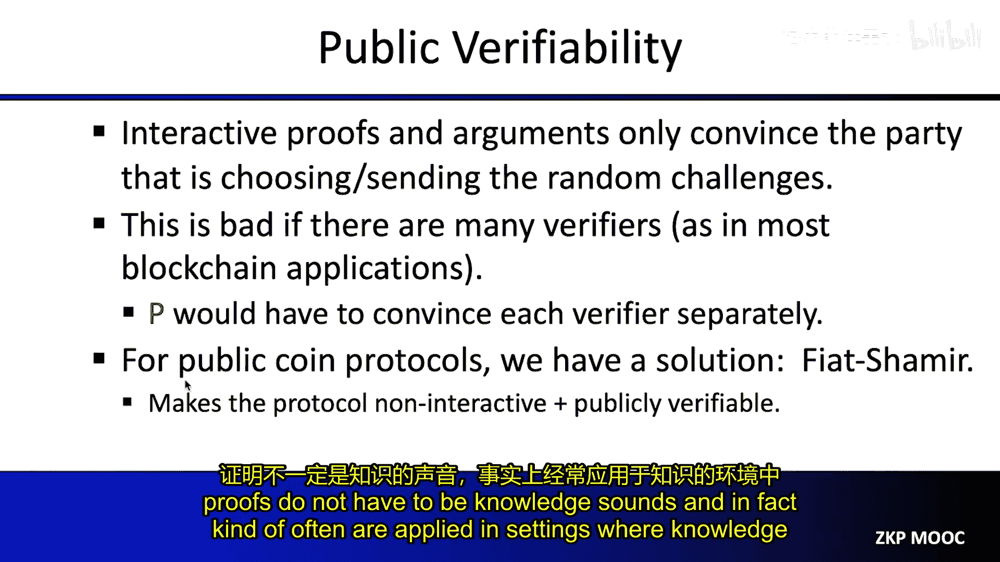
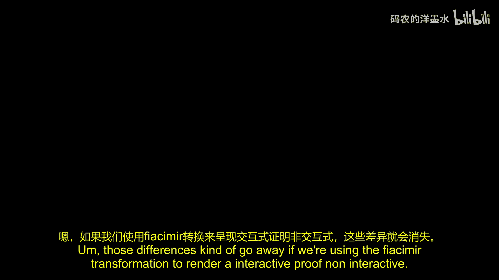
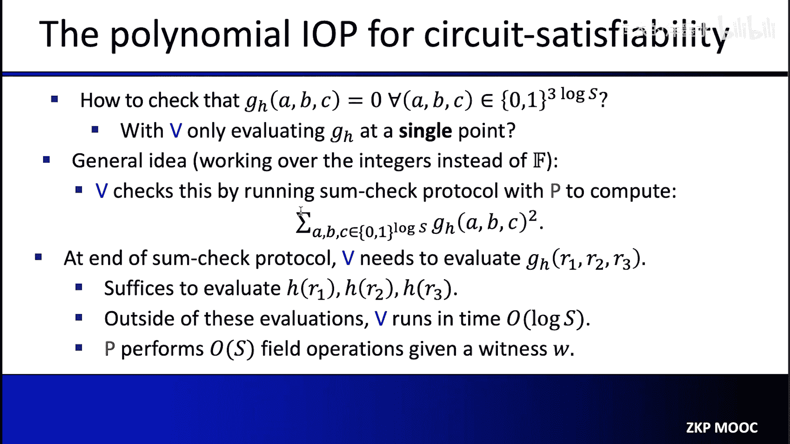

# 【全集】加州大学伯克利分校 Web3：零知识证明 区块链技术与隐私计算 中英字幕 1080P p04 Lecture 4 - 交互式证明 -BV1bCrpB2E7Q_p4-

Hello， my name is Justin Thaller， and I will be presenting the fourth lecture of this MOOC on Ze knowledgeledge proofus。

This lecture describes snarks that are designed using so-called interactive proofs as the key building block。

 so let me begin by reminding you going back to Dan's lecture lecture2 what is a snark of course this notion is in the title of this lecture and is essentially the main topic of this course so Snark is an acronym it stands for succinct noninteractive argument of knowledge。

 it is essentially a succinct proof that a certain statement is true and here's succinct means that the proof is short and fast to verify。

So in order to understand exactly what a snark is， I think it's helpful to have in mind a specific and very simple and clean application Dan used this example in his lecture as well。

 so the application is that somebody goes and claims that they know a message M that hashes to the value zero so here the hash function I'm referring to is just some cryptographic hash function that the proven and verifier have agreed upon to use in advance such asS 256 so the trivial proof for a statement such as this would be for the proof itself to just specify the message that the prover is claiming to know。

Then the verifier can simply evaluate the hash function itself on the message and confirm that the output of the hash on that message is zero。

OkayBut if the message M is really big， say it's a video file consisting of one gigabyte or more of data。

 then we would certainly not consider this proof to be short and we would not consider the verification procedure to be fast either because having to applyS 256 to this very very large file is itself like a fairly expensive operation you takes more time than we would like so yeah to summarize this trivial proof system simply specifies the so-called witness for the prover's claim in this case the witness would be the message M that the prover claims to know that hashs to zero and given you this witness as the trivial proof of the prove's claim the verifier can directly on its own check that the witness is valid so valid here would mean you it's actually a valid witness for the prove's claim in this case the witness hashes to zero。

Okay so this trivial proof system is never considered succinct like these verification costs。

 you know they're sort of the baseline and so sickness at a minimum requires that the proof be shorter than this witness and that the proof be faster to verify than this witness and that's the S and snark is for succinct it means better verification costs than the trivial proof system now the N and S snark stands for non-interactive which means the snark proof should be something that can just be written down posted to a blockchain if it's publicly verifiable so in particular a noninteractive protocol as the name suggests doesn't require any kind of interaction any kind of back and forth or exchange of messages between the prover and the verifier。

So again， if you have a noninteractive protocol， non interactiveactive Snark。

 and means noninactive in Snark and moreover it's publicly verifiable then you know this noninteractive proof is just you like a short string or something that can be posted to the blockchain for anyone to download in the future and verify the proof themselves so that's the S and the n in Snark。

 and then the last three letters in Snark stand for argument of knowledge。

 so roughly speaking this term means that if the statement that the prover is claiming is not true。

 for example， the prover does not know a message that hashes to zero。

 then it should be computationally infeasible for the prover to find a convincing proof of that false statement。

 so that is roughly speaking that means unless the prover can break some cryptoyt it should be impossible to find a convincing proof of the statement being claimed unless the statement is actually true。

Okay so that's a snark， a reminder of what is a snark and again today I want to talk about snarks that are designed in a multistep process and one of the key steps in that process is to first design something called an interactive proof so let's talk about what is an interactive proof so interactive proofs are naturally related to snarks but not the same so I'm going to tell you what is an interactive proof and then spend a few minutes trying to clarify the differences between an interactive proof and a snark and then of course later in this lecture we'll see how to build on an interactive proof to get a snark because what we really want in this course are snarks ideally zero knowledge snarks。

Okay so just as a simple example application such as you know knowing a message that hashees to zero was kind of a very nice clean way to describe what is a snark。

 I want to describe what is an interactive proof via simple example application So here's the example I have in mind So imagine a computationally limited entity which I'm going to call the verifier the user the slide says the user might be a small business or a government agency or something。

 imagine that they want to do some heavy duty data analysis because theirre computational limited know they only have a laptop or a smartphone or something。

 they're going to ship their data up to the cloud， the clouds going to store the data so cloud computing provider will store all that data turns out with a lot of interactive proofs。

 the user verifier doesn't even need to store all the data it only needs to store a small summary of the data。

Okay， and then， you know， later the user will ask the cloud some question about the data and the cloud will send back the answer。

Okay， and so this question is really what I mean by the heavy duty data analysis and in practice often this question will be of the form。

 you know the user sends to the cloud a computer program and says，Hey， Cloud。

 I need you to run this computer program on my data。

 you know using your giant cloud computing cluster。

 please run your program on my data and tell me what the output would be。but in an interactive proof。

 the user doesn't just blindly trust that the answer is correct。

 rather the user starts interrogating the cloud， sending a sequence of challenges and getting a sequence of responses。

 and at the end of this interaction， this challenge response procedure。

 the user has to accept the answer as valid or rejected as invalid。Okay。

 so in a little more detail and a little more formally。

 the prover nuactive proof solves the problem and tells the verifier， the claimed answer。

 the verifier doesn't directly trust the claim instead the prove and verifier then have a conversation。

 this sequence of challenges and responses。During which the prover attempts to convince the verifier that the answer is correct。

 Now， any interactive proof has to satisfy two requirements。 The first is called completeness。

 which roughly says that if the prover is honest and returns the correct answer and then follows the prescribed protocol。

 the verifier will be convinced to accept。 And the second property is a security property。

 which is called soundness， which says that if the prover lies at the beginning of the protocol returns an incorrect answer。

 then the verifier will catch the prover and a lie with high probability。

 meaning the verifier will reject。 And now in an interactive proof， the soundness guarantee。

 is required to be what's called statistical or sometimes people call it information theoreticalore soundness。

 This means that soundness will hold no matter how hard the prover works to try to convince the verifier that an incorrect answer is。

 in fact， correct。Okay， so in particular， interactive proofs are not based on cryptographic assumptions。

 they're soundness， this is in contrast to interactive arguments。

So interactive arguments are only sound against polynomial time sheeting provers now remember the a in snark stands for argument interact so snarks are arguments they are not proofs in the sense of the slide that is they are not statistically sound so in snarks。

 if a cheating prover manages to break some cryppttoy to find a collision in a hash function that should be collision resistant or to solve the discrete log problem in a cryptographic group where discrete log is believed to be intractable right then that cheating prover can find a convincing you know quote proof。

That the claim it's making is true when in fact， the claim it's making is not true okay。

 whereas in a statistically sound protocol， which interact proofs are required to be statistically sound。

 it doesn't matter if the prover spent trillions and trillions of years trying to you know compute like a convincing response to the verifiers challenges。

 no matter what with overwhelming probability， the verifier will catch the prover and a lie if the prover started with a lie。

Okay。So yeah， that is one difference between interactive proofs and snarks。

 namely interactive proofs are required to be statistically sound， snarks are arguments。

 they only need to be sound against computationally bounded。

 that is polynomial time cheating proof roofs。Okay。

The second difference that I want to highlight between interactive proofs and snarks is the difference between knowledge soundness and soundness。

 which I will henceforth for the next slide anyway clarify by calling it standard soundness so knowledge soundness was the security notion that Dan introduced two lectures ago that snarks have to satisfy So let me remind you what these notions are and compare what they mean in the context of a specific problem called circuit satisfiability。

 which Dan talked about as well so in the circuit satisfiability problem the prover and verifier have agreed upon some circuit C and some public input X and what the prover is claiming in know an interactive proofr argument is going to depend on whether the argument is satisfying soundness or knowledge soundness argument or proof so if the protocol is sound then essentially what the prover will be claiming is that there exists。

A witness。That causes the circuit to output zero so that is evaluating the circuit on the input。

 you know X， which X is the public input known to proven and verifier。

 know followed by the witness W causes the circuit to spit out zero。Okay。

 knowledgege sound this in any knowledge sound protocol。

 the prover is claiming to actually know such a witness W All right， so to repeat that one more time。

 in a knowledge sound protocol， the prover is claiming to know a witness W such that evaluating the circuit on X followed by W results in the output0。

 whereas in a sound protocol for circuit satisfiability。

 the prover is only establishing the existence of such a witness W。

 it is not establishing that it necessarily knows that witness W。Okay。

 so in the context of circuit satisfiability， now knowledge soundness is a strictly stronger requirement you know。

 it's a stronger requirement to demand that the prover know W than that the prover simply， you know。

 convince the verifier that some W exists， know， but not necessarily that the prover knows it。

Okay I do want to clarify that there are situations where soundness standard soundness is a meaningful notion and knowledge soundness is not just as there are also situations where knowledge soundness is a meaningful notion but standard soundness is not or is sort of trivially satisfied So let me give an example of each So an example of a situation where standard soundness is meaningful but knowledge soundness isn't is actually exactly the example I gave to introduce the notion of interactive proof and and really this applies to any setting where there's no natural notion of a witness for the prover's claim so again in the example I started with right the verifier like ask the prover to run some expensive computer program on some piece of data and the prover comes back and says。

 you know hey I ran your computer program on the data and here's the output know the output is the number 42 So there's no natural notion。

Of a witness for this it's just it's just a claim and the claim either true or false right so standard soundness makes sense here。

 you know， standard soundness requires that if the prove's claim is false。

 then the verifier will reject the claim with overwhelming probability knowledgeled soundness just doesn't make sense because there's no witness that the prover claiming to know here it's just making a claim。

 you know， the output of the computer program on X is 42。Okay。

 so this is a situation where standard standard soundness is a meaningful notion。

 but knowledge soundness is not。In contrast， or I should say similarly。

 there are also situations where knowledge soundness is a meaningful notion。

 but standard soundness is not， or is trivially satisfied， for example。

 if the prover claims to know a secret key that controls a certain Bitcoin wallet。

 or if the prover claims to know like the example， from Dan's lecture a pre imageage of the hash output zero。

So like if the hash function is subjective， then a witness for this claim always exists right in fact。

 there may be many， many， many witnesses for this claim， always。

 know regardless of the output most cryptographic hash functions are subjective so you know if the prover claims you hey。

 there exists some message that hashees to zero， well that's a trivial claim so the verifier can just ignore the prover and accept and that will be know a sound protocol right but it won't be knowledge sound because it's completely trivial the protocol。

 it's certainly not establishing that the prover actually knows a witness knows a pre-image of zero。

 knows a secret key that controls a certain Bitcoin wallet so in many I would say even most cryptographic context。

 you know where interactive proofs or arguments might be getting applied， you know again。

 proving that you know a private key corresponding to some public key you know that is a secret key that controls a Bitcoin wallet or something like that。

Really， knowledge soundness is what you want。But so in summary。

 there are settings where soundness is a meaningful notion but knowledge soundness isn't。

 there are also settings where knowledge soundness is meaningful and standard soundness isn't when both are meaningful notions。

 knowledge soundness is a stronger notion and in fact is the notion one would want in most cryptographic applications and that is why this course is about snarks with a K so snarks that don't satisfy knowledge soundness are called snarks with a G at the end and they people study them as well but they're not really what you want in most cryptographic applications。

 you really want the prover to know a witness for the claim being made okay。

The final difference that I want to highlight between interactive proofs and snarks are that snarks are nonin。

 that's what the end stands for and interactive proofs are interactive interactive proofs and arguments are interactive and a key consequence of their interactivity is that these interactive proofs and arguments are only convincing to the party that is choosing and sending the challenges to the prover so you if I am watching some verifier you know send a bunch of challenges to approver and get back a bunch of responses know and these are sent in an interactive way so you know the first challenge goes the prove of the prove response。

 the second challenge goes to the prove of the prover response I watching this interactive occur。

 have no way of knowing for sure that the verifier is really selecting the challenges as。

F should be for soundness to hold， typically that's going to just mean the challenges should be uniform random you know coin tosses and I can't know for sure。

 unless I am myself the one choosing those challenges that those challenges are truly random。

 I can't know for sure that the verifier didn't sort of collude with the prover in advance and tell the prover what the challenges would be and in all of these interactive proofs and arguments if that were to happen。

 it'd be sort be sort of very easy for the prover。To come up with convincing responses to the challenges。

 if it knew at the start， what the challenges would be。Okay。

 so what this means is for these interactive protocols， interactive proofs and arguments。

 sort of each run of the interactive protocol only convinces the verifier sending the challenges。

 which means you know， if there are many different parties that want to verify the claim provers making the prover would have to convince each one separately by interacting with each one separately。

Okay， now this would render the protocols。Pretty much useless in many blockchain applications where we really want these proofs to be know posted one chain。

 right the prover is proving something to the blockchain。

 the prover is proving it like correctly ran some expensive computation offcha and posting the proof to the blockchain So we want like every blockchain node in the world to be able to verify the proof。

 So this sort of interactive protocol is only being verifiable by the party sending the challenges and to the prover just doesn't work in blockchain settings。

But fortunately for public coin protocols as both Shaffi and Dan mentioned。

 we have a solution to this issue， which is we can apply the Fiat Shimir transformation to take the interactive protocol and simply render it nonin and publicly verifiable and indeed that's how all the protocols I want to tell you about today are designed we first design an interactive public coin protocol and then we render it noninteractive and publicly verifiable by applying the Fiat Shimir transformation which essentially just replaces the verifiers random challenges in the interactive protocol with hashes of the messages that the prover has sent in the protocol up to that point in the protocol right so the provers so the verifier。

 say like third random challenge in the protocol if you Fiat Shamed it would actually be determined by hashing like the first two messages that the prover sent to the verifier and in that way the Fiat Shimir protocol is completely nonin because。

The verifier never actually has to send any challenges to the prover。

 the challenges are effectively determined via hashing alone and the prover can kind of do the hashing itself It's kind of intuitively a way to make the challenges sent by the verifier sort of random like despite the fact that the verifier itself is not choosing the challenges that's a very rough intuition for the Fiat chimir transformation we will probably go into more detail about the Fiat chimir transformation later in the course。

Okay， so with all of that out of the way， I have finished describing interactive proofs and kind of highlighting the differences between interactive proofs and snarks again to summarize in a sentence。

 the three differences are interactive proofs are interactive srks are non interactiveactive。

 that's what the end means The second differences is that interactive proofs are information theoretically secure。

 also known as statistically secure。 snarks are arguments。

 and the third difference is snarks are knowledge sound whereas interactive proofs do not have to be knowledge sound and in fact kind of often are applied in settings where knowledge soundness doesn't even is not even a meaningful notion and then those first two differences interactivity versus noninivity and computational soundness versus statistical soundness those differences kind of go away。

 if we're using the fiat chire transformation to render a interactive proof， noninactive。

With the definition of interactive proofs and how they compare to snarks out of the way。

 we can finally begin discussing how one would take an interactive proof and build on top of it to obtain a snark so let's talk about this in the context of snarks for the circuit satisfiability problem remember this means the provers claiming to know a witness W that causes the circuit C to output zero and the trivial proof system for circuit satisfiability is once again for the verifier to just simply receive the witness W from the prover and then check on its own that it causes the circuit to output zero and there are two problems with this。

Both of which cause us to not consider this trivial proof system to be succinct。

 The first is that the witness might be too long。 we want the proof to be shorter than having to specify the entire witness and the second is that evaluating the circuit on the input X followed by W maybe too hard。

 We want the prover to be faster than that So we can very directly use an interactive proof to address the second issue of speeding up the verifier So after the prover sends the witness to the verifier。

 we can use an interactive proof to allow the prover to prove that W satisfies the claim property that is evaluating the circuit C on input X followed by W equals 0 This is exactly the kind of setting that I described in the example introducing interactive proofs where the verifier used the interactive proof to offload a challenging computation such as。

Running an expensive computer program or evaluating a specific circuit on a public input such as W to an untrusted prover。

 So here by the prover sending W to the verifier， W becomes public becomes known to both the prover and the verifier so we could use an interactive proof to force the prover itself to do the hard work of evaluating the circuit on X followed by W。

And ultimately prove to the verifier that it's doing that computation correctly。

 so this will save the verifier time compared to the trivial proof system because we do have very good interactive proofs for circuit evaluation。

 however， it still requires the prover to explicitly send W to the verifier so the proof is still too long。

So the idea is in the actual snark rather than the prover explicitly sending the witness to the verifier。

 the prover will instead succinctly commit to the witness using a cryptographic commitment scheme and then just as in the first suggestion at the top of this slide we can use an interactive proof to allow the prover to prove to the verifier that W satisfies the claim property。

 the problem is that now the interactive proof verifier needs to know some information about W to verify this interactive proof。

 and it doesn't know W because the prover has not sent it explicitly to the verifier has merely cryptographically committed to W so what we'll do is insist that our cryptographic commitment scheme have built in functionality that allows the prover to reveal just enough information about the committed witness to allow the verifier to perform the necessary checks in the interactive。

Proof protocolto。Okay so we're essentially using the cryptographic commitment scheme to more or less simulate running the proposal on the first bullet point of the slide。

 whereby the prover sent W to the verifier and then they apply an interactive proof to prove that W satisfies a claim property。

 we're essentially simulating that protocol， but without the prover explicitly sending w to the verifier。

 and we're using cryptography to avoid requiring the prover to explicitly send W to the verifier so the prover will merely commit to W。

And then they'll run the interactive proof。And then they will。

 the prover will reveal just enough information about the committed witness to enable the verifier to perform the necessary checks in the interactive proof。

That will give us a succinct interactive argument and we' render the argument non interactive via the fiat chire transformation。

 and that will give us the snark。Okay， so there is just a little more I want to say before I tell you how interactive proofs actually work。

Specifically， I want to give you some sense of how these cryptographic commitment schemes work。

Dan discussed this briefly during lecture2， he described these commitment schemes as functional commitments。

 so there are several different examples of functional commitments that Dan described， for example。

 there are polynomial commitments。Multilinear polynomial commitments and vector commitments。

In a polynomial commitment scheme。The untrusted prover is able to commit to a Uniivariate polynomial F of degree at most D。

 So this is a way for the prover to kind of bind itself succinctly。To a univari polynomial。

 And then later， if the verifier requests to know the evaluation of that polynomial at a specific point R。

 the prover can reveal F of R。And provide a proof that the revealed evaluation is indeed consistent with the committed polynomial。

Similarly， if the prover wants to commit to a multilinear polynomial F in， let's say K variables。

 a multilinear polynomial commitment scheme will enable this so the prover can send just like a single hash value or group element often and that will serve as the commitment to the multilinear polynomial or the Uniivari polynomial and then later if the verifier requests to learn an evaluation of the committed polynomial at a specific point R。

 the prover is able to reveal the requested evaluation and prove that indeed the revealed evaluation is consistent with the polynomial that was committed and then a functional commitment scheme that many。

 though not all polynomial commitments and multilinear polynomial commitment built on is something called a vector commitment so in a vector commitment。

 the prover commits to a vector say of length D so it has DN。

You won the UD and then when the verifier later asks the prover to reveal a specific entry of the vector。

 such as the I entry of the committed vector U sub I the prover can indeed reveal the I entry of that committed vector and provide a short proof that the revealed value U sub I is indeed consistent with the committed vector that is there is a vector U won the UD that kind of lives inside the commitment and UI is exactly the I entry of the vector that lives inside the commitment so I want to tell you in detail about how popular vector commitment schemes work。

 particularly this famous and fundamental vector commitment scheme called a Merrkel tree and then I'll sketch how one can use a Merrkel tree to try to get a polynomial commitment or multilinear polynomial commitment scheme although I won't cover all the details and later lectures will be devoted to exactly that topic。

Okay， so here's a Merrkkel tree， a Merrkle tree is a way for the prover to commit to a vector。

So in this example， the vector the prover wants to commit to is just the letters that spell out the words my vector。

Okay， so Merkle trees make use of a collision resistant hash function。

Wwhichch is capable of taking any two entries of the vector and hashing them to get out a hash value right you can also feed into the hash function。

 two hash values to get out another hash value so this enables you to build a hash tree over the vector So you know the data structure here has as the leaves of the tree。

 the entries of the vector to be committed in this case。

 the letters that spell out my vector right then every pair of adjacent letters in that vector you know are sort of paired up and hashed to get the hash values on the slide。

 M1 M2 and3 M4 know M1 is obtained by hashing M and Y M2 is obtained by hashing V and E and so forth so that will give you the values of this tree that live just above the leaves and then you know to obtain the hash values that sort of live just above those nodes of the tree you pair up you know adjacent。

Hah values and hash them and you just keep doing this until you sort of compress the entire vector living at the leaves down to a single hash value at the root right so again M1 is the hash of the first two leaves M2 is the hash of the next two leaves and so on and so forth then you know one layer up in the tree you know H1 is the hash of the first two hash values you know below that level and so forth so every level of the tree you are having the number of hash values and after logarithmically many levels there is just a single hash value we call that the root hash and that hash is the commitment to the vector that lives at the leaves。

Okay so the prover to commit to the vector at the leaves simply sends to the verifier one hash value。

 the root hash then if later the verifier says， hey， prover。

 I want to know the let's say the sixth entry of the committed vector。

 so in this example that would be T。The prover can provide to the verifier you know the letter t。

 which is the sixth entry of the committed vector， the prover also has to provide a proof that t is indeed the sixth entry of the committed vector sometimes we refer to that proof as authentication information because it allows the verifier to confirm or authenticate。

 that the answer returned by the prover is indeed the answer that the prover should return that is the sixth entry of the committed vector。

 what is the authentication information in a Merrkel tree。

 well you take the root to leaf path that sort of you walk from the root hash of the tree down to that leaf。

 you take every node in that path。And you ensure that the verifier has enough information。

To compute exactly the value of that node。Okay， so let's start at the leaf T。

So the parent of that leaf T on the leaf to root path is the hash M3 of CNt that is the sibling of T。

Which is C and T。 So the prover provides C。As part of the authentication information。

 which enables the verifier on its own to compute the hash value M3。Okay， then in addition to that。

 the prover provides the hash value M4， which allows the verifier on its own to hash M3 and M4 and thereby compute the hash value H2。

And then finally， the last piece of authentication information is the hash value H1。

 because given H1， the verifier can hash H1 and H2 and confirm that the result is equal to the root hash K1。

So what's happening here is the prover is sending exactly enough information to the verifier to enable the verifier kind of on its own to compute every hash along the root to leaf path that is the path between the root hash that was the commitment to the committed vector and the requested leaf that is the requested entry of the committed vector and the verifier just confirms that the root hash that it computes via the authentication information is equal to commitment that is the root hash that the prover sent in the commitment phase Now the key point here is that the Merkel commitment is binding。

In the sense that。Once the prover sends a root hash to the verifier， thereby committing to a vector。

In order for the prover to open any particular leaf up to two different values。

Would require the prover to identify a collision in the hash function。

And we are assuming that it is beyond the computational capabilities of anyone in the world today to compute collisions in this hash function。

So the idea is that in order for a prover to open a leaf。

 such as this sixle here up to two different values， say t and T prime。

 the prover would have to identify authentication information that passes the verifiers validity checks for both values T and T prime。

 So that means providing values for you know the sibling of T and T prime values for you know this hash value M4 and this hash value H1 so that the verifiers checks in both。

Openings。Pass。And this requires identifying a collision within the hash function because the leaf opening T and T prime are not the same。

Yet the root hash for both opening proofs must be the same。 and so if we have a different value。

 two different values for the leaf being opened。And then， two。Authentation proofs say， you know， C。

 C prime M4 M4 prime H1 and H1 prime。 then somewhere along the leaf to root path。

 we must have a hash collision， right， because we either have that C and T and C prime and T prime hash to the same value。

 in which case there's a collision。Or if they don't， then we must have that。M3。And M4。

 as well as M3 prime and M4 prime hash to the same value。Or if not， we must have that H1 in H2。

 as well as H1 prime in H2 prime hased the same value。 Okay， we know that at least。

One of these hash values on the root to leaf path represents a collision because you know we start with different values at the leaves。

 but we wind up with the same value by the root， so just there has to be a hash collision somewhere along the root to leaf path for the leaf that the prover is able to open to two different values。

That is a contradiction if the hash function is collision resistant and therefore。

 as soon as the prover sends committed the commitment root hash K1。

 there can only possibly be one value that the prover is able to open each entry of the committed vector 2。

 hence Merkel treeses represent a binding commitment scheme for vectors。Okay。

Now these opening proofs， in summary， they consist of the sibling hash of every node along the root to leaf path for the leaf that is requested to be opened because this tree has depth logarithmic in the length of the committed vector。

 that means these opening proofs consists of logarithmically many hash values and to verify them。

 the verifier has to evaluate the hash function logarithmically many times。Okay。Now。

 let's discuss briefly how we might try to use this vector commitment scheme given by Merrkel trees to obtain a polynomial commitment scheme。

 this attempt will not actually work， but it will be illustrative and give a sense of how many polynomial commitment schemes actually work。

 but again， there will be a gap in terms of the security properties of this attempt at a polynomial commitment scheme that I'm about to describe to you Okay so suppose we want to commit to a degree D polynomial defined over the finite field with seven elements。

 let's say D is three I don't know， it won't actually come up in this example specific degree。 Yeah。

 so let's call F the degree D polynomial that the prover wants to commit to So one way we could try to do this。

Okay is consider the vector consisting of all evaluations of F。

 so that is for each of the seven field elements， we can have an entry of the vector for that the evaluation of f at that field element。

 so if the field elements are 0，1，2，3，4，5，6 because there are seven elements in the field。

 the prover can simply Merkle commit to the vector consisting of f0 F1 up to F6。

 so that is all seven evaluations of F comprise the vector that gets Merkle committed。Okay。

 now when the verifier says， hey， prover， I need to know， let's say F of4。

 I need to know F evaluated at field element 4。The prover can reveal that evaluation by simply providing a Merkle authentication proof for the fifth leaf in the tree because that fifth leaf contains F of4。

Okay， so。There are two issues with this attempt at a polynomial commitment scheme okay the first is that there is a leaf in this tree for every element of the field over which the polynomial is defined。

And in snarks， we often like to work over pretty big fields。

 let's say fields of size at least2 to the 64， generally， if not always。

 So that is a pretty big vector for the prover to compute and materialize in its own head and then Merkle hash So even if the verifier only ever opens up a handful of leaves of this merkel tree。

 it might be very efficient for the verifier because each of those opening proofs is only logarithmic size and you know log of a pretty big size like 2 to the 64 is still reasonable。

 still like 64 hash values roughly but for the prover it's really bad because the prover has to enumerate every possible evaluation of the polynomial to be committed and then know Merrkel hash。

 the resulting vector so what we'd really like is a prover that runs in time proportional to the degree of the committed polynomial and not the size of the domain of the committed polynomial because。

General， the size of the domain of the committed polynomial may be huge。

 and it's the degree that is not that big。 So that is one issue with this proposed attempt at a polynomial commitment scheme。

 It is the prover is far too inefficient。 Another issue， which is even more important。

 is that the verifier has no guarantee from the Merkle tree that the vector that is committed actually is the evaluation vector of a degree D polynomial。

 so the Merkle tree binds the prover to some vector。

But provides no guarantee as to any structure within that vector。Okay。

 so for this to be a polynomial commitment scheme。The prover would have to somehow separately convince the verifier。

That all of the leaves of the tree actually consist of evaluations of a degree D polynomial。

And are not just some arbitrary list of field size many field elements Okay。

 so essentially this proposed commitment scheme is not a polynomoma commitment scheme because it binds the prover to some function F but provides no guarantee whatsoever that that function F is actually a degree D polynomial。

So later in the course， we'll provide ways to address both of these issues so that the prover is actually bound to a degree D polynomial。

 and moreover， the runtime of the prover to commit to that degree D polynomial is proportional to the degree of the polynomial and not the size of the domain over which the polynomial is defined。

 which can be much， much larger。Okay。So with all of that out of the way。

 in terms of what cryptographic commitment schemes tend to look like to turn our interactive proofs into snarks。

 I can finally start talking about how to design efficient interactive proofs。

That we then ultimately will turn into snarks as sketched in the section of this lecture that just ended。

 Okay， to do that， I have to introduce some important technical notions。

 One is to recap a certain technical lemma that Dan covered in lecture 2。

 which is called the short zipipple demlo Liton lemma。Okay。

 so this is a statement about low degree polynomials。In the Uniivevariate case。

 it's actually something that is covered in eighth grade algebra in many curriculum。

 and it simply states that if P and Q are distinct univariate polynomials of degree at most D。

And we evaluate P And Q at a randomly chosen input。 The probability that they agree at that input。

 despite not being the same polynomial is at most their degree over the size of the field。

So another way of saying this is simply that any two distinct degree D polynomials P and Q can agree on at most D points。

 the short zipal demlo lipinlemma itself is a multivariate generalization of that。

Which says that if P and Q are distinct L varied polynomials for where L might be much greater than1。

 and their total degree is in most D。Then if you evaluate them both at a randomly chosen point。

The probability they agree at that point is that most their total degree over the size of the field。

That they're defined over here， total degree refers to the maximum sum of degrees of all variables in any term。

 so for example， the polynomial x1 squared times x2 plus x1 times x2 has total degree 3 because the first term has degree2 in the first variable and degree1 in the second variable and those degrees sum to 3 now generally speaking Inter proofs tend to use within them multivariate polynomials rather than univariate ones that's why we're bringing up the multivariate short zipal demlolipin lemma and roughly the reason multivariate polynomials turn out to be so useful and interactive proofs is that by using many variables think 3060 variables。

 something like that we are able to keep the total degree of the polynomials that arise within the protocols quite low and that in turn ensures that the proofs are short。

and fast to verify， whereas if we try to design the protocol using univariate polynomials rather than multivariate ones。

 we'd wind up with very large proofs that take a long time to verify so that is why we're introducing the shortz demloipin lemma and that also motivates why we're about to consider on the following slide lvariate functions rather than univariate functions so yeah。

 this following slide is a little technical but I will make it much more intuitive and precise with the picture just one slide hence。

 so just bear with me so I need to introduce just two technical notions which are called polynomial extensions and in a particular kind of polynoial extension called a multilinear extension right and having already asserted that interactive proofs tend to use multivariate polynomials in their design it shouldn't be too stunning。

For me to say that I want you to consider a function F defined over L variables。

Where L might be more than one and F in particular。

 it's only defined over inputs that are 01 valued Okay， so F takes L bits as input that is L0。

1 valued inputs。And maps each such input to a field element。

 an L variant polynomial G defined over the field， big F。Is said to extend little F？If F and G agree。

At any point at which F is defined。Okay， so whereas the domain of f is 01 to the L。

The domain of G is much bigger， its field to the L。The G is said to extend F。

If f of x equals G of x for any x at which F is defined。Okay。

 so we think of G as extending the domain of F。From 01 to the L to field to the L。

 And this domain field to the L of G。May be vastly bigger than the domain 01 to the L of little F。

 That's because interactive proofs often work over fairly large fields of Psi a 2 to the 64 or 2 to the 128 or even 2 to the 256 or so So whereas the number of inputs to F is2 to the L right because that's how many bit vectors of length L there are the。

Number of inputs to G， so the domain size for G is field size to the I'll think of that as like 2 to the 128。

To the L， rather than2 to the L。Okay， now a basic fact。Which I won't prove。

 but I might be able to say a little bit about why it's true。Is that any function little F？

With the main01 to the L。Actually has a unique extension that's multiline。

Remember multi linearar means that the degree of the polynomial is at most one in each variable。

So we'll denote the multiline extension of any function little f by F twiddle， okay。

 note that an L variant multilinear polynomial can have up to2 to the L coefficients。

 right because there are two to the L different mononoials with degree at most one in each variable。

TheThe total degree。Of a multiline polynomial， such as F Twiddle。

Can be vastly smaller than the number of coefficients that it has。

 This is in contrast to a Uniivari polynomial， where if a Uniivari polynomial has degree D。

 then you can have at most D coefficients。 the ability of the total degree of a multivari polynomial to be much lower than the number of coefficients is。

Exactly why multivariate polynomials are so useful in interactive proofs Okay so let us see this notion of extension polynomials and multilinear extension polynomials in particular。

 depicted pictorially so on this slide I have drawn a two variant function defined over bits。

 so 01 by 01， so there are four inputs to this function namely 0，0，01。

10 and 11 and the function as depicted on the slide， little F maps 0，0 to the field element 1。

01 to the field element 2，10 to the field element 8 and 11 to the field element 10。Okay。

 now here is its multilinear extension Okay， so there is a row in this picture for every field element and a column in this picture for every field element。

 because the domain of the multiline extension polynomial。Is field by field。

 So if the field has size2 to the 64， then there would be two to the 64 rows and 2 to the 64 columns。

 but you can see that the top left corner the top you know2 by two square of the evaluation table of F twiddle is identical to the evaluation table of F。

 So in this sense， f twiddle is extending the domain of F from 01 by 01 to field by field。 In fact。

 I will tell you an explicit expression for F twiddle rather than just listing a subset of its evaluations。

 So here is f twiddle。So I have written it as a sum of four terms up here in fact。

 I am depicting a process called LaGrange interpolation whereby we define f twiddle specifically to have the behavior that F has on the four inputs which f is defined namely 00。

0110111。And essentially， what we've done is gone through each one of those four inputs and introduced a term to ensure that F twiddle has precisely the right behavior at that input。

 So， for example， this first term。Maps the input 0，0 to1。

Okay and maps all other Boolean valued inputs to 0 right because if either x1 or x2 is 1。

 then you get a factor 0 which kills the entire term so the behavior on the four points that f is defined of this term is sort of exactly what we want to ensure the correct evaluation at the input 00 because it maps 00 to 1。

 and it simply does not affect the evaluations of any of the other four inputs at which f is defined。

 Similarlyly this term maps input。01 to2。And kills all other 0，1 valued inputs。 right。

 So this term is used to ensure that f twiddle of 01 is 2。

And the term does not affect the evaluations of F twiddle at any of the other points that matter。

 for example， this term evaluated at 00 is0 because of the x2 factor and hence。

Adding this term to the first term does not alter the fact that the first term has exactly the desired behavior at 0。

0 because this second term。Evaluates to zero at input 00。Similarly。

 this third term maps input 10 to8 and maps all three other0，1 valued inputs to0。

 and finally this last term maps 1，1 to 10。And evaluates to zero at all other boolean valued inputs。

 So in this way， we can check that this expression on the right hand side here has exactly the desired behavior at the four inputs where f is defined 0。

0，0，1，10 and11。And more， it's very clear that it's a multiline polynomial。

 just because each and every one of these four terms has degree at most one in each variable。

 and hence the sum of the four terms does as well。 So this must be the unique multiline extension of F。

Now F has other extension polynomials as well， which are higher degree， which are not multiline。

 here's just one example。 So this is know a what's called a quadratic extension of F。

So it also has the correct behavior， the same behavior as F at the four points at which f is defined。

 but it's not the same polynomial as f twiddle they're just different polynomials and only f twiddle is multilinear you know this quadratic extension because it's quadratic is not multilinear Now you may be wondering why multilinear extension polynomials come up in interactive proof design so this will become very clear by the end of the lecture but in a sentence or two the intuition is that the multilinear extension polynomial of a function F defined over01 to the L can be thought of as a distance amplified andcoding of F in the sense that if two functions F and F prime defined over01 to the L differ at even a single input so out of all two to the L inputs to f and f prime if there's even just one input at。

They disagree， then their multilinear extension polynomials disagree at almost all inputs in field to the L so they somehow take tiny differences between functions defined over zero1 to the L and these multilinear extension polynomials blow up。

 amplify those tiny differences into extreme differences that are very easily detectable by only inspecting a tiny fraction of the evaluations of the encodings that is it will be enough to evaluate F twiddle and f prime twiddle at like a single random randomly chosen point in order to somehow detect that F and f prime disagree even if they only disagree at a single input so that sort of directly follows from the short ziplemma and I'll repeat this later in the lecture when it's going to come up again because our interactive。

That we're going to design shortly are going to make use of multilinear extension polynomials。

Both the verifier and the prover are going to wind up having to evaluate these multiline extensions quickly at some number of points。

 so we're going to require that there be efficient procedures for performing exactly that task。

So here is a fact whose proof I will sketch shortly。

 it is that suppose an algorithm is given as input all2 to the L evaluations of a function F mapping01 to the L to some field so this list of all evaluations of F is like the sort of dumb naive way of describing F just by listing every evaluation that it has。

 so the fact is that for any desired point R in field to the L at which one might want to evaluate the multilinear extension of F there is actually an algorithm that runs in time order 2 to the L。

That will process this list of evaluations of F and spit out the desired evaluation of the multi linearar extension F twi of R。

So note that this runtime order 2 to the L is within a constant factor of optimal because2 to the L time is required simply to read this description of F because this description of F lists all2 to the L evaluations of F。

 so you really can't hope for runtime better than about2 to the L。

 and this algorithm achieves that within a constant factor。

So here's a sketch of how the algorithm works， it basically just follows Larrange interpolation。

 so I sketch pictorially in an example how LaGrange interpolation works a few slides ago。

 so let me kind of repeat that again but this time in symbols so for any input W in01 to the L we can define a laggrange basis polynomial which is typically denoted delta tilde subw I mentioned we included one term for each input in01 to the L which f is defined when I was pictorially describing Lagrange interpolation before and this multilinear polynomial maps W to1 and all other inputs from01 to the L to0。

So then we can just express。The multilinear extension of F as sort of a weighted sum of these lagrrange basis polynomials。

 where the weight of the W with laggrange basis polynomial is just F evaluated at W。

 hence the right hand side of the sum is a multilinear polynomial。

Because it is a weighted sum of these multilinear polynomials， these lagrrange basis polynomials。

 and at every booleyan input W， it spits out exactly F of w。

 hence it must be the unique multilinear extension of F in summary we have given an explicit expression for f total of R。

 that expression is the right hand side here， this sum over 2 to the L terms one per input W in01 to the L。

 you can check offline if this lecture was a little fast to confirm that this expression on the right hand side here is indeed a multilinear polynomial that extends F。

 The key point is that as soon as we have expressed f totalwi of R in this lagrrange basis form we immediately very naively get an algorithm for evaluating f total of R that doesn't quite run in the claim time of order2 to the L but is with。

In a factor L of that so we get an algorithm that runs in time order L times 2 to the L okay and the point is that there are two to the L terms in the sum okay the algorithm is just fed the coefficient of each term that is the evaluation of F at the input W where W is in01 to the L and then these lagrrange basis polynomials kind of by definition you know they're a product of L terms each term can be evaluated in constant time and hence each of the two to the L terms of the sum can be computed in time order L so in total that is order L times 2 to the L。

Now it turns out that one can shave off that extra factor L in the runtime by using the fact that it is not necessary to evaluate these lagrange basis polynomials at the desired evaluation point R independently of each other so there's essentially like a lot of terms in these products that you know different lagrrange basis polynomials have in common with each other right so like if for two boolean inputs W that agree in the I bit。

 the I term of the product for both of their lagrange basis polynomials is identical so one can kind of use the overlapping structure of the various you know two to the L laggrange basis polynomials to evaluate all lagrange basis polynomials at the desired evaluation point R。

In total time2 to the L， instead of total time L times 2 to the L。

 and that is ultimately enough to reduce the runtime of this algorithm from L time 2 to the L down to order2 to the L。

Okay so these details are really not important， what is important is simply that if I feed an algorithm a description of a function F whose domain is 01 to the L。

 and that description consists of all2 to the L evaluations of F。

 then it is possible to evaluate the multilinear extension of F at any desired point。

 essentially as fast as one can hope namely order 2 to the L time。

 which is only a constant factor slower， then what's required simply to read the description of F。

Okay。Great， so with all of that information about multilinear extensions out of the way。

 we can finally discuss an interesting interactive proof。

 So this interactive proof is called the sum check protocol it dates back to seminal work from the late 80s and early 90s of L Fortn now Karloff and Nissan and this is an interactive proof devoted to solving the following problem So's the problem description is a little bit funny but we'll see as soon as we get to some applications why this is a very natural way to describe the protocol So we imagine that the verifier is given what is called oracle access to an Lvariate polynomial G over some finite field F Oracle access means that。

😊，If the verifier needs to evaluate a G at some point， it can go to the oracle。

 so to think of the oracle as just like a box that the verifier can go to and say， hey， Oracle。

 tell me the evaluation of G at this point and the oracle will come back and just hand over the requested evaluation and we say if the verifier does that。

 we charge the verifier one Oracle query。OkaySo the verifier's goal is to compute the following quantity so the verifier wants to know what is the sum of all of G's evaluations over inputs in01 to the L so the verifier can obviously solve this problem on her own with2 to the L oracle evaluations and then2 to the L field additions because it can just ask the oracle for the evaluation of G at each term know B1 to bL and the sum and then just sum the results so the point of the sumche protocol is we consider that cost to the verifier of making those2 to the L oracle queries too high so instead we're going to have the verifier offload the hard work of making those oracle queries and summing the results offload that work to the prover and in the sumche protocol it turns out the verifier will only have to run in order L time to check the prover's message。

And then on top of that make just a single evaluation of G that is make just a single query to the Oracle。

 So from the verifier's perspective， it's a way of reducing the hard work of computing this big summa2 to the L terms to the much lower amount of work of checking the prover's messages in order L time and making just a single evaluation query to the Oracle。

Okay， so let me explain how the Sunche protocol works。All right。

 so at the very start of the protocol the prover sends the claimed answer C1。

 the verifier of course doesn't trust that the answer is correct。

 so it must have to check somehow by interrogating the prover that C1 is indeed the true answer。

 so that is that C1 equals the sum of G's evaluations over all two to the Lbuan inputs。Okay。

 so the way the verifier starts interrogating the prover to perform the check is as follows。

 so in round one， the prover sends a Uniivariate polynomial S1。

Which is claimed to equal H1 defined as follows。Okay， so again。

 S1 is what the prover actually sends and H1 is what the prover would send if the prover is honest。

Okay， so this H1 is the same as the true answer， except we've sort of cut off the first sum。

So no longer are we summing over the first variable B1 We're only summing over the last L minus1 variables B2 up to bL and we kind of leave the first variable free we leave it as a variable so what's happening here is in the definition of H1 we've reduced the number of terms in the sum from 2 to the L to2 to the L minus1 so that's one half the number of terms as in the original sum and we have not summed over the very first variable and by not summing over the very first variable we are left with a univariate polynomial that we are calling H1 note that the degree of H1 in its variable x1 is at most the degree of the multivariate polynomial G in its first variable so this means that if G has low degree in each variable say it has。

Deree at most two or three in each variable， then even though there are two to the L minus1 terms in the sum。

 it's a very big sum， H1 will consist of will simply be a degree know two or three univariary polynomial and hence specifying H1 can be done by just sending you three or four coefficients。

 it's just three or four field elements so we're taking this really enormous sum。

 but the result of the sum is simply a univari polynomial of degree say two or3 so while the definition of H1 involves a giant sum H1 itself is a very simple object which can be specified with just a few field elements。

Okay， so the prover in RA1 again sends the verifier a polynomial S1， which is claimed to equal H1。

But of course， again， the verifier does not trust that the prover is being honest so the verifier has to come up with a way to check actually two things so one is does S1 equal h1 and the other is even if s1 does equal h1 like is that consistent with the true answer being c1 so let's do that second check first so to check that if S1 actually truly equals h1 then the true answer is c1 the verifier simply does the following。

 it checks that c1 equals s1 is0 plus s101 and we basically we defined h1 so that if the prover is honest throughout this equality will hold because C1 is obtained by taking h1 and just adding back in that sum over the first variable equaling 0 and1 you know if the prover is honest throughout。

 then indeed the true。Answer， which sums over all L variables is obtained by taking H1 and just summing its lo variable over 0 and 1 so the verifier simply checks that you know C1 satisfies the relationship that it should with the polynomial S1 if the prover has been honest both about to claim to answer c1 and that S1 actually equals what it should。

 namely H1。Okay， so that has allowed the verifier at this point in the protocol to check that if S1 equals H1 like it should。

 then the true answer is c1 as claimed。But it remains to check， does S1 equal H1 as it should？

OkayAnd the way the verifier checks that is it simply picks a random point R1 and confirms that S1 and H1 agree at R1。

RightAnd the point is if S1 does not equal H1， they're not the same polynomial。

 then because they're both you know low degree polynomials and they're not the same polynomial。

 as we've seen when we discuss the shortzipple demiplemma means that if the verifiers able to evaluate both of these polynomials at a random point in the field with overwhelming probability they will disagree at that random point and the verifier will therefore reject so basically to check whether S1 and H1 are the same polynomial because they are low degree degree much lower than the size of the entire field。

 it's enough to just evaluate them at a single random point and confirm they agree at that point。

Okay， so the verifier can own its own very quickly evaluate S1 at a randomly chosen point R1 because the prover explicitly sends S1 to the verifier and if it's a degree2 or3 in a very polynomial。

 you know it takes only a handful of field operations like certainly a constant number of field operations to compute s1 of R1 where R1 is the random field element chosen by the verifier however。

 evaluating H1 of r1 is much more of a problem because the verifier does not actually know H1 of R1。

 given that it's defined as still a very large sum over evaluates of G so the verifier cannot actually own its own evaluate H1 of R1 but fortunately H1 of R1 is expressed here in a form that is exactly amenable to applying the sum check protocol essentially。

What the verifier now has to check is sort of in a recursive fashion is that S1 of R1。

 which is a value of the verifier computed on its own。

 equals this giant sum of G's evaluations where the first variable now is fixed to R1 and we are summing over Boolean assignments to the last L minus1 variables and this is exactly the kind of statement that this sumche protocol is designed to solve it's just essentially all that's changed is we've reduced the number of variables by one by effectively binding the first variable to the field element R1 so it no longer needs to be summed over so effectively the prover and verifier can recursively applied the sumche protocol to check this equality and this way they proceed round by round through the protocol in each round another variable of G gets back。

Down to a randomly chosen field element。So they just keep doing this round by round until finally in the L round。

 the final variable of G gets bound to a random value Rl and at that point the final claim the verifier is left to check is that SL of Rl where SL is the Uniivari polynomoma。

 the prove sent in the L round equals G。Evaluated at R1 to RL and at this point。

 there's no need for any more rounds because this is a quantity that the verifier can compute on its own with just a single query to the oracle。

 So the verifier goes to the oracle and says， hey， Oracle。

 I need to know the evaluation of G at point R1 to Rl。

 the oracle just comes back and hands the verifier that requested evaluation。

 the verifier confirms that indeed Sl of Rl equals that evaluation， If so。

 the verifier accepts otherwise the verifier rejects。Okay。So that is the sum check protocol。

 So let me briefly sketch why it is both complete and sound。

 this should sort of be obvious from the description of the protocol， but I will。

Kind of run through it quickly so completeness kind of holds by design the protocol was designed carefully so that if the prover sends the prescribed unitvari polynomial in each round。

 then all of the verifiers checks will pass right so as I explained before right in round1 if the prover you know truly sent the claim the correct answer c1 and you know the polynomial S1 that the prover sends in round1 equals what it should namely H1。

 you know I explain that in that case C1 will exactly equal S1 is0 plus s101。Right。

 and and then similarly at every every other rounds， you know。

 if if the prover has been honest up to that point and then moreover。

 sends the correct polynomial S I of X and round I the verifiers consistency check in in round I will pass So it's just a sort of recursive instance of the same check here。

 So the protocols carefully designed for all of the verifier checks to pass if the prover is honest。

 Now， in terms of of of soundness。The key claim is that if the prover begins with the false claim。

 namely sends a claim to answer C1 that does not equal the true answer。

Then no matter what messages the prover sends in each round。

 the verifier will reject with probability at least one minus number of variables times the degree of the polynomial G in each variable divided by the field size。

 So think of the number of variables L as maybe 30 or 60。

 and think of the degree in each variable as 2 or 3。 and the field size as， I don't know。

2 to the 128。 Okay， so this probability L times d over field size that the verifier fails to reject if the prover cent of an incorrect answer at the start of the protocol is something like。

60 times 3， so 180。Over2 to 128， right， It's a completely minuscule probability。

 like basically it will never happen。 Yeah， so it's a。

 it's a very sound protocol as long as the field you're working over is much bigger than l times D。

Okay so let's prove sound this sound is bound so I guess I kind of describe the protocol in a way that suggested it sounds。

 but we can nonetheless run through the analysis so one way to prove it is by induction on the number variables L so in the case that L equals1 so we're just trying to compute g of0 plus g of1 where G is a univariate polynomial the sumche protocol in that case is pretty degenerate or simple right the prove sends a single message S1 which is just s1 is claimed to equal G in that case and all the verifier does is evaluate both s1 and G at a randomly chosen point r1 and confirm that they're equal and as far as showing that the sumche protocol in this almost degenerate case of one variable is sound just observe and I explain this。

As I was presenting the protocol that if S1 does not equal G， so if the prover was lying there。

 then because they are both low degree polynomials degree at most D。

 and we're evaluating them at randomly chosen field element R1 and they're not the same polynomial the probability they agree at that randomly chosen field element is at most degree over field size and that is exactly what the claim up here about soundness of the Lvariate sumche protocol tells you in the case L equals 1 is that the soundness error is1 times d over field size and that's what we just explained in the case。

L equals 1。Okay so that is the base case of the induction so now let's consider the general case L is greater than1。

 so recall that the prover's first message S1 in the first round of the protocol is claimed to equal h1 where H1 is this big sum of G's evaluations where we're summing over all variables except the first one and what the verifier does is it picks a random r1 and they recursively invoke the sumche protocol to confirm that S1 of r1 equals h1 of R1。

Okay， so the point is that if S1 does not equal H1， that is they're different polynomials。

 then again by the same reasoning as before， with overwhelming probability when the verifier picks a random field element r1 to evaluate both polynomials at they will disagree at that evaluation。

 so put another way， the probability that they do agree at that randomly chosen evaluation is at most D over field size where again D is the degree of S1 and H1。

And so what what one does in the soundus analysis is just you know condition on this event that S1 equals H1 at R1 not occurring you know because the event does occur with such tiny probability we can basically just assume it it never occurs and in the event that it doesn't occur。

 so in the event that S1 of r1 does not equal h1 of R1 the prover is left to prove a false claim in the recursive call to the sum protocol remember the recursive call applies the sum protocol to the L minus1 variant polynomial obtained by fixing the first variable G to r1 and because it's an L minus1 variant polynomial we can apply the induction hypothesis to conclude that the prover convinces the verifier in the recursive call to accept this false claim with probability at most you know degree times L minus1 over field size。

Okay so in summary， if the prover in the first round sends a univariary polynomial S1 that does not equal the prescribed polynomial H1。

 then the probability of the verifier accepts is that most well the probability that the prover kind of winds up with a lucky choice of r1 in the first round and despite S1 not being the same polynomial as H1。

 they happen to agree at r1 so that probability is at most d over field size plus the probability that the verifier accepts conditioned on you know this first event not happening and we've explained that that probability sort of by the inductive hypothesis is at most D times L minus1 over field size。

 so you sum these two probabilitybilities up and you get exactly the claim soundness error of degree times number variables over field size。

Okay。So to summarize， the sum protocol is a complete and sound protocol that allows the verifier to force the prover to correctly sum up all evaluations of an L variant polynomial G over some finite field where the sum is over not all field elements。

 but all vectors01 to the L。So there are two to the L terms of that sum。

Now there is one round of the sum check protocol for each of the L variables of the polynomial being summed and in each round the prover sends a unitivari polynomial of degree at most D in where D is you know the degree of G in that variable again think of D as2 or 3 because that's what it'll be in most applications and L as I don't know。

 30 or 60 or something so the total communication across all L rounds of the protocol then is order d times L which if d is a constant like 2 or 3 is really like order L。

The verifier's runtime is sort of linear in the total communication size。

 so it's ordered D times L plus the verifier does have to evaluate G at a single randomly chosen point at the end of the protocol。

Okay the prover's time and I'm not going to go into great detail about this is pretty close to what would be required just to solve the problem。

 so that is it turns out to be possible to implement the prover in time order D times2 to the L times the time required to evaluate G at any point and this is the amount of time required simply to compute the right answer。

 at least if the prover is also given sort of access to the polynomial via some oracle because the whole point of the problem is to sum up G's evaluations at 2 to the L points。

 so it's not really possible to do that at least in this setting where the prover can only get those evaluations via queries to the oracle like the prover definitely has to ask2 to the L queries to the oracle which is captured in this runtime here and then if D is a constant then ask。

ically speaking like that doesn't actually increase the runtime。 So yeah。

 essentially up to a constant factor， we know how to implement the prover as fast as possible in this subject check protocol。

Okay， so that is the sumche protocol。 this problem of summing up all evaluations of some L varied polynomial G over inputs in 01 to the L might seem like a really strange problem。

 Like why would anybody want to do that。 And we are now going to see a couple examples exactly why someone would want to do that。

 So I'm going to start with an interactive proof for accounting triangles in a graph。

 And the reason I'm presenting this is just to give a very simple and clean problem。

Application for which the sumche protocol is really useful。

 so it's not that I think counting triangles and graphs is such an important fundamental problem in its own right。

 although people do care about it， it's that it's just a really clean application of the sumche protocol。

Okay， so the yeah， in the counting triangles problem。

 the input to the problem is a matrix and n by N matrix。

 which we think of as representing the adjacency matrix of a graph Okay。

 so here a graph is a collection of n vertices。And any two vertices in the graph or may not be connected by an edge。

Okay， so a graph is just a collection of kind of vertices think of them as dots。

And edges connecting vertices。And the adjacency matrix of a graph has a row for each vertex and a column for each vertex and the IJth entry of that adjacency matrix is one。

 if and only if vertex I of the graph is connected to vertex J of the graph so for those who haven't seen graphs before you can imagine you can think of the Facebook graph in which there is a vertex for every person on Facebook and two vertices of the graph are connected by an edge。

 if and only if those two Facebook profiles or friends with each other so that's what a graph is and yeah the input to the counting triangles problem is the adjacency matrix of that graph and the desired output is the number of triangles in the graph so in the Facebook context that would be the number of triples of people so like the number of people Alice Bob and Charlie。

That are all friends with each other。 So Alice is friends with Bob。

 Bob is friends with Charlie and Charlie is friends with Alice that is the number of triangles in the Facebook graph。

 So another way to express that in terms of the adjacency matrix is the goal is to compute the sum over all triples of vertices IjK of AIj times AJK times AIK because this product is one。

 if and only if vertices I and J are connected， because that ensures that AIj is1 otherwise a0 we also are requiring here that vertices J and K are connected because if not AJK will be0 and that will kill that term of the sum and similarly the term AIK essentially requires that I and K are connected by an edge because otherwise AIK is0 ensuring that this whole product is0 and therefore the corresponding term of the sum would be0 So here we are summing up all triples of vertices such。

That all three vertices are connected to each other by an edge。

 so that is every pair of vertices in the triple is connected。嗯。

So the fastest known algorithm for this problem runs in what's called matrix multiplication time。

 so that is currently known to be time about end of the 2。37。

So that is super linear time in the size of the input matrix， the input matrix has size n squared。

And the fastest known algorithm for the problem takes time noticeably higher than n squared。

So I am going to give an interactive proof for the problem in which the verifier in the interactive proof proof runs in time n squared。

 which is essentially the best you can hope for up to constant factor because even reading the input takes time n squared and note this is a useful protocol for the verifier because know by running an n squared time。

 the verifier is saving work compared to just ignoring the prover and solving the problem on her own。

Okay， so let me tell you how the protocol works so like the main conceptual leap in the protocol is to view the matrix a that is input to the verifier to the both the verifier and the prover。

 not as an n by N matrix， but rather as a function whose domain is 01 to the two log n。

So that's sort of a funny way to view a matrix。 but essentially all we're doing here is viewing the matrix itself as a list of all evaluations of some function Okay so pictorially this is what this interpretation of the matrix looks like So here we have a  four by four matrix whose entries are field elements right in the counting triangles problem。

 I said the entries of the matrix would be 01 but everything essentially works even if the entries of the matrix are general field elements you can think of that as a adjacentjacency matrix of a weighted graph anyway。

 so this is just depicting how one can take any matrix。

 whether it has01 entries or just general field elements as its entries and interpret it not as four by four matrix but rather as a function on。

4 bits。 So on 0，1 squared by 0，1 squared。 So all we do to repeat is we interpret the matrix as simply listing all evaluations of the function。

 So a 0，0，0，0 is going to be 1。A 0001 is going to be 3 a 0010 is going to be 5 and so forth so again we interpret the entries of the matrix as just providing a list of all evaluations of some function whose domain is you know 01 to the L for the appropriate value of L that value of l turns out to be2 times log n because the number of vectors in 01 to the two times log n is exactly n squared。

 so hopefully that makes sense like this is really the main conceptual leap in the protocol we simply need to interpret the input matrix not as an n by n matrix but rather as a function。

Mapping 01 to the 2 log n to the field。 And the reason we're doing that is because once we interpret the matrix as such a function。

 it makes sense to refer to the multiline extension polynomial of that function so。Again。

 we're going to view a not as a matrix， but rather as a function whose domain is 01 to the 2 log n recall that any function with that domain has a unique multilinear extension polynomial which we're going to denote by a twiddle and then we're going to define a derived polynomial that takes actually three log n variables as input whereas a twiddle only takes two log n variables as input and this three log n variable polynomial。

 we define as follows so it is a product of three copies of a twiddle where the first copy of a twiddle is fed the first two log n variables of this polynomial G we're defining。

The second copy of a Twiddle is fed the second two log n variables。Of of G。

 and the third copy of a twiddle is fed the first log n variables of G and the last log n variables of G。

Okay， and we have specifically defined this polynomial so that it is a polynomial extension。

Of this thing being sunmed。Okay， so if you feed into this polynomial boolean labels， so say remember。

 we are associating。Rs and columns of the matrix like not with integers between one and n anymore。

 but rather with bit vectors of length log n。 Okay， so if you feed into G。Bit vectors。

3 bit vectors of length log n。So say those bit vectors， you know， index three nodes， Ij and K。

 this will simply spit out AIJ。Times a j k。Times A I K。Which means that computing this sum。

Of entries of A producted together is equivalent to summing up G's evaluations over inputs in 01 to the 3 log n。

And that is exactly the sort of thing that the Sunchek protocol is designed to do。In summary。

 the prover and verifier simply apply the subject protocol to this polynomial G。And that's it。Now。

 what are the costs of the protocol？So remember the subject protocol。

Has one round per variable of the polynomial G whose evaluations are being summed。

And this polynomial G has three log n variables。And it has degree 2 in each variable。Right。

 so just to be clear here。X， Y， and Z each consist of log n variables。

But a twiddle has degree1 in each of its variable。 So like a twi of x comma Y is multilinear。

 But when I multiply that by a twi Y comma Z， it's you know that product is no longer multilinear right because y appears in both both copies of a twiddle right So this product has degree 2 in each of the three log n variables while a twiddle itself has degree1 in each of its variable。

 So yeah， the sumche protocol applied to G。 there's three log n rounds and in each round。

 the prover sends a degree 2 polynomial So the total communication is something like。

Nine log n field elements， I think， three log n rounds with three field elements sent in each rounds。

 like one per coefficient of the degree 2 polynomial。

 there are three coefficients of the degree 2 polynomial。

The verifier processes all of those messages in logarithmic time。

 and then at the end of the protocol the verifier has to evaluate G at a random point。

 and that is the dominant cost in the verifier's runtime， and the point is evaluating G at one point。

 R1 r2R3 amounts to evaluating a twiddle at three points， one of the points being R1 R2。

 the other point being R2 R3 and the third point being R1R3。

And as I explained in the fact at the end of my introduction of multilinear extensions。

 given the list of all evaluations of the function being extended by a Twiddle。

 the verifier can in linear time， evaluate that multilinear extension at any desired point。

 which means that each of these three evaluations of a Twiddle can be computed directly by the verifier in time linear in the size of the input matrix。

 and that is why the verifier's runtime is order n squared。

 because it's spending only logarithmic time processing the prove's messages and checking them for consistency。

And then it's spending order n squared time， which is linear in the size of its input。

 evaluating a twiddle at each of the three points that it has to evaluate a Twiddle at to check the prover's messages。

And that is how you use the Sun protocol to solve the counting triangles problem in a way in which the verifier runs up to a constant factor as fast as we can hope。

Okay， so with that out of the way， now that we know how the subject protocol works and we've seen how to apply it to a problem people actually care about。

 we can finally get to the highlight of the lecture。

 which is the snark for circuit satisfiability derived from the subject protocol。Okay。

 so let's recall what is a srk for circuit satisfiability。

 so the prover and verifier have agreed upon an arithmetic circuit C over some field F。

 Let's let S refer to the size of the circuit， so that is the number of gates in the circuit。

And let's let Y denote the claimed output of the circuit。

 so the prover in the snark is claiming to know a witness W that causes the circuit to output Y。Okay。

 so for simplicity， we're going to take x to be the public input X to be the empty input。

 that's just because I don't want to have to write x everywhere in the next 10 slides or so。

 So what that means is the prover is really just claiming to know a W such that evaluating C on W equals y。

That is what the snark prover is claiming。And I guess as a reminder in an arithmetic circuit。

 the inputs to the circuit are elements of the finite field F and the gates of the circuit compute addition and multiplication over that field。

 and so the output of the circuit is simply one or more field elements。Okay， so yeah。

 this example circuit simply takes each input， squares it， and then sums the results。

 That's an arithmetic circuit over any field。All right。

So the snark relies on the notion of a transcript for the circuit satisfiability instance。

 so a transcript T for a circuit C is simply an assignment of a value to every gate in the circuit。

And the transcript is said to be correct if it assigns the gates the values obtained by evaluating the circuit。

On a valid input w。Okay， so yeah， that's a lot to absorb in a sentence。

 but I have a picture here that should make it a little bit more concrete and simpler。

 So imagine that the prover is claiming to know a witness W such that evaluating the circuit on W causes the circuit to output the value 5 Okay。

 so here I've depicted a correct transcript for that claim。 So the witness here is 1020。

And going gate by gate through the circuit， the gates have the following values right。

 so this first gate here on the left computes the square， the first input。 So that's one squared。

 So that gate winds up getting assigned value 1 in the correct transcript right The second gate squares the second input。

 So that's0 squared that gets value 0。 The third gate computes2 squared。

 So that gets value 4 and the fourth gate here computes。0ero squared because the fourth input is0。

 So that gate gets value 0。 So similarly， this gate here sums up you know。

 these two multiplication gates。 So that's  one plus0。

 So it gets value 1 This gate sums up the two applicationplication gates feeding into it。

 So that's 4 plus 0。 So it gets value 4。 And then finally the output gate sums up itss two input。

 So that's one plus 4 or 5。 So this is a correct transcript for the claim that the prover knows a witness W such that C a w equals 5。

 We just went gate by gate through the circuit evaluating the circuit on the witness and assign each gate。

 the value that the gate computes。When you evaluate the circuit on that particular input。Okay。

 so as suggested by the counting triangles protocol。

 we are not going to want to view these transcripts as transcripts we're really going to want to view them as functions whose domain is 01 to the L for the appropriate number of variables L and because the transcript has length S where again。

 s is the number of gates in the circuit the appropriate value of L here in order to interpret the transcript as all evaluations of a function on 01 to the L is precisely log basease 2 of S because the number of vectors in 01 to the log basease 2 of S is exactly S it's 2 to the log basease 2 of S。

 which is S。Okay， so what we're going to do is assign each gate in the circuit a log base2 of SB label。

 and we're going to view the transcript that the prover is claiming to know as a function mapping gate labels to the field。

 so I have taken this circuit， I have provided a correct transcript for the circuit under the claim that you know the prover knowss a witness that causes it to output the value for。

And then here on the right， I have interpreted that transcript as a function whose domain is 01 to the log S for this example。

 I believe S is 16 which means the domain of this function that we're interpreting the transcript as is 01 to the4 because there are 16 bit vectors of length 4 right and we're doing this in the natural way。

 same as in the counting triangles problem So we are simply interpreting the first entry of the transcript as the functions evaluation at input 000 is0 you know the second entry of the transcript as the functions evaluation at input 0001 and so on and so forth。

 the last entry of the transcript namely4 we are interpreting as the functions of evaluation at input 1111。

All right， so at this point now that we've interpreted the transcript as a function over domain 01 to the log S。

 right the prover is effectively claiming to know a function that corresponds to a correct transcript。

 so we are going to use a polynomial IO based on the sumche protocol。

To allow the verifier to confirm that indeed the prover has in its head a correct transcript。

 which again we are interpreting as a function over domain01 to the log guess so this term polynomial IOP was used in Dan's lecture it is simply an interactive proof where one or more messages from the prover may actually specify a large polynomial that the verifier of the polynomial IOP will not actually read in full but will rather merely evaluate at say a single point so please refer to Dan's lecture lecture2 for more details of that of what is a polynomial IOP but the following protocol should be fairly clear even without referring back to Dan's lecture so here is the start of the polynomial IOP again the prover is claiming to have in its head a correct transcript T for the prover's claim。

And we are viewing T as a function mapping gate labels to the field where each gate label consists of log base2 of S bits。

Now the prover's first message in the polynomial IOP is claimed to simply be an extension polynomial of the correct transcript。

 which remember means that the extension polynomial H should satisfy the property that if you feed into H a Boolean input that is an input in01 to the log S。

 it spits out the same thing that the transcript spits out at that input。

 remember the transcript is only defined over these Boolean inputs， that is inputs in01 to the log S。

 the polynomial extension of it is defined over field to the log S。

 but extension means that if you evaluate the polynomial at some input X where the transcript is defined。

 it spits out the same thing as the transcript。Okay。

 so the verifier needs to check that indeed this polynomial H that the prover sent extends a correct transcript。

 but it is very difficult for the verifier to check that at least on its own because the verifier in a polynomial IOP is only able to evaluate the polynomial that the prover sent namely H at say。

 a handful of evaluation points while the requirement that H extend a correct transcript involves。S。

 many evaluations of H，1 for every input at which the transcript is defined。

 That is once for every input x in 01 to the log S。

 So we need to design some kind of clever protocol that enables the verifier to confirm that H of x equals T of x for all x and 01 to the log S for some correct transcript T。

 despite the fact that the verifier is ultimately only going to be able to evaluate H at a handful of points rather than S many points。

So going back to some intuition， which I already describe but it's worth bringing up again。

 why is this polynomial extension H of a correct transcript a useful object for the prover to send。

 even though the verifier is only allowed to evaluate H at a handful of points。

 you should think of H as a distance amplified encoding of the correct transcript T。

So remember the domain of t is only 01 to the log S， which is the domain of size S。

 but the domain of the polynomial extension H is field to the log S， which is vastly bigger。

 especially if your field S I is say true to the 128 or something。And remember。

 if any two transcripts disagree and even a single input。

 their extension polynomials disagree at almost all inputs in field to the log S。

 so somehow even tiny differences in transcripts kind of get blown up by the extension polynomials into easily detectable differences。

 differences in particular that are detectable， even by a verifier that is only allowed to evaluate those extension polynomials at say a single point or a handful of points。

So the distant amplifying nature of these extension polynomials will allow the verifier to detect even a single inconsistency in the entire transcript。

 that's the intuition okay so back to the polynomial IOP so again the prover's first message in the polynomial IOP is a polynomial H which is claimed to extend a correct transcript T。

Where we are viewing the transcript as a function with domain 01 the log S。

 the verifier needs to check that H indeed extends some correct transcript。

 but is only able to learn a few evaluations of H so this is what we do we take a two step plan of attack the first step in the plan of attack is。

To transform H into a related polynomial， which I'm going to call G sub H G sub H has three times as many variables as H itself。

 so while H itself has log S variables， G sub H has three log S variables and we're going to require two properties out of G sub H。

So the first is that H extending a correct transcript will have to be equivalent to GS sub H。

Vanishing over the Boolean hypercue， that is a phy way of saying that if you feed into G sub H。

 any Boolean value， that is any triple ABC with each of ABC being a gateit label。

 namely being in01 to the log S， G sub H should spit out zero。

 so again this if and only if means H extends a correct transcript。

 if and only if G sub H vanishes for all Boolean vectors ABC， so if H is not a correct transcript。

 there should be at least one triple ABC， such that G sub H evaluated at that triple。

 does not equal0。Okay， so that's the first property we require G sub H。

 and the second property is that evaluating G sub H at any input R in order to do that。

 it is enough to evaluate H itself at only three inputs。Okay。

So I will sketch the definition of G subH shortly and you'll see that these two properties fall right out of the definition。

 but one way to think about what we're accomplishing by identifying this G subH with these nice two properties is the following so you know the original claim that the prover makes is that H extends a correct transcript and that is some like complicated claim about H's values at you know all inputs in01 to the log S you know。

 so like if。If a is an addition gate， then that condition is requiring that H of a indeed equals the sum of the values that H assigns to the two in neighbors of a so it's like a very complicated set of constraints about the values that H takes at the Boolean inputs and this G sub H in contrast what we're going to require from G sub H is some very simple structured claim namely that it equals zero at every single bullolean input so again the original claim that h extends a correct transcript is kind of complicated you for every gate we need to look at the in neighbors of the gate and confirm that the value assigned to the gate is like consistent with the values assigned to its in neighbors it's very complicated G sub H we' merely going to require that it spits out zero whenever you feed into it a boolean vector。

 that's it。This other nice property of G sub H besides you know it。

It being kind of a very nice structured claim about its behavior over the Boolean hyperce is that。

Every time the verifier wants to evaluate G sub H at a random point。

 it only needs to evaluate H at a handful of points。

 so kind of query access to G sub H evaluations is more or less equivalent up to a factor three to query access to H itself。

 that is the prover's first message polynomial。Okay so that's the first step in the two step plan of attack。

 the second step is to design an interactive proof to indeed check that G sub H vanishes over the Boan hypercue and this interactive proof we're going to require that V only needs to evaluate G sub H at a random point R。

All right。So let's start with step one of the plan here I'm going to be a little bit sketchy。

 but I hope I'll convey the main idea， so again， step one requires us to take any polynomial H。

And identify related polynomial G sub h in three times as many variables such as H extends a correct transcript if and only if G sub H vanishes over the Boolean hypercbe and moreover evaluating G sub h at any point entails evaluating H at at most three points so roughly speaking there is a little bit of a simplification So here it is so the definition does unfortunately introduce two new functions that I haven't previously mentioned which are denoted add twiddle of ABc and twiddle of ABc so let me tell you what these functions are so these are multilinear extensions of what I call the wiring predicates of the circuit so the function add of which add twiddle is the multilinear extension simply takes as input three boolean gateit labels so A B and C are each boolean vectors in 01 to the log S that we。

Feed into add and add spits out one。 if and only if a is an addition gate and it's two in neighbors R B and C。

 Otherwise add spits out0。 So that is add of A B and C spits out one， if gate A should be assigned。

 the value， that is the sum of the values assigned to gates B and C， Similarlyly malt spits out one。

 if and only if a is a multiplication gate and its in neighbors R B and C。

 another way is saying that is that mal spits out1。

 if a should be assigned the product of the values assigned to gates B and C。

 and otherwise malt spits out 0。Okay， so it's pretty easy then to check what's going on with this definition。

 So there are only three cases to consider as we as we think about how this polynomial G sub H behaves at Boolean inputs ABC。

 So if a is the label of a gate that computes the sum of gates B and C。

 then add Twiddle ABC will spit out1。And H of a minus H of B plus H of C in that case。

We'll spit out 0。If and only if。H does assign A the sum of the values that H assigns togate B and C。

Okay， so essentially this term add twiddle ABc times H of A minus H of B plus H of C ensures that for each addition gate in the circuit。

 the value assigned to that addition gate is the sum of the values assigned to its enable neighbors in the sense that if that does hold then this term spits out0 and if that does not hold。

 then this term spits out something nonzero。Similarly。

 this term involving malt Twiddle ensures that for every multiplication gate in the circuit。

 the value assigned to that multiplication gate is the product of the two values assigned to its in neighbors in the sense that this term involving Mot Twiddle spits out zero if indeed the value H assigns to a is the product of H of B and H of C。

 and otherwise it spits out something nonzero。Meanwhile， for any triple ABC。

 whereby a is neither the sum nor the product of gates B and C because B and C are not the in neighbors of a。

 then both add total ABC and multitoal ABC evaluate to0 and hence the entire expression for G sub H at that input ABC evaluates to0。

 So in summary， this definition of G sub H ensures that it evaluates to0 for all triples of inputs ABC in01 to the log S。

 if and only if the value assigned to each gate respects the operation of that gate in the sense that addition gates are assigned a value by H that equals the sum of the values that H assigned to the in neighbors of that gate and multiplication gates A are assigned a value equal to the product of the values assigned to the in neighbors of a we also require the property that evaluate。

G sub H at any point R， it suffices to evaluate H at only three inputs to evaluate H at a point。

 say R1， R2， R3， where each of R1， R2， R3 is in field to the log S。

 it suffices to evaluate H at points R1， R2 and R3。

And the verifier also does have to evaluate add twiddle and Mo Twiddle at the point R1 R2 R3。

 It turns out that for structured circuits， this can be done by the verifier in time logarithmic in the circuit size and even for unstructured circuits。

 there are other things you can do to ensure that the verifier can quickly obtain these evaluations of add twiddle and mock Twiddle note in particular that add twiddle and mock Twiddle depend only on the wiring pattern of the circuit and not on the actual circuit transcript。

 hence the polynomials add twiddle and mock Twiddle can be for example。

 committed using a polynomial commitment scheme in preprocessing and that enables the verifier to outsource the hard work of evaluating add twiddle and mock twiddle at the point R1 R2 R3 to the prover and the prover merely needs to provide an evaluation proof that the provided requested evaluation。

Of a T and Mo Twi is consistent with the pre processingcess commitment。As a reminder。

 step one of the plan identify this polynomial G sub H such that H extends a trip correct transcript if and only if G sub H vanishes over the boolean hypercube。

 yet it remains for the verifier to check that indeed G sub H vanishes over the boolean hyperc before I tell you how we do that。

 I want you to just imagine for a moment that G sub H where a univariate polynomial rather than a three log S variant polynomial and moreover。

 imagine that rather than needing to check that G sub H vanishes over01 to the3 log S。

 which doesn't even make sense if G sub H is a univariate polynomial rather than a3 log S variantate polynomial。

 we instead needed to check that G sub H vanishes over some subset capital H of the finite field。

So in this case， we could exploit the following fact to allow the prover to prove to the verifier that indeed G sub H vanishes over this set capital H the fact states that G sub H indeed vanishes over the set capital H if and only if G sub H is divisible by what is called the vanishing polynomial for capital H。

 this is the lowest degree polynomial that evaluates to0 over all points in H so this is a polynomial that essentially is defined to evaluate to0 over all points in H and to not evaluate to0 over any other points in the field so this is called the vanishing polynomial for capital H and yeah it's not too hard to prove this fact one direction is easy that is if G sub H is divisible by this vanishing polynomial that clearly G sub H doesn't d。

Vanish over all inputs in H because it is a product of something that does vanish over all inputs in H by definition。

 the vanishing polynomial for H and some quotient。 So okay。

 so here would be the polynomial IO to establish that a Uniivevari polynomial G sub H vanishes over some subset capital H of the finite field。

 So the prover could send a polynomial Q， the quotient polynomial such that G sub H equals  Q times z sub capital H。

Again， the existence of that quotient polynomial is equivalent by the fact above to G sub H vanishing over the set capital H。

Now， after the prover sends this polynomial Q， the verifier could check that indeed g sub h equals  Q times z sub capital H by evaluating both the lefthand side and righthand side of that equality at a random point R and just checking that the two polynomials agree at that point and as usual the reason this suffices is because if g sub H does not equal  Q times z sub h。

 the probability that they agree at a randomly chosen point R is at most the degree of these polynomials over the size of the field and if the field is sufficiently large。

 that is a negligible probability。Okay， so unfortunately， this slide doesn't work。

 And even if it did work， there would be efficiency reasons not to take this approach。

 so it doesn't work because， of course， G sub h is not unitivariate。 it is three log S variant。

 even if G sub H were unitvariate， you know， it would be somewhat expensive to apply the quotient polynomial approach of the previous slide。

 because computing that quotient polynomial requires dividing fairly high degree polynomials。

 like their degree isn't so high that it affects the soundness error to much。

 but it is high enough that dividing g sub H by the vanishing polynomial for capital H would be expensive。

 it would require a large fastvariate transform and also in the final snark。

 this would mean applying the polynomial commitments scheme to additional polynomials because the prover is sending the quotient polynomial Q。

 which ultimately means in the final snark committing to that polynomial Q and then。

Revealing requested evaluations of that polynomial cu。Nonetheless。

 this is what very popular snarks such as Marlin Planunk and Gth 16 do。

 And indeed in the next lecture， Dan is going to tell us about how Planck works and you'll see that the prover in Planck sends commitments to a quotient polynomial exactly as I described in the previous slide。

 So the solution I want to tell you about today that is based on interactive proofuse instead uses the sumche protocol to confirm that G subh vanishes over the boolean hyperce and this both is capable of handling the fact that G sub has three log S variables instead of one variable and also has efficiency benefits for example。

 the prover does not have to send this large quotient polynomial that in the resulting snark would entail committing to that large quotient polynomial so let me just briefly recall that the sum checkck protocol allows the verifier to force the prover to sum up all of。

valuations of an L variant polynomial G overall inputs and 01 to the L。

 the proof length is roughly the total degree of G。

 more precisely it is L times the maximum degree of G in each variable there is one round of the subject protocol for each of the L variables and the verifier time tends to be dominated by the time required to evaluate G at a single randomly chosen input。

 It's also worth pointing out that to apply the subject protocol to a polynomial G。

 the verifier doesn't even know what G is as long it has some way of getting a random evaluation of G because in the subject protocol。

 the only information the verifier ever needs to know about G at any point is simply to obtain one evaluation of G at a randomly chosen point R at the very end of the protocol。

Okay。So how do we finally check that G sub H vanishes at all inputs and 01 to the3 log S with the verifier only evaluating G sub H at a single point。

 I'm going to tell you the general idea and if I have time。

 I will add a slide that actually fills in the full details。

 The general idea will work over the integers instead of a finite field。

 So this is not really a full solution because ultimately snarks do after work over the finite field for if they worked over the integers。

 the integers that would arise in the protocol would be so large that specifying them would drastically blow up the proof size。

 So we cannot actually work over the integers， but life is just a little bit simpler if we did。

 So on this slide I will tell you a solution that works over the integers。

Okay so in order to check that g sub h evaluates to 0 at all inputs in01 to the three log S。

 if g sub H were defined over the integers rather than a finite field。

 it would be enough for the verifier to compute the sum of the squared evaluations of g sub H over all inputs in 01 to the3 log S。

 So the point is here， that this sum is0， if and only if g sub H does indeed vanish over inputs in01 to the3 log S。

 So clearly， if it vanishes every term of the sum is 0。

 And if you sum up 0 squared a whole bunch of times， you get out 0。

 whereas if even a single term of the sum is non-ze， well once you square it。

 if you're working over the integers， it's strictly positive and once you sum up a bunch of non-negative integers。

 at least one of which is strictly positive， you get out something that is non-zero。

 So it is enough for the verifier to sum up the squared evaluations of g sub h over the boolean hypercu and。

Confirm that the sum is zero so that is all we do and at the end of the sumche protocol。

 the verifier needs to evaluate G sub H at a single randomly chosen point as explained previously to do so it suffices to evaluate the committed polynomial H claim to extend the correct transcript at three points other than those evaluations。

 the verifier just runs in time logarithmic in the circuit size because that is the number of variables of G sub H is3 log S and g sub H has degree I think it's two in each variable and we're squaring it so we're applying the sumche protocol to a polynomial with degree4 in each variable Moreoverover。

 it's known that the prover can compute all of the messages that it has to in this sumche protocol in order S field operations if it knows a witness for the claim that it's making and this is optimal up to a constant factor in the sense that it takes S field operations simply to evaluate。

A circuit gate by gate on the witness W， even if there was no proof of correctness。 Now。

 exactly in in the resulting snark， how expensive it is to evaluate H at these three points is going to be determined by how expensive is the。

Is it to compute evaluation proofs for the polynomial commitment scheme？

 So in practice for the resulting snark， the prover's runtime tends to be dominated by the cost of the polynomial commitment scheme applied to the extension of the correct transcript H。

 because that tends to be more expensive than the order S field operations that the prover has to do to compute its messages in the sum protocol applied to G sub H squared。

Okay， that is the end of the lecture。 Thank you very much。

