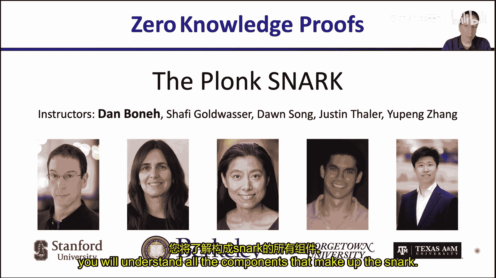
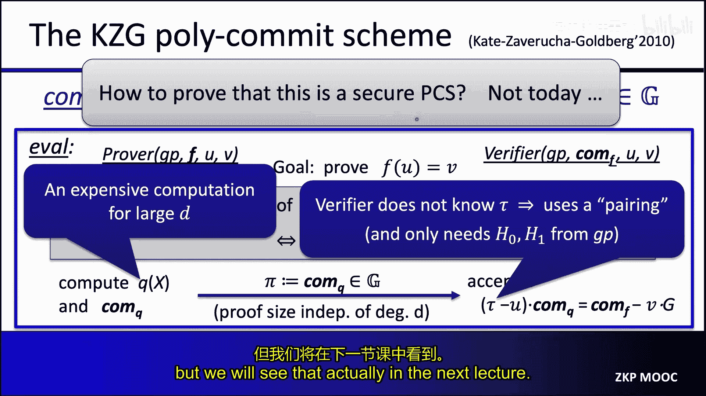
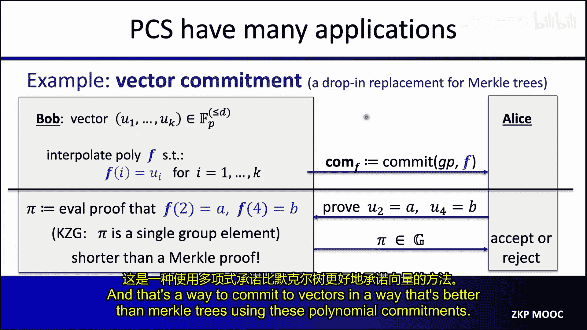
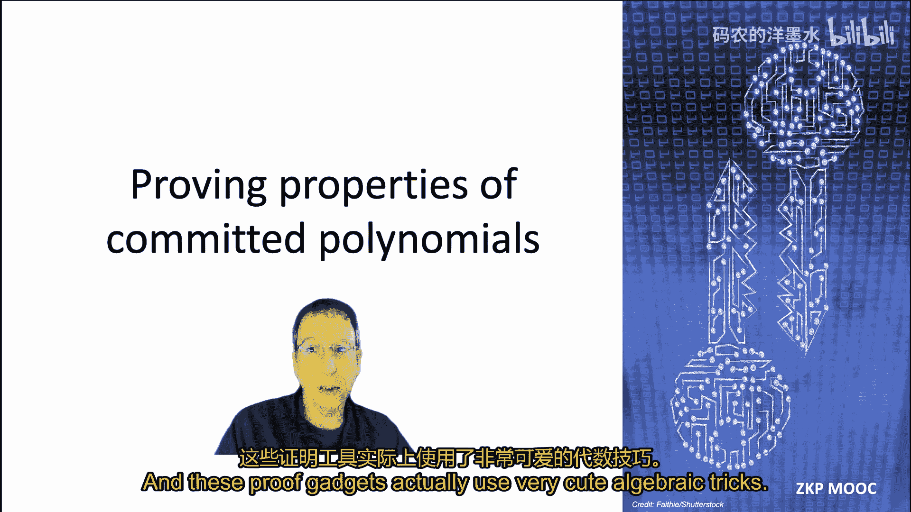
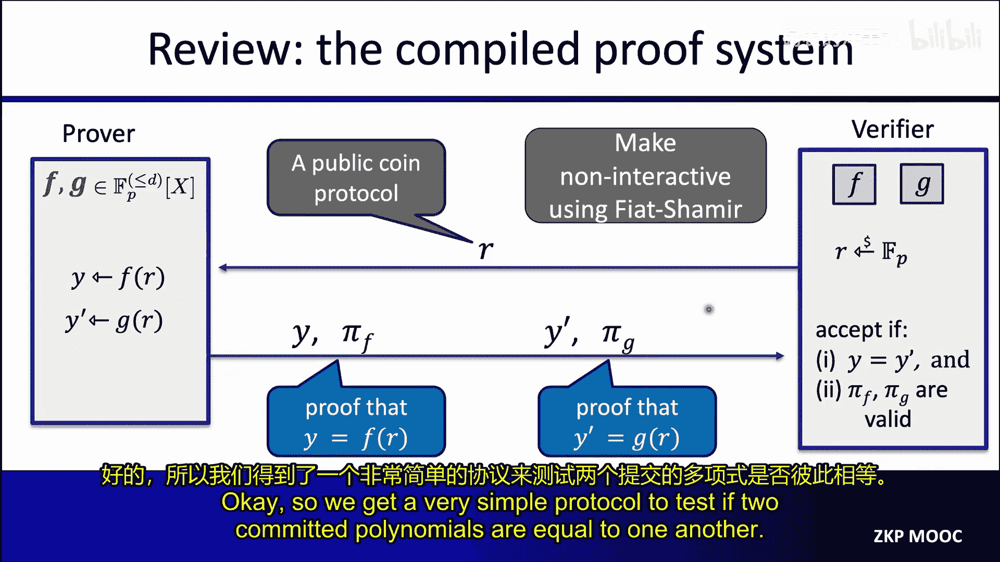
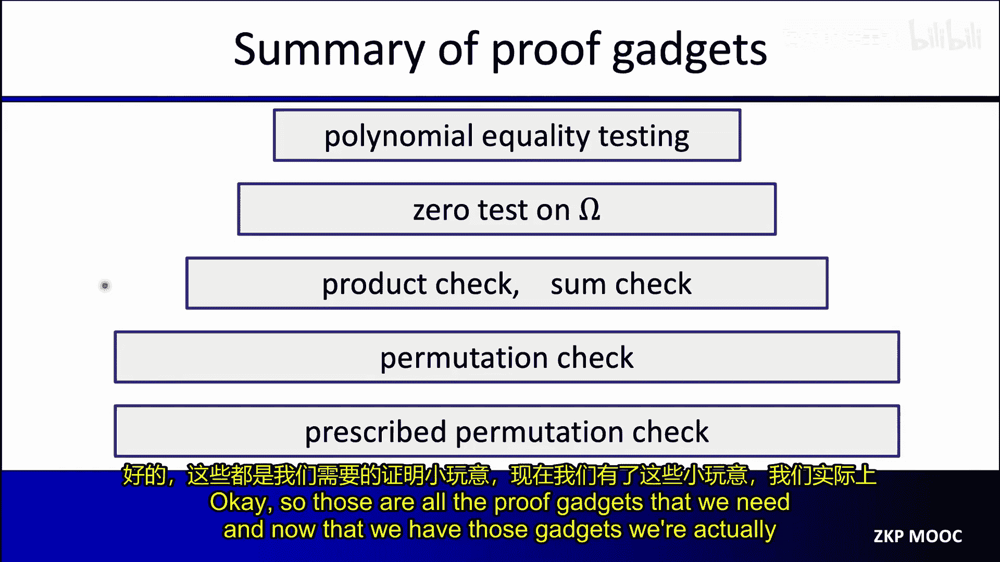
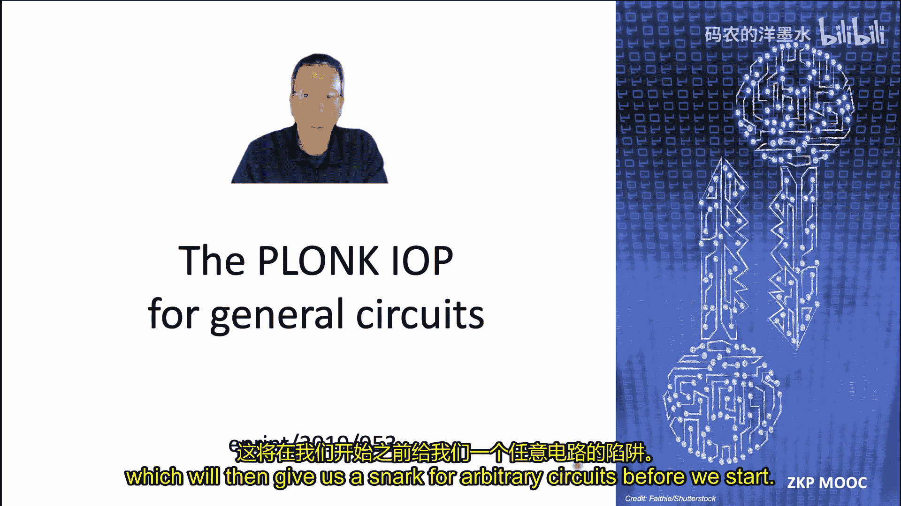
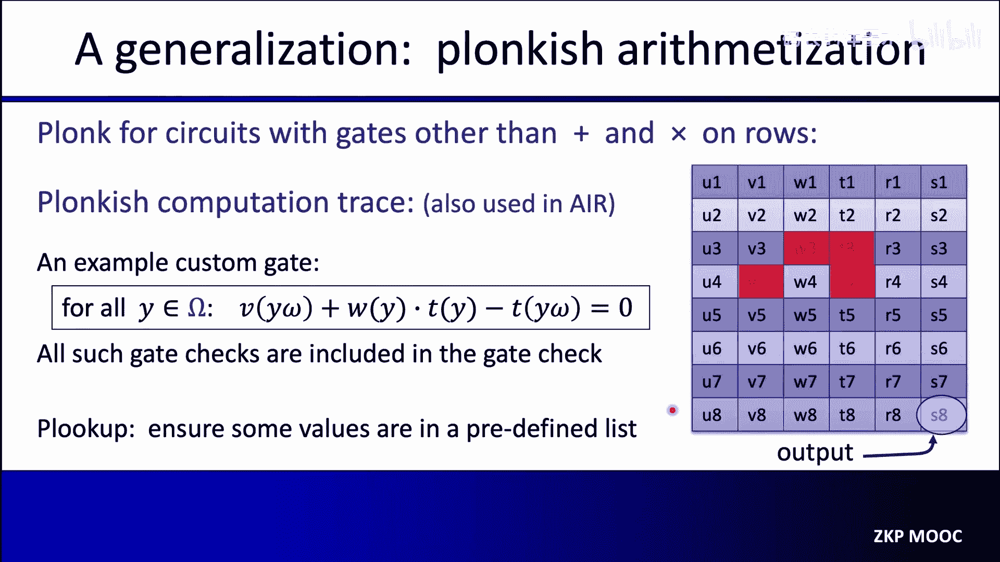
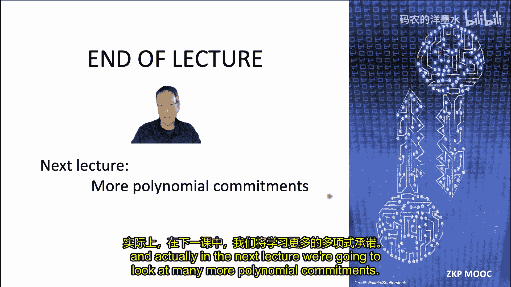

# 【全集】加州大学伯克利分校 Web3：零知识证明 区块链技术与隐私计算 中英字幕 1080P p05 Lecture 5 - Plonk SNARK -BV1bCrpB2E7Q_p5-

Hello， everyone， and welcome back to our courseine snarks。 In this lecture。

 we will construct a widely used srk called Planlunk。

 We will develop this srk slowly in an a modular way so that by the end of the lecture。

 you will understand all the components that make up the srk。 In fact。

 many of the components that we will see are interesting and useful in their own right。 First。

 let's review how snarks are typically built。 We start from a polynomial commitment scheme。

 Com it with a polynomial interactive oracle proof。

 and that will give us the snark that we want for general circuits。😊。

To do that， let me first remind you what a polynomial commitment scheme is。

 and then we will look at one particular construction for a polynomial commitment scheme。

So a polynomial commitment scheme lets a committer commit to a particular polynomial F that happens to live over some finite field F sub P。

 and the degree of the committed polynomial is bounded by some upper bound D。

Now after the prover commits to the polynomial F， the prover can then open the polynomial at any point of its choice。

 in particular， for public values U and V in the finite field。

 the prover can convince the verifier that the committed polynomial satisfies F of U is equal to V and the degree of the polynomial is at most D in this proof here。

 the verifier just has the upper bound in the degree it has a commitment to the polynomial and then it has the values U and V Now for a polynomial commitment scheme。

 we want the proof size and the verifier time to be at most logarithmic in the degree D。

So for example， simply sending the polynomial over to the verifier is not acceptable because that would result in a proof that's linear in the size of D。

 and verification time would also be linear in the size of D because the verifier would have to evaluate the polynomial。

So our goal is to build evaluation proofs that are very short and very， very fast to verify。

So a very widely used polynomial commitment scheme is called the KzG polynomial commitment scheme。

 It's named after the people who developed the scheme Catez of Verruche and Goldberg back in 2010 to explain how the commitment scheme works。

 First of all， let's fix some finite cyclic group G。 So what is a finite cyclic group。

 Basically the group consists of P elements will' denote them by 0 g2G3G up to p minus-1G。

 So the group contains P elements in total。And the group has an addition rule that allows us to add two elements together。

 So， for example， given the element 2 g and given the element 3G。

 we can add those two elements together and get the element 5 times G。

 Keep in mind that this addition is done modlo P。So now that we have this group G of order P。

 let's see how the commitment scheme actually works。So first of all。

 we have a setup procedure to generate some global parameters。

 so the setup procedure will take a security parameter lambda and it will sample a random field element tau and construct the global parameters as follows the first element of the global parameters is going to be the generator G so we'll denote that by H0。

 The second element of the global parameters is going to be tau times G we'll call that H1 then tau square G tau cube G up until tau to the Dg which will denote by Hd。

 So overall the global parameters contain D plus1 group elements。

The important thing is that now that the global parameters were generated。

 Whoever runs the setup procedure has to delete this field element tau。 And this is very important。

 If tau is leaked， then one can break the commitment scheme in the sense that one can produce incorrect evaluation proofs。

 So I can commit to a polynomial F and convince you that F of U is equal to V。

 even though that's not the case。 So it's very important that nobody ever learns the value tau。

 And so we have to trust whoever ran the setup procedure to delete this tau in the next lecture。

 we're going to talk about ways in which to run this setup procedure so that nobody will ever know what tau is。

 And the way we do that is basically by running the setup procedure across a large number of parties。

 And as long as one of those parties is honest， nobody will know what tau is。

 And so that the global parameters are safe。😊，But for now。

 let's assume that some trusted party actually ran the setup procedure。

 generated the global parameters， and then deleted this value ta。Now to commit to a polynomial F。

 we use a commitment string which itself is a group element。

 so comm F is just a single element in the group， and comm F is defined basically as the committed polynomial F evaluated a tau times de generator G。

 and that basically gives us one group element。So now you should be wondering。

 I just told you that tau is deleted。 so nobody knows the value of tau。

 So how does the committer actually compute f of tau times G without knowing tau And the answer is the committer will actually use the global parameters in order to commit to the polynomial F。

 So let's see how that's done。 So let's write out the polynomial F in coefficient form。

 So here you can see we wrote out the polynomial F explicitly with its coefficients being f 0 f1 up to fD。

 And the way to commit to the polynomial F is basically we're going to compute F0 times the group element H0 plus f1 times the group element H1 up until Fd times the group element H D。

Now， if you just expand this out a little bit， you see that all we did here is we plugged in the values for the various elements of the global parameters right so for example。

 H2 was replaced by tau square G and you realize that once we take G out of the parentheses。

 we get F tau times G。 Yeah so in fact， the commitment string that we compute it over here in fact is F tau times G and that serves as a commitment to the polynomial。

So now we see how the committer can compute the commitment to the polynomial without actually knowing the value tau explicitly。

One thing that I wanted to point out is that this is a binding commitment。

 so now the committer actually is bound to the polynomial F。

 but it's not a hiding commitment in the sense that something about the polynomial F is revealed in particular。

 we revealed F of tau times G That's okay for our purposes。

 a binding commitment that's not hiding is sufficient。

So now that we know how to commit to a polynomial。 The next question is how do we do an evaluation proof。

 And that's kind of the interesting thing here。 So I wrote down again the commitment algorithm here。

 the commitment to a polynomial F is simply going to be f tau times G。 The question is。

 how do we do an evaluation proof。 So here the prover has the global parameter。

 he has the polynomial F as well as a U and V。 The verifier， on the other hand。

 only has a commitment to the polynomial F， It doesn't have the polynomial f and the clear。

 And the prover wants to convince the verifier that the committed polynomial satisfies F of U is equal to V。

 So let me show you the trick of how that's done。 So first of all。

 you notice that if f of u is equal to V， that means that u must be a root of the polynomial F minus V if we evaluate the polynomial F minus V at the point U will get 0。

 which means that u is a root of the polynomial f minus V now the notice polynomial by F hat。😊，Now。

 what does it mean that U is a root of F hat， What it means is that the linear polynomial x minus U must divide F hat。

Okay so if u is a root of F hat， then F hat must have as one of its factors。

 the linear polynomial x minus U。But what that means is that there exists some quotient polynomial  Q such that Q times x minus Q is equal to the polynomial F minus v。

 so we have this equality of polynomials。 if and only if f of U is equal to V。

 And that's the fact that we're going to be using over and over and over again。

 So the way the evaluation proof works using this fact is the following。

 the prover will computes the quotient polynomial  Q。

 and it's actually going to commit to the polynomial  Q。

 So it's going to compute the single group element that corresponds to a commitment to this quotient polynomial and in fact。

 this single commitment is going to make up our evaluation proof pi。

 So the prover sends one group element over to the verifier and this group element serves as a commitment to the polynomial  Q。

 And that is already going to convince the verifier that f of u is equal to v。

 One thing that's interesting here is that the proof size is much better than logarithmic in the degree。

 the proof size is constant size's。😊，Single element in the group G。

 So it's kind of remarkable that we have such short evaluation proofs。

 And this is why the Kz G polynomial commitment scheme is so popular。

Now how does the verifier verify this proof What the verifier will do is we'll simply check that this polynomial equality holds at the point tau right so let's plug in tau into this relation。

 what we get is that x minus u becomes tau minus u times the commitment to the polynomial Q should be equal to a commitment to the polynomial f minus a commitment to the constant polynomial v so the way the verifier verifies that this equality of polynomials actually holds is that it verifies that it holds at the random point tau We know that if two polynomials agree at a random point。

 then the two polynomials must be equal to one another with high probability as long as they have a bounded degree。

And so here the verifier is checking that this relation holds at the points taut。

 and this implies that this equality of polynomials actually holds。Now again。

 when you look at this equality you should be wondering how does the verifier actually check that this equality holds。

 the verifier doesnt know tau so how does the verifier actually check that this relation holds and the answer is that to do that the verifier uses an algebra tool called the pairing。

 which I'm not going to explain now actually we're going to see how this works in more details in the next lecture But what's interesting is this pairing allows the verifier to check that this equality down here holds as needed without actually knowing the value tau。

 and it turns out that it only needs h of0 and h of 1 from the global parameters so even though the global parameters might be quite large。

 the verifier only needs the first two elements from GP in order to verify evaluation proofs。

So we see that the proof actually is constant size and in fact。

 verifying the proof also takes time independent of the degree D。

 It's kind of remarkable that this is possible， but this is sort of the basic fact that makes snarks possible。

Now I should say that computing the quotient polynomial can be quite a large computation for the prover。

 in fact， if the polynomial F has high degree， say the polynomial f is of degree a billion or more。

 then now the prover has to manipulate polynomials of degree a billion in order to construct this quotient polynomial and commit to it。

So this is all I wanted to say about the construction of Kzg and how we do evaluation proofs。

 You're probably wondering why is this secure in particular。

 why does this evaluation proof convince the verifier that F of U is equal to V。

 we will see why this is secure， but we will see that actually in the next lecture。

 Now the KzG polynomial commitment scheme actually has a number of very interesting properties that we will use throughout the lecture。

 First of all， it's actually not that difficult to generalize the commitment scheme to not just commit to univariate polynomials。

 In fact， we can commit to Kvari polynomials。

Polynomials in two， three， four， five variables， and so on。

 and that is actually something that we needed in the previous lecture。

 but we will not be using that here in this lecture。

 we're only going to commit to univariate polynomials。

What's interesting is that KZG also supports very efficient batch proofs。

 so suppose I have commitments to a number of polynomials in this case。

 I'm committing to n different polynomials。And suppose the prover wants to convince the verifier that each one of these polynomials evaluates to a particular value at a number of points。

 Yeah so for all I and for all J， the prover wants to convince the verifier that F of I at the point U of I comma J is equal to v of ia J。

 Let's say it has five polynomials and it has 10 points and in wants to convince the verifier that each of these five polynomials at each of these 10 points evaluate to a particular value。

 in this case， itll be five times 10 opening proofs 50 opening proofs。

 And the remarkable thing is that we can actually batch all these proofs together into a single proof。

 Yeah， so even though on the face of it， this looks like it's going to require 50 evaluation proofs。

 In fact， Kzg has this property that all these proofs can be batched into a single group element。

 So only one group element is sufficient to prove all these openings of all these polynomials at all these different points。

 Yeah， so this we will use quite a bit as well。😊，The other property I want to mention of KCG is that it also supports linear time commitments。

 yeah so the time for the prover to commit to a polynomial is actually only linear in the degree of the polynomial and let's see why that's true。

First of all， if we have the polynomial written out in what's called coefficient representation。

 so we literally write the polynomial f as a sum of these mononomials。

 which is sort of the standard way to describe a polynomial then computing the commitment to the polynomial f as we saw can be done a linear time it's basically a linear number of multiplications in our group G So this will take linear time in a degree of the polynomial however there's another way to represent polynomials and in fact that's the way that we will use which is what's called a point value representation what is a point value representation Well here we fix a bunch of inputs so in this case a0 to ad and we give the evaluation of the polynomial at these points a0 to a Yeah so you can see that these D plus1 pairs actually define a polynomial as you know。

 for example， it takes three points to determine a parabus so when these is equal to2 this will take three points and in general if we have a polynomial of degree D。

 we need its evaluation of D plus1 points to completely determine the polynomial。

So the question is if we have the polynomial in point value representation。

 how do we commit to that polynomial quickly So the naive answer would be well let's take the point value representation that we were given。

 let's convert it to the coefficient representation F0 to fd and now we'll commit in linear time to the coefficient representation F0 to f d just like we saw before。

 The problem is that converting from point value representation to coefficient representation that actually takes time D log D using an algorithm called a number theory transform which is very closely related to a fast Fourier transform We're not going to talk about that。

 All you need to know is that going from a point value representation to a coefficient representation takes time d log D but we would like to commit to a polynomial in time D in time linear indeed D。

 this log D is kind of getting in the way and you know when the degree of d is quite large。

 if the degree of the polynomial is 2 to the 20 or 2 to the 30 basically log D。

Like a factor of 20 or a factor of 30 slowdown under time to commit to a polynomial。

 we'd like to save that and simply have a commitment algorithm that runs in linear time in D。

 And so the question is how to do that and it turns out we can actually do that quite nicely。

 and so again， suppose we have a point value representation of the polynomial What we can do is look at what's called laggrange interpolation which is a way to interpolate a polynomial from its point value representation。

 the way laggrange interpolation works is basically we compute F of tau at some point tau as a sum of some laggrange polynomials。

 these are the lambda I so these laggrange polynomials will be evaluatedd at a tau times F of AI which are the values that were given to us。

Now， the lagunge polynomials， they don't depend on the value of the polynomial。

 They only depend on the point a0 to ADd。 And in fact。

 I can show you what these laggrangee polynomials are。 Let's just write out what they are。 So here。

 lambmbda I at the point tau， I wrote out the expression for it。

 And you can see here Tau only appears here in the numerator。

 everything else is a scalar as a constant scalar， So you can see that these polynomials are defined by this equation and they only depend on the points at which we evaluate the polynomial。

 but not on the actual value of the polynomial。Okay， so this is called Laangrange interpolation。

 If you have not seen La interpolation before， I actually suggest reading about this because this is actually quite an important technique。

 It comes up actually quite a lot when manipulating polynomials。 So how does this help us。

 What we're going do is we're going transform the global parameters into what's called a laggrange form。

 And this is basically just a linear transformation anyone can perform this transformation going from the original format of the global parameters into lagrangerange form。

 This doesn't involve any secrets， anyone can do it， it's just a linear transformation。

 then anyone can compute on their own。 But what is this laggrange form， basically。

 instead of having the global parameters be G tau G tau squared G tau cube g up to tau to the D What we're going do is we're going to replace that basically by the lagangrange coefficients。

 Yeah， So H0 hat will be lambda 0 at the point tau times G H1 will be lambda1 tau times G up to lambda d tau times G so this is basically going to be。

New global parameters。 Again， this is completely equivalent to the original global parameters。

 You can go back and forth with a linear transformation between the old global parameters and the new global parameters。

 It's quite a simple transformation。 But the beauty of this is that now。

 even if we're given a polynomial in point value form。

 we can commit to the polynomial in linear time because by the lagrange interpolation formula。

 We know that to compute f at the point tau， we simply have to take a linear combination of the lagrangerange coefficients。

 Yeah， so in particular， to compute f of tau times G。

 we can simply take a linear combination of the values of the polynomial we were given multiplied by the group elements in the modified global parameters。

 so now you can see the simple inner product between the polynomial values and the global parameter elements gives us the commitment to the polynomial F。

 And again， you see that this runs in linear time in the degree D。

 Yeah so this is much better than d log。When D is like again，2 to the 20 or 2 to the 30。

 this algorithm will run 20 to 30 times faster than the naive method。

So usually when people write the global parameters。

 they write them in the Lagrange basis rather than in the standard way that we saw before。

The last thing I want to tell you about Kzg commitments is again。

 an interesting property that's good to keep in mind。

 and that is that we can generate many proofs at once relatively quickly。 again。

 suppose the prover has some polynomial f and let's fix some subset of the finite field which will' denote by omega so omega is a subset of the finite field that happens to be of size D and suppose that the prover needs to construct evaluation proofs for the polynomial f for all a in omega。

 So it needs a Kzg evaluation proof pi a for every a in omega naively。

 the way you would do this is you would just generate the evaluation proofs one at a time。

 Each evaluation proof takes time D to generate。 So if you have to generate d of them。

 it will take u time d squared naively generating these d proofs will take time d square。

 Well so there's a very clever algorithm for 2020， it's called an fk algorithm And what it shows is that if omega happens to be a multiplicative subgroup of the finite field。

😊，Then， in fact， we can generate all D proofs in time D log D。 This is much better than d squared。

And if omega is just an arbitrary subset of the finite field of size D。

 it turns out we can still do it faster， but now it's going to take time D log squared d still much better than d squared。

 And by the way， this difference is one of the reasons that when we are going to choose our subset omega。

 we're actually going to choose it as a multiplicative subgroup of the finite field。

 as we'll see in just a bit。Finally， I want to mention that there are some issues with the Kzg polynomial commitment scheme as we saw。

 first of all， the Kzg commitment scheme requires a trusted setup to generate the global parameters in particular。

 we have to make sure that nobody knows the secret value tau。

 If there's a single entity generating the parameters it has to erase tau once it's done usually what people do is they generate the global parameters using a distributed protocol that we'll see in the next lecture in such a way that if one of the parties in the protocol is honest。

 then nobody will know the value tau and the global parameters will be secure。

 The other problem with Kzg is that the size of the global parameters is linear in the size of D。

 So again， if D is like a billion， then the size of the global parameters would be many gigabytes So quite large。

 And so it's a natural question as to whether we can build polynomial commitment scheme under the same assumptions as Kzg。

But one that doesn't require trusted setup and one where the global parameters are much smaller。

 It turns out that can be done。 And there's a commitment scheme called Dory， which is。

 again very pretty。 I put a link to the paper here in case you want to see how Dory works。

 First of all， there is no trusted set up。 So we don't have to trust anyone to forget any secret information when generating the parameters。

 The commitment to a polynomial is still a single group element independent of the degree D。

 just like in Kzg。 However， now the evaluation proofs are bigger。 Yeah。

 the evaluation proofs in Kzg or constant size。 There were a single group element here。

 the evaluation proofs are going to be logarithmic in the degree D。 Yeah。

 so they're going to be quite larger than Kzg proofs。And also for the verifier to check the proofs。

 the verifier now has to work time proportional to log D。

 whereas in KZG the verifier only had to work for a constant amount of time independent of the degree D。

So it's good to know that this scheme exists， but because the proofs are larger and verification time takes longer。

 these proofs are not as widely used and in most applications people end up using the KCG Com scheme。

Now I wanted to mention that polynomial commitment schemes have many， many applications。

 They're not just used for building snarks。 And let me just show you one very simple application。

 These polynomial commitment schemes give us an immediate drop in replacement for Merkel trees。

 So if you remember a Merkel tree allows us to commit to a vector So if I have a vector U1 to UK I can commit to this vector using a Merkel tree and later on。

 I can convince the verifier that u sub5 is equal to a particular value using a very short proof。

 that's what Merkel trees is let us do。 we can commit to a large vector and later on open the vector at only one point and convince the verifier quickly that that one point was opened correctly。

 Well， it turns out polynomial commitment schemes actually let us do the same thing but better。

 So let's see how Well， first of all， the way we would commit to a vector U1 to UK is as follows what we will do is we will interpolate a polynomial f such that f of I is equal to U I for all I goes from one to so this defines a polynomial of degree。

1 because it's defined by K points and K points define a polynomial of degree K minus1 and we go ahead and commit to this polynomial and send that commitment to the verifier to Alice。

So with a Kz G commitment scheme， this will be a single group element that's sent over to Alice。 Now。

 suppose Alice wants the prover to convince her that the second element of the vector is the value A and the fourth element of the vector is the value B。

 What the prover can do is he can produce an evaluation proof that F2 is equal to a F4 is equal to B and send this evaluation proof over to Alice and Alice will check the proof and either accept or reject the proof。

 Now， I told you about batch proofs。 the interesting thing about Kzg commitments is that naively。

 we would need two evaluation proofs to prove these two statements， but in fact， using batch proofs。

 these two statements can be proved using a single group element。 Yeah。

 so all the prover has to do is send a single group element and the verifier will be convinced that u2 is equal to a and U4 is equal to B。

 This is actually much shorter than a Merel proof and a Mer proof is you might remember if you need to open it at L points you would have to provide L Mer。

😊，ProsEach Mer proof is going be of size log K。 So you would have to send over L times log K hash values。

 Yeah L times log K hash values， whereas using a Kz G commitment scheme to open the vector at L points。

 you only have to send in a single group element independent of L and independent of K。

 So quite remarkable and much， much shorter than Mer proofs。

 If you want to learn more about vector commitments using polynomomic commitment schemes。

 I would suggest looking up the term vertical trees， vertical V， E， R K， L E vertical trees。😊。

And that's a way to commit to vectors in a way that's better than Merkel trees using these polynomial commitments。

Okay， so this brings us to the。Welcome back， everyone。 In the last segment。

 we saw how to commit to a bounded degree polynomial using the Kz G commitment scheme。

 In this segment， we're going to see how to prove properties of a committed polynomial。

 And these proof gadgets actually use very cute algebraic tricks。 So let's get started。😊。

So first， what does it mean to prove properties of a committed polynomial So in our settings。

 the prover is going to have some polynomials， let's say F and G available to it in the clear。

 The verifier is just going to have commitments to those polynomials。 Yes。

 I'm going to use the polynomial in a box to denote a commitment to the polynomial。

 This could be a KG commitment to the polynomial or a commitment using any other commitment scheme。

Now， what the prover is trying to do is it wants to convince the verifiers that the polynomials f and G satisfies some properties and we're going to see many examples of what we mean by that。

 so we will present these proof systems as interactive oracle proof So what I mean by that is that the verifier will send some random messages to the prover the prover will send back some polynomials that may depend on the data from the verifier and finally the verifier is going to query some committed polynomials at some random points in Fp and then it's going to decide to accept or reject Now when describing these proof systems I'm just going to say the verifier queries F and G at a certain point but in your head you should be compiling this already to a real proof system where what does it mean for the verifier to query f and g at a certain point What it means is that V is going to send some points to the prover the prover is going to respond with the evaluation of the polynomial at those points along with an evaluation proof to prove that the prover correctly evaluated the committed polynomial at the requested point。

So let's do a simple example and we'll do that by recalling one of the basic building blocks of this whole area。

 which is basically how to test the two committed polynomials are equal to one another。

 what we call polynomial equality testing and the basic tool that we use for this is something that we already saw in previous lectures let me very briefly remind you what that is suppose were working over a large prime field and suppose that our polynomials have bounded degree let's say degree less than 2 to the 40 so that the degree over the a size of a field is negligible then if we want to test the two polynomials f and G are equal。

 we use this basic fact that if we choose a random point in a finite field and we test that the two polynomials are equal at this random point if the values are equal that means that the polynomials are also equal with very high probability。

 In fact as you may recall we saw that the probability of making a mistake is that most d over P which is negligible So this gives us a very simple way to test if two committed polynomials are equal to one another again the idea we choose。

randomandom point and we check whether those two polynomials are equal at the random point。 So again。

 the prover is gonna have the polynomials f and G in the clear。

 These are bounded degree polynomials bounded by degree D and the verifier is gonna to have commitments to these polynomials f and G again。

 these f and gs in a box denote commitments to the polynomial。

 Now the way the interactive oracle proof works is very simple。

 basically the verifier is going to choose a random point in the finite field。

 It's going send a random point over to the prover and ask the prover to evaluate the polynomials f and this random point R。

 So I'm going say this as querying f G and R。 the verifier will then learn f R and G R and you have the two are equal is going accept to say yes。

 these two committed polynomials really are the same polynomial。 And again。

 just to make sure this is crystal clear。 when we compile this to an actual proof system。

 the verifier will send a random point。 The prover will evaluate the polynomials f and G at the random point and it will send back the evaluations y and y prime。

Along with evaluation proofs that the evaluation was done correctly with respect to the committed polynomials。

 the verifier will verify that， in fact， the two evaluations are equal to one another and that the evaluation proofs are valid。

 and if so， it will accept。But again， as a shorthand when we describe these proof gadgets。

 I'm just going to say the verifier queries the polynomials F and G at the point R and then checks that the two evaluations are the same。

 and in your head I'd like you to compile that into a proof system where the evaluation is done by the prover。

 the prover sends back the evaluation values and proof that the evaluation was done correctly with respect to the committed polynomials。

Now of course you notice this is a public coin protocol。

 the only thing that the verifier does here is just send random field elements。

 it's not keeping any secrets， and because of that we can compile this into a non interactiveactive protocol using the Fchemre transformation。

Okay， so we get a very simple protocol to test if two committed polynomials are equal to one another。

So I want to make one more point about this very simple protocol and that is that when we use Kzg commitments。

 if you remember the way we described Kzg commitment in the previous segment。

 we describe them as a deterministic commitment scheme which means that if two polynomials are equal to one another。

 their commitments are also going to be equal to one another So you should be asking well why did we describe such a complicated protocol if the verifier can test if F is equal to G on its own。

 it simply tests if the two commitments that it has are equal to one another and if so in those already on its own that the two polynomials are equal Well。

 it turns out the protocol are needed if we do something slightly more complicated in particular。

 maybe the prover has a bunch of polynomials F G1 G2 G3 and the verifier only has commitments to those polynomials Well the prover wants to prove to the verifier is that in fact F happens to be equal to the product of all three polynomials G1 times G2 times G3 Well now the verifier can't just check equality of commitments。

Because well it doesn't have a commitment to the product of the three polynomials。

 it only has commitments to these polynomials individually。

 and so what we'll do is basically the verifi will query all four polynomials at a random point and then it will accept the equality is true if f of r is equal to G1 of r times g2 of r times g3 of R。

Yes， so there's a little bit of work the verifier has to do here。

 basically has to compute this product of G1 of r times G2 of r times G3 of R and test that that's equal to f of R。

And in fact， this protocol is complete in sound， assuming 3D over p is negligible。

 the reason for the 3D is because the degree of the polynomial G1 times g2 times g3 is 3D。

 so the soundless error namely the probability that the verifier makes a mistake。

 is at most 3D over P， which of course if P is sufficiently large。

 this is going to be a negligible value。Okay， so now that we understand how polynomial equality testing works。

 let's put it to use and we are going to start off with three very important proof gadgets for univariates。

 so to present as gadgets， let's fix some subset of the finite field I'm going to call the subset capital omega and let's say that this is a subset of our finite field Fp that happens to have size K。

Now， suppose I have a certain polynomial of degree D the degree of the polynomial， let's say。

 is much bigger than the size of omega。 and let's say that the verifier has a commitment to this polynomial f。

The things that the prover would like to prove to the verifier about this polynomial are the falling。

The first one is what's called a zero test。 So what is a zero test In a zero test。

 the prover wants to convince the verifier that， in fact。

 the polynomial f is identically0 on the set omega。

 Now I want to emphasize this doesn't mean that the polynomial f is identically0 everywhere outside of omega。

 the polynomial F could take on arbitrary values， but on the set omega， the polynomial has to be 0。

 So F is not a zero polynomial。 it just happens to be0 on the set omega。

 And you notice because the degree of the polynomial can be much larger than the size of the set omega。

 it's perfectly reasonable for the polynomial f to be non-ze outside of omega in completely0 on omega。

 Okay so we're going to call this a zero test。 This is a very important building block in proof systems and I'm going to show you how to do a zero test in just a minute。

The next thing the prover might want to convince the verifier of is what's called a sum check。

 which is to say that the sum of the evaluations of f on the set omega you see here we're summing over all the elements in omega and summing the evaluations of f on those elements。

 that happens to be equal to 0。So again， a sum check has a very important proof gadgets that will come up again and again in the course。

 and the goal is for the prover to convince the verifier that the sum of the evaluations happens to be equal to0 and similarly it there's a product check which is the same thing except using a product。

 So instead of proving that the sum is equal to0， now the prover wants to convince the verifier that if you take the product of all the evaluations of the polynomial F on points of omega。

 that product evaluates to1。Okay， so these are three basic things that the prover would like to convince the verifier of it。

 and we're going to apply these three different tasks for different polynomials。Okay。

 so I want to show you how these protocols work。 And so to start。

 we have to introduce a very important concept called the vanishing polynomial。 Okay。

 so let omega again be our subset of the finite field and it's going to have size k。

The vanishing polynomial of the set omega well denoted by z omega0 omega is basically a polynomial that happens to be0 everywhere on the set omega。

 Yeah， so the polynomial is defined as product of a in omega of x minus a。

 which clearly if you plug in any value in the set omega。

 this vanishing polynomial will evaluate to 0。 Outside of omega， of course。

 the polynomial could evaluate to arbitrary values。 but on the set omega。

 this polynomial will always evaluate to 0。 Now， of course。

 the degree of the vanishing polynomial Z omega is exactly the size of the set omega。

 which in our case happens to B K。 And so just keep it in mind。

 this is a degree K polynomial that happens to be 0 and all of omega。

So now there's one particular set omega that's very， very important to us。

 and that's going to be the set omega， which happens to be a multiplicative subgroup of the finite field。

 What do I mean by that， Well， let's fix some element。 little omega in the finite field。

 And let's assume that omega is what's called a primitive K through of unity。

 What that means is basically that omega to the K is equal to1。

 But omega to a lesser power than k is not equal to 1。

 So we can set omega to be all the powers of little omega。 Yes。

 so1 omega omega squared up to omega to the K -1。 And that's going to be a subset of the finite field of size K。

And in this case， you probably remember from your high school algebra that the polynomial that happens to be0 at all the primitive roots of unity of order K is simply the polynomial x to the k minus-1。

 And in fact， it's quite easy to see that if you plug in any of these points。

 then x to the K -1 will evaluate to0。 What's interesting about this polynomial。

 and the reason we like this particular set cap omega。

 is that if you want to evaluate the vanishing polynomial at a point R。

 then evaluating it just basically amounts to computing r to the K in subtracting one。

 computing r to the K can be done using only about log K field operations。

 This is done using the repeated querying algorithm。

 So what this says is that if we use this particular set cap omega。

 then it's vanishing polynomial can be evaluated in logarithmic time in the size of the set。

 And again， this will be very important because our verifier is going to have to evaluate z omega by itself。

 and we'd like that evaluation to be superfast。😊，Okay。

 so now that we understand what the vanishing polynomial is， let's describe our first proof system。

 which is a zero test。So the setup here is that the prover has a polynomial F of bound the degree D。

 and the verifier has a commitment to this polynomial F。

 and what the prover wants to convince the verifier is that this polynomial happens to be0 on the entire set capital omega。

Alright， so the way we're going to do that is using a very simple lemma。

 which is to say that if F is in fact，0 on the entire set capital omega。

That means that all the elements of omega are roots of the polynomial F。

 which means that actually F must be divisible by the vanishing polynomial of omega by z omega。

 which in our case will be x to the K-1。 It， in fact， this is an if and only if。 Yeah。

 if F is0 then iss divisible， if F is， in fact， divisible。

 it means necessarily it must be 0 on all of omega。 So the lemma is actually what we're going to use。

 And so the way the proof system works is as follows。 Basically。

 the prover will compute a quotient polynomial， which is f divided by z omega。

 Now you realize that if f is， in fact，0 and omega。

 dividing by the vanishing polynomial will give a polynomial。

 The result of this division will be a polynomial because F is divisible by the vanishing polynomial。

 If F is not0 on omega， then this division is not going to relate to a polynomial。 Yeah。

 it will lead to some rational function that's going to have a denominator。

 it's not going to be a clean polynomial。And so what the prover will do next is it's going to send to the verifier a commitment to this quotient Q。

 and I want to emphasize that the only reason that the prover can commit to this quotient polynomial Q is if Q happens to be a polynomial right the Kzg commitment scheme only lets us commit to polynomials of bound to degree D。

 we cannot commit to general rational functions using Kzg And so the fact that the prover was able to commit to the quotient polynomial is what we will use to prove that F is divisible by the vanishing polynomial。

But the verifier doesn't know that the prover actually committed to the correct quotients。

 The prover could have committed to garbage。 And so the verifier has to check that this quotient really is f divided by the vanishing polynomial。

 And so we do that using our usual equality test of polynomials so the verifier will choose a random point R in the finite field。

 it will query the polynomial Q and the polynomial f at the point R， then it will learn Qr and f R。

 and then it will accept if f of R is equal to Q of R times the vanishing polynomial。

 Now if the lefthand side and the righthand side are equal to one another at a random point。

 As we said， that means that they're very likely to equal one another as polynomials。

 So this means that actually f is equal to Q times the vanishing polynomial。

 which again means that in fact， f is divisible by the vanishing polynomial and therefore the verifier can safely conclude that f is 0 on the entire set omega。

And what's interesting here is you notice the verifier obtained the values F of R and Q of R from the prover。

 along with the proof that these evaluations were done correctly。

 but it has to evaluate a vanishing polynomial by itself。

 and this is why we want a vanishing polynomial to be efficiently computable so the verifier can do this very quickly and when we use this particular omega we said that this can be done in logarithmic time in k。

So as we just argued， basically this protocol is complete in sound as long as d over P is negligible。

 the reason we need d over p to be negligible is because when d over P is negligible。

 we know that if two polynomials agree to random point。

 then those two polynomials are very likely equal to one another as polynomials。

And in terms of running times， the only thing the verifier has to do is it has to verify two opening proofs。

 and it has to evaluate the vanishing polynomial by itself， which takes time log K as we said。

 So the verifier's work is basically order log K plus two polynomial queries。

 You might remember in the previous segment we said that queries can be batched into one。 So in fact。

 this can even be reduced to a single polynomial query。 What is the prover has to do。

 The prover has to compute the quotient Q， which either takes time k or maybe k log K depending on how f is represented。

 and then it has to commit to Q， which we said takes linear time in K。

 So the prover's time is either k or k log K。 Also quite fast for the prover。

Okay so this concludes our discussion of a zero test。 Next。

 I want to show you how to do the sum check and the product check， but in fact。

 the sum check and the product check are almost identical protocols。

 And so I'll just focus on doing a product check because that's actually something that we're going to be using in the next segment。

 so here again， the prover has a polynomial F。 The verifier has a commitment to the polynomial F and the prover wants to convince the verifier that the product of all the evaluations of f on capital omega happens to be equal to one。

Okay， so how does the prover convince the verifier of this fact， This is kind of a protocol。

 And so what the prover will do is it's going to interpolate an auxiliary polynomial。

 which we'll call T。 And again， this is a polynomial of degree K。

 and it has a very simple definition。 is defined as follows。

 So T at a01 is going to be equal to simply f of1。And now we're going to define it inductively。

 So T at the point omega to the S is equal to the product of f at all the points omega to the I from 0 to S。

 so just to give an example。 So we know that t of1 is equal to f of1 T of omega is going to be equal to f of1 times f of omega T of omega squared is going to be equal to the prefix product up to omega squared。

 meaning f of1 times f of omega times f of omega squared t of omega cubed will be the prefix product up to f of omega cubed and so on and so forth。

 for s equals1 to k -1。 So when s is equal to k -1。

 we have the T of omega to the k -1 is actually equal to the product of f of a over the entire set omega。

 Yeah， so you can think of this T as slowly building up the full product over the set omega by multiplying by one element of the set omega at a time。

So again， this polynomial t captures these prefix products where t of omega to the s is basically a product of all the evaluations of f at the points1 omega。

 omega squared omega cubed up to omega to the S。And therefore。

 the evaluations of T at the last element of capital omega is actually going to give us the entire product。

 which supposedly is equal to one。So there is a recurrence relation that holds here for every x in capital omega。

 what the recurrence relation says is if I want to compute t at a0 omega times x。

 what I'll do is I'll take t at a point x and then p in f at a0 omega x and this holds for all x and omega and you can verify for yourself that this even holds at the last point namely when x is equal to omega to the k minus1 if in fact a product of f happens to be equal to 1。

So you notice that this product check is very closely tied to the fact that the set capital omega consists of powers of little omega。

 So from now on， we're going to set capital omega to always be the powers of little omega。

How does this help us with a product check？ Well， now we can state thelemma that will give the condition that the prover will prove to the verifier and the lemma says the following。

 if the evaluation of T at the last element of capital omega happens to be equal to1。

 and this recurrence relation holds for all x and omega。 Then， in fact。

 the product of f of a is equal to1 so you can see that the second condition verifies that little t was constructed correctly。

 it really is a bunch of prefix products。 and the first condition verifies that the complete product actually is equal to1。

 And that's why we can conclude that the product of f of a over all of omega is equal to1。

 so the prover will convince the verifier that these two conditions hold。

 and then the verifier will conclude that indeed the product is equal to1 as required。

 So let's see how the system actually works。 So again， we have a prover that has a polynomial f。

 The verifier has a commitment to F。 What the prover will do is it will construct the polynomial T as we just saw。

 And it's going to construct the polynomial t1， which captures。

Recurrence relation that is supposed to hold for all x in capital omega。

 What this says is that if the recurrence relation actually holds for all x in capital omega。

 this means that t1 x should be 0 on all of capital omega， right。

 Because T of omega x is actually equal to T x times f of omega x for all x in omega。

 So if t was constructed correctly， T1 x has to be 0 on all of capital omega。

So now what the prover will do is it's going to use a zero test on the polynomial t1 to prove that it's 0 on all of capital omega。

 So how does a 0 test work again， to remind you， we're going to compute quots by dividing t1 by x to the K -1。

 this quotient will be a polynomial， if and only if t1 really is 0 on the set omega。

So now the prover constructed the auxiliary polynomial T and it constructed the quotient polynomial Q。

 It's going to go ahead and commit to those polynomials and send them over to the verifier。

 What does the verifier do， The verifier does what it always does。

 It chooses a random point in the finite field。 And now it's going to query the polynomials at a whole bunch of points in order to verify that the conditions of the lemma on the previous slide actually hold So let's see So it's going to query the polynomial T at the point omega to the  Q -1 and then at the random point R and omega R。

 It's going to query Q at R and it's going query f of x at omega R。 Yeah。

 so it's going learn all these values。 Yeah， these are five values that it gets back。

 And now what it will check is exactly that the conditions of the lemma on the previous slide hold。

 So in other words， itqueri for t of omega to the K -1。

 So it's going to check that that's actually equal to1。

And then it's going to check that the zero test succeeded。 So on the left here。

 we just wrote out the polynomial t1 evaluated at the random point R right so we plug in omega r into T。

 we plug in r into T， we plug in omega R into f。 and this evaluation of t1 at the point R should be equal to the quotient polynomial at the point R times the vanishing polynomial at the point R。

 So if this condition holds at a random point R， it means that the polynomial on the left is actually equal to the polynomial on the right。

 And again， as we said that proves that r to the k minus1 divides t1。

 and therefore t1 is in fact0 on all of omega。 Yeah。

 so now both conditions of the previous Lama are satisfied and therefore the verifier can safely accept the fact that the product of f over capital omega is equal to1。

😊，So that's the whole product check。 When we compile this to an actual proof system。

 the proof size is going to contain two commitments and five evaluations along with five evaluation proofs。

 But remember polynomial commitments can be batched。

 so these five evaluation proofs can actually be batched into a single group elements。

 So really the proof size is just going contain three group elements。

 two commitments and one batch evaluation。 the verifier time basically is going be dominated by computing r to the K minus1 and omega to the K minus-1。

 So both of those can be done in time log K so the ver first time is logarithmic and K and the proof' time is going to be dominated by a time to compute this quotient polynomial and so computing this quosient polynomial is going to take time k log K and that's why the prover runs in time K log K。

 So almost linear time for the prover the verifier definitely runs in logarithmic time and the proof size is constant just three group elements。

 quite amazing。😊，And as usual， I need to point out that this is a public coin protocol。

 so therefore by FHMme， we can make all this non interactive。

There's one more point that I want to make about the product check and that is that exactly the same thing also works for a rational function Yeah so a rational function is a ratio of two polynomials here F over g and just like we were able to prove that the product of evaluations of a polynomial over omega happens to be equal to 1。

 we can also prove that a product of the evaluations of a rational function over omega happens to be equal to1。

 it's exactly the same protocol。And let me show you how because we're actually going to use this in just a minute。

 So again here the prover has two polynomials F and G and the clear。

 the verifier has commitments to these two polynomials。Just like we did before。

 we're going to construct an auxiliary polynomial T that encodes prefix products of this rational function。

 right so t of 1 is going to be f of1 divided by g of 1。

 and then T at the point omega to the S is going to be the prefix product of F divided by G at the point omega to the I for all I from 0 to S。

The limma that we stated before works exactly the same way。

 so the product of the rational function happens to evaluate to1 if t at its last point is equal to 1。

 and the recurrence relation now is a little bit more complicated。

Normally we would write this as t of omega times x is equal to t of x times f of omega x divided by g of omega x。

But then we wouldn't have a polynomial on the right-hand side。

 So all we do is we just multiply both sides by g to clear denominators and the recurrence relation just becomes this where t of omega x is multiplied by g of omega x and we check that that's equal to t of x times f of omega x for all x and omega。

 So if you divide both sides by g of omega x， then we get exactly the same recurrence relation that we had on the previous slides。

 but to write this as an equality of polynomials， we clear the denominators and move g of omega x to the other side so now we have an equality of polynomials which again we can then verify that this equality holds for all x and omega using the zero test on this particular polynomial。

So nothing changes， the product check works literally as is also for rational functions。

So next I want to show you two more proof systems for properties or polynomials both of these have to do with permutation checks and again these are going to be at the heart of the p system and generally these are important proof systems to know about and in fact these systems use very clever algebraic tricks so let me show you how they work。

So the setup again is we have two polynomials f and G that the prover has and as usual the verifier has commitments to these polynomials F G what the prover wants to convince the verifier is that if we write out the set of evaluations of the polynomial f over the set capital of omega yes so we get this vector here of all evaluations over the set capital omega and we do the same thing for the polynomial G。

 then in fact the top vector is a permutation of the bottom vector。In other words， these tuples。

 geo omega， and f of omega， are the same， they're just permutations of one another。

So let's see how to build a proof system for this kind of interesting fact。

So the proof system uses actually an old trick， it's called Liton Strrick， dates back to 1989。

 and it's very cute that it actually comes up in this context here。So again。

 we have the prover with its two polynomials， the verifier has commitments to f and G。

 and the prover wants to prove that F is a permutation of G。

What the prover will do is it will create an auxiliary polynomial f hat and this polynomial is basically the product of x minus all the evaluations of f on the set capital omega Yeah。

 so really what the polynomial F hat is is a polynomial that has all the evaluations of F as its roots。

We're going to do exactly the same thing with Ghat。AndNow the observation is that in fact。

 if F hat is equal to G hat， if these two polynomials are identically equal to one another。

 then G must be a permutation of F。What this says is that if the polynomial F hat is equal to the polynomial G hat。

 then the vectors of G must be a permutation of the vector of evaluations of F。So again。

 we reduced this peration check to simply testing that the polynomials F hat and G hat are equal to one another。

 And so how do we test the two polynomials are equal to one another。

 We evaluate them at a random point and check that the evaluations are equal。

 So let's see how the verifier will do that。 So the verifier is going to send a random point over to the prover。

 And now the prover will need to prove that F hat R is equal to G hat R。

 but these polynomials F hat and G hat they're not so easy to evaluate these are kind of complicated polynomials。

 But if you think about what actually is happening here。

 the prover can check that F hat is equal to G hat at the point R by proving that the ratio of F hat are divided by G hat R is equal to1。

 So this basically boils down to doing a product check over this crazy polynomial here the polynomial is defined as R minus f of x divided by r minus G of x。

 Yeah we want to prove that the product of this polynomial evaluated at all the points a in omega is equal。

B to one。Well， that's exactly the product check protocol。

 and so the prover and the verifier will run the product check protocol。

 and if in fact this product does evaluate to one， it means that F hat is equal to G hat。

 and then the verifier can accept that f of omega is a permutation of geo omega。

So how long is this proof， It's kind of interesting， It involves two commitments。

 remember we have to commit to the auxiliary polynomial T and we have to commit to the quotient polynomial Q and if you count the number of evaluations from the product checked。

 there are basically six evaluations here， you notice this is a product check over a rational function。

 so it boils down to six evaluation proofs which as usual these can all be batched into a single group elements。

So that's it， that's the whole preutation check protocol As usual I point out that this is a public coin protocol and therefore it can all be made unatactive using the FHm transformation。

 So this is a cute trick。 we check the two vectors are a purutation of one another by defining these polynomials F hat and G hat that have these vectors as their roots and then just proving that those polynomials are equal to one another and that's done using a product check。

Okay， the last gadget I want to show you is sort of an embellished permutation check。

 We don't just want to check that the two vectors are permutations of one another。

 We actually want to check that they satisfy a prescribed permutation。 So what do I mean by that。

 Let's look at a polynomial W that sends elements in omega 2 elements in omega will say that this polynomial W defines a permutation of omega。

 If， in fact， it so happens that w at the point omega to the I is equal to omega to the j。

 and this happens to be a permutation of omega。 Yeah， so just to be concrete。

 imagine capital omega had three elements in it。 So K was equal to3。

 Here's an example of such a permutation， right， so this permutation will send omega to the0 to omega squared omega to the 1 to omega to the0 and omega squared to omega to the1。

 Yeah， so this w will be a quadratic polynomial that implements this particular permutation on the set capital omega。

Now we'd like to prove that f and G on the set omega are not just an arbitrary permutations of one another。

 but in fact， they implement the permutation W。 so here the verifier will have commitments to the polynomials F G and W and what the prover wants to prove is that F of y is equal to G of wy for all y in omega。

 This would basically prove that F at the point y in omega is equal to G at the point wy in omega。

 Yeah， so again， this implements the permutation described by w and it shows that the vector evaluations F is。

 in fact a permutation of the vector evaluations G permed by the permutation W so that's basically what the prover would like to prove。

So on the face of it， this seems very simple， Basically all we have to do is just do a zero test to prove that this polynomial on the left hand side here is0 on all of capital omega。

 Unfortunately， that's not acceptable。 Why does this not work。

 The reason this doesn't work is because G has some degree D bigger than K in W has degree。

 So when we compose G composed with w， we end up with a polynomial degree K squared。

 So this would force the prover to manipulate polynomials of degree K squared。

 which would mean that the prover will run in quadratic time in the degree of w。

 We don't want to have quadratic time algorithms， we only want to have linear or at most quasiline algorithms。

 And so the question is how to do this in linear time。

 We cannot simply run a zero test on this lefthand side polynomial here。

So how do we do this in linear time What we're going to do is we're going to reduce this to a product check on a polynomial of degree2 k。

 and that will reduce the prover's work to only linear time。 so let's see how to do it。

 So we're going to use a very cute observation and that is that f and G are equal up to the permutation W if and only if the set of pairs that I wrote here。

 W a comma f of a is， in fact， a permutation of the set of pairs a comma G Yeah so that's the observation。

 Let's see why that's true just by example。 So let's look at our example from before just when k is equal to3 yeah so omega to the 0 gets mapped omega squared and so on and so forth。

 The tuple on the right。 Yeah， the elements a comma G basically form d3 pairs。

 you can see omega to the0 G omega to the 0 omega1 to the1 G to the omega1 and so on and so forth。

 and the tuple on the left is basically going to be Well， it's the same values。

 So this is we're evaluating f at omega to the 0 omega to the 1 omega squared but。

Replacing the omegas by their images under the permutation。

 So you can see we have omega squared here， omega to the 0 and omega to the1。

 Yes so this is the image of all the omegas under the permutation W。

 and the claim is that if this sequence of pairs on top is a permutation of the sequence of pairs on the bottom。

 then in fact， the permutation holds and you can see that if omega to the0 is mapped to omega squared that means that the only way that these two pairs can be equal to one another is if。

 in fact， f of omega to the0 is equal to g of omega squared。

 and the same thing hold for all other pairs。 So the only way that the sequence of pairs on top is a permutation of the sequence of pairs on the bottom is if in fact。

 f of y is equal to g of wy for all y in omega。And maybe this takes a moment to think about。

 but this is not a difficult fact。So now we've reduced a problem of checking for a specific permutation W into simply checking that this set of pairs is a permutation of that set of pairs。

The protocol is very similar to the gadget that we just saw。

 except that instead of defining univariate polynomials with prescribed roots。

 we're going to define bivari polynomials with prescribed roots。

So we're going to define the polynomial F hat， which is going to be a product over all the pairs that we defined on the previous slide。

 except now because this is a product of pairs， not a product of singletons。

 we actually have to define a bivariate polynomial rather than a univariate polynomial。

And the same thing for GhaAT， we define a bivariate polynomial that encodes all the pairs that correspond to the pairs that come from a polynomial G。

So these are bivari polynomials and the variable is x and y。

 and because we're multiplying k linear polynomials and x and y1 by the other。

 the total degree of the resulting polynomial is at most k。

AndNow there's a very simple lema that you can try to prove for yourself that says that these two polynomials are equal to one another。

 if， in fact， a set of pairs that we defined in the previous slide happens to be a permutation of each other。

 which is exactly what we wanted。 if you want to prove this lemma just use the fact that the set of bivariate polynomials over a finite field happens to be a unique factorization domain。

 So F hat factors uniquely G hat factors uniquely。 And so if the two polynomials are identical。

 it must mean that all prime factors are identical from which dilemma follows very easily。

So now that we have our auxiliary polynomials F hat and G hat。 The protocol follows quite directly。

 We're just going to do the usual thing that we always do。

 The prover will prove that F hat is equal to the polynomial G hat by proving that they're equal to one another at a random point so again。

 the prover has fgW。 the verifier has commitments to FGw the verifier will begin by sampling two points Rns。

 And now the prover will prove that F hat at the point Rns is equal to G hat at the point Rns。

 How do we do that， we prove that the ratio is equal to1 And when you write out the ratio basically you get the numerator represents the value of F the denominator represents the value of G。

 and we're taking a product over all a in omega。 And so again。

 this reduces just to another product check over a univevariate polynomial where a is replaced by the indeterminate x and we're just taking a product over that univevariate polynomial over all a in omega and we want to prove that that's equal to1。

So this we just do using another product check so the verifier is now convinced that this product is equal to1。

 which means that f hat R comm S is equal to G hat R comma S。

 which means that these two polynomials F hat and G hat are equal at a random point and therefore by Schchwartz zipipple。

 we can conclude that they're equal as by variant polynomials。

 and we said that if F hat is equal to G hat as polynomials。

 that means that f of omega and G of omega are the same just permed by the permutation W。

And so again this protocol is complete in sound。 The degree of the polynomials we're dealing here is at most 2D and therefore the sound is bound is 2 d over p。

 which by assumption is negligible as usual the verifier time is only log k because the verifier just has to evaluate the vanishing polynomial of the set omega。

 the prove time is k log K because it has to compute the quotient that comes up in the product check and again the proof is actually constant size and quite short。

Okay so this summarizes all the proof gadgets that I wanted to show you。

 There are many other proof gadgets that one can build。

 and maybe we'll explore those in the homework assignment。 So just as a quick summary。

 we started off from polynomial quality testing。 we moved on to a zero test on set omega then I showed you how to use a zero test to do a product check。

 which is basically the same also as a sum check。 In fact。

 you can try to work out the details of the sum check for yourself。

 it's very similar to the product check。 So that we build a premutation check and in the same way we also build a prescribed permutation check。

 so those are all the proof gadgets that we need。 And now that we have those gadgets。

 we're actually ready to build the plan Iop， which basically gives us the planc snark。

 which is a very， very widely used srk。 and I want to show you basically how it works。

 And so that's what we're going to do in the next segment。 So see you in a few minutes。

Okay welcome back everyone in the last segment we saw proof systems for proving properties of committed polynomials in this segment we're going to put it all to use and construct the Plan IOP which will then give us a snark for arbitrary circuits。

Before we start I wanted just to mention quickly that Planck is actually a very widely used snark system。

 but the way to think about Planck is as an abstract IO。

 which can then be combined with a polynomial commitment scheme to construct an actual snark system and so we can take the planck IOP and combine it with a bunch of commitment schemes and get different snark systems and that's actually what's happening in the real world So for example。

 we can combine a planck IO using Kcg commitments， and we end up with an actual realword snark that's being used by Aztec it's also implemented a library called jellyfish。

 alternatively， we can combine a plan IO with a different polynomial commitment scheme。

 one that's derived from a proof system called bulletproofs and then we end up with a proof system called halo which is also quite widely used in practice。

 The interesting thing about a bulletproofs is that it can operate using arbitrary elliptic curve groups it does not require an elliptic curve group that supports a pairing and so there's more flexibility in using standardized elliptic curves to construct the resulting proof system。

However， in the bulletproof polynomial commitment scheme。

 the verifier is relatively slow and as a result， the Hlo2 verifier that's currently implemented actually uses a slow verifier。

 Another benefit of bulletproof is that it doesn't require a trusted setup unlike AG commitments which do require a trusted setup here in Halo2 we require no trusted setup and similarly we can combine the Planck IOP with yet another polynomial commitment scheme this time a commitment scheme that's derived from a protocol called FRI which is primarily based on hashing and then we end up with a snark system called Plankey2 which also doesn't require a trusted setup so you see that the idea behind the Planunk IOP can be used to instantiate multiple snark systems by combining planunk with different commitment schemes。

Okay， so we see that planunk is sort of at the heart of many of these proof systems。

 and so let's see how it actually works。 So Planck as we said。

 is a polynomial interactive oracle proof for general circuits C Xw。

 so the prover here is trying to convince the verifier for a public circuit C in a public input X that it has a witness W such as C of xw is equal to 0。

So let's look at an example arithmetic circuit here。

 I just wrote down one it's got a sort of silly arithmetic circuit。

 It has public inputs x1 and x2 and a witness input W1 and you can see that it has two addition gates in one multiplication gate and if you expandend this all out this circuit is computing this very simple trivariate polynomial So let's look at a particular example suppose our inputs are going to be 5。

6 and 1 then of course we can instantiate the inputs to each gate So the first gate。

 the inputs would be 56 an addition gate so the output is 11 second gate 6 and1 the output is 7 and the third gate is a multiplication gate of 11 times 7 is 77 and that' the output of the circuit。

 so this circuit So this particular input happens to evaluate to 77 and from now on let's assume that what the prover is actually trying to convince the verifier is that it has a witness W such that on this input the circuit evaluates to 77。

The first thing we're going to do is we're going to encode this entire computation trace as a table。

 so we'll write out the computation trace as this table where we write the inputs at the top。

 So the inputs here are 56 and 1。 then we write the inputs and outputs to gate number 0。

 you notice 5，6 and 11。 So we write them here， then the next row contains the inputs and outputs to gate number one。

 the inputs and outputs to gate number 2。 And so on and so forth and of course the output of the circuit is the output of the final gate。

 which happens to be 77 in this case。 So writing the computation trace in a table like this is often called anrithmatization and this arithmeization is going to make it easy for us to construct proofs that the output of the circuit an input 5。

6 and 1 really is 77。 So let's see how we do it。 So since we can commit to polynomials。

 the idea is to encode the entire trace as a polynomial。 so here's the plan。

 let me introduce some notation first。 So let's say that the size of C is the total number of gates in C。

 So in our case。or three gates， so the size of C would be3 and let's say that I the set I is a set of inputs and outputs。

 so let's call these IX and IW again in our case IX was a set of size 2 and IW was a set of size 1 together they formed three inputs to the circuit C。

And then let's define D to be 3 c plus I。 yeah， so 3 times three gates plus3 inputs gives us a d equals 12 in our example。

 and as usual we're going to set capital omega to be the powers of little omega。

 we're going to assume that little omega has order D， so omega to the power of d is equal to 1。

Now the plan as we said is we're going to interpolate this polynomial t tos a polynomial t of degree D that is going to encode the entire trace。

 so we wrote the computation trace in this table and we're going to write a polynomial T that is going to encode this entire table So how do we do it Well so here's what we're going to do So we're going to encode all the inputs and the negative powers of omega so we'll say that t at the0 omega to the minus j happens to be input number J for j equals 12 up to the number of inputs In our case there are three inputs So the inputs will be encoded on the points omega to the minus1 omega to the minus2 omega to the minus3。

Now， for gate number L， we're going to encode the left input of gate number L as input omega to the 3 L。

 the right input as omega to the 3 l plus 1 and the output is omega to the 3 L plus 2。 Yeah so again。

 for gate number 0 for example， T of omega to the0 will be5 T of omega to the1 will be 6 and t of omega squared will be 11 so we're basically encoding one gate at a time using different points on this polynomial。

 So here I wrote down what it would look like for our example gate。 Yeah。

 so we have our three inputs。 we have our three gates and for each gate。

 we have two inputs and one output。 And I literally can see I wrote down all the constraints on the polynomial T。

 This table induces 12 constraints on the polynomial and as you know。

12 points define a polynomial degree 11 remember two points define a line 3 points define a parabula。

 So 12 points define a polynomial of degree 11。 and one can write out this polynomial explicitly if we want to。

 In fact， we can use a。Interpolation algorithm， the fast Fourier transform allows us to compute the coefficients of the polynomial T in time。

 de log D if we want to， but in general， we're going to leave the polynomial in this point value form right this is what's called the point value representation of a polynomial and it defines a polynomial of degree11。

Okay now what does it mean to prove that t encodes a valid computation trace So as we said。

 the prover is going to interpolate this polynomial T and then it's going to commit to this polynomial T to the verifier。

 remember， the commitment is a constant size commitment is just a single group element that is now committing to this huge polynomial that encodes the entire computation trace Now the verifier needs to check that the committed polynomial encodes a valid computation trace for the inputs 5。

6 and 1。So the question is， how does the verifier do that And in fact。

 we're going to do that in four steps。 First of all。

 we're going to have to check that t encodes the correct public inputs。 In other words。

 T encodes 5 and 6 correctly。 Next， we're going to have to check that every gate is evaluated correctly。

 So for example， gate zero is an addition operation。 So it really did perform an addition。

 gate2 is a multiplication， so it really did perform a multiplication。

The third thing we're going to have to check is that the wiring is implemented correctly。

 So you notice here， for example， the second input。

 number6 was actually given as input to gate number 0 and was also given as input to gate number one。

 Yeah so the verifier will have to verify that the second input is also given as a right input to gate number 0 and as a left input to gate number one。

And finally， the verifier is to check that the output of the last gate is0。

 but in our case the output of the last gate is 77。

 but the verifier would need to check that the output of the last gate is what the verifier is expecting。

 which is typically zero。So this fourth check is actually quite easy。

 All the verifier is going to do is just ask the prover to open the polynomial at the point omega to the 3 c -1。

 This corresponds to the output of the very last gate in the circuit。

 And then the verifier can check that this output really is 0。 So check number 4 is quite easy。

 What I want to show you is how to do checks number1，2 and 3。So let's start with check number one。

 namely the T encodes the correct inputs。 Well， the way we're going to do that is basically both the prover and the verifier are going to interpolate a certain polynomial v。

 The degree of this polynomial v is at most the number of public inputs to the circuit2 in the example circuit that we looked at and this polynomial v will encode the public inputs to the circuit by basically mapping V at the0 omega to the minus J to input number J。

So in our example， there were two inputs， a 5 and 6。

 and so we just make sure that a V omega to the minus1 is 5 and v omega minus2 is 6。Now， in general。

 constructing this Vx takes time that's linear in the size of the input。

 and since the verifier is allowed to run a linear time in the size of the input。

 the verifier can actually construct this polynomial Vx explicitly。

So now what the prover will do is it will prove that the polynomial t is actually equal to the values of the polynomial v at these points。

 omega to the -1 omega -2 up to the number of public inputs to the circuit。

 Yeah and this is basically just a simple zero test so we just need to prove that ty minus v y is equal to0 on this set omega Imp which is basically just a set of omegas that represent the public inputs to the circuit and it's quite easy to do a zero test on this set because the vanishing polynomial of this set can be evaluatedd quite quickly and as a result。

 the proven and verifier can engage in a zero test where the verifier only runs in linear time in the size of the public inputs。

Okay， so this checks the T correctly encodes the public inputs to the circuit。Next。

 we have to check that every gate is evaluated correctly okay so we have to make sure that addition gates are evaluated as addition and multiplication gates are evaluated as a multiplication。

 so the way we do that is we're going to have our setup procedure that preprocesses the circuit C it's going to commit to a polynomial capital S and this polynomial is going to function as a selector polynomial。

So the requirement on this polynomial S is that for gate number L。

 this s at the point omega to the 3 L is going to be one if the gate happens to be an addition gate and S of omega to the 3 L will be 0 if gate number L happens to be a multiplication gate。

 So in our example， we're going to have the selector polynomial that evaluates to 110 at omega to the0 omega cube and omega to the6。

 and this denotes the fact that the first two gates or addition gates and the last gate is a multiplication gate Now again。

 I want to remind you that the preprocessing algorithm is going to create a commitment to the selector polynomial because the selector polynomial is just a function of the circuit。

 It does not depend on any of the inputs。 This is just an encoding of what the gates in the circuits represent。

So now how do we prove that the gates were evaluatedd correctly？ Well。

 what the prover will do is it will convince the verifier that the following relation actually holds for all gates。

 Yeah， so let's define the set omega gates to be the powers of omega that corresponds to gates So you can see that for gate number L we're going to have an element omega to the3 L in this set that corresponds to gate number L。

 and then what we'd like to do is to prove that for every gates or for every y in omega gate。

 the prover will prove that the following relation holds。 So what does this relation do So let's see。

So if gate number L is an addition gate， then S of omega to the 3 L will be equal to 1。

 So let's just say that y is equal to omega to the 3 L。

 then s of y will be equal to 1 and which means that1 minus s of y is equal to0。

 So this term goes away and what we're left with is basically that t of y plus t of omega y。

 the left input plus the right input， the sum of these two is equal to t of omega squared y。

 which is the output of the gate， So when s of y is equal to1。

 this equality proves that the sum of the left input and the right input is equal to the output。

 which is basically what we wanted for an addition gate。Now， when S of y is equal to0。

 if the gate happens to be a multiplication gate， then this left term disappears and one minus s of y will be 1。

 So what this condition will prove is that the left input times the right input is actually equal to the output。

 Yeah In other words， this checks that when s of y is equal to1。

 the multiplication gate was implemented correctly。

 So all this does is basically encodes both addition gates and and multiplication gates into a single polynomial。

 And if this equality relation holds for the entire set omega gates。

 that means that all the addition gates and all the multiplication gates were evaluated correctly。

 So this is just one more zero test， let's see how we do this。

 So the setup procedure basically will output a commitment to the selector polynomial S。

 And now what the prover will do is as usual it will commit to the polynomial t。

 And then the prover will use a zero test to prove that for all y in omega gates。

 the polynomial on the lefthand side here actually evaluate to0 and that。

Proves that all the addition gates and multiplication gates were processed correctly。

 The last thing we have to prove is that all the wiring is correct。 So， for example。

 you know the second input 6 happens to be given as the right input to gate number0 and the left input to gate number one you can see the output of gate number0 happens to be the left input of gate number two So all these equality relations also have to be proved to the verifier And so I wrote down all these equal over here。

 you can see this first one means that the second input is the right input to gate number 0 and the left input to gate number one。

 you can see the second equality means that input number one is equal to the left input of gate number 0 and so on and so forth。

 There are four wiring constraints in the example gate that we have More generally when the circuit has like a million gates in it。

 there will be many， many wiring constraints that have to hold for the computation trace to be correct。

 So the question is how do we prove that these wiring constraints are actually satisfied。

And here there's a very cute trick。 So what we're going to do is we're going to define a polynomial on the set omega that implements a rotation of all these equalities。

 Yeah， so what does that mean， you can see that， for example。

 when we evaluate the polynomial on omega to the minus-2 omega1 omega cubed this basically implements a rotation to the left of all the values right So omega to the minus-2 became omega 1 omega 1 became omega 3。

 omega 3 became omega to the -2 So this polynomial w implements a rotation and the observation is that in fact。

 if for all y and omega it so happens that ty is equal to twy。

 so that basically the polynomial T is invariant under this rotation。

 this basically means that all the wire constraints are satisfied。

This invariance under rotation basically means that the same number6 appears in all three positions and then the same number 11 appears in both of these positions and so on。

So again， this is a very clever way of encoding all the wiring constraints in the circuit。

 and this polynomial W doesn't depend on the inputs。

 this polynomial W is an intrinsic property of the circuit itself。

 and in fact it's the setup algorithm that's going to generate a commitment to this polynomial W。

So how do we check that T is invariant under the permutation W Well this is exactly why we developed the prescribed permutation check。

 so we have this prescribed permutation check that's a constant size proof logarithmic time verification for the verifier and linear or quasiline time work for the prover to do the proof。

So basically these are all the ingredients on planunk Now we can actually write a complete planunk circuit。

 so basically the setup procedure that's going to preproces the circuit C。

 it will output a commitment to the selector polynomial S and it will output a commitment to the wiring polynomial W anyone can check that these commitments were done correctly so the setup procedure is untrusted if you want to you can just run it yourself and the circuit C and see that you've got the right commitment as a result。

And then the prover will commit to the computation trace polynomial T by sending a commitment to the verifier。

 and then the prover will basically prove to the verifier the four things we wanted to prove。

 it will prove that this crazy polynomial here happens to be0 and the set omega gates and that proves that all the gates were valued correctly This is just a simple zero test。

 It will prove that ty is equal to Vy on the set omega inputs and that will prove that all the inputs were correctly loaded into the polynomial t it will prove that ty is equal to t of wy using the permutation check and that will prove that all the wiring constraints were satisfied and finally will prove that the output of the last gates happens to be0 and that will prove that the final output of the circuit is actually0。

That's it。 That's all a planunk。 It basically does these four checks using zero tests and a permutation check。

 and that convinces the verifier that， in fact， T is a commitment to a valid computation trace。

 and the output of this computation happens to be 0。

And there's a theorem in the p paper that shows that this IO P actually is complete and knowledge sound as long as 7 C over P is negligible since P is huge。

 P is typically2 to the 256。 This is going to be negligible for all practical circuits。So y7 C。

 Well let's look at the degree of the polynomials involved。

 The polynomial T has degree roughly three times the number of gates because for every gate it encodes the left。

 the right and the output， so it's degrees roughly three times the number of gates in the circuit and then you notice here that we're multiplying t times t times s S the degree of s is the number of gates。

 and so we have one times the number of gates plus three times the number of gates plus another three times the number of gates。

 so the total degree here will actually be7 times the number of gates。

 so as long as 7 c over p is negligible the0 tests will be secure and then the polynomial Iop will be sound。

Okay， so that's all it takes to describe Planunk。 Once we build all the proof systems that are needed to do zero tests and permutation checks。

 the description of planck itself is actually quite simple。

 So we end up with with an IOP where the proof is actually quite short。

 The prover only commits to a very small number of polynomials like three or four polynomials。

 So the proof is actually constant size。And we also end up with a very fast verifier， right。

 The verifier runs in logarithmic time in the size of the circuit。

So we end up with a shortproof and a fast verifier and everything we've said so far gives us a snark that's not necessarily zero knowledge because。

 for example， the commitments are not zero knowledge。 the openings are not zero knowledge。

 but it's actually quite easy to convert this into a zero knowledge snark。

 There are generic transformations that are quite efficient that will convert any polynomial IOP into a zero knowledge polynomial IO So actually constructing a ZK snark from Planunk is also quite easy and the main challenge。

 of course is to reduce the prover time as much as possible because of all the zero test and the permutation checks。

 the running time of the prover is actually C log C。

 Yeah it's not quite linear in the size of C it's quasi linear because of the extra log C term and when C is actually quite large。

 let's say C has like a million or a billion gates in it then the log C term will blow up the running time by about a factor of 20 or 30 log C when C is a million or a billion is either 20 or 30。

And so we'd like to save this factor of 20 or 30 and have a truly a linear time prover。

 And so there are many constructions that achieve this。

 I'll point out to one proof system that achieves this。 It's called hyperplunk。

 It uses the planunk mechanism as we just saw the only difference is that it replaces the set omega in a finite field by the hypercube by the set 01 to the T where t is log of the size of omega So now the polynomial T becomes a multilinear polynomial in t variables。

 and the computation trace is encoded on the vertices of this t dimensionmensional hypercue and it turns out all the tools that we built for proving facts about committed univariate polynomials can be generalized to work and proof properties of multilinear polynomials So why would we do that the interesting benefit of doing that is that now a zero test becomes a linear time operation as opposed to a quasilinear time operation and all the proof systems that Planck uses also become。

time as a result， so we end up with a linear time prover。

So this is one way to speed up a plan prover， but in fact。

 there are also other systems that try to improve the prover time using various techniques that we're not going to talk about here。

The last thing I want to say about Planck is that our description so far of Planck used the simplest version of Planck where the gates are just doing addition and multiplication operations on rows。

 right so we just verified that every row is either doing an addition or a multiplication。

But in fact， we can generalize this further to other types of gates beyond addition and multiplication。

 these are sometimes called custom gates。 So when we do that now it all of a sudden makes sense to expand the table to rather than just having a left input and a right input and an output。

 you can imagine having more columns in this table。😊。

AndNow whenever we want to verify that the gates were implemented correctly actually we can think about verifying more general gates。

 So here' is an example of a custom gate。 For example， it touches the second element in a row。

 that the third element in the previous row， the fourth element in the previous row and the fourth element in the current row right this is an example of a gate that touches a number of elements in the computation trace and now the gate check that we saw in Planunk can be replaced by a more general gate check that says that for all y and omega it so happens that if we look at the v column at position y omega plus the w column and position y times the t column and position y minus the t column at position y omega that should be equal to0 so this is an example of a custom gate that is actually verified on the entire trace right so this custom gate。

 the red thing that are described here would be verified on each and every row of this matrix so we can verify that。

😊，This gate was implemented correctly on each and every row and of course if we wanted to。

 we can multiply this all by a selector polynomial and the selector polynomial would say only on the following rows are we supposed to do this check and other rows we're supposed to do other checks and so on。

This allows us to implement custom gates in Planunk which are much more general than just addition and multiplication。

 This is called Punkish arithmeization， and I'll tell you that in Pish arithmeization。

 there's even one more generalization where we can even use something called pup to ensure that certain values in our table are contained in some predefined list Yeah so not only can we verify that the addition multiplication and custom gates were implemented correctly。

 we can even verify that certain gates belong to some predefined list so this actually adds quite a lot of power to the arithmeization of our circuits。

 because we are allowed to use custom gates and plugups。

 we can now shrink the number of rows in the computation trace and if we have fewer rows in the computation trace that would speed up the running time of the prover。

😊。

So all this extra power is primarily being used to speed up the prover。 Allright。

 so this is all I wanted to say about Planlunk。 I hope this was clear。

 And you now have a good sense of how Planck works in practice。 If you have time and interest。

 you can try to implement Planunk yourself。 It's actually not too difficult。

 It's a good exercise to make sure you understand exactly how it works。

 But this brings us to the end of the lecture。 And actually， in the next lecture。

 we're gonna to look at many more polynomial commitments。😊。

