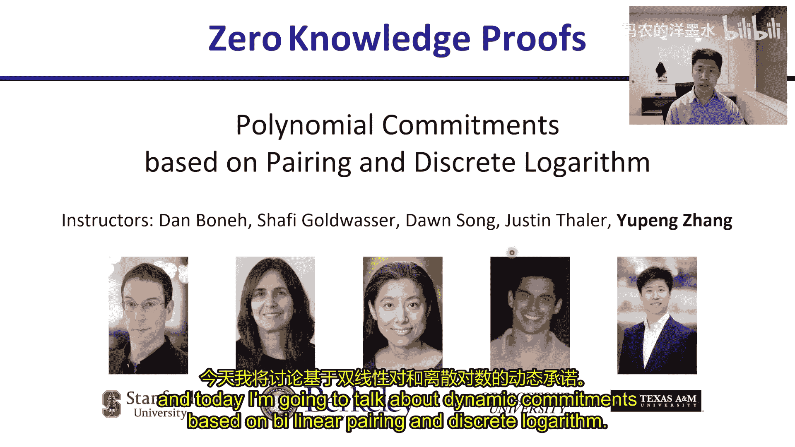
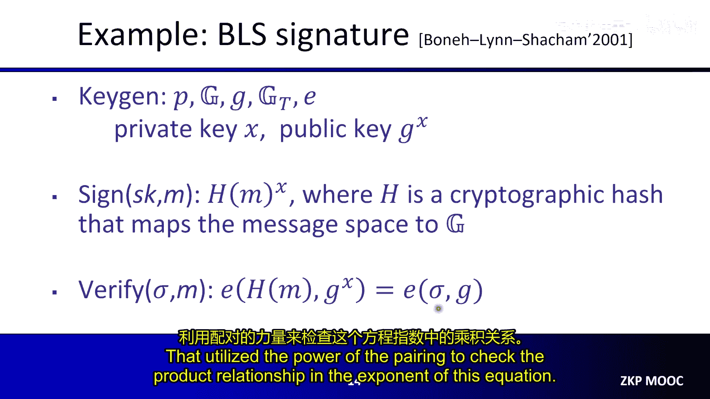
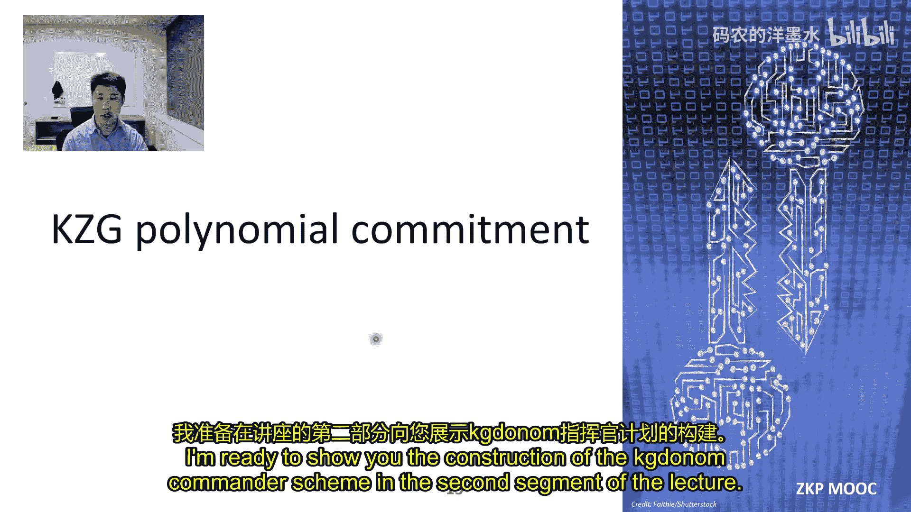
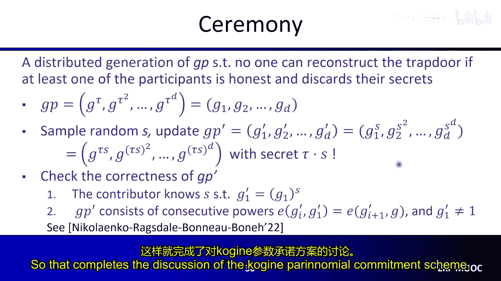
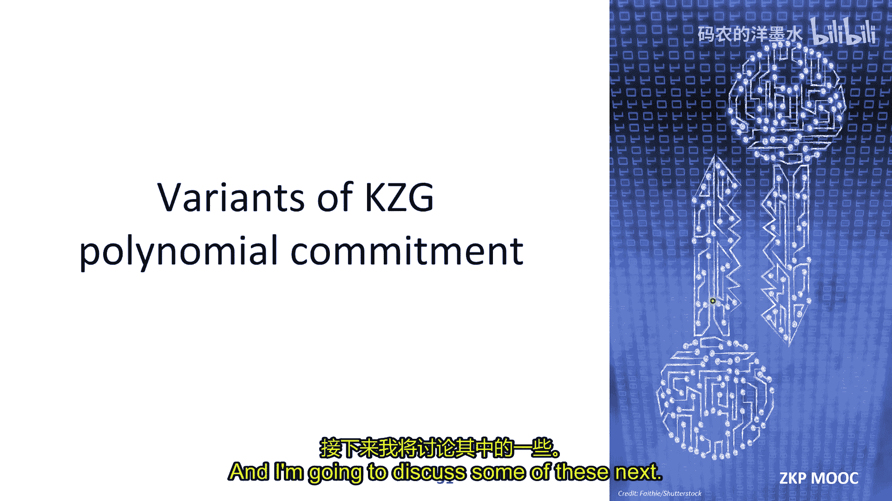
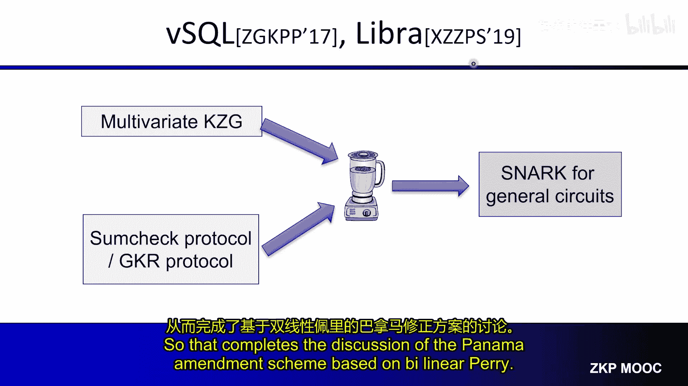
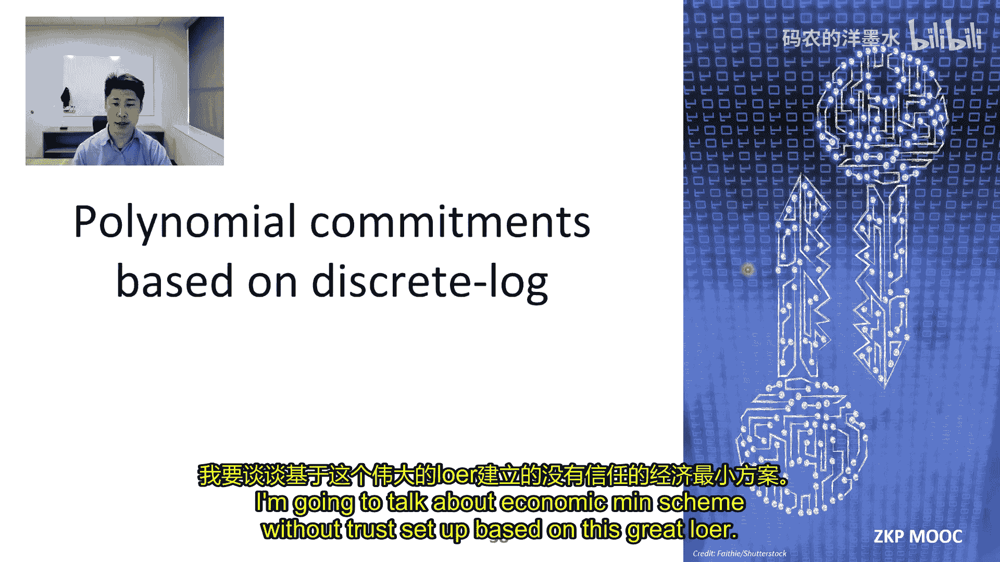
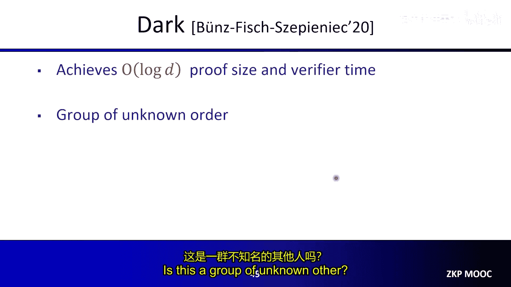
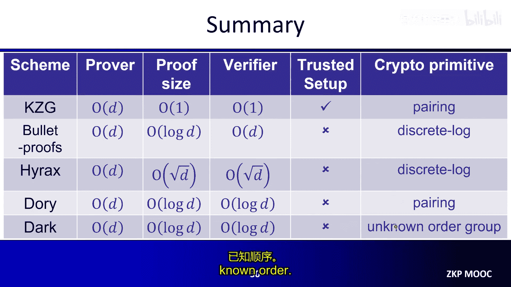
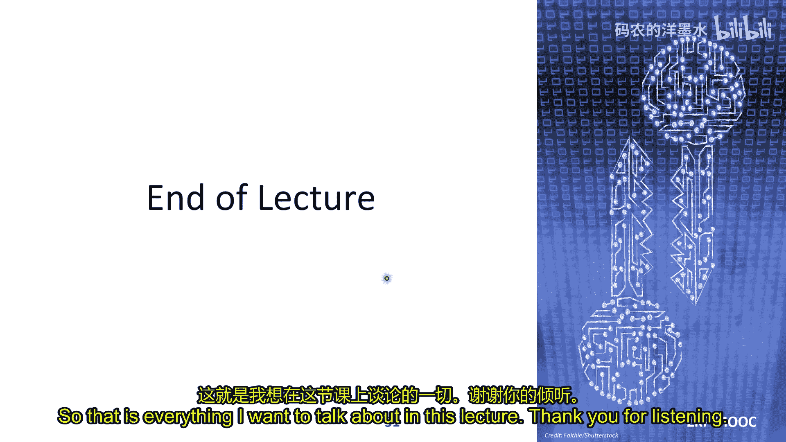

# 【全集】加州大学伯克利分校 Web3：零知识证明 区块链技术与隐私计算 中英字幕 1080P p06 Lecture 6 - 基于配对和离散对数的多项式承诺 -BV1bCrpB2E7Q_p6-

Hello everyone， welcome back to our course on zero knowledgeledge Group。

 I'm Yu Peng Zhang and today I'm going to talk about polynomic commitments based on bilinear pairing and discreteet logarith。

Recall that from previous lectures， we've learned that a common recipe to build an efficient srk system is this general paradigm in two steps。

We first design a proper interactive oracle proof such as a polynomial IOP。

 and then we can combine it with a polynomial commitment to build an efficient srk for certain evaluation。

In the last lecture， De has taught about the plan scheme where we can reduce the computation of a general circuit to several proof gas such as the polyno quality testing。

 product check， permutation check and so on。Combining the Plan IOP with a uniever panamial commitment。

 we will get an efficient srk for general circuits。Earlier in lecture4。

 Justin talked about interactive proofs and showed how to check the ced satisifiability using a classical Ssha protocol。

At the end of this protocol， the verifier has to evaluate a multi veron defined by the prove's witness at a single point。

And this is again realized by a multivari dynamic commitment scheme in order to get an efficient srk。

In today's lecture， Im going to formally present the constructions of Panoromic commitment schemes based on biline pairing and discrete logarm。

Combining them with the panamami as we learned before。

 we will eventually have the complete description of several efficient Snark schemes。So to start。

 what is a panyn commitment？It is again， a protocol between a proveer and verifier for a family of anonymous。

For example， Uni polynoms with degree less than or equal to B。

And the proveer has this pon in the family。And without sending it directly to the verifier。

 the poorer can commit to this through pan commitment。Later。

 the verifier can issue a query on the evaluation at this point U。

And the proveer replies with the value v and the proof pi。

 proving that v equals to the evaluation F of U， and at the same time F belongs to this family of pan。

More formal speaking， there are four algorithms of a pan commitment scheme。

Keygen can meet EL and verify。The Keyjan takes the description of this family of the polynomous and security parameter and outputs a set of global parameters。

It is also known as the public key or public parameters or common reference ring。

 but in this lecture I'm just going to use GP to represent it。Then given GP and the polynomial。

 the poorer can compute the commitment of this polynomial。And later at the evoion point， U。

 the poorer can call this。Evolve algorithm to output the evaluation B and App pi。And finally。

 the verifier can verify the correctness of this claim using GP， the commitment UV and pi。

 and output either accept or reject。The correctness of a panor commitment says that if the proveer is honest and follows all of these algorithms。

 then the verification always outputs accept。And I omit the formal definition here。Or interestingly。

 we want the scheme to be summed， meaning that the poorer should not be able to lie about this evaluation。

And here I'm showing the formal definition of a knowledge soundness。

It says that for every Pan time adversary， given the global parameters generated by Tgen。

If the ver can output a valid commitment evaluation and proof that pass the verification with probability 1。

 then there must exist an efficient extractor that uses a so that it can extract or pannomial F where f of U equals to V and Fx belongs to this family of pannomials with an overwhelming probability。

So that is the formal definition of knowledge soundness of Panonic commitments。

So in order to fully understand the construction of Ph commitments。

 there will be three segments of this lecture。So first I'm going to introduce a mathematical and cryptographic background on groups。

 discreterelo and bilinear pair。After that， I'm going to present the classical construction。

Of this KZG panormal commitment using bilinear pairing and also talk about this variant。Finally。

 in the last part。I will talk about Panam schemes。Without trust is set up。

 such as bullet proofs and also highlight some other schemes based on discrete logarithms。

 such as hierarchs， story， and dark。So let's start with some background。

The first thing on the D is a group。A group is a set of elements and an operation star。

That satisfy these four properties。And I think it's actually easier to walk through these properties with a concrete example that everyone knows。

 like integers and additions。As you can see here， closure means that given two elements in the integers。

 A and B， then a plus B should also be an integer， and this is clearly true for integers under addition。

Asociivity says that。Computing the result of A plus B and M plus C。

Should equal to a plus the result of B plus C， and this is also true for integers。

An identity means that there exists an identity element， such that。

E plus a equal to a plus e equals to a itself， and0 is the identity element for in under addition。

And finally， for every element in this set， there exists an inverse such that a plus b equals to0。

Again， for integers， this is taking the negative of the number。

So because of this integers under addition satisfy all of these four properties， so it forms a group。

And other groups。That people are familiar with include rational numbers， real numbers。

 complex numbers， and so forth。However， group views in crypttography are quite different。For example。

 a common group we use is positive integers moduleular prime number P under modification。

And the set is 1，2，3 all the way 2 p minus1， and this is the finite set。

And you can check that it actually satisfies all these four properties and thus form a multiplicative group。

Another common group we use is defined by lipid curves。

 but I'm not going to go into details in this lecture。

 and I will mainly use this example of the multi group moduleular P in this lecture。

So given the definition of a group， then for every group there exists， the concept of a generator。

So the generator is an element that can generate all elements in this screw by taking all powers of this element G。

For example， taking the Moicative group modular the prime number seven。The elements include 1，2，3，4。

5，6， and then we can actually take three as an example as an element。

 you can see here that if you take all the powers of three。And of course。

 the computation always done Mo 7。You can see that it iterates through all possible elements， 3，2，6。

545，1 in this group。So because of this， by the definition 3 is the generator of this multiplicative group of z7 star。

By the way， there usually exist multiple generators and they can be efficiently computed and sampled in practice。

With this definition of a generator， then the group G has an alternative representation as the powers of the generator G。

 You can write it as g to the 1 g to 2 all the way to G to the p minus1。

 This is because by the definition of the generator。This set its through all possible elements。

 so this is essentially the same set of the group in a different order。

Here note that in this lecture， I'm using the multiplicative notation where the operation of the group is multiplication and exponation means。

Repeating the modification multiple times。We call that in the last lecture done was using the additive notation where the base operation is addition。

Each of these two notation is convenient for different protocols and it's actually good for you to understand both notations。

But I will use the multid one in this lecture。So because of this alternative way of defining the group。

 then we can formal define a problem called discreted logarithm。

The problem is given an element y in this group， please find x such that a generator G to the power of x equals to y。

This is well defined for every because of this alternative representation。

 and the problem is analog to the logarithm computation in the continuous case。

 thus it is called discrete lock。So then let's see an example on。The multi group， more seven。

Please tell me what is x such that 3 to the x equals to 4 mode 7。Can you compute it now。Actually。

 you can't figure it out immediately and basically the naU solution is try out all possible act to see which one is true。

For this equation。And this suggests that this problem is actually hard to solve。

 and this is known as the famous discrilog assumption。

The assumption says that this disc problem is computationally hard。

And basically the EU solution is to try all possible elements in the group。

 which the complexity of which is a proportion to the size of the group and is computationally hard if the size is exponentially large。

And there are a better algorithms in practice that improves the running time a little bit。

 but still it's considered not in polynomial time。And by the way。

 this this assumption does not hold in all groups， but is's believed to hold in certain groups that are used in cryptography。

And also， quantum computers will actually solve this this grid luck problem in polynomial time。

 therefore。All all protocols based on the disclosurere assumption will not be postponum secure。

Another popular assumption that is highly related to the thisre assumption is called the DV Hema assumption。

 and here I'm presenting the version called computational DV HeM assumption。

It says given G to X and G to Y， you cannot compute G2 Xy efficiently。

 and it's also a fundamental assumption in cryptography。

And you can see here that clearly if you can solve thisreo problem。

 then you can compute x from G to X and y from G to y and then use them to compute G to Xy。

 So therefore this assumption is stronger than the discretere log assumption。

 but still it is believed to be hard in the groups we are using in cryptography。

With these definitions， I'm ready to present the。Importanted building block we are going to use called Bi linear parity。

So you know， bi linear pairing。In addition to the group G and the generator G。

 we also have a target group called GT and an operation called Perry， we use E to denote it。

The base group G and target group GT are both multid groups of order P。

 and G is the generator of the space group G。And the rule for the pairing operation is that it input it takes two elements in the base group as input。

P to the x and Q to the y， and after the pairing it gives you an element in the target group。

 which equals to E PQ to the power of Xy。So， basically， is。

Computing the product in the exponent of this equation。So again。

 to guess the familiar with that using an example。Given G to x and G to Y。

 the pairing of these two elements equals to EGG to the power of X Y。And by a similar rule。

 this also equals to。The pairing。Between G to the Xy and the generator G itself。

So this gets you away。That given G to the x and G to the y。

 you can actually check if some element H is G to the Xy or not without knowing x and y。

So basically this gives you a tool to verify the product relationship in the exponent of the computation。

 but not computing it， so know that using pairing you cannot break the computational Dfima assumption。

 you cannot compute G to X Y directly， but you can use pairing to check。If someone gives you。

The result of Gu X， Y， whether it is true or not。And again， for your information。

 not all groups in which this grid log is hard are believed to support efficient computable pairry。

 but some groups are especially those defined by lipid curves。

So a good example to get more familiar with this pairing operation is through this elegant design of a BLS signature。

 this was proposed by Benalin and Xia Chang in 2001。

So the key generation of this BA signature is very simple。

 the private key is just a random element x and the public key is G to the x by the discretere assumption given G to the x。

 it is hard to figure out the x， the secret key。You other to sign a message。

We are going to compute the hash of this message and then raise it to the power of x。

 where H is a cryptgraph hash function that maps the message space to the base group。

In order to verify the signature， note that everyone can actually compute H of them that is a public hash function。

But without knowing act。We cannot compute the hash of M raised to the power of X directly。

 so what can we do？Here comes the pairing operation。

 We can actually pair the H of M with G to the power of x， which is a public key。

 This is known by everyone。 And then check if it is the same as the pairing。

Of the signature and generator itself。If the signature is computed honestly as H of m to the power of x。

 then this verification will pass， so that's the correctness part。Off the Bs signature。For soundness。

 in the paper， it can be shown that if there exists an adversary that can forge signatures。

 then we can actually use the adversary to break the computational D assumption in this bi linear group。

 so therefore。This signature share scheme is secure。

So this shows you an example that utilized the power of the pairing to check the product relationship in the exponent of this equation。

With a background on the bilinear pairing， I'm ready to show you the construction of the KGG Panorama commitment scheme in the second segment of the lecture。

The KCG Panamama Me scheme was introduced by Catay Sevacha and Goberg in 2010。

 and the applications in the original paper include verifiable secret sharing and verifiable panorial delegations。

 but in recent years it has become a very important building block to construct the efficient srk systems in practice。

Recall that there are four algorithms for a Pan commitment scheme。

 we have a key generation that generates a set of global parameters。

 and then the prover called this commit algorithm to compute the commitment for a pannom app。

Later for an e point U， the proveer caused the above algorithm to compute evaluation together with the proof pi。

 and finally the verifier caused the ver algorithm to verify the correctness。Of the evaluation。

And we're going to go through the four algorithms of the KZG Panama commitment scheme one by one。

The scheme works on a bilinear group with a base group G， a target group GT and pairing Op E。

And the basic version works for the family of Uniiever polynoms with degree less than or equal to D。

 where D is a publicly known parameter。First， in the key generation algorithm。

 we are going to sample a random number tau in this finite field mode P and then we are going to use tau to compute this set of global parameters in particular we are going to raise G to the different powers of tau you have G G to the power of tau G to the power of tau square and so on all the way to G to the power of tau to the D。

Note that the size of these global parameters is linear in the maximum degree of the pan we want to support。

Intuitively speaking， since we are using a group in which discrete grid log problem is hard。

 no one should be able to compute tall given this set of global parameters。So in essence sense。

 Tau is hidden in the exponent of the generator G。After that。

 an important step of this key generation algorithm is that we have to。

Completely delete this secret key。 That is because interestingly。

 in the remaining part of the KC G Pan command scheme， we are not going to use this tool at all。

 It suffice us to use the global parameters to commit and generate the proof and to verify the evaluation。

And if anyone can have access to this。A secret keytao。

 then they can actually generate a fake proof to food verifier and to break security of this Pan community。

So it is very important to dis this talk after the key generation acronym。

 and this step is called the trustedsses setup。Because we have to trust this preprocessor to discard this toxic waste of Ta after the execution。

 and in practice this is not desirable for many applicationss because it is hard to find a trusted party to run this trusted setup up。

So given this set of global parameters。The way to commit to a pannoial is as follows First we are going to represent this panno in the form of the coefficients。

 we have F0 plus F1 x plus F2 x squared and so forth all the way to F D x to the power of D。

Then the commitment we are trying compute is simply G to the power of F evaluated that at the point tau。

And turns out the pool can actually compute it without accessing call directly。

You can actually compute it using the global parameters only that is because if you just expand the expression of f of tau。

 you get g to the power of50 plus f1 tau plus f2 tau squared and so on。

 and by the rules of exponentialonation。It equals to G raised to the power of f0 times g to the tau raised to the power of F1 times g to the tau square raised to the power of F2 and so on and so forth。

 and this is because basically the addition in exponent。

Is equivalent to multis in the base level and multis in the exponent is equivalent to exponents in the base level。

So in this way， we can compute the commitment using this equation and know that each of these elements in the parenttices is actually from the global parameters directly。

 So in this way， the poorer can actually raise。Each value。

In the global parameters to the corresponding degree defined by the coefficients。

Of the pan and get this commitment without using Ta directly。 So that's how we commit to。Aponm。

 I know the size of this commitment is only one。E in the base group of the bilingage group。

So after that， let's see how can we generate a proof for evaluation of this Pan F at point view。

The most important key idea of this KGP commitment is actually based on this pan equation。

Where for any panel F。Fx minus F of view can always be expressed as the product。

Offer two polynomials， x minus u times and another polynomial Q of x。

Where the degree of qx is d minus1。And it's actually not hard to see this relationship because。

U is clearly a root of this pannoial fx minus f of u this equals with0 at0 U。

 and because of this fact， then the pannomial fx minus f u can always be decomposed as x minus u timesq of x。

And there are other ways to prove the correctness of this equation， for example。

 using ta's expansion。So with this pan equation， then the idea of a KG p commitment is for the prover to compute this pan Q of x and then generate the proof pi equals to G raised to the power of Q evaluated at a point top。

Again， this computed using the global parameters only without assessing this tool。

And the proof size is only one element in the base group of the bivinier group。Finally。

 how can we verify the correctness of this evaluation？

Then the idea of this verification is to check this Pan equation at this secret point top。

In particular， what we are trying to check is G raised to the power of f tau minus f of u should equal to g to the power of tau minus u timesq tau。

 and this is basically replicating this pan equation in the exponent。At the point。

Paul substituting the variableable X。And here I'm listing what will happen if the prove is honest。

 Basically the prove is going to commit to G to the f of tau and the prove is G to the Q of poweru and the evaluation V is F of U。

 So given all of these values。We almost have all the information about this equation to check。

So on the left hand side。We have a G to the f of tau given by the prover and we have G to the F of U again given by the prover as the evaluation on the right hand side。

 the verifier knows the value point U， this is the public information and we have a G to the tau in the global parameters and the prover returns G to the Q of tau as the proof。

But unfortunately， we cannot compute G to the tau minus u times  Q of tau directly。

 This is because the verifier is only given G to the tau minus u and G to the Q of tau as the proof。

And by the computational Dfihamm assumption， it is actually hard to compute G to the power of tau minus s timesq tau given these two values。

So what can we do？But the solution is to use spyer Perry。

Rell that pairing gives you a way to check the product relationship in the exponent of the equation instead of computing it。

So with pairing instead of computing g to the tau minus u timesq of tau。

 they are going to check the correctness of this computation。In particular， we're going to pair。

A commitment divided by G to power of Bal B with the generator。And on the right hand side。

 we're going to check whether this is equal to the pairing of a g to tau minus U and prove itself。

And to see the correctness of this verification。If you substitute these commitments approved by the correct。

Evaluations provided by the on ruleer， we can see that the left hand side equals to E G G to the power of f of tau minus f of U because of the rule of the pair equation。

And on the right hand side， if pi is honestly computed。

 it should equal to G to the power of  Q of tau。 And then by the rule of bi linear pairing。

 the red hand side equals to E G G to the power of tau minus u times Q of ta。

 It's basically computing the product in the exponent。 And finally， because of this。Equation。

If the poor is honest。This equation pair equation should hold EG to the power of F tau minus f of U should equal to EG to the power of tau minus u times q of tau This is essentially checking this equation at to the secret point tau。

And that completes the description of this entire KZG Panama commitment scheme。Finally。

 to put it back to this。嗯。A slidel showing the interactions between the P and verifier in the key generation algorithm we are going to generate the global parameters as G to the tau all the way to G to the tau to the D and this is the trusted set up step。

And then for a panial F of X， the poorer can commit to it。

Using only the global parameters and compute G to the F power as a commitment。

Later for an evaluation point U， the puller computefuses this polynoomic equation。

 fx minus f of u equals to x minus u timesq of x。After figuring out Q of x。

 the prover computes this proof pi Sg to the power of Qtau， and finally。

 the verifier checks this panoral equation。In the exponent using the pairing operation。

And that is complete the description of the KZG Pan community。

Now we've explained the correctness of the KGG Panna commitment key。Namely， if the prove is honest。

 then the correct evaluation and the proof can always pass the verification because of the polynomial equation。

But what about sounds。Why can't the proveer return a wrong evaluation and fake proof and still pass the verification？

Well， the soundness of the scheme is actually based on so called Q strong bilinear DP harm assumption。

The assumption states that given the biline group and the global parameters。

 the tao Gtao squared all the way to G to the tao to D。

An a cannot compute this value E G G to the power of one over tau minus U for any constant。

And this is actually a variant of the disclosure assumption and the D assumption。From a name。

 we can actually。Tell that there is a rigorous reduction from this assumption to the computational DPHm assumption。

 which means that this assumption is strictly stronger than the computational DPH assumption。

 but still we believe that this assumption holds in the bilingual groups we use in cryptography。

So with this assumption。I'm going to show you the formal security proof of the KLG Pan commitment scheme。

 and this slide will be quite technical， but I'm going to go through it slowly step by step and I also think that it's really an elegant security proof ands a good place to show you a formal proof in crytography here。

The calmer approach to proof security in photography is by contradiction。In the first step。

 we suppose that there existent adversary that can return a wrong answer V star that is not equal to F of U。

And the fake proof but still passed the verification。Then by the equation。Of the verification。

 we have the pairing of the commitment divided by G to the V star and the generator G should equal to G to the power of tau minus U pair based。

 the fake proof pi star。 This is directly from。The equationian we check in the verification。

The next I'm going to cheat a little bit and write this commitment as G to the power of F of T for some panama F known by the anniversary。

And this is actually a big assumption because for just a randomly generated number as a commitment。

You cannot always write it as G to the F for some F known by the anniversaryver。

 and we need a socal knowledge assumption to really make it happen I'm going to explain it in detail later in the lecture。

So if you're good with this。Writing this commitment as the G to power of F of2。

 then the next step is the key idea of this security proof。

Because this V is different from the real evaluation F of U。

We are going to subtract F of view from this valuealing exponent and then add it back。

The purpose of doing this is that now in the exponent， we have F to minus F of U。

 which is the correct evaluation of this pan。Plus， a difference term。

Which we defined as delta equal to f of U minus v star。

 and note that this delta is non0 because V star is not equal to F of U。Because the pool is chilling。

So， then。Now we have the correct evaluation of a tau minus f of u in the exponent。

 this can be decomposed as tau minus u timesq of tau for the correct Q。In exponent。

 again by the Pan question I introduced earlier in the lecture。

And then by the rule of the bilinear pairing， we can try to extract these elements in the exponent and put it outside of the pairing。

 so the left hand side equals to EGG to the power of tau minus u timesq of tau plus this delta。

And on the right hand side。TheEG。E equal to E G pi star raised to the power of top minus。

That from this equation， we can see that。The twomb terms in the left hand side on the right hand side。

 they both have a common factor tau minus。So we can actually combine these two terms together。

By dividing this leading term in the front in both on both sides。

 we get E G G to the power of delta equals to this E G。

Pi star divided by E G U to the power of Q Tao。Together raised to the power of Tu minus u because they both have a common factor of tau minus U。

Then once we reach this step。You can roughly get the idea of how to break the Q strong bi linear DV assumption。

 right， So from both sides， we can actually raise them to the power of power minus U inverse。

And know that here I'm not saying that anyone knows this secret value tall minus U compute inverse。

 I'm merely stating the fact that if we do that， we have the following equation。

And in the following equation， on the left hand side。

 we have E G G to the power of deelta divided by tau minus。 This is almost the same as the。

Problem of the Q strong bi linear D helmet。Assumption。

 we are trying to compute this value on the right hand side equals to this value inside apprentices。

I know that the adversary can actually compute the rattan side with the global parameters only。

That is because this EG pi star is known by the attacker because he literally generated the fake proof。

And this EGG to the power of Q of Pao is also known by the adversary。

Because Q of color is the correct proof and you can't prevent the adversity compute from computing the correct proof。

So the adversary knows both of these values and compute the right hand side。

 which means that the adversary can use this contradiction， use this。

Fake proof to break the Q strong bilinear D helmet assumption。But。

Then we assume that this assumption is computational hard， which means that。

It is the contradiction the first step of this V star nadical death of U should not happen。

So that completes the entire security proof of the KGG economic commitment scheme。And。

If you can't follow the entire revision。Note that the key idea of this security proof is to decompose this fake value v star into the correct value F of U and a different delta。

And then we can actually extract the common factor of tall minus u in the exponent。 So that is the。

A most clever step of this security proof， in my opinion。

So after that we have actually a remaining part that is not solved yet so because in the security proof I actually made an assumption and so when we see this commitment F in the next step I actually write it as G to the power of F power for some F known by the prove known by the adversary。

And this is actually a very big assumption if the proveer just generate a random value and call it the commitmentant F。

 how can you make sure that the proveer actually knows this panial F locally？

And this is actually a hard to check， and this requires an additional assumption called knowledge of exponent assumption。

So this key idea of this assumption is saying that for this global parameters。

For the cases your economic commitment。We are going to sample another secret value alpha and compute G to the alpha G to the alpha tau G to the alpha tau square。

 and so forth all the way to G to the alpha tau to the power of B。Basically。

 we are raising each of the element in this global parameters。To another power of alpha。

 and we are going to include both as new global parameters。So now for every commitment。

 G the power of Atal。Using the second set of global parameters。

 B can also ask the prove compute G to the alpha times F of time。

And this is actually easy to do because we are just raising the corresponding element in the second set of the global parameters to the same coefficients of。

The panl F。So there is actually a one to one relationship between these two sets of global parameters。

So after that。In the verification， we are going to check an additional pairing equation。

So this equation is essentially checking the relationship between these two components of the commitment。

We are going to do the pairing of the commitment， the first commitment。There's G to the alpha。And。

Then we are going to check it against the pairing between this commitment prime with the generator。

And again， if this comp is computed honestly。Then you can always pass this verification because it is the product equation in the exponent and to11 I should equal to the right hand side。

And the assumption says that as long as you can pass this verification。

 there must exist an efficient extractor E that can extract a poly numberma F such that the commitment equals to G to the power of f ofta。

So this assumption directly solves the problem you are facing in the security proof。

Given the commitment that。We don't know how to express it as g to a power5 of tau。

 then by this assumption， if you perform an additional communum con prime and an additional check using pairing。

 then their existing structure to extract G to the f of tau。So that is the knowledge assumption。

With the knowledge assumption， you can actually solve this problem and get a real polynomial community scheme that satisfies knowledge sums。

So based in the key generation algorithm， we are going to generate two sets of public parametersers G to the power of tau。

 tau square and tau to D， and G to the alpha g to the alpha tau。

 g to the alpha tau squared and so forth。And for each commitment， it consists of two parts。

 G to the f of tau and g to the alpha f of tau。And to verify the correctness of evaluation。

 in addition to this pairing equation to check the polynomial equation。

 we also check that the pairing of comm and G to the alpha equals to the pairing of comm prime and the generator G。

And by the knowledge assumption in the very first step of the security proof。

 we can extract F such that。The commitment equals to G to the power of F toweru by the knowledge assumption。

And that solved the problem of the security proof and gives you the final complete proof of the knowledge assignments。

But then a problem of this knowledge song is assumption is that。

It actually introduce an overhead in the commitment size and the verifyifier time。

So now the comm becomes two elements in the base group and verifier becomes a two pairing equations to check。

 so it basically doubles the cost of this scheme。So in order to further improve this apart。

 we can also prove the security in a model called generic group model， G GM。So in GGM。

 informally speaking， the adversary is only given an oracle to compute the group operations。

What it means that。Given a set of global parameters。

The adversary can only compute their linear combinations in order to get another。

A group element in the base group。 There is no other way for the adversary to， for example。

 sample random point and it happens to be another。Element in the base group。Because of this model。

 we can actually use the GGN to replace the knowledge of exponent assumption and reduce the commitment size to one element and also the verifier time to one pair equation to check。

And this GGM is again a stronger model to work with。

 but is also believed to be reasonable because it captures all known attacks against the discre assumptions or Dho assumptions and the family。

 So that is why。It is reasonable to use this to prove security in our case。

And here is really an informal description of this GGM model。

 and please see the book by Dan and Victor for more details about the GGM model。So with all of that。

 finally， we end up with this KCG panomic amendment scheme that is correct and knowledge sound。

And in the GGM model and so to remind you again， we have this global parameters and the poor commit the pan as G to the power of F tallu and in order to prove an evaluation。

We compute this quotient pan fx minus f of U divided by x minus u。

And the proof is G to the power of Q of tall and ver our checklist using a pair equation。So finally。

 let's look at the properties of this KGG pannomial commitment scheme。

So in the key generation algorithm as we discussed， it requires a tro setup up。

 someone has to pick this secret key， generate the global parameters and remove this secret k completely。

 otherwise the security will be broken。And the commit takes all of the group exponations。

Computing to compute G to power of F tallu， given the global parameters。

 and the size of the commitment is constant， is only one group element in the base group。

And the evaluation algorithm， the complexity of that is again out of D group exps to compute d to the power of Q of time and know that this panorialq of X can be computed efficiently in linear time using just a simple long division。

 you don't have to use complicated panor divisions to do that。And。

The proof size is only one group element out of one。

 and very time is only one pair equation to check。So that is why the Kon movement is actually a。

Very efficient in practice with very small proof size and fast veryifier time。

 but the only drawback is that requires a trusted setup in the key generation algorithm。

SoAnother thing we want to mention is that in order to somehow relax this try to set up assumption practice。

 there is a process called ceremony。The goal of the ceremony is to have a distributed generation of the global parameters so that no one can actually reconstruct this trap or tall if at least one of the participants is honest and discards their secret。

So leslie， how can we do that Well， the actually the。

The idea is very simple because of this nice structure of the global parameters。

We call that global parameters is G raised to the different powers of Tau。

 and we just call a running global parameters。A generated by one party as G1 G2 all the way to G to G D。

So then。If we receive this global parameters from another party， there is a way to introduce。

An additional part of the randomness called S and out this GP prime into a new set of global parameters。

And update is very simple。 We are going to raise each element of this。Existing global parameters。

 G1 G2 GD to the corresponding powers of S。We compute G1 to the S G to the that square all the way to G D to the S to the B。

And if you just write down this equation formally。You can see that E GPp is honestly computed。

Then this set of global parameters becomes。G to the tau S， G to the tau S together square。

 and then all the way to G to tau S together to the power of D。

Which means that this new set of global parameters is actually。

Equent to generating it using the secret tower times as from bidding。

So this gives you a sense that if everyone is honest。

 then they can still form the correct generation of the global parameters using the product of all the secrets from all the parties。

So finally， there are some additional steps to check that this GP prime is indeed correctly generated。

In case that someone is malicious， we don't want them to ruin these entire global parameters。

And there are two steps to check the correctness。 So first of all。

 the contributor has to generate the proof。Proving that。

He or she knows as such that G1 prime equals to G1 to the power of S。Indeed。

 you are introducing some valid secret S from G1 to G1 prime instead of discarding the existing global parameters and generate GP prime from scratch。

 and this one can be done efficiently using， for example， Sigma Pro。

And another check we need to do is that R computation GP prime should have the form of consecutive powers of this generator race to this new secret。

 and this can actually be checked efficiently using pairry there's a simple check it can actually do the pairing between GI prime and G1 prime and that equal to G plus1 prime and G for I equals to a zero out to d minus1。

And this shows that after the update， we still have a valid global parameters with this relationship and also another thing we need to pay attention to is that we can't just remove the secret and change it to zero so in order to prevent that we have to check that G1 prime is not equal to zero。

And this nice way of doing the ceremony。Was actually introduced in this paper in 2022。

So that completes with the discussion of the KCG Pannomial commitments scheme。

As we've seen so far， the KZ economicomic commitment has this simple and nice algebraic structure。

 and that's why it has led to many variants in the literature and I'm going to discuss some of these variants next。

The first extension is to the multivari case， and the scheme was proposed by Paumento X and Tamaia in the paper in 2013。

And here I'm showing you an example of a multivari polynomial with K variables and spatial can be expressed as a disseation of all these monoials generated by these variables times the corresponding coefficients。

And the key idea to build a multivari pandemic community scheme is based on this pan equation。

So for every multivari pannoial， Fx1 to xk minus F1 to UK。

 the evaluation at this point can always be expressed as the summation of x minus I minus Ui times QiX。

From I equal to one all the way K。And here QIX is again， a multivarion。

It's actually not straightforward to prove this equation， but I refer you to the。

Original paper for a formal proof of this equation。And based on this polyormial equation。

 then in the key generation， instead of sampling。One， a secret key tau。

 we are going to sample K secret keys， tau 1 and all the way to talkque。

 and basically each tau is representing the one variable in this multivari pan。

Then we are going to compute the global parameters as G risk to all possible monomials generated by Tao1 all the way to Toe。

And for example， as Justin discussed in lecture4， for multiline polyials。

 there are in total to the pair of Kmonials。A generated by all the variables。

Then with this public parameter， the commitment is very straightforward。

 we are still computing G to the power of F tau where tau now is a vector tau 12 tau k and again this can be computed using the globe parameters only。

The poor is raising each element of the global parameters to the corresponding coefficient of the pan and multiply them together to get the commitment。

Next， in order to compute the proof， the prove is going to evaluate this phenomenon at this point U1 to UK and invoke this equation to compute QIX for OI。

Then the proof consists of a multiple。Elements。P I equal to G to the power of Q， I。

Evalu it at the point top here。For i equals to one all the way to k。And finally。

 to verify the correctness of this evaluation， we are again checking this equation in the exponent using by N Perry。

On the left hand side is exactly same as the Uni case。

 We are computing the pairing between the commitment divided by G to B V with。The generator itself。

On the right hand side， we have multiple pairings， so the verifier is computing the pairing between g to the power of tau I minus Ui and pi I。

 and then multiply all of them together from I equals to1 out k。And if you do the derivation。

 this is essentially checking this equation。At point， Tao I。In the exponent。And。For a similar reason。

 this scheme is correct and can be proved sound under the same assumptions。

And in terms of efficiency， the commitment and the evaluation has the same complexity as before。

 assuming that the n is the total size of this polynomial。

 then both of them are out of N groups exponentialations。

The scheme does introduce an overhead on the proof size and verifyifier time。

 so now the proof size becomes order of K， which is order of a login， for example。

 for multi linear polynomial and the same applies to the verifier time。

So this is the scheme for multivert pnomial commitment。The second extension I will to introduce is。

A way to achieve your knowledge。And I refer you to see lecture one for the formal definition of zero knowledge。

In the case of a pandemic commitment， essentially geology is saying that there exists a simulator。

Without knowing the pannoial， the simulatorulator can actually simulate the view。

Of the verifier and generate this proof， and that is indistinguishable from a real execution with the p。

And turns out this plain AG is not zero knowledge。And the simple way to see it is that this commitment equals to G to the power of Fileu is actually deterministic。

Although you cannot reconstruct FO directly from the commitment。

 you can actually do some testing for this economy。For example， we can assume that。

Is the pannomial a zero pannomial， or if that is true， then G to the f of tau。

Must be equal to g to the power of 0， which equals to1。

 and you can actually check whether the commitment is one or not。

 and that tells you whether the polynomial is all zero or not， and in general。

 you can make any hypothesis about whether a polynomial is of certain form and then compute the corresponding commitment and check that if it's the same as a real commitment。

So in this way， you can actually learn some information about。This。A secret pan。

 so that is why this scheme is not zero knowledge and the key reason is that this commitment is deterministic and can be computed by anyone。

So the key idea to make it zero knowledge is to mask both commitment and proof with some randomizers。

 and here I'm showing you a scheme from my paper with my authors in 2018。

So the key idea of this scheme is。That instead of committing to G to the power5 of tau。

 you are going to add a randomr term。 That is R times Eta。

 where R is a random number chosen by the prover， and Eta is actually。

Another secret key sampled by the preprocessor in the trusted setup。

 and of course we also need to include G to the Eta in the public parameters。

 but Ill only the step in this informal description。

And then to generate the proof instead of doing the regular decomposition， Fx minus F of U。

They're going to do a randomized decomposition。You see here that on the left hand side we have an additional term r times y which is actually from this randomizer of the commitment。

 and here we are replacing Eta with a variable y。And on the right hand side。

 instead of doing x minus u timesq of x， we are going to do x minus u timesq of x plus r prime times y。

 where our prime is another randomizer sampled by the prover to mask this proof。

And then if you expand this modification， you will see that this is the remaining term and all of them have this common factor y。

 so we can write it as y times r minus r prime times x minus U。With this decomposition。

 we can actually generate the proof pi consisting of two elements。

The first element is G to the power of Q tau plus R prime Eta。

 which is essentially evaluating this panomial inside the first premise at point tau substing x and the Eta substing y。

And the second element is G to per r minus our prime times tau minus u。

 and essentially from the second preary apprentices。And then we can check the。

This relationship of the randomized composition with the pairing。

Equation to check the product in the exponent。And this is how we achieve zero knowledge。

For the KZ pandemic commitment scheme。And。Another interesting thing to think about is that actually this scheme is almost equivalent。

To。Generalizing the Univer KG Pan image scheme to the bivariate case。We are essentially adding。

An additional variable， Y。So that we can actually use this term to randomize both the commitment and the proof。

And for a correct evaluation of F of U， we are essentially evaluating this by very panomial at a point U comma 0 where0 is for the variable y。

And in this way， we can achieve zero knowledge。So finally。

 the last variant I want to introduce is the badge opening。So the first version。

 I want to start from a single pan where there is a。One pan hold by the provever F。

And the prove wants to convince the verifier that the evaluation of F at multiple points you won all the way to UM for M that is smaller than DVD。

Because if it's lower than D， then you can reconstruct the pnom。In the first place。So。

The key idea to generate a short proof for this multiple evaluations。

Is that we can actually extrapolate the evaluations F1， F2 order to FUM to get a polynomial H of X。

The property of this H of x is that HU1 should equal to FU1 HU2 should equal to FU2 and so on and so forth。

 and HUM should equal to FUN， and there exists a unique pnoial of Hx of degree M with such a property。

Ive be the leading coefficient one。So with such。A per number h of x， then we have a new equation。

Here。F x minus h of x equals to the product of x minus Ui for i equals to 1 to n times the quotient pan  Qx。

Why is that again， we can check。The roots of this Pan on the left hand side。If you take。

Evaluate this Pan at U1， then because of the property of H of x。F1 equals to H1。

 so the left hand side is 0 at0 u1。For a similar reason。It is also zero at U2， U3， all the way to UN。

So because of that， you want you to。And U3 and Nor way to UM are all roots of this polynomial f x minus H of x。

 And because of that， it can always be decomposed as this product times the quotient pannoial Q of x。

So then we are going to compute the proof pi asg to the power Qta as in the regular case with one opening。

And note that this is only a single element in the base group for multiple evaluations。Finally。

 we can check this panormal equation。At point tao using the pairing again。So on the left hand side。

 we are going to compute the pairing。Between the commitment divided by G to the h of tau and the generator itself。

 and the verifier is able to compute this G to the h of tau using the global parameters。

On the right hand side。We are going to compute the pairing between g to the power of the product of tau minus Ui。

Again， the verifier can compute it using the panormal interpolation and global parameters。

 and then we're going to do the pairing between this one and apply itself。And if the poor is honest。

 then this equation should hold because of this polynomial relationship。

And we can prove the soundness。In a similar way and reduce it to the strong biline TV H assumption。

 So in this way。For multiple evaluations M evaluations， the proof is still a single。Element。

But know that the verify time is actually order of M grows linearly in the number of evaluations。

And finally， in an extended version， which was actually left as a homework in the previous lecture by Dan。

 there exists a batch opening protocol for multiple evaluations of multiple polynomials and multiple evaluations。

 So now in the most general case， the proveer commits to multiple polynomials F I X for I equals to n for I belongs to n The set。

And and then the prove wants to prove that FI UI J equals to VIJ for J belongs to the set of M。

And the key idea is。Kind of similar to the a single pan case。For every pan F I。

 we are going to extrapolate F I U1， F， Y， I U 2 and missing us index here F I U M to get H I X for I in。

Then。For the similar reason， we have a polyno equation for every poly F I X M minus H I X equals to。

The product of x minus UIM。Times Q I X。So we are going to have a QIX for each polynomial fi。

 and then we can combine all of these QIX via a random linear combination and compute G to the power of that polynomial。

 which is only a single element in the proof。And then the verifier can actually reproduce all of these equations in the exponent using the public parameters。

And then check this equation using biline pair。 So in this way。

 we can actually batch the multiple evaluations of multiple polynomials into a single proof。

So that's all the variants I want to discuss about the KGG economic scheme。

So going all the way back to the general purpose snarks with these variants of KGG pan commitments we can actually construct snarks based on these pan IOPs。

 For example， using the planck system， we can combine this Planck pan IOP with the Uniever KZG pan commit scheme to get a snark for general circuits。

 and this is the executive construction proposed by the planck paper。

And in terms of interactive proofs， there are actually several papers proposing these constructions so we can actually combine a sumche protocol or a variant called the GKR protocol for layered arithmetic circuits with a multivariate version of the KGG Pan commitment and that leads to an efficient snark for the computation of circuits。

 and this idea was used in the systems called Bico and later in Libra in these two papers。

So that completes the discussion of the Pan commitment scheme based on bilineal pairing。

And in the next segment， I'm going to talk about other pandemic events schemes based on this real algorithm。

Welcome back to the last segment of this lecture In this segment I'm going to talk about dynamic minimum scheme without trusses set up based on discrete logarithm。

Recall that the KZG Panmic commitment scheme has very impressive performance in practice。

Both commitment and proof size are only order of one。 It's a one group group element each。

 and very time is only one pairing equation。But the main drawback of this Pama Community scheme is that requires a trust setup to generate global parameters。

And of course， the ceremony process relaxes trust a little bit and is actually good for many education in practice。

 but still this trust setup is a fundamental problem to solve。So in recent years。

 there has been a main focus to construct。Efficient。

 transparent serological schemes without trust set up。And in this lecture。

 I'm going to talk about the scheme based on a bulletproof。

 which was proposed by Buddo Ado in 2016 and later refined by Boons Ado in 2018。

And in the original bullet paper， they proposed an inner product argument and has a special protocol for range proofs and also can be generalized to proofs for a general alphathmetic circuit。

But here I'm just going to rephrase this bullet protocol as a panormama commitment。

Because it can still show the key idea of this bulletproof reduction。

 but it will significantly simplify the protocol。So in this scheme。

The key generation is actually very simple。 We're just going to sample the global parameters as a D plus one random elements in this group。

Without theres no trap door or secret key in this setup process。

 so that is why we call it a transparent setup。I know that the size of this global parametermeter in the construction of bulletproof is still linear in the degree of the p。

With these global parameters， the commitment of a scheme is also。very simple。 So again。

 given a panorama f x equals to f0 plus f1 x plus f 2 x squared and so on all the way to F D times x to the D。

 the commitment。Is simply G0 to F0 times G1 to F1 times G2 to F2， and other the way to G D to F D。

 So basically we are still raising each element of the global parameters。

To the corresponding coefficient of this phenomenon and then multiply them together to get a constant size commitment。

And for those who are familiar with the Peterson commitment。

 you can see this is actually the standard commitment scheme for the vector version of the Peterson commitment and here I'm omitting the random term of the Peterson commitment but it is actually not hard to just add a term H to the R at the end and all the protocols should follow。

So with this commitment， I'm going to first describe the high level idea of this bulletproof reduction。

So。When the verifier picks an e point U， the proveer replies with this V as the evaluation of this panom at point U。

 and here I'm using example of a degree 3 pannoial。

 which equals to f0 plus f1x plus f2 x squared plus f3x to the 3。And clearly， the evaluation。

s equal to this equation if the prove is honest。And the key idea of this bulletproof reduction is to actually reduce this claim of。

Evalution V at point U for the Pammial inside this commitment。To a new claim。

About the new p of only half of the sites。So through a reduction。

 we want to reduce this original pan of degree 3 to a new p of degree only one with two coefficients at 0 prime plus F1 prime x。

And then we can somehow compute the commitment of this new pnomial as comp prime。

There's some new basis G0 prime2 F0 prime times G1 prime2 F1 prime。

 and also a new claim about the evaluation V prime。For the new Pan at point view。And。

If you can do this， then the verifier will receive a new instance of this panial commitment for a pan of degree only。

Half。Then we can just keep doing this recursively to reduce the new instance to another pnom of degree only D over 4 and D over 8 and all the way to a constant degree pno。

And finally， if we don't care about the zero knowledge for the time being。

 then in the last round approval can just send this constant size pan to the ver directly and the verifier opens the panial。

And checks that the evaluation of the last round is indeed true。

And that completes the entire reduction and guarantees that the original evaluation of this v for this polynomial of De3 is actually correct。

So that is the height of idea of this bulletproof。But the main challenge of this reduction is。

How can we go from this original panomial to a new pannoial of half of the size？

We have to check the relationship between these two kinds。

 you can't let the proveer just to commit randomly to a new commitment without any relationship before and then commit to a new evaluation V prime。

Then the poorer can just cheat。And the lie about the original evaluation because there is no relationship between V and V prime and comm and co prime。

So。A major challenge and the the problem we are going to see next is how can we establish such a connection between the audience in and the new instance？

So。Here I'm listing the global parameters as G0， G1， G2 and G3。And。

A common way to reduce the p to half of the size is to actually decompose it to two parts。

And the way I'm doing here is we're going to have a left part of the panami and the right part of the pan。

And here you can see that I'm defining VL as F0 plus F1 U。

Which is from the first half of the coefficients of the original pan Fx。And similarly。

 we have VR equals to f2 plus F3 U， which is from the second half of the pm。

 know that I'm restricting the degree of both polynomials as only one half of the original p。

So with these two values， it's not hard to see that the original evaluation v should equal to VL plus VR times u square。

So that gives you a way to check the correctness of this VR and VR。After that。

Another quite common approach to reduce the original p to a new p of only half of the size is through random linear combination。

So now we have two parts of the final， first half and second half。

 Then the verifier picks a random number R and send it to the pooler。 and the pooler is going to。

Combine these two panamis。By multiplying r times the first half plus the second half。

And the result of that is this new pan of only two elements。The this。

New panammial F0 prime simply equal to r times F0 plus F2。And F1 prime equals to r times F1 plus F3。

So in this way， we reduce the original panome of degree 3 to a new pan of degree 1 that is only of half of the size。

Then with this new reduction， it's not hard to see that the evaluation of this new pial at point U should equal to r times VL plus Vr。

And this is the new claim V prime。The verar is trying to check。So in this way。

 I show you a simple approach to reduce this panomial to。A new p of only half of the size。

And at the same time。The verifier has already checked the claim about the relationship between the new evaluation V prime and old evaluation V through this two parts of VL and VR。

So the only remaining challenge is to。Generate the commitment of this new phenomenon。

But turns out this step is quite challenging because given this new polynomial。

You can't let the provevers to compute。The same Peters commitment using the same basis， for example。

 if you ask the prove commit G0 to this first term and G1 to the second term。

 there is no way for the verifier to check that this new commitment is indeed computed from the vectors in this old commitment co F。

That is because now we have a transparent setup， we don't know the relationship between these different bases。

And we can't compute computations in exponent across these different bases。

So in order to address this issue， here is the clever design of this bulletproof protocol。

So in addition to this VL and VR， in the same round， we are going to ask the prove。To send。

Two more commitments。And the first one is G2 to f0 times G3 to F1。

 and the second one G0 to f2 times G1 to F3。So intuitive speaking。

This is the commitment to the first half of the Pan。

 and this is commitment to the second half of the Pan。That's what I named it I and R。

But interestingly。The bases are different。We are using G2 and G3 to commit to the first half and G0 and G1 to commit to the second half。

 So it's kind of a cross term。For this to compute these commitments。

 were using the second half of thes to commit to the first half of the polynomial。

 and then we use the first half thes to commit to the second half of the polynom。So that is L and R。

 again， both of them are only one element in the group。So with L and R。

 turns out the verifier is able to reduce this old commitment comm F to a new commitment for this new p。

And。How can she do that through this magical equation？

The verifier is going to compute con prime as L to the power of this random R times the original commitment times r to the power of a small R inverse。

And with that， we claim that。This commitment is actually for this new pan and they're a new。

Global pros。Why is that now I'm going to explain this magical computation。In this slide。

So here I'm listing the information received from the proveer， if the proveer is honest。

 so the original commitment。Is this G 0，2 F 0， G12， F1 and so forth。

 And the left part is the cross term for the first half。 and R is the。

cross term commitment for the second half。And the verifier is computings comp prime as L to the R times。

 the old commitment times r to the small R emverse。So what is this computation？

But then let's just expand it term by term。So first， let's see what's happening for this space G0。

So in this equation。The second term Kong has this a term G0 to F0， so we are going to write it here。

And R contains the term G0 to f2。And then we raise it to the power of our small inverse so that gives us our inverse times F2。

 and there's no term inside this commitment L with base G0。

So the result of this computation gives you G0 to F 0 plus r inverse times at 2。

On top of the base of G0。Similarly， let's take a look at G2。From the commitment L。

 there is a G2 to the power of F0。And when we raise it to the power of small R。

 that gives G2 to r times F0。And from the old commitment， we have G2 to act。

And we don't have anything。With the base G2 in the commitment R。

So in sum that gives us G2 to the power of r times F0 plus F2。

And then we can do the devation again for the basiss G1 and G3。But again， G1。

 you have this G1 F1 from the commitment and a G1 F。

3 from the R part and raise it to small R inverse。 So we have G1 F1 plus R inverse times F3。

And finally， for G3， you have this G3 f3 from the commitment and G3 to the F1 times R from the L part of the commitment。

So。All I'm saying is that。It looks complicated to expand everything and figure it out。

 but there's no magical math involved， you just do it step by step for every basis and you end up with this equation。

As the new commitment comp。嗯。Then with that， the interesting observation is we can actually extract a common factor from the exponent of G0 and G2。

And this common factor happens to be r times F0 plus F2。

Clearly you have this factor from in the exponent of G2， so you end up this G2 in apprentices。

found the exponent of g zero if you。Extract this R inverse out。

 then the remaining term equals to R times F0 plus F 2。That is why it also has a common factor。

 r times f0 plus f2， and the remaining term in apprenesis is G0 raised to the power of R inverse。

Similarly， we can do the same thing for the base of G1 and G3。

 and the second part of the new commitment equals to G1 to the power of r inverse times G3 together rise to the power of r times F1 plus F3。

And recall that this is exactly the new。Plynomial， were trying to reduce to。

When the new polynomial contains two coefficients， the first coefficient is exactly this R F0 plus F2。

 and second coefficient is r times f1 plus F3。So that is saying。After this computation。

 the ver ends up with a new commitment。And this is again the same as the Peterson commitment。

 and exponent is actually from the new Pnomial。And。Bass are from these two numbers in the premises。

So we have to update this global parameters as g0 to the r inverse times G2 and g1 to the r inverse times G3 and combine them together So in this way we have a new global parameters or new set of base of only half of the size。

 and this con prime is exactly the commitment of this new polynomial using this new basis。

So that solves the problem of establishing a connection from the old commitment to a new commitment。

 with the help of these two values L andR。So going back to the original picture that completes the description of one step of this reduction。

So in each round， the per can actually send VLVR as the evaluations of first half and second half。

And L and R as the cross commit term commitments of the first half and second half。

 and verifier can update the commitment at this equation and derive the new basis as。

This equation and computes the new claim。Of the evaluation v prime as R time Vl plus VR See in this way。

They can reduce the original。Polynomial and evaluation to a new polynomial and of only half of the size。

And note here that another point on the highlight is someone may be familiar with， for example。

 the standard FFT reduction， which actually decompose the panommial as the odd terms odd coefficients and even coefficients and I believe its actually still working。

You can actually decompose it as odd and even instead of the left part and right part。

 and the same protocol should still follow for this Pan commitment based on bulletproof。So， with。

This protocol of the reduction here， we can actually generalize it to a polynomial of any degree D。

So。With the commitment of that pnomum， the job on the poor side is to compute this。L， R， V L。

 and VR E de。And then the query receives the randomness from the verifier and reduces panama f to f prime of degree only d over 2 and here to be precise。

 I'm actually assuming that the degree d plus1 should be a power of 2。

 so after reduction degree should be d minus1 over 2 or something like that。

 but this is not that important and just a corner case。And after that。

 the proveer should update the basis from the original global primary GP to GP prime using equation I explained before。

On the ver side， the ver receives。Two new claims， VL and VR first。

She has to check that they are consistent with the original claim。The evaluation B。

And then the verifier generates this randomly and updates commitment as this equation updates the global parameters and also updates the。

Claim of the B prime as R time VL plus meR。And after that。

 they're going to do a recursion for logD times to further reduce degree to D or4。

 D or8 and all the way to a constant plan。And to complete this entire particle in the last round。

 the poorer simply sends this conized pan to the verifier。

 the verifier checks it against the commitment， checks that the evaluation the loss round is correct。

 which completes the entire reduction of this bulletproof。

 and guarantees that the original evaluation of this pan of degree D is actually correct。

So that is the complete description of this Panorammic commitment scheme based on bulletproofs。

And here I won't go into the details the sound is proof of this bulletproof。

 but roughly speaking you're using this random inner combinations to actually combine two claims about the left part and the right part into one claim。

Of only half of the size。 I refer you to the original paper for more details about the security。

So finally， let's take a look at the properties of this bullet。So in the key generation。

 there's no trapor or toxic waste， the setup is transparent and the size of the global parameters is linear in the degree of the pan。

 so this is solves the problem of the KGG p commitment。To commit to a polynomial。

 it also takes all of the group exps and the commitment gain of size constant one element in the group。

And to generate the proof， it takes only order of P group exponentialons because it is a recursive reduction。

 And every time you cut the size of the phenomenon to half。 So in total， the complexity。

Remains linear in the degree of the pandemic。And the version I described before is actually interactive between the proven and verifier。

 and you can actually。OfMaking non interactive we are the fear of Shair transformation。And。

In addition， the proof size is only order of Loy because in every round。

 the prove is only sending a constant number of elements to the verifier。Remember。

 there's the LR and BL and VR four elements in total in the version un' described。And finally。

One of the main drawback of this product based on bulletproof。Its this verified time。

The verifier time is actually linear in the degree of this phenomenon。

 and that is because recall in the description of this protocol， the verifier has also to。

Update these global parameters by combining。Two bases into one using this random number R and the complexity of this step is actually linear。

 which is the same as the complexity as of the prover。

So that is why the ver part time is actually quite slow in practice。

Using this version of the Pan commitment based on voting groups。So in order to further improve。

The properties of the bulletproofs， There has has been other polyy schemes based on discrete logarithm in the literature。

 And I don't have time to go into details of this。Protocols。

 but here I'm just going to highlight the key improvements and the key ideas in these schemes。

So the first scheme I want to mention is this hierarchs proposed by Wabiar in 2018。So in this paper。

 they propose。Another pan scheme that improves the verifier time from linear to only square rootity。

And the key idea is to represent the coefficients of this panm as a 2D matrix。

Then you can actually commit to this matrix rowwise and then do a reduction column wise to get the final answer of the Pan evaluation。

And with this approach， the。Proof size and birdfa time are only linear in one dimension of the matrix。

So in this way， we can achieve a proof size of a squareity and a verify time of squareity。And。

Also in the paper， there is actually a flexible way to choose these parameters。 for example。

 the proof size can be fully reduced to the n root of D with the cost of verifier increasing to D to the power of 1 minus1 over1。

 so essentially the product of these two has to be linear in D。

So that is the panor commitment in the Hex paper。Another very important paper for Panmic commitment is called Dory proposed by Lee in 2021。

 and this is a very nice improvement over the Pan commitment scheme based on bulletproofs。

 and the key contribution is to further improve the very time to only order of Lock。

Without any symptomotic overhead on other parts。And the key idea of this story paper is to delegate the verifiers computation to the prover site。

Recored the verifier has to update this basis to generate a new set of global parameters by combining。

Two elements in the old global parameters， and this is a very well structured computation You always take two elements from the global parameters that are publicly known and well structured and combine them with using the random numbers chosen by the verifier。

And using the approach called inner pairing product arguments proposed by this paper。

A Dory is able to delegate this computation of the verifier to the prove side。

 and the time to verify this step of computation is reduced to only order of lockly。

So with this approach， the verifier time is subineard。In in the Pan commitment。

Another improvement to highlight is the protocol also improves the prove time to only out of square root d exponentialons。

But the time to evaluate this pan remains out of d。

 so still asyically the poor times the linear number of field operations。And。

This improvement also Congress speaking this improves the proper time significantly in practice。

 but for the purpose of constructing efficient zeroology proof schemes。

 it really depends on your protocol for some protocols， for example。

 the plan protocol we covered in previous lecture。The poor has to commit to a pan defined by the witness。

And then later opened it at some random point chosen by the verify， and because of that。

 the poor time of the zeroology group scheme includes both the commitment and the poor time of the Pan commitment。

So in that sense， the addition of these two steps still remain linear number of exponentialons using the Dory construction。

Finally， the last paper I want to mention is this a dark paper by Boons， Fish and Spach in 2020。

So this paper also achieves strictly order of a log the proof size and verifyifier time。And in fact。

 the scheme I described for Pan commitment based on bullet proofs in the previous slides is actually inspired by the construction in this paper。

 so this is also a very important paper in the literature。

And the key idea is also delegating some of the。Verifies the computation with linear time to the poorer side using some prior protocols and the primitive the cryptographic primitive this paper works on is this a group of unknown order。

So finally， to summarize this entire lecture， so in this lecture we've talked about pan schemes based on bilinear pairing and discrete log。

And in the first part， we studied this。AClical design of the KGG Pan scheme。

 and this scheme has a tru setup that has a very impressive performance in practice both the proof size and commitments are only one group of elements and the verifier is constant time a single pairing equation。

Any the other to remove this trustsses that set up and achieve a transparent setup。

 we have a sequence of works based on variants of discrete log problems in different groups。

So the bulletproof reduce removes the trusses setup up and achieves the logarithm proof size。

And it is purely based on the discrete log assumption。But unfortunately。

 the were times linear in the degree of the pandemic。

And later this is improved by the Hex construction with the cost of an increase on the proof size to squareity。

And finally， we have two papers that achieve both logs proof size and logs verifyifier time without any trust set up。

The Dory paper is based on the bilinear pairing operation for the linear pairing product argument。

 and the dark scheme is based on the group of an known order。

So that is the everything I want to talk about in this lecture， thank you for listening。

