# 【全集】加州大学伯克利分校 Web3：零知识证明 区块链技术与隐私计算 中英字幕 1080P p07 Lecture 7 - 基于纠错码的多项式承诺 -BV1bCrpB2E7Q_p7-

嗯。Hello everyone。 welcome back to our Moc on zero knowledge route。I'm Yuu Kung Zhang。

 and today I'm going to talk about Panorama commitment schemes based on error current codes。

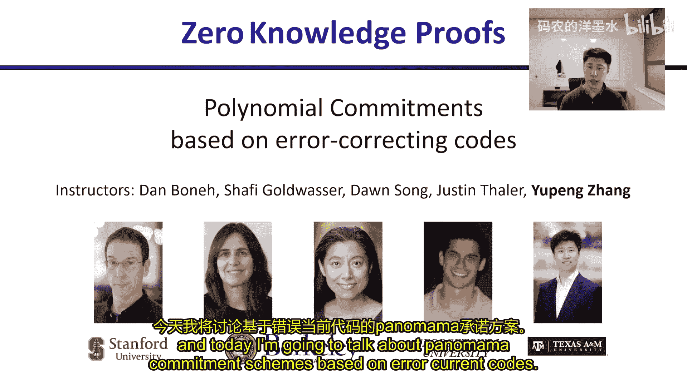

Recall that a common paradigm to construct efficient snrks for general circuits is to combine a polyormmal commitment scheme with an appropriate polyormmal interactive oracle proof。

 such as the Planck IOP and the interactive proofs as you've seen in previous lectures。

Last time I started the section on Panorama commitments and talked about the classical protocol of the KCG Panorama commitment。

The protocol utilizes the bilinear pairing and has this trustedy setup step to compute the global parameters with this structure and the trapor in。

And the key idea of the scheme relies on this pan equation to compute the quotient pannoial kiloto effects。

And the scheme has a very small proof size and very fast very far time in practice。

The proof only consists of a single element in the group。

 and the verifier only needs to compute a single pairing equation。

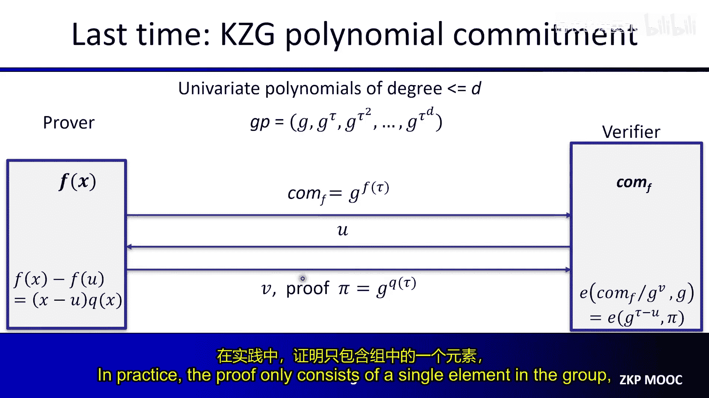

In addition， I also talked about other Ph schemes without trust set up that are based on thisre log problem。

Those include bulletproofs， hierarchs， story and dark。

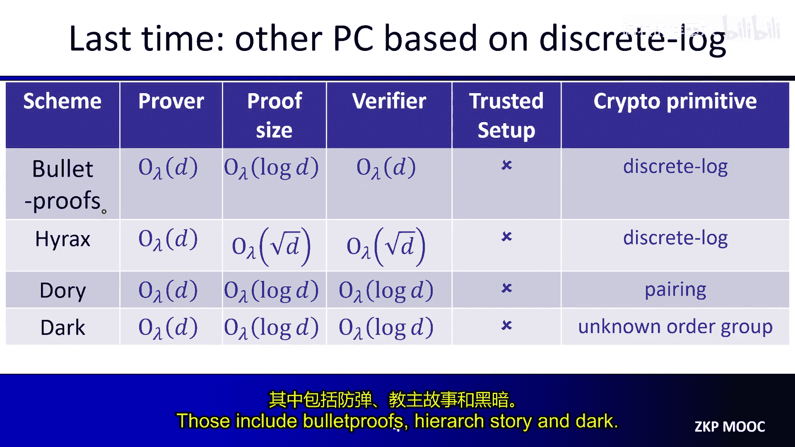

In this lecture， we are going to see a new class of Pan image schemes based on error green codes。

And to give you some motivations。Here I'm showing you the pros and cons of these schemes on this slide。

So on the positive side。😊，We are not aware of any efficient algorithm on quantum computers to break the assumptions of these schemes。

 so the schemes are plausibly post quantumum， like those that are based on this grid problem。

In addition。The poor time of these schemes tends to be fast because。

They do not require any group exponations。The pool only computes hash functions， Merkle trees。

 and some field additions， modifications， and FFT。Finally。

 the size that the global of parameters is very small and there's no trusted setup。

All we need to do is to sample a hash from a family of hash functions， and the size is constant。

But of course， these nice properties come at a cost。

The first drawback is that these schemes usually have a very large proof size。

 and as you will see later， you are talking about several megabytes to tens of megabytes in practice。

And another drawback is that because of the lack of the algebraic structure。

 these proofs do not have this homomorphic property and they are hard to aggregate。In a similar way。

 as we seen last time in the variance of KG economic commitments to support multipoint evaluations。

So to understand the schemes based on Eric and codes， here's the plan of this lecture。

There would be three segments in the first segment I'm going to talk about some background on error recording codes。

And with that background in the second segment， I'm going to present the Panama command schemes using any error cr codes。

And in the last segment， I'm going to talk about this interesting line of work to build linear time in codeable code based on expander graphs。

And the Panama command schemes and zero group schemes using this type of code can have a linear time prover in terms of the number of field additions and field modifications。

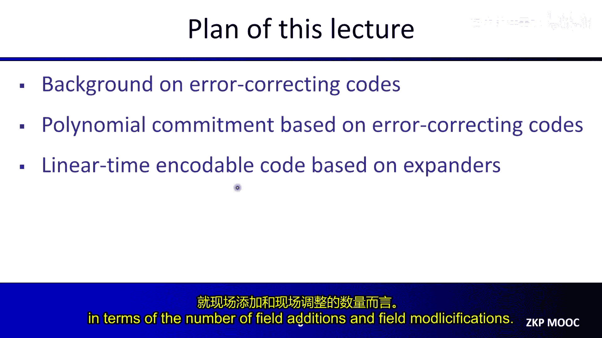

So let's start with the background。

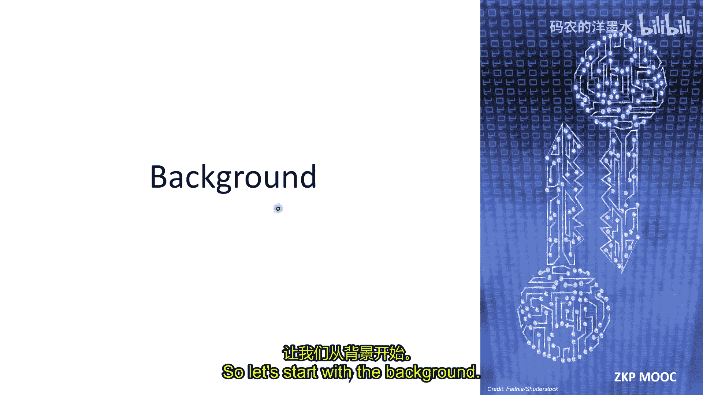

The error cr code is actually a well studied topic in the area of information theory and coding theory。

It can be used to correct errors in the transmission over the network。

 and that is why is's called error recording code。An error code encodes a message of size K to a code word of size N。

 where n is strictly larger than k。An important property of the Africanan code is the concept of a minimum distance。

So the distance between two code words is the number of different locations between the two code words。

 and this is called He distance。And if you take the minimum of the distance between any two code words and call it delta。

 that is the minimum distance of this error cr code。

And this NK and Dlta are three important parameters of the code， and we call it N Delta code。

And note that there's another important parameter is the alphabet of the code。

Whether it's defined over a binary or a find field。

 but I' am omitting this parameter in this notation。So to give you an example the。

Simp example I you're using is this repetition code。

And here I'm using example with the message of size 2 over the binary values and the code were size 6。

So essentially we are repeating each symbol three times to encode message。

 so that's why we have the encoding of a 00 gives you all zeros and encoding of 01 is 00，0111。

And similarly， you have the encoding of 10 and encoding of 11。

 and that's all possible messages of a lens2 over the binary。

So then it's not hard to see that the minimum distance of this code is actually three。

Because if you take any two code words from these four possible code words。

We have at least three locations between any two cohort that are different。

And because of this nice property， we can actually correct one error during the transmission。

Suppose that。Because of the noise level。😡，It can only introduce at most one error during a transmission and the code word we receive is this is what 01。

0111。Then because of this distant property of the repetition code。

 there is only one message whose code word is one error away from this code word。

 that is 01 and the code word is 000111 and that is why we are sure that the original message must be 01 even with such an error during the transmission。

So that is the original application of the error cr code。

And the process to derive this orange message from a received code word is called decoding algorithm。

And an interesting thing to note here is that in our Pan scheme。

 we are not going to use this decoding algorithm at all。

 so because that we can actually use error and codes without efficient decoding。

So next I'm just going to define some additional terms。

 So we have this rate of an American code as K over n。

 So essentially it's representing the ratio of a meaningful message。Let me have。

A code word of size K， size N， sorry。So this is basically measuring out of n symbols。

 we only have K symbols representing the message， and this is number between 0 and 1。

 and apparently we want it to be as close to one as possible。

And we also have this term called relative distance is basically the minimum distance delta divided by a。

 so this is the ratio of en encode words that is different between any two code words。And again。

 it's a number between zero and 1， and for the purpose of error correction。

 we also want it to be as big as possible。And using the same example of the repetition code。

 if we have a rate of1 or a， meaning that they are going to repeat each symbol a times。

Then from the previous example， we can see that the distance of this code is a。

 and therefore the relative distance is the delta or n where n equals 2 k times a。

 so the distance is 1 over k。And turns out this is actually not very good because it decays as the messageed S K increases。

 So it's not an asympotic good code。And as we said。

 we want both the rate and the relative distance to be as big as possible。

 but unfortunately there is usually a tradeoff between the rate and the distance of code。

Inly speaking， increasing the rate will actually decrease the relative distance of the code and we have well studied bounds on the relationship between the rate and the relative distance of code under different settings。

So the last concept I' want going to introduce is this linear code and the linear code is actually the most common type of code we are using in practice。

So for linear code， we have an additional requirement that any linear combination of code words is also a code word。

And because of this property。It's equivalent to say that。

The encoding algorithm can always be represented as a vector matrix modification between message M and a generator matrix of size k times n。

And because of all these cool techniques in linear algebra。

 the linear code can be analyzed to have a nice properties and that's why it is the most common type of code we use in practice。

And another implication of the linear code is that the minimum distance is the same as。

TheThe least number of non zeros for any non zero code wordss。

 and we call this as the weight of the code words。And this is actually not hard to see because。

The distance is defined as the having distance between any two code wordss。

 and because the code is linear， the subtraction of those two code words。There's also a code。

So that is saying that。The number of different locations directly implies and other code words with that many nonze elements。

So therefore， the minimum distance between any two code wordss is just equivalent to the minimum weight of a non0 code word for a linear code。

 so that's something to keep in mind。So finally Im going to show you this classic construction of the linear code called Read Solomon code。

 and this is actually a very important construction in the literature and has many applications to build cryptographic primitives such as the zero knowledge proof schemes of Lehiro and Stark and also for secret sharing and other applications in cryptography。

So here I'm defining a re sum code over a5 and field moduleular prime number P and the。

Agorrithm takes a size K message and code it as a size N a code word。

The way to do it is we're going to view message as a unique degree pay minus1 Uniievertami。

You can think of it as a pineappal interpretationpolation。On a fixed set of public coins of size K。

 and we are going to treat each symbol of the message as the evaluation at a pretty defined point。

 and then we're going to interpolate it and get a unique degree k minus 1。9。

Then the code word is simply the evaluation of this anomial at n points。Again。

 these are predefined and public points， for example， we can use the root of unity。

We are going to evaluate at omega omega to the 2， all it to omega to the n。

 where omega to the n equals to 1 mod P。And this is actually a linear code because the encoding algorithm can be represented as a vector matrix mark between the message and the generator matrix。

 which can be derived from the Fourier matrix。And the reason sum code has a very nice distance。

 the distance is actually a minus k plus1。And this is very good。

And that is because as we said in the previous slide for a linear code。

 the distance minimum distance， simply the minimum number of a non zero elements of a non zero code word。

Then as each code word is actually the evaluation of a k degree k minus1 Uni p。

How many locations can be zero？Well， at most， K minus one。

That is because a degree k minus 1 poly has at most k minus1。So therefore。

 at least un minuss K plus1 locations or non0 for a non0 message。

 so that is why the distance is this one。And to give a concrete number。

 let's say that n equals to 2 k。 Were expanding the message。By 2 and get the code word equals to 2 k。

 then the rate is a constant 1 over 2 that's actually pretty good in practice。Then by this devation。

 the relative distance is also1 over2 is a constant， so the distance is also very good in practice。

 So it turns out this is exactly the best you can achieve and thus the resment code is synally good。

And find the encoding time of reum code disorder of n times login using the fast Fourier transform algorithm FftT to evaluate this pan at these end points defined by the root of un。

So that's everything I want to talk about for。Aa cr coats。

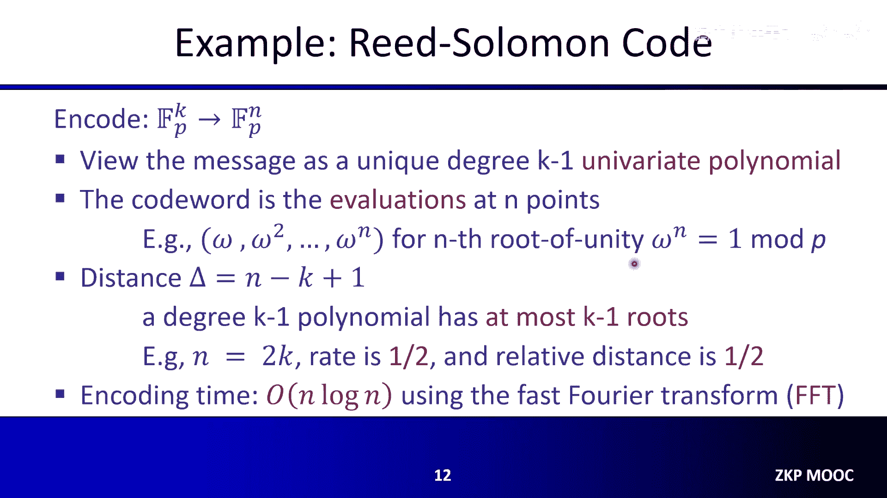

啊。With this background in the second segment of lecture。

 I'm going to show you how to build poromic commitments using linear codes。

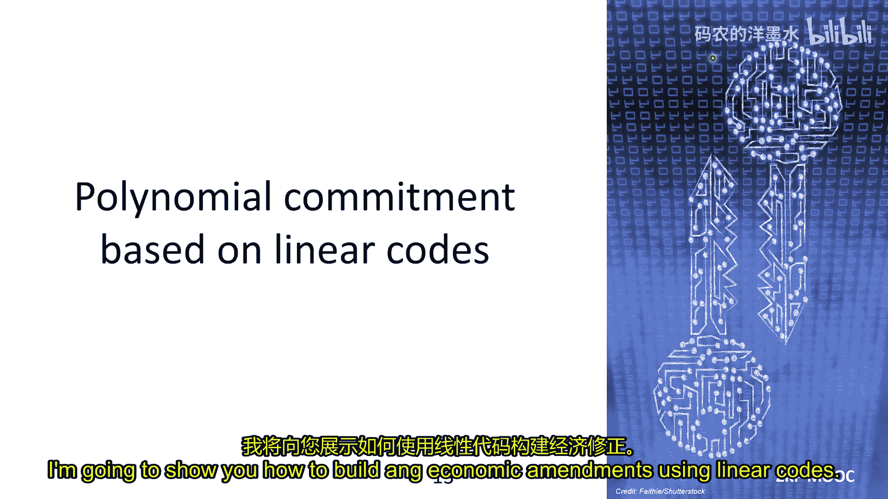

To recall that this is the setting of a panelmial commitment。

 we have our four algorithms the key generation commit， evolve and verify。

And the scheme I'm going to show you here is derived from the papers of Lehiro， Budddo etdo in 2017。

 breakdown and O R。And that the scheme has a square root size proof and a square root verification cost。

So the key idea of this panormic amendment scheme is to identify the matrix structure in the panammal evaluation。

So。Here I'm showing you that a matrix consisting of the coefficients of the panamium from my F11 auto it to F squareity。

 and I'm assuming that the number of coefficients of a pannoial is an exact power of an integer。

 but of course you can add it if it is not。And。The reason why we are arranging the coefficients of pannomial in this form is that we can actually write。

The equation of a panormal evaluation as this equation。

So we're going to have a two ines I and G range here from one all the way to square root D。

 and then compute this。Product between coefficients and the corresponding monomial。

Evaluate that point U in this way。And the nice property of this way of computing is that the panammal evaluation F of U can actually be decomposing to two steps。

In the first step， we are going to multiply。A vector defined by this e point。

 U of size squareity with。The matrix of the coefficients of the pandemic。

And the result of this vector measure allocation will give you a vector of size squareity。

Then in the second step， we are going to multiply that vector with this another vector derived from the inversion point view and take the inner product。

 The result will be a single value that equals to the in FF E。

And if you do the duration following the rules of vector matrixs modifications。

 you can see that this computation is exactly the same as the equation at the bottom。So。

I'm saying here that evaluation can be viewed as this two steps of vector matrix onation。

With this observation， we can actually reduce the Panormial commitment scheme。

To an argument for vector matrix product， so if you're good with a scheme with a square root D proof size。

 then we can actually just prove the computation of the first step。So in the first step。

 we are going to multiply this vector of squares D size defined by the e point U with this。

Matrix defined by the coefficients of the pointagon。

And the result of that is a vector of a square root d。Size。

So then the poorer can just send this result of the vector directly to the verifier and the verifier verifies that the first step is actually computed correctly using this proof system and then evaluate the second step locally by taking the inner product of this vector with the second vector defined by the e point view。

And in this way， the proof size is only this vector of size square D。

 and the verify time is again square d。By computing that email product。

So this is saying that if we can have an argument scheme for this first step of vector matrix product。

With a reasonable proofside and welfare time， of course， then we are going to have。

A pan commitment scheme with a squared precise and squared。Verification time。 So in this way。

 we reduce。The problem to is a simple problem of vector matrix product。

So then the focus of the remaining parts will be how can we design a scheme to test the computation of this vector matrix。

Product without sending this matrix directly to the verifier site。

So the idea is to use the linear error current to encode this matrix defined by the coefficientfis of the pan。

So here we are going to encode each row of this matrix using a linear code。

So then the dimension of this original matrix is square d by square d。

 and here the size of the message of this linear code K equals to square d。After encoding。

 we end up with an encoded matrix and the dimension is scroll D by n where end is the size of the code word。

And for your information， we are going to eventually use。linear codes with a constant rate。

 So then n is symptomtically the same as k and which is also the same symptomtotic the same as a square root。

 So after encoding， they're not increasing the size of this decoding matrix syntically。

So with this encod matrix。We are going to commit to this polynomial defined by this encoded matrix and the commitment using the Mer history。

So recall that in previous lectures， we explained this a very important primitive in a cryography called Merrkcohatry。

And the construction is to compute the hash of the two consecutive leaves and then do a recursive in a tree structure to get the root of this tree。

 and this route is served as a commitment of this vector。And later。

 the poor actually opened a commitment。I prove to the verify that。

The leaf at a certain location equals to a particular value。

And the prove is generated by traversing this tree and returning all the siblings along the path from a leaf to the root。

 and the verifierer can actually reconstruct the root with only the information from siblings and the proof size is only logarm in the size of the vector。

 So this is the Merle tree。And the way to commit to this。Pnomial is first。

 we are going to encode this polynomial rowwise using the linear code。 After that。

 we are going to use the Mer tree to commit to this encoded matrix column wise。

 We are going to view each column。As Wal leave of the Merrkcur tree and then build this merkcur tree on top of this。

呃。A matrix， and then send this a hash， root hash to the verifier as the commitment of the polynom。

And using this commitment， you can imagine later that we can actually open each column individually。

 the ruleer can actually send a column chosen by the verifier and then together with the Merrkry proof and the verifier can verify that the column is not altered is actually indeed as committed in the first place by the proof。

So this is the commitment step of the Pan commitment I'm describing。

And because of this commitment step， then actually the key generation of this pan image scheme is very straightforward。

 all we need to do is to sample a hash function that will be used for remotemocoche and that's it。

 so there's no trust set up and the size of the global parameter is only constant。

So then the most complicated protocol of this P imaging scheme is this evaluation together with the verification。

And I'm going to spend plenty of time explaining these steps in details。

So the evolved algorithm can be roughly divided into two steps。

 and the first step is called a proximity test or proximity checking。

And the main goal of this step is to test if the committed matrix indeed consists of these scrollly code words encoded rowwises。

And the reason for this check is that。Recorded in the comm phase。

 an honest poor should commit to this matrix as encoded from the original matrix defined by the coefficients of the  point9。

But if the poor is malicious。He may not follow the algorithms we were described。In particular。

 it is actually not hard for the verifier to check the size of this matrix， for example。

 by returning one path of the mercurry。But even if the matrix is。

The size of the matrix or the dimension of the matrix is as specified。

Each room may not be a valid code word of the。Vinear code。

A malicious proveer could generate any arbitrary。A vector of length N and then put scity of these vectors and commit it using Mer to andc it to the verifier。

 There are not even code words of this code。And again， using the resment code as an example。

If the four is honest， then each row should be a result encoding coding， in particular。

 a panomial evaluated at endpoints， but a malicious prove may just commit to any vectors。

Of a length and and they may not be on the same phenomenon of a degree K minus-1。

 So that is the purpose of this first proximity test。

 trying to ensure that the committed matrix is indeed encoded as specified by the commitment algorithm。

And the way to do it is as follows。So first， the ver is going to send a random vector。

Of size square root d， and I'm using R1 or2 all the way to R D to denote it here。

And the verifier is asking the poorer to return the result of this vector times the encoded matrix。

So then the result of this completion is a vector of size n the same as the size of one row。

 if the pool works honest。After that， the verifier is going to pick several random columns and ask the prove to open these columns。

I recall that in the commitment phase， the poorer already commits to the columns using a Mercur tree。

 So in this step， the poorer also sends the corresponding Mer tree proofs。

In particular path from the leaves to the root so that by checking these meatory proofs。

 the verifier can make sure that these random selected columns are indeed consistent with those committed in the first place。

 The poor cannot change。The values of these columns at all。Then finally。

 the verifiers is going to perform the following three checks。The first check。

Is that this vector returned by in the first round is indeed a code word of the linear code。

And this is true if the per is honest because of the property of a linear code。

 any linear combination of code words still gives you a code word。

 so this is actually a linear combination of r1 times the first row and plus r2 times the second rule and so forth。

 and this is still should give you a code word if the per is honest。Second。

 to verify check that the columns are indeed as committed using the Merrcurry， and this is。

 as I explained before。can be done by checking the Mer path proof to ensure that the poorer cannot change any value。

All these are committed columns。Finally， the verifier is going to compute the inner product between this random vector。

And each column。And。By the rule of the vector matrix modification， you can see that。

If the answer is honestly computed， then the inner product between this vector R and each column should equal to the corresponding element。

Of this vector returned by the poor。And verifier is checking this relationship for each column that is chosen randomly by the verifier itself。

And if all of these three checks pass。Then with the overwhelming probability。

 the verifier can actually conclude that the committed matrix is indeed。

As encoded in the commitment algorithm we described before。

 So that is the description of this proximity test。So then why is this a protocol secure？

So here I'm going to sketch the intuition of the soundist proof。

And it heavily relies on the property of the linear code。So。As usual。

 we are going to start with a contradiction， Suppose that the perer cheese。

 So this committed matrix is actually not an encoded matrix as specified。

 The poor actually pick any values in the vectors and then put them together and committed using a mercurry。

Then were the condition on whether this vector in the first round is correctly computed or not。

So if this vector is correctly computed based on this。Like a fake matrix chosen by the poor。

Then by the property of a linear code， it can the vector matrix product。

As the credit computed by the proveer cannot be a code word。So then the check one will fail。

So this is saying that this is a simple strategy， so the prove where cheating is committing to a wrong matrix。

 then you just can't follow the wrong matrix and compute the inner product between this random value vector and the matrix。

And the result won't be a code word because of the Nina property of the code and won't pass check one。

Which means that the aary is left with only the second option。Which is the poorh has to return。

A wrong vector that is not the result of the the product between this vector and this a a matrix committed by the program。

And if that is the case， then we have this nice property at the distance of the codework。

Because this wrong answer still has to be。A codework to pass check1。

Then by the minimum distance property of a linear code。

 there should be many locations that are different from the correct answer。For example。

 if you're using a realment code again with a distance one relative distance by half。

 then that means that half of the locations are actually。Wrong。

 actually different from the correct answer of this。A vectorect matrix product。Because of that。

 by the second check， the columns are the same as committed。 you cannot。

Lie about these columns that are open by the verifier。

Then it means that the probability of a passing the third check。Is extremely small。

That is because if half of the locations are actually different from the correct answer。

 what is the probability of opening a random column？

And still passing the verification of this inner product。

 the inner product between this random vector and this column is actually。Crrectly computed。

 given the fact that half of locations are actually wrong。

Well the probability is one half is a constant。 So then by opening multiple columns。

 saying that 100 columns， the probability of passing this check 3 decays exponentially。

 so in that way， we can actually achieve a negligible soundness error and so that the whole soundness can actually。

The proven to have a negligible cheating property。 So that is the intuition behind this。

Proxi to test。Yeah。So。This proximityimate test algorithm was actually introduced independently by these two papers。

 the first one is Leherro， and the second ones by Abbu out in 2017。And in Le heroarrow。

 they called this one as the interlib test， and the protocol uses the rement code with an encoding time of co linear out of a login。

And independently in Budao in 2017， they also proposed a similar proximity test algorithm and they call it the ideal linear commitment model。

And based on this model， they actually designed a scheme for a general purpose start for a circuit computation。

 and they were using a linear time codeable code instead of rement code。

 which I'm going to introduce this in the third segment of the lecture。

And this actually gives the first s with a strict linear power time in terms of field additions and field modifications。

And by the way， the schemes proposing these two papers were actually for general purpose ss。

 and here I'm actually presenting this technique and use it to construct the Pan commitments as a specialized protocol which was actually proposed in the a followout papers such as。

A breakdown and a riot that I'm going to highlight later。

So that is just the intuition of the soundist proof and turns out in the formal proof things are actually much more complicated and here I'm just showing you the kind of key differences and I refer you to read the details in the paper of Aliharro。

So turns out in the formal proof， this is actually we count。Approvve that the prove cannot。

Chain achieved at all。 Like we can't catch the achieving cheat prover if immunity changes like one value of this encoding matrix。

What we can prove is that。If the committed matrix C is very far away from any codework that is encoded as specified by commitment。

 we can actually catch it with an overwhelming probability。In particular。

 we define another parameter called E that is related to the distance of this linear code。

 so E is less than delta over 4。And then for for any number。Then。

If the committed matrix is e far from any code work， meaning that。

If we take the minimum distance of a。Any row wears any code word in this linear code。

 And if that distance is actually。E far away， meaning that the at least e locations are different。

 then we can actually catch the prove the cheating prove with an overwhelming probability。

Why is that or in the formal proof， we can show that if this matrix C is e far from a real code word。

Then the vector matrix product between a random vector R and this encoded and this comm matrix C。

The result we call it W that is exactly the vector returned by the proveer。

 as I specified in the protocol， the probability of that vector is e close to any code word。

Is less than or or equal to e plus one over the size of this finite field。

 So this is extremely small。 This is negligible。Which means that if the committed matrix is E far from any code word as a matrix。

 then this vector is also E far from any code word with high probability。 So that is the。

differenceerence of the claim from the intuition to the formal proof。

So then if you rule out this possibility， then the remaining part is exactly the same as the intuition conditioning on this this vector w is actually e close to any sorry e far from any code word。

 then the probability of passing check3 for T random comms decays exponentially with T So in particular because like E over n fraction。

Of the values are different。From the real。A result。

 then the probability of passing all checks of all T random columns is1 minus E or n to the power of T。

 and that decays exponentially with T。And this is exactly the reason why we need a linear code with a constant relative distance。

 And so this E is related to the distance of the code so you can roughly think of this as an odd is related to the relative distance and if you have a constant relative distance。

 this number is a constant， and then we can make it negligible by repeating the check for t columns。

 say 100 columns or。500 column。Otherwise， if the distance of the code is not good。

 then we cannot make this probability negligible， so that is why we need a linear code with constant relative distance。

 such as realment code。And by the way， in a recent version of this Herald。

 authors further show that we can actually choose any E that is less than delta over 3 as a parameter in this proof。

 so that improves the proof size by some factor。So that is reason why this proximity testing is working。

 we can actually show that the committed matrix is actually close to a code word that is encoded using the commitment algorithm。

Another interesting thing I want to mention here is that we can actually perform one optimization in this proximity test。

So the optimization is that instead of sending the code word。

Which is the result of this vector matrix product。 The poorer can actually send a message behind this code word to the verifier。

And then the verifier can actually use this message。

It can actually encode this message to recover this code word。

That was supposed to be sent by the poor。And then perform the remaining checks。

And why this is a nice optimization first， this actually reduces the size of the proof because instead of sending a vector of size n。

 we not only need to send a message of size only m only k that is equal to a square rootity。

Another optimization is that the ver now doesn't have to perform the first check where this vector is a code word。

This checks from imp because it is literally encoded from a message sent by the poor。

 so it has to be a code work。And another interesting observation is that by the property of a linear code。

 this message of size square D is exactly same as the result of the。

Vecter matrix product between this random vector be the original matrix that was defined by the coefficients of the polyum。

Instead of the encoded matrix。And it is actually not hard to check due to the property of the linear coat。

So this is a nice optimization to keep in mind for the remaining of the probe。

So now with the first step of this proximity check with the overwhelming probability。

 the verifier knows that this committed matrix must be close to an encoded matrix。

Then the second step of this commitment。Is called the consistent test or consistency check。

The purpose of this step is to really test that the inner product the the vector matrix product between the。

Vectctor defined by the version point and this origin matrix equals to the claimed result。

 a vector of a size squarely。And turns out the algorithm， the protocol of this step。

 is almost the same as everything did for the proximity test。So in order to do that first。

 the poor is going to send。The message m to the verifier。

 where the message should equal to the vector matrix product between this vector defined by the e point and the original。

Mattrix defined by the coefficients of the p of square d by square d before the encoding。

And the results should be。A vector of size square t， and that is the message of a linear code。

Then the verifier is going to encode this message to get a code work。offer length。end here。

And as I explained in the previous slide using this optimization。

This vector of size n should be the result of this vector defined by the version point u times this encoded matrix of size square d by n here。

And this is exactly same as the proximity test with the optimization I introduced。After that。

 the birdf is going to pick several random columns and ask the proveer to return these columns back。

And record that in in the commitment phase。The proveer commit to these columns using Merhad 3。

 So in this step， the poorer further proves that these columns are actually has the corresponding mecurry path so that the proveer cannot change any value of these committed columns。

And finally， the verifier is going to perform exactly the same three checks as the proximity test。

So first this vector is actually code word， second the columns are as committed in the Mer tree。

 and third， the inner product between this vector defined by the version point U and each column is consistent with the corresponding location of this code word。

And the reason why I'm actually removing these first two checks is that we don't need to do them anymore。

So。The first check is embedded in this encoding。Because of the optimization I mentioned。

 the poorer only needs to send the message to the verifier。

 and the fact that verifier encodes it to the code word already tells the fact that this vector is a code word。

The second one， we also don't need to do it because the columns we are opening here are exactly the same as ones in the proximity test。

 The verifier doesn't have to pick。New randomly chosen columns we are going to use exactly those columns opened in the proximity test。

 and we don't need to verify the meatory passes anymore。So the only difference。

 the only additional step to perform is the third one is again an inner product。

 but this time is the inner product between this vector U here defined by the evaluation point instead of the random vector chosen in the proximity test。

And we are going to do the inner product between this one in each column and see that it is consistent with this code word。

Computed from the encoding of the message。And again， if this text status is true。

Then we can conclude that this message M is the product between this vector defined by U and the original。

Matrix defined by the coefficients of the pannom before encoding。 so that can please。

The description of the second step of the consistency check。So to sketch the soundness of this step。

First， by the proximity test， we already know that this committed matrix C is very close to a codework。

Then in order to prove knowledge soundness， the key idea is that although we actually don't know whether this matrix is indeed exactly the same as。

An encoded matrix。Because it is close to a code word。

 Then it is actually enough to attribute an efficient tractor， retract。

The coefficient matrix defining a p and this structure is using the Merry commitment and also the efficient decoding algorithm to decode this committed matrix because it is close to a code word。

 then there is a unique。A coefficient matrix F so that we can actually track F such that the vector u times F equals to this message m return by the poor。

 and that completes the first step of this vector matrix。AProduct argument。

And this is with an overwhelming probability。So that is the intuition of the soundness of this second step。

And if you' are interested in the formal proof， please feel free to refer to the papers for more details。

 and I'm not going to talk about the formal proof in this lecture。So to put everything together。

 this is the kind of the algorithm of this entire pan commitment。So in the key generation。

 we are just going to sample a hash function from a family of hashes。And to commit to a matrix。

 we are going to encode the coefficient matrix of F rowwise with a linear code。

 and then we are going to compute the merrccurry commitment on the columns of this encoded matrix。

And then the evolve and the ver algorithm are actually a kind of an interactive process。

So there are two steps， proximity test and a consistent test In the proximity test， we are going to。

Compute the random linear combination of all the rows。Using the randomest challenge by the verifier。

And the verifier is going to check its consistency with T random columns。

 and this guarantees that committed matrix is actually close to an encoded matrix。

Then in the second step， we are going to perform this consistency check。

And we are going to use exactly those columns opened in the first step。

And checks that the inner product between the vector U defined by the e point U。

With these columns is consistent with the answer that is encoded from the message app。So in this way。

 we can make sure that u times think the coefficient matrix f equals to n。

And to complete the p evaluation， we can perform the second step locally on the verifier side。

 So the verifier simply computefuses the inner product between the message M and the second half of the vector defined by this e point。

 And I'm just going to call it U prime for simplicity。

And if you still recall the devation we showed in the very beginning。

 this two steps of the vector matrix product and the inner product gives you the evaluation of F of you。

 if the prover is honest。So that completes the entire description of this phenomena commitment。

And this also shows you kind of the necessity of this proximityxi test and the consistency check。

So one question I already get when seeing this protocol is it looks like。

The proximity test and consistency test are almost the same。

We are using the same open columns and we are checking the inner products between these columns and the corresponding vector。

 so can be just perform only the consists without proximity test， but the answer is no。

 and the intuitive speaking the reason is because this U is not randomly generated is actually derived。

From the eversion point， you in a very well structured way。 and if this eversion point。

Is not from a randomly chosen from a large domain， random in a final field。

 Then with the consistency as only the poorer can actually cheat。If。

He knows some information have time about the magic point you are going to choose。

And that is why this proximity test is necessary。So， no matter what。Will be the eva point。

 We are going to run this proximity test using a random challenges from the verifier。

 And this guarantees that。The committed matrix is actually close to an encoded matrix。

 and then we can perform the consistent test and extract this witness such that the vector matrix product is equals to n with an overwhelming probability。

So then next let's see the properties of this panonic image scheme based on the linear code。

So the key generation is very efficient。It does not require any trusses set up and numerical merely sample a hash function。

 so the size of the global parameter is constant。In the commitment there are two steps。

 so first we're going to encode this matrix rowwise and the complexity is dominated by the encoding algorithm of the linear code。

 So if you' are using the resment code for example。

 then the encoding complexity is the order of d times log B。

Were talking about field editions and modifications。Alternatively， we can use。

Any linear code with a good relative distance in particular constant relative distance。

 so then if you' are using linear time encode code with good distance。

 you can achieve a linear encoding time in this step。Next。

 we're going to commit this encoded matrix using a Merrcury tree。

 and this one is actually not the domining cost， we' are going to compute the order of D hashes and the commitment size is only constant。

 the root of the mercur tree。The evaluation will take order of D addition to the modifications again and can be made now interactive using the Fchemre transformation。

So then finally the kind of as I mentioned the drawback of this scheme is the proof size is relatively large。

 so in the scheme I'm presenting here the proof size is the order of square root D and that is because they are opening essentially one row and multiple columns of this encoded matrix。

And the optimal solutions set the matrix dimension as square root times square rootd。

 so the proof size is order of a square root d， and similarly the verifier times is the order of a square root。

So to show you some concrete numbers， so this is the performance of the Pan scheme that was actually describing the breakdown paper。

So for a pno of degree d equals to 2 to the 25， that is about 32 million。

Using a linear hum in codeable code， then I'm going to explain the next segment。

The commitment takes 36 seconds using a single thread on a reasonable machine。

And the evaluation to generate the proof only takes 3。2 seconds。

So these numbers are excellent in practice and are significantly faster than those schemes based on discrete log and bi linear period。

 for example， the KG Pe scheme and the bulletproof because it is not using any group exponations there's linear number of additions and modificationplications so that's very efficient。

But apparently the drawback is the proof size， so using this scheme with the square root proof size。

 we are talking about 49 megabytes。Concrete， so this is really a big overhead。

And may not be desirable for certain applications and finally， the verar time is about 0。7 seconds。

 so that's actually a reasonably fast in practice。So before I conclude this segment。

 I also want to further discuss several follow up papers in the literature and that leads to this pan community scheme I'm describing。

So actually， the key idea of this version of Ph Min scheme came from these two papers。

So recall that in the original paper of the Lehiro and this Bo allowed in 2017。

They were merely describing a way to do this proximity test。

And in order to make it work for a pan amendment efficiently。

 relies on this nice observation and the improvements of the protocol for tensor IOP proposed by Budha。

 kyosza and G In。So in this paper， they proposed this protocol that I was describing for tensor products and Tensor cur。

 and what is that， so to give an example for these two dimensions that exactly the protocol we were describing。

So that works for the inner product between a vector F。

 and you can think of this as the coefficients of phium and another vector that is generated。

By the tenser product。Between two sub vectorctors of size square rootity， so u tensor your prime。

And it only works for this type of inner products， but not the general inner product for arbitrary vectors。

And。And in this paper， it also generalized the protocol to multiple dimensions instead of just dimension2。

 and using this approach， we can actually achieve a smaller proof size that is order of n to the any small constant emission that is less than one。

And you can think of the scheme as basically your generalization to a multidimensal matrix。

 and we are performing this proximity test and consistent test recursively dimension by dimension and the end result will gives you this smaller proof size of order of n to the Itro instead of only square root then。

Then。With this tensor IOP paper， then in the breakdown paper。

 they actually introduced this Pan amendment theme that I was describing earlier in this lecture based on this tensor query。

 so this is the actually the origin of the pan commitment。

And another important contribution of this paper is actually proposes another technique to prove knowledge onness。

And that is actually worth mentioning。 So recall it。

An interesting observation of the product that I was describing is that it does not need the decoding algorithm of the linear code at all the prove sends the message。

Of this vector matrix product to the ver and the verf encodes it to get decocode word。

 So there's no decoding algorithm involved。 So because of that。

 we can actually use any code without in decoding algorithm。

 and it gives a lot of relaxation on the design space of the code。

But unfortunately in order to prove sound is formally。Especially this extractor for knowledge on。

We need an efficient decoding algorithm to extract the Ven of the coefficient matrix from this committed matrix that is close to a cohortt。

If the decoding algorithm is not defic， the extract room be of pan time and it actually doesn't work。

So this paper shows you an alternative way to prove knowledge science。

And the approach is similar to a single protocol with the rewinding of a multiple random curious to extract this coefficient matrix without efficient decoding。

 So with this a contribution， we can finally use any linear code without efficient decoding to build such a efficient pan commitment scheme。

And another two papers worth mentioning are this Budddo Kiios and Liu in 2021。

 and then this are a Ryan paper by Xie Zhang and Song in 2022。

And the main contributions of these two papers for this part is to improve the proof size。

 recall that the proof size in the version time I was describing is squareity and is actually concretely a very large tens of megabytes。

So in this paper， by。Bdao in 2021， they reduced the proof size to polylgan using a proof composition technique combining the Tensor LP with the PCP of proximity proposed in this paper。

And the contribution of Orion paper is actually to reduce the proof size with the concrete efficient protocol。

Reult is it can actually improve the precise to order of a login square with a proof composition technique using a code switching technique proposed in this paper。

And concrete speaking it reduces the proof size for the degree decrease equals to 2 to 25 from this about 50 megabytes to 5。

7 megabytes so this is about an automatic making improvement。

 but still it's actually quite large in practice because of the distance of the code and also the design of this entire panamial commitment scheme。

So because of that， this really gives you a trade off between efficient per time and the large proof size。

 and you should choose appropriate schemes for your application。So that's the entire segment for the。

AP commitment based on the linear code。So in the next segment， I'm going to present。呃呃。

A concrete construction of a linear time in codeableable code， which leads to a linear time。

Were p improvementss and zero output group schemes。

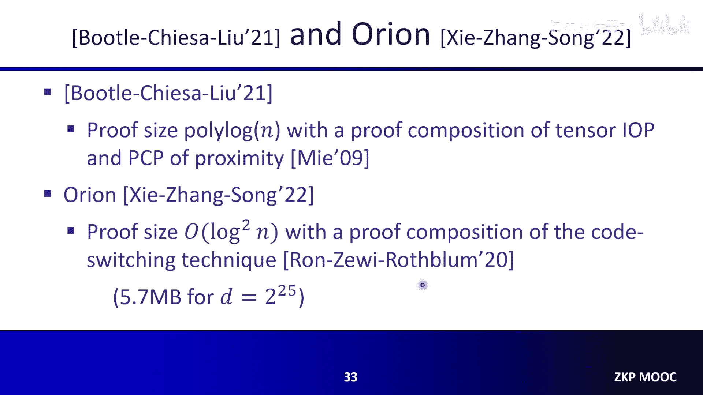

Welcome back to the last segment of the lecture， so in this part I'm going to talk about linear timing code of code with a constant relative distance using expander graphs。

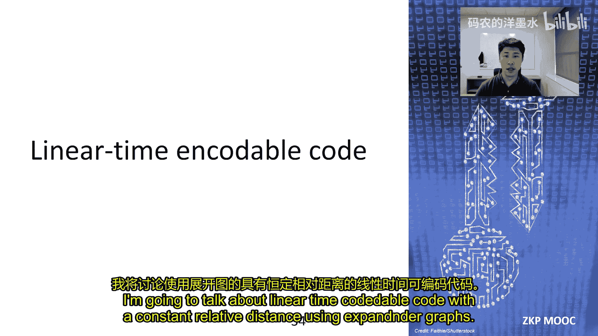

And this code has been used in this interesting line for work to construct snarks with a linear pool time here I'm talking about the linear number of a field additions and modifications so they can be really efficient in practice。

And as I mentioned earlier in this lecture， this line of work was initiated by Bto Chirui Gaddafi Gross。

 Hyderbaaddi and Jacob in 2017， and there proposed this ideal linear commitment model with the squared proof size。

 and this is basically the proximity as I explained in the earlier part of the lecture。AndLater。

 this scheme was further improved by Budo Kiios and Gros in 2020。

To construct an IOP that supports ten securities。In this scheme。

 they can actually achieve a proof size of order due to the power of Iule for any small constants of the I。

And after that in this paper by Buhuto Kios and Liu。

 they further improved proof science to be polyloggedD using a proof composition between a tensor LP and the PCV of proximity。

After that in this breakdown paper by Govna， Li Seti， Tlor and Awabi。

 they actually used this technique of Tensor LOP to build an efficient polyomic commitment with a proof size of order D to the power issue and also as mentioned in this paper to show how to prove knowledge onness without an efficient decoding of the linear code。

And finally， in our Orion paper by Shiia Zhang and Song。

We further propose a code switching technique to reduce the proof size to order of a log D square using a proof composition and a code switching technique that is concretely efficient。

But all of these papers are using this single construction of the linear time co code with a constant relative distance。

In this part， I'm going to clearly explain to you that the construction and why it can actually achieve a constant relative distance。

So this code was actually proposed by Daniel Spielman in 1996 and later was generalized from a binary to a final field initiative by Drhu and Ia in 2014。

And this code relies on this classical object called expandergraphs。So in an expander graph。

 any subset of graph or subgraph can actually connect to。

A many neighbor of node in this graph emphasize thus this as very good expansion and called expandeder graph。

And here I'm showing an example of a bipart graph。Meaning that there is a left set of nodes and the right side of nodes。

 and there are connections between these two sets， but there is no connection within each set。

 and that is called the bipartid graph。And in this biparted graph， every node on the left。

Has three outgoing edges connecting to a node to nodes on the right hand side。

 So the degree of each node on the left is3。Then this graph actually has a very good expansion because you can check that every two nodes on the left hand side。

Connects to at least five nodes on the right hand side so that is a good expansion and because in total there are three edges from each node。

 so from a set of two nodes on the left there are at most six outgoing edges so it can connect to at most six nodes on the right hand side and now it connects at least five so the expansion is pretty good。

So this gives you an example of the bipartiteid a graph that is a good Exper。

And this is exactly the type of expander graph we are going to use to build this linear time total code。

So to give you a very kind of rough intuition， why we need such an expand graph to achieve a good relative distance。

嗯。Where roughly is speaking with such an expander， we are just going to put the message on the left side node。

 we are going to put each symbol of the message into each node on the left hand side。

And then the way to compute this encoding is for every node on the right。

 we are going to sum the values of the node from the left that's connected to this node， for example。

 to compute the first symbol of this encoding， we are going to sum up the values in the first node on the left and the second node on that because of these two edges。

And that's it that's a very simple aggregate encoded just through a summation of the values from the neighbors on the left。

And。This is actually a linear code because this way of encoding can be represented as a vector matrix product between the message and the efficiency matrix of this bipart graph。

 So that is the generator of this way of encoding。 so that is why it is a linear code and it's also the encoding of this simple version can be done very efficiently in linear time。

 simply because we're just going to go through each node and compute the summ on the left hand side because a number of edges from each node is constant so the running time of this entire encoding is merely a constant time the size of the message so that's a linear encoding。

And the intuition why， we need the expander graph to achieve a constant relative distance is because recall call that。

From very beginning， I said that the distance of a linear code is equivalent to the minimum weight of any nonzero codeward。

So。It just suffices to count the number of non zero codewords for all the messages and the reason why we need a good expansion is because even if the message has a very small number of non zeros。

 for example， there's only single element of the messages non zero。

It expands to many nodes on the right hand side。 In this case， at least three nodes on the right。

 So one non0 leads to at least three non zeros on the right and two non0 leads to5。

 So that is amplifying the number of non zeros from the message to the code word in order to achieve a good distance of the code。

 So that's the intuition why we need the expander。But unfortunately。

 this simple encoding does not work， it's actually far away from being a good code Wisconsin relative distance。

And its， it's not hard to see this because again， using the example。

 if the message contains only a single。No0 value by the requirement of a constant rate distance。

 the code word has to have a constant portion of the values to be non0。 And clearly。

 this is not possible using the simple encoding because one non0 can only connect to 3。

Noes on the red hand side， which leads to 3 non zeros in the code word instead of a constant fraction so。

This simple way of encoding does not work directly。

So then next I'm just going to show you the formal way of building this linear time encode of code with a constant relative distance using expander graphs。

And also will show you why this can actually achieve a constant distance。 So in order to do that。

 the first thing I'm going to define is this concept loss Le expander。

It's basically you have a type of expander that has a very good expansion。

 almost a perfect expansion among all expenditureer graphs。So in a elastic expenditureer。

 just to define some notations， we're going to use the size of L to denote number of a nodes on the left side and the size of the set on the right is a constant fraction of L alpha times L for a constant alpha。

In this example， alpha is actually larger than one because the right hand side is larger than the left hand side。

 but in the real expenditureer we're going to use in this linear code。

 alpha is actually valued between 0 and 1。So the size of the red set is actually smaller than the size of the left set。

And then degree of the node in the left side is a constant G and the3 in this case。

So then with this definition。What is the maximum possible expansion for a subset on the left。嗯。

If you think about it。If you take any subset of noise on the left。

The number of total edges is exactly G times S。 and every node has G edges。

 and you have S nodes in total。So then at most， you can connect to G times as snows on the rent hand side。

 That's a maximum possible expansion。So then we are just going to define this loss exper in this way and so we want this expander graph to achieve this max possible expansion。

 and I'm using this a capital gamma of s to denote neighbors of this subset of nodes and the size equals to G to the s。

So that's the birth expansion you can have。But then it turns out there has to be another condition to make it happen。

 It can be true for all subsets， simply because we don't have enough nose on the reference hand side。

But in total， you have alpha times L nodes on the right。

 And if this G times S is larger than than number。It can't happen， you don't have enough notes。

So in order to make it happen， we have to have a condition on the side of this subset。Saying that。

 for all subsets。That is less than or equal to r four times L divided by G。

 We want the expansion to be maximum。And you can see this is G times S is less than or equal to alpha L that's exactly describing the condition I would say as long as you have enough notes on the right hand side。

 I want maximum expansion， So that is the idea of this loss exp。But again。

 this is actually too good to be true， so that is actually very hard to find such graphs。

 so in the real definition of the loss sper， we are going to relax these two definitions。

 two conditions a little bit， but still following kind of the idea I was describing。

See in the real definition， instead of saying that this expansion of this subset S is exactly same as g times S that's the best you can do。

 we are going to say that it's going to be larger than or equal to 1 minus beta times g of S where beta is actually a small constant and when beta approaches to0 that is the maximum expansion you want。

 so beta is a parameter of this loss exper。It's a relaxation and similarly for this condition。

 orange you wanted to hold for any subset S with size less than or equal to alpha times l divided g again that is too good and we use another parameter delta。

 small delta to replace alpha saying that for all subsets a size that is smaller than or equal to this amount。

 we have this almost perfect expansion。And again， this delta should approach to alpha and is again a top constant。

 so that is the real definition of a loss exper。And for time being。

 all you to remember is that it is a bipartid graph with a very good expansion。

 Any small subset expands to a large number of neighbors on the right。

 and the encoding is we put message on the left hand side。

 and we're going to sum up the corresponding node with the edges on the right hand side to get a result of the encoding。

So that's the concept of a loss expense。With that next I'm going to show you an overview of this real encoding algorithm is's actually much more complicated than just applying this loss expenditureer。

 it's actually recursive encoding algorithm。So how can we encode a message。

 So suppose the size of the message is K。 The goal of this step encoding is to get a code word of size 4 times k。

 So the rate is one force is a constant rate。In the first step。

 we are just going to copy the message directly to be the first part of the codeword。

And this is part up size Kate。And this is actually a quite common approach in Erran code and the code with the first part to be exactly same as message is called a systematic code。

Then in the second part， we are going to apply this loss exper on this message and we are going to use loss exper with these parameters such as alpha equals to12 the size of the red side is only half of the size of the left set and then we have this good expansion correctly rise by delta and beta。

And the result of this applying loss expenditureer gives you。AnAn encoding that is of size K over2。

We are going to compute the right hand side of the nose using the summation from neighbors of the left hand side。

 So that is the。A vector of size K or2。Then a very kind of a important step of this encoding is that we are going to assume that we already have a good。

Incoing algorithm， a good linear code for message of size K over 2。And it already has a very good。

 constant relative distance。And where can we use it to construct this encoding algorithm for message of size K。

And for time being， just assume that we have such encoding algorithm。

Then we are going to apply it to the result of this loss exper and the rate is again the same as 1 fourth。

 so the result is 4 times k over 2 and that gives us a code word c1 of size 2 times k。

And we are going to put it as a second part opposite this incho， the code word。

And we are not done yet。Finally， we have another step。

 we are going to run this code word C1 through another lost expander graph with rpha equals to12。

And these parameters and good expansions。And the result of that is half of the size of c1 because alpha equals 1/ half。

 the size of the nose on the right hand side is12， so we end up with another part we deoteed as codeverse C2 ofs K。

And then the final code work there the conation of the message， C1 and C2。

 and the size is k plus 2 k plus k in total， it is 4 times k。

 and that's how we do this encoding algorithm using the lossnder。And then you may wonder。

 how can we get this。Encoding algorithm for the message of size K or2 with a good relative distance。

While using this exactly the same encoding algorithm for message of size K or2。

 and that is why it is a recursive encoding algorithm。once you have this vector of k over2。

 how do you do this encoding， oh you put this K over2 vector again here with all of these parameters divided by two。

 we will cover two， copy it and then do another loss expander and get a K over4 and do the recursive encoding step by step so that is the recursive part of this encoding algorithm。

Another thing to highlight is that although we are using two loss expanders with both r equals one half。

 there are actually two different expenditureer graphs because the size。Sizes are different。

 This expenditureograph takes an input of size K on the left side and generates a vector of size K or 2 on the right side。

And this logic expand graph takes input a vector of size 2 k and computes a vector of size k。

So because of that in this recursive coding algorithm。

 we are actually using a sequence of La expand graphs with similar parameters are always equal one2。

 and we want the expansions of these logic parameterss to be pretty good with all these of beta and delta and energy parameters。

So that is the high level overview review of this recurs encoding algorithm using the lastX expander。

And to put it in a little more formal way。 So here is basically a description of this recursive en codinging。

 as I described in the previous slide in the chart。So we have a message of size k。

 and we want to get a code word of size 4K such that read this constant one force。

Then we assume that there is encoding algorithm from K over 2 to 2k already with a very good relative constant distance。

 a constant relative distance delta。And we also suppose that there is a sequence of expander graphs and we're using two graphs from this sequence。

Of size K and 2 k on the left hand side with alpha equals to1 half。

Then the encoding algorithm can basically describe the by this four steps。

 We are going to pass this M through the logic expand graph to get M1 of size k over2。

Then we' are going to encode this M1 to get c1 of size 2k using this encoding algorithm from here2 to 2k with a good relative distance。

Then we are going to pass C1 through another log expenditureer to get C2 of size k。

 and finally we're just going to content them together to get a code word of size 4K。

And to complete this recursion， we are going to repeat it for K over 2 K over4 until the message becomes a constant size that is talking about this step assuming that how can we like explaining how can we go from this encoding of a K 2 to 2k。

 we just repeat this entire encoding algorithm for size K over 2 and then K over4 until a constant size。

So finally， how can we complete this recursive encoding？

Once the size of this message becomes a constant， we can actually use any code with good distance。

For this message。For example， the reassignment code and here because the size of the message is constant。

 no matter what we do， it won't affect the asymptootic behavior of this code。

 the encoding time remains constant so that is the formal description of this recursive en encode。

So next， I'm going to show you why this way of encoding can achieve a constant relative distance。

 And so the theorem is saying that the distance of this code Dlta prime equal the minimum of delta。

 which is actually the。Re distance of this code we use in the middle from K over2 to 2 k and another parameter delta or 4G that depends on the expenditureer graph。

And this proof is actually a little technical， but。

The first time Ive seen this proof from the Ruy Sha paper and also the Spman code paper。

 it was really impressive and I really want to show you the idea of this proof of the constant relative distance。

So yeah， let's do that。So recall these parameters are actually related to this elastic exper。

 this delta is the constraint on the size of this subset of the nodes on the left hand side。

 and this G is the degree of this node from the left to the right is a constant G and also we have this delta。

 beta depends on delta and G and is not used directly in the analysis。

Just to remind you that these practice。And。Re call that the code word is a conation of the message C1 and C2。

 where C1 is derived from the expanded graph of M to get M1 and encode it using another good code with a constant relative distance of delta so here the high level idea of this proof is to actually break it down to several cases。

So again， recall that for any linear code。You know。

 the the distance between any two code word is equivalent to the weight of a code word。

 So we are just calculating the minimum weight of any non zero code word to get this the minimum distance。

 So that's what we are trying to prove here。And the first case is actually extremely simple。

 So we are saying that if the weight of the message is large enough。Then we are done。

 then the weight of this code word is is good。 And then there's nothing to prove here because we are copying this message to the code word。

 and then if you're counting the number of non zeros in this code word。

 we already have more than 4 k times deelta prime number of non zeros。 So the distance。

Or the the relative weight of this this code where already 4K Delta prime divided by 4K。

 So that is larger than Delta prime already。 So we're saying that that for all messages with actually large weights。

Then， automatically， we get。Large weight code wordss。 So that is very simple。

Then the second case is if this weight of m is less than or equal to this 4 k times deelta prime。

What can we do。So here is where the expander graph， loss expander kicks you。

So recall that the definition of the loss expenditureer has a condition on the size of the subset nose on the left hand side and this exact condition。

Where this is actually satisfied。So it is so if we can show that if the weight of M is less than 4 k times theelta prime。

And if you substitute Delta prime with this delta over 4G， you can see that it means that the weight。

The number of non zeros is less than or equal to k times delta or G。

 That's the exact condition of this loss exper。Because of that。

 if you use this S to be the set of nonze nodes。Then。

It has to expand to more than1 minus beta times G times S nodes on the right hand side。

That is the definition of the last exp。嗯。And。Once you have this good expansion on the right hand side。

 then by a simple counting argument， we can show that at least one node in this neighbor have a unique neighbor in S。

Which means that this result of this expander M1 must be non0。

 And why is that there is a simple proof by contradiction。 I suppose that you have a。

So all the node on in the neighbors have at least two neighbors in this S。

Then the total number of edges will be  two times 1 minus square times g times S。 But in total。

 you only have g times as many edges because each node in S have a has this G outgoing edges as a constant。

 So then you just simply don't have enough edges in this graph。 So because of that。

At least one node in this neighbor have a unique neighbor in S and in fact。

 you can actually do a much better bound actually a lot of node should have unique neighbors in S because of this good expansion and。

The sole reason why we are trying to make such an argument is that we want to show that this result of this loss exper we call M1 is90。

That's all we need As long as this M1 is down zero。

 we are applying this recursive encoding of another good code with a constant relative distance of deelta。

Then the weight of the C1 has to be larger than article equal to 2 k times deta。

Because of the distance property of this。Second code， we use it in the recursory code。

So all we need to prove is that M1 is9 zero， as long as M1 is90。

 the weight of c1 is actually pretty big。So that is the key idea of this second step。Then actually。

 in order to finish this entire proof， we are just following this same idea just and do it again。

 Okay so then we can just condition on whether this weight of c1 is big enough or not。

 so if this weight of c1 is very larger than 4K delta prime。

 which is exactly same argument as the first step， then we are done。And saying that。

The number of non zeros in C1 is already big enough， so the weight of C。

 the color C is actually larger than Dlta prime and very're good。And else。

 if the weight of this C1 is actually less than or equal to 4 k times delta prime。

 but still larger than 2 k delta， then we can apply the argument of lossnder again right the size of this subset is bounded so because of the condition of this loss exper。

 we are going to compute C2 using the second loss exper and we can show that because of the unique neighbors。

The weight of C2 has to be larger than literature to 2k times Delta prime。

Because of this counting argument， we simply have that many nodes with unique neighbors and they have to be non0 and then summing it up together with this weight of c1。

 so C1 has to be larger than the weight of c1 has to be larger than 2k times delta。

 we end up with the total weight to be larger than Nor equalco the 2k times delta prime。

 and that complete pleases the proof for this distance of this inquiry。So I mean， again。

 I was saying that this is a little bit technical。Hi， Loan I dear I on the deliver is that we just。

Proving it case by case。 right， The first case is if the message has enough weight， then we are good。

 If not， then the condition of loss expenditureer will be satisfied。

And then this message will extend to many node on the right hand side。

 then by a simple county argument。A big portion of these zone will have unique neighbors from the message M and the unique neighbors implies non zero elements。

Because you're just summing the value in this non zero elements with nothing else。

 and the result has to be non zero。And then we are just going to apply it again。

 and finally the computer is proof to show that it has the constant relative distance。And。

So that is the proof why。It has actually a constant red tape distance。So with that。

Or we can actually。Build this linear time encoder code using its sp graphs and that completes the entire description of the encoding algorithm。

And the last piece of the puzzle is how can we find such lost explainers？Do they exist in practice？

But result， we can actually construct the loss expenditureers explicitly in a determin way。

And this was proposed in this paper in 2002。But unfortunately。

 the concrete efficiency of this approach is actually not very good in practice because it has a large hidden constant in the construction。

 namely you have to find a constant size graph with a very good expansion property and the only way to do it is to do a proofful search and really to very a big overhead in practice。

Another approach is to actually sum over a graph by prototype type graph random， and as you may know。

 random graphs can have a good expansions。So if you just do that with some good probability。

 you can actually have these loss expers。But unfortunately。

 the probability is only one over panmami unit。Instead of a negligible。

 so we can't achieve negligible failure probability to random sum and this is also not hard to show because actually the lower bound of this failure probability has to be inverse p。

 simply because the size of the graph is a p and your total sample space the random space is a pan in it and there is at least one graph that is not lost experiment。

 so then the probability of failure has to be bigger than one over the poly。

 so this is a very simple argument。So then that leads to some improvements of this linear timing col code based on expander graphs in these two papers。

 breakdown and Or。So in the breakdown paper they proposed an improved version of this encoding using random submissions instead of plain submissions。

 so I was describing the weight to encode the message is to actually sum the neighbors on the Russian hand side from the nose on the left hand side so in this paper instead of doing the plane sum they're going to assign a random weight for each edge in the finite field and then doing a weighted sum based on the weights on these edges and this actually boosts the comparative distance significantly and they can actually show that the distance is actually very good in practice with very high probability。

And another improvement in the Orion paper is actually further proposed a testing algorithm to reduce the failure probability of this sampling run loss leak Exper。

And this testing algorithm is actually based on an interesting connection between the expansion of a graph and the maximum density of a graph。

 so using this algorithm we can attribute a testing algorithm to see whether a random graph is a loss expander or not。

 and the failure probability is reduced from inverse phenomenaomeial to a negligible。

And you can actually do a rejection sampling to really get a good loss expenditureer with an overwhelming probability。

So these are the contributions to the linear timing code of code from these two papers。

So yeah that's everything about this linear time global code so finally to put everything together so in this lecture I showed you how to build a panormial commitment using a linear code and combined with the polynomial IOPs。

 for example the Plan IOP and interactive ruless we discussed in the earlier lectures we end up with snarks based on error current codes and they have these nice properties so in terms of the advantages。

They only have a transparent setup， there's no trapdo transit setup up in the in these schemes and the size of the global parameters is only constant。

 We only need to sample a hash function from a family of hashes。

And the time to commit to the polynomial and to generate the proof is actually extremely fast in practice。

 so it only requires a linear number of field additions and modifications in the degree of the polynomami。

And the schemes are also plausibly post quantumum secure。

 and another important feature I want to highlight here is that they are field agnostic。

 meaning that the schemes don't use FFT or bilinear pairings or discrete log。

 which means that they can actually work on any field you want。

So you can actually pick a native field of the computation you want to prove and then run these algorithms run these schemes directly on that field。

 so that's another nice feature about these schemes。And on the drawback set side。

 as I emphasize several times， the proof size tend to be very big in practice So in the plain version I described in this lecture。

 the proof size is square root D。In the size of the pami and Congress speaking can be moderate tens of a megabytes and even with these improvements using per composition。

 they can be reduced to a polylo D or log D square。

 but still in practice there are several megabytes because of distance of code and also the mechanism to construct these panam commitments using the code and me trees。

So。Because this really depends on your applicationss and the tradeoff between the poor time and assumptions and proof size。

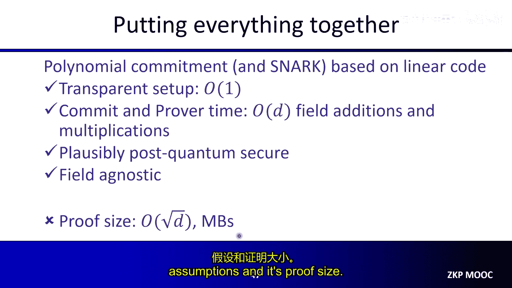

So that's the end of this lecture and in the next lecture we are going to discuss the fry protocol and the stark construction。

Thank you for listening。

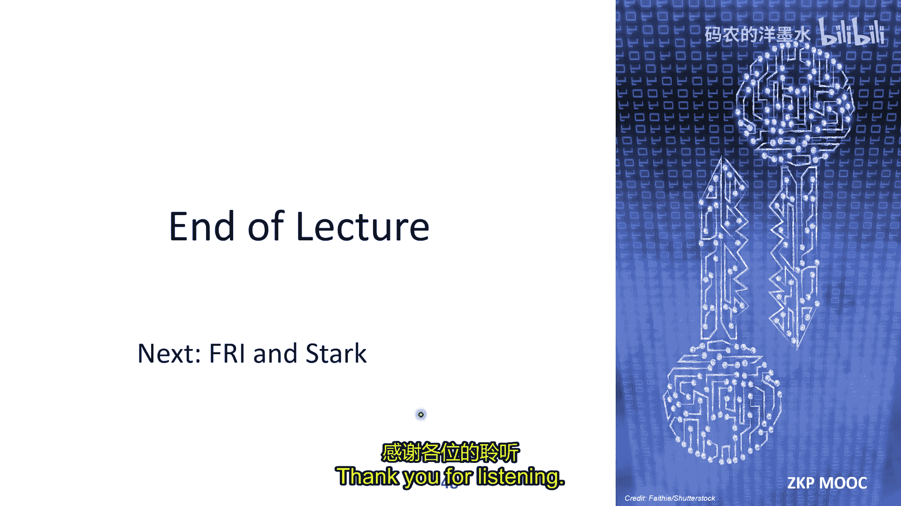