# 【全集】加州大学伯克利分校 Web3：零知识证明 区块链技术与隐私计算 中英字幕 1080P p08 Lecture 8 - 基于 FRI 的多项式承诺 -BV1bCrpB2E7Q_p8-

This is lecture8 of the ZK learningOOC I am Justin Thaler and this lecture will cover Fry-based polynomial commitments and the Fiat chimre transformation Well as a reminder。

 most snarks are designed by combining two components a cryptographic protocol called a polynomial commitment scheme and a interactive protocol called a polynomial interactive oracle proof or a polynomial IOP and you can kind of take any polynomial IOP and any polynomial commitment scheme with some minor caveat and put them together to get an interactive argument that is succinct and then apply the fiat chimre transformation to render the succinct interactive argument nonin and thereby obtain a snark so at this point in the course we have seen a variety of different。

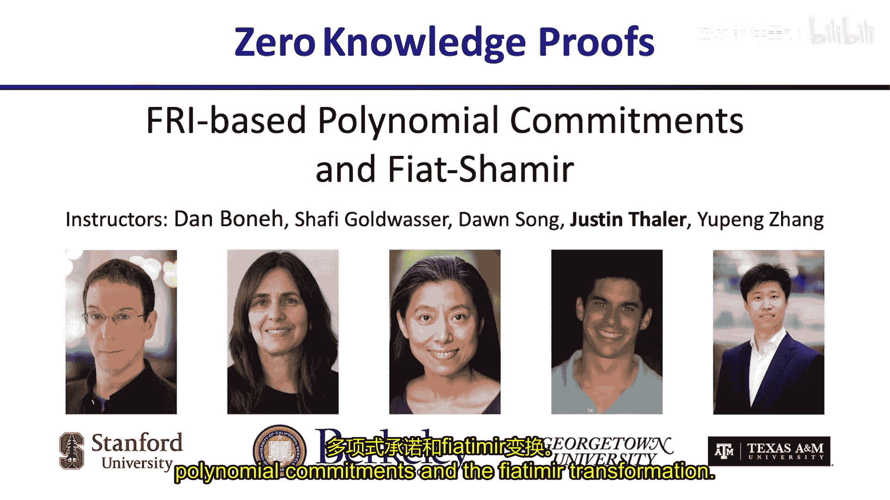

Polynomial IOPs and a variety of different polynomial commitment schemes and each individually has sort of trade offs。

 you know a unique performance profile and pros and cons and the combinations of polynomial IOPs and polynomial commitments also inherit the corresponding pros and cons。

 so I thought I would give a very brief summary。Of the various performance profiles obtainable from the protocols that the course has already covered and the protocols that we have yet to cover as a brief reminder。

 what is a polynomial IOP and what is a polynomial equipment scheme。

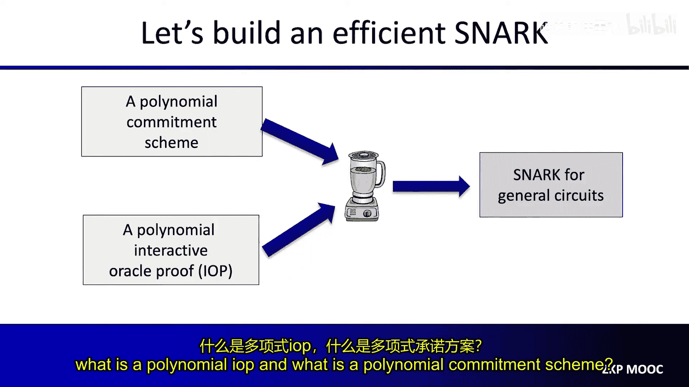

So I will tell you actually a special case of a polynomial IOP that suffices for most but not all snarks。

 so in this special case of a polynomial IOP， the prover's first message to the verifier specifies a polynomial H the polynomial H you should think of as very large so for example。

 if it is a uni polynomial its degree might be as big as the circuit that the prover is claiming to know a satisfying assignment for so as a result of the polynomial being so large。

 we don't want the verifier to have to read a complete description of that polynomial for example we don't want the verifier to have to read every coefficient of that polynomial that would simply destroys the sickness the verifier would simply be too slow so we will in the polynomial IOP not allow the verifier to learn H in full。

Rather， the verifier will only be permitted to evaluate H ats say a single point of the verifier's choosing and after the verifier evaluates H at that point。

 the prover and verifier then execute a standard interactive proof。

 meaning other than that very first special message that specified the polynomial H every other message from the prover is short and read by the verifier in full and then at the end of the polynomial IOP。

 the verifier decides whether to accept or reject the prover's claim as valid。

A polynomial commitment scheme is a cryptographic protocol that is essentially exactly what we would need to turn a polynomial IOP into a succinct interactive argument so specifically a polynomial commitment scheme allows the prover to more or less simulate the polynomial IOP without explicitly sending a description of this large polynomial H to the verifier so instead the polynomial commitment scheme will let the prover send a succinct cryptographic commitment to H to the verifier typically this will just be a single cryptographic hash value or a single element of a cryptographic group and the polynomial commitment scheme has to support the functionality of allowing the verifier to later choose an input X to the polynomial H。

And demand that the prover evaluate the committed polynomial h at X and then convince the verifier that indeed the evaluation that the prover returns to the verifier is equal to the committed polynomial evaluation at X so we call that an evaluation proof for the polynomial commitment scheme and the idea is that this just allows one to use a polynomial IOP without requiring the verifier to explicitly receive a complete description of the polynomial rather the verifier will receive just essentially a single hash value or cryptographic group element that commits to the polynomial and later it will receive the requested evaluation of the polynomial and a proof that the requested evaluation is correct so it effectively allows one to run a polynomial IOP succinctly meaning without the prover ever。

Sending this one giant message specifying the polynomial H explicitly to the verifier。

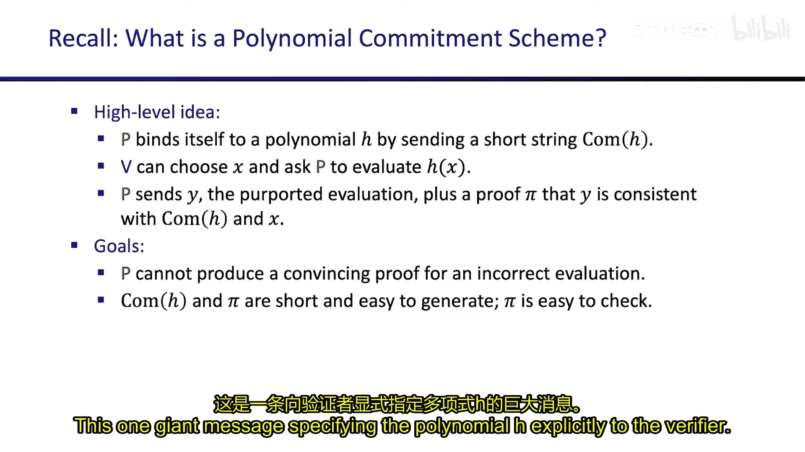

Okay， so as I've already reviewed， there are several different polynomial IOPs out there and several different polynomial commitments and you can kind of take any polynomial IOP in any polynomial commitment and put them together up to some minor caveats and it's always worth reminding you that the resulting Snark inherit the property of being transparent or not。

 or if being plausibly postquum secure or not entirely from the polynomial commitment scheme used。

 so if I tell you what polynomial commitment scheme the Snark is using。

 you will immediately know is the SNarrk transparent versus does it require a trusted setup is it plausibly postquum secure or is it obviously not post quantumum secure。

Okay， now a very brief overview of known polynomial IOPs。

 so I categorized them into three different categories， one is based on what are called Inter proofs。

 the others is based on what are called multiproer Inter proofs。

 essentially both of these categories were covered in lecture4。

 the first lecture that I gave in this MOC。And then the third category， according to my taxonomy。

 is what I call constant round polynomial IOPs。And the example the most prominent examples here are Marlin and Planck and so Dan covered the Planck polynomial IOP I think in lecture 5 and very roughly speaking the above snarks are listed an increasing order of prover costs but decreasing order of verification costs so snarks based on Inter proofs and multiinactive proofs broadly speaking have the fastest prover。

 but higher verification costs than snarks like Marlin and Planck everything of course does ultimately depend as well on what polynomial commitment scheme you combine the polynomial IOP with Marlin and Planck both typically use KZG polynomial commitments which keeps the verification costs really low because KZG polynomial commitments is the polynomial commitment scheme with the best known verification costs。

In terms of polynomial commitment schemes that people use and practice today。

 I categorize them into three classes， I think this is a pretty common way of classifying those polynomial commitments the first category is based on pairing friendly groups and trusted setup meaning that such polynomial commitments are neither transparent nor post quantumum secure because anything that uses a cryptographic group is not post quantumantum and anything that uses a trusted setup is by definition not transparent the most important example in this category is KzG commitments which were covered in both lectures 5 and6 and the unique property that KZG commitments have is their evaluation proofs and the commitment itself is just a constant number of elements of a pairing friendlyendly cryptographic groups so we call that constant size proofs and they are these commitments KzG commitments are unique in achieving that the second category of polynomial commitments is based on the discrete log。

hym problem and do not require a trusted setup So these will be transparent。

 but they're not post quantum secure again， because the discrete logarithm problem can be solved in polynomial time if we had a large enough quantum computer。

Examples in this category include IPA also known as bulletproofs， which youpen covered in lecture 6。

 HiRAs and Dory Dory does use pairing friendly groups。

 but it is transparent unlike KzG polynomial commitments。

 you could think of Dory as roughly taking bulletproofs， which has logarithmic size proofs。

 but linear verification time and addressing the linear verification time reducing it to logarithmic verification time at the cost of needing to use pairing friendlyri groups。

 whereas bulletproofs does not and also at a concrete cost even though the proof length is logarithmic the Dory evaluation proofs are concretely substantially bigger than the bulletproofs evaluation proofs。

 even though asymptically they're the same。And then the third category of polynomoma commitments that people use today is based on hashing。

 so the only cryptography they use is Merkel hashing and the fiat chimir transformation。

 both of which only use cryptographic hash functions So this category is both transparent and plausibly post quantumum secure the prominent examples in this category。

 the most prominent one is fry， that's because it is the example in this category with the shortest our evaluation proofs that will be the subject of today's lecture and we saw other examples in this category last lecture。

 lecture 7， these include the hero breakdown and Orion so broadly speaking here。

 the three category I have listed in increasing order of verification costs So Kzg commitments have constant verification costs。

 things like bulletproof and Dory have logarithmic verification costs and protocols like。

Fry and Orion have polylogarithmic verification costs。

 so that is at least log squared size proofs with a significant dependence on the security parameter as well So it's like security parameter times log squared of the size of the polynomial being committed in this third category for fry okay so another thing worth mentioning is that commitment schemes from the first two categories that is using cryptographic groups or homomorphic So this means you can take a commitment to polynomial one and a commitment to polynomial2 and without knowing what polynomial one is or a polynomial2 is you can kind of add the commitments together to get a commitment to polynomial1 plus polynomial2 so you can kind of do addition underneath the commitments right again。

 you can take two commitments and derive a commitment to the sum of the two committed objects without actually knowing either the committed objects So these homomorphism properties of discrete。

Aarrithm and pairing-based polynomial commitments are really important for fishinging batching and amortization properties of snarks。

 so this means things like you know a prover is proving to know many different witnesses and doesn't want to have to sort of pay a cost that grows linearly with the number of witnesses it's proving that it knows and these homomorphism properties without going into great detail right now allow the prover to kind of prove that it knows 10 different witnesses with costs that are not necessarily 10 times greater than proving that it knows a single witness and these sorts of homomorphism properties are likely to come up to lectures from now when Dan talks about exactly these topics so snark composition。

 batching and amortization。Okay， so the polynomial commitments based on cryptographic hashing alone are not homomorphic。

 so they are not quite as nice if you're working in a setting where there's opportunities for batching and amortization。

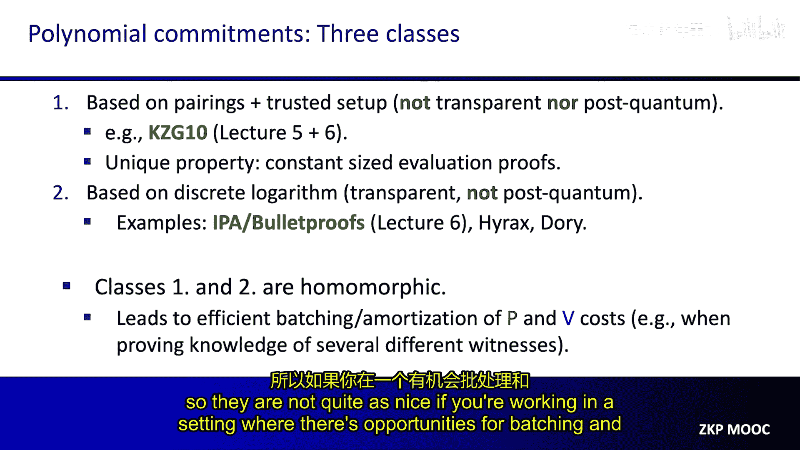

Okay， so again， you can take any polynomial IOP in any polynomial commitment scheme and with some modest caveat to put them together to get a snark or at least a succinct interactive argument that you can make into a snark with fiat Shamir。

 so let me just briefly summarize some particular snarks that are especially popular right now and explain what their pros and cons are just to try to make this big zoo of snarks that you can get a little more concrete。

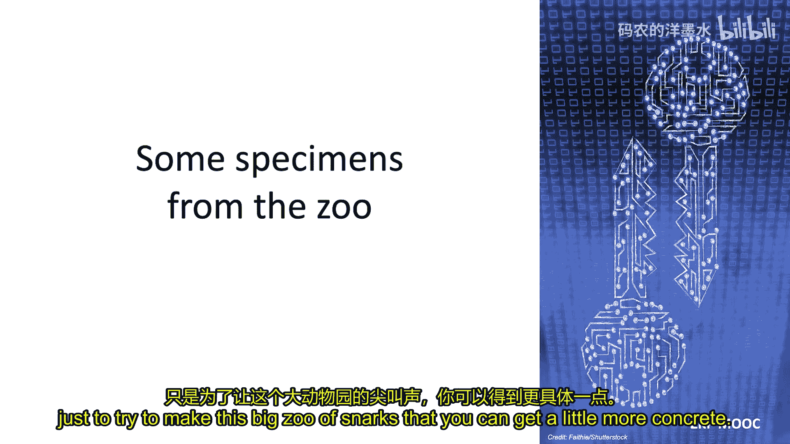

Okay so I'll start with transparent snarks so one very popular implementation of parent snarks today is Halo2 I've written here Halo2 hyphen Zcash basically to indicate the halo2 codebase with bulletproof/ IPA as the polynomial commitment scheme because there's a different branch of the Halo2 codebase that swaps out IPA/ bulletproofs for Kzg in order to take advantage of smaller proofs and things like that at the cost of a trusted setup and by the way。

 this is essentially the Planck polynomial IOP with the bulletproof polynomial commitment scheme the benefit especially of using bulletproofs as the polynomial commitment is that this obtains the shortest proofs among transparent snarks out there today the downside is especially in a non-amor tie setting the verifier is very slow。

Your time in the size of the quote circuit that the prover is claiming to know a satisfying assignment for。

 so this is not a work savingaving verifier， but it is a succinct proof this is one reason I like to separate the notion of short proofs and fast verifiers right because people do call halo to a snark in fact in a non name or tie setting it is not work savingaving for the verifier so apparently in this context the word succinct is referring only to proof length and not to verification time。

Okay another example is you can actually take any polynomial IOP and combine it with fry-based polynomial commitments and examples here include what people call starks fractal aurora Virgo lahro plus plus and Leherro itself is polynomial commitment scheme in the same category as fry but with bigger proofs lahero plus plus kind of combines the Laharro polynomial commitment scheme with the fry polynomial commitment scheme to kind of get the nice prover costs of Lehro but the shorter proofs of fry so the pros of snarks from this category is because they use fry as the polynomial commitment they obtain the shortest proofs amongst plausibly post quantumum snarks unfortunately those proofs are still pretty big so they are at least hundreds of kilobytes they'd actually be into the multiple hundreds depending on what exactly you want to base security upon。

cuss this later in today's lecture Another thing that practitioners like today about snarks in this category is that there's more flexibility in what field you work over so any of the snarks that use cryptographic groups inside the polynommal commitment scheme。

 so this means anything based on KZG anything based on bulletproofs or Dory or hi racks。

 these all use cryptographic groups and cryptographic groups have to be defined over fields that are quite large。

 so at least about 256 bits in size if you want。128 bits of security in fact。

 if you need to work over a pairing friendly group。

 the resulting fields will be of size even like 381 bits。

 that is the field has size 2 to the 381 so for example one of the most popular pairing friendly curves is called BLS 12381 and that 381 means that the field over which it's defined is of size about2 to the 381。

So if you use a polynommal commitment scheme such as Fry that does not use any cryptographic groups。

 which is exactly why it's plausibly post quantumum secure。

 you can work over potentially smaller fields and moreover。

 those fields can be a little more structured and together both the field size。

And the nice structure in the field can lead to faster field arithmetic and therefore potentially speedups for both the prover and the verifier。

 I think it's worth pointing out two caveats regarding this field size flexibility that the hashing-based snarks have one caveat is that if the field that one works over is too small。

 say of size about two to the 64， rather than of size say two to the 128 or larger。

 there are components of the protocol of the snark that will need to be repeated several times。

 in order to achieve an adequate security level， so that can potentially offset some of the benefits of faster field arithmetic if you have to repeat some aspects of the protocol multiple times。

 another caveat。I that many of the most important statements that are being proved today are actually statements about elliptic curve groups those statements are naturally statements about very large fields。

 so if those are the statements that you are proving or that you are spending most of your time proving that there is very little point to being able to work over smaller fields because the best thing to do would be to work over the large field that your statement is naturally about and in fact working over a different field will only slow things down and add overhead So for example when transactions on the blockchain are very simple such as token transfers probably the most complicated aspect of proving to the blockchain that you know a bunch of transactions is proving that the transactions。

Vid digital signatures that is that the transactions were authorized properly by the owners of the accounts affected by the transactions。

 the digital signature schemes used today are defined over elliptic curve groups and for this reason some of the rollups out there today are working over very large fields such as 251 bit fields。

 while using fry， so although Fry gives the flexibility to work over small fields it is very natural to nonetheless not take advantage of the flexibility if you are proving statements about large fields because the statements you are proving refer to elliptic curve-based digital signature schemes or a third important category of transparent snarks out there will combine various MI-based or IPbased polynomial。

Ps with any polynomial commitment scheme that's particularly fast for the prover and this combination will give you the fastest prover out there today。

So examples here include Spartan breakdownak Orion and Orion Plus Orion Plus is a part of a paper called hyperplc。

 so for all of these protocols， the underlying polynomial IOP is based on the sumche protocol we discussed in lecture4 and each of these papers combines that polynomial IOP with a different polynomial commitment scheme meant to be fast for the prover。

And the yeah， generally speaking， the downside of these snarks right now today， at least。

Is that their proofs tend to be bigger， although actually Orion plus reports proof sizes under 10 kilobytes。

 which in fact is much smaller than fry base proofs。But。

It does so using a variant to KzG commitment so it in fact is not in the transparent snarks category despite me listing it on this slide Okay so that is a brief summary of some highlights on in the category of transparent snarks let me now briefly move to highlights of nontranspar snarks so one of the most popular nontransparent snarks especially going back a couple years is growth 16 So this is sort of the culmination of a long line of work on snarks derived from linear PCPs this is exactly the topic of next lecture which youpen will be given and the benefits of linear PCP based srks such as growth 16 is that they have the best verification costs so growth 16 proofs are only three group elements and the。

Fier just does a handful of pairing operations is typically the verification time bottleneck and the con。

 the major con of growth 16 is that not only is there a trusted setup。

 but it's a circuit specificific trusted setup so if you change the circuit about which the prover is claiming to know a satisfying assignment then you have to run the trusted setup all over again it also tends to be fairly slow and space intensive for the prover and due to its use of pairing friendly groups or just any cryptographic groups even and if they weren't pairing friendly。

 it is not post quantumum secure。Now the other two highlights out there of nontransparent snarks are Marlin and Planck。

 both referring to when they use the KZG polynomial commitment scheme the big benefit of these over G 16 is that the trusted setup is circuit independent so you run the trusted setup once and that trusted setup will work for any circuit up to a given size bound。

 the downside of Marlin and Planck relative to G 16 is that proofs are somewhat larger than G 16 and the prover is slower than G 16。

 at least for a given circuit that G 16 also applies to a counterpoint in terms of prover time is that growth 16 is somewhat restricted in the kinds of circuit it can use specifically。

It's sort of very specific to either R1 Cs or arithmetic circuits and all of the other srks out there can actually apply to somewhat more expressive kinds of circuits。

 so it's possible that the。Slower prover of Marlin and Planck relative to G 16 for a given circuit can be more than offset by the ability of Marlin and Planck to apply to a more general class of circuits and a slower prover applied to a smaller circuit might in the end be faster than a faster prover applied to a bigger circuit Another thing people like to say about Gro 16 is that quote addition gates are free and what they mean is that the trusted setup in G 16。

 which is circuit specific， does have runtime costs that grow with the number of addition gates in the circuit but once the trusted setup is done。

 the prover in G 16 essentially does not quotepay in runtime for any addition gates in the circuit that the prover is claiming to know a satisfying assignment for whereas in。

Marlin and Planck addition Gs would contribute to the prover tie okay。

 that completes my overview of the polynomial IOPs。

 polynomial commitments and combinations that are popular today and hopefully it clarifies why we are covering so many different。

Polynomial IOPs and polynomial commitment schemes， the design space is quite rich and understanding all of the possible performance profiles does require understanding many different ideas and techniques。

 there's just a lot of different trade offs available out there。

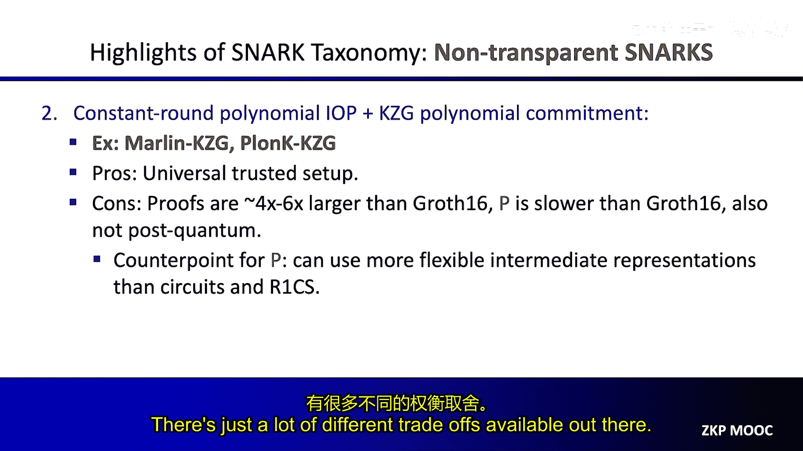

Okay， so the rest of today's lecture will be focused on fry based polynomial commitments and more details about the Fiat Shimir transformation than have been covered in previous lectures。

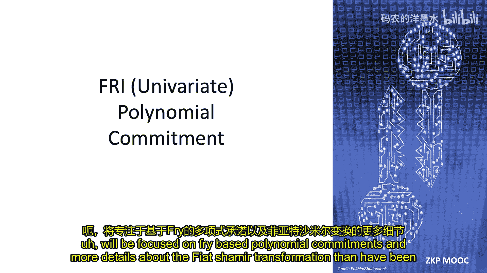

Okay， so let me remind you what is a Uniivariate polynomial commitment scheme。

 so we're going to let Q be a polynomial of degree k minus1 over some prime field FP P is a prime so that means that Q has k coefficients。

 for example， if k is5， then Q might be 1 plus 2x plus 4x squared plus x to the fourth。So here。

 the coefficient of the term x cubed is zero。And in a univariate polynomial commitment scheme。

 we would like the prover to be able to commit to Q and later reveal Q of R for an input R chosen by the verifier and the prover is going to have to prove that the return evaluation is indeed consistent with the committed polynomial now you might remember from lecture 4。

That I sketched a polynomial commitment scheme that simply had the prover Merkel commit to all evaluations of Q so that way。

 when the verifier requested Q of R the prover could simply reveal the associated leaf of the Merrkel tree along with its authentication path but this had two problems this did not actually directly give an interesting polynomoma commitment scheme the first issue was that there is one leaf in this Merrkel tree for every element of the field。

 which means if we are working over a pretty large field， the prover will just take way， way。

 way too much time to build this merkel tree and determine what is the root hash so we would really like the prover time to grow with the degree of Q and not with the size of the field which is typically much。

 much， much larger than the degree of Q and secondly， this does not give。

Verifier any guarantee that the function that is committed that is the function whose evaluations are the leaves of the tree actually has degree at most K minus1 Merrkel trees do bind the prover to the vector given by the leaves but do not provide any information about structure within that vector so the verifier in this sort of initial attempt at a polynomial commitments scheme from lecture4 would have no guarantee at all that the function that the Merkel tree binds the prover to is actually of degree at most K minus1。

Okay， so let us fix the first problem regarding the prover's time being linear in the degree of the polynomial and not the size of the field。

So rather than having the prover commit to all evaluations of Q across all inputs in the entire field。

F I will instead have the prover only commit to evaluations of Q for those points x in a carefully chosen subset omega of the field。

 specifically this set omega will have size row inverse times k for some constant row so think of row as less than or equal to1 half。

 so row inverse is at least two。And this factor row inverse in front of the degree bound K is sometimes referred to as the fry blowup factor。

Row itself as opposed to row inverse is also called the rate of the read Solomon code used in fry。

 I will explain that in more detail later now due to the prover Merel committing to all evaluations of the committed polynomial Q over a set omega of size row inverse times k there is a very strong tension between prover time and verification costs okay because the bigger the blowup factor row inverse。

 the bigger the prover time because the prover has to spend the time to evaluate Q at all points in omega so the bigger omega is that is the bigger row inverses the longer it takes the prover to evaluate Q at all those points and then build a Merrkel tree over all those evaluations on the other hand。

 as we will see the bigger the blowup factor the smaller the verification。

Cost will be for fry when the verifier receives an evaluation proof if the blowup factor is very big the proof will be shorter and the verification of the proof will be faster specifically here is how the verification cost in fry depend on the blowup factor row inverse so this expression will be a little bit technical but I'll explain how to think about it in a moment so the proof length and ver fire time is this many hash evaluations so here lambda is what's called the security parameter also known as the number of bits of security at which fry is configured so you can think of lambda as roughly the logarithm of the amount of work that a cheating prover would have to do to convince the verifier to accept a false claim in fry so that is。

The adversary will have to run in time about two to the lambmbda in order to find a convincing proof of a false statement and the size of the fry evaluation proof will be roughly lambmbda divided by log of the blowup factor。

Times log squared of the degree of the committed polynomial， many hash values。

 so the way to think about what happens in fry is that the verifier of fry makes queries to the committed vector and roughly speaking each individual query requires the prover to return log squared K。

Many hash values。 Those are coming from Merkel authentication paths， but in fact。

 there are many Merrkel authentication paths that need to be provided for each query。

 and hence the number of hash values returned for each query is not log K。

 as it would be with a single Merrkkel tree， but in fact， is the square of that。

 So then the question becomes how many fry verifier queries must be made to achieve lambda bits of security。

 and the answer is roughly lambmbda over log of the blowup factor。

 So that is each fry verifier query provides about log of the blowup factor。 Many bits of security。

 So in order to achieve lambmbda bits of security。 The number of queries required is lambmbda over log of the blowup factor in summary。

The proveverses time grows linearly with the blow up factor， at least。

But the verifier's cost in terms of both proof length and verifier time falls logarithmically with the blowup factor。

 so bigger blow up factor means more prover time， but less verifier time and shorter proofs。Okay。Now。

 let me tell you what is this subset omega at which fry requires the prover to evaluate the polynomial queue to be committed。

So remember I said omega has size the blow up factor times the degree bound K。

 so let me just give that size a name， let me call it n and let's assume n is a power of 2。

 which fry will actually essentially require， So what omega consists of is the set of all n roots of unity in the field。

So that is the set of all field elements x， so that if you raise x to the n power， you get out one。

Okay so this is how to think about roots of unity I have actually depicted here roots of unity over the complex numbers but in fact roots of unity over a finite field behave very similarly to roots of unity for the complex numbers so I think the roots of unity the picture on the slide is exactly what you should have in mind as you try to think about roots of unity used by fry so this first image here is the 16th roots of unity amongst the complex numbers so this represents the number one because the real component is one and the complex component is zero and this represents the number minus1。

Okay， this is I， this is minus I。Okay， so this root of unity right here is what's called the primitive root of unity for amongst the 16th roots of unity。

 so this means if you take this primitive root of unity and you multiply it by itself。

 you get this root of unity。If you take this root of unity and you multiply it again by the primitive root of unity。

 you get the next root of unity and every time you multiply again by this primitive root of unity。

 you step to the what would this be counterclockwise one root of unity， and after 16 multiplications。

 so you take the primitive root of unity and you raise it to the 16 power。

 you get all the way around to one。Okay， now if we look at the a root to unity。

 you see something very similar， we have essentially just taken all of the。

 you know as we step around the circle， we've taken the odd steps so the primitive 16 root of unity you know that to the third power that to the fifth power that to the seventh power we've gotten rid of them okay so like the primitive a root of unity is the primitive 16th root of unity squared。

And you know the next a root of unity is the square of that and so on and so forth and and then once again。

 I've drawn the fourth root of unity here and yeah we've taken sort of the even indexed a root of unity so this one's1 you know this one's35。

7 by that I mean just the order in which you encountered them as you step around the circle and they're gone the odd ones are gone and the even ones remain so basically every time we take primitive root of unity and we square it we get a primitive root of unity for you know rather than n n becomes n over2 and this is exactly the sort of behavior or the sort of that is exploited by fry so let me just state some facts about the primitive n roots of unity over a finite field each of these facts except possibly the last one will exactly mirror the complex numbers。

Picture I just showed on the previous slide so if omega is a primitive n root of unity that is n is the smallest integer such that omega to the n equals 1。

 then this capital omega set of all n root to unity in the finite field is just given by all powers of omega So the zero power is1。

 the first power is omega itself， and as you just increase that power 2，3，4 up to n minus1。

 you step through all of the n root to unity in the finite field。

 the next fact is that the n root to unity form what's called a multiplicative subgroup of the field This just means that if x and y are2 n through to unity。

 then so is their product This is easy to see because the product x times y raised to the power is the same as x to the n times y to the n and since x and y or both n through to unity both x to the n is 1 n y to the n is 1。

As well and one times one is one， so you take two n through to unity， you multiply them together。

 you get out another n through div unity。There are two special cases of this fact that are particularly important which follow from n being even okay the first is that if x is an n through div unity。

 then x squared is an n over 2 through div unity， this holds because obviously since n is even n over 2 is an integer。

And hence， x squared to the power n over 2 is the same as x to the n。

 which is just what the second special case。Again， since n is even is that for any n root of unity x minus x is also an n root of unity。

 this holds because clearly minus1 is an n through of unity since n is even since minus1 to n even power is1 and so minus x is the same as minus1 times x and you by the closure of the n root to unity under multiplication。

 that means that minus x itself is a n through of unity the final fact is also if you know。

 I guess a little bit of group theory is also a consequence of the second fact which is that the set capital omega of n through to unity has size n if and only if n divides p minus1 so a basic fact from group theory is that the size of any。

Multipplicationicative subgroup of a multiupplicative group divides the size of the full multiplicative group and the multiplicative subgroup of the field Fp has size exactly p minus1 so you can only have a non-trivial set of n through to unity if n divides p minus1 and it turns out that the converse is true as well so this is why many fry- based snarks work over fields for which a very large power of two divides the field size minus1 so for example a popular field today to work over when using fry is the so-called goilocks field of size 2 to the 64 minus2 to the 32 plus1。

One reason this is so popular is that if you subtract one from the field size。

 you get out 2 to the 64 minus2 to the 32， which is divisible by 2 to the 32 okay so basically you can use within fry the n through to unity for n equals 48 16 32 64 all the way up to 2 to the 32 no 2 to the 32 is about 4 billion。

Okay， so let me just give an example of the roots of unity used by fry over a finite field rather than over the complex numbers。

 so I will choose the prime field of order 41 so in this case the size of the multiplicative subgroup of this field which is specifically all nonzero field elements。

 is。4ty。And 40 is divisible by8。That is the largest power of two that divides 40。

And so that means that there are8 a root to unity in this field。

 and we can kind of enumerate the a roots of unity by starting with the first root of unity and then moving to the two second roots of unity。

 you know which are just one and minus one because those are the only values in the field such that if you square them you get out one。

Then if you move to the fourth roots of unity you'll see there are for them it's one minus1。

9 and minus9 so you can just check like 99 to the fourth turns out to be congruent to 1 modulo 41 so requires a little bit of algebra but it is the case you know you can check this one of the facts I included on the previous slide was that if x is an n root of unity so is minus x as long as n is even and you see that here so you one is a fourth root to unity so is minus19 is a fourth root of unity so is minus9 and then moving to the eighth roots of unity there are8 of them again8 divides p minus1 and they are 1 and minus19 and minus-9。

3 and minus3， 14 and minus14 okay so。summaryum， as an example here。

 if you were using fry to commit to a polynomial Q over this field with 41 elements and you were using as the commitment set the set of a through to unity。

 the commitment to Q would simply be to take Q evaluated at each of the A through to unity。

Mirle hash them and the root of the Merkel tree。Is。The commitment to Qe with fry。Okay。

So that has fixed the first problem with our initial attempt at a polynomial commitment scheme from lecture 4。

 namely no longer does the prover time grow with the size of the entire field in this example 41 only does the prover time grow with the degree of the committed polynomial k minus1 times the fry blowup factor。

 I just think of it as two2 or4 or sometimes it's 16， sometimes people will have it even higher。

 but anyway think of it as some constant times the degree hence in general time for the prover to compute the commitment is some constant then the fry blowup factor times the degree instead of proportional to the size of the entire field。

 so in general the field might be vastly vastly bigger than 41 elements and might have size。

Close to 2 to the 64， or close to2 to the 128 or even close to two to the 256。

Okay now there is a second problem that we encountered with our initial attempt at a polynomialquium scheme in lecture field for namely that the verifier needs to know that the Merkel committed vector consists of all evaluations over this domain capital omega and through to unity of some polynomial of the appropriate degree remember Merkel trees do not give you any promise do not tell you anything about the structure of the committed vector all they do is bind the prover to some vector and then enable the prover to reveal entries of the vector to which it is bound it does not by itself tell you that that vector has any structure at all it's just some arbitrary vector so the idea of fry is taken from the literature or probabilistically checkable proofs the idea is that the verifier should inspect。

Just a few entries of the committed vector to try to get a sense of whether it indeed has degree at most k minus1 or not Now。

 of course， each query to the committed vector will require the prover to not only respond with that particular coordinate of the committed vector but also a authentication path consisting of log and hash values to prove to the verifier that the coordinate returned by the prover is indeed consistent with the committed vector unfortunately if you just directly use these so-called low degree tests from the probabilistically checkable proof literature in the context of fry they would be impractical the verifier would unfortunately have to inspect a concretely very large number of entries of the committed vector and also the field one would。

Have to work over at least to get provable security from the load degree test would be enormous so we do not directly use the load degree test that were designed in the probabilistically checkable proof literature from years ago instead the fry load degree test will be interactive more specifically it will consist of what I call a folding phase which will consist of logarithically many rounds meaning the verifier will send a field element in round one and the prover will respond with another Merkel commitment then the verifier will send a second field element in round two and the prover will respond with yet another Merkel commitment then the verifier will send another field element and the prover will respond with another Merel commitment so on and so forth for log K many rounds and then finally the verifier will make these fry verifier queries I referred to several slides ago when discussing verification costs。

And that query phase where the verifier makes its queries is only one round。

 so the interactive part of the fry load degree test primarily lies in the folding phase。

 the query phase is minimally interactive the verifier just basically sends all of the queries and wishes to make and the prover respond with the answers and associated Merkel authentication paths Okay so let's talk about what the folding phase does。

So in the folding phase， the idea is to force the prover to repeatedly do the following。

 the prover should randomly fold the committed vector in half。

So this means pair up entries of the committed vector， so pair up like the first and second entry。

 the third and fourth， the fifth and sixth， then the verifier will pick a random field element R and use R to randomly combine every two paired up entries in this way the length of the folded vector will wind up being half the length of the original vector because for every pair of entries in the original vector we sort of randomly combine them into a single entry of the folded vector and what fry does is have the prover commit with a Merrkel tree to the folded vector now the random combining technique is specifically chosen so that if the prover is honest。

 the folded vector will also have half of the degree of the original vector so not only should folding reduce the length of the vector by a factor of two it should also reduce the degree of the polynomial that is you whose evaluations are given by the folded vector by a factor of two。

Okay so if the original polynomial had degree at most k。

 then after we fold the original vector log base 2 of k times the degree should fall to0 at this point because the original vector had length k times the fry blowup factor。

 while you know this final vector has degree0， meaning if the prover is honest， it is constant。

 it's a constant function， the length of this final folded vector is at least two。

 I mean specifically it's at least the fry blowup factor which is at least two so while this final folded vector has two or more entries because its degree should be zero if the prover is honest。

 the prover can actually specify， the final folded vector with a single field elements right any degree zero polynomial is。

Just constant。 that is it maps every element of its domain to the same output。

 so that output is just some field element。 So rather than sending。

One field element for each entry of this final folded vector of which there are you know row inverse of these entries。

 the prover can send just a single field elements specifying the value that that final folded function takes across its entire domain that domain having size equal to row inverse the fry blowup factor here is a picture or example of the folding procedure used in fry when the committed polynomial Q is committed using the a through to unity from my example before over the field of size 41 so。

As you can see in the first fold。The entries of the initial committed vector containing Q's evaluations at all a through the unity are paired up with Q of 1 paired up with  Q of minus1  Q of 9 paired up with  Q of minus9 and so forth and then based on the verifiers randomly chosen field element r1 in that iteration of folding each pair of paired up entries are combined do not worry right now about the precise coefficients used to do the combining that is chosen specifically so that if the prover does the folding honestly。

 the degree of Q will reduce by a factor of 2 upon folding and then folding is done again and again until the resulting vector should be all evaluations of a degree0 polynomial over。

The row inverse roots of unity again row inverse is the fry blowup factor at that point because the vector should be all evaluations of a degree0 function。

 in fact the prover if honest can just specify that vector with a single field element so here I have depicted two folds。

Okay now the final phase of fry as mentioned before is the query phase。

 it's when the folds have all been done， the intuition of the query phase is that P may have lied at some step of the folding phase by not performing the fold correctly so that is you know the prover is supposed to pair up entries of the current vector at each iteration of the folding procedure and combine the paired up entries in a very specific way and the prover may not have done that it may not follow the prescribed folding procedure with the goal of artificially reducing the degree of the claimfolded vector because by the end of the folding procedure it has to wind up with a constant function。

 that is a degree0 polynomial so if the original committed vector。Not have degree k minus1 as claims。

 but rather had much larger degree， say degree as large as n。

 which is bigger than K by a factor of the fry blow up factor。

 the only way the prover is going to ultimately wind up with a。

Degree0 function after log K many folds conceptually or intuitively is if the prover lies in some folding procedure and does not actually do the fold properly so the point of the query phase is for the verifier to try to detect any situation whereby the prover did not perform a fold correctly。

 so the verifier in the query phase will look for inconsistencies between you know two vectors。

 one of which is supposed to be the folding of the other。

So what this means is roughly the verifier will pick this many entries of each of the committed vectors that are supposed to be foldings of the preceding vector。

 this number is exactly the number that we discussed before。

 whereby each query is providing about log of the blowup factor， many bits of security。

 so we're going to need to pick about lambda over log of the blowup factor。

 many entries of each folded vector to get lambmbda bits of security。

 and we need to confirm that for each selected entry of each vector indeed that entry is the appropriate linear combination of the relevant two entries of the previous vector。

Okay， so this leads to a proof size displayed here。

What is happening is each of the folded vectors of which there were log K of them is queried at this many points so the desired number of bits of security lambmbda divided by log of the fry blowup factor and then for each query there is a Merrkel authentication path that must be provided along with the answer to the query the length of that authentication path is log of the length of the committed vector that is being queried。

 so the total number of hash values sent is equal to the total number of queries to each of the log K vectors with each authentication path being about log K hash values and that gives you roughly this total quantity of hash values sent as the fry。

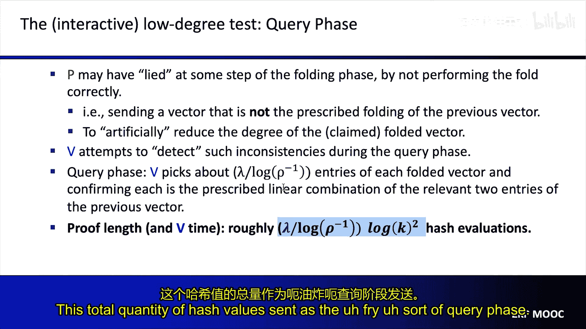

Sort of query phase okay so let's go into just a little more detail about how the folding phase actually works so the idea is that fry is going to split the committed polynomial Q into even an odd parts where basically the even part will just take into account coefficients of even degree and the odd part will take into account coefficients of odd degree okay so for example ifq of x where just one plus 2 x plus 3 x squared plus 4 x cubed then I'm saying the even component of  Q would be one plus 3x so this is taking the coefficients of even degree and sort of dividing the powers by 2 and then the odd component would be 2 plus 4x this is taking the coefficients of odd degree。

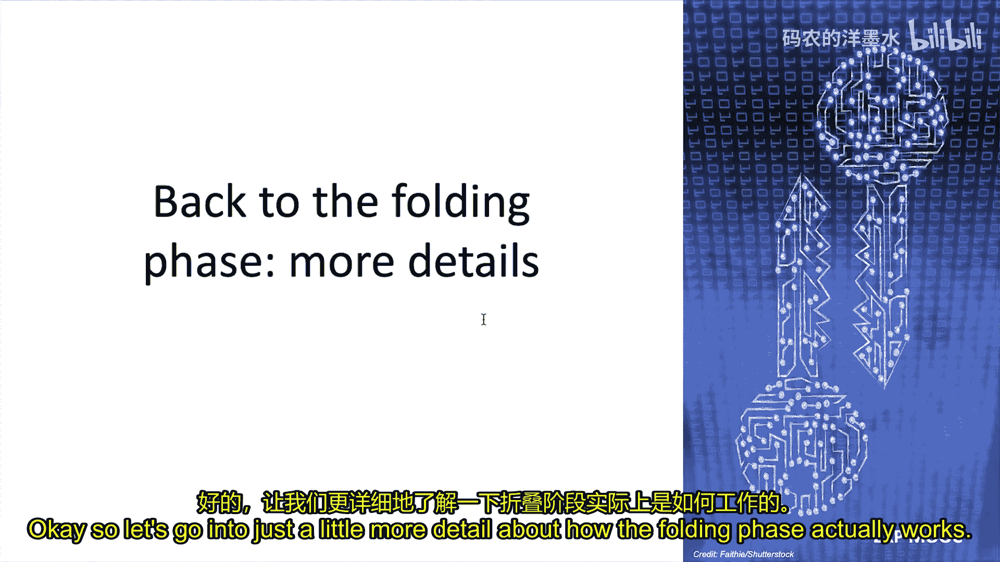

Again， dividing the powers by  two and taking the floor that ensures that we can write the original polynomial Q as the even component of Q evaluated at x squared plus x times the odd component of Q evaluated at x squared So we've literally just defined Q E and Q O so that this equality holds so we think of sort of Q E as capturing like one half a Q and Q O as capturing the other half a Q and we'd like to randomly fold these two halves together so what the verifier does is it picks a random field element R and sense it to p and they describe the folding of Q to be exactly what I just said so Q E plus R times  Q O so I have described the folding procedure in this way to make clear that the degree of Q fold。

Is one half the degree of Q itself this is should be clear because we have split the original polynomial Q up into two halves Q E and Q O each of degree at most half the degree of Q itself and。

Take in a random linear combination of Q E and QO with the kind of randomness in the random linear combination given by this random field element are chosen by the verifier。

 and of course any linear combination of two polynomials both of degree at most n over2 is itself of degree at most n over2。

 so this way of defining Q fold makes very clear that the degree of the fold polynomial is at most half of the degree of the original polynomial that is being folded but it is not necessarily obvious that the folding procedure。

 as I've defined it here， is equivalent to the folding procedure I depicted several slides ago whereby I said we paired up each and root of unity with its negative。

and took a certain carefully defined linear combination of Q's evaluations at those two and through to unity so I now need to explain that the folding procedure I just defined in terms of Q E and QO is in fact equivalent to the folding procedure I depicted here in this picture so let us see that equivalence now okay so yeah I just defined the folding procedure in terms of Q E and QO right it was Q E plus R times QO is supposed to be the folded polynomial and I now want to explain the equivalentvalence with the picture from before which amounts to showing the following so if we let Z be x squared the picture I had from before。

Showed that Q fold of z was this very specific linear combination of Q's evaluations at x n minus x。

 so I'm just going to now explain that under the Q E plus R QO definition of Q fold。

 you get exactly this behavior whereby Q folds evaluation at n square of one of the n roots of unity is this very specific combination of Q's evaluations at the two square roots of z。

 namely x n minus x， so let's see why this equality holds that is why this Q EQO definition of Q fold implies other definition of Q fold at each n over2 root of unity z。

Okay， so we define Q E and QO specifically so that evaluating Q at x was equivalent to evaluating Q E and QO at x squared and namely Z。

Because z is x squared。Multiplying the latter by x and summing the results。

 So another way of stating this equality is that in our Q E， Q O definition of Q fold。

 if we set R to x， then Q fold of z。Is just exactly equivalent to Q of x。

Okay so we have now seen that under this definition of Q fold in terms of Q E and QO。

 if R were to equal x， then Q fold evaluated at z would just be Q of x。Similarly。

 if r were to equal minus x， then Q fold evaluated at z would equal Q of minus x。Okay。So in summary。

 what these two bullet points right here show is that we understand what Q fold of z would equal if r equals x or r equals minus x。

Okay， we have。Introduced the right hand side here。Exactly so that it has the correct behavior at R equals x and r equals minus x。

 That is this right hand side is explicitly defined。

So that it maps r equals x to Q of x and r equals minus x to  Q of minus x， right。

 you can just check that if r equals x， what we have here is x plus x over 2 x。

 that's1 times  Q of x。 And then what we have here is x minus x times whatever x minus x is 0。

 So x minus x times whatever is。0， the right hand side of this equality right here has exactly the correct behavior when r equals x or R equals minus x。

 and it is a degree one function of R and any two degree one functions of R that agree at two or more points must be the same function accordingly we have explained that this right hand side here is。

 in fact。The expression for Q fold of Z。Regardless of r's value， right。

 what's happening just to summarize is that weve verified that this expression is true when r equals x or r equals minus x。

 and because this is a degree1 function in R and it takes exactly the same values as this expression does at two different values of R。

 these must actually be the same expressions。Yeah， so that establishes the equivalentvalence of this definition of Q fold in terms of Q E and QO with the picture I drew before。

 which sort of explained or described Q folds behavior at each n over tooth root of unity Z as a certain linear combination of Q's behavior at the two square roots of the namely x and minus x。

 so I know this was a lot to follow online， but you can sort of take your time if you wish to or otherwise you can just believe me that we have two different equivalent definitions of Q fold。

 one as a random linear combination of Q E and QO， and the other via the picture from before whereby the folded polynomial evaluated at each of the n over2 root to unity is defined as a very specific linear combination of the original polynomial being fold。

At the two square roots of that n over tooth root of unity。

So I just want to mention that fry is heavily exploiting the fact that this squaring map is2 to1 when applied to the n roots of unity。

 if n is even this is why n is a power of2 is an assumption of fry so that n will be even throughout the entire folding procedure。

 you know you keep dividing n by 2， it's still a power2。

 so it stays even the whole time So this two to one nature of the squaring map on the n root of unity is what ensures that the relevant domain after each fold has in size。

 if instead we replace the n roots of unity with some other set such as all of the field elements between 0 and n -1 you would not have this property that squaring each of the field elements in the set would result in a set of half the size so if you look at0 squared。

1 squared2 squared。3 squared up to n minus1 squared you would get out n different values。

 at least as long as the characteristic of the field was bigger than n minus1 squared。

 that is not the case with the n roots of unity as you look at one squared omega squared omega squared squared omega cubed squared so you square each of the n roots of unity you don't actually get out n different values you get out n over two values kind of each appearing twice so that is a very important property of the n roots of unity that fry is exploiting that property is not satisfied by other natural interpolation domains such as kind of the first n field elements。

Okay， so that is a complete description of fry before I sketch why it is sounds and what you know talk about polynomial commitment schemes derived from Fry。

 let me compare it to the polynomial commitment schemes such as Laherro breakdown and Orion that we saw last lecture from UP。

Okay so in Uuppeng's lecture when he covered the error correcting codebased polynomial commitment schemes。

 those commitment schemes were very similar to fry in that they all used error correcting codes so Fry uses something called the Re Solomon code which involves you taking a vector interpreting it as a Uniivari polynomial and evaluating that polynomial at many points in the finite field in this case。

 the nro to unity and that's why I said before that this parameter row and fry is also called the rate of the read Solomon code that's where that terminology comes from is the coding theory literature on read Solomon codes so the polynomial commitment schemes in Upeng's lecture were very similar in that they also use error correcting codes not necessarily just the read Solomon code and the only cryptography they used was hashing now the differences between the lecture7 polynomial。

and fry， whereas follows so the lecture7 schemes viewed any degree D polynomial as consisting of D to the one half vectors each of length D to the one half and so they thought of the polynomial as sort of like a root D by root D matrix and they performed what I call a single random fold of all these vectors that is the verifier demanded that the prover send a random linear combination of the rows of this matrix so that's like one giant fold where you kind of combine root D vectors。

 each feature length root D into a single vector of length root D by taking a random linear combination of each of the vectors this winds up resulting in a polynomial commitment scheme with larger proofs than fry。

 namely size about root D but has some advantages over fry， for example。

 you can achieve a linear time prover， which fry does not。

Because evaluating the committed polynomial Q at all n through to unity requires superline time。

 whereas if you use a different error correcting code than the read Solomon code。

 you can hope for truly linear time also breakdown is unique today in that it works over any sufficiently large field unlike fry unlike Laharro unlike Orion。

 it does not have to work over a field where a very large power of two divides the field size minus1 in comparison to the lecture7 commitment schemes。

 which kind of did one giant fold of many vectors， fry views the polynomoma to be committed as a single vector of length order D order its degree the hidden constant in this big O notation is the fry blowup factor row inverse and what fry does is it randomly folds that vector in half logarithmically。

Many times so rather than doing a single giant fold。

 you know it does one fold in half to kind of have the size of the committed vector and the degree of the resulting polynomial and then it folds that in half and it folds that in half and it folds that in half until it's reduced the degree if the prove is being honest to zero So that's how I think you should compare the two conceptually everything from last lecture did a single giant fold fry does logarithmically many folds in half。

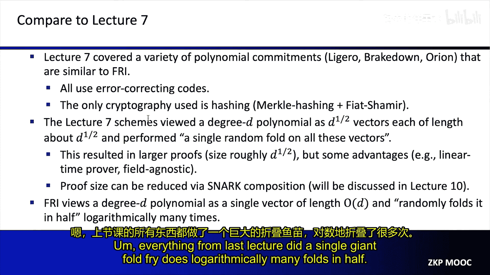

Okay now let me sketch the security analysis of fI。

 so recall that at the start of the fry polynommal commitment scheme。

 the prover sends a Merle commitment to a vector w。

 which if the prover is honest is equal to Q's evaluations over n through to unity where n is noticeably bigger then the degree of Q。

 namely K minus1。

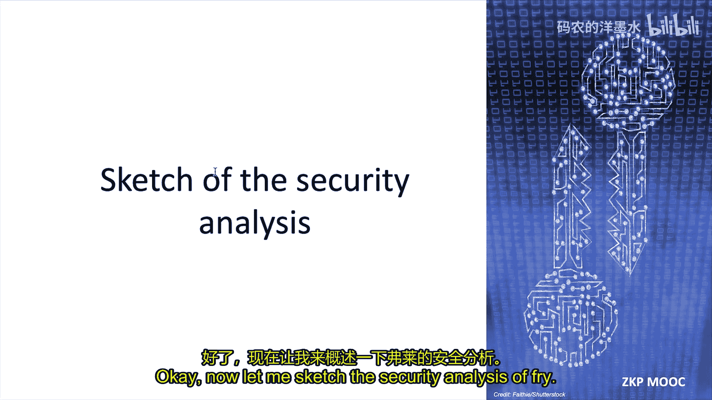

So the verifier needs to check that indeed this committed vector W has degree at most k minus1。

 and that is sort of conceptually difficult to do that's kind of the magic of fry。

 without just reading all of W which would destroy succinctness of the valuation proofs if the verifier needed to read the entirety of the committed vector。

 so yeah， in order to explain how the security analysis works， let Dlta。

Toote the relative hamm distance of the committed polynomial Q from the closest polynomial H that does have degree at most K -1。

 So think of H as like the closest honest polynomial。To the actual committed polynomial Q。 Okay。

 so if the prover is lying， the actual committed polynomial Q might have degree up to n。

But the closest honest polynomial is H。 and by honest， I mean。

 the closest polynommal that actually does have degree K -1， which the prover is claiming Q does。

 but is lying possibly。Okay， so by relative heming distance。

 what I mean is deelta is the fraction of n through to unity such that H and Q do not agree at that input。

Okay， so that's called relative hamming distance。 That's the fraction of inputs over which you know Q's evaluations were provided at which Q disagrees from the closest honest polynomial H。

Okay， so the key claim is that the prover will pass all of the Fry Verifier queries with this probability。

Okay， so this is a degree of the honest polynomial k k minus1 divided by the field size plus1 minus delta to the number of queries。

Okay， now each of these terms in this probability has a natural interpretation。

 so this degree over field size。Is capturing the probability that the prover gets lucky in the folding phase？

And one of the folded vectors has degree much less than the vector that is being folded divided by two right so you know I said each fold should reduce the degree of the committed function by a factor of two okay。

 if the prover gets really， really lucky， the degree might actually fall by a factor more than two。

And if that happens， the prover might be able to reduce the degree all the way to zero after log K folds。

 even though he started with something of degree N rather than degree K。

So this degree over field size probability is bounding the probability that one of the folds is lucky for the prover。

 and when the verifier picks a random field element to do the fold with it's saying that there's sort of at most K many field elements that the verifier might pick。

 that reduce the degree of the committed function by a factor more than two。

 which would help a cheating prover。Okay， and then you think of the second term as one minus delta to the number of fry verifier queries as the probability that the prover passes all of the verifier's consistency checks in the query phase。

Despite the fact that it did not get a lucky fold that the cheating prover did not get a lucky fold。

 So this is like the probability that you know， even though the it must have done at least one of the folds incorrectly。

 the verifier fails to detect the inconsistency during the query phase so some caveats about this claim before I explain why you should expect the claim to be true。

 okay the first caveat is that this claim is only known to hold for proximity parameters delta。

Up to1 minus the square root of row。Though it is conjecture to hold for delta all the way up to one minus row。

嗯。What this means is that we can only prove that each。Fry Verifier query provides a one half。

Log one over row bits of security。Whereas it is conjectured that each Thr Veraifier query provides log one over row bits of security。

Most really I think all deployments of fry analyze security under the conjecture。

 so that is they simply assume that each fry Verifier query provides log one over row bits of security when in fact what we can prove is one half of that so one would need to double the number of fry Verifier queries thereby doubling the size of the proof and doubling the verifier runtime in order to establish the desired security level that these projects do desire under you know an unconditional result okay so just as an example if the fry blowup factor is for then each fry Verifier query is。

Conjectured to contribute two bits of security， but is only proven to provide one bit of security。

Okay。😔，With the aforementioned caveats out of the way， let me sketch how this claim is proven。

Recall that the folded polynomial is defined as a random linear combination of Q even and QO。

 and it is really straightforward to check that if Q is delta far from every degree k minus1 polynomial。

 then at least one of Q E or QO must be at least delta far from every degree K over 2 polynomial over the n over2 through to unity。

 so that is if both Q E and QO we're delta close to low degree polynomials over the n over 2 through to unity。

 it is not hard to check that Q itself would also be close to a degree k polynomial over the n through to unity。

 so the fact that the prover is lying meaning that Q is delta far from every degree k minus1 polynomial H tells us that at least one of Q E or Q。

I also delta far， but now with the relative handling distance defined over the n over2 root to unity。

 so the key idea is that a random linear combination of two functions Q even and QO at least one of which is delta far from degree D polynomials will also be delta far from degree D with overwhelming probability where the probability here is over the random choice of the linear combination remember the fold polynomial was defined as Q E plus r times QO so the probability that this idea refers to is just over the random choice of R so quantitatively this K over p term where p is the field size bounds this probability that the cheating prover gets a lucky R whereby Q fold winds up being closer to a polynomial of degree less than K over 2 than it should be。

Given that Q is not close to any polynomial of degree at most K。Okay， so that is the first idea。

 which basically says that the prover is very unlucky to quote get a lucky fold the second idea。

Is that if the prover does not get a lucky fold， then the true final folded function will basically by definition be at least delta far from any degree0 function but fry forces the prover to send a degree0 function in the final round of the folding procedure。

 so at least one fold had to have been done dishonestly by the cheating prover。

 and in this case each fry verifier query will detect some inconsistency within a fold meaning it will detect that the folded vector is not the appropriate linear combination of the paired up entries of the vector that was folded with the probability it will detect this is at least this proximity parameter delta so the probability that every single one of the fry Verifier queries fails to detect any inconsistency。

at most one minus delta to the number of queries right it's saying that any particular query fails to detect the inconsistency with probability one minus delta so the probability that all of the queries fail to detect the inconsistency is at most one minus delta raised to the power number of queries so that is the idea behind the soundness analysis of fry now I do want to mention the known attack on fry which shows that the conjectured soundness of fry if true is tight so here is the known attack so recall at the start of the fry polynomial commitment scheme the prover Merel commits to a vector which is claimed to equal the polynomial to be committed evaluations over the n roots of unity here N is larger than the claim。

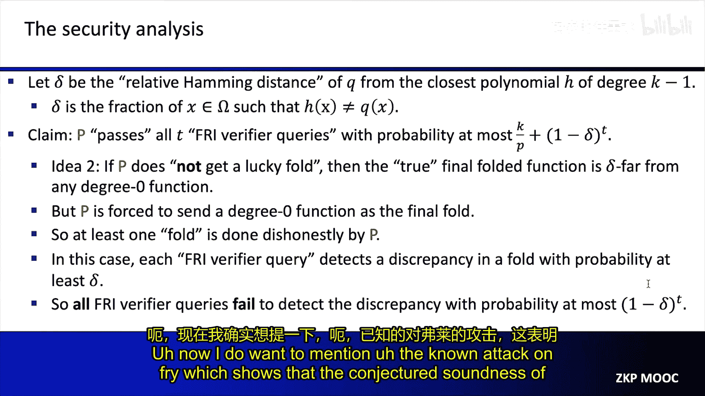

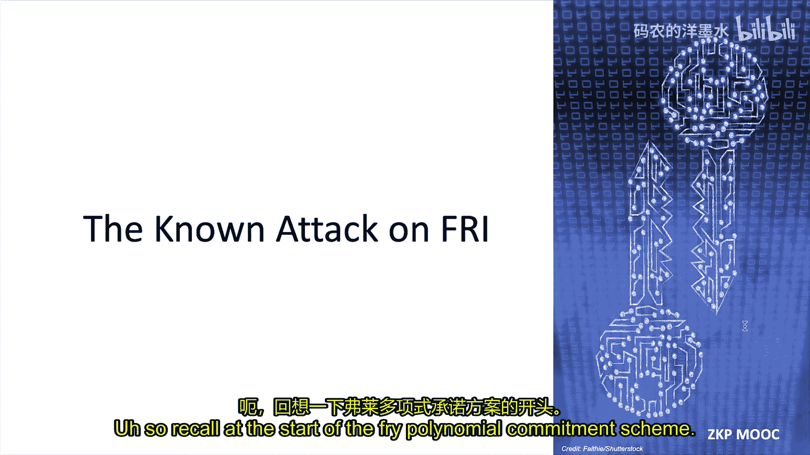

Deegree bound K by a factor equal to the fry blowup factor row inverse so the following prover strategy works for any polynomial Q even one that is maximally far from degree K and this prover strategy will pass all of the fry verifier checks with probability at least row to the number of fry verifier queries T okay so this is saying this prover strategy works。

 no matter how big a lie the provers telling so no matter how far the committed function Q is from a degree K polynomial the following prover strategy will succeed in convincing the verifier to accept the false claim that Q has degree K with probability at least row to the T so here is the strategy。

 the prover picks a set capital T of K elements of the n through to unity。

And interpolates a polynomial let me call it S of degree k minus1 that agrees with Q just at those points in capital T okay。

 so S is going to agree with Q at exactly K points k n through to unity and we're not going to control s's behavior at any other points whatsoever。

 now when during the folding phase when in the very first round of the folding phase when the prover is supposed to fold。

Q。It instead folds S。Okay， at all other folds， it answers honestly。

 so the very first fold is done dishonestly。Meaning it is done with evaluations of S at the root to unity rather than with Q at the end root to unity。

 and then from then on the prover throughout the entire protocol behaves honestly and the point is that this proving strategy will pass all of the verifiers checks。

 if every one of its T of the verifiers t queries lies in the set capital T at which S and Q agree。

Okay， and because we are looking at the n through to unity。

And S and Q agree at a row fraction of those n roots of unity。

 each individual fry verifier query lies in the agreement set with probability row。

 all little T fry Verifier queries lie in the agreement set with probability at least row to the T so to summarize if the conjectured soundness of fry is correct。

 the conjecture would be tight， there would be no hope of improving it because there is a very simple attack that achieves success probability row to the number of fry Verifier queries regardless of how big a li the prover is telling by which I mean this attack works for any committed function Q no matter how far it is from a degree K polynomial of course the prover is claiming it has degree K and I am saying。

That this attack will work no matter how untrue that claim might be。

Okay now let's finally talk about getting a polynomial commitment scheme from fry because believe it or not。

 even after all of this time I spent explaining fry。

 we've not actually seen a complete polynomial commitment scheme from it so remember going back to our initial attempt at a polynomial commitment scheme from lecture4 the prover Merkel committed to all evaluations of the polynomial queue to be committed。

 meaning every evaluation from the entire field， and this meant that when the verifier in this attempted polynomial commitment scheme requested the evaluation of Q at some point R in the field。

 the prover could just reveal the associated Merklele along with the authentication information but now we have the problem that fry only has the prover Merkel commit to evaluations of Q amongst the endros of unity not over the whole field so that is an issue。

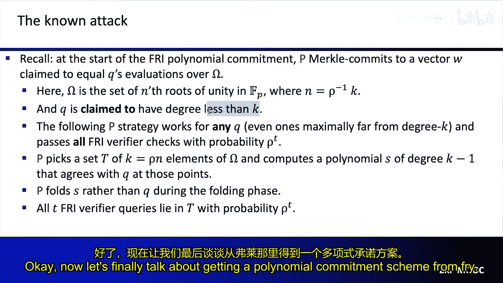

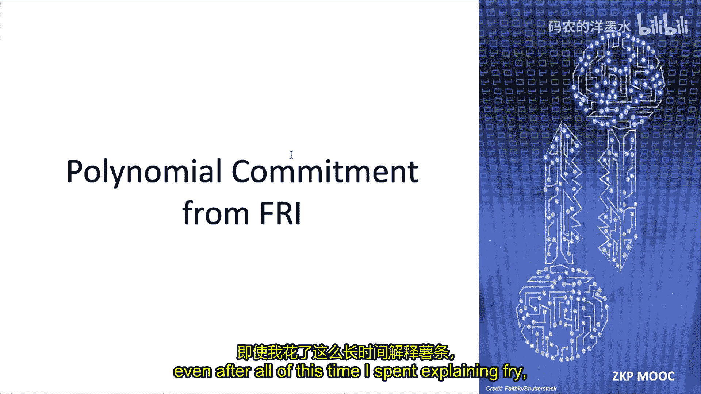

Because the verifier may request an evaluation of Q at any point R in the field not just among the n root to unity。

 so it's not going to be enough for the prover to simply reveal some leaf of the Merrkel tree along with authentication information since if R is not an nro of unity the Q evaluated at R is not a leaf of the Merrkel tree。

 that is just one problem another problem is that the verifier does not know after applying fry to Q。

 that Q is exactly low degree， all it winds up being convinced of is that Q is quote not too far from low degree meaning that the verifier after applying the fry low degree test is convinced that the relative hamming distance of Q from a degree k minus1 polynomial is not too big but it does。

Not know that that relative hamm distance is zero， so we have to address both issues so the way to address this is relies on the following fact。

 which was also used in KZG commitments， so it is that a degree D Uniever polynomial Q。

 satisfies the property that it evaluates to V at input R if and only if there exists a polynomial W of degree at most D such that Q of x minus v is equal to W。

Times x minus R。Okay， so it is easy to see that if Q of R equals V。Okay， then。

Q of x minus v will be divisible by x minus R because both the lefthand side and the righthand side will evaluate to0 at R。

 and so w would just be the quotient polynomial in that case and it is also easy to see that if Q of r does not equal V that we cannot possibly have such a w because the lefthand side at R would evaluate to something non-zero while the right-hand side would evaluate to zero。

 which would be a contradiction hence in order to confirm that Q of r equals v where Q is the committed polynomial the verifier can apply fries fold and query procedure to the function obtained by taking the equation above and multiplying both the lefthand side and right- hand side by X minus R inverse using degree。

D minus1 so that effectively checks that this polynomial W in the equation up here indeed exists and has degree at most d minus1。

 which the fact that we discussed above explains as equivalent to the committed polynomial  Q evaluating to V at input R so。

Note that in order to apply f to this function here。

 the fry verifier will have to query this function at various n roots of unity when the。

Fry query procedure is applied。Any evaluation of this function can be obtained with just a single query to Q at the same point。

 the verifier then derives this function evaluated at that point by simply subtracting V from it and then multiplying the result by the evaluation point minus R inverse。

And it is not difficult to show that in order for the prover to pass the verifiers checks in this polynomial commitment scheme with noticeable probability。

 it better be the case that the claimed evaluation of the committed polynomial  Q at R is equal to h evaluated at R where H is the degree D polynomial that is closest2 Q。

 so this polynomial commitment scheme kind of has the cool property that even though the verifier doesn't know for sure that the committed vector Q is exactly low degree is exactly degree at most D where in my earlier notation D was k minus1。

 nonetheless for the prover to pass the verifier checks with noticeable probability in this。

Commitment scheme whereby the Fry low degree test。Is applied to this derived polynomial derived from the requested evaluation point and the claim evaluation。

 then the prover has to have the claimed evaluation equal to an actual exactly low degree polynomial H evaluated at the requested point R。

 so effectively the prover is bound to answer evaluations to Q consistently with the closest truly low degree polynomial H to Q。

Okay， so a caveat here is that the security analysis of this polynomial commitment scheme requires the relative hamming distance which with which the fry low degree test is applied and analyzed to be at least this quantity1 minus row over two this is called the unique decoding radius of the read Solomon code。

 the upshot is that each fry verifier query will bring less than one bit of security to this polynomial commitment scheme okay so what's happening is that today people are using fry actually as a weaker primitive than the polynomial commitment scheme described in this slide they are using it as something that's more properly referred to as a list polynomial commitment scheme it turns out that a list polynomial commitments。

still suffices for snark security so a list polynomial commitment scheme effectively does not bind P to a single low degree polynomial as required by a polynomial commitment scheme but instead bounds P to a small set of low degree polynomials in the sense that when the verifier requests Q of R the prover does not necessarily have to answer consistent with H of R for a fixed low degree polynomial H but instead is able to choose from a small set of low degree polynomials an answer with any one of those polynomials from the small set evaluated at R and this so-called list polynomial commitment scheme turns out to be enough for snaarrk security so it is a bit of a simplification or a lie to。

Tell you that every single snark out there combines a polynomial IOP with a polynomial commitment scheme。

 in fact it often suffices to use a list polynomial commitment scheme at any rate so people are using this weaker primitive called a list polynomial commitment scheme in order to be able to conjecture that each fry verifier query provides log of one over row bits of security rather than less than one bit of security and thereby keep the verification cost smaller than if they used a fry as a true polynomial commitment scheme that binds the prover to a single polynomial of a specified degree bound okay。

Now let us talk in detail about the Fiat Shamir transformation and concrete security because when Fry is deployed today in blockchain applications it is as far as I know always deployed noninactively by applying Fiat Shamir to it and of course the Fiat Shamir transformation is used in almost all snarks with the notable exception of G 16 every other Snark in use today as far as I am aware there might be some small exceptions that are related to G 16 will take an interactive succinct argument and render it noninactive with Fiat Shamir so let us discuss Fiat Shamir in more detail than any of the previous lectures so I am going to remind you how Fiat Shamir works。

 I am going to describe it for simplicity in the context of a three message。

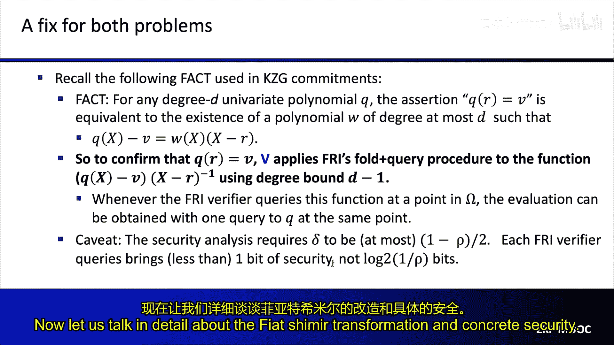

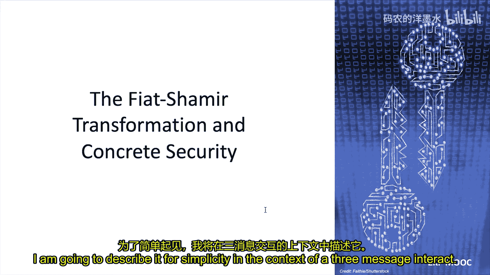

Interactive protocol where the prover speaks first so in the interactive protocol the prover sends a message alpha to the verifier who responds with a random challenge beta and then the prover responds to beta with final message gamma now in order to render this interactive protocol noninactive what the fiia chimir transformation will do is effectively replace beta with a hash evaluation with the hash function modeled as a random oracle are so specifically rather than the verifier choosing beta and sending it to the prover beta will be chosen by evaluating the random oracle will think of that as a cryptographic hash function at the prover's first message in the protocol alpha Now if you want the resulting non-interactive argument to satisfy something called adaptive security which means it is secure even if。

Adversary can select the input X fed to the verifier you better include x in the tuple being hashed in addition to the prover's first message this is actually a mistake that has appeared many times over many years including recently in many SNRC deployments and so please don't make that mistake yourself if you omit X that X here is the verifier's public input if you omit it from the Fiia chimir hashing you will not have adaptive security that is you will not have security against prover that can choose X adversararily for the noninteractive arguments okay。

Whenever you apply the Fiat Shamir transformation， the following attack is always available for a cheating prover。

 so this is often called the grinding attack on fiat shamir so a cheating prover making a false claim can iterate over all first message alpha until it finds one that hashees to a lucky verifier challenge beta by a lucky verifier challenge beta I mean one for which the cheating prover can efficiently find a response gamma that will convince the verifier to accept so in this grinding attack the prover just you know it tries you know some first message alpha sees if the resulting hash value is lucky if not it tries another alpha if。

That next alpha doesn't get hash just something lucky。

 it just tries another alpha and another and another。

 just keeps trying until it finds a lucky alpha okay so as an example。

 suppose you apply the Fiat Shimir transformation to an interactive protocol with 80 bits of statistical security by which I mean the soundless error of the interactive protocol is at most two to the minus 80。

This grinding attack will have achieve the following tradeoff between work expended and success probability of completing the attack。

 so with2 to the B hash evaluations， the grinding attack will succeed with probability 2 to the minus 80。

Plus， B。Okay， so for example， with two to the 70 hashes。

A cheating prover can successfully find a convincing proof for any false statement with probability about 2 to the minus 10。

 which is about 1 over 1000。So basically every time the prover tries another first message alpha。

It has a probability of about two to the minus 80 of that alpha being lucky。

 meaning it hashes to a lucky challenge， and it only has to get lucky once。

So this particular tradeoff between computational effort expended by the attacker and success probability of the attack should be contrasted with the tradeoff achievable for other cryptographic primitives configured to the same security level so for example。

 with a collision resistant hash function configured to 80 bits of security。

 the fastest collision finding procedure should be a birthday attack if the hash function is well designed and the computational effort versus success probability tradeoff here looks quite different than when attacking the fiia chimir transformation。

 so specifically when a birthday attack performed2 to the K hashes when attacking a hash function configured to 80 bits of security。

 it will succeed in finding a collision with probability of only two to the 2K minus1。

So this is quadraically worse than the success probability of the grinding attack against Fiat Shamir。

 so for example， with two to the 70 hash evaluations。

 the birthday attack will find a collision in a hash function configured to 80 bits of security。

 with the probability of only two to the minus 20， which is about one over1 million。

 rather than two to the minus 10， which is about one over 1，000。

And this difference in success probabilities for a given amount of computational effort can make a dramatic difference in the expected profitability of an attack。

 when the attacker has budget limitations that prevent it from expending enough work to succeed with probability close to 1。

 so if an attacker is limited to say2 to the 70 hash evaluations。

 it is certainly going to matter a lot to that attacker。

 when determining whether or not to launch an attack。

 whether the attack will succeed with probability 2 to the minus 10 versus2 to the minus 20。

So the point here is that when protocol designers refer to 80 bits of security or lambmbda bits of security in general。

 they are referring to the logarithm of the number of computational steps required to succeed in an attack with probability close to one。

 but that does not specify how quickly the success probability of the attack increases as the amount of computational effort invested in the attack increases。

 and in fact for the grinding attack on the fiat chimir transformation the situation is considerably worse if you are a protocol designer looking to design a secure protocol then the situation for many other cryptographic primitives。

 including as we've discussed here finding collisions and collision resistant hash functions and breaking the。

diiscrete logarithm problems that is finding X from G to the X for a group generator G I think an important question that any protocol designer will encounter is how many bits of security is enough and in order to answer that question one must understand how many hash evaluations are feasible today and at what price so all I can do in this lecture is provide just a couple of data points to give you a sense So today the Bitcoinin network perform just about2 to the 80 shot 256 hashes every hour or so and at current Bitcoincoin prices those hashes typically earn less than a million dollars worth of block rewards now obviously the world as a whole has invested enormous sums of money into As6s to make computing these hashes as fast as possible。

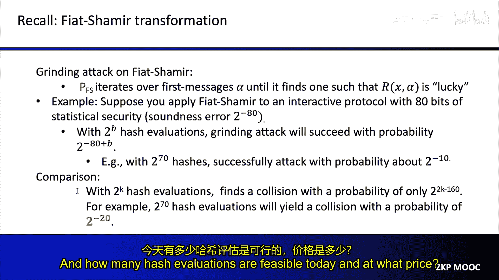

But nonetheless， this should give some sense that with enough investment in AsIs at least two to the 80 hash evaluations are in fact quite cheap and can be done quite quickly as another data point a research paper reported that in January 2020 about two to the 64 Shah one evaluations cost about $45。

000 on GPUs that would put two to the $70 Shah1 evaluations at about 3 million and today the rental of GPUs is likely to be cheaper than it was in January 2020 when many of those GPUs were profitably being used to mine Ethereum and today they will not be okay so that should just give a sense of why standard cryptographic practice is to set the number a bit to security to。

Be 128 or more that puts the number of hash evaluations used to attack a Fiat chimir based snark set to that security level。

 substantially beyond the reach of current hardware and also leaves a bit of a buffer in case better attacks are found than what are known today。

Finally， let me discuss or different security levels might be appropriate if a protocol is being run interactively versus if it is being fiiachemed so that it is can be run noninactively now a polynomial commitment scheme such as fry when run interactively at lambmbda bit to security has the following guarantee so assuming the cheating prover cannot find a collision in the hash function used to for Merkel hashing then a lying prover cannot pass the verifiers checks with probability better than two to the minus lambmbda now a key point here is that a cheating prover attempting to attack the interactive variant of fry must actually interact with the verifier to learn the verifier challenges and thereby find out whether the attack will succeed put another way。

 the prover cannot know if it's。

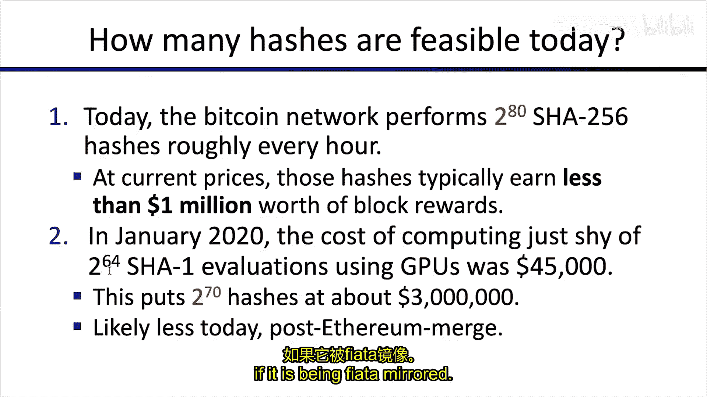

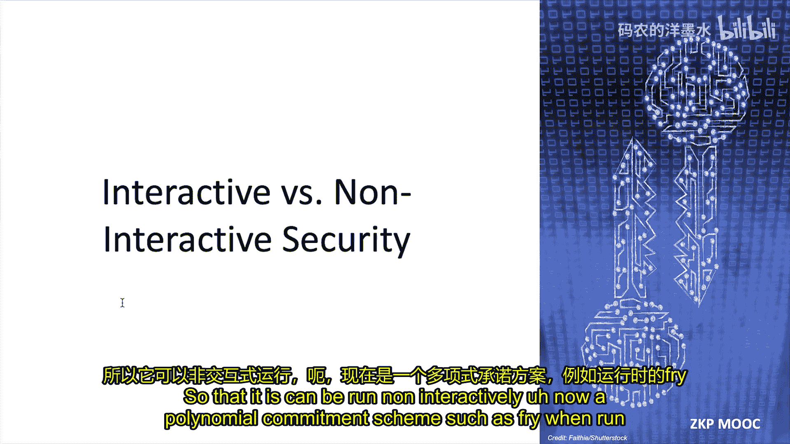

Attack will succeed until it actually speaks to the verifier to learn what the verifiers challenges are as an example。

 if fry is run interactively at 60 bits of security then with probability at least one minus1 over a billion or so the verifier will reject at least 1 billion times before the cheating prover succeeds。

 it seems unlikely that a verifier would continue interacting with a prover that has been caught in a lie over 1 billion times。

 Moreoverover， the interactive protocols might simply take too long to run for any prover to execute over a billion attacks in a reasonable amount of time so as one data point one billion Ethereum blocks should require about three years to create assuming Ethereum is creating blocks at about one block per 12 seconds。

Contrast， if you apply Fiia Chamir to an interactive protocol such as Fry that was run at Lambda bits of interactive security before Fiia Chimir was applied。

 the resulting noninactive protocols of much weaker security guarantee。

 essentially the key point is that a lying prover can attempt the grinding attack silently。

 so unlike in the interactive case，The prover can basically just perform something resembling know the interactive attempts at attacks in its own head without revealing to the verifier that the attack is occurring so rather than the actual verifier having to reject the prover over one billion times for the prover to have even a one in a billion chance to succeed the prover can just attempt the grinding attack meaning with one hash evaluation required per attempt two to the 60 times which is entirely feasible on modern hardware without any verifier ever knowing that the prover was attempting an attack in the first place as a result。

 much higher security levels are required in the noninteractive setting than in the interactive setting so for example。

 60 bits of security might be totally fine in the interactive。settingtting unless very， very。

 very large sums of money on the line think multiple billions of dollars， perhaps。

 whereas in the non interactiveactive setting， 60 bits of security is not going to be enough unless the payoff is really minimal because again。

 two to the 64 Shah1 hash evaluations three years ago cost under 45，000。

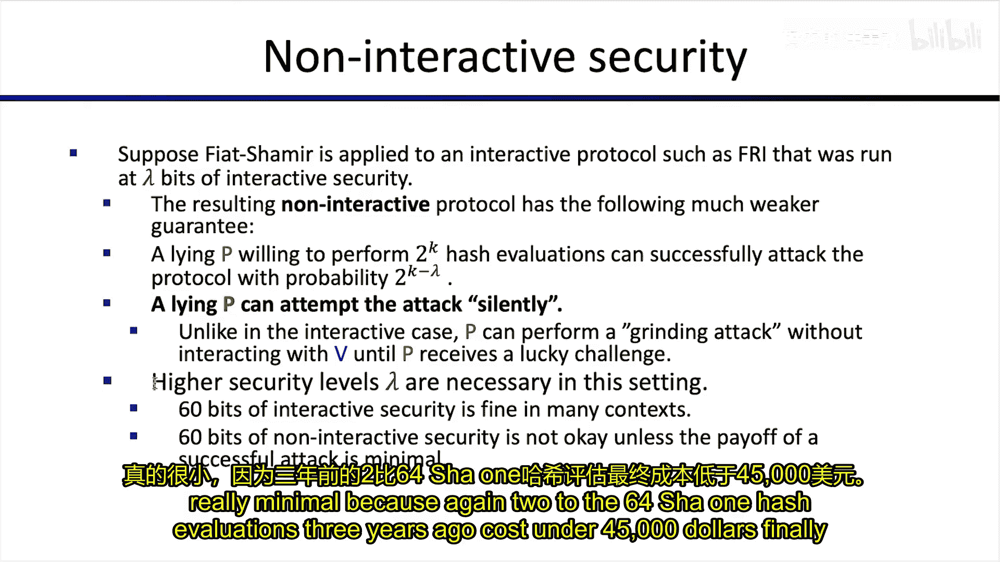

Finally， I want to discuss an issue that while well known。

 I feel may be nonetheless underappreciated today， and that is that the Fiat chimre transformation can lead to a tremendous loss of security when it is applied to many round interactive protocols to render them non-in In fact。

 when applying the Fiat chimre transformation to some many round protocols that have negligible soundless error。

 the resulting noninactive protocol may be entirely insecure。

 here is the canonical example of such an interactive protocol， consider the empty language。

 So this means that the verifier should always reject literally nothing should be accepted by the verifier and let us consider the following somewhat silly interactive protocol for the empty language so the prover in this silly interactive protocol sends a single。

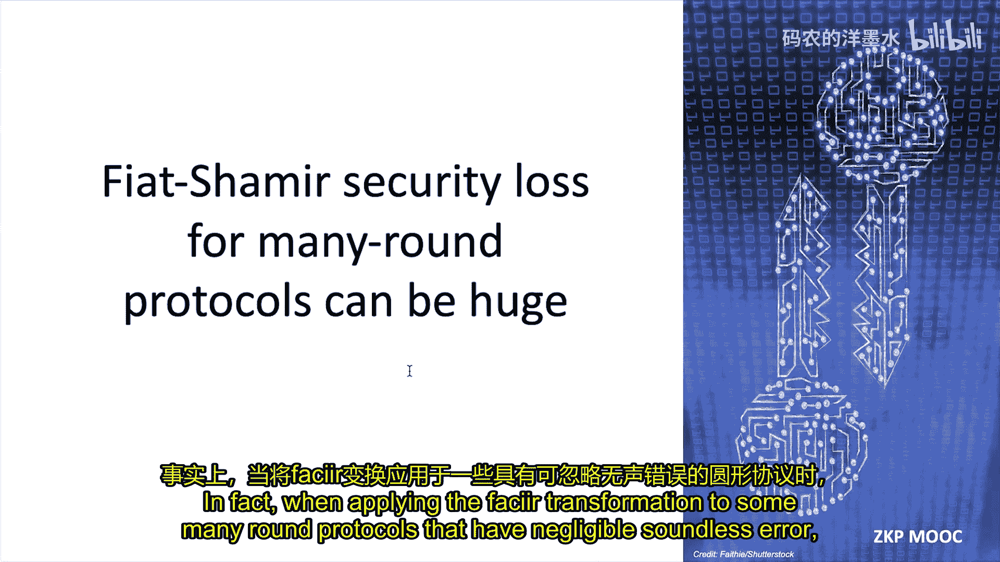

Message which I'm going to call a nonce because the verifier is just going to ignore the prover's message so after the verifier receives and ignores the prover's message。

 the verifier then tosses a coin and halt and outputs reject if the coin comes up heads。

 but halt and outputs except if the coin comes up tails。

OkayNow the soundness error of this protocol is1 half because with probability a half。

 the verifier winds up accepting when it really should never accept now if you sequentially repeat this protocol lambda times and accept only if every repetition of the base protocol except the soundless error falls from one half in one repetition to one over two to the lambmbda because the probability that all lambmbda runs except is exactly one over two to the lambda。

Okay now consider applying Fiia chimir to this lambmbda round protocol obtained by sequentially repeating the soundless error half protocol lambda times applying fiia chimir to this protocol will render the protocol noninteractive however。

 the resulting protocol is totally insecure In fact a cheating prover can find a convincing quote proof for the noninteractive protocol with only order lambda hash evaluations the key idea of the attacker is to execute a grinding attack on a single repetition of the base protocol at a time rather than attempting to quote grind upon all lambda repetitions all at once so this is what I mean by that so the attacker can grind on the first repetition of the base protocol alone first that means iterating over nonsenses that the prover might send in the。

First repetition of the base protocol until one is found that hashes to tails so in expectation the attacker only has to try two different nounces before it's going to find one that hashes to tails once it finds one that hashes to tails。

 it can fix that no， let's call it M1 for the remainder of the attack once it has succeeded in finding M1 it can then execute a grinding attack on the second repetition of the protocol by searching for a nonnce M2。

Such that M1 comma M2 hashees to tails once it finds such an M2。

 it will have effectively passed the verifier's checks in the first two repetitions of the base protocol。

 it can fix M2 and move on to finding an M3 such that M1 comma M2 comma M3 hashes to tails in this way it can find a successful nonmi for each repetition I of the base protocol iteratively。

 it does not conceptually it does not have to guess lucky M1 M2 up to M lambda like all at once。

 it can sort of grind until it finds an M1 that's lucky then it can grind until it finds an M2 that's lucky then it can grind until it finds an M3 that's lucky and so on and so forth and in expectation only two attempts at finding each MI are required。

So the takeaway from this example is that applying the fiat chimir transformation to many round interactive protocols can lead to a huge loss of security。

 whereby the resulting non interactive protocol is totally insecure Okay。

 now it is known that if the many round interactive protocol can be shown to satisfy a stronger notion of soundness called round by round soundness。

Then in fact， it is safe to apply Fiat Chimir to the many round protocol that is showing that an interactdirect protocol satisfies round by round soundness rules out the kind of catastrophic security loss that applying Fiat Chimir to this kind of silly sequential repetition of the base protocol for the empty language demonstrated intuitively what is round by round soundness。

A protocol is round by round sound if an attacker and the interactive protocol in order to convince the verifier to accept has to somehow get lucky all at once in sort of a single round it can't kind of space out its luck across many rounds by getting a little bit lucky in many different rounds so this sequential repetition of a soundist one half protocol that I presented before is the canonical example of a protocol that is not round by round sound in this sequential repetition which is not round by round sound we saw that the attacker can get a little lucky in each round and succeed it only has to get the verifier to toss tails in each round so in each round it gets lucky sort of with probability half and manage if it manages to string lambda many you slightly lucky rounds together it manages to convince the interactive verifier to accept so that is the epitome of not being round by round sound。

Our example protocol is known that are round by round sounds， despite having many rounds。

 a key example is the sumche protocol that I covered in detail in lecture 4 this is a logarithmic round protocol logarithmic sort of in the size of the statement being proven and it is known to be round by round sound so the prover kind of has to get very。

 very lucky in a single round it can't get a little bit lucky in each and every one of the logarithmic rounds and hence we know that applying the fiat chiir transformation to the sumcheck protocol leads to a sound noninteractive protocol in the random oracle model something similar is known for bulletproofs this is a logarithmic round proof of knowledge that's commonly used as a polynomial commitment scheme which Yupeng discussed I think two lectures ago。

So one thing I do want to mention is that FRry is a logarithmic round interactive protocol that as far as I know。

 is currently deployed exclusively noninteractively by applying the fiat chimir transformation to it。

 and it has not been shown to be round by round sound。

 at least this has not been published so this is kind of a gap in the known security analyses。

 which I'm actually hoping to patch soon with a new preprint。

 so it's not that I think fry is not round by round sound。

 but I do think that for a pervasively deployed protocol such as fry which is deployed noninactiveively we should know for sure that it's round by round sound。

 to rule out the possible catastrophic loss in security that we know is possible when applying Fiat Chimir to many round protocols。

So as a general takeaway of this coverage of Fiat Chamir。

 any protocol designers that are obtaining a Snark by applying the Fiat Shimir transformation to an interactive protocol with strictly more than three messages should show that the protocol is round by round sound if they want to rule out a major loss of security that comes from the application of the Fiat Shimir transformation to the many round protocol。

I do think there is an underemphas on such analyses today。

 whereby protocol designers simply assume that there is zero loss of security when applying the Fiat chimir transformation even to protocols with strictly more than three messages when that can only truly be justified if it is shown that the interactive protocol is round by round sounds。

 otherwise even in the random oracle model， there might be a significant loss of concrete security when Fiat chimir is applied。

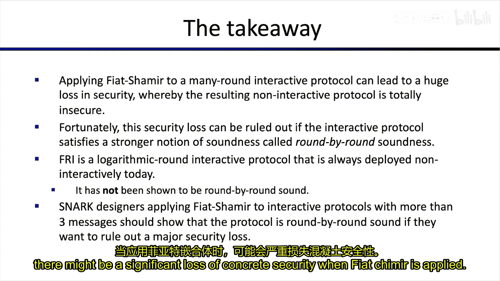

Okay that is the end of today's lecture， next lecture will cover srks from linear PCPs such as Grow 16。

 the following lecture will cover sarrk composition and recursion and after that I believe we are turning to applications of snarks。

Thank you very much。

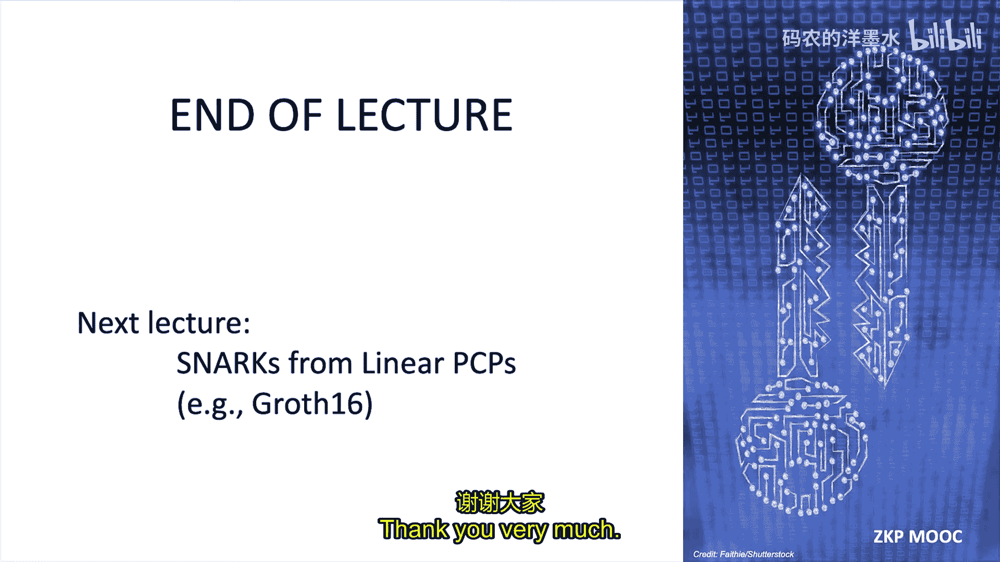