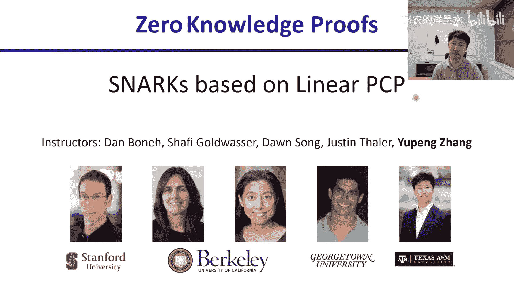
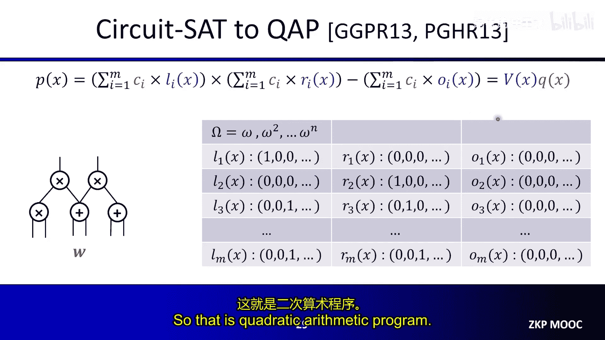
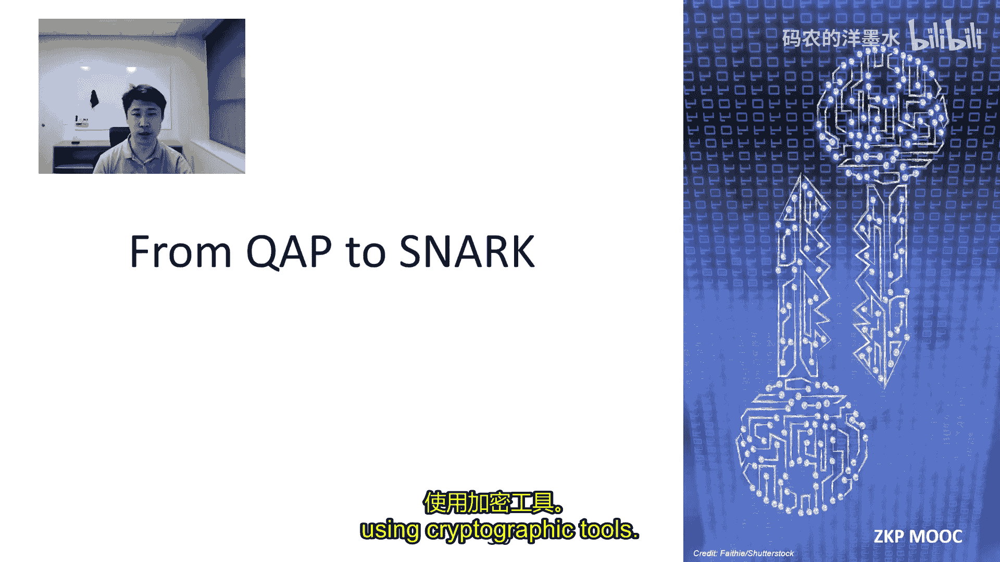
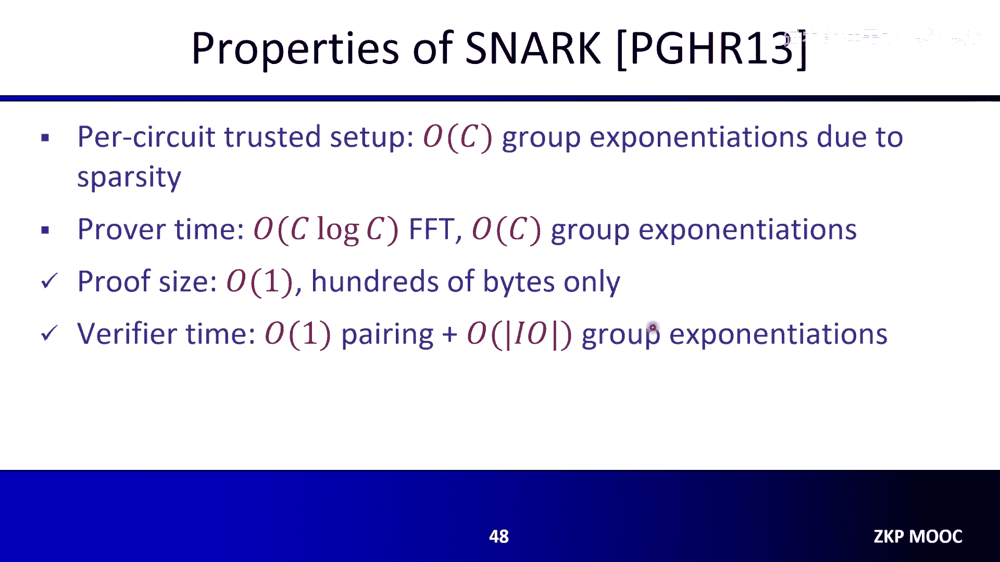
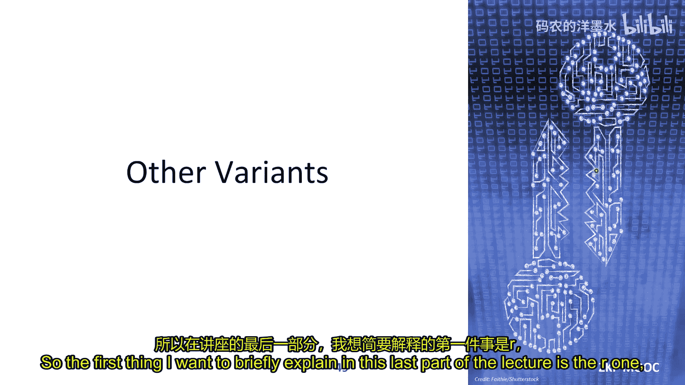
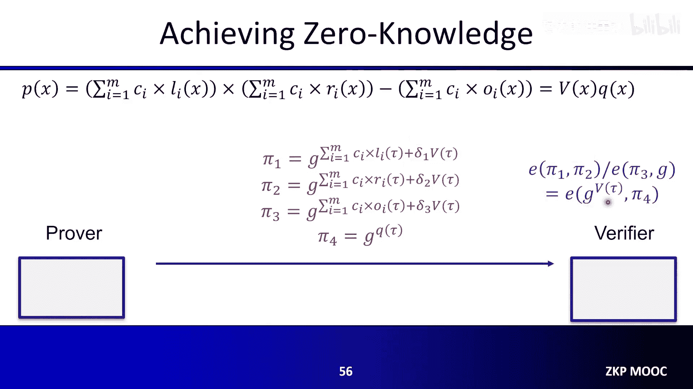
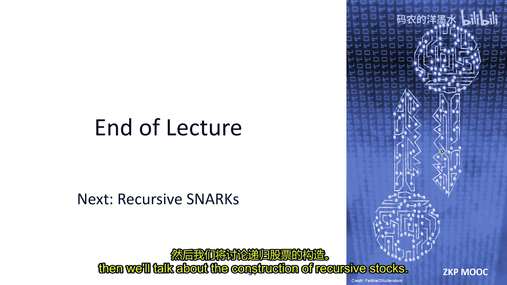

# 【全集】加州大学伯克利分校 Web3：零知识证明 区块链技术与隐私计算 中英字幕 1080P p09 Lecture 9 - 基于线性 PCP 的 SNARKs -BV1bCrpB2E7Q_p9-

Hello everyone。 welcomelcom back to our MOoc on Ze knowledgege Group。 I'm Y Peng Zhang。

 and today I'm going to talk about S snarks based on linear PCPs。

So first， I want to remind everyone about srks we've learned so far in this table。Electric 6。

 I introduced as a classical protocol of the KGG Ph commitments based on bilinear pairing。

Combine it with the Plan IOP in lecture 5 or the interact proofs in lecture 4。

We end up with snarks with a truy setup up。And these constructions tend to have a small proof size in practice。

And in order to remove the processsses set up， I've talked about schemes based on discrete grid logarithm。

And those include bulletproofs， dory， dark and hierarchs。

 and we also have snark implementations based on these pan elements such as a Hadlo2。

During the past two lectures， we also introduced。The schemes building srks based on error and codes。

In lecture 7， we talk about schemes based on linear timing code of code and Mer hashsteries。

 and those include breakdown and orwI。And in last lecture。

 Justin talked about this interesting lab research。

 building snarks based on rement code and the Fry interactive A proof scheme。

And these scheme can actually further reduce proof size from a square root to polylogism。

 and they include dark， aura， fractal， Virgo， and so on。

The goal of this lecture is to talk about another technique to build snarks based on the so called linear PCP。

And this technique was actually proposed before those pnomial commitments and polynomial IOPs and has been used to construct the earliest implementations of snarks。

So it was to spend this lecture to study the details of the constructions。So， to。

Briefly show you the properties of these constructions。On the positive side。

 these snarks tend to have very short proof size in practice， for example。

 in this construction proposed by Yscross in 2016， the proof only consists of three group elements。

And in practice it's only about 100 to 200 bytes， so that's actually the shortest proof size among all the ss we are learning this course。

And for a similar reason， these snorks also have very fast veryifier time。Again。

 in this construction of G 16， the verifier only needs to check one pairing equation using three bi linear pairings。

 and in practice it only takes less than one millisecond to do it。

And in terms of disadvantage advantages， the poor time of thesenarks tend to be relatively slow in practice because they require both effortT and group exponations。

 and the size of these computations are linear in the size of the circuit to improve。

And because of that， they're usually slower compared to schemes based on， for example。

 error record codes。Another major drawback of these constructions is that they require a circuit specific trust setup。

There has to be a pre processor to perform trust the setup with the trap door and delete this trap door completely after the setup phase。

And these schemes have to do this trust setup for every computation you want to prove。And。

This may not be desirable for some as in practice。And。Because of that。

 this is sometimes called preprocessing snabss in the literature。

And this is different from the starts we've seen so far， for example。

 the Plan system that requires a one time universal trustee setup and also other schemes without trust setup up at all。

So before going into the detailed construction of these ss based on linear PCP。

 I want to briefly introduce the history of this line of research。So in the early days。

 the original construction ss were proposed。In these two seminal papers by Kiian and Miikali。

And in these two papers， they combine the classical product of the proically checkable proofs PCP with Merkle trees。

And the constructions of snarks are actually asyically optimal up to polylogarithm factors。

They do not require any trust set up and they have a succinc pool and verifyifier time。So in theory。

 they are actually very good。And also in this paper by McCli in 2000。

 he actually applied F Shamir transformation to remove the interactions in this construction and get a non interact argument of knowledge。

But unfortunately， they don't need to efficient sound systems in practice。

Partly because of the heavy mechanism of the PCP。And to the best of my knowledge。

 I'm not aware of any concrete efficient systems implemented based on this PCD+ Mer tree。

So motivated by this problem。There is this line of research constructing smartRTs without the classical PCP algorithm。

And this line of research was started by Ishai Kushlvi Otrosky in 2007。And in this paper。

 they propose this concept of a linear PCP and view the scheme combined this one with a homomorph encryption to get。

Ana resort proof。But unfortunately， the poor time is chaotic in the size of the Earth computation。

A later。Yenscro proposed the construction of snarks based on bilinear pairing in this paper in 2010。

Although it's not directly built on top of the construction of the linear PCP。

 it can still be classified as a linear PCP in this model。

And in this construction it applies the bilinear pairing。

 which is kind of the ancestor of the asnaarchs where I'm going to talk about today。

 but unfortunately the size of the global parameters and the prototype time are still quadratic in this construction in gross 10。

AndLater， the scheme was further improved by Hgerd Lima in 2012 with a technique called Pro Freeets。

With this technique。He improved the size of the global parameters from kratic to causingy。 but still。

 the scheme has。A correctlytic brew time and does not have a efficient imp in practice。And finally。

 a big breakthrough in this line research was actually proposed in this paper by Gennaro Gentry Parno and Ricowa。

 And there they proposed this。Very beautiful construction of choretic span programs and corratic arithmetic programs that reduces the poor time and the size of global parameters from corratic to quasiline and linear in practice。

 and that leads to efficient inis。And many systems in practice。

 And this is the one we going talk about today， the Q A。And after that。

 this line of research has led to many new techniques and efficient constructions of snarks。

And they were usually before the invention of these pan IOPs and pan commitments we've talked before。

 and here I'm just listing a very small subset of papers and there are many more papers with both theoretical contributions and concrete efficient systems for different applications and there's a very long literature。

Building snarks based on linear PCs and QAP。 And in this short list。

 there are several papers I want to highlight。 For example。

 this one by Parno Gentry Howwell and Ricowa， they propose this system called Poccu that is one of the earliest efficient constructions of snarks and is the one that I'm going to talk about today。

And here we have a s for run based computation， such as a snas for C and tiny Re。

And we also have the recursive sns of cycles ofic curves in this paper by Ben Saaneddo。

 and we also have this famous construction for Gro 16 with the smallest proof size of only three elements。

 and it has been。W be used in practice for different applications？And another line of research is。

Build this ss based on the original linear PCP construction。 And in these two papers。

 by study at all， they have the。Snog systems called ginger and pepper。

And that was also one of the earliest。There systems of West knocks。And also in this paper。呃。

By Betanky。Kasa， Ishai ofrovsky and the Penis actually unifies this line of research under the framework of ba linear interactive proofs。

And。In and these Q A Ps and linear PCP are catching instants in this framework。

So that's a brief introduction of the history of this line of research on linear PCPs and QEPs。

So in order to understand the construction of this smart space on linear PCPs。

 I am going to follow this common paradigm。For building efficient starts again。

So recall that in order to build the stars for general circuits。

 we really have an information theoretical secure component。

And and this time it's going to be this linear PCP or choratic arithmetic program。

And then we are going to compile this information secure component to concrete efficient ss with short groups using an proper cryptographic tool。

 and this time we're going to use the bindingin pairing to do it。

And this is actually different from the polynomial IOPs and polynomami commitments we've learned before。

So then we will have a three segments of this lecture in the first part。

 I'm going to talk about this。Classio construction of a QAP coratic arithmetic program。

In the second part， I'm going to show you how to construct an efficient snark with a constant size proof from the QAP using bi linear Per。

And in the last part， I'm going to talk about variants of these snarks。

In this framework of linear PCV， those include the support of RNCS rank1 constraint system and also the variance of a across16 with three group elements in the proof and also how to achieve zero knowledge。

In this constructions。So let's start with the Q A P。So recall that our job is to view the sng for。

Proving circuits as viability， which means that given an athtic circuit C defined over a finite field with addition gates and modification gates and an output Y。

The prove P is trying to claim that he knows a witness w such that C of x comma w equals to y。

 where x is the public input known by the verifier。And for simplicity。

 let's ignore this public input for time being and assume that all the inputs are secret held by the Per。

 so the Per is trying to convince the verifier that he knows a satisfying assignment。

 the input and values of the circuit such that C of w equals to y。So， that is the。

Setting there and the problem we are trying to solve。

So next I want to reintroduce this concept of a transcript or the trace of a computation or a circuit。

So here I'm showing you an example of an arithmetic circuit with these addition gates and multi gates and this set of values。

So the trees just means that the pooler is going to evaluate this entire circuit and take the values on all the wires。

And for example， this is exactly the transcript。Defined。In lecture 4 for interactive proofs。

 that is the value of aggregategate， including the inputs。And then for interactive proofs。

 Justin talked about how to construct the sum check and multibar panoms representing the addition gate and multi gate and also the transcripts of this computation and how to use the summche protocol to check the correctness of this evaluation。

Similarly in Le5， when Ben was introducing this Plan IOP。He also defined a trace of this computation。

 but it's actually slightly different from the interactive proof。

Instead of just taking the value of aggregate gate。

 actually it is actually defined as the left input。

 right input and output of aggregate gate so there。

Are some actually some redundancies of this definition of the trace because。

One wire can both be the output of one gate and also the input of aggregate gate。

 So it's actually slightly larger than the size of the value of every gate。 but still it is derived。

From the valuations of the circuit。 So that's why we still call it the transcript or trace of the computation。

The following the same ideas。We are going to define the transcript of QAP for this lecture again it will be slightly different from both interactive proofs and plan。

 so this time we are going to define the trace as the input plus output of every multiplication gate。

And theyre going to ignore the output of audition gates this time。So to show you on this slide。

So we are going to remove the labels for the output of these two addition gates and only count the output of every modification gates here together with the input。

 so that is the trace we're going to talk about we are going to use in this lecture so again that can actually be derived from the circuit violation so essentially there is no big difference but in terms of formal definition it' slightly different from the interact proofs and the Plan IOP。

So when we do that， we can actually represent this transcript or trace as a vector。

So we can just do this in any predefined order， for example。

 just following the topological order of the circuit evaluation， we had the six inputs 321，7。

54 and then the internal wires 6 and then the outputs of the modification gates 48 and 782。

And also for simplicity， I'm assuming that。The gate before each output must be a modification gate。

So that is the transcript of this computation for KAP。

And then another thing to introduce is that very naturally were also going to label these gates in the circuit again。

 we only care about the modification gates for QAP and we are just going to label them one by one。

 for example， we have gate1， the navigation gate here， gate2 and gate 3。

So we have three modification gates。And the trace of this vector with nine values in the circuit。

With six inputs。And the three outputs of the multi kits。With that。

 the next concept I want to introduce is this a selector polynomial。

So that is a key component to reduce the problem of a circuit sets viability to a polynoormmal equation。

 which is essentially the correctratic arithmetic program。

So let's basically spend most of the time of this segment to understand what is the definition of this selector partner。

So I'm going to first define a set of pannomials called LIX。And。How can we define this。

 We are basically asking this question。Is each C in this trace of the computation the left input of gate J？

For every j equals to one， two， and three for all the gates。If the answer is yes。

 we're going to put one there， and if the answer is no， we are going to put  zero。

And here for your convenience， I'm basically labeling these values in the computation no trace of this circuit at C1 c2 all the way to C9。

So then let's take a look at an example of L1x。 What is L1x？So then we are asking the question is C1。

 this value3， the left input。Of gate one。Well the answer is yes。

 this three is left input of gate gate1， the multi gate， so we put one here。And is C1。

 the left input of K2， the answer is no， so we put zero here。And then finally is c1。

 the left input input code of K3， the answer is again no， so we put 0， so we have a better 100。

Of size three， the same as the size of the number of our application gates。

So then the way to define this L1 x is through pan interpolation at a known set。C 米ga。So。

With this set， we want this panorama at one x。That to evaluate to one。At， for example。

 omega and it values to0 at omega square and it values to0 again add omega to the cube。

So in this way， for any predefined distinct set of values。

 we have a unique interpolation of the polynomial， and we can actually compute a polynomial l1 x。

With degree three， assuming that is a mononic p。Meaning that the leading coefficient is one。

 so there is a unique degree3 mon polynomial with these three evaluations。

And up to this point everyone should be familiar with the definition of root of beauty。

 this is for the convenience of pannomial computations using the FFT algorithm。But。

So that is why we set this set to be the powers generated by the root of N。

 but for the algorithm work you can actually for the product work。

 you can actually use any set with distinct values so that is how we define this panomial L1x。

Using the Pannaami interpolation。Then similarly， let's take a look at L2 x。

Is C2 the left input of each gate。Then this C2 is the wire here， it is not the left input of gate1。

 it is the right input， so we put zero here。And again。

 it's not the right input of K2 and not the right input of K 3， so we have a vector of 0，0，0。

And we are going to interpretpolate this phenomenon。

Using the fact that the evaluations are all zeros at these three points。

And note that this L2 x is not a 0。9。You can actually interpolate the pannomial with these three values as the roots。

 It is exactly a unique degree 3 mononic panno。So similarly， we can do it for。

Every C and get the stackg pannaami of L I X for Oi。

But another interesting case I want to highlight here is for L3x。So we are asking is C 3。

The left input of Gi Gj。So it is this wire， apparently it is not the left input of Gi1。

 it' is not the left input of gatet through or 2， so we put0 and zero there。But。

The rule to define whether it's left input or not。When we have a edition gate is that。

The values should go through this edition gates。And connect to the modification gates。

 So in this gate case， because it both one and 7 are actually input to this addition gate and the output of this addition gate is the left input of gate 3。

 So because of that， we count them as。😊，The left input of gate3， and because of that。

 we're going to put one here， denoting that C3 is the left input of gate3。

So that's how we take care of wires related to addition gates， and you're going to understand why。

We're doing this in the B next slide。So then we are going to interpolate the panamial using the evaluations of a0。

0 and1， so that's how we get L3 x。And were just keep doing that one by one。

 and here's the table summarizing the evaluations of all these。L X from L1 x all the way to L 9x。

 and evaluation should be these vectors at these three points。

 and we can interpolate these pans and get the unique pans of a degree 3。

 assuming leading coefficient one。So that's how we define。The LI X。

Then you may wonder what's the properties of these pans， why they' are called selector pans。

 and here's the reason。So again， I'm listing this table with the evaluations and vector。

 and I'm going to define a capital Lx phenomenon。As the summation of C。Times LI X for area。

And multiplying each value in this trace， the vector with the corresponding L I X and sum mark。

So once we have this capital LX。What is the property of this polynomia？Well。

 let's evaluate it at different powers of the root of unity。So what is L evaluated at point omega？

Well then by the definition of these LI X， right， we need to evaluate them at0 omega。And basically。

 we are looking at the first column。In the table。Because by definition。

 they're specifying the evaluation of L1 x， L2x， L3x and all the way to L9 x at the point of omega。

And as we can see from the table， there is only one non zero value in this column。

 and that is L1 omega。Because of this property。There will only be one non zeroro term in this entire summage that is C1 times L1 omega that equals to C1 itself。

 which equals to3。All other values will become zero because of the evaluations of this LIX and omega。

So in this way， we are selecting C1 out of this big submission。When evaluating L of x atomic。

And then what is C1 is essentially the left input of this modification gate 1。So because of that。

 the property of this capital Lx is selecting the left input of gate1 when evaluated at Oome。

So similarly， let's take a look at what is L evaluated at omega square。

Then by the definition of this LIX， we are essentially looking at the second column of this table。

And again， there's only one non zero term in this entire column， and that is L7 omega squared。

Because of that。In this big sum， there will be only one non zero term。Again。

 and that is c7 so we are computing c7 times L7 omega squared， that is c7 cell equals 26。

And what is this6， that is basically the left input of the second modification gate here。Right。

So we are selecting the left input of the second gate out of all these values from the trace。

And finally， what is L divided at omega to cube？Then we are looking at the third column。

In this table and note here that there are actually two non zeros in the third column that are corresponding to L3 x and L4x。

 because of that we are selecting c3 and C4 and addom up together because of the summation in this equation so L of x evaluates to C3 plus c4 at point omega to the cube。

And if you take a look at this circuit， that's exactly the left input of gate 3。

 that is C3 plus C4 that equals to8， which is the left input of gate 3。

 and that is why we don't count the output of edition gates。In the transcript or trace accommodation。

 because they will be taken care of implicitly by this definition of the capital LOX polynomial using the big sum since we are summing them up。

In the big sum automatic。So with all of these。Kind of evaluations。

The role of this capital Lx is essentially selecting the left input of every modification gate by evaluating at different powers of the rules of un。

 so that is why it is called the selector part 9。嗯。So with that， then very naturally。

 we will have two more selected pans for the right input and output of aggregategate。

So once we have LIX， the next one we have will be RIX and we are asking the question。

 is HC CI the right input of G J for allJ？And then again， to give an example， what is R1X？

We are asking whether C1 is the right input of each modification gate and clearly it is not the right input of gate1。

 not the right input of K2 and not the right input of K3， so weve put0 and0 and0 there。And again。

 we interpret pannomial at the same known set。Generated by the rules of unity。

 and we have a unique mononic p with degrees 3 for R1x。Similarly， we are going to do it for R2x， R3x。

 auto way R9x， and we have this another table for the selectponomial RX。

That corresponds to the right input of aggregategate。After that。

 we can define a capital Rx in a similar way as the capital L X and we are summing up。

C I times R X for I equals to 1 all the way to9。And once we do that。

 we can actually evaluate this capital Rx at different powers of the root of unity。

And what is R of omega？Again， we are looking at the first column of this table。

And there is only one non0 in this column that is R2 x。

 simply because C2 is the right input of this gate1。And because of that， in this entire sum。

 there's only one non zero term that is C2， so we are selecting C2 out of this trace。

Of the computation。And similarly， if you evaluate R at omega square。

 that is c3 plus c4 because there are two non zeros in the second column of this table。

 and they correspond to the right input of this gate2， again。

 they go through this addition gates and both of them are right input of this modification gate2。

And finally， we have sorry， there's a type of here should be R of omega to the cube that equals to c5 plus c6。

And that is because we have R 5 x and r6x to be non0 at this point。

 and that correspond to the right input of gate 3， so we are essentially selecting the right inputs of every multi gate using this capital Rx polyon。

Finally， we have the select pan OIX for the output of each gate and again using example， what is O1x。

We are asking is C1 the output of gate1， gate2 or gate 3。The answer is no for all of them。

 so we have a vector 0，0 and0 and0。And we' are going to interpolate this phenomenon and get the unique pno of degree 3。

And finally， we just have this entire table that corresponds to the output of aggregategate。

 defining the panommous OIX。And we have the definition of this capital O of x。

As the summation of C times OI X using this table。And for a similar reason。

When you evaluate this OX at different powers of roots of un。

 it's essentially selecting the output of each modification gate。

AndSo o of omega equals to c7 because there's non0 and that is the output of this gate 1 and o of omega squared is the output of gate2 of omega cube is the output of the gate 3。

So that completes the definition of these three sets of a selector p。So。

Once we understand the definition of the polynomous。

 we are almost there to understand this entire construction of the QAP。

 and the last piece of the puzzle is this master polynomial P of X。

So I'm going to define a pan P of x as。The product of l x times r of x minus o of x。And if you can。

 if you expand the definitions of these pannomials， we have。

A equation consisting of a three big apptices in the first parenttices。

This is summation of C times LI X times the summation of C times Rx minus the summation of C times O f。

 that is the definition of this so called masterpon P ofx。les we have that。 The claim is that。

The P of x should be to 0 at all powers of this。Rot of unity defined by the public。Pretde set。

And why is that， Let's take a look at the definition of these。Uonnom means using this example。

 So we've actually went through all of these evaluations of L X， R X and no x。 So what is P of omega。

Or that equals to l of omega times r ofomega minus or of oomega。So then what is L of or明ga？

From previous slides， we know that this space is selecting the left input of gate1。

And that should equal to c1 because of the definition。And similarly。

 R of omega is selecting the right input of gate1 and equals to C2。

And all of Omiga is selecting the output of Git1 which is C sub。

So then p of omega simply equals to c1 times C2 minus c7。That equals to three times 2 minus6。

And it should be zero。In this example。It is exactly tapping the left input of multi gate times the right input of multi gate minus the output of the multi gate。

 and if this phrase is crack and computeed by divided in the circuit。

 then it must be zero because left times right minus output should equal to  zero。

For the first modification kit。Then for a similar reason。

 let's take a look at P of x evaluated at omega squared。Again。

 by the properties of these electro polynomials， we are essentially selecting the left input。

 right input， and output of gate2。So the equation becomes c7 times C2 plus c4。

 we are taking account of addition automatically in the definition。Mus C 8。

And if you do the calculation， clearly this is a zero again， so P of x equals the0 at omega squared。

And， finally。P of omega cube should also equal to 0 because we are taking the left input of P 3 times right input of P3 minus output of day3。

 and that should equal to 0。So because of that， we can see that。

As long as this C is the correct evaluation of the circuit is the correct trace of this computation。

 then P of x should be 0。For omega to the power of J for all J equals to1，2 and 3 in the six up。So。

Finally， how can we actually show that a pan P of x equals0 at the given？Locations。

 what is an equivalent condition？So again， this is not saying that P of x equal to is a zero poly。

Because the degree of P of x is actually twice of the degree of Lx， and in this case。

 the degree is 6。So this is clearly not a zero part now。So this condition is equivalent。

to saying that P of x can be written as the product of two pnoials， bx times the quotient ponq of x。

 where Vx is the vanishing p defined as x minus omega times x minus omega squared times x minus omega to the cube。

And this pan value to zero at all these three points in this set。

ItBecause there's the roots of these three points。So that is why it is called vanishing pnoial because it vanishes to0。

At all elements in this set。So basically， you are just taking the product of x minus each element in the set and multiply them together。

 that is the vanish pan of a given set。And this pnomial is the pannomial of minimum degree。

That equals to 0 at these given points。And also it should be the non zero pan。

So then any partner on you。That equals to zero at these points can always be written as the product of this vanishing polynomial times the quotient polyno。

Withs a correspondingent degree。So that is why each we can write p of x as v of x times any quotient pan effects。

It's cool to say that。This P of x evaluate 0 at these given points。

So that is the property using the vanishing pad。So that completes the entire story of this QAP。

 so that is the design of this charatic arithmetic probe。So to're sum it up。Essentially。

 were trying to reduce the problem of this circuit as vi to an equivalent problem that can be represented as a polynom equation。

And so that later we can use cryptographic tools to compare it to an efficient s in practice。

In particular， in this case。P is trying to claim that he knows the witness such that C of xw equals to y。

And through this entire definition of select pannomials， the master pannoials， and batch pnoms。

 it is equivalent to say that the poorer P claimed to know a vector C。

 which is the trace of this computation， such that this master pannomial P of x can be written as v of x timesq of x。

And there are equivalent conditions。 as long as you can do this。

 it means that this vector C is the correct trace evaluating。Evaluated using the circuit。

So to make things a bit more general。So we have two parameters that related to the size of the circuit。

So first we have this parameter M that denotes the size of this vector， the trace。

 that's essentially the number of inputs plus the number of outputs of the multi gates in the circuit。

And in the literature is also called extended business。

Because the witness of the approval should technically be the secret input of the circuit。

And the Pro is evaluated in this entire circuit to get this trace of the computation。

 and that is why it's called extended business。Another parameter we have is the small n。

 that is number of modification gates and is also the degree of each select panami because they are defined by the panami interpolation at the locations。

The size of which is the same as the number of modification gates。So。We have two parameters M and N。

 but。They're not exactly the same， but they're on the same order。

 So M is the number of inputs plus the number of modification gates。

 and n is the number of modification gates。 So they're off by the number of inputs in this example。

So then again， to visualize it using this a big table of a selected pan is defining the QAP。

So we have these。Selector Panoms L I X， R I X， and O I X。The number of rows in this table is M。

And the size of this extended business。For every value C， we have a corresponding LIX， RX， and OIX。

And the degree of each pannomial is this small end。The number of multiplication gates in the circuit。

 because we are defining the evaluations that this set of。

Elements generated by different powers of the root of unity。

So the total size of this table is roughly being on the order of n times n its quadratic in the size of the circuit。

But as you can see here， the table is quite sparse。

 we are asking a question whether each value is the left input of a gate or not。

And if you think about it carefully， the total number of non zeros here is linear in the number of multiplication gates in the circuit。

A linear the size of this circuit。And you can't have a circuit with all ones in the table。

 so because of that there exists a sparse representation of this entire table。

And another important property to highlight here is that this table is a public information。

It does not depend on any values or this Ven in the circuit known by the pool。They arere。

 They are solely defined by the structure of the circuit。

 whether each buyer connects to a certain gate or not。 So because of that。

 this table can be generated in a pre processing phase。

 which is actually important in the construction of the real snrk。So。

That's why in this equation defining the master pannoial。

 I'm using this blue color to represent those pannoials which are known both by the purer and the butter。

 so they are public information and can be precomputed with a sparse representation。

And the secret value， only known by the poorer， is。These seas。

So they were actually derived from the business。 The secret input of the circuit and the approval evaluated its entire circuit and the。

Get this extended business of the ice。And this QAP。

 the proveer is trying to convince the verifier that the CIs satisfy this set of equations where this P of x can be written as the vanish top pan v of x times the Q of x。

 where the vanish pan is again a public information and this quotient pan is a secret information known only by it。

So in this way。We complete the description of this entire QVP。

 so essentially we are reducing the problem of a circuit saysfi。To， a choratic arithmetic program。

Showing that the polynomial P of x has this property that can be decomposed as v of x timesq of x。

And they couldn beat each other。As long as there exists such a C passing this check。

 then it means that the circuit， the poorer knows。The assignment of the circuit that can be satisfied。

And give you this corresponding output。So that is chodratic aromatic program。

。Welcome back。In the second segment of lecture， I'm going to show you how to compile a choratic atic program to a snark with the constant proof size using cryptographic tools。

So before showing you the detailed construction of the snark。

 I want to explain a little bit more about the model of a linear PCP。So first。

 they have this a classical model for probabilically checkable proofs。

In which the perer can actually generate this PCP oracle。

 and you can think of it as a big message of a polynomial size。

And instead of sending it directly to the verifier。

 the verifier can actually make several pointqueries asking， what is the elements of this big vector。

And with this point curious， the verifier is able to verify the correctness of the computation or the proven node satisfying assignment of the circuit efficiently。

And this was a big breakthrough in the complexity theory。

 and then the early star constructions of Aquillum McCly were based on this PCP model。

Essentially they're compiling the probabilistically checkable proof into a real snark using Merrkle trees on top of this PCP articlele。

 so instead of sending this PCP article directly to the verifier。

 the proveer can commit to this PCP oracle using the Merkle tree and send only the route of the Merle tree to the verifier。

Later to answer these point curious， the poorer。Additionally。

 attaches the Merrkel patch tree proof to the verifier with logrimic size in the size of the PCP article。

 So in this way， they were able to build a synthetic good snarks。For a large class of computations。

So， then。In analogy to this classical PCP model， there are several generalizations of the model that we've learned in previous lectures。

 So the first one is the interactive PCP proposed by C and Ru in 2008 and also the interactive Oracle proofs proposed by Ben Saangkyasa and Sar in 2016。

So in this model， instead of sending a single oracle。

 the pur can actually interact with the verifier and sends multiple oracles during these interactions and know that it' is only interesting with the interactions。

 otherwise the pool can just send all of these oracles together as in their original PCV。

And after that， the verifier can make pointque from all of these articlesacles and then check the correctness of the computation。

 and this IOP is actually the model used in the F protocol explained in the previous lecture。

And again， we can compile an IPCP or IOP to a real smartRT system using Merrkco trees。

 and this Merel tree is again the cryptographic primitive we used。

 So we are going to build the Merel tree for on top of each article and then send the Merco tree proofs for these pointque。

And again， this generalization improves the efficiency of these oracles and prove time significantly in practice。

Another generalization we've learned before is this polynomial IOP， for example。

 it was used in the plan system and the polynomial IP was formalized by boonsfish and spinak in 2020 in the dark paper。

So in this model。Instead of sending a string as in the originaliental PCP。

 the articleacle is a polynomial generated by the pool。

And the verifier can make evaluation queries on chosen points of the panm。

 and the oracle replies with F ofR to the verifier for the verifier to verify the correctness of the communicationnot。

And then in order to compile it to a real snark。 We have these pammami commitments。

 as we learned in the previous2， three lectures。 And so instead of sending the polynomial to the verifier or post it on the fly。

 the poorer commence the panammial and opened it。At these points using the Plan commitment。So again。

 we have the components of pan IOP and then the。APomic commitment of the cryptographic permitted。

So then in analogy to all of these models， here's the model of a linear PCP。 So again。

 it's a generalization of the classical PCP model and was proposed by Si Kushlesi and Otrasky in 2007。

Paper。So in this linear PCP model， the oracle generated by the poorer is。A linear function。

So you can think of it as。An oracle defined by， for example， vector。And。InAgain。

 instead of sending it direct to the verifier， the verifier can make curries to this arc。

 and now the curries are actually linear。Functions， so the verer can submit。Oh。Again， a vector。

 let's say a Q1 of the same size as C， for example。

 and Oracle will compute the inner product between this C and the verifier query Q and return a single value to the verifier。

So this defines a linear function。For the Oracle and the queryry。

 So that is why it's called linear PCP。 So the poor。

Its only allowed to post these linear articless and verifier。

It only allows to make linear trees from these oracles。 So that is the linear PCP model。

So then the choratic aromatic program I explained in the first part of the lecture can actually be categorized as a linear PCP in executive model。

And here's the reason why。 So recall that in the choretic arithmetic program， we are trying to。

But the poor is trying to convince the verifier that this master pnom you。

Computed using the extended business CI and public selector polynomials， LIX。

 RX and NoAX can be written as the product between managing polynomial again this is public and the secret quotient pannomic coefficient effects。

AndAnd we show that is equivalent to a circuitcus size vi。So then in order to show this。

 we can actually apply the linear PCP model and this linear PCP article is simply the extended witness C and also the coefficients of this QF。

Then with this articleacle， one way to check this equation is again， evaluating it at a random point。

So the verifier can compute this evaluation of this pan equation at randomren point gamma。

And to do that， the verifier can only submit linearques to this oracle。

And the first query is the inner product between C and the evaluations of Li at the random point gamma。

 And here I'm abusing the notation informally to use this bold letter denote the vector for O I like L1 gamma L2 gamma and so forth。

 So then the value in the first parentheesis is simply the inner product between C and Li gamma and similarly the second components again。

 inner product between C and the second query from the verifier and then we have C the inner product between C and the third query from the verifier and then finally v of gamma can be evaluated locally by the verifier and Q of x。

The evaluation of Q of x can be viewed as the inner product between the coefficients of Q and this vector generated by the random point Ga。

 so in this way， the verifier can actually check this equation using four linear curs to this linear PCP oracle。

And if this equation is true， then by the Schze Polemma， we know that with high probability this。

The pan equation on the master pannomial is also true。

 so this gives you one way to check the validity of this master panno of co arithmetic program in the linear PCP model。

 so that is why QAP is actually a instantiation of a linear PCP。

But know that here in the real product that I'm going to present next。

 we are not using this random curious and not using SchZ。

 we are using another cryptographic tool to do it as I'm going to show you right now。

So that is the model of a linear PCP。 So what I'm going to do next is again in analogy to the classical PCP pernomial IOP and the IOP and I PCP。

RightSo right now you have the correct arithmetic program that is the information direct component。

In the linear PCP model。And next I'm going to show you how to compile it to a real snark with a constant size proof using the cryptographic tools。

So the cryptographic primitive we are going to use is actually our old friend bi linearar pair。

And recall that in lecture 6， I explained this definition of bilinear pairing and use it to construct the KZG p commitment。

 And here we're going to use it again to construct this。Snarks based on linear PC。

And codralic arithmetic program。So in a biline pair。

 we have these parameters of a bilinear group where this G is the base group and the GT is the target group and both of them are of other P and small G is the generator of the base group。

And there is a key operation called biline pairing it。Two group elements in the base group。

As input and computes one element in the targeting group。

 And the rule of this computation is basically compute computing the modification in the exponent and then。

Bring it to the party group。And as an example。The power of this biline pairing is actually to verify the correctness of the product in the exponent。

 so given G to the x and G to Y， a pairing can check that if some element H is G to the X Y or not without knowing x and y。

So that is the tool of biline pair we' are going to use。So now let's see。

 how can we use this cryptographic primitive to compile the QAP into a real snark with constant size proof Again。

 here I'm showing you the master p we're trying to check and again to emphasize these Cs or secret values extended Ven known only by the prove and these LIX Rx and noX these are public select p defined by the circuit and they're known by both the prover and verifier and they can be computed in a preprocessing phase because they only depend。

On the circuit， but not on any secret value。And similarly。

 we have the public vanishing pannomial V of X， and this quotient pannomial is computed， for example。

 through the Pannomial division and onlyon known by the P。So。

Then instead of sending these Cs and Q of x directly to the verifier as in the linear PCP model。

 here's what they're going to do。There is a setup phase of this snark based on linear based on the correct aromatic program。

So in the setup。First， we are going to generate the parameters of a biline group and then computes this set of a。

Puby key。 And in this case， very according as the proving key。That would be used by the。

So this pruning key is basically evaluating each flag polynomial。Add a secret。

Evalation point tau chosen by this prepro so we compute G to the L I tau G to the R I tau and G to the O I tau for all I from1 to n。

And know that these are the selector pannoms， LIX， RIX and OX evaluated at location tallu and raised to the expon end of G。

Then the second half of theroving key we're going to evaluate g to the tau g to tau square and so forth all the way to g to the tau to then。

 and note that this is exactly the same global parameters as in the KCG Pan commitments and also as in the planck or maring snarks systems。

And。This is the the same kind of trotting setup process as these snarks。 But in addition。

 in order for the snarks based on Q A or Linux specific to work。

 we also need these additional terms in the proving key as shown on the slide and these。

provingroving keys depend on the circuit。 They are defined by the select p。

 which are again defined by the connections of the circuit。

 and that is why this preproces phase is circuit dependent。

AndFor every computation you're trying to prove， you have to generate a different set of preki。

And then we have a verification key， which is G to the power of V evaluated at top where V is the vanishing point NA。

 and that is known by the verifier。After this， the most important step is we have to delete this tunnel completely。

 and that is why this is called the trusses setup and it a circuit dependent。

So that is a key generation algorithm of the spark。

So next let's see why we are generating this set of public key。

 how can we use them to compress the proveverse messages of these extendeds and quotient polynoms？

So the way to do it or the the， the key idea is to actually compute each term of this。

Moster pannomial in therentices。Using the evaluation at the secret location tileu and raised the exponent of G。

So in the first element in the proof， we are again going to compute pi 1。

 which equals to G to the power of summation C times Ioi。And if you take a look at this。

The term in the exponent of G is exactly the first p in the first premisees evaluated at the location secret point tau。

 and so that is pihi 1。And again， following the same derivation as shown in the KG economic commitment。

 this pi1 can be evaluated by the poor without knowing the secret keyta。

It can be computed using the public parameter there is G to the power of LIal。

 so essentially you are raising each term of G to the LIal to the corresponding coefficient C in the extended business and then multiply them together。

 you can get a single element pi1。Then similarly， the prove can compute pi 2 using the p in the second premiseesis so that it's G to the power of summation C times Rta。

And this can be evaluated using the second set of a public。

And then we have pi 3 that equals to g to poweru of sumation C times Otau， and finally we have pi 4。

 which is equal to g to power ofq tau where  Q is the quotient pi。

And this can be evaluated in the last set of public parameters in a similar way as the KGE pandemic community。

Just raise each。Key to the corresponding coefficients of this pan of X。So in this way。

 the poor generates。4 group elements as proof to the verifier。 And that's the proof algorithm。

In this s。So finally， how can they verify the correctness of this computation？So again。

 the idea is to actually check the correctness of this。Equation。

 the masteronome equal to v of x timesq of x in the exponent。

And so we already have all of these terms。In these for proofs。 and we merely need to check the。

 the relationship， the product relationship。As shown in this equation。And the order to do that。

We need a biline piring operation， and here's the equation to check it。

The verifier is going to compute the pairing between pi1 and pi 2。And here if the prove is honest。

 then pi 1 and pi 2 will be computed as shown on the slide。

Then the pairing between them will give you the product between。This value and this value。

Which is exactly the same as the product of the first panami。

 the first parenttices and the second pan and the second parenttices， as in this panami equation。

 evaluate at a point tau。And then the verifier is going to divide。By the pairing of pi 3 and the GsF。

 So that gives you subtract and exponent by。The summation of C times Oi ta。

 and that is the third term in this equation。Finally， on the right hand side。

The verifier is going to compute V of x times q of x evaluated at this point tau。

 so how can I do that again by linear pairing and the verifier is going to compute the pairing of G to the V of tau。

 which is given as the verification T and also is a known information。With py4。

 which is generated by the per。 And again， if the proveer is honest。

 this is G to the Q of tau and the Rahansai gives you G to the V of tau times Q of tau in。

The exponent。India target group。So then if affording all of these demissions， that gives you。The。

First pannomial time， second polynomial minus the third panommial equals to Vx timesq of x。

 all evaluated at this secret location tau in the exponent。

So that is why we the verifier can actually check this master polyno equation using the bi linear pair and again the reason why we need bi linear pairing is we are checking the product relationship in the exponent and without bi linear pairing。

 the verifier is not able to do that because of the computational of DV harm assumption。So。

 that is the。A completelete description of this snark product。And。Actually。

 this version of the protocol is not the real version， is' actually not secure。

 but the reason why I'm showing you this first is already highlights the key idea of this construction of the stock based on QAP。

So in the next part， I'm going to show you several problems of this version of the protocol and also how to fix these problems to get the real SnaRT protocol。

 but just for your information， these changes won't affect the key ideas and also the complexity of this S sRT protocol。

So let's do that one by one。So the first problem of this protocol。

Is we already explained if the prove is honest， then all the derivation follows and you can actually pass the verification。

But now， what about security， right if the poor is malicious。Is the protocol secure。

Well I'm not going to go into the formal security proof。 These are actually quite technical。

 and we can refer to the original papers for the real security proof。

 but I would just highlight certain intuitions about the the problems and the first problem is。

How can we make sure that a malicious proveer is really using this set of public parameters to compute these proofs？

We have these nice structured public parameters in the proving key。

 but there's no guarantee that prove is using them to compute pi1。

 but what if the prove is computing this pii 1， pi2 pi 3。

 pi 4 just using some random numbers and it happens to pass their verification？

And then there is no guarantee that the poorer is really。Proving the sizeisifiability of the circuit。

So then the solution is actually some techniques we've learned before in the KZD pandemic environment。

Either using the knowledge of the exponent assumption or the generic group model。

So to remind you a little bit， so in the knowledge of exponent assumption。4our。

Every proof you are trying to compute using a set of public keys。

 we are going to generate an additional set of public parameters using a second number alpha and then compute G to the alpha times L。

So it's the counterpart of。The original pipe you corrected。

And then for every proof pi 1 you want to the proveer is trying to generate。

 we also ask for a counterpart pi 1 prime generated using the second set of public cr。And with that。

 the ver has an additional check， is good using biin Perry。

She's going to check the pairing of Pi1 and the G2 alphapha。

 where G2 alpha should also be part of the verification key and I'm oittting here for simplicity。

The pairing of these two should equal to the pairing between Pylon prime and the generator G。

And if the proveer can pass this verification， then by the knowledge of exponent assumption。

 the proveer has to compute pi 1 as。G to the power of II Tao times some coefficients chosen by the poor。

So that is the knowledge of exponent assumption， and if you apply this to all of the proofs。

In the vanilla version as quite4， we can actually solve this first issue。

 and this is used in this PGHR 13 paper in the pinoccular construct。

Another solution is again discussed was discussed in the KG economic movement called generic group model。

 So here we don't need to do any additional check。 So this is a different model and informally speaking。

 the a is only given an oracle to compute group operations。

 So that is what given G to the power of L I third is the typo should be G to L without alpha。

The adverr can only compute their linear combinations。

Meaning that risk enough just generate a random number and happens to be a group element on the curve。

So because of that in the GGM model。Informally speaking， that has to use。These global parameters。

 the p key to generate the proof。And this solution is used in cross 16。And again。

 the real proof is much more involved because the ver not only has access to this public parameters。

 it also has access to other parts of the graphic parameters。

 and you have to use some tricks to formally prove that you can actually extract the coefficients from the proper coefficients from theversary。

 but this is the high level idea to solve the first problem。

 making sure that the versary is really using the public keys to generate these proofs。

So that's the first patch。Towards the real product。

Then the second problem is somehow related to the first problem。

So with the knowledge of X assumption and GGM， we can make sure that proveer is using the public key to generate these proofs。

But。There is no guarantee that the prove is using the same coefficient。

 the same extendedness to compute pi 1， pi 2 and pi 3。So here I'm showing you the original version。

 the vanilla Pro。Pro little bit that I described before。Note here that。Pi 1。

 pi 2 and pi 3 are supposed to be computed using the same set of CIs。In order to。

Make sure that it is the equivalent。Version of kate athmetic program to the original circuit set5 week。

Even with KOE or GGM， you can only make sure that Taiwan is compute using the cheaper power of LIta time some elements。

And pi 2 is g to power of R at all times some elements that could be potentially different from pi 1。

That's the only guarantee you have from Ke or didia。And if you only use these checks。

 this protocol is not secure。That is because if we allow the prove to use different vectors in the computation of pi 1 and pi 2。

 this is not corresponding to the original circuit setfiability problem。

The Cora the aromatic program is this master equation is saying that。

If and only if the poor is using the same Cs in these computations。

 this is equivalent to the original circuit evaluation or circuit satisfiability。

And inform is intuitive speaking， you can see the reason as the follows。So these are select pointnos。

 as I explained before， by selecting left input， right input and output of the circuit。So。

The master pan only makes sense if the poor is using the same sea ice。

For the select polynomous to select from。If the proveer is allowed to use different vectors。

 then the computation is not even relevant to the original circuit you' are selecting。

Some values from one vector and selecting some other values from another vector and selecting some values from the third vector。

 and then they satisfy a certain modification relationship。

And this has nothing to do with the original circuit valuation。So that is the second problem。

So how to make sure that the poor is using the same Cs in the computation of these three proofs。

So then the solution is to introduce an additional set of public parameters in the provinging key。

So this set of green is g to the power of beta times lu plus ru plus O。And also。

 we need to include G beta as part of the provinging key and verification key。

So with this set of public keys， in addition to pi1 out pi4。

 we asked the prove to generate an additional proof。Pide 5。

 which equals to the product of G to the pi beta。LITO plus RIT plus OITO rise to the power of C。

And this compute can be computed using this new set of public keyies。

 essentially approves raising each element of this public key to the corresponding power of C for each element in the extended business。

And that's p5。 again， a single group app。So what was the purpose of this additional proof and additional provingroving key？

So。It turns out there is actually a nice。Relationship。Between this pi 1 auto to pi 3 and pi 5。

 E these are generated honestly using the same Cs。So you can see here that if the proveer is using the same C in pi1。

 pi2 and pi 3， if we multiplly pi 1， pi2 and pi 3 together。

Mplicationification gives you sum in the exponent， and for each eye it will be a common factor of C in the exponent。

So because of that we can actually track the C out of the computation and that gives us the summation of IITu plus RTO plus OITu together times the C in the exponent。

 and that's what we are doing exactly here on the left hand side of this。new。Equation to check。

And on the right side， we have this submission of LITo， RT and OITO given by the new public。

And then we are going to raise it to the coefficient of C。 and if the poor is honest。

This verification should pass。Because we have the same kind of C times， the summation of these LI。

 RI and OI in the exponent。So that's the purpose of this additional check and to put it in the opposite direction。

 if the prove was malicious。And is cheating， using different vector。In this。

 in the computation of pi 1， pi 3 and pi 3， then when we multiply these three proofs together。

 there won't be a common factor。For the same eye。RightSo there is no way for the poorer to express this product。

As。This set of pupp key is rising to the same coefficient because youre using different。

vectors or or values in the computation P 1 pi 2 and pi 3。 and that is why。Inly speaking。

 the poorer cannot pass this additional check if the pool is cheating。So。

That is the solution to the second problem。 So in with this additional check。

 we can make sure that P is using the same set of coefficients in the generation of pi 1 pi 2 and pi 3 and that is why。

It enforces this original cadratic arithmetic program。

 which is equivalent to the cicus size viability problem。Finally， we have the last。Problem。So so far。

 we've we've talk about the simplified version， where we are assuming that。

This entire input of the circuit。Is the witness of the poor。

 The poor is trying to convince the verifier that he knows a satisfying assignment of the circuit。

By in practice。In many interesting applications and computations。

 we need to have some public inputs that are known both to the poor and the verifier。

So then how can we support this general case in the construction of this s So right now instead of proving c of w equals to y。

 we are proving c of x w equals to y where w is the secret business known by the prove x is the public input and y is the public output so how can we support this version。

But turns out， the fix to this issue is actually relatively simple because of the N algebra structure of the proof。

So in the again， the manila version original version I was describing。

Each proof I'm using Taiwani1 as an example equals to G to the power of summation C I times L I power for all I from1 to a。

 So we are summing over。All values in this extended business that corresponds to。

The all the evaluations of the circuit in like the output of modification case and the input。

When we have some public input and outputs， it just means that。

Somewhere buyers will have the values that are known by the purifier。

Instead of only a secret to the poor。So then we can actuallycomp this original proof pi 1 into two parts。

In the new proof， the first part is only known by the prove。

 and I'm calling these wires as the set I emit。Instead of。All wires from one to M。

This is a subset called I made known only to the prove。 That includes the。

Secret witness known by the poor and all the evaluations related to this a secret business。

And then the proveer is going to compute new Taiwani1 as G to the power of summation over this set of I mid C times L tau。

 instead of summing over i equals to1 to I。Then after that we have a second component。

 which are the public values known by the verifier。

 and then I call it I of IO standing for it Painipput and public output。

Then the verifier can compute G to the power of summation I belongs to II O， C I times L。

 and because of this nice algebra structure of the proof。

If you multiply pi 1 with the new pi 1 with the second component， you get the original pi 1。

Because modification gives you summation in the experimenton。

So which means that if you have some public inputs and public outputs on certain wires。

The prove is just going to generate this new pi 1 as G to the power of I belongs to I meet C times I L I Tao。

And the verfa can recover this original pi 1。 I'm calling it pi 1 star here by multiplying pi 1 with G to the power of I in I O。

CI times LI target X one。Similarly， the verver and pur can do the same thing for pi 2 and pi3。

 and I'm omitting the formal equation further， and I'm just going to call this original pi 2 and pi 3 as pi2 star and pi3 star。

Once we do that。We can just perform the original check。

 the ver I can perform the pairing between pi 1 star and pi 2 star divided by the pairing between pi 3 star g and check if it is same as the pairing of G to the beta with p4。

As in the orange numbers。So that's the fix to the third problem。

 By now we have some public input or public output。Just。Move these tags to the ver side。

 And because of this nice algebrastruct in exponent。The proof remains a consensus。And of course。

 that requires some changes in the key generation algorithm。

 because the proving key now only includes this。Pub parameters that corresponds to these intermediate values known only by the rule and the ver of key now needs to include this。

Wrees for the input and output。So that's the patch for the third problem。

With all these three patches， we end up with the former protocol of the real snark constructed from the Ktic athmetic program。

 and this version was actually proposed by the Pinocio paper in PGHR 13。

And here I'm listing the formal algorithm to put everything together。

And as you can see here in the key generation， we have the proving key。

 which is a g to the power of these selector polynoms and also another term to make sure that Pro is using the same set of coefficients to generate all the proofs for all I。

In40 wires owned by the proof known by the proof。 And we also have G to the beta and G to the tau G to tau squared and not the way to G to the tau M T value the quosient cloud now。

In the verification key， we have G to the Vi， as I specified in the vanilla protocol。

 and we also have the additional verification key that corresponds to the bars that are。

No one publicly by the butterf。And the other to generate the proof， the purer computes this pi 1 pi2。

 pi 3 and pi 4 for these panials in this master pan equation of QAP and also the pi 5hi to show that the coefficients of these terms are the same。

And to verify the correctness of this proof， the verifier first computes the pi1 star pi 2 star and pi3 star and then check these two pairing equations。

And if the the， these checks are true。 then the verifier knows that the poorer is。

Computing the circuit evaluation correctly that satisfies the choratic athmetic program equation。

So that is the formal description of this snark based on QA。So finally。

 to see the properties of this srk again from the Pocio paper。

The scheme has a per circuit trust setup phase。The public keys are dependent on the connections of the circuits because of the select economy。

And。If you still remember the big kind of table for these seplannomous， technical speaking。

 the total size is correctratic， but there is a sparse representation because of the sparsity of the matrix。

 a sparseity of the table。 So because of that。There is an efficient algorithm generate all of these parameters in linear time in the number of。

In terms of group exponentials in the number of size of the circuit。And to generate the proof。

 there are two main components of the Per algorithm。 First。

 the Proer has to run this FFT algorithm to interpolate these polynomials and compute polynomial applicationss and divisions as are described in the QAP polynomial equation。

After that， the poorer needs to compute the linear number of group exponentials in the size of the circuit to compute these proofs by raising each p key to the corresponding power of the coefficients and multiply them together。

And the main power of this construction is that it has a very short proof。

 The proof consists of a constant number of group elements in the base group。

So in the verse I described in Pinocchio as only five group elements that is secure in the GGM model。

 and in practice it is only hundreds bytes that is kind of one of the shortest proof size among all the snarks。

And the verified times also are very efficient。It be ignore the part for dealing with input and output。

The where our time is only constant is the。Cost number of pairing equation and bi linearar pairing operations。

 since currently speaking is very efficient at less than1 millisecond。But to be precise。

 the ver also has to compute the linear number of group explanations in the number of public input and output。

So in practice this part can be a little bit more costly for the verifier。

 but there are additional optimizations to further improve this part， for example。

 if your input and output is really big you can actually compute the hash of these input and output inside the snark and then in this way the public input and output of the srk becomes constant and this computation is negligible and the verifier can actually check the hash outside the snark and then a ver the snark in constant time。

So that is the property of this snark based on the codra arithmetic program。

So in the next segment， I'm going to show you some other variants of this star construction based on QEP。

So the first thing I want to briefly explain in this lot part of the lecture is the R1 CSS ranknk1 constraint system。

So essentially this is a generalized computation model replacing the arithmetic circuit for this type of srks based on QAP and linear PCP。

 and this is widely used in practice。So actually if you understand the construction of these QAPs and selected pnomials。

 it' is actually fairly easy to generalize it to support the so called RNCS and let's see how it works。

So remember in the example in the first part of lecture。

 this is the computation of arithmetic circuit and taking the select polynomial LIX example。

 we are essentially asking the question whether each value is the left input of a gate。And if it is。

 we're going to put one and then if it's not， we're going to put zero。

 and we're going to interpolate it to find unique panomial IIX。

But another very natural question is why do we restrict ourselves to either zero or one？

We can actually generalize these phenomenononm to work on any publicly known constant。

And then we can still interpolate these pannoms and see what happens for this entire computation system。

So then let's do that。So now， instead of a。Computing only like the left input times right input minus output。

 we can have this generalized constraint in this form。Still， it has three pairs apprentices。

Something times， something else。 Min is something goes with zero。But then inside each premise。

 we can have actually a linear computation on the entire extended witness。

We can select multiple elements from the extended Ven and multiply them with some public constant。

And then let's see， how can we define。The select panom is for this type of cuttrain。

But then by this equation， let's take a look at the first appesis and we are summing up C times LIX。

 so in order to map to this constraint。呃。L 1 omega should equal to 3。

 assuming that this is for the the first gate or first constraint， right。

 and L 55 omega equals to 5 and L 7 omega equals to negative 7。And for other L I omega， other than 1。

5 and 7， they all equal to 0。Then if you compute the summation of C times LIX。

 that will give you3 times C1 plus 5 times C5 minus 7 times C7 in the first pair of furnases。

Similarly， we can define RIX。As r2 omega equals to 6， r9 ga equals to 10。

 and everything else equals to 0。And if you compute the second parent summation of C times RX。

 that will give you 6 times C2 plus 10 times c9。And similarly。

 you can define OIX as03 omega equals to 1 and then08 omega equals to negative 2 that gives you the computation in the third premiseesis。

After that， we are going to inter these panoms to find unique select panomms with。

The appropriate evaluation is and degree。An offer that everything else remained exactly the same as the original protocol I presented for the arithmetic circuit。

The only difference is instead of defining things at zero and1。

 we can define them as any public constant。And in this way。

 the same system can support this kind of generalized constraint where you have a linear computation on the extent of business times another linear computation equals to the third linear computation。

 and that is exactly called rank1 constraint system。And that's it。 That's a simple generalization。So。

A， arithmetic circuit can be written as rank one system， as we've shown in the previous example。

 but rank one system can support。The so calledled。Generalized constrain or generalized circuit gates in this form。

 So that is why it's more powerful and more convenient to use in practice。

And also another thing to highlight here is that by defining these pans properly。

We are computing these linear computation， like additions subtract the multiied by constant implicitly inside each premisees。

 So that is why these。Additions， modifications and scalar modifications by constant are almost for free in Star systems for R1 CSS。

 so that's another aspect to optimize for real world computation， so that is R1 CSs。

And another important kind the property of RNCS that we're sharing is the matrix view of this RNCS。

So here。We have some parameters of R N C S。 So now M is the size of the extended units。

 and N is the number of constraints， the kind of the generalized gates。 Okay。

 so now we can view this。Extend the viity as a vector。And to compute the value in the first parentes。

 it is equivalent to select values from the vector and multiply them by some public known constant。

 And this can be done by a matrix vector multi。 The matrix has dimension N by M。

 where M is the same as the size of the C。 So you're computing the inner product between each row and this vector。

 So that's essentially selecting。Values from this extended Ven and multiplied by public constants。

 and they are going to do it n times for n constraints。And similarly。

 we are going to compute R times C for another public matrix and O time C for the output matrix。

Authed that the result of these three computations are just three vectors of size n。Each。

Then finally， we are just going to check the first vector times the second vector element y equals to the third vector。

So that is the matrix view of RNCS。 We are computing exactly the same con system as I described in the previous slide。

Okay。And the reason why it is committed to view things like this is because we can actually propose new snark systems for R1 CSs。

Followingolding this matrix view， all we need to do is to support these two building blocks。

 a linear check and a hotma product check。So。The， the the approach is to first。For example。

 for a committed extended minutes from the poor。The poor needs to prove to the ver that the matrix vector product gives you another committed vector。

And that's a linear relationship because the matrix is the publicly known information。

So that is why this is called the linear check， and we can perform the linear check for these three matrix vector products。

And after that， the verer ends up with the commitments of three vectors of size n。And。

The only remaining step is to check the hotm product relationship， which is the element wise product。

 right， the first vector。Times the second vector element y is equals to the third vector。

And once both checks are true， then we have a valid R1 CSS system and design。

So that is a very convenient view of R1CS and a common approach to design snarks for R1CS。

 and this has been used in bulletproofs， maring and Spartan and so on。

For sng systems beyond those based on Q8。So the second variant I want to briefly discuss is this popular construction for Gro 16 so this has the smallest proof size among allm systems with only three group elements in the proof and it is actually indeed based on the QAP from the pinoc paper I explained earlier and here I want to show the how can be further reduce the proof size。

So recall that the goal is due to check the QAP master pannoial equation P of x can be decomposed as v of x times Q of x and recall that there were five elements in the original proof you have the proof pi1 for the polyno in the first parenttices and then pi 2 for a second parentes pi 3 from third apptices pi4 for the codinging polynoial and pi5 showing that the proof is computing these proofs。

Using the same coefficients。And turns out we can actually combine the last three group elements together using one new group element pth。

And the way is as follows。 So first you can see here that pi 1， pi 2 almost remains unchanged。

Right pi1 still equals to G to the power of C I times O I tau。 But in addition， we are going to add。

Apha to it where Al is again secretly computed in the trusted setup。

 and Jter alpha should be in the public branches for both the programme and the Wi。And similarly。

 pi 2 equals g to the beta plus the original C times Rta。And now the pi3 will be changed。Kind of a。

to take into account all the remaining checks on the approval。As you can see here。

 pi 3 equal to g2 power C times beta times L Ita plus alpha times r plus O I and plus vta times kota。

So the last term is computing this product of the quoian polyno。

As the original pi 4 for G to the Kyota。And inside these pretices， you have C times O tau。

 so that is for the third Pretices， and they're combined together Again。

 it is actually not hard to see this because you can just move the third term to the right hand side of the equation and have Vx times qx plus the third term。

And remain term for the purpose of proving that the proveer is actually using the same C。

And the new verifier algorithm becomes the pairing between pi 1 pi 2 should equal to the pairing between pi 3 and the generator times the pairing of g to alpha and g to the beta。

 assuming that both G2 alpha and g to beta are in the ver kitchen key now。

And the way to see this equation is that if you multiply。The exponent of pi1 and the pi 2。

You will have。The product of this sum times the submission。 That is the original masterpon equation。

 right， And that should equal to。C， I times O tau plus Vta times Q of tau by moving the third term to the right hand side。

So you have these terms。In the exp and buy this pairing check。Then you have some additional terms。

When you multiply the exponent of Taiwani1 P2， you have beta times， C times。

LI the summation of this and that's taken care of by this first term in the new pi 3。

 you also have the cross term R four times the summation of C times RL and that's taken care of by the second term of this new summation and the fact that you are competing all of this using this new public key guarantees that the prere the same C as P1 and pi2。

You you prove it formally。And finally， you will have an actual term G to the alpha times beta。

 and that can be checked by computing this G to the pairing of G to the alpha and G to the beta in the verification key。

 and this can be done ahead of time。In the in the verification Act。

So that is the kind of high level idea to。Where do we use the proof size？

From five elements to three elements only。Okay，And that is the kind of the improvement of a graphic。

And again， to be precise， this is actually not the actual algorithm。

So this is only the giving the intuition of this new algorithm。

 combining these three elements into one in the new pi 3。It's the real algorithm you to take account。

Take into account the intermediate wire known only by the Fer and also the public input and public output。

You also need to ensure zero knowledge on top of that， so for the real protocol。

 please refer to the across 16 paper。For details。Baically to summarize the properties。

 you also need to change a key generation accordingly with these new public parameters。

 and now the proof size becomes three group elements only and depending on the biline electricic curves。

Apparently friendly curves you're using in practice， it can be as low as 144 bytes in practice。

 So that's very impressive。And the veryifier time becomes a single pair equation with three bi linear pairing in the check。

 So these are。Very efficient in practice。So the glass varied on the highlight is。

Achieving the zero knowledge。So as we've always been doing so in most of the lectures of this course so far we always focus on the claim protocol with correctness and soundness and we don't usually talk about zero knowledge that is because usually it is not hard to achieve zero knowledge you just add some randomizer to this proofs to achieve zero knowledge for example I showed your version of zero knowledge Pan commitment in lecture 6。

And here we are actually following the a similar idea。 So again。

 I'm listing the original protocol of the， the pinalchio construction for simplicity。

And I' am only showing you the pi one other the way to to， to pi for here。So again。

 this version is not zero knowledge for a similar reason， as I explained earlier in lecture 6。

 it is deterministic， although it's not repeating all the values of circuit because it's only a single group element。

But you can infer some information。From these proofs， you can make a hypothesis whether。

All the values are0 in the circuit and check whether the proof will give you the same proof in this way。

 you can kind of do this boot for search attack。To infer information about values。

 And formally speaking， there's no way for you to construct the simulator in the proof。

To prove zero knowledge。And the way to fix it is to actually introduce some randomizerrs to randomize these。

And。For on top of Pocchial， the zero knowledge versions are fairly simple and the way to do it is to randomize this value by adding an extra term in the exponent。

And again， you can try to add a random number， D 12 and D 3 in the proofs。

 but then you realize that they will ruin the relationship of these proofs and the pairing equation to check no longer holds。

So then the right way to randomize it is to actually introduce the deelta 1 times the vanishing p B of ta。

To each proof， because of that， when you multiply these two polynoms together in exponent。

 it is still divisible by the managing polynom because you have a common factor in all of these products。

So。In this way， with these randoms， we can formally prove that you can actually simulate。

Thisis proves without knowing the real。Witness of the poor。 And at the same time。

 the scheme is also has the knowledge sum。By the same pair equation check and a slightly different proof。

So this is the idea to achieve zero knowledge in the original version of the pininoccu paper based on QAP。

And for the G 16 version， it is slightly different。

 but still you're trying to add some randomizers to these proofs and still preserving the pi equation to check。

So that's the variant of a zero knowledge。So that is everything we to talk about for sns based on linear PCP and QAP。

And next in the next lecture， then we'll talk about the construction of a recursive stocks。

 So thank you for listening。

