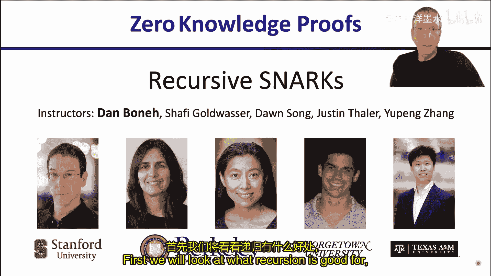
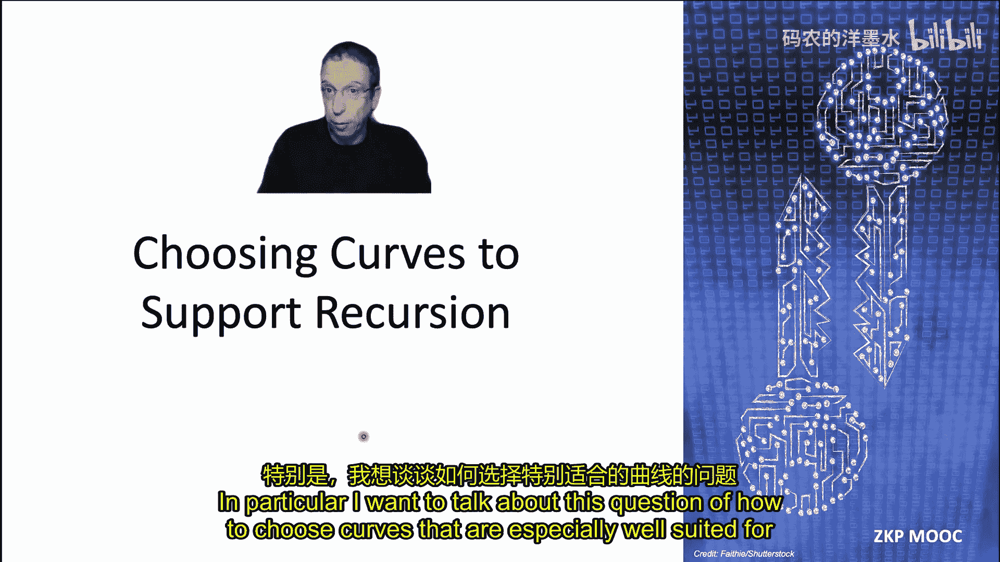
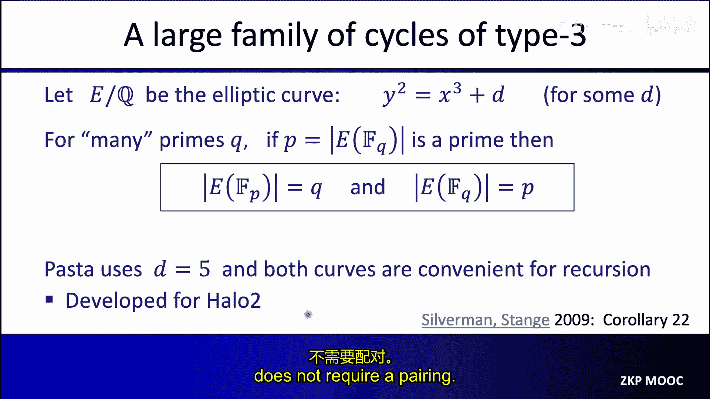
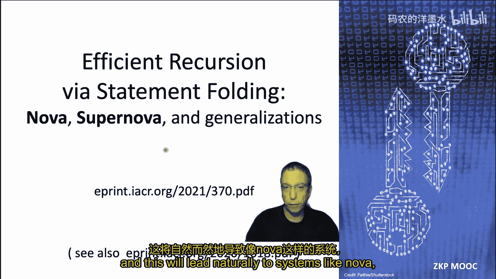
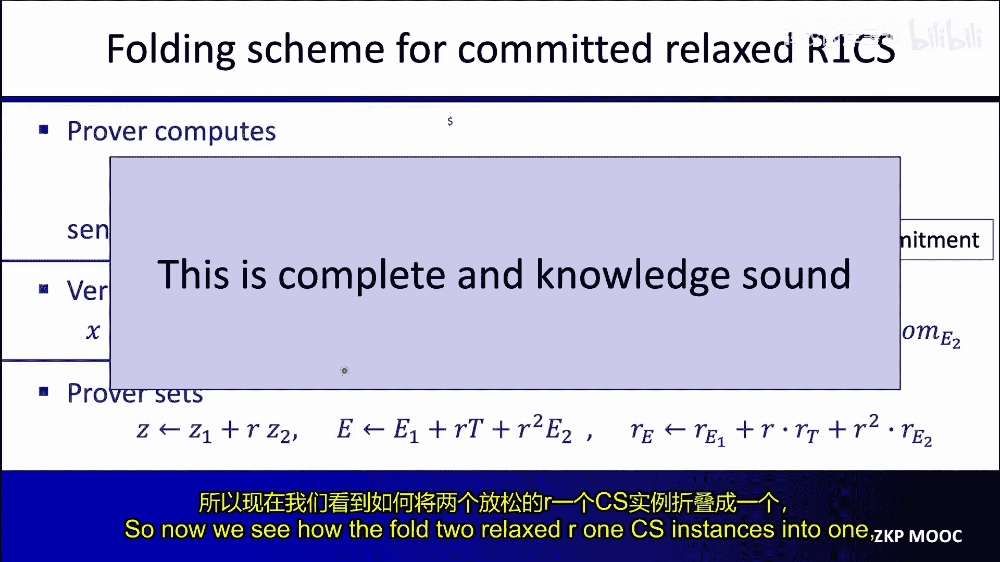
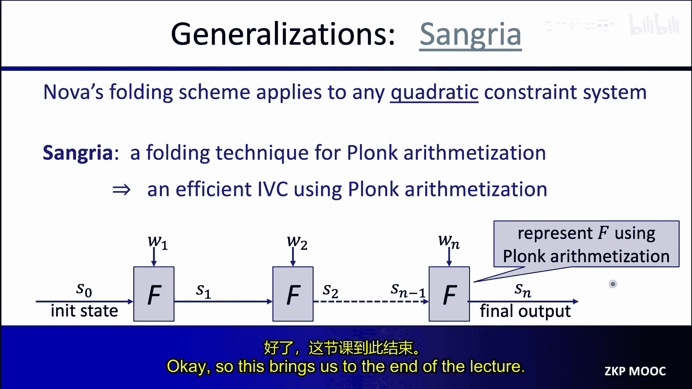
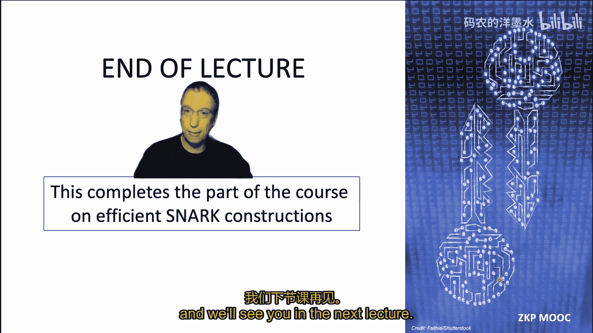

# 【全集】加州大学伯克利分校 Web3：零知识证明 区块链技术与隐私计算 中英字幕 1080P p10 Lecture 10 - 递归的 SNARKs -BV1bCrpB2E7Q_p10-

Hello everyone and welcome back to our chosison snarks In this lecture we're going to look at a fascinating idea called a acursa snark。

First， we will look at what recursion is good for， and then we will see how to construct efficient recursive s Norrks。

To begin with I want to quickly review the three algorithms that make up a snark。 So as you remember。

 a preprocessing snark is a triple of algorithms， S P and V。

 the setup algorithm will take a circuit and preprocess it to output public parameters for the prover and public parameters for the verifier。

 The proving algorithm will use the parameters for the prover。

 the statement X and the witness W to produce a proof pi。

 The verifier will use the verifier parameters。 the statement X and the proof pi to decide whether to accept or to reject the proof。

Now， in the last couple of lectures， we saw several snark constructions。 For example。

 we looked at Grs 16 in the Planunk snark in particular Planunk using the Kcg polynomial commitment scheme。

 we said that these constructions actually lead to short proofs， but to prover time is not linear。

 It actually runs in time N log n where n is the size of the computation。

 We refer to this as a quasilinear time prover。 We also looked at other snark constructions in particular。

 FI based constructions as well as coding based constructions like breakdown Orion orion plus These systems we said have in practice a faster prover。

 but unfortunately， they generate longer proofs。 So one question you could ask is you can we have the best of both worlds where we have a fast prover。

 but one that also produces very short proofs。So to begin to answer that question。

 let's first look at the general principle of Snark recursion。

So what do we mean when we talk about proof recursion。 Well。

 let's start with a twolel snark recursion and explain what that means。 So normally。

 when we apply a snark， of course， you know， we have a statement X and a witness W and we produce a proof that the witness W is a valid witness for the statement X in a recursive snark。

 the idea is not to produce the actual proof。 but rather to produce a proof of knowledge of a proof。

 Yeah， this idea sometimes can blow your mind in that we're not proving that we know a witness for the statement X。

 but rather we prove that we know a proof of a witness for the statement X。 Yeah。

 and so let's see how that works。 So let's suppose that we start with a statement X and a witness W。

 and we're going to use our proof system are snark to actually， as usual。

 produce a proof that the witness W is a valid witness for the statement X。 Yeah。

 So here this proof pi here proves knowledge of W such as C of x W is equal to 0。

But that's not what we're going stop。 Now what we're going to do is we're going run another proof system on top of this proof。

 Now， this public statement is still going to be the statement X。

 but the witness for the second proof system is actually going to be the proof pi that came out of the first system。

 So what the second system is actually doing is proving knowledge of a proof that the witness W is a valid witness for the statement X。

 we're not directly proving knowledge of the witness we're proving knowledge of a proof that the witness is valid。

 so we end up with a proof pi prime And what it actually proves is that this second proof of p prime knows pi such that pi is a valid proof for the statement X。

 So the circuit that the proof of p prime is working with is actually the verification circuit V for the first system。

 S PV。So the first system， what we'll often call the inner system。

 is actually proving knowledge of a witness W relative to the circuit C， the outer system。

 the second system S prime P prime V prime is actually producing a proof relative to a circuit that implements the verification algorithm V of the inner system。

 so you can see that pi prime is a recursive proof because we're proving knowledge of a proof rather than directly proving knowledge of a witness。

So this picture is actually quite important in this lecture。

 where the whole point of recursion is that instead of directly proving knowledge of a witness。

 we're proving knowledge of a proof that a witness exists。😊。

So let's look at the first application for this， and the first application is to build a system that has a fast prover and the resulting proof is also short。

So let's assume that the inner proof system， this SPV proof system。

 is one that actually has a fast proofr， but maybe it results in a large proof。

 so let's say the prover and the verifier are fast in this system。

 but the final proof pi here is rather long say 100 kilobytes to be concrete。

 What we'd like to do is now we'd like to compress this proof to something much shorter and what we can do is we can run the outer system which now maybe is a slower proofr。

 but results in a shorter proof and now the outer proof system will again prove that the verifier of the inner system would accept the witness proof pi and that will result in an outer proof pi prime which is say now only a kilobyte long。

Now， the point of this is imagine that the circuit C that we're actually proving knowledge of a witness for。

 Imagine the circuit C is gigantic。 So constructing a proof for the circuit C directly using the outer system would actually be quite slow because of the slow proofer。

 it would result in a small proof in a short proof。

 but it would take quite a while to generate that proof。 Well。

 what we instead we do is we'll use this inner proof system to quickly produce a proof for the large circuit C for which we're trying to prove the ws of valid witness that will run faster than the outer proof system。

 but it will generate a large proof and what we'll do is we'll run the outer system just on the verifier on the inner system。

 And so if the verifier circuit for the inner system is smaller than the circuit that we're trying to prove using the inner system。

 the outer system will then work much faster than if we had tried to use the outer system to generate a proof for the original circuit C right because now the outer system is only being applied to the verification circuit。

Of the inner system。 So in this way， we get the best of both worlds。 Basically。

 we use a fast proof to process the large circuit that actually looks at W directly。 but of course。

 that produces a large proof。 And then we use the inner system， which has a slower prover。

 but now is being applied to a much smaller circuit， namely just a verifier of the inner system。

 And now the final result will only be a kilobyte long proof。

 Yeah and so the nice thing here is we get a fast overall proofr and the final proof is actually short。

 so we kind get the best of both worlds。 And as I say。

 this only is applicable when the verifier circuit for the inner system is much simpler than the actual statement we're trying to prove。

 So this is something that's very useful for proving very complex statements。

 and this actually comes up quite a bit when doing proofs for things called the Zk EvM when we're trying to prove a large execution of the EVM。

 Of course， when the verifier wants to verify that W in fact， exists。😊。

So the prover actually knows that w such as c of xw is equal to0。

 it will verify the recursive proof pi prime， and the proof pi will never be seen by the actual real world verifier。

 So you might be wondering why is this sound at all right So why is this an okay thing to do。

 And so let's walk through a quick argument as to why this recursive construction provide knowledge soundness。

 Yeah， so let's fix some circuit C。 yet the circuit you can see takes n field elements that represent a statement。

 M field elements to represent the witness and it outputs0 or1 basically saying whether the witness is valid for the statement or not。

 Now let's quickly review the definition of knowledge soundness。

 which is what we're trying to prove here。 And so as usual。

 we said that a snark SV is knowledge sound for a circuit C if the following holds It so happens that for every malicious polynomial time prove a。

 there is an efficient extractor E that satisfies the following property So for all statements that we could imagine。

 we'll call the statement Y。If we look at a probability that our malicious prover is able to produce a valid proof。

 right this probability here captures the probability that our malicious prover is able to produce a convincing proof for the statement Y what we'd like is no matter what this probability is。

 the extractor when it runs on the statement Y it's able to actually extract a witness for this malicious prover and the probability that it produces a valid witness is greater than the probability the malicious prover is able to convince the verifier minus some small epsilon。

 some languageable epsilon this epsilon is called the knowledge error。

 so if for every efficient prover， there's an efficient extractor that satisfies this inequality。

 then we say that the system is knowledge sound。😊，So we'd like to prove that our two level recursive srk is knowledge sound for a particular circuit C。

 So let's see prime be the circuit that actually is used by the outer system。

 Yes so the C prime is a circuit that basically runs the verifier of the inner system using the proof pi as a witness In addition。

 let's say that we have a convincing prover So A is a convincing prover for the outer system as prime P prime and V prime with respect to this circuit C prime。

What we need to do is we need to build an extractor that doesn't extract a proof pi。

 that's not what we want。 what we want is an extractor that actually extracts a witness for the original circuitency。

Okay so let's see how to build this extractor so here we wrote down again the conditions right so we have the outer proof system is being applied to the circuit C prime and we have a malicious prover a that's able to produce a convincing proof with respect to this circuit C prime。

So here's how our extractor is going to work。 So we're given some statement X。 and of course。

 we're given the verification parameters for the inner system。

 What our extractor will do is the following。 Well。

 we know that the outer system is knowledge its sound for the circuit C prime that's by assumption That means that there's an extractor E prime that can extract from the proofr a。

 it can extract a proof pi such as a circuit C prime is satisfied， In other words。

 the inner verification algorithm， given the extract proof pi while output yes。

 but now look at this E prime E prime is a circuit that outputs of proof pi that convinces the inner proof system In other words。

 E prime now is convincing prover for the inner proof system Well then because the inner proof system by itself as knowledge sound we know that there is exist extractor E that can extract from the extractor E prime treating this E prime is a malicious prover this extractor E can extract a witness from E prime such as c of x double。

I equal to 0。 Yeah， so we kind of extract in two steps。

 We extract a proof from the outer proof system。 and now that we have an extractor for a proof from the outer proof system。

 we can run the extractor of the inner proof system and obtain the actual witness for the statement that we're interested in。

Yeah so it's a two step extraction process and let's see how likely is this extraction to succeed。

 so I claim that our extractor， which is made up of running two extractors one after the other。

 I claim that that's going to succeed with exactly the probability that a convinces the outer proof system minus the sum of the two knowledge errors。

So why is that Well， let's see So the adversary A， the malicious prover。

 when we apply the extractor for the outer system， we know that we'll be able to succeed in producing a proof for the inner system with exact same probability minus the negligible knowledge error for the outer proof system and now when we run the extractor of the inner proof system will know that we'll be able to extract a valid witness with the same probability minus the knowledge error of the inner proof system。

 So overall we succeed in extracting a witness for the circuit C with knowledge error epsilon prime plus epsilon which is still negligible because both epsilon prime and epsilon are negligible and the sum of negligible values is negligible。

Okay， so this is why the two level recursive construction is sound because we can extract from the outer proof system then extract again from the inner proof system。

 and that results in the actual witness that we're interested in。

 one thing that we have to be a little careful with is that， in fact。

 the running time of these extractors might get worse and worse as we kind run through the recursion。

 In particular， imagine that the running time of the extractor E prime for the outer proof system。

 Let's say it's twice the running time of the malicious prover。

 And the same would hold for the inner proof system。

 Imagine the extractor for the inner proof system runs at twice the time of the malicious prover for the inner proof system。

 Now the time for our overall extractor was four times the time of the malicious prover that we were given。

 So for our two level recursion， this is perfectly fine。

 four times the time is still polynomial time。 So we're all happy。

 But imagine in an n level recursive system。 If we have to repeat this process n times。 Yes。

 so we extract from the outermost system。 Then the second outermost。😊。

outermost and so on and so forth。 we kind repeat this n times。

 The final extractor that we end up with will run now in time 2 to the n times the original malicious prover。

 and that's no longer polynomial time。 So we end up with an extractor that's not valid because it doesn't run in polynomial time。

 So this is something that we have to be careful with when we do recursion in that the recursion depth in effect can only be logarithmic and the security parameter otherwise we end up with an extractor that runs for too long。

 One might view this as just as an artifact of our proof technique。

 The fact that we compose these extractors one inside of the other。

 maybe it is another proof technique that avoids this kind of exponential blowup。 but in general。

 we're going to try and limit our recursion depth to be most logarithmic in the security parameter。

 and that actually avoids this problem but in some applications will ignore this technical issue and give a construction that actually uses linear recursive depth And I'll tell you that usually whenever we have a construction with a linear recursive depth we usually can converted in。

A construction of logarithmic recursive depth。There's another issue with recursion that I wanted to bring out。

 and that is that when we construct S sRC systems， we very often use the Fatm transformation to transform an interactive proof system into a non-interactive one。

 If you remember the Fatchm transformation introduces the notion of a random oracle where the prover and verifier generate the challenges by using a hash function which we model as a random oracle in order to make the proof system noninactive。

The question is when we do recursion， now all of a sudden we end up with a verifier that has random oracle gates embedded in the verification circuit。

But now you the recursive prover has to work with the verification circuit of the inner proof system。

 but if this verification circuit has random oracle gates in it。

 the recursive prover doesn't know what to do with those gates。

 Yeah those are not kind of computational gates they call out to a random oracle which the prover cannot handle。

 So somehow we have to get rid of these random oracle gates before recursion can actually be made to work。

 and so there's a standard answer to this and the answer is what we do is before we start the recursive process。

 we instantiate all the random oracles in the verifiers circuit with a concrete hash function。

 Yeah so we replace the random oracle， say we shot to 56 or some other hash function and maybe is more amenable to our arithmetic circuits like Poseidon but the point is we replace the random oracle with a very concrete hash function Of course once we move away from the random oracle model Now we no longer have a security proof that the snark system is all its sound So we have to just assume that after this。

😊，The proof system is still knowledge sound。 We can justify that assumption by the fact that it is true in the random oracle model。

 but strictly speaking， once we instantiate the random oracle。

 now we have to make another assumption that the instantiated system is still secure。

 The point is now that we have an instantiated system where now the verifier circuit no longer uses random oracle gates Now it uses a concrete hash function。

 So the verification circuit is a concrete circuit。

 this now allows us to recurse because now the outer prover can actually process the verification circuit of the inner snark system。

 But of course， to prove now that the resulting recursive snark is secure。

 we have to rely on this somewhat ugly assumption， which is to say that this concrete system with the random oracle replaced by a real hash function is still knowledge sound。

 so to summarize our discussion so far， The first application we saw for recursion had to do with proof compression。

 And I should stress， of course， that that construction would generalize to three levels of recursions and fourlevel recursion and so on and so forth。

Nothing magical about stopping at just two levels of recursion。

The next application I want to show you is for the purpose of streaming proof generation。 Yeah。

 So what does that mean， What does it mean to stream proof generation， Well。

 imagine we have a prover， like， for example， in the case of a rollup that actually needs to prove many statements at once。

 Yeah， it needs to prove that a whole bunch of transactions， like 100 transactions are all valid。

What that means is it's actually trying to prove that it knows W1， W2 up to WN。

 such that W1 is valid witness for x 1。 W2 is a valid witness for x2 and so on and so forth。

 So it's trying to prove this conjunction of statements。

The problem with this is if you have to produce one monolithic proof for this entire conjunction。

 that actually can be quite expensive and slow to build。 in particular。

 you can only start to construct this proof after you have all the end statements that you're trying to prove。

 But in reality， that's not what happens， right in reality， when you build a roll up system。

 the public will send you transactions one at a time。 Now。

 you can wait until you have 1000 transactions and then start to produce the proof of all thousand transactions at once。

 But what we'd like to do is we'd like to start to generate the proof that the transactions are valid as soon as the first transactions is already available。

 Yes， so we call this streaming proof generation because we don't want to wait until all the statements are available before we can generate the proof。

 we'd like to start to generate the proof as the statements are being sent to us。And again。

 recursion is a very good way to do this。 And let's kind look at two worlds to explain the problem。

 So imagine we have like 100 transactions that are being sent to us naively， as we said。

 we can only start to generate the proof for these 10 transactions only after the last transaction was submitted And so here there's going be quite a long delay before the last transaction is submitted and the time that we can actually submit the proof to the layer 1 chain。

 Wed like to do something better。 And the way we'll do this better is exactly using recursion。 Yes。

 so we'll take the first set of 10 transactions and then we'll generate a proof for them。

 Then we'll generate a proof for the second batch of 10 transactions。 And so on and so and so forth。

 So you see we're already generating proofs while the transaction are still streaming in And then finally。

 once all the transactions are available， all we have to do is we have to take the 10 proofs that we generated and generate a proof of proofs。

 So we have generate a proof that says that these 10 proofs are valid and then finally。

 this becomes the proof that we。😊，To the layer 1 chain。

 And the point is that now the only thing we have to do after all 100 transactions are received is produce a proof for the batch of last 10 transactions。

 along with a proof of proofs。 And both of these operations are much。

 much faster than generating a analyistic proof for all the transactions once they're all received。

 Yeah， so we end up with a much shorter delay between the time that the last transactions is received。

 and we can post things to the layer 1。Okay， so again。

 this is another very cute application of recursion I want you to think about as a way to kind of speed up proof generation when the statements are streaming at you one at a time。

Okay， so we have two more applications that I want to show you。

 and then we'll start to look at how to construct efficient recursive proofs。

So the next application is actually kind of an important application。

 It's what's called incrementally verifiable computation or IVC。

 This is something that can also be used to speed up proof generation quite a bit。

 So the setup here is that we have a very long computation that's done by iterating some fixed function F。

 Yeah so you can see here that the computation starts at some initial state as 0。

 first input comes in， we'll call omega1， we apply the function F。 we get a new state S1。

 another input comes in， we get a new state S2。 we keep doing this until finally we end up with the final state Sn。

 Yeah And our goal is basically to produce a succinct proof that the prover knows witnesses omega 1 to omega n such that the final output Sn is in fact correct。

 In other words， Sn is the result of applying omega1 to omega n to the initial state S0。

 Here the verifier is gonna know the function F of course because that's a public function。

 It knows how many steps we ran the function4。 It has the initial state and it has the final state and it just wants to verify that the final state。

😊，Is correct。 So this is actually something that happens quite often in practice。

 It's a very real world problem， especially if you think of F as like a microprocessor。

 So imagine F literally implements a simple microprocessor and then what happens here is we're literally stepping through the state of a computation。

 And since F is a touring completelete microprocessor that basically captures an arbitrary computation that just happens by running this microprocessor for many。

 many， many cycles。Now， since we mentioned long computations that are done by iterating a function F。

 I can't resist the connection to Deep thoughtt Deeptht。

 as you may remember from the hititchhiker's Guide to the galaxy is a computer that was built by the civilization。

 The civilization asked the computer what's the meaning of life。

 the universe and everything And the computer said。

 oh that's a very interesting problem It's going to take me 7 million years to figure out the answer。

 and so it worked for 7 million years。 this is this long computation that we are thinking of here。

 and at the end of the  seven million years is said the answer is 42。

 So wasn't a very helpful answer， but that was the answer。

 And so that's an example of a very long computation for which one might also want to generate a succinct proof that the computation was done correctly and therefore 42 really is the correct answer to life。

 the universe and everything So we wouldn't have to take deep thoughts word for it。Okay。

 so let's first of all look at the construction and then I'll show you some examples where IVC actually comes up。

So the construction is a very natural idea。 Maybe many of you already see it。

 What we're going to do is basically at every step， we're， of course。

 going to output the state at that step， but we're also going to output a proof that the computation is correct up until that step Yeah And so specifically right So for I equals1 to n and step I。

 the prover is going to output the current state S I along with a proof pi I and what does this proof prove this proof pi I prove that the prover has a witness namely S I minus1。

 the previous state， omega I namely the input to the current step and the proof。

 the previous state was correct。😊，And the witness basically has to satisfy the following properties。

 First of all， it has to be the case that， you know。

 if we apply F to this previous state with omega I， we get the current state。 Okay。

 so this proves that S I is correct。 when more importantly。

 we prove that the proof pi I -1 of the previous state is， in fact。

 a valid proof relative to the previous state of the computation。So again。

 at every step we output the current state in a proof and what the proof proves is that a。

 the current state is correct relative to the previous state and that the proof of the previous state is also correct relative to the previous state。

So I'd like to very briefly convince you that this means that the last proof pi N。

 along with the final output S N proves that， in fact， the prover knows W1 to W N。

 such that the output Sn is in fact correct。 So why is that true Well。

 what we need to do is build an extractor to prove knowledge soundness we want to prove that the prover knows omega1 to omega n that make s and correct Well。

 So how do we do that Well， we're going run the extractor on pi n right and what is the extractor going extract from pi n。

 Well it's going extract a valid witness for the previous state。 Well。

 this valid witness at a point n-1 proves to us that f of s n-1 is equal to S n and that pi of n-1 is a valid proof for the previous statement Well。

 now we're going run the extractor again， and each time we run it。

 we're going extract the previous state until the very beginning where we will extract s0 and then the very circuit just checks that s0 is in fact the correct initial state。

 so because we can run the。Exctor iteratively and extract literally all the states in the computation。

 And we know that all these states actually are correct。

 We can deduce from this that pi of n proves that S N really is the correct output of the computation。

So this was a little bit of a high level description of how the extractor works。

 but this actually can be made into a formal argument and it might be a good exercise for you to convince yourself that by repeatedly applying the extractor。

 we actually can recover the entire computation trace and that computation trace must be correct。Now。

 at this point you're probably wondering about what I said earlier about linear recursion depth versus logarithmic recursion depth。

 I'm not going to get into the details here， but just know that in fact this IVC can also be proven secure using only logarithmic depth recursions。

So what I did here is I kind of wrote out more explicitly what is the statement that' being proved at each step and you can see the statement is actually that s sub I is the correct state at step I and the proof pi I is the proof that actually prove that and what I wrote here in red are actually the witness values that are used to prove that the statement is correct So what really what the proof pi I is proving to us it proves that I know a witness containing s subi minus1 omega I and pi I minus1 for the statement that we just wrote here such that in fact。

 you if I apply f to the witness elements s sub i 1 omega I I get the statement element S and if I apply the verification algorithm to the witness element that contains the proof in the previous state。

 the answer actually will be yes Now I actually even wrote down the ver here is ver actually just verifies this circuit which is a relatively simple circuit this is a constant size circuit independent。

Of the depth of the computation and the verifier just verifies this one proof pi N to say that this is a valid proof。

 and therefore this is a valid statement， and therefore SN is computed correctly。 Okay。

 so that's how IC works。 these ideas are very elegant。

 but they definitely take some thinking to see why this all works and why it's all correct。

So let's talk about some applications of IVC。 So the first application is the one we already talked about where you can take a long computation and break it into a sequence of small steps。

 like if the function F implements a microprocessor like steps of a risk5 or steps of the EVM All the prover has to do now is prove one step of the computation at a time as opposed to proving a monolithic proof over the entire lifetime of the computation we're just doing one step of this function F rather than proving everything all at once and because we're proving only a single step。

 this is a simple enough proof that it greatly reduces the memory requirements of the prover now the memory requirements are only the ones needed to prove a single step of the computation This is kind of the reason why people like to do recursion in that it allows us to prove very。

 very， very large statements that we might not otherwise be able to because a memory requirements。

 for example， but we can do it like one step at a time and that actually does not require that much memory at all。

 There are two more applications。Of IVC that I wanted to mention， which are very cute。

 The first one is basically a way to build a single short succinct proof that the current state of the blockchain is correct。

 so I can compress the validity proof of an entire blockchain into a single succinct proof。

 And the way we do that is basically we make S0 be the initial state of the chain。

 We make SN be the current state of the chain。 Yeah and then the omega 1 to omega and the inputs that we provided to f at every step are basically blocks of valid transactions and literally the transition from s0 to S1 is just a transition that says omega1 is a block of valid transactions and here is how these transactions change the state of the chain。

 So the proof that SN is correct。 is a short proof that's fast to verify to say that all the blocks are valid and they in fact lead to the current state SN and that's already convincing the ver that SN is correct。

Yeah， without this type of mechanism， if a new verifier wakes up and it wants to verify that S N is correct。

 it would have to download all the box and rerun them all by itself until it obtains S N。

 And only then is it convinced that the blockchain is correct。

 with these IVC methods when a new verifier wakes up and wants to verify the current state of the chain。

 All it has to do is verify the proof pi。 Of course。

 it has to make sure that everybody agrees on the same S N。 That's a consensus problem。

 But validating this S N is correct is done by a very short and succinct proof。

 So this is used by the mean blockchain where you can verify the entire state of the chain by literally verifying just one proof。

Another application I wanted to mention is what's called a verifiable delay function where the goal here is to compute a function in such a way that the computation cannot be sped up by parallelism。

 So we want a sequential computation。 but do it in such a way that once you compute the final answer。

 it's actually quite easy to convince somebody else that S N is correct。

 So the way we do that is basically using a hash chain Yeah so we start from as 0。

 we apply the hash over and over again， we end up with sn。

 so this is often denoted as H to the power of n of s0。

 and the IVC proof will now prove that Sn is correct using a short proof that's fast to verify。

 And the reason we use IVC is again， so the prover can actually do this proof one step at a time。

 without having to resort to a huge amount of memory that's needed to do the monolithic proof if it wanted to do it all at once。

 So IVC allows us to do these proofs of long computations with relatively little memory。

Okay and the last application I'll give you and then we'll stop with applications and start with constructions is this coming market for ZK provers。

 Yeah so you know people have GPUus in their homes， maybe for gaming rigs and such。

 they don't use these GPus all the time they might want to rent out the GPUus so other people can use them and then there's gonna be a market for these provers where the market takes statements that need to be proved。

 like for example， a bunch of transactions that need to be proved via ZK rollup So the market will take this collection of transactions from the public and then it will assign jobs to the various GPUus that are available to currently do proofs。

But again， we don't want to assign the entire job of all these transactions to a single GPU。

 We'd like to break it up into pieces。 And so the market might assign。

 you know prove that transaction 1 and2 are correct to one prover and in parallel。

 prove that transaction 3 and 4 are correct to another prover。 Well。

 now we have two proofs for these pairs of transactions。

 a third proofr now would build a proof of proofs that pi1 and pi2 are correct so that the final proof will be pi and that's the thing that will be pushed to the layer1 chain。

So again， this is an example where recursion comes up where we can do kind of in parallel。

 we can have multiple entities prove that various transactions are correct。

 then we produce a proof of proofs recursively， and that's the thing that's actually pushed onto the chain。

Yeah， so again you can see many， many applications for recursion。

 so snarks are not just used for proving that statements are correct。

 they're also used for proving proofs of proofs and as you can see that actually comes up again and again and again in different applications。

Okay， so we're going to stop here in the next segment。

 we're going to look at a technical problem that comes up when doing recursive proofs and then how to solve it。

 So we'll see you in a few minutes in the next segment。

 So welcome back everyone now that we understand all the wonderful things that recursive proofs can do for us。

 I want to talk a little bit about a technical problem that comes up when doing recursion in particular。

 I want to talk about this question of how to choose curves that are especially well suited for recursive proofs。

😊。

First of all， let's quickly review what a twolel snark recursion is so as you remember basically there's an inner proof system SPV there's a public statement X and the prover P will produce a proof pi that it knows a valid witness W for the statement X Yeah so that's what this proof pi proves and then the outer proof system basically will use the proof pi as a witness and it will produce a proof pi prime that proves that the prover P prime knows a proof that will be accepted by the inner proof system。

So rather than P prime proving directly that it knows a witness W。

 it proves that it knows a proof pi that will be accepted by the verifier of the inner proof system。

So now let's quickly review how these proof system works at a high level。

 so let's fix some circuit C and let's fix a statement X and to prove that I know a witness w such as c of xw is equal to0。

 remember that we use commitments to polynomials， for example。

 we might commit to univevariate polynoials or maybe multivariate polynomials。

 but let's focus on univariate polynomials for a minute and the prover commits to a polynomial basically did encodes the computation trace and then it proves that in fact a computation trace is a valid computation trace。

Now how do we commit to a univevariated polynomial。 Well， for that， for example。

 we could use the Kzg proof system and to do that， we basically needed groups of order P right so our circuit is defined for our arithmetic operations in the finite field Fp。

 so we do additionions and multiplications module P。

 And so to commit to polynomials that are defined over fp， we need a group of order P。

 and using such a group， in fact， a Kzg commitment to a polynomial over fp is a single group element in G。

 but it's important to remember that if we're going to support circuits with arithmetic and fp。

 then to commit to polynomials over fp， we need a group G of order P。

 And the question is how is a group G represented So for that。

 I have to introduce an interesting concept called an algebra group。

 Yeah so what is an algebra group。 Well we'll say that the group G is an algebraic group defined over the field fq。

 if， in fact， the group G is contained in fq to the L。

 that means that every element in the group G is represent。as an L tuple over the field Fq。

 so the tuple of L elements represents one element in the group G。 And beyond that。

 the group operation itself can be computed by polynomials over fq in particular。

 there are polynomials， which will call F1 to F L such that if I give you two elements in the group G。

 So A and B are in the group G。 Of course， you remember that a is an L tuple over fq and B is another L tuple over fq。

 Well， the sum of a plus B can be computed by applying the polynomials F1 to Fl to the points A B。

 Yeah， so the group operation itself can be computed by simply applying polynomials over this field Fq。

 Yeah， so the group itself is embedded in in L tuples over fq。

 and the group operation can be computed using polynomials defined over fq。 In addition。

 from any algebra groups， there are many L tuples that represent the same elements in the group。

 And so we also need an algorithm that given2。Ltoples in the group will test whether they actually correspond to the same element in the group。

 Yeah， this is more of a mechanical thing。 The more important thing to understand is that the group has order P。

 it has P elements in it， but it's defined over fq。

 meaning that elements are L topples over fq in addition is implemented using polynomials defined over fq and just as an example I'll tell you that if G is a group of points of an ellipto curve defined over fq then this is an example of an algebraic group Yeah the group operation can be computed using polynomials in this case。

 every element is a threetopple and the group operation can be computed using three polynomials that output the sum of two given points and this group could have some order P and it turns out that P is going to be relatively close to Q。

Okay， so now what is the problem that we are facing when we're doing recursive proofs。

 It turns out we have an arithmetic problem。 Yeah， so suppose G again is a group of order P defined over FQ。

Yeah so if the group G is of order P， that means that's a prover can support doing proofs for circuits that are defined over fp Yeah so additional multiplications in the circuits are defined over fp but because the verifier needs to verify polynomial evaluation proofs in the group G it actually needs to do operations in fq because group operations in this group are done using additions and multiplications modular Q So again。

 the prover will support circuits defined over fp， but the verifier needs to do operations in fq in order to verify a proof So in a picture we have our prover。

 the prover says I can do proofs for circuits over fp and the verifier says well that's great。

 but I need to do operations in the group G which requires arithmetic and fq and as a result I need to do arithmetic over fq in order to verify the proof So you see there's a mismatch the prover P prime is doing proofs using the circuit for the ver V but there's a mismatch because P prime supports operations in fp but the verification circuit uses operations。

😊，FQ。So the question is what to do how to resolve this technical problem。

 And it turns out theres a bunch of solutions。 some of them good， some of them not so good。

 The first solution that comes to mind is what's called field emulation。 Yeah。

 let's implement arithmetic and fq， which is what the verifier needs as a circuit over fP so now the prover supports circuits over fP those circuits implement arithmetic over fQ。

 So now the prover can produce proof for the verifier circuit because now the ver circuit is implemented as a circuit over fP。

 so again， every addition and multiplication that the verifier needs to do in fQ will somehow be translated into many additions and multiplications over fP The problem of course。

 is this blows up the size of the verification circuit， because every arithmetic operation。

 FQ now becomes many arithmetic operations in Fp and now the prover is really really slow and in fact。

 this comes up in the real world， for example， to verify a Kzg evaluation proof would need to do what's called a pairing and implementing a pairing using field emulation is huge。

Prover is really quite slow if it has to implement a circuit that verifies KzG proofs。

 and it does so using field em。 the verification circuit becomes quite large。 and as a result。

 the prover becomes quite slow。So we'd like to do something better。 So here's a better idea。

 A better idea is let's find an algebra group G that has order P。 and it's also defined over Fp。

 The cool thing about that is now the prover and the verifier will both use arithmetic over Fp。

 Yes because if the group has order P， that means that the prover can efficiently generate proofs for circuits defined over Fp。

 And because this group is defined over Fp。 It means that the verifier needs operations over fp to do its verification work。

 And so there's a very good match here between what the verifier does and what the prover supports。😊。

Well， I wish we were this lucky， but unfortunately。

 the universe just doesn't want us to have one of these objects。

 one can prove that a discrete problem is always very easy in such groups。 Yeah。

 so a group of order P defined over FP is always going to have an easy discrete log and as a result。

 it cannot be used for polynomomic commitments。 so this just doesn't work。Okay。

 so are there other solutions we can use。 And it turns out the answer is yes。

 the next thing that comes to mind is what's called a chain of groups。 Yeah。

 so let's try to use a chain of groups where the idea is the following。 Let's find groups G1 and G2。

 such the G1 has order P， So the prover can deal with circuits defined over fp。

 but the group is defined over fq。 So the verifier needs operations in fq G2 will have order Q。 Yeah。

 so the prover can handle circuits in fq。 You notice this as a match here。

 and the group is defined over f R。 Yeah， so in a picture， you know， again。

 we have a group of order P。 It's embedded in Fq， It's defined over fq and then we have another group G2。

 which has size Q， Yeah， and it's defined over the field F R。

So what's interesting about this picture is that the inner prover can handle circuits over fp。

 The verifier will need to do operations in fq。 But fortunately。

 the outer prover can now handle operations over fq quite cheaply。 So there's a good match here。

 And so good things will happen。 So let's see， in fact。

 how we do two levels of recursions using a chain。 And it's exactly what we just said。

 So the inner proof system uses polyomic commitments in G1。

 which means that the prover P supports circuits defined over fp。

 So additionions and multiplications in the circuits are over fp， but because commitments are in G1。

 the verifier will need to do arithmetic in fq in order to verify proofs。 Okay。

 the outer proof system is going to use polyomic commitments in G2。

 The fact that it uses polyomic commitments in G2， means the prover P prime will support circuits over fq。

 So the verifier circuit， which needs to do arithmetic in fq。

 is now very easily supported by the prover P prime， which supports arithmetic in fq。

 So it's quite cheap to。😊，To verify our circuit V such that the outer prover can do proofs for that verifier。

 So that's a very cute idea that enables us to do much faster proof recursion than what we would do if we had to do field emulation。

 And， of course， if we had a longer chain of groups， we can support more levels of recursion。😊。

Turns out there's an even better idea than simply using chains。

 It turns out we can actually use cycles of groups。 So what are cycles of groups。 Well。

 so here the idea is to find groups G1 and G2。 So a G1 has order P and is defined over fq。

 and G2 has order Q and is defined over fp。 The interesting thing about this structure is that allows us to do many levels of recursion where we kind of jump back and forth between G1 and G2。

 Yeah so maybe it's not completely clear in your mind how we jump back and forth between G1 and G2。

 So let's do it in a picture。 so our first proof is going to prove that it knows a witness W for the statement X。

 And so here C is a circuit that's defined over fp。 so uses arithmetic and fp。

 which means that the prove over P needs a group of size P。 Well that's exactly G1 but G1 of course。

 is contained in fq and therefore the veriifier will'll need operations in fq fine to verify pi 1。

 We need to do operations in。QWell fine， the next prover P prime is going to use the group G2。 Well。

 as we said， the circuit uses operations in fq。 Fortunatelyly， the group G2 has size Q。

 so that's well supported。 and it's contained instead of fp。

 So the verify for p prime is going to do operations module P。

 So we need a group of order P in order to do the next level of recursion。

 but fortunately we can just jump back into G1 G1 has order P and it can therefore support the operations that v prime need to do which our operations in fp So the prover P will use G1。

 which is contained fq and so on and so forth。 So when the prover needs to generate a proof for a circuit over fp it uses G1。

 And then the next prover will need to generate a proof for circuit over fq， itll use G2。

 The next prover will need to generate a proof for circuit over fp so it will use g1 again and we ping pong back and forth between the two groups。

 I hope this is clear it's a very acute idea。 I put a link to the original paper that defines this idea and if。

to read more about this， you can look at this paper and there have been many other papers since that also kind of explored this idea of using cycles for efficient recursive proofs。

Now it turns out there are three types of cycles of length2 first of all if you remember for KZ G polynomial commitments。

 we needed to use what are called pairing groups， right groups that support a bilineer pairing Yeah and so the first thing that it comes to mind is can we find two groups G1 and G2 that form a cycle and they happen to be a pairing group yes so both G1 and G2 support a pairing unfortunately it turns out that the best constructions for such groups result in relatively large groups and as a result this is not very often used。

Another thing we can do is we can find a cycle where G1 is a pairing group so we can use Kz G and G1。

 but G2 is a regular group， so it doesn't support a pairing。

 which would mean that if we want to do a polynomic equipment scheme over G2。

 we have to use a pairing free polynoormomic equipment scheme。 For example。

 we discuss bulletproofs in a previous lecture and there are other polynmomic equipment schemes that do not require a pairing。

 The problem with those is that their evaluation proofs are actually quite large and so provers that use G2 will end up with quite large proofs。

 but provers that use G1 will have very short proofs because Kzg evaluation proofs are actually very short。

 So as we do the pingponong between G1 and G2 we just need to make sure that the very last step of the recursion ends with G1 so that the final proof is short。

 Finally， there's another approach where neither of the groups G1 or G2 is a pairing group。

 they form a cycle but neither one is a pairing group in which case we have to use nonparing polynomomic equipment schemes in both of these groups。

 So we might end up with slightly larger proofs。hen otherwise， but you know not not too bad。

 and it turns out there are some other benefits to using non pairing groups both for G1 and G2 and in fact there's a very famous pair of curves they're called the pasta curves。

 Palace and Vesta and this pasta pair of curves， G1 and G2 is exactly designed for recursive snarks。

So how are these pasta curves constructed？Well， it turns out there's a general theory for building such curves。

 So let's see how that works。 It turns out， as we said。

 there's basically a very large family of of two cycles of this type 3 where neither one supports appearing。

 Yeah， so here I have to assume a little bit of knowledge of elliptic curves。

 So if you're not comfortable with this feel free to skip this slide。

 It's not relevant to anything that we will do later。

 So let's look at an elliptic curve that's specified by this particular form， right。

 So it's y squared equals x Q plus D for some constant D。As it turns out。

 when we look at curves of this particular form， it turns out that in fact， for many primes Q。

 it so happens that if we let p be the number of points in the curve defined over fq and this number p happens to be a prime。

 then there's a theorem it's due to silverman and sta。

 that shows that the number of points on E defined over fp is equal to Q and the number of points in the curve E over fq is equal to P。

So this one elliptic curves actually gives us two groups， one defined over fP。

 and one defined over fQ and lo and behold， they form a cycle。

 So Paa uses a particular form of this curve in particular when D is equal to 5 for particular primes P and Q and it turns out that gives us two curves that form a cycle and both of them are very convenient for acursion and these pasta curves were actually developed for the halo2 proving system and it can be quite conveniently used for recursion as long as we're using a polynom equipment scheme that does not require pairing。

Okay， so that's all I wanted to say about this technical issue of arithmetic when doing recursion。

 What we're going to do in the next segment is we're going to look at a very efficient recursive mechanism using what's called statement folding。

 that leads to systems like Nova and supernova and other generalizations that are much more efficient than doing simple recursion the way we've been doing it so far。

 So we'll do that on the next segment。 And so I'll see you in a few minutes。Okay。

 so in this last segment， I want to show you some very elegant ideas for very efficient recursion using a technique called statement folding。

 and this will lead naturally to systems like Nova， supernova and some other journals。

First of all， why do we need better recursion techniques， Well。

 if you think about the proof recursion that we saw in the previous parts of the lecture in those schemes。

 the prover P had to build a proof for a circuit that actually contains inside of it。

 the entire verification algorithm of a proof system。

 Now the verification algorithm of a proof system needs to verify the evaluation proofs for a polynoial commitment scheme。

 It turns out these verifying these evaluation proofs inside of an arithmetic circuit can be quite expensive。

And so the first idea is implementing the halo system allows us basically to take all of the evaluation proof verifications that are related to the poly recruitment scheme out of the circuit C that the prover has to build a proof for。

 So in Halo， a big chunk of the verification algorithm is done outside of the circuit C that the prover has to build a proof for。

 Nova takes this to the next step， it further simplifies the part of the verification algorithm that the prover has to build a proof for。

 and as a result， in fact， now when we do recursion。

 the prover doesn't actually have to build a proof for the entire verification circuit。

 it only has to build a proof for a very small number of checks and that's exactly what we're going to see。

 So this Nova technique enables us to build proof recursion much faster than we could before。😊。

So the way this magic is done is using the concept of a folding scheme。

 The idea of a folding scheme is to compress two valid instances into one。

 And let's see what that means。 So let's as usual fix a circuit C。

 And we're going to build a folding scheme for the circuit C。 So what is a folding scheme for C。

 Well basically it's a protocol between two parties will call it the folding prover and the folding verifier。

 The folding verifier will take two public instances。

 x1 and x2 for the circuit C and the folding prover will take those instances along with the corresponding witnesses。

 So we know that C of x1 comma W1 is 0 and C of x2 comma w2 is 0。Now。

 what they'd like to do is they'd like to fold these two instances into a single instance such that if a single instance is correct。

 that would imply that the original two instances are correct as well。

 So the way they do it is basically through some sort of an interactive protocol where the folding prover sends a certain value T to the folding verifier will see what t is in just a minute。

 the folding verifier sends back a random nons R。 and then from that。

 the folding verifier is able to create a folded statement X and the folding prover is able。

 of course， to create the same x and as well as fold the witnesses W。

 Now the property of a folding scheme is that， in fact， if the original witnesses are correct。

 then the new witness that the folding prover output is correct for the fold instance X that the verifier obtained。

 So that's one property。 So if we start from two valid witnesses will end up with a valid witness。

 More importantly， we'd like to argue that if， in fact， w is a valid witness for x。

 then we can extract。Witnesses for x1 and x2。 And that's what the knowledge sound in this property says。

 It says that for any potentially malicious folding prover P star there exist an extractor such that for any instances x1 and x2。

 if P star is able to output a valid witness for the folded instance X。

 then the extractor is able to extract from P star valid witnesses W1 and W2 for the original instances x1 and x2。

 so this basically says that again， if somehow the malicious prover is able to produce a valid folded witness W for the folded statement X。

 then it must be the case that this malicious prover。

 new valid witnesses W1 and W2 for the original instances。

 x1 and x2 So this is kind of amazing if we can do this because it says that rather than proving that x1 W1 is valid and x2 W2 is valid all we need to do is just create a folded instance and then the prover just needs to prove that this onefold instance is valid and that already proves that it has witnesses for the original instances。

Have we started with？So that's the idea of a folding scheme and we're going to see how to construct it in just a second and then we'll put it to use to do very fast recursion。

Now， when you stare at this， you might be wondering well， wait a minute。

 this is an interactive process between a prover and a verifier where we want a noninter system at the very end。

 so we have to make this folding mechanism noninteractive and as usual we do that using Fmere that unfortunately introduces a complication。

 So here instead of the verifier sending the random nos to the prover。

 the prover is going to compute the random nos by itself just like we do in fime so it's going hash whatever the verifier has。

 it has going to hash x1 and x2 along with this value T that was sent to the verifier by hashing this way。

 the prover will generate r for itself。 and then it can output the folded instance x and the folded witness w。

 Now， unfortunately， when we do it this way this introduces an extra complication because remember the verifier only sees x and w。

 and it's supposed to deduce from the fact that w is valid for x It's supposed to deduce that the prover had w1 and w2 valid for the original x1 and x2 Well。

 it can only do that if in fact， R was computed correctly。Actually。

 what the prover would have to do now is not only output X and W。

 it would also somehow have to convince the verifier that the value R was actually computed correctly and the folding didn't happen using just some random art that the prover picked arbitrarily。

The magical thing is that this is actually much， much simpler than doing regular proof recursion。

Okay so instead of using circuits， we are going to express everything in terms of rank1 constrained systems。

 what's called R1 cs。 This is something we talked about in a previous lecture。

 let me quickly remind you of the R1 cs format， So in fact。

 any circuit can be easily translated into what's called an R1 cs program So an R1 cs program as you may recall consists of three matrices。

 I'm going to call them A B and D here and so once we translate the circuit C into matrices A B and D。

 It so happens also that an instance x and a valid witness W prime for which the circuit values to0 can be similarly translated into an R1 Cs witness W so that if we put x and w together to get Z。

 so actually for the rest of the lecture is Z is always going to be the concatenation of x and W It so happens that Az times Bz is equal to Dz Yeah Now this circle is called the Haammar product and just to give an example。

 I wrote a simple example of the Haammar product， you can see this as componentwise multiplication。

Where x Y multiplies y 1 and x2 multiplies y 2。 So basically。

 we say that w is a valid witness for the R1 Cs program if z satisfies this vector equality。

And again， as I said， it's a simple exercise that I actually encourage you to do to show that any circuit can be converted into an R1 CSs program such that any satisfying input to the circuit can be converted into a satisfying witness Z for the R1 CSs program Yeah so we say that z satisfies the R1 CS program if this vector equality holds。

Okay， so why did we move to R 1 Cs。 Well， what we're going to do is we're actually going to build a folding scheme for R1 Cs。

 So our goal is to compress two R1 Cs instances into one。 in particular。

 let's fix the R1 Cs program A B D。 and in fact， we're going to fix it now once and for all。

 And let's suppose we have two instances。 So here we have x1 and x2。 And we have witnesses。

 which well call Z1 and Z2 for the R1 Cs programs， which mean again。

 that Azi times Bzi is equal to Dzi for both I equals1 and2。

 That just means that Z1 and Z2 are valid witnesses for the program A B D。 notice， by the way。

 that for now， we can only fold witnesses Z1 and Z2 that satisfy the same program A B D。Okay。

 so let's try to fold these two witnesses together as Z1 and Z2。

 And the most natural thing to do is to try to create some sort of a random linear combination。

 right， so the verifier is going to choose some random R。

 and it's going to set the folded instance x to be x1 plus X R 2。

 The prove is going to do the same thing for W1 and W2。 So overall， Z is going to be Z1 plus R Z2。

 which basically evaluates to a random linear combination of the x's and the Ws。

So that seems like a very natural thing to do。 And let's see if this works。

 So let's look at Az times Bz。 Yeah， so we have z， which is the linear combination。

 and let's just plug it into the program and see what happens。

 So we look at Az times Bz plug in z in both places and then we can expand so we get Az1 times Bz1 plus R squared。

 You notice the R appears twice of Az2 times bz2， and then we get some cross terms we get an Az2 times Bz1 and we get an Az1 times Bz2。

 Yeah these are just cross terms that come from this multiplication。😊。

Let's call this thing capital E and now let's see what we get。 So we know that Az1 times bz1。

 when we know what that is， that's equal to dz1 because we said Z1 is a valid witness for the instance Z1。

 Similarlyly Az2 times Bz2 is Dz2。 so we get R squared Dz2 here plus the cross terms。Okay。

 so now when we look at this equality， it turns out this is a little bit problematic for us because this is not exactly an R1 CS instance。

 what we want is that Az times Bz is equal to Dz， but it's not。

 it's equal to some crazy linear combination with some noise of the original instances。Yeah。

 so we can't just say that folding two R1 CSs instances gives us another R1 CS instance because that didn't quite work。

But it almost works。 Yeah， if we allow for this error term and we allow for some other scalrs here。

 then in fact， maybe we can get something to work。 And so this is gonna to motivate what's called a relaxed R1 cs instance。

 So what's a relaxed R1 cs instance， Again， we're going to fix the R1 Cs program A B D except now the instance itself is going to include some noise parameters。

 So there' are going to be a scalar C in a vector E。 Yeah。

 so X C and E together are basically an R1 cs instance。

 and we'll say that the witness Z satisfies this instance if again， when we put X and w together。

 It so happens that Az times Bz is not equal to Dz like before， but it's equal to C times dz plus E。

 Yeah， so we allow a bit of slack in that Dz can be multiplied by the scalar C。

 and we can add some noise E to the result。😊，Well， now let's try to fold to relaxed R1 Cs instances and see how this works。

 So again， we fix the program A B D， and we have two relaxed R1 Cs instances。 Yeah， so again。

 x1 c1 E1 and x2 C E2 E2。 those are the public parts of the relaxed R1 Cs program and then we have two witnesses Z1 and Z2 and these are valid witnesses。

 So we know that basically the relaxed formula is satisfied for I equals 1 and 2。😊，And again。

 I stressed that all we did to R1 CSS is we just allowed it to be multiplied by a scalar and we add some potential error vector EI。

Well， now let's see if we can actually fold two relaxed R1 CSs instances into one and now things are going to work actually quite well。

 Yeah， so what the prover will do is first it's going to compute all the cross terms。 Yeah。

 so it turns out it's going to compute this term T。

 which is going to include all the cross terms and it's going to send this T to the verifier。

The verifier is going to choose a random R Yeah， just like we did before。

 and we're going to create random a random linear combination based on this R。

 so R will be sent to the prover and then the verifier will fold the two instances together using this R so itll take a linear combination of the x's。

 itll take a linear combination of the C's and with the error term it will actually do something a little bit more sophisticated。

 it will compute E1 plus r2 plus r squared E2。😊，Okay。

 that's all that the verifier will do to fold the two instances。

 So it's just very simple arithmetic on vectors。 And that's all the verifier has to do。

 What will the prover do， The prover just does what it does before。 Yeah。

 so it just takes the two witnesses Z1 and Z2 and combines them using R。

 And this gives us the new witness Z。Okay， so so the question now is this new witness Z a valid relaxed R1 cs witness for this new relaxed R1 cs instance that we got by folding the two instances that we had Well。

 let's check so Az times bz again we can plug in the value for z which is z1 plus Rz2 and we can expand just as before so we get Az1 bz1 plus R squared Az2 Bz2 plus the cross terms just like we had before。

But now what do we know about Az1， Bz1， Well， Az1， Bz1 satisfies the relaxed R1 Cs condition。

 So it's equal to the right hand side of the R1 cs equality， Similarlyly for Az2 Bz2。

 we notice that the two cross terms are multiplied by R I'm just going to take the R out。

 and I'm left with the sum of these two cross terms here。

Okay so now let's rearrange things just a little bit。

 And so you notice what I did is I brought the E1 and E2 together so we have E1 plus r squared E2 and it turns out I can kind of also combine dz1 and Dz2 Yes。

 write them as dz1 plus R dz2 times C1 plus R C2 Yeah and if you expand this out you'll basically get the terms that we have over here。

 C1 Dz1 and r squared C2 dz2 plus some other error terms and actually what's interesting is if you look at these other error terms they exactly we're already canceled out by what we put into T。

 So T actually if you go back to the to the slide that defines T T is basically these two cross terms that we always have to deal with minus some error terms that come from this multiplication And so this quality holds because of how we define T But now the amazing thing is that we know that c1 plus R C2 is equal to C and this is actually how we define E so we get c dz plus E and lo and behold。

This is another relaxed R1 Cs instance。So what this says is that W from which we derive Z。

 remember z is simply x concatenated with W。 So W， the folded witness is in fact a valid。

 relaxed R1 CS instance for the instance， x and this new C and this new E。

So the simple calculation that we did here simply shows that in fact。

 the Z that we constructed z is equal to z1 plus Rz2， in fact。

 is a valid witness for the new folded instance X he E。

 which is what the folding verifier actually built right So in fact。

 the folded witness satisfies the folded instance that the verifier got。

Why is this secure in particular， Why is this knowledge sound？ Well， under paper。

 the authors actually show that this is knowledge sound。

 They show that for every folding prover P star there's an extractor E。

 such that if you look at any pair of relaxed r1 cs instances。

 if the folding verifier outputs X C is the folded instance and p star is able to output valid witness for this folded instance。

 then in fact the extractionor can extract w1 and W2 for the given instances for the input instances and these are going to be valid witnesseses for these instances。

 Now I oversimplified just by a little bit， In fact。

 the relaxed r1 cs instances have to contain one more term。 It's actually a quadruple。

 not a triple and it has to contain also a commitment to W that's done for technical reason so that this extraction can go through but for our purposes will just assume that the relaxed r1 cs instances are triples。

 but just keep in mind that there actually is a fourth element that's needed for the extraction theorem to hold。

Now， this actually by itself is still not good enough。So in a relaxed instance。

 the verifier has to store x， which is the original instance。 It has to store C。

 which is just a scalar， but it also has to store E。

 And the problem is that this E can be quite large， in particular， it could be much。

 much larger than x。 This E actually is somewhat related to the size of the computation。

 the total computation。 Well， the poor verifier can only run in time that's proportional to the size of x。

 It's not allowed to run in time it's proportional to the size of the computation。 And as a result。

 we can't send this E to the verifier。 This E is too big for the verifier to accept。

 So we have to get rid of E somehow。 And the way we do that is by replacing E by a commitment to E。

 so this is called a committed relaxed r1 C。 where now what we'll do is the instance will contain x and C is before。

 In an addition， it will just contain a short commitment to this noise E。

 And the prover will have E in the clear as part of the witness。 and of course。

 whenever we verify committed relaxed r1 C witness。😊。

To verify that E and RE are a proper opening of the commitment in the relaxed R1 CSS instance。Yeah。

 so the only thing we did is we just replaced E by a commitment to E and shoved E in the witness。

 and now the instance itself is not much bigger than than the original instance X。 Now。

 remember the verifier has to do all sorts ofthmetic operations on E So for the folding to actually work the commitment scheme that we use has to be an additive commitment scheme。

 So let me remind you what an additive commitment scheme is So let's quickly review what a commitment scheme is。

 So commitment scheme has a commit algorithm and a verify algorithm。

 the commit algorithm will take a message， some randomness and output of commitment。

 ver algorithm will take the message。 the commitment and this randomness to to create the commitment。

 This is sometimes called the opening of the commitment。

 and decide to accept or reject Yeah and as usual， a commitment scheme has to be binding and hiding binding just means that the adversary can never produce a commitment with two valid openings for this commitment once it outputs a commitment it can only open it in one way and hiding just means that the commitment reveals nothing about the committed data hiding is primarily needed when we talk。

😊，As zero knowledge proofs， if we don't care about the zero knowledge property。

 we don't have to use a hiding commitment， binding is the main property that we would need。Now。

 what makes a commitment scheme additively homomorphic。 Well。

 so we need this extra property where the messages themselves are going to be vectors over a field。

 The randomness is going to be an element of the field。

 and I'm going to assume that the commitment themselves lie in some additive group and we'll say that the commitment scheme is homomorphic if for all messages M1 m2 and randomness is r1 R2 It so happens that if I commit to M1 using R1。

 this produces a group element， and I commit to M2 using R2。 this is commits another group element。

 If I sum those two up， I get a commitment to M1 plus M2 with respect to r1 plus R2。

 Yet it says the additive property that says that I can add up two commitments and obtain the commitment of the sum of the committed values。

 Yeah and we'll say that the commitment scheme is succinct。 if the commitment itself is very short。

 In fact， we're going assume it's the commitment itself could be like 256 B。

 So it's kind of constant size and then we'll say that it's succinct。And in fact。

 there are many additively homomorphic commitment schemes。 I'll just say the names here。

 One is called the petterson commitment scheme。 There are lattice based homomorphic commitment schemes。

 I'm not going to explain how these commitment schemes work here。 If you want to see how they work。

 you can look up petterson commitments。 and you'll see exactly how we build an additively homomorphic commitment scheme。

 Now， once we have an additively homomorphic commitment scheme。

 we can build a folding scheme for committed， relaxed R1 C S instances。 Yeah， So again。

 we fixed the R1 C S program， A B D。😊，And the instance is going to be Xc in a commitment to E。

 the witness that the prover has is going to be some vector Z， the vector E。

 which is an opening of this commitment E using the randomness R Yeah。

 and the only thing we know is that if this is a valid witness that we know that Az times Bz is equal to CDz plus E and E and R are in fact an opening of the commitment E。

So that's what an instance is。 and that's what what it means for a witness to be a valid witness for this committed。

 relaxed R1 Cs instance。 as usual now we're going to take two such instances。 Yeah。

 we're going to fix the program A B D。 And we're going to take two such instances and see if we can fold them into a single instance。

 Well， so here's again， the folding strategy， which is exactly what we saw before。

 So the prover is going to compute this vector T。 And again。

 the problem is that this vector T is too big to send the verifier because this vector T is basically as big as the computation。

 So instead， what we'll do is the proveable commit to the vector T and send the commitment to the verifier。

 Again， this is done using the additively homomorphic commitment scheme。😊。

The verifier does what it normally does。 It chooses a random R， sends r to the prover。

 and then it just folds the two instances。 so it will fold x1 x2， it' will fold c1 and C2。

 And now when it does the folding， it doesn't apply it to E because it doesn't have E。

 it only has a commitment to E， but that's okay。 It can fold the commitment to E because the additively homomorphic property in particular。

 it's going to compute exactly what it did before on the plain text E。

 it's going do exactly the same thing on the commitment it adds the commitment to E to E1 plus r times the commitment to t plus R squared times the commitment to E2 And again。

 the reason it can do that is because the commitment scheme is homomorphic。What does the prover do。

 The prover just does the same thing as before， The prover does a linear combination of its witnesses。

 It computes the updated E。 You notice this matches the commitment。

 So E is still going to be an opening of the commitment to E and the same thing it does for the randomness that's used to open that commitment。

Okay， so E comma R is an opening of the commitment comm sub B。

So this is how we fold two relaxed R1 cs instances。 And I want you to look at this for just a minute。

 It's really quite remarkable that the work is really quite low。

 All that happens in order to fold is we just basically take a linear combination of the two instances that we were given。

 So we combine X1 and x2。 Similarlyly， we combine Z1 and Z2。 And basically that's it。

 That's kind of how the folding works。 So it's extremely fast。😊，And of course。

 we have to ask why is it secure。 And again in the paper。

 there's a proof that this is complete and knowledge sounds。 Okay。

 so now we see how to fold two relaxed R1 cs instances into one。 now that we have a folding scheme。

 let's go ahead and put it to use。 What I'd like to do is show you how to build a very efficient mechanism for incrementally verifiable computation for IVC。

And so let me remind you that IVC means that we're trying to prove that a computation that iterates the same function over and over and over again is done correctly。

 in particular the prover knows these omega 1 to omega n。

 such that Sn is in fact a result of applying omega 1 to omega n to an initial state s0。

And we said in the earlier part of the lecture that in fact。

 IVC can capture arbitrary computation because F could implement like a microprocessor。

 and then all we're doing is we're just running steps of a microprocessor over and over and over again。

 and that basically captures any computation we want。

So now we're going to do IVC using folding instead of snark recursion。

 On the first part of the lecture， we saw how to do IVC using recursion。

 where at every step we would have to produce a proof that everything up until this point was correct。

 The next step would verify that the proof is correct。

 So the prover at step I would have to construct a proof that the verification circuit ran correctly on the proof of step I-1。

 So again， the prover has to work quite hard in order to generate a proof that the entire verification circuit ran correctly using folding're going build an IVC that's much。

 much more efficient in particular there's no need to run the ver circuit inside of the snark prover。

 So this is really quite remarkable that we can completely move away from running the verifiers circuit inside of the snark prove so let's see how this is done。

 So what we're going to do is we're going create an r1 program A。

 What this program will do is the following。 It's going take the following input。

 So the input is going include the step number， step number I is。Take the initial state as 0。

 then it's going to take two consecutive states S and s prime and it's going to take the input omega at step I and of course。

 it's also going to take a witness。 Now the program will check that if s is the state at step I。

 then S prime really is the state at step I plus1 and if I is equal to 0 if we're the beginning of the process。

 then in fact the state S is equal to the initial state S 0。Okay， so that's all this program does。

 It's a very simple R1 CS S program that's not much more complicated than simply evaluating the function F。

Now， we can kind of represent this， of course， as a committed R1 C S instance。 Yeah。

 so the instance is going to contain X。 It's going to contain C in a commitment to E。 But， of course。

 these are very simple relaxed R1 C S instances simply where C is equal to 1 and E is equal to 0。

 Yeah， the witness， of course， is going to contain W and the opening of the commitment to E。

 And what do we know we know that if we put X and W together to obtain Z。

 then this is a valid R1 C S instance。 and E and R E are， in fact， an opening of comm E。😊。

I want you to remember that when we first build a witness for this program。

 the relaxation is not needed。 So C is equal to1 is and E is equal to 0。 Now。

 how do we use this for IVC。 Well， if you think about this。

 IVC really is a sequence of valid instance witness pairs here I had to use somewhat of a small font to get everything to fit。

 So here you can see that the first pair of inputs is S 0， S1。 The second pair of inputs is S1， S2。

 then S2 S3， then S3， S4， and what the fact that these are all valid witnesses。

 means that S1 is F of S0。 S2 is F of S1 S3 is F of S2， S4 is F of S3 and so on and so forth。

 So the final output of the computation is S4， And if these are all valid， then in fact。

 S4 is the correct output of the computation。 So if S 4 is the correct output of the computation。

 then in fact， the prover has valid witnesses for all four of these instances of the program A B D。

 the verifier can， of course。😊，By itself， verify all four of these instances one after the other。

 but that verification work will be linear in the size of the computation。 Instead。

 I imagine you can kind of guess what we're going to do。

 We're going to fold together the first two of these instances。

 and we are going to obtain this instance， x1，2， which is a folding of the first and second instances。

 Now remember x12 is a randomly new combination of x1 and x2， So x12 at this point is gibberish。

 It's no no longer has this kind of nice structure and now we're going to keep going。

 We're going to fold the second and the third instance， and we're going to end up with x1，3。

 which is a folding of the first three instances that we were given and we're going to keep going。

 We're going to fold x1，3 with the fourth instance， and we're going to get this instance。 x14。

 which is actually a folding of all four instances that we were given。😊，Now， the point here is。

 again， if the prover has a satisfying witness for this onefold instance。

 that means that it has a satisfying witness for all the folded instances， because as an extractor。

 it can go ahead and extract witnesses for all the underlying instances that were folded into X14。

 And so the amazing thing here is that we end up with one instance。

 which represents the entire computation， the prover needs to prove that， in fact。

 it it has a valid witness for this folded instance。 If it can do that， then again， by extract。

 it has valid witnesses for all the instances that were folded into X14。😊。

And so we do this this super fast folding and we end up with one relaxed R1 CSs instance。

 and then the prover can use whatever proof system it wants to prove that it has a valid witness for this single folded instance at the very end。

Yeah， so that's the magic of folding。 Unfortunately， things are not so simple。 Yeah。

 I kind of cheated you a little bit in that it's not enough for the prover to simply do the folding。

Remember， I told you that the folding process is an interactive process to make it noninactive。

 we have to use Fchemre。 but now when we make it non interactiveactive。

 the prover has to prove that the Fchemre challenged that it computed is， in fact。

 a result of the hash function。 So it is actually computed correctly。 The verifier， of course。

 doesn't have any of the underlying instances， so it can't check that R13 was done correctly。

 All the verifier sees is just a very， very last result of folding。

 It can't verify that the folding was done correctly。

 So somehow the prover has to prove that when it did the folding， it actually use the correct R13。

Otherwise， the extractor will not work， and we lose the soundest property。

 Another thing that the prover also has to prove is that all these instances that were folded together are all linked together。

 So the output of step number I really is the input into step number I plus1。

 So we need to link all the instances together。 and the way we do that is actually by augmenting the R1 cs program A B D。

 So we're going to augment it into a more complicated R1 cs program called a prime B prime D prime I'm not going to give all the details here。

 but just to give you the idea。 what will happen is that this augmented program is going to take basically the three instances。

 X X1 to I and X1 to I plus1。 this program itself is going to check that in fact。

 X1 to I plus1 is a correct folding of X1 to I and X I and that X I is a valid instance。

 So we're going create a more complicated R1 cs program and that more complicated R1 cs program well。

that the witnesses are correct for the instances being folded and it will also verify that the folding is done correctly。

 Now， how to actually do it。 honestly， there are a lot of details that I didn't want to get into。

 They're described in the paper if you're interested。

 But the important fact is that this augmented circuits。

 all it does is it just checks that F was computed correctly。

 And in addition it just needs to do two multiplications in the group G。

 this is checking that the folding was done correctly。

 that only requires two multiplications and literally you can see what these multiplications are here we have to multiply r1。

3 by x3。 That's one multiplication and we have to multiply the commitment to t13 by r1，3。

 Yeah those are the two multiplications that this augmented circuit needs to do So the remarkable thing is that when we do IVC using Nova the provers basically manipulating now a program that just does the basic evaluation of F just like before。

 plus two multiplications in the group。 that's it if you。Pre that to normal recursion there。

 The prover had to evaluate the function F， but it also had to run the entire verification circuit of a snark。

 So here in Nova， we replace running the verification circuit of a snark simply by two multiplications in G and some simple hashing。

 The hashing is a cheap part。 This part is kind of the expensive overhead overcomp in a function F。

 So again， these two multiplications are much faster than verifying that a snark proof is correct。

 And as a result， we end up with a much faster way to implement IVC。😊。

Now the last thing I'll say is that Nova allows us to do an IVC where the same function is evaluated over and over and over and over again。

 It turns out in reality， sure， this is already sufficient because the function F can simply be a microprocessor that runs over and over but in reality it would be much nicer if we can implement different functions at every step that's what supernovava lets us do this is an extension of Nova where in fact in the chain we can have multiple types of functions。

 Yeah F1 to fk we can have k different types of functions each one can appear multiple times another interesting generalization that is recently came out is called sangria again I put a link to sangria if you're interested in reading more about this what sangria observes is that a Nova folding scheme can be applied to any quadratic constraint system Nova happened to apply it to relaxed r1 yes but in fact it can apply to any quadratic constraint system in particular we can look at plank Earth meization and if we only stick to addition multiplication gates that if you remember the plan。

circuitcuit is really just a quadratic constraint system。 As a result。

 we can literally do folding on planunk athmeticization。 And what that allows us to do is run IVC。

 where F now is not represented as an R1 Cs， but rather it's represented using plan athmeization。

 So This is again， a more powerful arithmeization technique。 And so as a result。

 the function F is going to be smaller。 So it's going to be easier to do the folding because the witnesses are going to be smaller and things will be more efficient again because F is represented using a more powerful arithmeization technique。

😊，Okay so this brings us to the end of the lecture。 As you can see。

 there's a lot of different ideas that are used in recursion。

 Recursion is sort of an up and coming technique that's going to be used more and more。

 especially when we have to do proofs for very large and complicated statements。

 Recursion is almost the only way we can prove very complicated statements because of memory constraints and timing constraints as well。

 And so recursion is definitely becoming a fairly important concept。

 especially when it comes to doing complicated proofs in Zk rollups。 And so again。

 we're going to be seeing more and more ideas for making recursion efficient here I just showed you some of the beautiful ideas that have come up the last year or two。

 if you're interested in learning more about this， I highly recommend reading the papers that we pointed to throughout the presentation。

 And so I hope you dive deeper into some of this work。 And yeah， I hope you enjoy the lecture。

 I hope it was clear。 And this actually brings us to the end of the part of the course where we describe efficient snark constructions。

 in the next couple。😊。

We're going turn to various applications。 And so we'll put to use everything that we've discussed so far。

 Yeah， so I hope you enjoy the rest of the course。 Thank you all。

 and we'll see you in the next lecture。😊。

