# 【全集】加州大学伯克利分校 Web3：零知识证明 区块链技术与隐私计算 中英字幕 1080P p11 Lecture 11 - 从实践到理论 -BV1bCrpB2E7Q_p11-

Hey everyone， I'm Alex， and I'll be giving the 11th lecture for the ZK Learning On course In this lecture we're going to hear about some theoretical aspects of the proof systems that you've been learning about throughout this course This includes both some very important ideas dating back to the foundations of the fields in the 80s and 90s as well as some much more recent results just from the last few years。

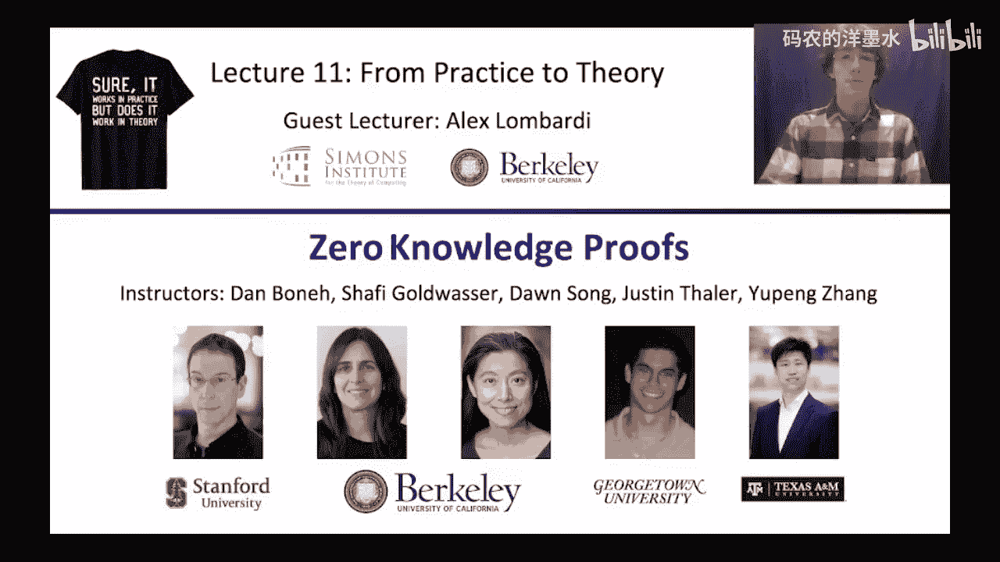

Let's start with a high level overview。Cryptographic proof systems are one of the most important foundations of both theoretical and applied cryptography and they have been for many decades。

 so for most of the course you've been hearing specifically about snarks。

 which currently have a lot of practical relevance due to potential applications in the blockchain space。

 but long before blockchains existed proof systems were still crucial for like practical internet security in particular the entire notion of authentication or digital signatures is essentially a form of proof system and so any kind of secure communication on the internet relied on it。

So that's on the practical end on the theoretical end。

 proof systems and especially zero knowledge proof systems have been sort of a Swiss army knife in cryptographic instructions and the most prominent example of this is in secure multiparty computation。

 so this is a cryptographic primitive that tries to enable a bunch of mutually distrustful parties to jointly compute an arbitrary function of their private inputs and zero knowledge proofs enable you to compile a semi-onist protocol。

 a protocol which is only secure if you're promised that all of the participants follow the protocol exactly as specified into a fully secure protocol where you don't assume that the adversary may deviate and the zero knowledge proof is used in a very direct way。

 you have each party proof that they are following the protocol specification as they're supposed to。

So more broadly， zero knowledge proofs are a critical tool in any sort of situation where you want to enforce a pretty specified behavior but simultaneously maintain secrets and this comes up in all sorts of contexts in cryptography。

So given this overview， let's talk a little bit about what theoretical research on cryptographic proof systems typically looks like and there are sort of three overlapping categories of thoughts that I want to give you on this so the first is that there is a lot of thought given to the question of feasibility do protocols with properties X Y and Z exist in principle。

 so the most prominent example of this is of course snarks and we're still trying to understand today what we can say about whether or not snarks can mathematically exist and I'll get into it in this lecture about what the issues are but beyond snarks specifically there are tons of other kinds of protocols。

 for example， like non-sistinct protocols satisfying zero knowledge or weaker hiding properties like witness and distinguishuability。

 witness hiding。

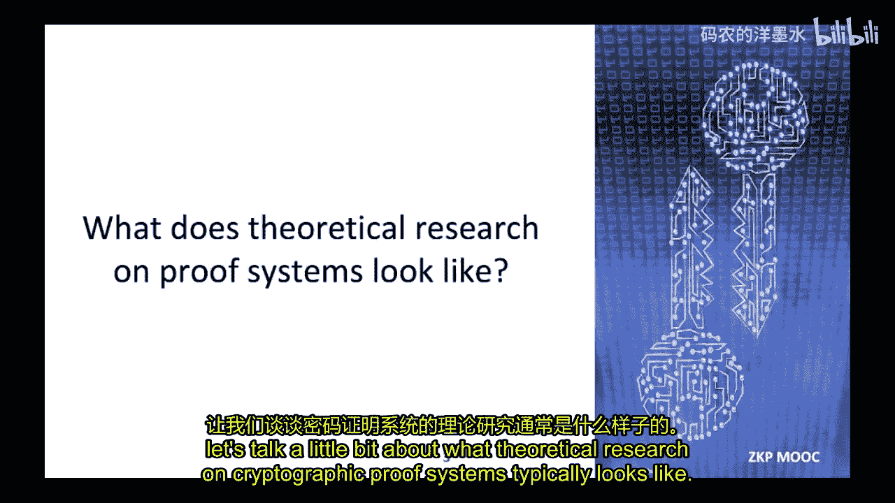

List any collection of nice properties that you'd like from a protocol and it may be inspired by some application then you can ask mathematically can such a proof system exist and this question is often very complicated and it can depend on the attack model that you're thinking about for example。

 the problem becomes harder if you think about an adversary that might be able to open up a bunch of concurrent executions of a protocol and sort of use these executions jointly to try to break security things can also be more difficult if you have an adversary that has access to。

 for example， a quantum device than it's much less clear when protocols are zero knowledge against quantum attacks for example。

 so there are there are lots of feasibility questions that come up。嗯。On top of that。

 we also want to minimize the assumptions that we're making in our constructions to whatever extent that is possible。

 so a couple of things let me mention a couple of specific examples so in non-interactive protocols you often have some sort of trusted setup either you assume that therere like a really arbitrary trusted setup of some like structured reference string has been set up by some third party that the prover and verifier have access to or you assume they have access to just a bunch of random coins which is a weaker assumption or you don't assume anything this is called the plane model so there's no setup and and feasibility of different kinds of protocols can certainly depend on what kind of setup you're assuming。

啊。And we'd like to minimize， we'd like to have the weakest setup possible for any of any kind of protocol that we're thinking about。

On top of that， we would like to have a proof of security or security reduction for our protocols based on preferably simple。

 well studied quote unquote falsifiable assumptions and I'll get into this a little bit more in the middle of the lecture。

😊，Then finally， especially once the feasibility questions have been resolved。

 we also think about improving the efficiency of various kinds of protocols and there are many sort of axes where you might want to improve efficiency in the interactive setting you might want to minimize the number of rounds of communication。

 sometimes not interactive is impossible that you still want to minimize the number of rounds of communication。

 that's a resource you might want to minimize the amount of communication like the number of bits sent between the prover and the verifier。

 you might want to optimize the computational efficiency of the prover and the verifier and so this last thing the prover especially the prover computational efficiency is a a lot of what you've been hearing about in the class so far but。

This。All of the ideas that you can see on this slide are more broadly what theorists are often thinking about。

And then of course， on top of that， we also think about how to apply various kinds of cryptographic proof systems to other applications that are not strictly in the cryptographic proof sphere。

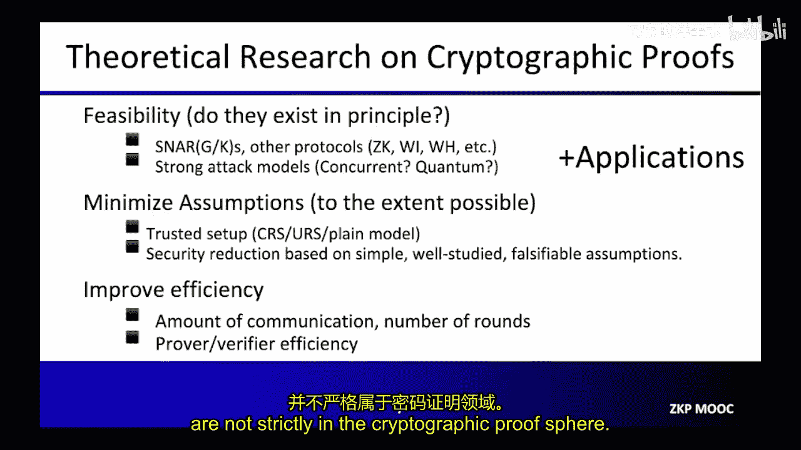

So that was a somewhat abstract discussion， so let's dive into a particular example of theoretical questions that come up when talking about interactive zero knowledge protocols。

 which you heard about in the first lecture by Shafi。

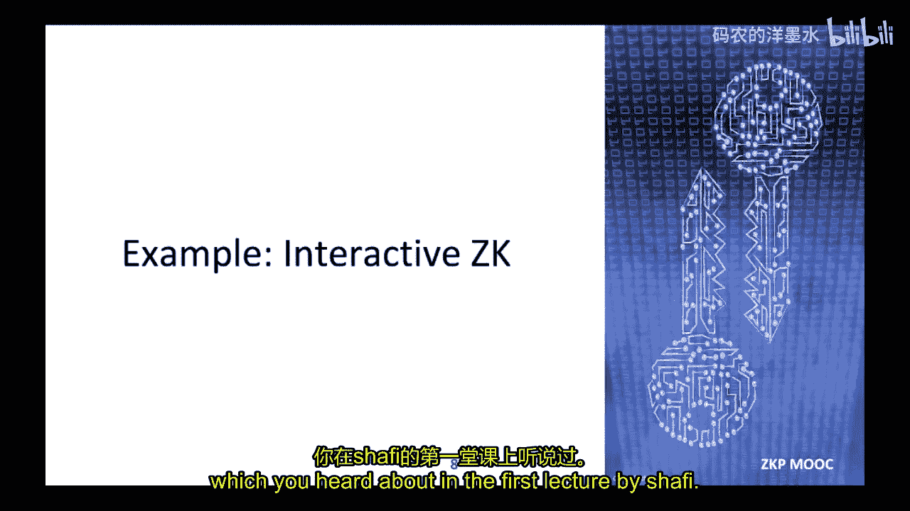

So when we talk about interactive zero knowledge protocols， we're in a setting with no trusted setup。

 so the prover and verifier can send each other messages， but there's no trusted third party。

 there's no common random string that they have access to what they send is all the information that they get to see。

So in this setting， zero knowledge turns out to be much trickier to reason about than in the non interactive setting with trust and setup。

And the reason is that you want your protocol to be secure against an arbitrary polynomial time verifier。

 which may or may not follow the protocol specification。In the non interactive setting。

 there is no protocol for the verifier to cheat they're just sent a message。

 but now they might send messages that they're not supposed to， and this might violate security。

 so your analysis needs to rule this out。So nevertheless we saw in lecture1 that you could build a zero knowledge proof system for any NP language and the base protocol that you saw had some inverse polynomial soundness error in three messages。

And so that's nice， but not really what we're looking for。

 we want a protocol where a prover can only trick the verifier with some like exponentially small probability。

 so we need to think about how to reduce the error in this protocol。

And so there are a couple of things you can do， one is that you can repeat that protocol over and over again sequentially and you can show that this works。

 this will reduce the soundness error but preserve zero knowledge however。

 this would result in a protocol with say 30，000 rounds of communication or something like that and this is not something anybody would ever want to run。

So that's one option， another thing you could try to do is repeat the protocol many times in parallel and this is a very common thing to do。

And you can show that this reduces the soundness error as you would expect。

 at least in this particular situation， and it does for any statistically sound protocol。

 it turns out。But it turns out that this parallel repetition transformation does not actually preserve zero knowledge of the protocol。

 and so you have to be a lot more careful in the interactive setting。So let's see what the issue is。

 so let's recall what the protocol was from the first lecture。

So one of the protocols that you saw was a protocol where the prover wants to convince the verifier that a certain publicly known graph is three colorable。

 and so the way the protocol works if the prover knows a three coloring of the graph is as follows。

First， the prover takes its coloring of the graph and randomizes it。

 so each of the colors it assigns a random 0，1 or two。

Then the prover commits to these randomized colors， so for every vertex in the graph。

 the prover commits to a number 0，1 or two and sends all of these commitments to the verifier。

 these commitments bind the prover to the assignments， the coloring assignment。

 but at this point in time the verifier does not know what the colors are。

After these messages are sent， the verifier samples a single random edge。

 which we call a challenge from the graph and sends this edge to the prover。

And then the prover is required to open the two colors。

The colors for the two vertices on this edge and if the prover actually committed to a three coloring。

 then the verifier will see two different colors and the verifier will accept if it indeed sees two different colors。

This is sound because the prover was committed to。Was committed to the coloring before the edge was sampled and so。

Whatever this coloring was， if it's not a valid3 coloring。

 the verifier would haveverse at least inverse polynomial chance of sampling an edge that the prove would be unable to open and accepting response with respect to。

On the other hand， it's zero knowledge intuitively because for any fixed edge that the verifier could ask。

 the prover is going to open up two random unequal colors and it doesn't seem like the verifier really learns anything from seeing two random unequal colors。

So to formalize this， we turn to the simulation paradigm。

 which you again heard about in the first lecture， so a quick recap。

 so here's how you would write down a  zero hour simulator for this protocol。

So we starts with an arbitrary。Verifier V star， which which may behave not as specified。

 so it may not sample a random edge。 It may pick a particular edge carefully that it wants to learn some information about。

 And this edge may be a function of the prover's first message。But nevertheless。

 we want to show that we can simulate the verifier's view without knowing a coloring of the graph。

 a three coloring of the graph。And the way we do it is as follows。We repeatedly guess a random edge。

And then。再。We commit to a coloring that respects this particular edge。

 so we make sure that this edge has a random pair of unequal colors assigned to the two vertices you can commit to all zeros everywhere or everywhere else。

 for example。嗯。😊，So you send those commitments over， then the verifier， you run the verifier。

 the verifier picks some edge potentially maliciously。

 and then if the edge the verifier sends is equal to your guests。

 then you can send the opening and it looks exactly like what the verifier would see in the real protocol。

If your guess was wrong， then we rewind the verifier， we rewind the entire execution。

 and we start again， we come up with a new guest， new commitments， etc。

Because the commitment is hiding， the verifier does not know which edge we guessed and our guest is in fact going to be correct with inverse polynomial probability。

 so after a polynomial number of attempts， we're going to successfully create a transcript that looks like what the verifier would have seen in a real execution of the protocol。

So that's how you show that this protocol is zero knowledge。

So what happens if we repeated this protocol many times in parallel？Let's see what goes wrong。

So I'm imagining that we have some T number of repetitions of this protocol and we're thinking of T as pretty large。

 it needs to be pretty large， in particular at least security parameter in order to make the soundness error small。

 but if there are a large number of repetitions， then the simulation strategy that we just described。

 does not work anymore， it's not efficient。And the reason is that there are at least two to the T thereifier messages that could be sent。

If you guess one of them at random， then it's only going to match what the verifier sends with probability 2 to the minus t and so you would need to do this2 to the t times in order to successfully simulate so the simulator would not run in polynomial time and so the protocol does not satisfy the zero knowledge property。

 at least we have not shown that it does。啊。So。That's an explanation for why the simulation strategy we discussed does not work for the parallel repeated protocol。

 but it turns out that the protocol morally should not be thought of as zero knowledge so there is this result due to dwarna Rangled and stockmire from 99 and they show this kind of funny lose lose situation there are two things that you might expect to be true for this parallel repeated protocol one you might expect it to be zero knowledge and two you might expect to be able to instantiate fitchemir for this protocol and they show that at least one of those has to be false so either you cannot instantiate fitchemir for this protocol or if you can instantiate fietcheir for this protocol then the interactive protocol is not zero knowledge against malicious verifiers and I won't get into the details but the point is basically that the bad。

Vifier that you can't simulate here is a verifier who generates its challenges maliciously by hashing the prover's message。

So the takeaway here is that we shouldn't expect this protocol to be zero knowledge。

 the correct intuition is that Ft chiir should be possible and we'll discuss it later in this class。

 but as a result， we don't think this protocol is zero knowledge。So that's a。

That's an example of one issue that comes up when thinking about the theory of interactive zero knowledge protocols and the fact that parallel repetition doesn't preserve zero knowledge causes a whole bunch of problems that come out of this fact。

 and so there are many lines of research devoted to sort of circumventing this problem。So。

 for example。Because of this issue， it's not clear how many rounds of communication you need in order to prove something in zero knowledge。

 like what is the minimal number of rounds of communication of a zero knowledge protocol that actually achieves small soundness error？

So there is a very recent work of Banski Kali Panth who give a construction that requires only three rounds of communication。

 which we know would have to be optimal， but we know that you can't do less than three and they give a candidate construction for a three message protocol。

啊。So here are some other questions that you could ask， forget about the rounds of communication。

 how efficient can you make the prover in a zero knowledge protocol and so there are many lines of work devoted to writing down protocols that have much better prover efficiency than this is zero knowledge protocol for three coloring that I just gave you in particular if you want to prove some other statement that does not naturally have the structure of a threecolorable graph then in order to use the protocol that we just talked about you'd have to reduce the problem you care about to a threecoling question and this reduction has terrible overhead such that you would never want to actually run the threecoling protocol after computing this reduction。

So on the other hand， yeah there are other constructions of zero knowledge protocols that are much more efficient for the prover。

 and these are potentially practically relevant。And some of them are related to some of the protocols that you've learned about in this class like bulletproofs。

啊。Finally， as we already touched on in the introduction。

 you could also ask for stronger forms of security from zero knowledge protocols besides the definition that we've talked about so far。

 so you might want the protocol to be zero knowledge against quantum attacks。

 which we have not actually argued。Because the rewinding procedure that we described turns out not to work when the verifier is quantum for somewhat subtle reasons。

Similarly， the rewinding procedure we talked about does not work in a setting where you have an adversary who who has opened up many concurrent executions of a zero knowledge protocol and is trying to learn something from these from the joint view of many executions and so there are lots of thoughts and techniques on how to。

Write down protocols and prove that they're secure in these settings。

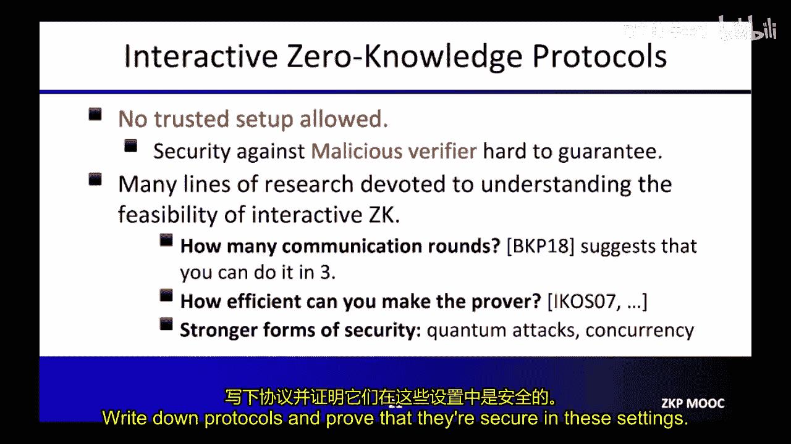

So that was a brief foray into the world of interactive Ze knowledge protocols。

 but for the rest of the lecture， I want to talk about theoretical aspects of the fiatra mirrorre transformation and about the existence of succinct non interactive arguments。

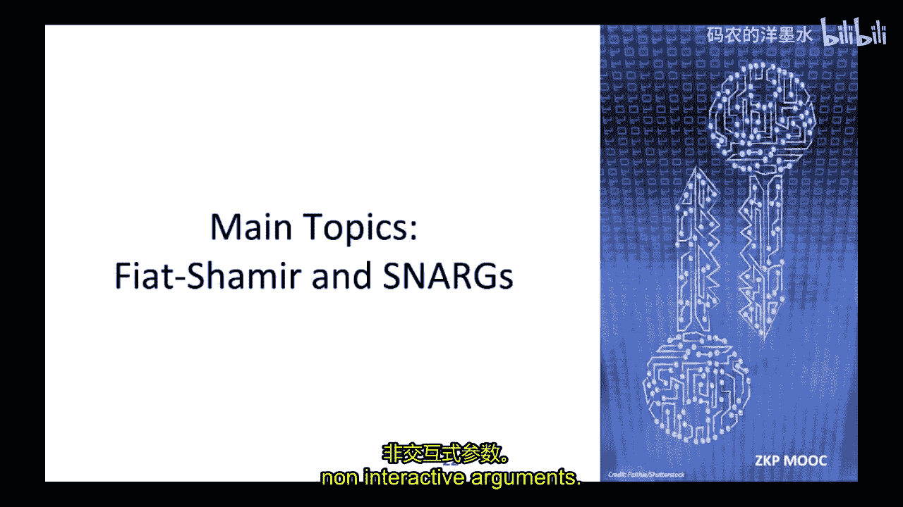

So here's a quick reminder of the definition of a succinct noninteractive argument。

 so we have an NP language， we have some claim represented by a string X and the prover。

 the honest prover at least will have a witness W， for the truth of the statement X。

 and the prover and verifier share a common reference string either some random coins or generated to be a trusted setup。

And then the prover uses its potentially long witness to generate a short。

 easy to verify proof pi that is sent to the verifier that the verifier can use to check that X is true。

And as long as the prover actually has a witness W for x。

 then the verifier should almost always accept。😊，But on the other hand。

 if the statement X is actually false， then for an arbitrary efficient strategy P star。

 whatever proof that the strategy generates should make the verifier reject with very high probability。

Finally， as I said， we want the proof to be short， so we're thinking of this as like polylogarithmic in the length of the statement and witness and verification should be very fast。

 it should be about this much time with some read access to the input。😊，So this is what we'd like。

And we've seen constructions of snarks in this class already using interactive oracle proofs along with a random oracle。

 there is also another family of constructions that you saw briefly using linear PCPs。

 but we'll be focusing on the random Oracle based constructions today。

So what does it mean that a random oracle was used to convert an IOP into a snrg while it's done via the fiiachere transform。

 which you've also learned about but a quick recap is that it's a powerful and very general proposal for removing interaction from interactive protocols as long as the verifier messages in the interactive protocol are truly random strings then you can replace interaction with a verifier with the hash function H that the prover uses to generate verifier messages on its own by hashing its own messages or hashing the transcript prefixes to generate the next verifier message。

 what you see on the screen is just the three message case so you can think of the verifier challenge being a hash of the first message alpha potentially along with the statement X which is not written here。

So。It turns out that if you model this hash function as a random oracle。

 then this transformation will securely compile any constant round public coin interactive protocol。

 In fact it will compile more protocols than this， but for a simplicity of discussion let's just think about constant round protocols for now。

So I don't think that we've actually seen a proof of this in the class。

 So the first thing I'm going to do is sketch a proof that。That in the random Oracle model。

 this compiler works。So now we should be a little more specific， Well。

 what do we mean by the statement that H is model as random oracle？So the random oracle model。

 roughly speaking。Is an assumption about the structure of an attack on the hash function？

So in principle， for the FHchmR protocol， the prover is given a description of the hash function。

 and it can use this hash function description however it likes in order to try to generate its proof。

But the randomoracle model is an assumption that the best that an adversarial strategy can do is treat the hash function description as a black box as a box which takes as input message alpha and spits out a message of beta and the strategy will only query this hash function as an oracle。

 it will not use the implementation details of the hash function。So yeah。

 so the random work model is a class of text that tries to。

 in the case of Fetchemir tries to generate an accepting proof on a false statement by querying the hash function a bunch of times and not actually looking at the implementation details of the hash function。

And roughly speaking， if you're only treating the hash function as a black box。

 it's reasonable to think of it as just like a uniformly random function， for example。

 the hash function could be a pseudoran function and then if you only query it then it's indistinguishable from a truly random function。

😊，So the claim very concretely is that FtR works in the random work model。

 meaning that if you only query the hash function8 and you don't look at its implementation。

 then the best prover strategy for the noninactive protocol is not much better than the best prover strategy for the interactive protocol and there is a security loss that grows with the number of rounds so for the proof right now we'll focus on the three message case。

What we need to do is show that any good prover， any successful prover for the non interactive protocol can be converted into a successful prover for the interactive protocol。

 So we start with this prover P star， which queries the hash function a bunch of times and eventually produces a transcript alphapha beta gamma sent to the verifier。

And we want to say that we can emulate this in the interactive setting。

So the key idea for app security here。Is that the first message alpha that is generated by P star essentially has to come from one of the queries that P star made to the hash function H。

 In fact， that can be done without loss of generality。

 you can always assume that whenever the prover is going to output something at first queries。

 the message alpha to the hash function if you really want。So。

 but now the punchline is that we're assuming that the prover only makes a polynomial number of queries to the hash function because it's running in polynomial time。

 or more generally it's running in some bounded amount of time and so as a bounded number of queries it can make to the hash function。

So。We can take advantage of this to actually break the three message protocol。

And the idea is as follows if we want to trick the verifier in the three message protocol well。

We have this random oracle non interactive strategy that's tricking the non interactive verifier。

And if the prover makes Q queries to the hash function。

 then there's one of Q locations essentially where it's producing an accepting transcript on a false statement for the interactive protocol so how we'll break the interactive protocol is we'll make a guess。

 we'll guess which query to H is going to is going to be the successful one essentially？

And then in the interactive protocol， we will generate the first message alpha by running the lefthand side strategy and making I minus1queries like to the hash function ourselves so I is the guess that we made for which query is going to work。

 so we do the first I minus1 queries locally ourselves and then。

We send whatever the Ih query was going to be， we instead send that to the verifier。

 we do not query the hash function on that alpha， we just send to the verifier。

Then the verifier sends us back a random string beta and we basically pretend that this was the output of the hash function。

 then to generate our last message gamma， we continue running the left-hand side strategy until it outputs a transcript at the end。

 we pick whatever gamma was chosen by the fiatmre approver and we output that。So， so。Basically。

 this will break the interactive protocol with the probability1 over Q times the probability that the noninactive prover is winning。

 because if we happen to guess which query the alpha that the non interactiveactive prover outputs corresponds to。

 then are if our guess is correct， then we're correctly emulating the random oracle attack in the interactive setting。

And so this says that。That your security is only one over Q worse than the security that you had for the interactive protocol for a2 R round protocol。

 your security loss in general will grow like one over Q to the R， roughly speaking。

 although you can do better for protocol satisfying more fine grain soundness notions like round by round soundness。

So that was a proof that Fetchemir works under reasonable hypotheses in the random orle model。

 but now let's revisit this assumption that the random orle model was making。So as we said before。

 the model is assuming that even though you're given the description of some hash function H that the best an attack can do for the purposes of breaking the Fiat chimre protocol is treat that hash function as a black box。

 plug in a bunch of inputs to it get some outputs and use this to try to break security。

So in reality， the hash function is not a random function that you call as a black box。

 but it iss instead something likeSh 256 may be salted with some like identities。

 times stamps and random strings， things like this， but it's something likeSh 256。

 and so that's what it is in practice， but even in theory， like no matter what。

 you're going to instantiate this hash function with some efficiently computable public algorithm。

 because it needs to be something that the prover and verifier can both actually compute in a reasonable amount of time。

So。There is a mismatch between the model which treats H as a random function and the reality。

 which is that it's efficiently computable， is an efficient algorithm。Uh， and so yeah。

 this is an obvious like a theoretical issue， which is that efficient public algorithms can't compute random functions。

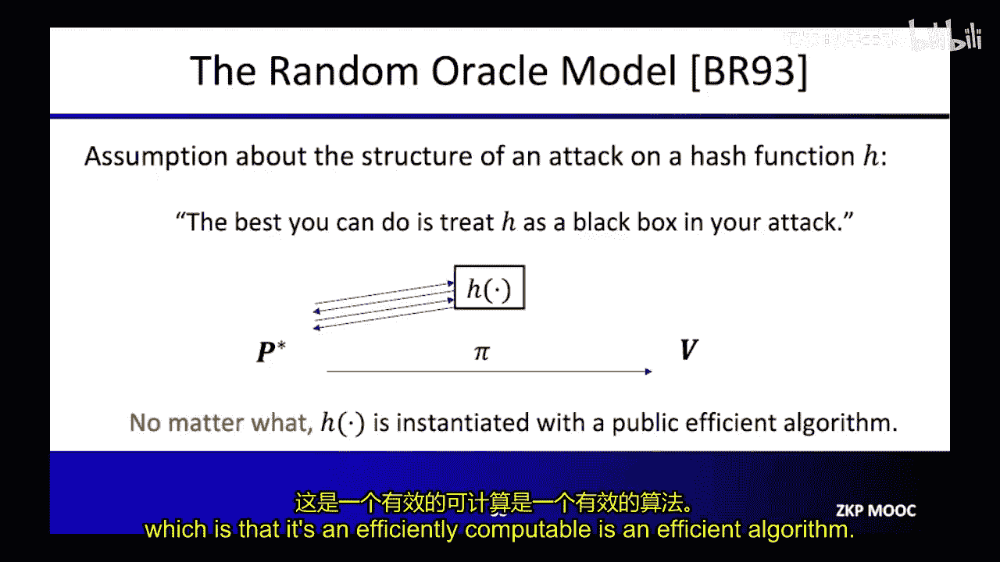

And。So yeah， that's a clear issue， but nevertheless。

 you might still hope that for any security property that you actually care about。

 that if you can prove the security property holds in the Rorical model。

 then a reasonable hash function instantiation will also satisfy that security property。

 this is the logic underlying the Rorical heuristic。So of course， you don't just have to。

Like hope that it works， you can also try to attack any specific protocols that you implement and so the heuristic is supported by the fact that the Fetchemeir paradigm has not been really broken in practice。

 but theorists are trying to get a more principled understanding of when and why this transformation actually works so the first thing I'm going to show you is a negative results。

 we're going to see property of random oracs that is a security property that holds in the randomoracle model that provably cannot hold for any efficiently computable hash function family so this is a violation of the randomoracle heuristic。

So。

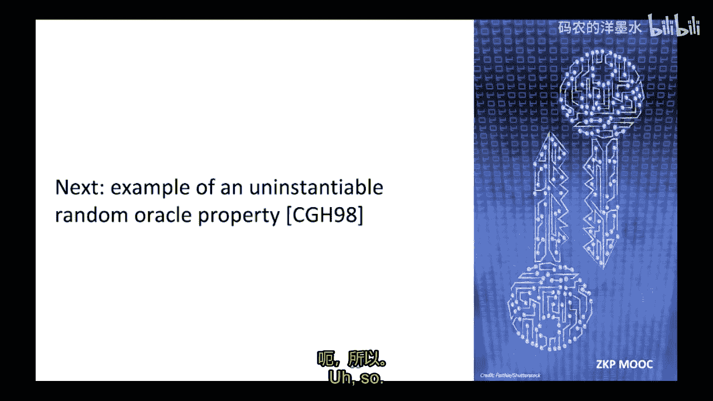

Here's a family of very important security properties。

 so there's a security property for every function。

 F mapping strings to fixed say security parameter length strings。

So a hash function or hash function family， we say， is correlation intractable for this function F？

If given a description of the hash function H， it is computationally hard to find an input x to the hash function。

 such that hash of x is equal to F of x。So yes， this is a very very broad security property。

 you can plug in any function F that you like here and you get a different security property but it's not hard to see that for any fixed function F you get F correlation andtractability in the random orle model that is a randomoracle will satisfy this security property and the reason is very simple in the randomorle model your attacker is just making a polynomial number of queries to the hash function and for each query X made to the hash function。

 you get a random output string Y。And you know each time you do this。

 the probability that y is equal to f of x is2 to the minus lambda 2 to the minus security parameter。

 which is tiny， and so even if you do this a polynomial a number of times you're extremely unlikely to find an x such that hash of x is equal to f of x。

And this is true for every fixed function F。So so it is a very reasonable security property that a random oracle has。

 and so you might expect that if you instantiate the randomoracle with Shah or with some reasonable hash function that you'll also get this security property。

 but it turns out this is not the case， so there is a particular function F。

Such that for any efficiently computable hash function family， capital H。

 H is not correlation intractable with respect to this function。

So the random or heuristic just completely fails for this notion of correlation and tractability。

So if you haven't seen this before， now would be a good time to actually pause and think about if you could come up with a function F。

That proving this claim， can you come up with a bad F where correlation intractability for F is impossible。

 it's an example of a very ubiquitous idea from theoretical computer science called diagonalization。

So I'll give you a little bit of time to think about if you can come up with an F。

So here's a function F， which demonstrates the impossibility。

So F is going to take as inputs an arbitrary string X。

 and what it will do is it will interpret this string X as the description of a program P。

 you can always， you know you just have some mapping between strings and programs。

 doesn't matter what it is。And then F of x is equal to p of x。

 so you run the program that X describes。On input X。So again。

 F takes as input the description of the program and it runs the program on its own description。

Seems like a bit of a weird function and it makes sense because it's demonstrating this random workacle impossibility。

 so here's why you can't have correlation and tractability for this F with an actual hash function family。

So take any H， any hash function family capital H， and we can write down a very simple attack that breaks correlation intractability with respect to this F。

 so given a hash function little H from this family。

 we want to find an input X such that hash of x is equal to F of x。

 so the input X that we're going to pick is the description of H itself。So we're going to take the。

 we got a hash function and we're going to plug the description of the hash function into itself。

hAnd and you can see sort of by definition that that hash of x for this particular choice of x is going to be equal to f of x because what does F of x do？

😊，F of x plugs x into the program that X describes X is the description of H。So therefore。

 F of x is equal to h of x， and so we've broken correlation and tractability。

 like just given the description of H。We can efficiently find an input that is always equal to F of x where F is some fixed function。

And a randomoracle does not have this property and so this is a property that holds for randomoracles。

 but not for any actual hash function family。So yeah， this is the counter example。

 and it's very simple to write down but I think it takes quite a bit of time to actually wrap your head around。

 so definitely feel free to take some time to think about what's actually going on here。

So let's let's talk about this counter example a little bit more。

 so like let's talk about how reasonable it is at like how。

How should this make you think about the instantibility of random oracles？

So the counter example is kind of asking for a pretty contrived security property here。

 the in particular， this is only a counterex to the random or heuristic for like hash functions that need to be able to take arbitrarily long inputs in particular。

 your hash function needs to be able to take need to be able to hash inputs that are at least as long as the description of the hash function itself。

And so this counterexle does not rule out correlation andtractability for functions that have bounded input lengths。

 and this is very important and it will come up towards the end of the talk because we're actually going to build hash function satisfying weaker forms of correlation intractability。

They actually exist。So， so that's， yeah， that's one big。Caat to think about here on the other hand。

 there are actually other hash function security properties that holds for randomoracles and provably don't hold for any hash function family that only involve fixed length inputs it's no longer about correlation interacttractability but there are other security properties for fixed length hash functions that are counterexamp in fact these counterex are for the Fiatchemere heuristic so there are these two results of Barque and Goldwaser Kaai and show they construct interactive protocols where the Fatchere heuristic applies to these protocols in the randomoracle model in particular they constant round protocols and so we know that fiatchemre should work。

But nevertheless， they show that for any efficiently computable hash function family H。

 the Fatmere protocol using H is insecure， so for any particular H there's an attack。

But for a random oracle， there's no attack。嗯。So this is a very direct counter example。

 saying that although we have this random oracle proof of security for Fatremre。

 we actually have to be careful when when instantiating it。 there are some protocols where。

Where nevertheless it won't work。So。So， but let's。So as a result。

 theorists are really trying to understand。When the random work heuristic actually applies。

 when we can take it as evidence that the resulting protocol is actually secure when you instantiateiate it in the real world。

So let let's note a few more things about the negative result。So first of all。

 we break the security property in the attack we just saw by running the hash function on its own description so so you can ask is this practically relevant。

 would you ever run a hash function on its own description if。If you never want to， yeah。

 if your protocols never care about things like this。

 then maybe you can say that the counter examples is irrelevant to practice。

You can sometimes say this， but interestingly snarks that are constructed via recursive composition actually do in some sense call the hash function on its own description。

 not exactly as we wrote it down in the attack， but something that like at least superficially resembles it and that's because when you're doing recursive snark composition。

 what you're doing is you're giving a snark proof that the snark verifier would have accepted some other snark proof。

and so you're proving things about the snark verifier。

 the snark verifier is running the hash function， and so therefore you want to give a snark about something to do with the hash function。

And yeah， so as a result， you're using you're calling the hash function on information that depends on the description of the hash function。

😊，嗯。And so to be clear， this is not at all to say that recursive snarks in practice are broken。

 we don't actually have attacks， but it doesly that there is a really hard to describe line between secure and insecure instantiations and as a theorist we're still trying to understand what this line actually is to explain why the constructions in practice are secure。

 even though there are these weird counter examplesamples in theory。

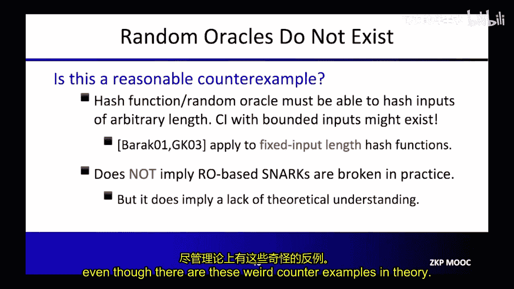

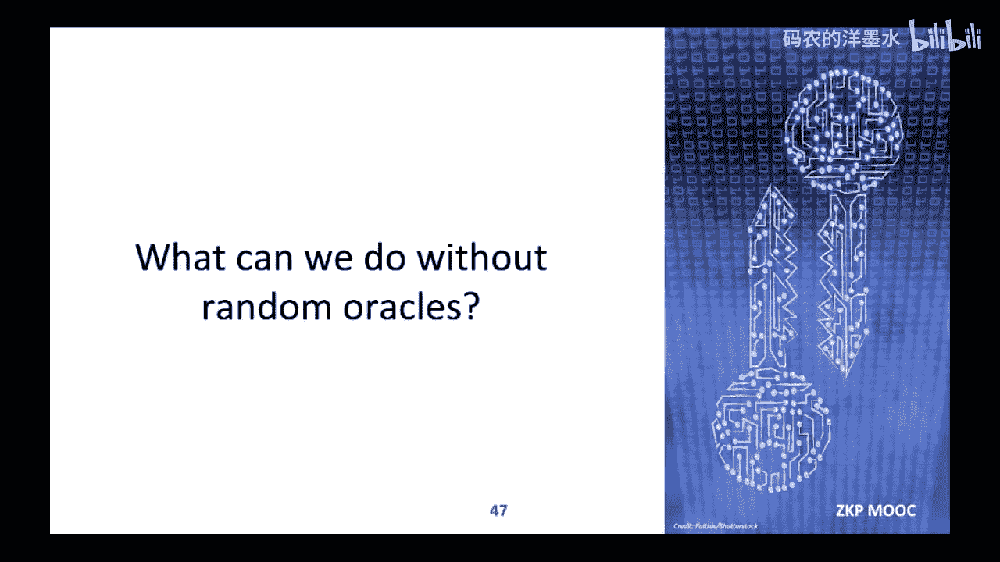

Now that we've seen some serious theoretical issues with the randomoracle model。

 I'm going to spend the rest of the lecture telling you about some things that we can do without random oracles。

 so some constructions of secure per systems that use explicit hash function families and don't resort to the randomorle model at all。

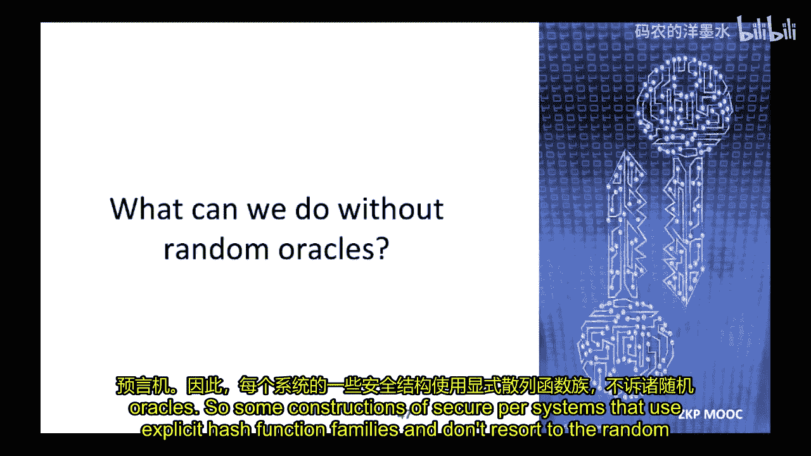

So what do we do when we don't have random oracles on what are we basing security so what theorists like to do is make use of what are called falsifiable assumptions。

 so we want to construct a proof system or perhaps some other cryptographic primitive。

And prove that the primitive or protocol is secure。

Assuming that some concrete algorithmic task is infeasible in polynomial time or in some like a。

Not too large amount of time。 So some examples of falsifiable assumptions are that computing discrete logarithms over some group is hard。

Or perhaps instead we could assume that solving random noisy linear equations is hard。

 this is called the learning with errors problem， this is noisy linear equations over Z mod P。啊。

So these are two very common assumptions that are made in theoretical cryptography。

 but you could also make an assumption like that Shah 256 is collision resistant so it's not like so Shah 256 is not inherently an unfalsifiable object it's the random oracle model that's not falsifiable you can still take a concrete instantiation like Shah and the assumption that it's collision resistant is a reasonable falsifiable assumption that we have quite a bit of confidence in。

So these are examples of falsifiable assumptions。And so how things often work in crypto is we construct some cryptographic primitive or protocol based on falsifiable assumptions。

 but the construction is very inefficient。And so one way to improve the efficiency of the construction is often to make use is to modify the construction and making use of a random oracle。

 because random oracles sort of solve a lot of technical issues for you for free。

 they can often simplify cryptographic constructions at the cost of this modeling assumption。

So for example， yeah so I've listed some examples on the slide。

 but in particular for noninactive zero knowledge protocols， forget about succinctness for a second。

 suppose you just want non interactive zero knowledge。

 we have constructions both in the random work model based on Ftchmere and also constructions based on falsifiable assumptions。

😊，诶。So an advantage of having the construction based on falsifiable assumptions is that even if we end up using the randomoracle based protocol in the real world。

 the construction making use of falsifiability is another piece of evidence that the random Oracle construction iniateated with ShaHh 256 is a reasonable thing to do。

So our goal for the time being is to understand what kinds of protocols can be built based on falsifiable cryptographic assumptions。

And so we'll start with snarks with a K， so here we're asking if succinct non interactive arguments of knowledge can be built based on falsifiable assumptions。

And here the answer is pretty quickly， no， there are caveats to a lot of these impossibility results。

 but the intuition here should be that no this is not the thing you should expect to be able to do。

And so what's the issue？The issue is that an argument of knowledge wants you to be able to extract an NP witness from any successful prover。

But the prover is only outputting。A short proof string。

So it's really unclear how to extract a long NP witness from a short proof string。And the way thats。

 the constructions we have accomplish this is by making an assumption that actually just like that assumes away this problem。

 the assumption says， oh， there is magically some way to extract a long string from a short one。😊，So。

So random Oracles give us this because。Because in the randomoracle model。

 you can think about the entire history of function calls that the adversary makes to the oracle。

 and this can give you a long string， even though the proof itself is short then constructions based on linear PCPs don't use randomoracles。

 but they instead make knowledge assumption over some cryptographic group and again this assumption like solves this problem for us。

 it assumes that，You can magically extract large amounts of information。

 even from an adversary that actually only like explicitly tells you a small amount of information。

So this is not a problem we expect to be able to solve with falsifiable assumptions。

 and so if you want snarks with knowledge soundness。

 it seems that you need to go beyond what theoretical cryptographers typically deal with。However。

 the situation is different for snas with a G or just a protocol satisfying soundness and not necessarily knowledge soundness。

Here there isn't nearly so clear a reason why you couldn't build these based on falsifiable assumptions。

 even though the only general purpose constructions we have right now make use of non falsifiable assumptions like a randomorle。

So we don't know the answer to this question of whether falsifiable assumptions suffice at the moment。

 there are some barriers， there are some theoretical papers that have talked about why this might be difficult。

 but I would say the evidence is not nearly so clear as in the Snark case。

 and the jury's still out probably on whether this should be possible。And for example。

 a lot of my personally， my research is on trying to understand this question a little better。

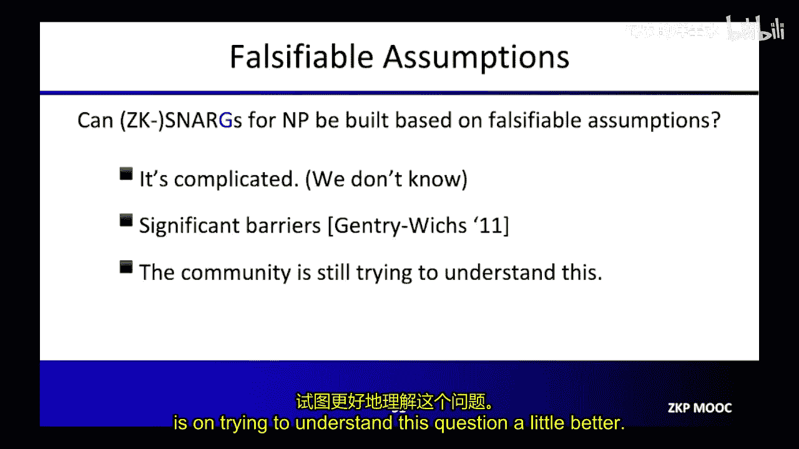

嗯。But the state of the art is that we don't know how to do this。

 and so we're going to settle for snaRGs for subclasses of computations。

 so we won't build snaarGs for any NP statement， but we'll just build them for some special NP statements that are still pretty expressive。

And so for the rest of the lecture， we'll see I'll sketch a construction based on the learning with errors assumption。

 although the details of the assumption are not that important。

 but this is what we're going to see for the rest of today。

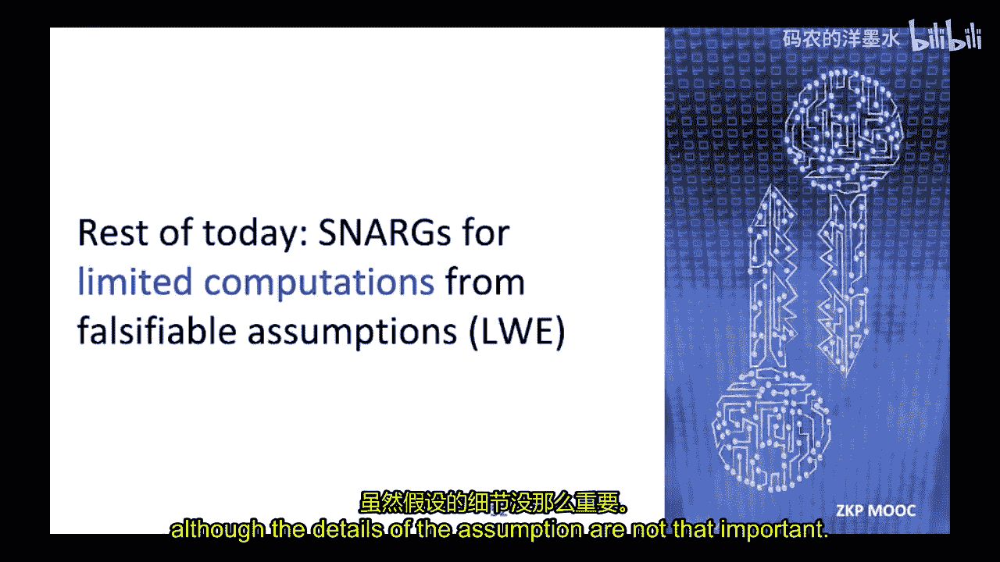

So， there are。Let me introduce before getting to the construction。

 let me introduce the two main tools and techniques that are going to come up on the construction。

 so the first is correlation and tractability， which we already saw earlier today。

And so instead of using a random oracle based hash function in the Fetchmre paradigm。

 we are going to use a hash function satisfying some forms of correlation interacttractability。

 that turn out to suffice for Ftchmre， at least for some specific interactive protocols。

 not in general。So that's the first tool。The second tool is something called a somewhere extractable commitment。

 which is a special kind of succinct commitment scheme。

 So we've seen succinct commitments in this class， like a Merkel trees。

 but somewhere extractable commitment is a stronger form of a succinct commitment scheme and it's used to build a special interactive protocol that we instantiate fiat chimre for based on these correlation intractable hash functions。

 and in the end the interactive protocol that that gets built looks a lot like the typical IOPbased interactive protocols but but only works for special languages and comes with a proof of security。

😊，So let's go back to correlation intractability first， so as we said before， given a function F。

 a hash family is correlation intractable for F if it's hard to find an input X such that hash of x equals f of x。

So it turns out。You can think of this as a special case of stronger form of correlation intractability。

 not for functions but for binary relations， so for every binary relation R。

 you could say that a hash function is correlation intractable for R if it's hard to finds an input output pair x comm a hash of x that satisfies the relation and as long as the relation doesn't have too many pairs of points in it。

 then a random oracle will satisfy this security notion and you could look for explicit hash functions。

 satisfying this property。呃。Although again， we know that we know there are issues。

 so let's go back to the function version for a second。

I spent some time earlier in the lecture telling you that this property is actually unintanable。

 There are some functions where you can't， where there is no hash function satisfying this property。

 no efficient one。So we're getting around this by restricting the input length to the hash function。

 so we're going to be considering this property for hash functions that have a fixed input length and the description of the hash function will have to be slightly larger than this input length。

So yeah， we know that this restriction is necessary or else the object is uninstanible。啊。

We're going to then restrict the notion even further。

 we're going to only consider F that are computable in some fixed a priori bounded polynomial time capital T。

So our goal is going to be to build a hash function that's correlation intractable for all function F。

 all function F， computable in time T。And the hash function itself will be computable in times slightly larger than T so this is what we know how to build right now it's not clear if this restriction is necessary。

 but yeah that's currently what we know how to handle。So next。

 I'll actually show you a construction of such a hash function family based on a falsifiable assumption。

 and our main tool for doing so is something called fully homomorphic encryption。

So this is a kind of encryption scheme where you can encrypt some data X。

And on the ciphertex encryption of X， it is possible to evaluate an efficiently computable function F of your choice on it and obtain an encryption of F of x。

 and this you can do without the secret key， without knowing what X is。

 just given an encryption of x and the function， you can evaluate its under the hood。And。

The guarantee of the homomorphic encryption scheme is that if you were to decrypt the evaluated ciphertext。

 you would get f of x。So this is a very powerful tool and is not necessarily practical。

 although people are spending a lot of time trying to make this practical。

 it's not actually necessary for to construct the hash function。

 but I'm going to use this high power tool because it gives the simplest or the easiest to explain construction。

 but there are other constructions that do not use fully homomorphic con。So， but nevertheless。

 let's see a construction using it。So given a fully homomorphic encryption scheme。

 we're going to write down a hash function family and then argue that it's correlation intractable。

So here here's the family so the description of a hash function H is going to be two things。

 first of all， a public key for the homomorphic encryption scheme。

And then an encryption of sum the description of sum function G。So。

You should think of G as some like function that just like takes every input and output zero immediately or something like that。

It's not it's not too important what this function is， in fact。In reality。

 you can think of the description of our H as actually being a uniformly random string。

 but in our heads we will think of it as a public key and an encryption of a function G and as long as the encryption scheme has the property that public keys and ciphertex or pseudoranom then a random string is indistinguishable from such a hash function description so we can equivalently think of it as a random string or having this structure。

Okay， so so this is how we're going to think of a description of the hash function。

Then so now we should say what the hash function actually is that is given an input X。

 how do you hash it？So what you do is you run the FHE evaluation algorithm on the encryption of G and the function that you use is described by X。

 so what you want to do is evaluate the function which takes G which is encrypted and computes G of x。

So this is sort of like inverting the usual like way you think about inputs and functions。

 but this is something that you can do。So yeah， so the hash key is an encryption of G。

And when you hash X， you will get an encryption of GX。

Although but hashing X is a public efficiently computable operation。So yeah。

 this is a hash function that you can write down。呃。

And so why would we expect this hash function to satisfy security properties of any kind Well。

 the reason is that the function G is hidden。It's like。It's implicitly in the description of H。

But nobody actually knows what it is。And so you can argue different security properties by imagining that G were various different functions because an encryption of G is indistinguishable from an encryption of some other function G prime。

You can imagine that G was whatever function。Is the most convenient to you for approving some security property？

So so let's see that's a little abstract。 So let's just see a proof that this hash function is correlation intractable。

 So so we'll do a proof by contradiction。 supposeuppose that for some a priori fixed。

Efficiently computable function F， an adversary could find an input X such that hash of x is equal to f of x。

Well。Then so here's the key idea in arguing security。 We're going to pick a very special function。

 G star of x。What it's going to do is it's going to compute。F of x。

And then decrypt the resulting string， so you think of F of x as a cipher text， you decrypt it。

 so now you have some plain text， you can think of the plain text as being a single bit if you want。

 and then after decrypting you add one。So this is a function that you can define。And。

And we know like I was saying before， that an encryption of whatever G we started with is computationally indistinguishable from an encryption of G star provided that the encryption scheme is secure。

 so there is a minor caveat here， which is that's the G star that I defined actually runs the decion algorithm of the encryption scheme and so it depends on the secret key of the encryption scheme。

 but we can still argue this indistinguishability if we know that the encryption scheme is secure in the presence of an encryption of the secret key。

And so this is called circular security and it's something that comes up pretty frequently in Homemorphic encryption and something that we're reasonably confident in but this。

But this assumption is not really necessary， you can get away with less with a more complicated construction。

But we're going to assume the circular security for now， just for the easiest construction and proof。

So okay， so we started with a hash function， which was an encryption。

 which was described by an encryption of G。But because an encryption of G is indistinguishable from an encryption of G prime。

 then we know that our attacker would still break security。

 even if it were given an encryption of G prime instead。

But now I claim we have a contradiction that the attacker actually can't break security when the hash function is an encryption of G star instead。

So here's why。So we know that if you hash X and your hash key has an encryption of G star in it。

Then hash of x is going to be an encryption of G star of x。So then we can see that so。So if。

On the other hand， hash of x was also equal to f of x。

 that's what we're assuming we're assuming the adversary managed to find such an x。

 then we would get that so if hash of x is equal to f of x， then if you decrypt F of x。

 then this is supposed to be the same as the decryption of hash of x。

But but we also know that hash of x is an encryption of G star of x。

 so decryption of hash of x is equal to g star of x。

 and we've defined G star to always avoid the function decryption of f of x It's literally one plus decryption of f of x so these two plain texts cannot be equal the scheme has been constructed so they can never be equal and therefore。

It is actually impossible for the adversary to break security when the hash key is sampled in this strange F dependent way。

But by indistinguishability， that also means that the adversary can't do it when the hash key is a random string。

So this is a proof assuming that your encryption scheme is secure enough that the resulting hash function is correlation intractable。

So that's one construction of a correlation intractable hash family for efficiently computable functions。

But so there's been a lot of work over the last five years or so in constructing various correlation intractable hash families。

 including fur relations that are not just functions。

 so I'll list a few on this slide so when you restrict to functions we have constructions based on the learning with errors assumptions so we know so LWE can be used to build fully homomorphic encryption but。

But follow up works， we' actually able to avoid making this circular security assumption that I made in the proof on the previous slide。

 so you can really build it based on the standard hardness of learning with errors。呃。

There's also a construction from the decisional diiffy Heman assumption。

 which is more related to some group based cryptography that you may have seen in this class。

LW E lattices and DDH groups are the two main families of of building blocks and assumptions that are used by theoretical cryptographers。

 and both of them， we know we now know how to use to build correlation intractability for at least some kinds of efficiently computable functions。

 The the DDH based construction is actually restricted to certain certain certain subclass of functions。

 but it's， it's pretty expressive。Then。You can ask， well， okay。

 what about relations that are not functions although it's still not clear why we're asking any of these questions but yeah。

 but you could ask about what about things that aren't functions。

 we don't know in general whether or not we can build correlation andtractability for bounded input length relations。

 but we do have a construction for relations satisfying a nice combinatorial structure basically。

If you think of if you think of the hash value as a。As a concatenation of many。Of many blocks。

 then you can guarantee correlation intractability for properties that sort of respect the blockwise structure。

 and this turns out to be relevant when instantiating thetchir。Don't worry too much about this。

 but so we can handle some kinds of relations that have many outputs。

 but it's still somewhat open how to handle them more generally。

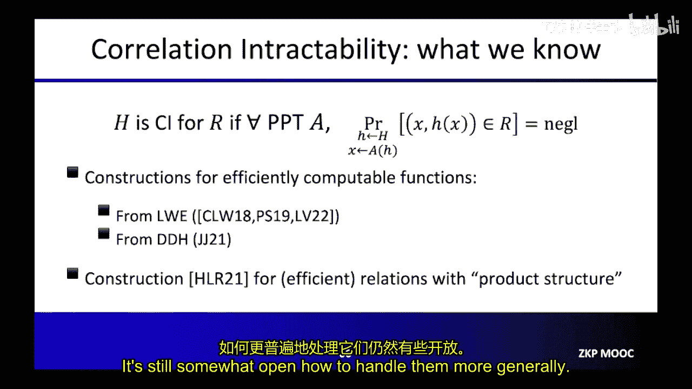

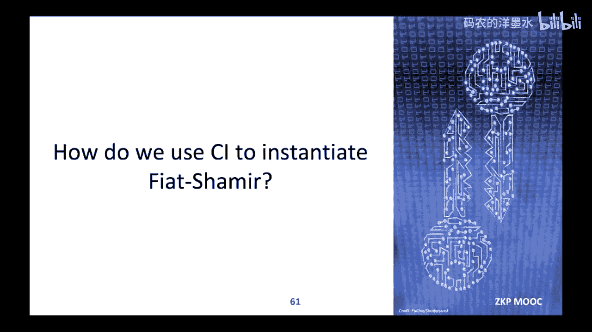

That's everything I wanted to say on constructions of correlation Interable hash functions from falsifiable assumptions so for the rest of the lecture we'll talk about how to use the hash functions that we constructed to provably instantiate the fit me heuristic without relying on random ors。

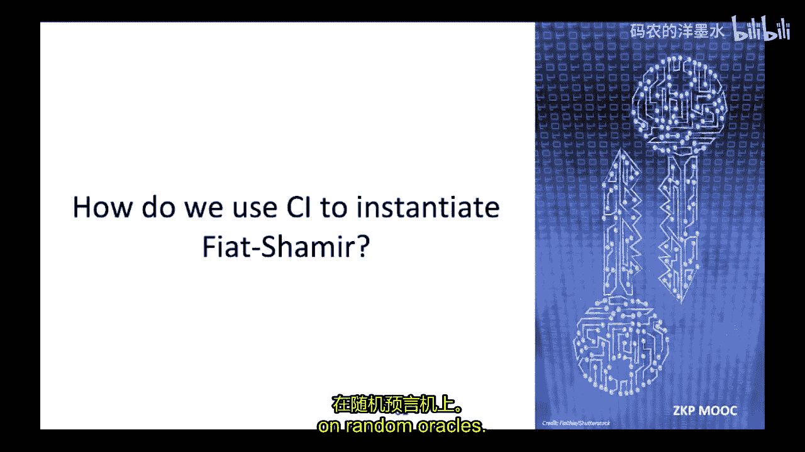

So the basic paradigm for how to use correlation intractability is that we'd like to avoid some notion of bad challenges so on the slide I have up the transformation for three message interactive protocols and so here's and in this setting we'll consider the following analysis。

So given an initial statement or initial claim of X， which is false。

 and a first message alpha that is adversarialally chosen by the prover。

 we say that a verifier challenge beta is bad if there exists a prover message gamma making the verifier except and it'll become clear in a moment why this is the definition that we're writing down。

 but let's just go with it for now。So so。In the interactive setting。

We'd like to say that soundness of the interactive protocol implies that most beta。

 most challenges are not bad specifically we want to say that for any false x and for any message alpha that most beta the verifier could pick are not bad so this is true for statistically sound proof systems。

 but not true for computationally sound proof systems in fact。

 if the interactive protocol is only computationally sound。

 it might be that every message beta is bad， it might be that every challenge is bad。

 it might be that for every challenge there exists a message gamma that would make the verifier accept。

But。But the protocol could still be sound because these gamma might be hard to find。

But if you start with a three message protocol that is sound against unbounded provers。

 then the soundness actually directly says that for all false x and for all alpha。

 most beta are not bad because whenever beta is bad， the inefficient prover could trick the verifier。

So long story short， if we start with a statistically sound protocol， which is a major like caveats。

 but nevertheless， if we start this way， then we get this interesting fact that most beta for every fixed transcript prefix。

 x and alpha， most beta are not that。So this is exactly a situation where correlation intractability seems useful in particular。

 we can talk about a relation whose inputs are first message is alpha and whose outputs are second message is beta and we can say that alpha beta is in this relation if beta is a bad challenge for alpha。

 so this depends on the initial claim x， so what you actually get is a relation r sub x for every false statement x。

 or you could alternatively have a single relation。

 whose inputs are x comma alpha and outputs are beta and then this is in the relation if x is false and beta is bad。

啊。So in any case， there are some relations that we can write down and it's pretty easy to see that if the fiiachmre hash function H is correlation intractable for these relations when we're dealing with false statements anyway。

 then the Fiatchmre protocol is actually sound。And the reason is that if you break the soundness of fiatchemir。

 then whatever first and second message alpha and beta you end up sending。

 no matter what that pair is， it must be that beta is bad for X comma alpha because in fact you've even found the third message gamma making the verifier except so you've solved an even harder problem。

As a result， breaking fiat chiir is an attack on this particular kind of correlation and tractability。

So in fact， we can so this is a way to relate correlation and tractability to FH ChimR for three message protocols。

But for you can extend this actually to protocols with arbitrarily many messages provided that they satisfy a statistical form of round by round soundness。

 that is for every round， for every verifier message you can talk about a notion of that message being bad and as long as the hash function avoids these bad messages。

 then you'll get a secure fit mirror instantiation。

So this is the high level approach for how correlation intractability implies theat chiir instantis。

 but there are some big technical challenges in order to actually show that this works。First of all。

Sometimes you don't start with an interactive proof that is actually statistically sound and then so far what I've said says nothing about how you might instantiate Fet chiir for such proof systems we'll discuss how to handle this a little bit in the next slide or in a particular example。

The second technical challenge， which I'm not going to cover in this lecture。

 but you can see some of the papers for details。The second challenge is that。

We only can build correlation intractability for specific kinds of relations。

 in particular all of the relations that we handle have the property that they can be decided in polynomial time。

啊。But the relation that we just talked about， that alpha and beta in the relation。

 if there exists a gamma making the verifier accept。Is not actually decidable in polynomial time。

 and so it's not clear how anything that we've said so far helps there either。嗯。

I won't cover really how you handle this second challenge。

 but from the example that we are about to get into， maybe you could see how that might go。

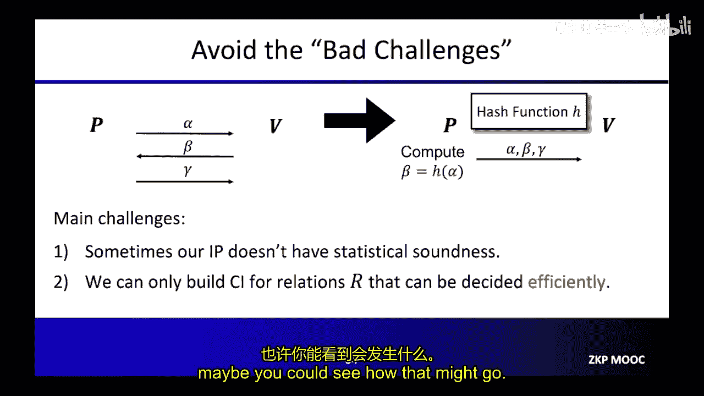

So yeah， so now let's focus on a particular example。

 let's focus on the problem of obtaining snarks via interactive oracle proofs。

 which you've seen a few times in this class already。

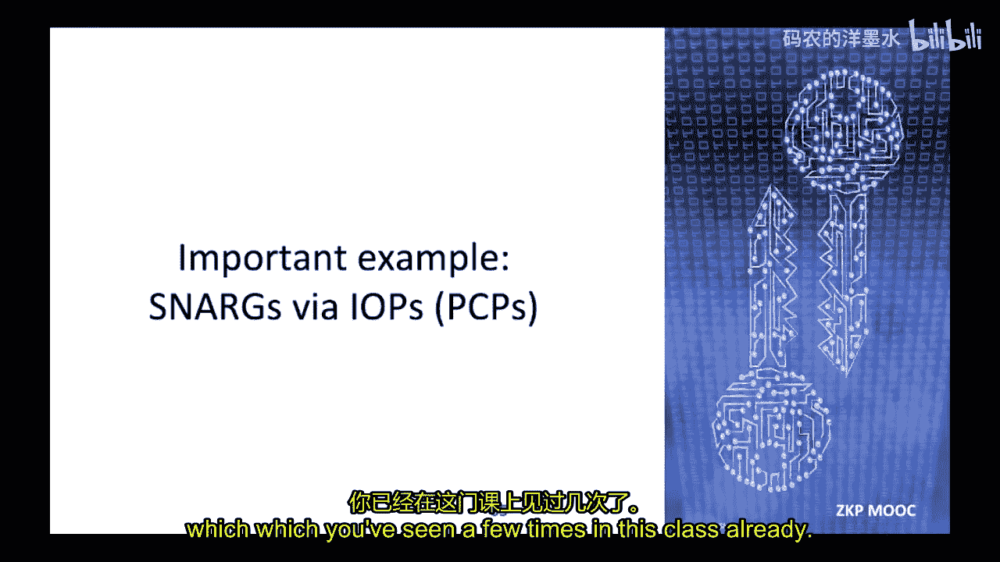

So here's a very simple template snarg using a very special kind of interactive oracle proof。

 which is called a probabilistically checkable proof。

 so this construction is due to Ki and McCli from the 90s。😊。

And it's essentially like a theoretical simplification of some constructions that you've already seen in class。

 the cost is that the downside is that this construction is way less efficient。

 but we don't need to worry about that for now。So诶。Way less prover efficient。So here's the protocol。

 so the prover starts with a statement X along with a witness W。

And what the proveer is going to do is first of all。

 compute some long proof string pi from X and W it's some sort of encoding。

And then you can think of pi as being the analog of the oracles that you saw in the IOP based constructions。

And then the prover commits to this very long string pie。

 it sends a succinct commitment to the verifier。The verifier then samples random string。

 which indicates a set of locations or a set of indices。

 it indicates a substring that the verifier wants the prover to open and the substring should be very short。

Then finally， the prover gives local openings to every location that the verifier asked for。So， yeah。

 so this is like a。Minimally interactive version of the IOP based snarks that you've seen before。

 and instead of using a polynomial commitment， we're just using a vector commitment。Good。

 so so this is a very basic construction and and you can prove that as long as the as the mapping from like the as long as the information theoretic object pi as long as that。

Underlying proof system is sound， then the resulting interactive protocol here is also sound。

So then you immediately get a candidate sed as well by applying theatrere to this protocol。However。

 and yeah as I said， this is a more inefficient version of modern srks that you've learned about in the course already。

But it's easier to talk about this version because there are fewer moving parts。So。In principle。

 so we have a candidate snark。But since this interactive protocol is not statistically sound。

 it's really not clear how anything I've said about correlation in tractability can help us argue the soundness of the fiatia mere version of this protocol so the reason this protocol is not statistically sound is because whenever you can find collisions in the vector commitment。

 then this protocol will be broken or sorry at least if you can find good enough collisions in the vector commitment then this protocol will be broke。

Okay， so what do we do？What we're going to do is we're going to restrict the kinds of computations that we imagine that we're proving。

So so we're going to instead of considering the problem of proving an arbitrary NP statement succinctly。

 we're going to imagine that we're proving a large number of small NP statements。

 so instead of one big computation， imagine we want to prove。That many small claims are true。So yeah。

 so this is called a snag for batch NP and the syntax is that the prover is given K statements。

 x1 through xk and K witnesses w1 through WK sends a proof pi to the verifier。

 the verifier has these k statements。And。And what we want is that the verifier will accept the honestly generated proof if every one of the witnesses is a valid witness。

 if WI is a witness for XI。And more， if any of the case statements is false。

 then no matter what the prover does， and for any efficient prover strategy。

 the verifier is likely to reject。Then we still ask that this proof is succinct。

 but the succinctous notion that we ask for is different。

 we want the proof length to have polyloguearic dependence in the number of statements K but we allow it to be at least as large as a single witness W so that's why I said the situation to have in mind is that you have many small NP statements。

 the proof is still succinct because the naive proof would require sending K witnesses which would be very long and you'd have to verify k different claims。

But the proof length and verification time here has a logarithm of dependence on K。

So this is not as strong as a full fledged snug for arbitrary NP statements。

 but it's actually a surprisingly powerful object。It's been shown within the last couple of years that。

 for example， if you have such a proof system， then you can use it to build a sng for any deterministic computation。

 so that's another restricted class of computations where there's no witness but just like checking the claim X yourself would take a very。

 very long time， and a sng for deterministic computation as the prover send you a short proof that you can verify very quickly。

So in any case， the point here is thatNarch for batchchMP are pretty powerful。

 and we're going to show how to build these using correlation andtractability。

This is a construction due to Chaery Jane and Jin from 2020。So here's a protocol。

 an interactive protocol that looks a lot like the previous succinct argument that I showed the Killian McCauley construction。

So。All that's happened is that instead of writing down a single PCP。

 a single proof string for a single witness， you now write down K of them， one for each one。

And then you send a distinctinct commitment to all K of these proof strings。

 The verifier then does the same thing as before， it samples location sent。

But now the prover is going to give you local openings to answers for all k of the proofs。

啊So this is a。This is a protocol that you can write down。

 so if you're concerned that this proof doesn't seem succinct， don't worry about it。

 we're going to make it succinct make it more succinct later。But it's at least somewhat succinct。

 you do not have to send。This is still less than that Kwi worth of information that you've sent here。

So so why？Why did we switch to the batch verification setting and why did we write down this protocol Well。

 there is a clever idea here that reduces us to a protocol which is kind of statistically sound。

So the idea is that you can use a commitment scheme。

Which is statistically binding to one out of the K proofs that the honest prover was supposed to generate。

So。Of course， if the commitment is succinct， you can't be binding to the entire concatenation pi1 through pi K。

 then your commitment would have to be at least that long and then you have no succinctness。

But you could be statistically binding to a single one of them， so it could be that a commitment。

Information theoretically determines， say the first proof， pi1。So if that's the case。

 then if the first statement x1 is false， then this protocol。

 you know for this like collection for this statement anyway。

 would be statistically sound because your information theoretically bound to this particular proof string。

Then it turns out there are only a small fraction I mean。

 by the soundness of the information theoretic proof system。

 you can only successfully answer a small fraction of the queries represented by the Verifier challenge R。

啊So。Yeah， so if you use this special kind of a commitment scheme。

 then you can be statistically sound。When you are told that a fixed statement like X1 or Xi is false。

So let me say a little bit more about this notion of a commitment scheme。

 it's a property called somewhere statistical binding。So。

SoSome statistically binding commitments are strengthening of the usual notion of succinct commitment。

 which I'm going to think of as a Merle tree like you've seen in the course so far。

 so we say that a Merle tree type construction is somewhere statistically binding。If for every index。

 for every like index of your initial vector。There is a way to choose the hash key。

Suchuch that the roots of the Merkel tree information theoretically determines that single location of your vector。

 that single coordinate。So formally， what you ask for is that for every index I。

 that there is a way to sample a hash key depending on I。

So that yeah when you sample the hash key and mode I。

 you have statistical binding to the Ih position of your vector and moreover。

 the n different ways of sampling these hash keys， one for each index。

 all have to be computationally indistinguishable， so it's statistically binding somewhere。

 but you don't know where。If you're just given the hash key。

 you don't know which coordinate is bound， but one of them is bound， but it could be any of them。

And so it turns out that you can build such commitment schemes。

 I'm not going to get into the construction， but it's possible to construct these。

 and yeah so you can think of when the hash function is sampled in mode I。

 you can think of the Merkel root as secretly encoding the particular coordinates。

 the I coordinates of your initial vector。So yeah， so this is the kind of commitment scheme that we want to use in this construction。

So now the idea is that is that you can argue soundness of this protocol and in fact。

Like for like in the following way， suppose that's one of the statements。

One of x1 through Xk is false。Then you can switch to a world in which the hash key was sampled to be statistically binding on the Ithe。

PCP， or I is the index of the statement that's false。if you break soundness。

 then you break soundness on any of these。No matter which mode of hash function you choose。And so。

 and so。You will imagine that the hash key is sampled in that mode。诶。

Then you have a protocol which is actually statistically sound。

And this actually enables you to rely on correlation and tractability to prove the soundness of the theatremre protocol。

I won't get into the details of the argument， but the idea is that you know for any particular index I。

 if the Ith statement is false， you can rely on correlation and tractability for some relations that depend on the Ih statement and the proof string that's statistically committed to by the Merkel root。

And you can combine this with the correlation intractable hash functions that we've talked about to argue soundness of the fitchmre protocol。

Now， one last detail， which I should mention is that right now the protocol that we've written down is not fully succinct。

 its proof length is like security parameter times the sum of the length of one witness and K。

But what we wanted was essentially no k dependence or maybe a polylaariththmic K dependence。

 but you can actually do this by recursion so like what you can think of this protocol as having done is it's reduced。

 verifying K witnesses W1 through WK。To verifying K openings of a small subset of locations to the PCP。

So you've reduced the you have a reduction from a larger amount of work to a smaller amount of work and this enables you to recurse。

 you can then use this proof system to instead of actually sending the openings in this third round you can instead commit to to some information related to it and have a。

Longer protocol that eventually reduces your work down to nothing。

Then you can argue soundness of the theatia mirror protocol via a round by round argument。

This concludes our discussion of constructing snaars for batch NPP computations without relying on random Oracles let me give a quick summary of everything that we've talked about in the second half of the lecture。

So the basic idea is that we could hope to instantiate Fatchmre without random oracles by relying on an appropriate notion of correlation intractable hash functions where we have to balance that the strong notions of correlation interactability are harder or impossible to build but the notions that we use still need to be strong enough to capture the security of the fiatchemre transform for particular protocols of interest。

 so there have been a bunch of works over the last few years that have given different constructions of correlation interacttractable hash families and then applied them to build to build non-inactive protocols that we care about so for example。

 we know how through this approach to build non-interactive zero knowledge protocols based on quote unquote standard cryptographic assumptions here we've given up on succinctness for the moment and we're just going。

For zero knowledge， we also know how to make the sum check protocol not interactive using a standard model hash function using this approach。

And this also enables you to do certain kinds of snaGs by using the GKR protocol。

 which I think maybe you haven't learned about in the class。

 but it's an extension of the sum check protocol that allows you to delegate certain kinds of deterministic computations。

And then finally， there's the construction that we just sketched。

 which is how to do snags for batch NP P computations， again， using a standard model fittrore。

 and as I mentioned， this can be used in turn to build snags for arbitrary deterministic computations。

So let me mention also a couple of the biggest open problems in my opinion in the area。

 so first of all， we really still don't know how to characterize which interactive protocols can be soundly compiled via the fitmre transform without relying on random oracles we know that what the random oracle model predicts does not match reality there are some protocols where there's no hope on the other hand we have some positive examples where it is possible but there's this huge middle ground of protocols that we don't know how to analyze nor rule out and this includes for example the。

The IOP based sngs for NP that you've learned about in the class so far we don't know what to say about those and that's a big open question and relatedly we still don't know whether sngs for NP can be built based on falsifiable assumptions I mentioned there are some barriers here but on the other hand we have these we have these provable sngs for subclasses of NP computations and I'm actually somewhat optimistic that we can expand this class to be larger and larger and eventually maybe even answer this question positively I'm hopeful that's in the next say five to 1 years of research we're going to learn a lot about these questions。

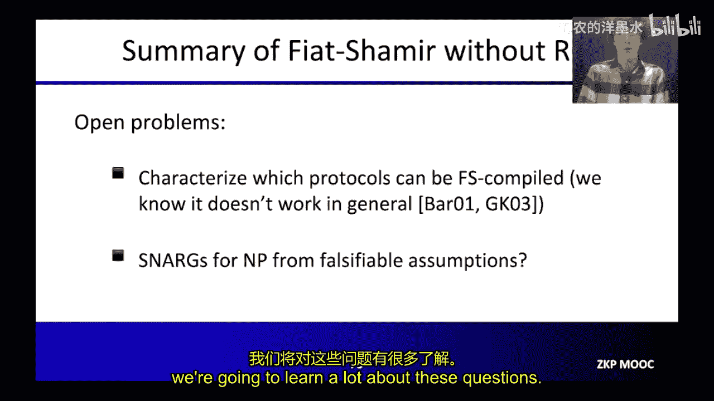

So this concludes the lecture， I hope that among other things you've learned some cool theory behind the protocols you've been learning about and seeing somewhat different way of and looking at and thinking about these protocols that will give you another tool in your arsenal wherever you might go after this。

 so thanks for listening and see you in the next lecture。

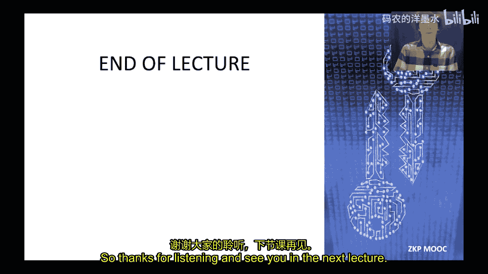

