# 【全集】加州大学伯克利分校 Web3：零知识证明 区块链技术与隐私计算 中英字幕 1080P p12 Lecture 12 - zkEVM 的设计、优化及应用 -BV1bCrpB2E7Q_p12-

Hello everyone。 My name is Ye。 I'm the coant of scroll。

 I do research about theki hardware C and ZkiP system。 Today。

 Im going to talk about thekiVM design optimization and applications。

 I will try to give a comprehensive overview of thekiVM Ex what is it， how we are building it。

 some challenges we met and some other interesting applications that use thekiVm besides us。

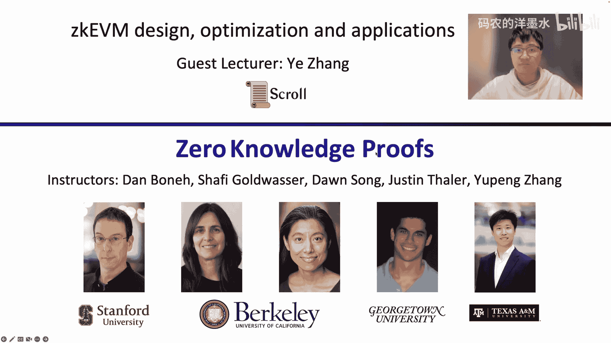

Before diving into more detail， just a quick introduction of us。 So what is scroll in short。

 scroll is a scaling solution for E。 In other words。

 we are building a general purpose layer to platform that in security from E but can be much cheaper faster with the highest input。

And more specifically， we are building an EVM equivalent Zk up。 So firstly。

 we are building a Z up solution。 it's considered to be the most secure scaling solution based on00 proof。

 second， we can support EVM inside our Zk up。 It's not only a specific smart contract programming language like solidity but we can achieve a deeper level of compatibility at the EVM bico level。

 and it's not only specific language， but we can support all the tool around directly。

 So if you are like contract developer the development experience on scroll will be exactly the same as easier。

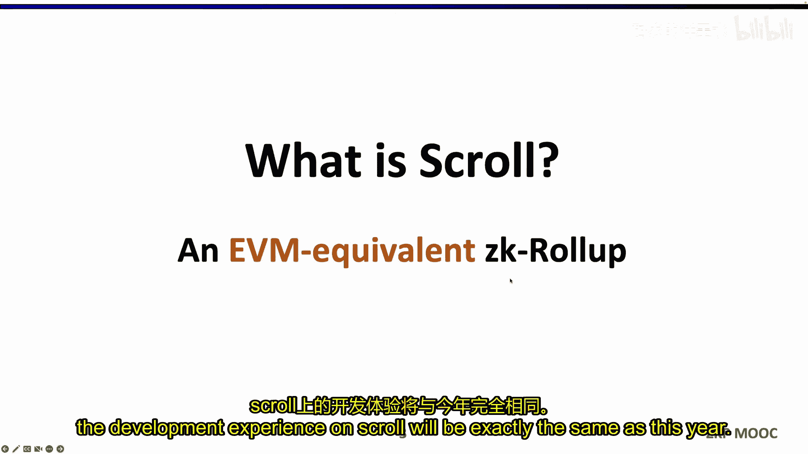

And in this lecture it will be divided into four parts。 Firstly。

 I'm going to introduce some background and motivation of why we need ZkiVM in the first place and why it become so popular in recent two years then I'm going to guide you through a complete journey of how to build a ZkiVM from scratch including the circularization and proof system and after that I will go through some interesting research problems we met when we are building our ZkiVM and finally I will introduce some other applications that can also leverage ZkiVM。

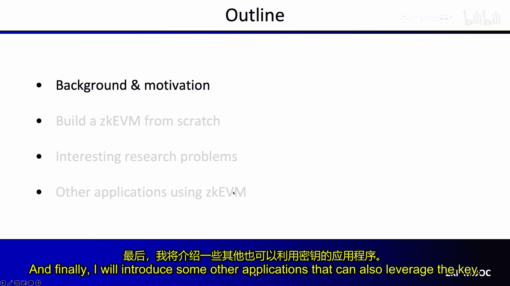

So let's start with a traditional diagram of layer1 blockchain。

 especially for some theyners who are not even familiar with blockchain。

 let me do a quick introduction of blockchain。 So a blockchain network is consist of many nodes。

 usually tenns of some nodes for decentization， and they are interconnected by a P2 P network。

And all the nodes are maintaining the same state shown here， which is a database like a share ledger。

 so you can like put your balance here or some code for a program here and then you use a data structure called Mercur tree to store all those information on your leave and then you get a state route which is like you just do hush and then you get a digest here to represent all your all your state and every node need to maintain the same database。

 and then they will also run the same software called E virtual machine to do some computation and update this state route and blockchain is also called word computer because anyone can use that to run any program in a decentralized fashion and the program running on top of blockchain is called smart contract so the EVM will load this data from your storage to some computation and revise this tree and get a new state route。

And if you are a user， you can send transactions and it will be broadcasted in this P2P network。

 there will be some consensus algorithm to elect a proposal and each time slot and this proposal will pack many transaction it received into a block and run EVM with a transaction as input and update this state route and then it will some easy block and after saying this block is submitted everyone in the network will download this block and reexecute the transactions inside this block to reach some consensus about this state route。

So the blocks are chain together like one after the other。

 and they know they need to do a testation or which is re execute the transactions inside this block for all the blocks。

To， to reach the same state So， so that they are maintaining the same database always。

And there are many benefits of the blockchain system。

 it's secure since your transaction will be executed tens of thousands of times by different nodes and it's also decentralized because no one can censorship your transaction if one node is rejecting a transaction。

 you can easily listen to the other。But it's super expensive and super slow。

 And many inefficiencies come from like all the nodes， doing the same computation， tens of sun node。

 and also need to reach some consensus。 It's very common for you to pay for over $10 as gas fee on Yyuan。

 especially when congested， is's even much higher。So that's a problem we want to solve。

 We want to solve the scalability problem。 and so that's why we use Zki Ro up。

 Zki Ro up is a scaling solution to solve scalability problem of Yuan。

 let's take a look at the diagram of Zki up。 So the idea is that instead of broadcasting all the transactions on congested and expensive layer 1 P2 P network we have a separate layer 2 network which can be more centralized with a much higher throughput and this layer2 network will post a state route in layer1 smart contract and then like all the users on layer 2 need to send transactions to this a bit more centralized node and the node will process all those transactions and generate a very small and efficiently verifiable Zki proof pie and this pie is saying that all those N transactions are valid and after executing。

In transactions， the state route will be updated to state route prime。

 and then like it was update the route in the smart contract。

 So the layer one only need to verify this very single proof instead of executing re executingcuting all the transactions and then like update the state route So the magic here relies on zero proof to compress a huge batch of transactions into a small and but publicly verifiable proof in this way。

 layer one can be scaled up massively。 imagine that if a layer one network because it's so decentralized。

 it can process only 10 transaction per second， now every transaction is verifying in a proof which can which is basically proving maybe one sound transaction are valid So the network throughput can increase for order of magnitudes and also the security is equivalent because you proof the validity of proof only rely on mass and crypto assumption。

And is's mathematically equivalent to the validity of all all those own transactions。

Although it sounds like so magic like you can compress a large computation of chain to this proof。

 but it's nontri to build such a Zro system for many reasons。

 one is that as we all know if you want to generate proof for some computation。

 you firstly need to write all your program logic in the form of the circuit Athmetic circuit。

 it's very complicated and heard and hard from previous lecture you know that you can only use some addition multiplication and similar math assertions in a circuit to express very complicated logic。

 including full loop if else and all your program syntax。 It's just very complicated。

 and also like one circuit is called for one program。

 So which means for different application developer， you need to implement your own circuits。

 So thats that's really a pinpoint for pinpoint for Z in the past years because。

You are basically requiring a solidity developer to write a very complicated circuit to scale up their own application。

 so， and also， like even after this， you need to pass a very rigid security。

 which just takes a fairly long development time。And worse still， even if like， for example。

 you are you are like UniOb swap application and there is a lending application。 for example， AV。

 they all build their own Z up， there is still no compossibility。

 So which means you can't use one transaction to include like transaction on UniisOp and RV and include that in atomic transaction。

 you don't have composibility。 but that's composibility super important in decentralized finance。

 and because you just can't prove a dynamic sequence of transaction of circuits in in one proof since and also you might need different oncha verify with different Vkis。

 Its just make the system become more complicated。Or need some specialized system。

So that's exactly the problem we want to solve， we want developer friendly because we don't want solid developer to write Zki circuits or even touch any mass。

 and also we want compossibility because we want the applications deployed on layer to network to have atomic compossibility and calling each other inside one transaction。

So instead of proving for application specific logic。

 we are proving on the EVM level with a shared like global state， similar to layer 1。

So to build a general proper ZQ up， we need to general proof for arbitrary type of EVM transactions。

 So that's exactly called Zki EVM。 In short， ZVM can prove a batch of EVM transactions are valid using a Zki proof and technically speaking it's a set of circuits and using those circuits。

 you can prove EVM is executing correctly so that you can handle an EVM transaction So previously when you're thinking of application specifically ZQ up。

 you get different different circuits per smart contract or per application but now different smart contracts a part of the input to your ZM circuits and you are only proof on the virtual machine level。

And but you know， like it sounds like magic。 but the problem is that ZkiVM is extremely hard to build with a super large overhead。

 So basically instead of developer to face the problem of building a circuit by themselves。

 we take the hardest part to build a general purpose virtual machine circuit。

 And it's super complicated it's very complicated already to implement some functions inside the key but you know。

 even now even like not only building for for a program。

 but you are handling the virtual machine logic。 you need to implement a lot of up。

 you need to handle the workflow， you need to handle the error cases and long and just a lot of VM specific logic。

 And also like even if you really write out sound circuit。 two years ago。

 people think they pulling overhead for ZVm will be will be huge。 So for example。

 it might take you like one day to generate。😊，They even even proof for N transactions。But luckily。

 the efficiency of Zki protocol has been massively improved in the past two years。

 And so that's the reason why in recent two years， ZM becomes like， you know so popular。

 it's become really possible。 at least form your reasons why it becomes possible。

 So first is according to polynomomic commitment。 So on the one hand。

 you can have a universal setup or transparent setup with different polynomomic schemes。

 but on the other hand， more importantly， it enables flexible artization like lookup and some high degree custom case。

 So imagine that previously you don't have polynomomic commitment， you only have growth 16。

 So your bienium pair require that you have to use degree2 constraints。 which is less flexible。😊。

And so that's why like with Pannoama commitments game。

 you can support more flexible optimizationization and it can make your circuit become one or two other of magnitude smaller。

 and so that's why it becomes more efficient。On the back end side。

 the proving algorithm like when you're genetic proof。

 you need to run some proving algorithm and the proving algorithm is highly parallellyzable。

 So there is hardware work acceleration through GPU effort IPg effort and As effort making prover becomes another one or two order of magnitude faster so and finally there is a recursive proof and it will further lower the cost of onchan verification So basically you can like aggregate multiple proof into one proof and makes the vacation becomes even smaller。

 So combining with all those four factors， they can even becomes finally possible with around like three order of magnitude efficiency improvement comparing with what we have two years ago。

 So that's where scroll began。And there are many different types of ZM out there here。

 I will use the standard proposed by Justin Drake， which I think is the most intuitive one。

 and the first one is language level， So the idea is that EVM is not designed for ZK and writing circuits for EVM will introduce a large overhead because EVM has so many Z un friendly op codes and so instead of building EVM inside Zk inside a ZK circuit。

 you build a totally new virtual machine， which is more friendly for Zk and it enable like more ZK friendly has function and all kind of primitives。

But then there is a compatibility issue because you are using a different virtual machine。

 which is not EVM and why you are calling yourself Zki E because for this new virtual machine。

 you might need new program languages and so developers are not really deploying what they can do on issue。

 So to solve this you also need to write a compiler to compileel EVm language like solidity and to your virtual machine bycode。

 So combining this compiler and this new Zki virtual machine。

 you still get some level of compatibility with your EVM language and this approach is adopted by Mela and Starware。

 So that's why it's called language level ZV。 because basically you are using a compiler to force compile EVM language not to EVM but to another virtual machine。

 and then prove for this more Zki friendly virtual machine efficiently。

And the second level is called bycode level and it can take your EVM bycode and prove the bycode is executing correctly in this way。

 all the tool around EVM can be compatible with theVM directly。

 It's not specifically using a compiler to support special language but can support everything that EVM can support。

 It can in the EVM execution model， but you can still make some tradeoff， for example。

 like you can change the data structure of your storage with some Zki friendly alternatives。

 but this doesn't influence on the execution layer。

 It only influence how you store the data and but the tradeoff is that you get a longer proving time because many primitives are not Zki friendly and you are proving at a lower level of compatibility with EVM。

And last classification is called consensus level， or sometimes people call that ECM equivalent the keyVM。

It basically need to maintain everything that EM has。 It's not only E VM。

 but also the storage and even some other informations in the block header。

 the trade off is that it has a much， much longer proving time and it might introduce some potential dose attack because you need to maintain the gas price to be the same and a lot of things like that。

 So it's still under exploration。And we are in the middle here。

 but we are collaborating with the privacy and skill exploration team at ECM Foundation to help ECM to scale on the consensus level and doing more exploration there as much as we can。

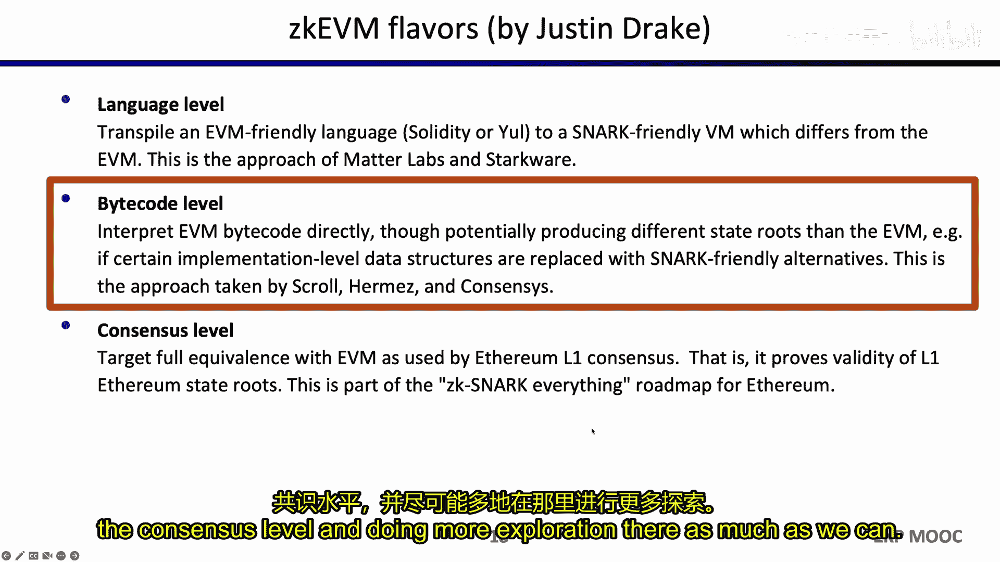

In this section， I'm going to show you how to build a Z event from scratch。

 I will talk about how we are choosing among different circular optimization and proving algorithms。

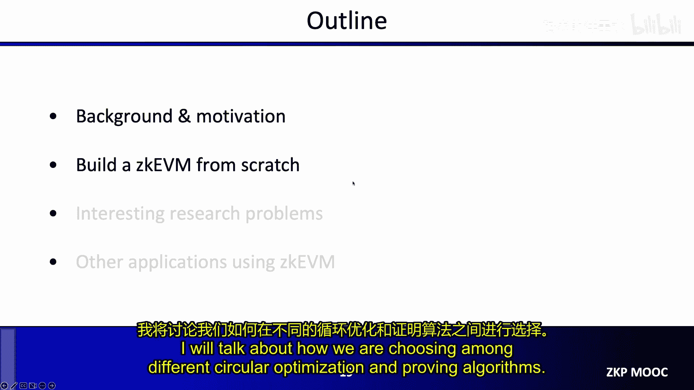

So let's start with a workflow of the proof， So if you want to generate proof for a program。

 you firstly need to express your program or computation using a number of athmetic constraints and this requires some artthization and they most commonly use one R1Cs。

 which is a linear combination and Planish artthization which is custom gate。

 lookup permutation or I， which is used in star containing transition constraint and some boundary constraint。

 so I will introduce and compare later。And on the back end side， after you get your constrain system。

 you will run some proving algorithm to generate the proof。

 and you have already learned so many different proving protocol。

 but here I only list the most commonly used one industry。

 so which is a combination of polynomial IOP with the polynomial commitment scheme。So here。

 like because we are pulling for EVM execution， so the program is EVM itself。And for us。

 we are using plan optimizationization to write our constraints。

 and we are using Plan I O P plus KZ G polyomic commitments game in the back end to join the proof。

 I will explain why later。 So let's start with the most familiar R C S。Arthization， and in R and C S。

 you basically need to lay out all your variables in a long array。

 and then you you define your constraints over those n variables。 And the format is shown here。

 It's a linear combination times linear combination equal to some linear combination。

 So here are some examples。 you you can just。Add any coefficient to those variables and linear combine。

 and the addition is almost free here， but in each constraint， the degree need to be at most2。

And when you are proving for concrete instance， you need to fill up all those variables with concrete values and proving that I know a vector。

 which is input V A V BV， blah， blah， blah， and that is specify all those constraints and eventually like you know if prove can prove that the verifier I know that this computation for this circuit is carried out correctly。

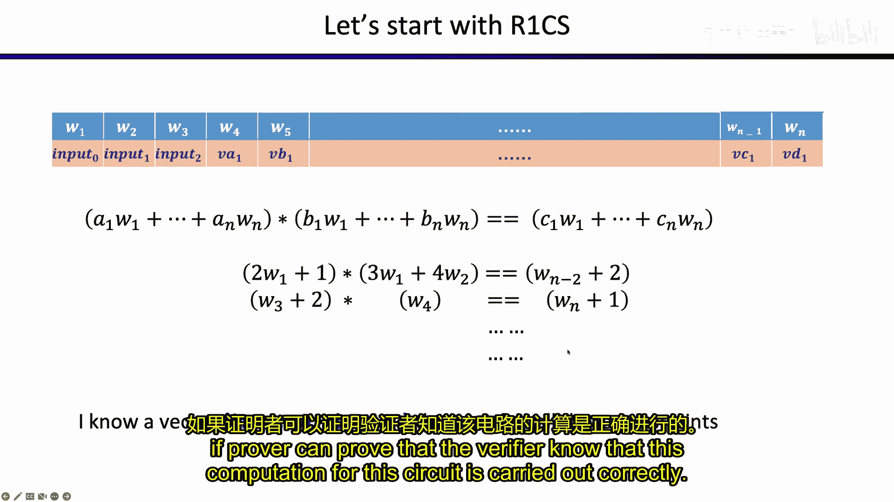

And differently in in Pish organization， you are lay out all the variables， not in a array。

 but in a two dimension table。 So this is a table。And you will fill up all those。

 all the table with your， with your values like you know， input variable V variable B here。

 and you fill up this table with， with all those values。

And then like you can define different type of constraints。

 there are three type of constraints which you can write about the first is called custom gate。

 So basically you can define any shape within the table。' that's called a gate。 so for example。

 you can define this shape as your new gate And then you can define arbitrary relationship between those those values or like in that cells within those gates。

 So， for example， you can define v3 times vb3 times v3 minus vb4 equal to0 and you can define basically arbitrary and。

the comparison with R1CSA is that the degree can be higher because you can define arbitrary relationship for your gate。

 and it's also more customized， for example， you can comprise three modifications inside one constraints。

And for example， you can define this shape and define arbitrary relationship in your custom gate。

 and you can define even some very irregular shape like this。

And the second constraint you can define in planageizationization is called permutation。

So it defines equality among different cells， so it can be be used to link different gates like for example。

 like we be4 equal to vs6 equal equal to this cell equal to this cell imagine that in previous slide。

 if you define some custom gate here， custom gate here and if you want to link different gates together and then like you can just use one permutation to pull that know the gate for this the gate here。

 the output of this gate here is equivalent to the input of this gate here so that you can link different gates together。

And the last constraint you can define is called lookups。

 So basically what you can prove is that you can define a tuple and prove that this tuple belonging to a table like this tuple is like way 7。

 we 7， V C 7。 it belongs to this table here。So why why this is super powerful。

 let me show you some example here。 So imagine that you want to prove for the range of Vc7 is within0 to 15。

 So imagine that you want to prove this in r1 cs what you need to do is that firstly you need to decompose this value into4 bit。

 and firstly prove that each bit is within the range of0 to1 using this value times value minus-1 equal to 0 so that's already like four constraints and then you prove that linear combination of those those variables equal to vc7。

 So it's very complicated and use many constraints。

 but here what you can do is that you can prove forth all the possibilities within that range like from 0 to 15。

And then as far as you can prove that V C 7 is belonging to this column。 Then like。

 it's clear that V C 7 is in this range。 so you can do range proof very efficiently。And similarly。

 you can look up a tuple to prove some bitwise operations are correct。 So， for example。

 V 7 V B 7 equal to V 7。 what you can do is that you can prove forth all the this table and all the store all the possible entries here as some fixed column and then you can you can prove that this tuple belong to this table instead of like proving for this relationship。

 which is needs a lot of。A lot of constraints in R1 Cs。

 and can it can really reduce your your circuit size。

And it's extremely helpful not only for some fixed brute force table。

But also it's extremely helpful for doing some RamM operation。

 which is read and write operation in the content of ZkiVM because imagine that if you are building for a virtual machine circuit in a virtual machine it usually have memory which you write and some data to this memory right to some places and then later you will read from that from that position so you basically need to prove that your read and write are consistent so you can use the table which is generated on the fly as your RamM table and you just put all the entries like in this table and later when you are using this opera you can look up into this table So that's why this lookup table can be extremely helpful for some RamM operation So that's why like we need this lookup so much in in theVM I will give more specific examples later。

But as a summary here are the constraints you can use in Planage optimizationization。

 so there is custom gate， there is permutation and there is lookup tables and for star is quite similar you can think of the optimizationization in star as you can only define gate to be this kind of rectangular of your like a two rows and then like the relationship。

 the constraints you are writing basically need to transform the first row to the second row。

 So in you can imagine that in each row represents some state in a virtual machine and then the next row is another new state and your constraints is defining that the transition between the first row to the second row with the correct which actually plan is a more generalized format because your gate can be arbitrary。

 not only like two adjacent rows， but you can define like any shape with different rotations。

 So I wont go to。

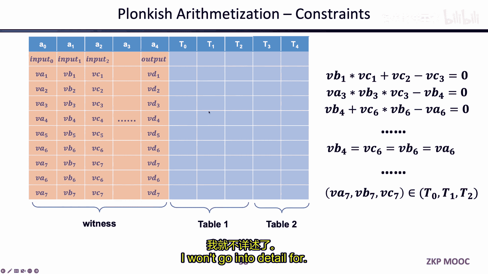

Detail for stock。Now the question is how we， how we can like choose the front end for our Z KVM。

So here is our computation we need to prove and。So if you look at the computation inside EVM。

 there are four challenges。 One day that EVM word size is 256 beat。 So every word。

 every variable using EVM is 256 beat。 And this is extremely problematic for for Zki circuit。

 because Zki circuit usually require the field to be at least some prime field or some scalar field or for EPA curve and usually we are using some curve。

 even if it's some large curve， the field is usually 254 B and EVM word size is even larger than that。

 So basically every time you need to use a variable。

 you need very efficient range proof almost everywhere to limit that you are you are not using some value that out of the range。

 And so that's one problem。 And second problem is that EVM has so many Z unfriendly up codes。

For example， it has catch Sha 256 it's just in general。

 many hasush functions are very Zon friendlyriend and you need a very large and complicated Zki circuit to proof for those up codes so sometimes you need to have separate circuits for those hasush functions and link different circuits together and also for some Zon friendlyriend even even some bitwise operations at this scale is very Zon friendlyend so you need to handle those Zon friendlyend logic or and sometimes like even allsource that to other circuits and connect them together。

And third， as I mentioned， is that it's a virtual machine circuit where you have this problem for read and write consistency。

So you need some kind of efficient mapping to prove that what you are reading is what you previously have written。

And finally， EVM has a dynamic execution trace。 So for example， like you know for this transaction。

 EVM has a different like execution order because this transaction needs， for example， like add， add。

 push this sequence， but that transaction is different。

 So you need to handle those dynamic like input in a dynamic way。

 So that's why like we need some kind of efficient of selectors to open different constraints at different positions。

 you will see that later。So considering considering all those those three factors like efficient range proof。

 efficient rate to connect circuits， efficient read and write。

 we want our circulationization to enable lookup。And considering the second one where you are handling a dynamic execution trace。

 we want some custom gate because we can just abstract those like upcode pattern and make that become some IR flower circuit and efficiently open those IR for different positions so combining with all those factors we decide to use plany organizationization。

Okay， now we already figured out that we are using Planizationization and figure out the reason why we are using that with comparing against R andCS。

 Now let's write some concrete circuits and build a real Z keyVM from scratch。

So to write the the concrete circuit， let's take a closer look at what's the exact computation we need to prove and what's happening even like behind the EVM。

So we start with some initial work state， as I mentioned， like you have a database。

 you have state root for that， and then you receive one transaction like from this address to that address。

And then the node after receiving the transaction， the node will run this transaction over EVM。

And EVM is a stack based virtual machine。 It will load the bycode you are contract bycode you are running and load that to memory and execute this bycode op code by op code with this transaction as your input。

 And then like when you are executing this transaction you were result in an execution trace look like this。

 So this execution trace is composed of a sequence of op code that has been executed on EVM。

 So for example， it contains push， push， store， core value， blah blah and finally return。

 And at the same time， because during execution， you need to write to storage。

So you need to change the leaf here， and so you will end up with a different state root prime here。

So here is the computation under under like。Under under node1， this node receiving a transaction。

 So now let's take a look how does Z EM kick in during this process。

 So since the computation you need to prove is EVM So you will use EVM as your computational spec for defining all your constraints。

 So for example， because EVM is executing all those op code。

 So you need to have constraints for all the operations happening inside EVM including each op code circuit for each op code for the spec code unrolling for storage read and write。

 etctera。 So all the operations inside EVM you need some write some constraints inside the EM to prove that they are valid。

And so the public input for the key VM will be your old state and。

 and your new state and all those N transactions。 So your statement will become that the statement that after applying all those N transactions。

 your state route move from， from this one to state route prime。

So verify don't need to know the concrete execution treess and the concrete。

 like what's happening like。Like during execution， it only need to know that this is a transaction input After executing that you get this。

 So that's what the verifier can see。 Verifier only need to update to a new state route。

 But they V M already takes this。Or the execution process as witness and prove that。

So your execution trace is actually your witness for the key VM。 So again， like， you know。

 your this spec defines constraints， but you need some kind of witness which satisfies those constraints。

 So that's your execution trace with those information as。

 as public input and defined those constraints and。

So basically what you are proving inside the logic inside EVM the EM is that prove that I know an execution trace。

 which is uniquely onrolled from this transaction So basically I'm executing by op code by op code and it's valid which means this execution is valid means all the op code computation for each op code is valid and read and write also consistent。

 for example， like if you have push here， it must be if you have some kind of like pop here。

 it must be some value which you have already pushed already。

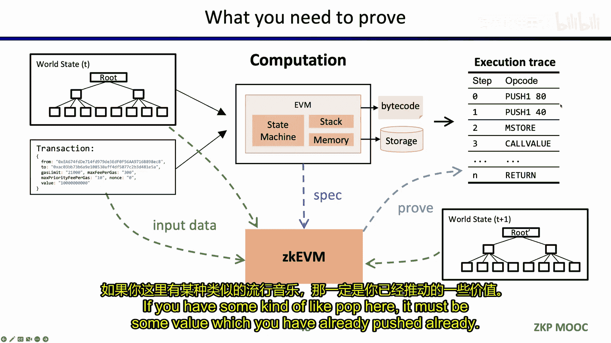

As I explained earlier， a transaction is valid is like equivalent to the execution trace is valid and unique。

 but the information here in the execution trace is not enough as witness so the first thing you need to do is unroll this execution trace into a larger execution table because I'm using table here because eventually all those values will be filled up in in a planish artization table and define constraints to constrain the relationship between those values。

And so let's take a closer look at what the concrete witness you need for each step。So in each step。

 there are three like mainly three type of different type of witness。 one is called step contacts。

 one is called key switch and one is called optical specific witness。 So what does step contact mean。

 So step contact means when you are executing this step or what' your contact variable。 So。

 for example， it contains the code hasush which indicates what the code you are executing and there is a guess left。

 which means after when you are executing this step。

 whats the remaining guess and also contains on program counter step pointer as a contact for like VM contact for executing this step。

And there is a key switch。 So key switch contains all the possible possibilities for op codes andarrow cases for one one step。

 So you can imagine that so if you have like n different type of possibilities for this step。

 then you need to have like variables inside this area and to indicate that like what is what this step is useful So for example。

 if this step is is add， then you need to put this as add to be one and other variable to be0 so that other people know that you know this is this is for add because every time as far as this value to be one other value to be0。

 then like it indicate that this function this step is useful for this op code and you can think of that as a efficient selector select the constraints。

Need to apply to this area and indicates what this area is useful。

And the last thing is optical specific witness。 So it contains all the necessary witness that is needed specifically to this step。

 So， for example， if you are again， if you are pulling for add then you definitely need some kind of opera right like A plus B equal to C because A B and C are 256。

 So I am using high low here to represent the highest half and lowest half。

 So you need to put your up here and some other information that is needed as actual witness。

 for example， you might need some kind of carry for add like because it might overflow and need some other variable。

 So this places for optical specific witness。

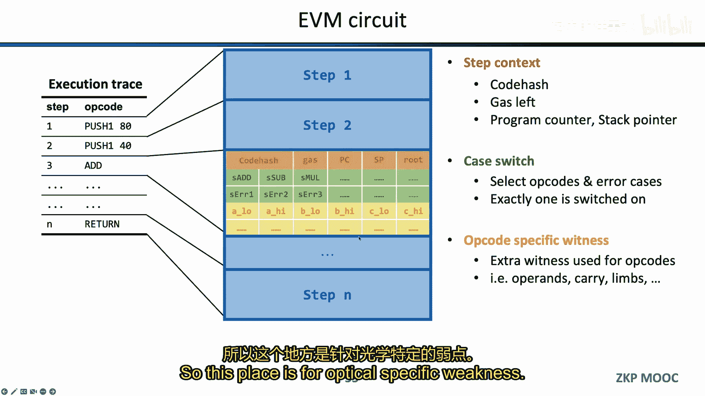

Now， let's take a look at the。Theres some specific constraints。

 And I will take add as an example to see like what the constraints we are defining for。

For for those different steps。So for step context， because it's basically proving that the context variable are consistent。

 like when you move from step1 to step 2， step 2 to step 3。

 you are executing in the same context so you basically basically this step context need to prove for two adjacent steps。

 the variables are consistent so here is your constraints。

 so you need to write S add times p prime minus p1 equal to 0， which means if S add is one。

 because if S add is 0， which means this step is not for for add。

 So only if this S add is one which means this error is one。

 then like know this PC prime equal to plus1， so which means if this step is add。

 then your counter need to plus one and step pointer similarly is is add。That point need to plus one。

 and guess need to to plus 3。So this is like the logic four step context。

 so basically after executing add， what your contact variable will look like。😊，And for key switch。

 as I mentioned， like key switch basically indicates that this area。 what is this step useful。

 So the idea here is that each value need to be binary。 It's either to be 0 or one means on or off。

 So， and at most， there will be only one variables。Which is is one and other variables will all be 0。

 So you need to write all those constraints like this。 Basically。

 it's S add times1 plus1 minus S equal to 0， which means S is binary。 S more is also my binary。

 All those you write this for all the all these the values in this area。

 and then adding them together。 you get one。 which means okay， so previously you said okay。

 it it's all binary And finally you said there will be only one value。 and exactly one value。

 the value of that variable is one。 So。😊，This is how you constrain this key switch to guarantee that there will be only one variable set to be one。

And for your optical specific witness， I'm also using add as an example here。 So as add。

 you need to time S add because it only works if you are selected to be this area select to be add。

 And so this if it add， then like a plus B minus C equal to 0 if there are some carry and there are some carry。

 So this is add specific logic。So here is here is a more complete example for add。

 but you will notice that there is still one one missing piece。

 So what's missing here is that so if you are doing add。

 then you are basically popping to elements from your stack， which is A and B。

 and then you push your C value back。 So here you didn't prove that a and B value are what you previously have push to this stack。

 So you basically need to prove that this A and B are consistent with what you push previously。

 right， So basically is proving for read and write are consistent。And to achieve this。

 we use a separate lookup table。 So imagine that there is a magic table here and assuming that this table has correctly ordered all the entries。

 all the all the values you need to read and write in EM circuits。

 and then like you just have a magic table here。 And we need to， we only need to inside EM circuit。

 we only need to write a lookup constraints， which you look up this value to this table。

 And as far as it exists in this table。 then like it it's correct。😊。

So now the problem moves to the table like the question becomes how you are going to prove that this table has crack order and because。

 you know， like EVM is pretty EVM circuit is pretty handwaving is just look up and if it exists then like it's consistent。

 But how you are actually constraining this table。 So what you do is that we will have a separate Ram circuit with different constraints to constrain that this table is generally correctly with the crack order For example。

 this Ram circuit will will check that like two adjacent rows have like， for example。

 the the time step is increasing and the address will be like。Has some some order for this address。

 and whether it's read or write。 And if， if， if it's for example， if it's read after write。

 right after read， then it's need to prove that the value are consistent。

 So this Ram circuit will be used to prove that all the tables。

 all the entries in the inside this Ramm table are correct。

So this is I won't go into the detail here， but if you are interested。

 we have more specific explanations on our YouTube channel you can check out so this is but this is basically how you handle stack memory and storage so basically you have separate circuits to handle those circuits and then inside EVM circuits you are just handwaving and look up into that into that table。

And similarly， when you need to prove some really zy unfriendly op code like hush function。

 you just simply can't put all the witness within that tiny op code specific area right because hush is so complicated needs many rows more than just like two or three rows。

 So what you need to do is that for example， you want to prove that this is input。

 this is the h result of your your input。 and then like you just put your value here and directly assume that it correct。

 And then inside EVM circuit， what you do is that you look up this tuple like input comma hush input and to a table。

And then as far as if this pair exists in that table。

 then it means this input and this harsh output has the relationship you want。

And then like the magic become like how you kind of generate this harsh lookup table。

 So previously when we are we are proving for range proof。

 the lookup table is quite simple because it's fixed。

 even for some bit wide operation is fixed table。 But now because you can't prove for all the input for hush function and it has to be this this lookup table has to be constructed in a way that is dynamic。

 So only proving for the pairs you want them to to prove。😊，So again。

 like you just imagine that there exists such a magic lookup table。

 which store all the possible entries like input and h input pair。

 and like like just store many entries like that。 and all the EVM circuits were when they need h。

 they just look into this table as far as exist then it correct。 Then like again。

 how do you guarantee that the entries in this table are correct。 So what you do is that similarly。

 you have a harsh circuit， which you write， you encode all the h constraints inside this circuits。

 And then using this constraints， you can prove that all the entries are correct together。

 So you basically take all the input and output， all the many instances and then you one circuit to prove that like they are correct。

 So you just separate that into a specific circuit。😊。

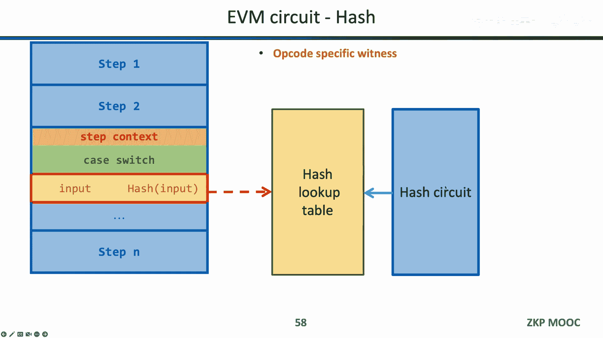

嗯。Okay， now let's take a look at the overall architecture of the theM circuits。

 So you firstly start with some EVM circuit on the top to constrain the whole state machine is divided into multiple steps。

 and you have an execution trace， which is your witness。

 You unroll these execution trace to specific variables and fill up in the EVM circuits and EVM circuit defining some like your constraints like constraining each step or look up into some other circuits。

😊，And then like every time you you met with some really hard out codes。

 you just imagine that there is a magic table。 So， for example。

 there is a fixed table for like bit wide operations range check。 and for example。

 there is a catch check table， which store all the input and output pair， which is used in EVM。

 and there is a Ram table for all the read and write entries。 There is a bicycle table。

 There is a transaction table。 There is a block context table。😊。

And you just imagine that although table exists。 And every time EVM circuit might some problem。

 you just look up into this， this table and imagine that this table is， is correct。

And then for each table， you need to use separate circuits to prove that all the entries in this table are valid。

 So for fixed table because this fixed is preprocesed， you don't need to constrain that。

 but for catchact table， for example， you need to have a catch circuit。

 proving that catch catchak is a has function that all the entries in catch table are correct。

 and for Ram table because it contains some storage memory and stack operations。

 So for storage operation， you need a Mer potential tree circuit to constrain that storage is correct。

And in this MPT， if you are using the Mer potential trail like if youM。

 then you need to look up into catchup table because constructing a Mer train need hush and you need to look up into that table and run circuit for stack and and memory operations and there is bi circuit pulling for bike on rollinging and there is a transaction circuit。

 block circuit and for your signature even you can have a ECDS circuits to constrain the signatures in that table and transaction circuit can just look up this table。

 So basically you can imagine that Z event circuits is a set of circuits they are connected by lookup tables。

Okay， so just a quick quick recap of where we are so far。

 we compared the RCs withish organizationization and explain the reason why Pish is a better fit for virtual machine circuit。

 mainly due to the support of custom gate and lookup tables。

 And then we explained how to write the constraints for our the KVN and explain the architecture for the ZVM。

 which is like a EVM circuit on top and many separate circuits for different functionalities and they are interconnected by this lookup tables。

😊，And now after the front end， let's move to the back end and see how you are actually generating proofs and how we are choosing different proof systems。

😊，So again， here is all the circuits we need for the key EVM。

 So there is the EVM circuit for C translation， Ram circuit and a bunch of others like EDSC circuit and all those other circuits。

 So in theory， you need to generate proof for each circuit and verify all the proofs to know that you are executing a transaction correctly。

 because you need all the functions， all the components to function like as expected to know that one transaction is correct。

 But in practice， it's too expensive to verify all those proofs。😊，So instead。

 we have an aggregation circuit to prove that all those proofs from those subciits are valid。

 and in the end， you will only have one aggregation proof instead of like many different proofs。

 which can massive reduce verification overhead。😊，And so accordingly。

 when you are considering the proof system， we can use a two layer architecture。

 So basically the first layer， you need to generate proof for， for EVM for for those kind of direct。

 you are directly proving for EVM logic。 So， and second layer is mainly targeting as they proof from the first layer。

 But， but here， like you can use a different proof system。

So let's take a look at the requirement for different layers and figure out what's the best proof system for each because you can you can basically compose different proof system together because they have different requirements and different targets。

 So let's take a look at the first layer。 So the first layer need to handle some really large computation。

 which is directly coming from your EVM。 And so you basically because you are directly provinging for EVM logic you need some very good support for custom gate and lookups。

 You need to be really expressive because you are handling different type of computation inside EVM and more customized。

 So the proof system ideally want them to support custom gate and lookup。😊。

And second requirement is that you want some really hardware friendly prover to make prove faster。

 by saying hardware friendly。 I mean， two things。 One is highly parallelable。

 So your prover if you are using GPU， which can like basically making a proof like 10 times or10 faster because it's so paralyzed and also low peak memory。

 So basically， for example， you can you can process your your circuits like circuit by circuit。

 or like you can have some way to reduce a maximum user of your your memory， for example。

 like you know in some cases， if you you require very large FFT。

 then your memory requirement will become high。 But if you are doing some multiexentation。

 you can do that like trunk by trunk and to reduce your peak memory。

 So we want some hardware friendly prove because we want some efficiency。😊。

And third requirement is that the verification circuit should be small because eventually the aggregation circuit is proving for the verification algorithm from your previous Pro system。

 So the verification circuit need to be small。And the last requirement is that ideally。

 we want the proof system to have transparent setup or universal trust setup。

 because EVM is is upgrading。 And if you are using application specific trustee setup。

 then like you will have some trouble because basically every time you do some upgrade。

 you need to run your setup。 So in the first layer， it's very important that you have。

 you at least have some universal trust setup so that you don't need to run this ceremony again again。

And here are some promising candidates。 So from polygon， there is Planunky2， are stary。 They are et。

 which basically all using like also a plan like IOP， but use f as the polynomial commitment scheme。

 and it has some really nice properties， for example。

 like Plany2 and and those per system use a smaller field called gaillocks。

 which can make the computation on CPU become really fast because it's not curve。

 You can use a smaller field， which can fit into a smaller。 So goillocks is like 64 bit。

 which can fit into a CPU register， So you can do computation much faster and also you can support custom gate look up and it's hardware friendly because it is fast and verification circuit is smaller and it has a transparent setup。

😊，And another promising category is Hlo2 or Hlo2 Kversion。

 So Hlo2 is initially developed by thec team。 and initially Hlo2 is a they use the organization on the front end with flexibility with very special support for custom gate and lookups。

 but Hlo2 initially use the inner product argument with the pasta curve。

 which you can you can do folding， you can do like because it's a if curve。

 you can do recursion very efficiently。 However， pasta curve is like pasta curve is not directly supported on on layer 1。

 And also like because you are using inner product argument so if you very familiar。

 you know that it will have some kind of log logmic verification， So which means。😊。

So in the first place， E VM does support past curve。

 So you can't use precomp So verification will be very expensive。 And second。

 because this log logarithmic verification， it can make even more expensive than like E M。

 So that's the reason why there is a derivative， which we are using and also like the PSE team from foundation using is's called Hlo to KG version。

 So we basically replace the polynomial committee part in hello to with KZG。😊，Because for K G。

 we we we can have very small， small proof。 And also because K G。

 we are using being curve is' supporteded on ECM。 So it can be efficiently verified on EM。

 And there are some other new like candidates， which are very promising。 Like for example。

 there are some linear time prover which remove FFT to be more hardware friendly。

 And there are a bunch of like new I O P around that。

 And also another recent trend is like using because Nova is famous for。😊。

Fast small threshold aggregation and recursion。 So if you can use Nova to recursively prove for maybe a repeated catch check or whatever。

 then you you might be able to get some very efficient like prover with those。

 but but currently like although some check based protocol or Nova， like initially in the paper。

 they only support R1 S。 So if they can support plantization。

 which they are already recent work from geometry。Like talking about that how to how you can support like degree2 custom G in Nova and there are some new new work supporting lookup forwarding in Nova and also there is new new work called supernova which can support like you can for different circuits so those are all very interesting line of work which can be promising in the first layer to make your prove efficient and also universal verification is smaller and support some artization。

And now let's take a look at the second layer。 So the second layer。

 because you generate aggregated proof。 So the second layer need to be very verify efficient。

 especially efficiently verified on EVM because eventually you need to sum this proof on on easier。

 So there are some requirements。 first requirements like， as mentioned。

 like proof efficiently verify upon EVM。 you have smaller proof you have low low low gas cost for verifying this proof。

 And secondly， that you need to consider the best practice from pures1 because you need to prove for verification circuit of the former layer。

 and you need to prove that efficiently。And also ideally。

 it should be also be hardware friendly for efficiency and ideally transparent or universal stress setup。

 but transparent or universal setup is not a very harsh requirement for aggregation circuit。

 especially if you have some very good design。 The reason is that because aggregation circuit is only proving that proofs are valid。

 and the proof verification logic is usually fixed。 So even if you have some kind of G 16。

 even G 16 or some more like application specific stress tab because you are only proving for proofs。

 So you can change your logic here， but without changing the logic here。😊。

So that's why I only write ideally you want this property。So some promising candidates。

 which can make your your proof become really small is like G 16。

 which is still remaining a very like efficient prover in the literature。

 and another candidate might be planunk with very few columns。

 So imagine that one I mentioned like like Plan organizationization you can you can think of a table and this table has many columns。

 and the verification cost is linear to the column number。

 So if you can and and also this table is configurable。 you can configure this table to be really。

 really thin and really tall。 And then like you have very fewer columns so you can reduce your verification cost to be very。

 very small。 and then like with either K G committee scheme like so that one row will have one one like know。

😊，Open proof or a flk， which sacrifices poor time with verification efficiency and which is actually adopted by polygon hermes to to reduce a verification cost。

 or there might be kak f。 So basically you are using fry。

 but you are using kchak because EVM has kak a precompel。 and it can be verify efficiently。

 but mostly if people don't care about this setup saying they will go with KD G or or fluk or go 16。

So as far as what we choose we we， we choose we we， our first layer is using Helo to K G。

 and our second layer is also Helo to K G。 But the the only difference is that like recall previous lectures when you so from interactive proof to non interactive proof。

 you need some fair Sha to harshush previous transcript to a randomness。

 So because in navigationrgregigation circuit， you need to prove the verification algorithm。

 And so you want the harsh the harsh。😊，Use in this verification algorithm is efficiently provable。

 So that's why like we we we we， we are using per hush for F Shair in previous layer and then using catch in the second layer because eventually you need to verify this application profile on layer1。

Because the first layer， because Hlo2 can support custom gate and lookup。 And also。

 it has very good prove performance because we have very fast GPU prove。

 and we have paper talking about that。 You can check， check out that on on S plus and。😊。

The verification circuit is also very small because it's K G。 So you only per per per per column。

 you only have very small。Small proof。 And also it's a universal setup。 And secondly。

 why we are choosing K Hi to K G is that because we have custom gate and lookup support。

 so we can prove the nonnative operations of KH opening still very efficiently。 And then again。

 like we can reuse our GPU prove。 And also we can configure this because it's helo to and it can support planage organization。

 we can configure this table to be really， really thin and that verification is very， very small。

 So it can be configured very small。 So that's why we we are like using this。

 And this is one of the major differences which differentiate us from from polygon hermes。

 So they are basically using the first layer they are using a star。

 And then like use multiple layer of star to shrink the proof size。 And then finally， they use a。😊。

The user， I flnk to make application even even smaller。 But here we are。

 we are using directly using Hlo to KZ G， Hlo to KZ G， which is basically a plan L O P plus KZ G。

 And also we are we are considering like also having multiple layer of aggregation to even aggregate many aggregated proofs。

So let's take a look at the the concrete layout here。

 I only list some some some status for for Ean circuits。 So Evian circuits has like over 100 columns。

 over 200 custom case and 50 lookups。😊，And the highest degree is 9。And for around 1 million guys。

 it needs around  two power，18 rows。 and the more gas you want to prove the more rows you will need。

 like for example， if you you need like2 million guys， its just double the the number of rows。

And then in the second layer， you， you need to aggregate proofs like from U circuit。

 Ram circuit also circuits into one proof， so。And but but but this aggregation circuit。

 the proof need to be submitted on layer 1。 So it's very thin。 So it only had like 23 columns。

1 custom gate and7 lookup tables。 and the highest custom gate degrees5 and for aggregating like many circuits。

 it takes like two power 25 rows and just like to notice here is that this is not finalized。

 So currently we are actually using two layer of aggregation。

 so one one layer aggregation is like 23 columns。 but right after this aggregation layer。

 we have another layer which might only use like three columns or four five columns to even reduce verification cost further and and also like this little number will be massive reduced with some optimization from from aom and it's still work in progress。

 but we believe that this。Can be further reduced。And also like if you are increasing the gas limit。

 the aggregation circuit won' be the aggregation circuit size won't increase because you only increase the real number。

 but the proof verification won't be changed。It only influence putting time in the first layer。So。

 and beside that， we have done crazy optimization for our prove， mainly on GPU。

 So we have optimize the most computational heavy part inside prove on GPU， including M M。

 which is like inner product over E curve， and N T T。

 which is like FFT over finite field and also caution kernel。

 which is computing the caution polynomial。 So if， if you are interested in this。 again， like we。

 we have some videos talking about more specific into this GPU optimization optimization。

 you can check out some other videos。😊，And also like that's one optimization for different computational kernel and also we pipeline and overlap CPU and GP computations like when you're doing things on CPU。

 you can also compute something on GPU at the same time to overlap to further reduce your latency and also we have multicard in we have done a bunch of crazy memory optimization to reduce from like 1 gigy memory。

 which is our starting point to around like 300 gigy memory。😊，And the performance is also great。

 like for EM circuits， Eventually the GPU prove takes around 30 seconds and for application circuit。

 it takes around like two minutes。 it's actually even more reduced like with our recent optimization。

 including parallel synthesized and some other optimization。 But this can show that。

 you know the U is already practical。 So for around 1 million guys。

 the first layer will take two minutes， the second layer takes around three minutes。 And for example。

 if you on increase to 10 million guys， then the first layer will just be like 20 minutes and second layer still be3 minutes。

 So it's not finalized again， like we expect that to be within 10 minutes in the future for for one block。

 But like we just many， many optimization for that。😊。

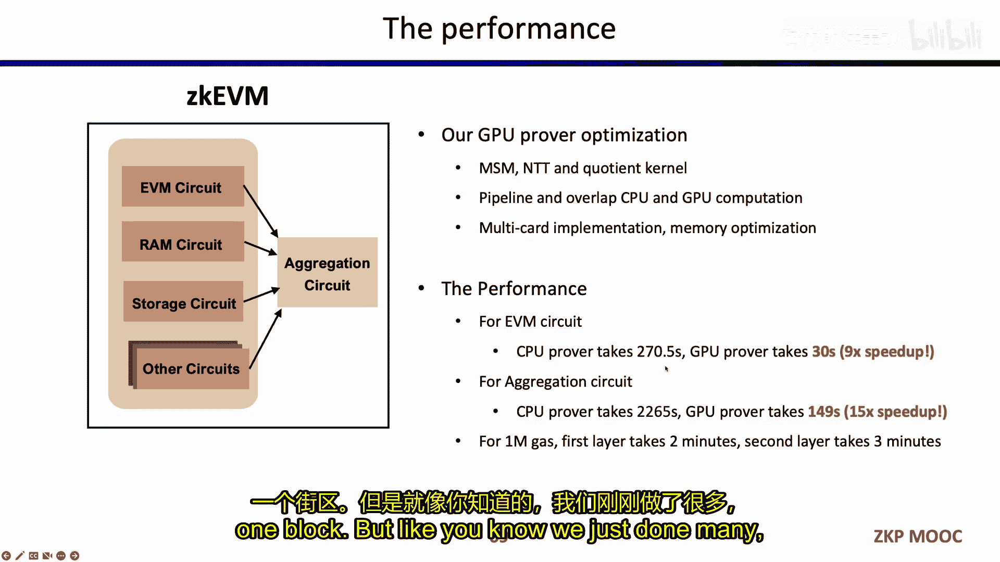

In this section， I'm going to talk about some interesting research problems we met when we are building out the keyVM still。

 like I will talk from the front hand circuit to the back end prover。

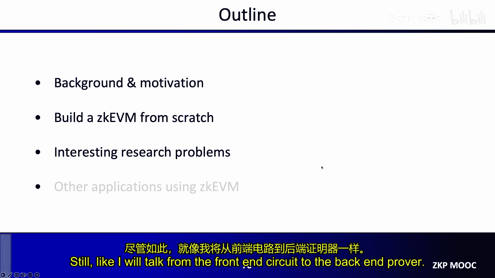

Now， let's take a look some of the interesting problems on the circuit side。So again。

 let's start with our EVM layout。 So this is our EVM circuit layout， and you have spec compacts。

 case switch and optical specific Wi。😊，And as I said， EVM word size is 256 beat。

And it's problematic because for the variables inside your circuit。

 you need to be limit that into a smaller finite field。 So you can't fit into 256 B。

Word into such a such a cell。 So what we do here is that we decompose 256 B into 32 limbs。

 and each limb is 8 B so that we can do efficient range proof for each limb like you can look up this 8 B limb into a  two powers 8 size table so that you you。

 you know that it's 8 8，8 beat size so that you can do efficient range proof for 256 B word and also fit this 8 B limb into smaller cell。

So this is your value。 You decompose that into 8 bit lips。

But it's problematic because every time when you need this EVM word。

 you will need to bring and duplicate 32 variables。

 So what we do here is that we encode a EVM word using something called random linear combination or RLC。

So this linear random meeting combination is basically taking all those 32 numbers and then use a randomness to combine those numbers into one encoded value。

And then every time you need to use this 256 beat word。

 you just use this encoded value instead and proof for this constraint。

So it's very convenient and efficient。But heres some problem。

So because you are using a random number to linear combine 32 values。

 So those 32 values should be fixed， and then theta should be derived from those numbers or or fix fixed values。

 because， for example， if， if theta and a1 to a 31 are decided at the same time。

 then you can adjust your。Your， your limb number to change your encoded value。

 So it only makes sense if a 0 to a 31 is already fixed。

 and then you use the new randomness to linear combine those values。

But if you take a look at the witness。This is your in value。 This is your limp。

It's all part of the witness。 So which means proven need to fill up both parts by them by themselves at the same time。

 So that's a problem。 Like you basically can't do that if if R C and a2 to a 31 a at the same time。

 So that's why we implement the feature called multiface prove。

 which is basically saying that you should synthesize part of the witness derive this randomness and then keep synthesizing the rest of the witness so that you can like you know derive randomness from previous values to to this value。

So this， this is。At first one， we find this this is with the PSE team at EM Foundation。

 this is extremely helpful and it's standardized。 The implementationation is called challenge API and you can find out in the implementationation it's extremely powerful and it can be used in many places for example。

 as I mentioned like compress EVM word into one value and also it can encode dynamic lens input So imagine that if you have catch check or you have any hash function because you don't know like what's the input size for this hash function。

 So you can lay out all those input trunks in in some columns and then encode those values into one value and then use this as your your input encoding and which can efficiently represent a dynamic length of input and third that you can do some lookup layout optimization So this is extremely extremely helpful in our DKM context。

😊，So I can briefly explain what is this lookup layout of transition。 So as I mentioned。

 you can look up a tuple to to a table columns， right， Like， for example。

 imagine that we have a three value tuple and， for example， and this。

 the values in this tuple can come from any place in this table。😊。

So imagine that you have one three column table。 and if so the first tuple is looking up this position。

 this position， this position to this table， and the next tuple is from this position。

 this position and this position also into this table。

 So different position will introduce different tu。

 which means you will every every time you do a lookup。

 you will introduce one additional lookup arguments。

 which is very costly because almost like one lookup is equivalent to like one custom gate。

 three custom gate plus some some columns。 So that's very costly。😊。

And so one optimization you can do with this randomness is that you can allocate a new empty column。

 and then you can use this randomness to linear combine those three value to into one one value and put that into this into one cell in this column。

 And then like if you have like three， three values here。

 you also use this randomness to linear combine those three values into here。

 And then you get a table， you get a table column， which is full of your random linear combined。😊，T。

 and then like you can also do the same linear combination for your table column and into one column。

 And then you only need to look up from this column to that column。

 So basically imagine that initially you have n lookup tables。

 N lookup arguments because you have N two looking up into the same same lookup table。

 And then after this optimization， you optimize that into n custom case。

 which is a random linear combined two into a cell。 and then one lookup because you， you。

 you look up this column into your lookup table。 So you can efficiently make those like different positions。

😊，Like， and then like lay out that regularly in one table column and then look up that in a table。

 So this is extremely powerful。But this， this randomness also has some。

 some problems because as I mentioned， like， you know。

 you need multi face prover to derive this randomness and its especially problematic when you have many circuits。

 For example， there is EVM circuit。 There is a catch circuit。 There is ECDSC circuit。😊。

If one circuit need to stop to generate a witness and then other circuits also need to stop if they need this randomness because。

 if， for example， like， you know， if you need to look up this value into catcharch circuit and then like you。

 you firstly， after synthesizing your EM circuit， you get your randomness， you get this encode value。

 and then bad guy can just put some kind of。Bad values which will satisfy this requirement because this randomness like he already knows randomness so he can change this limb number and get some other like encoded version。

 which is not exactly encoding the same number。 and then like do something bad there。

 So if you have many circuits is randomness will enforce you to have synthesize all the circuit。

 So you have synthesize E circuit， you have synthesize EDS circuit， you synthesize the catch circuit。

 b bla blah and then deriving the randomness at the same time。 and then synthesizeizing this circuit。

 syntheize that circuit， that circuit。 So you need some kind of synchronness but problematic like way to generate your witness which will introduce a very large overheading inside prove。

 So that's the reason why in reality， we actually put all those ES circuit。

 catch circuit even circuit into a super circuit。😊，That we can just have like fewer stages。

 fewer faces。 and then like Jane witness for the first half， second half together。

So that's the reason why we are seriously considering whether we can remove this randomness and there are some ways like for example。

 for emm word size optimization， you can divide that into high low。

 which is like just cut that into two half and only decompose when you need to do range proofs but carry those two values all the time。

 which can still save some number。 And for this dynamic length input。

 you can just divide that into fixed trunk and do that dynamic times。

 But for lookup layout optimization that's still very important。

 we haven't figured out what's the best way to to do this without LC optimization。

 And another way to solve this optimization is that if your circuit is layout very regularly So because for example。

 like for every two that need to look up into that table。

 you layout that into the same position at the same step。

 then you can directly use one lookup to optimize that without kind of recombined。😊，ManyInto a new。

 new column。 But currently to maximum the usage of each cells， we kind of allocate very freely。

 So that's why we need this optimization。 So this is still remaining an open problem。

Which is are interesting。

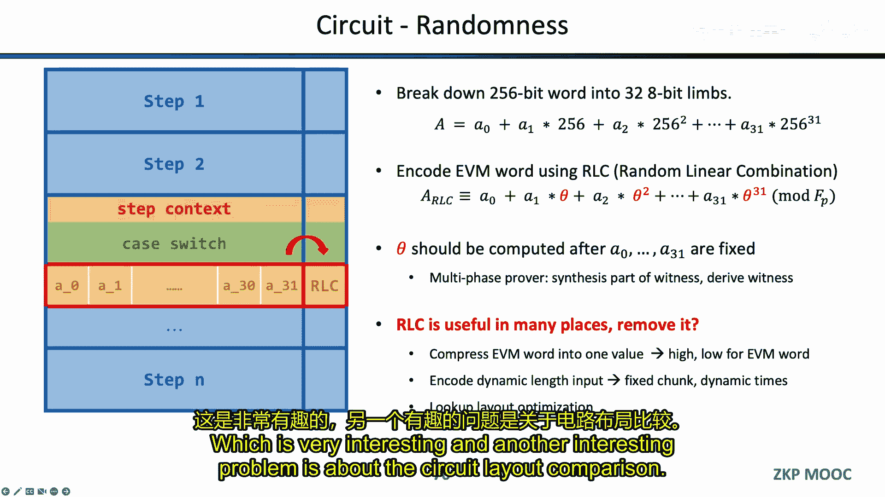

And another interesting problem is about the circuit layout comparison。 So as I mentioned earlier。

 the reason why we are using planage organizationization is that we can handle dynamic execution tray。

 So what does this mean， it means for one transaction， the execution trays can be push， push add。

 But maybe for the other transaction， it can be add， pop push， blah， blah， blah， And so in each step。

 you need to prove for different op codes。😊，And so this says。

 this makes your whole circuit become dynamic。 So like， recall that in R1 C， S。

 if you want to write some constraints， you basically need fix logic here。

 fix logic here and have one fixed circuit。 and then like， have some pre processed。😊。

Like P K and Vki for your like three matrix in in R C S。 But now。

 like because step  one need to constrain for different con for different op code。 and you you。

 you basically need to enable different constraints in different positions。

And so Planage is much more efficient in doing this because in RC。

 the only way you can do this is that in each step you implement something like if else logic。

 you implement if it's push then this is a constraint pop， then this is a constraint in each step。

 you basically need to write out all the possibilities that can happen in this step。

 which is a VM logic VM possibilities and then repeat that for every step。

 So which is a very gigantic overhead。 But using planishization。

 you can define some custom gate for each up code like push。

 you can define an op code you can define custom gate for， you can define some some custom gate。

 and only open or on or off those constraints at different steps。

 So like recall that previously there is a key switch。

 So basically if you set that to be one than like。😊，Addd constraint will be applied to this area。

 But if you said that to be， if you said maybe multiplication to be one。

 then multiplication constraints will be applied to this area， which is super convenient。

 which means， you know， using this way， it's very hard to standardize gates。

 you have to design custom gate for different output code。

But we are kind of abusing the functionality of custom gates。 So， for example。

 like we have over 20 custom gates。 because in each each shop code。

 you might introduce more custom gates and each code you might introduce some some some some custom cases。

 So we are thinking of whether there are some better way to to layout out the whole。

 the whole custom gate。 So one solution can be again， like， you know。

 it has some relationship with the previously mention this regular layout。 So if you can make。

 you know， maybe your opera brand to be within this area and then like you can reuse maybe some kind of。

😊，Ringe checks across different steps， or you can re some basic math gadget across different steps to。

 to reduce some custom gate numbers。Or another way like which you can do is that you you can define some basic。

 like maybe 20 like microop code。 And then like each op code is consist of of several microop codes。

 And then like those micro opt codes， you will have some constraints for those microop codes。

 And then like you can have the custom gate number is like how many microop code you will have。

 And then like each output code will be mapped into micro some microop codes。 And in this way。

 you can also reduce custom gate number。 But this will also like。😊，Make your cell becomes like the。

 the usage percentage of of your your circuit will be become like smaller。

 become become smaller because previously， we allocate cell by cell。

 every cell will be used directly for some function。 But if you implement， you want to reuse。

 Then you need to layout in a way that can be reus， which means there will be more empty cells。

 So it doesn't mean like the layout differently and regularly will be more efficient than our current design。

 But there are some open problems to be explored。And another problem also in the circuit side is what I call a dynamic CVM problem。

 so。😊，Imagine that in step 1， you are handling some really complicated up codes like precompel。

 So what you do is that you just outsource set to another precompel circuit。 And in step 2。

 you also out that in to a harsh circuit。 if you are handling hush So they are two problems。

 One is that because hush precompel and although sub circuits are handling different circuits。

 So they have different length of of of row number and they are like example harsh circuit maybe like needs many rows。

 because it's very complicated， but maybe some smaller group comp needs fewer fewer rows。😊。

And then there are some problem because eventually when you are， when you are proving。

 you need to limit what's the maximum size of your circuit。So， for example。

 we limit the the row number to be two powers 18。 And then like h circuit kit might be easier to exceed this。

 this limit。If， if you are not designed properly。And and also like currently in our design to connect different circuits more efficiently。

 we pad them into the same length， which will introduce some problem because we are paying for some additional cost。

 even if we are not using that many hush and also this again like shows you will have the same row number。

 which means you will have some kind of maximum limit of hush， you can use inside your circuit。

 especially if for example， if if if if the maximum row number is two powers 18 and hush circuit takes two powers like 16 rows。

 then you can only use like you know， four hushes in one circuit。

 So which is indeed some indeed very problematic。 So we are thinking of whether they are some way。

 which allow you to dynamically prove dynamic number of hushes， which can exist this number。

 and also like how to link different circuits together。

 So the current of reason why we we need to pad them together is that also because of the randomness because if。

😊，You have independent circuits。 You need to derive randomness。

 like partial synthes size and derive randomness together。

 But if you pad them together and put that in the same circuit。

 it makes your circuit syn become faster and。More convenient。

 So you have to solve the previous problem。 And then like， you know。

 make this architecture be become dynamic and then think of a way to link like dynamic size circuits together。

So here at least I summarize all the bad influences。

 which is you might need a maximum of number of catchs and because because catchche might be like need many roles and you have a maximum number of rows limit。

 So which means you have limited number of catchs which can be proven in one circuit and also like this can happen even not only for catch。

 but also for some op code。 like if some of code like this step 3， for example。

 is need more roles than step 2， then which means you can fit in less step 3 of codes in your circuit than step 2。

 which might be some problem and you are also because you add to the same length。

 even if you are not using that， you are paying for the proving cost。

 So can we make the become more dynamic like pay for what we really need and support a larger limit of of catchche and also circuits。

So one solution like people are coming up with is that maybe you can use recursive to recursively prove many catch checks and then like you know then you can link those those input input output pairs to the specialized catchche and then in this way like you can have dynamic length of sub circuitcuits and but still connected to your main circuit。

😊。

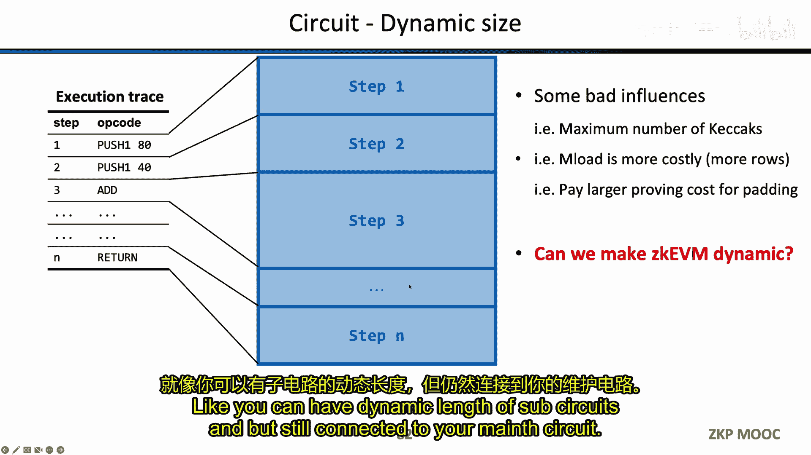

Next， I will go through some problems on the back end， which is quite interesting。

 especially for the audience of this class because you learn so much about the theoretical proof system construction。

😊，So again， like recall that we have two layer of circuit and we have two layer of prover and in both layer the proruning bottleneck is the same because we are re using the same Hlo 2 and KZG。

And the most computational heavy part is multiexentation and FFT。 So multiexent， as I explained。

 is inner product and on curve。 and N T T is like FFT over finance field。

 And you can use GPU to massively paralyze those two components to make the core components become really。

 really fast。 But then the problem move to witness generation and data copy。 So what does this mean。

 So witness generation is when you are generating the value for the whole table。

 So that that is not like。😊，Highly parallellyzable。

 And that like differs per circuit or per application。So that's the CPU part becomes bottleneck。

 And for the data copy part， what Im I mean here is that， for example， for FFT， for example。

 if you are doing a like two powers，26 size FFT。 So GPU can compute FFT really， really fast。

 It can like finish computing， for example， in 20 milliseconds。

 but copy this data from CPU to GP takes like much longer time than 20 milliseconds。

 So the data copy actually become even a larger bottleneck than computation itself。

 So we need some way which we can reduce this problem。😊。

So that's that's one one interesting thing we noticed during our benchmark。

 And secondly is that we need a very large CPU memory。 So initially when we implement our firstVM。

 we need almost like 1 CPU memory。 And then we currently will already optimize that to 300 GB memory on CPU and also optimize this GPU memory becomes like 8 GB。

 which means you can run run run our prove on very cheap GP， but still require a very expensive CPU。

 So the problem is that whether you can have some hardware friendly prove。

 which by saying hardware friendly。 I mean， both paralyzable and with a lower peak memory。😊，And also。

 you shouldn't ignore the witness generation。 So because previously。

Mifation and FFT takes 95% of your proving time。 So， but so that's why like， you know。

 people are all focusing on this， these two， two components acceleration。

But the problem is that even if you make this part becomes like 10 times faster than like you basically like you know in your competition。

 like 95， you make the 95% of your computation become 10 times faster than you will bottom by still by that smaller 5%。

 which is a long tail problem， but it can't be ignored。😊。

Especially with As like even you can make that even faster。

 but you will still be bottomneck by this within generation。

 So you shouldn't ignore this within generation。And。

30 is like how to run on cheap machines and become more decentralized。 So eventually。

 I think this will evolve into a problem which needs software and hardware called design。

Because basically like when you are designing hardware。

 you also need to consider like you know what's the best software。

 like maybe you can like even the one prove is is a linear time。

 it can be theoretically be very fast， but it's very super hardware unfriendly。

 maybe it's not as practical as like maybe some some more like the theoretical complexity is higher。

 but it's highly parallellyzable in practice。 and GPU can makes that 100 times faster。

 so it can still beat that linear time prove construction。

 So we really need to take both into consideration。😊，And。Finally， around like prover。

 there is some problem around like recursive proof and how you can efficiently compose different proof systems。

So as I mentioned earlier， so there are， there are like different different like proof systems requirement for for different layers。

 So the first layer need to be very expressive for handling those EVM logic。

 And the second layer need to be very efficient in EVM。 So how to combine， gets a better combination。

 maybe there are some better combination than what we have so far。 So there are two large directions。

 One is like people are kind of prefer smaller and smaller field， for example， this golock field。

 which is like 64 bit and even mason prime， which is like， you know some mason prime is like 32 B。

 which is a fast computation on CPU and on。😊，Harware like IPG and Asic。

 So should we move to that smaller field for faster speed and smaller memory。😊，Or another way。

 like we stick to this e curve based construction。 But there are some nice constructions recently like supernova No。

 which provide you a like you can recursively prove dynamic number of of。

 of circuits with a smaller recursive threshold or you can use some circuit curve to， to also like。

 you know， for your， your， your， your proofs and get a very small， small proof in the end。 And the。

 the good thing about this e curve based construction is that。😊，Because your core。

 core computation is bottlenecked by this small text iniation。 so it can be be accelerated。

On GPU and Asic 4 around like， you know，10 or even 100100 times。

 so it can be very fast considering the best practice of of， of hardware。So it's still open problem。

 There are a lot more options to explore， especially from previous courses。

 and if you are interested， reach out to us and if you want to do related research and we welcome this effort。

😊。

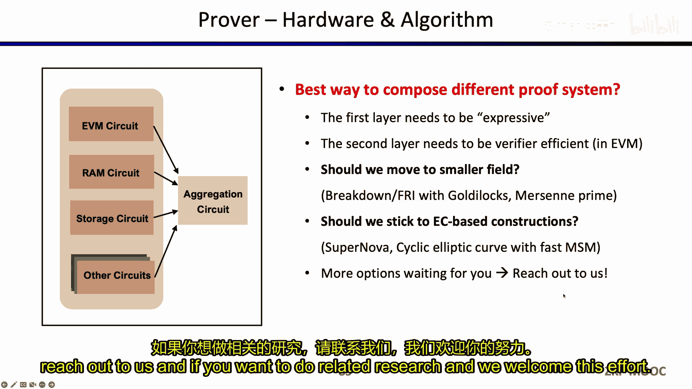

And another issue around the KVM is more about security。 So both us and the PSE Z KVM。

 because we are col on the the same ZM effort， we need over 30 K lines of code。

 and it can't be bug free for quite quite a long time because it's just a super complicated system with so many mathematical constraints。

 You definitely will meet something or。😊，Do something wrong。

 So what's the best way to order the key event circuits。

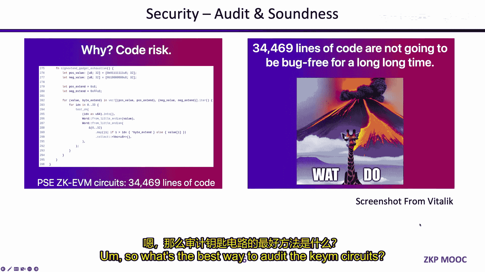

So in general， this is a problem of how you can audit a VM circuit based on IR efficiently。

 So P there are some work。 I know for from from from Stanford， like there is Thursday。

 which introduce some like you can use some other I and SM T server to kind of find bug。

 But this is a VM circuit based on I and whether you can。 And this is also Pization。

 whether you can audit that automatically， but currently like we are you。😊。

Audit manually line by line to to to figure out some bugs。 but there are some still some。

 some effort exploring， for example， formalification or some other way to audit your Z circuits。

 So maybe you can like is feasible like in some time。 but we we don't know。

 So or maybe you can start with some simple ones， which you do for aification for some simpler up code。

 And then eventually extend that to your full Z VM。

 But this is quite interesting and quite critical in reality。

 like how you kind of securely prove that Zki VM has no bug。😊。

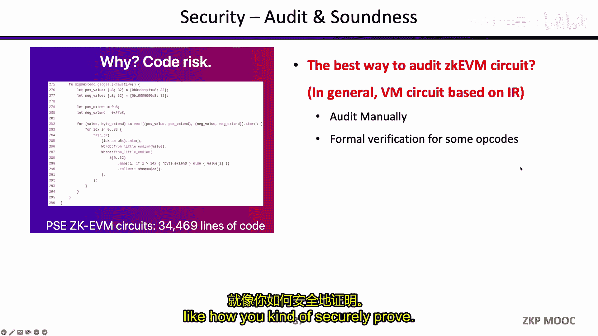

In the last section， I'm going to quickly show you applications of stickVM even besides the K up。😊。

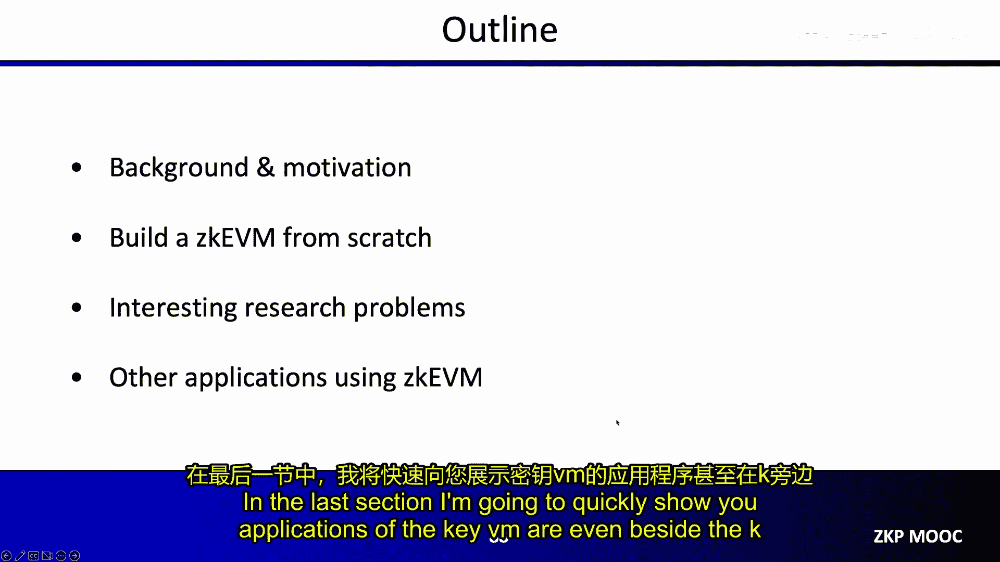

So again， like the first application and the most motivated application is still in the space of Z up where。

 you know， we are building a layer to solution。 We can prove N transactions on layer2 are valid using the Vm。

 And we verify this proof。 We generate proof of chain。 we verify this proof on layer1 smart contract。

 So that's the idea of Z up。 So basically taking layer to transactions and general proof and some easy proof。

😊，Another application is not only on on layer 2， but also on layer one。

 it's called like they call that enshrine blockchain。

 So the idea is that if you take a look at the layer1 diagram。

 why it's not so efficient because for each block， like most of the node need to do some attestation to kind of reexecute and then know the recent state。

But。😡，So so they basically need to download and execute。 But what if， like for each block。

 there are some proof proving that all the transaction of that layer one block are valid。

 And then all the nodes just need to verify that very small proof。

 and it's enough instead of re executingcuting all the transactions。

 And this happens on layer 1 instead of layer 2。😡，So you can require that the proposer who is proposing this block to generate Zkivan proof and then submit this oncha。

 but but this is like very ambitious because you are basically enshrining the whole layer one and each block will attach one one proof。

😊，And currently it's not feasible because for many reasons， one is that as I mentioned。

 like this requires a last like consensus level or E equivalent EVM。

 which is very hard to build with a very large premium your head。

 and there might be some security considerations。 And also because the p time is super long。

 it's unacceptable on layer 1， because for layer 2。

 like it's quite safe because you can submit proof later because that only influence your finality on layer 1。

 but layer  two can provide some faster preconfiration to users ahead of time。 But for layer 2。

 layer 1， if you have some kind of like 12 second block time， then you can't do this。😊。

So that's why it's it's still a like very ambitious dream。 And people are optimizing that。

 including us and， and the PSD team at Ian Foundation are are are working on this。 But。

 but currently it's still like， you know， an ambitious goal。😊，And even more cr。

 you can do some like kind of recursive proof。 I take this kind of dynamic figure from from In。

 So basically， the idea is that this proof is not only proving that all the transactions inside this block are valid。

 but also prove that the previous proof are valid。 So the proof proofs proof and the block。

 And then eventually you just need to get one proof to prove that the whole blockchain history is correct。

 So this is very ambitious to ensuring like the whole blockchain into a very small proof。

 And like you know one day you just hold one proof and saying that you know all the transactions in in the history of EM is valid。

 So that that's pretty cool。😊，So， and also just to， to quickly distinguish that， you know， this。

Layer 1 idea is different from layer to idea。 So， and also it's orthogonal because imagine that layer one can generally prove for layer  one block。

 but among layer one block， each transaction can be a proof verification for layer 2 block。

 So basically like layer toolsth are enshrined into one transaction。

 One verification transaction to layer 1， and then layer  one can generally proof for the layer one block。

 which might consist of several verification proof from different layer tooth。😊。

So that's how it's different。 Like one is ensuringsh layer one state。 One is like based on layer1。

 I'm kind of doing scalability and making my verification transaction become one transaction on layer one。

😊，So another interesting application is called proof of flu。 And so the idea here is that， you know。

 if you think about what is Z key VM。 So ZivM is basically proving that like after applying one transaction。

 your statero move from this to this route prime。😊，So。

If you make your transaction also become part of your private input。

 what you can prove is that you can prove that I know a transaction that can change your state route to state route prime。

😡，And so this。You， you can like using this， this very like fancy nature。

 you can prove that I know a bug which can change your balance。 So for example， like， you know， if。

 if your contract implementationation has some bug， which after I do a transaction。

 I can get your balance， like here， leave here become 0。 And then like I can prove that。 Okay。

 so after applying some transaction， which I know I constructed。😊。

I can make your balance become from like， you know，100 E to 0。

 which means I can still find from this， this solidity bug。

 And so you can use this proof to prove that， you know， I know bug。 I found a bug。 And then like。

 you know， they can reward， reward you with some， some kind of。😊。

Money so that you you will review this bug because one common problem is that， you know。

 if you review this bug to， to the application， they may not rever you as much as you want。

 And also like you can't really prove to application that without reviewing that you know a bug。

 So this is very like you know useful， like in terms of proving that you know some transaction which makes this state transfer from this to that。

And one last example is that you can do some attestation， so which is sometimes called Z oracle。

 So imagine that in layer1 blockchain in a smart contract。

 you need some kind of history information and you just can't access that through layer1 So but so how can you access the press data。

 So one way that you can connect to some kind of other oracle like chain link。

 they provide some kind of node and then provide this like they just fit this data directly to you。

 So you are basically trusting chain link or some other oracle network to provide the price fit for you。

 But another stronger way is that you can actually trustlessly read historical ontrain data。😊。

Because， you know， historical data is like this block has on this root and this state。

 and you can prove that you use the state proof， which is proving for， for the storage， memory and。

 and those stuff。 you you can use this state proof to prove that。

 hey at this height your balance is this or the information you need is this because I can prove the numericalmer parts and some other informations。

 And then I can， I can take this， this data and do some computation I want。 like， for example。

 I want to perform like。😊，I want to compute the average price for Uniisb in the past one month。

 so I can use the the circuit is basically computing the average average price。

 And then you can take the price from previous block through the state proof of Z E VM。

 because you can prove in for the E VM state3。😊，And then you do some computation generate proof and then you verify this proof on chain so that you know that this is your result。

 This is your proof。 So basically doing a testation or Oracle can be you read state from historical data。

 you do some computation。 and then you verify that。 So this can be Zy circuit。

 Z EVM or Zki virtual machine like arbitrary computation you can define and aom is is working on this like it's basically a Zy corepro where it may not be Z EVM。

 but it leverage the state proof of Z EVM and also many information of the block header And then like you know corepro means this can this not necessarily me to be an EVM is just another processor and verify proof on chain。

😊，And finally， like just a small advertisement for us。

 so a also a quick summary for what I have talked about previously。

 So we are building some really cool things at Sc scroll is a general purpose getting solution for EM based on ZQ up and we are building a native ZKVM which is bicycle level compatible which or you can call that EVM equivalent using very advanced circularization and very advanced proof system and we are also building fast prove through hardware acceleration and we have like a GPU in production and also proof recursion like we are using very advanced way to aggregate proof and currently we are live on the testnet we will product level robust infrastructure and if you are developer feel free to to trialto testnet。

 give more feedback and deploy anything you want and experience that deploying a scroll is exactly the same as ECM with the best developer experience and also they are a bunch of interesting problems to be solved。

😊，As I mentioned， they are like ZK engineering problem， VK research problem for practical efficiency。

 and also even besides Z K， if you are doing some other。

Rearch around protocol design and mechanism design。 Wecome。

 like we are looking for protocol design and mechanical design， like。😊。

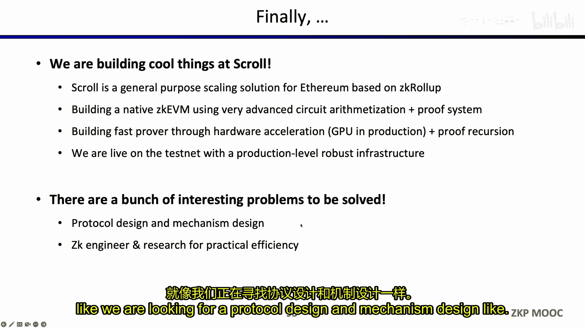

People， so thank， thank you for， for listening。 And we have a like hiring like check out our website at scroll dot I O。

 And also there is a hiring page， or you can D Dm me on on Twitter if you are interested in joining or like working on research together。

😊，Okay， thank you。

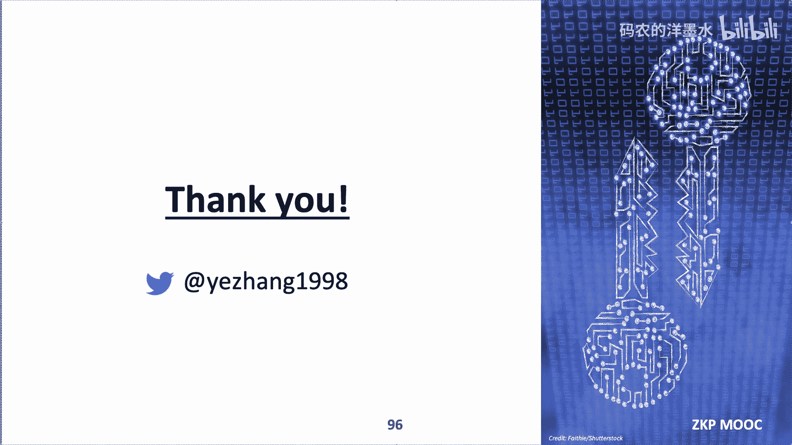