# 【全集】加州大学伯克利分校 Web3：零知识证明 区块链技术与隐私计算 中英字幕 1080P p13 Lecture 13 - 采用形式方法的 Secure ZK 电路 -BV1bCrpB2E7Q_p13-

Hello， everyone。 My name is Yu Feng。 I'm a faculty member as UCSB。 I'm also a cofounder at Verdise。

My research is mostly on program verification， program analysis。

 as well as programming language in general。Today， I will be talking about how to secure your Zk circuit with formal method。

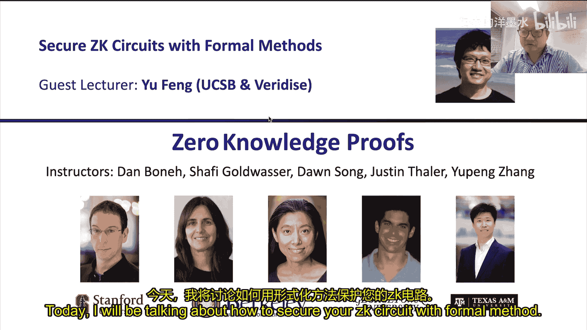

First of all， I would like to start by staying there obvious in a sense that bugs in blockchain software can be extremely dangerous。

And here， when I refer to blockchain software。This actually ranging from the underlying consensus protocol to Xonology circuit to smart contract and all the way to the Web free application at the top。

 including walls， games， unan。And if you have any logical bugs or security vulabilities in any of those layers。

The attackers can basically exploit and steal enormous amount of money。

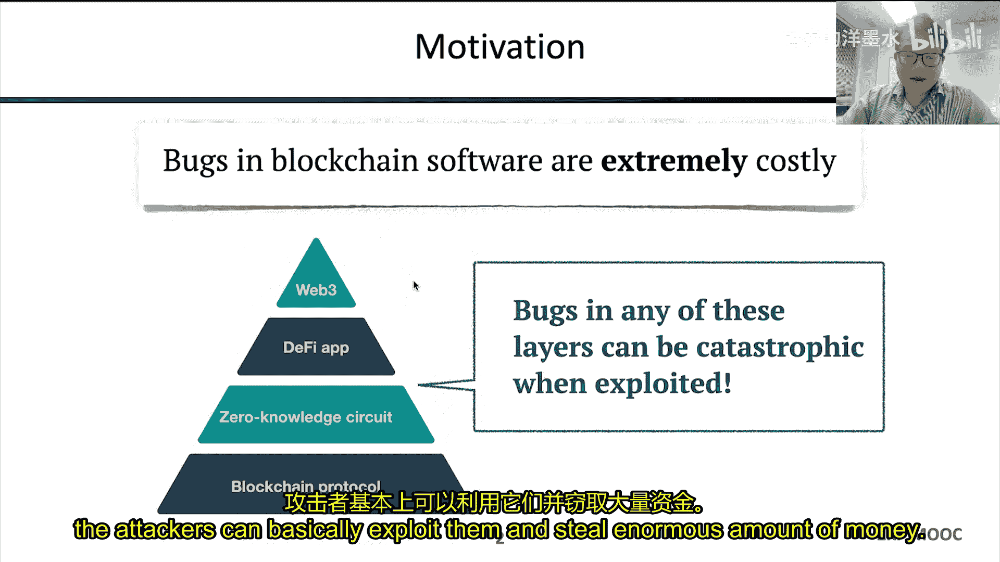

Here to attach some number to this claim， for instance。

 a flashlong vulnerability that happened last April in Beta Proigal Re in 182 million worth of cryptoconcurrency to be stolen。

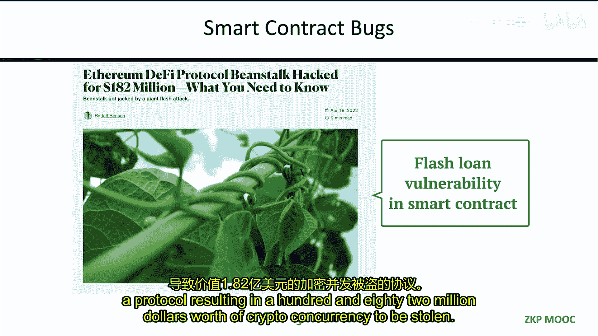

And that denial of service vulnerabilities in the Sallana protocol result in a widespread network outage。

 causing the Sallana price drop substantially within even a single day。

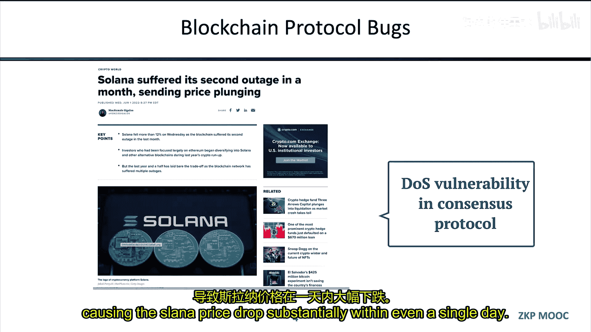

And last， but also relevant to today's topic， I also want to point out that bugs can also arrive at a level of zero node proof。

 which is not very surprising， right， because zero node proof are written by humans。

 and we know that humans all made mistakes。And for instance， in this case。

 a soundist box in a Zkina proof protocol can allow attacker to create fake z cacheed coins out of nowhere。

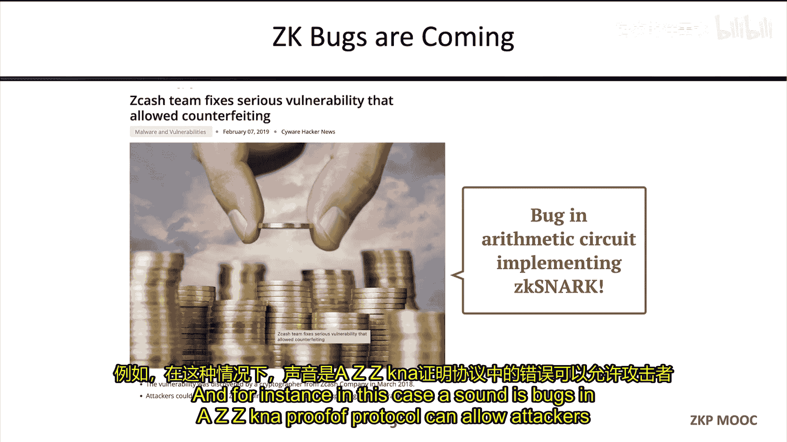

Now， I agree that this might not be the best way to guest I as a talk because this sounds a little bit depressing。

 But one thing I would like to get across in this talk is that bug are actually not inevitable。

And if were using the proper and right formal method in blockchain application developments。

 we can actually eradicate majority of the bugs。And to adjust that。

 here is the outline of today's talk。 First， I will give a quick overview about some basic concepts。

 as well as terminology inform formal method that I'm going to use throughout the entire talk。

Then I will present two projects that apply formal method to ZK security with complementary skills in a sense that the first project we will apply library static analysis that can allow us to find and quickly identify common vulnerabilities in Z K circuit。

And then so the second project will be performing like formal verification to verify that your Z K circuit is actually mathematically correct with respect to certain properties。

And finally， I will conclude my talk with some interesting future direction。Excellent。

 so what is formal matter。In the nuts form method refer to a set of mathematically rigorous technique for finding bugs。

 as well as constructing proof about the correctness of your software。So to be clear。

 when I talk about formal methods in this context， I'm not just referring to a single technique or a single tool。

 but rather a class of technique ranging from systematic testing to the right to static analysis in the middle all the way to the right for formalifications。

And I will talk about this in a bit more details later。 But January， the further you go to the right。

On this spectrum， the stronger guarantee you can get。 However。

 there's no free lunch in order to get stronger guarantee， you also need to put more menu effort。Now。

 at higher levels， we can actually classify a formal methods。Into either being dynamic or static。

In particular， so dynamic technique on the left， such as fuing can call executions。

They kind of like executing the program on some interesting input and monitor what happens。Typically。

 with the goal of like， finding certain vulnerabilities。In contrast， static technique on the right。

 such as abstract interpretations or formal of verifications。

 they kind of statically staring at your source code。

And try to reason about the behavior of all possible execution of your program and then try to make a conclusion whether your your system is actually safe or not。

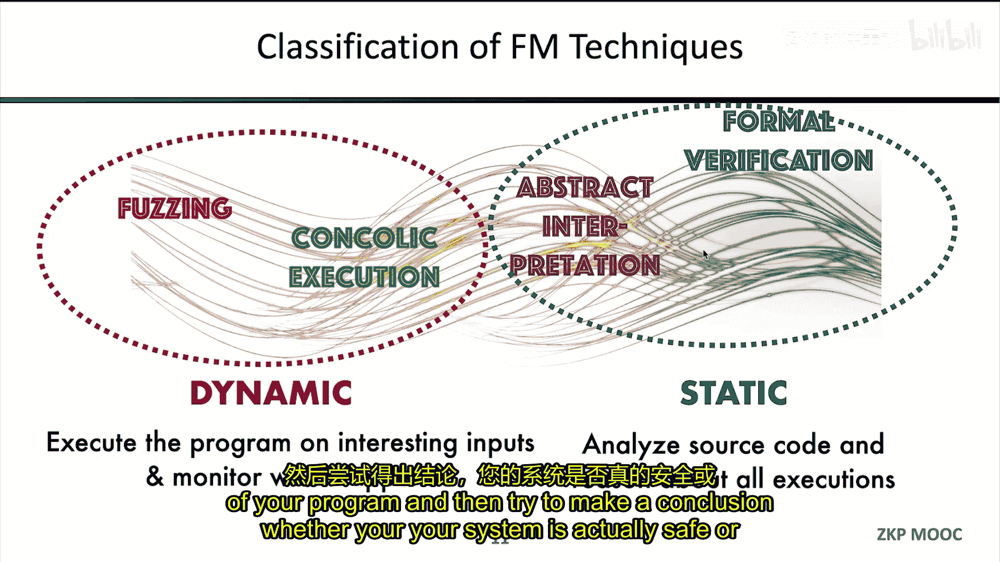

In this talk， we will mostly focusing on static technique。

 including extra interpretations as well as formal ver。To begin。

 so I want to say that we cannot actually reason about the exact behaviors of a given programs due to the undecidability province of。

 of this， of this context。 Like it's essentially we are solving a haunting problems。

So the fact that we cannot reason about the behavior of the actual execution of your program doesn't mean that we cannot reason about the abstract versions of your program。

 so the idea is essentially to obtain a conserv of over approximations of your original behavior and hopefully that it is enough to prove the absence of a certain bulk of the correctness of your program。

And to do that， we typically use apps interpretation。

 which is a very popular framework to compute over approximations of programming state。Okay。

 so just to give you a high level intuitions about the insight of an abstract interpretation。Here。

 let's use blue regions in the middle to represent the actual program state and notice that the shape is actually highly irregular in the sense that there was no way you can actually precisely reason about its actual behavior due to the unciability nature。

And then on the right hand side， we also have use the red region to represent some bad state in a sense that some vulnerabilities or bad behavior that we hope that our origin system does not have。

And we know that it's very difficult to compute the actual behavior of this irregular boost proof region。

 And what we can do is that we can actually systematically compute。

The over approximate of the original state using the green region。Okay。

 so in this case you can think of the green region it used to over approximateimate original behavior of the blue region and in this case。

 even with over approximations， we can actually prove that it is actually like have no inter intersections with the best day。

 which is the rare region and in this case can we essentially have proved that our original program does not do anything back。

And this is great， however， like the devil is actually on the details in a sense that in practice。

 how do you compute and select the right abstractions is highly non trivial。

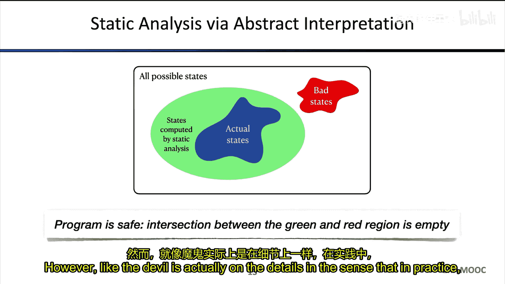

For instance。Like if you took a look at the abstractions on the Le science case。The over in here。

 the over approximation， which is also the green regions， is two cross green。

Because the green region accidentally overlap with the red regions。Okay。

 which means that if you generate force positive。That actually does not appear in concrete executions。

And thats， that's essentially when we say that our analysis actually generate false positive。

 which is mostly due to the imprecise approximations of our like abstract state， okay。

On the other hand， for the case on the right。The， the。

 the over approximations on the right hand side， is's also like undecidable。

Because the green region here only cover portions of the actual blue state。

Which means that if you actually generate like a false negative。

 meaning that if you miss like a critical bug in this case。Now we get intuitions。

 But how does abstract interpretations actually work， Like how do we compute those abstract stage。

 given concrete problems。So to understand that， let's first review a simple concrete interpreter。

Okay， which is essentially take input as concrete value as well as the co snippet that we want to interpreter。

 and it will produce some concrete output。And so given a very simple example。

 let's say our conippets only contain one statement， x equal to y plus z。 And in this case。

 it is trivial to obtain to know that x is going to evaluate to 3 if y is equal to1 and z is equal to 2。

 right That's essentially a trivial concrete interpreter。So in this case。

 if you can follow the previous concrete interpreter， then I have to say congratulations。

 because an actual interpreter works exactly like a concrete interpreter except that it operates over abstract value。

 which essentially represents a set of concrete value。For instance， in this case， an integer x。

It essentially can't have an abstract values of intervals between A and B in the sense that we say that x is actually great or equal than A and less or equal than B。

ok。In this case， let's revisit and use the same statement that we see in the previous line in a sense that given a statement x equal to y plus z。

 and then in this case， if we know that the abstract value of y is within the interval of A and B。

And the abstract value of Z is within the interval between C and D。

 then once we symbolic evaluate this expression y plus z。

 and we can conclude that the abstract value of x is actually between a plus C and B plus D。

So basically， as I mentioned in the previous slide。

 the idea is to emulate all possible program paths by performing some fallable symbolic executions or symbolic reasoning。

So in this case， you might ask， how about complex program statement like branches and loops。

So basically， it's actually like the same idea in a sense that whenever you have a branch or you have doubt about which one you should be choosing。

 you just like a conservatively assuming that both part is going to happen and then you just merge the outcome of different branches。

And collect all the values along different paths。For instance， in this example。

It's very difficult to tell like aesthetically whether x is going to evaluate to 1 or -1。

 because we don't know what's the actual value of flag， right。

 Because flag can be evaluatedd to either true or false during run term。However。

 what we can do is that we can actually conservatives say that and conclude an X is actually hold an abstract values that is ranging between minus1 to one。

 It is imprecise， but it's actually over approximate original behavior。

So abstract interpretation can be used to capture many nasty bugs in by three smart contract。

 for instance， as you some of you might know that reentch's attack is very dangerous to small contracts because it actually enable an attacker to repeatedly withdraw user found without updating the balance。

For instance， using this example to illustrate。So here we have the victiming contract on the right hand side。

 as well as the attacker Con on the left hand side。 In this case。

 the widthing contract has a restore function， and then the function is trying to transfer a certain amount using the external call。

However。So every time it it it involves external call。

 And then so if you automatically trigger the anonymous callback functions。

 and then this function happen to be one of the functions of the attacker。 So in that case。

 the attacker can actually。Call this visual function and reenter this function again to make another external call without updating the balance of the account。

What does that mean， meaning that arms So the attacker can actually create dozens and hundreds of tokens out of nowhere。

So how do we capture this box？So even though the actual business logic of the smart con of that defined protocol can be very complex。

And we can actually abstractly encode the reentance behavior using abstractions such as temporal order。

 as well as rewrite dependencies。For instance， in this case。

 we can actually statically abstract the behavior of reents attack by saying that whether there exists an external function call。

 followed by a storage update。Like in this case， like the co snippets on the victim control actually match the pattern we are looking for in the sense that they first make an external call。

 which is what stay here。 And then after making the call， it is trying to do a sort update。

 So if such case happens， which means that this external call would enable the attacker to reenter this function again without updating this contra。

So extra interpretation is actually very effective in identifying specific title bugs and vulnerabilities。

Anders such as integer or flows， transaction， order dependencies flashlong attacks。

 And there's a whole bunch of research in both and two in both a research community in academic。

 as well as industry， for instance， leader is one of the probably most popular static analyzer that can encode a bunch of common vulnerabilities。

And Vanguard， like a framework， can also enable the attacker or the。

 the smart content developer to essentially encode and capture fractional attack。So。

Absent interpretation is very effective in identifying specific title of bug and vulnerabilities。

However， it cannot guarantee your program is free from logical areas。对。So which what does that mean。

 meaning that， let's say if you have a piece of functions that you want to compute and then you want a reason about whether your function was actually compute as your original intended behavior like you cannot do that like using abstract interpretations and here that's where we need like formal verification。

However， to use formal educations， a prereracy is to provide a formal specification to describe what's the intended behavior。

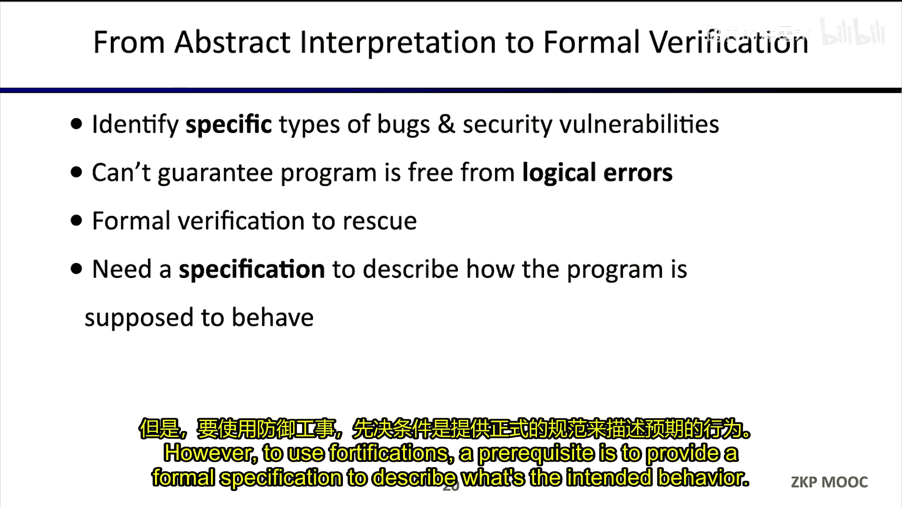

Well， so what do I mean by formal verifications。Well， that is essentially a mathematical。

 precise descriptions of the intended program behavior， typically in some form of logics。

 such as first thought logics or temporal logic。For instance。

 if you want to implement a defined protocol and then you want to express the correctness of an auction behavior。

ok。And then here， you can actually write the correctness behavior of your a Proal using the temporal splicationations on the left hand side。

And if you cannot understand what the splication is it is about that's completely fine because that's essentially。

 not the purpose of today's talk。 So basically， what the splication is trying to express in English is that So imagine Im。

 I'm a participant of the a protocol。 So in this case， no matter what happens。

If I didn't win the bit。Okay， if I'm not the winner eventually。

 then I should eventually get my money back， right。

 because that's essentially like an invariance I should always maintain。

 regardless like what happens and how it is going to execute and who is going to interact with。

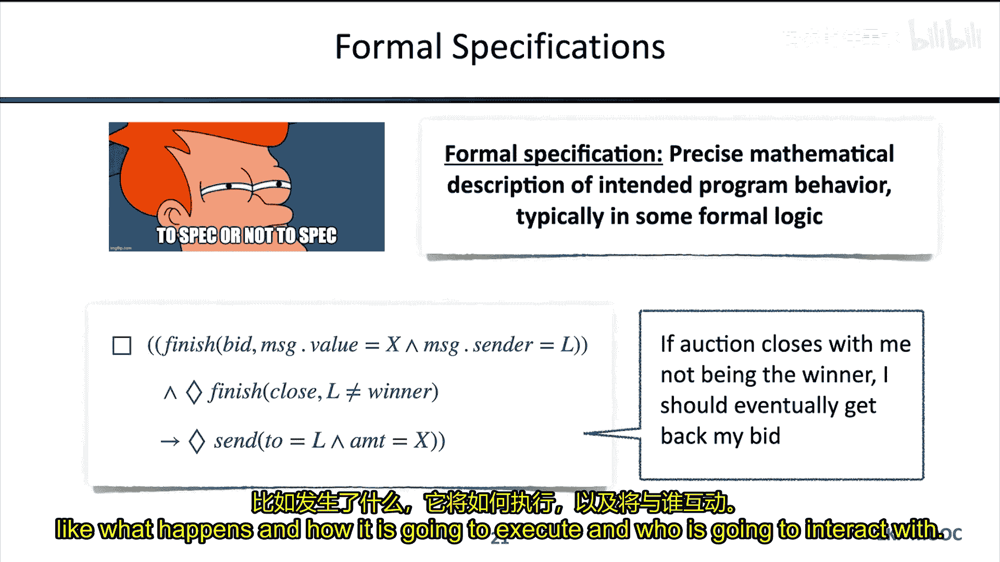

So a formal verification tool， which we usually call it as a program verifier。

 has different meanings as the verifier in ZK protocol。So from the high level and perspective。

 a formal verifier take the following input。The source or bike of the target program。

A specifications that formerly describe the property to be verified。And there other。

 like optional annotations， such as loop invariance， contract invariance， or like some actual domain。

 like knowledge and lemas。So once the program verifier take those inputs。

 it will combine those inputs into a logical formula。

Using a component called verification condition generator， we also called a V C generator。

And V C generator ensure that the code satisfied the applications if and only if the generating formula is valid。

And the validity checking is typically done through an of the shell， like a theor prover。

 such as SMMT solver， Z 3， CV 4， or like some kind of interactive theorem prover。

 such as cork lean improver， etctera。And in the end。

 so the formal verifier is going to produce a yes or no answer。

And for the for the yes case in which the two was successfully able to prove。Disifications。

It basically mathematically guaranteed that the program matched the design behavior。

So as I mentioned earlier， so V C generator like a verification condition generator act like a compiler。

 the output logical formula。 So here is a simple but concrete example to illustrate the basic idea behind it。

Suppose we have a function full that assign different constant to x and Y。 Okay。

 we assign 10 to x and 5hi to y。 And then at the end， we want to assert that x is greater than 0。

So once you pass those programs， as well as the splication in this case。

 use a surgeon as its corresponding specifications。

 So the VC generator is going to compile these informations and then generate its corresponding first formula in first all logic。

 So basically what this formula is saying that So if x is equal than 10 and y is equal than phi。

 then it is going to imply that x is going to greater than 0。 okay。

So now in order to formally verify that this assertion always is true。

 So basically the former verify is going to reduce the problem to checking whether this formula is actually valid or not。

Value in the sense that no matter what's happens， how you' are going to execute these programs。

 So this formula should always going to be true。And in this case。

 we know that this assertion always holds if and only if F is valid。

So formal reification is very nice because its essentially give the strongest guarantee when the proofs succeed。

😊，However， due to， again， the undesdability nature of formal verifier， when the proof failed。

It could belong to one of the foreign cases。The first case is that we did found a logical error in the sense that this is a true positive。

And the second case could be while the probe doesn't proceed because we need like actual human input。

 such as loop invariance， such as missing las， such as like additional like a contra invariance。

 etca。So the last case， which is also quite common， especially in the context of ZK。

 is due to the incompleteness， as well as the capabilities of existing theory prover。Like。

 for instance， in the previous like a figure， we showed that。

Its essentially venue you involve a formal verifier。

 It's a essentially delegate job to an of the shell theory approvalr。However。

 so existing theory provers such as S T solve like these 3 can only handle simple linear integer arithmetic。

But as we see like in the in the in the follow up part of the talk。 So in existing server。

 we basically choke for reasoning about like a nonlinear arithmetic。

 as well as like a large prime of finite fields， which are essentially essentially everywhere in Z K circuit。

So another thing I want to point out that there are many different flavor of formal verifications。

 and so far we talk about unbounding verifications by default in which we try to reason about the space of all possible behavior of the software。

However， this could be extremely challenging in practice because that will also require actual like a manual effort and actual human input。

So another option in practice is that you can also choose to weaken your guarantee using boundary verifications。

So which are pretty common in real world ver， too， for instance。

 if you can like restrict your input size to a certain degree or you restrict the space of your input。

Or sometimes， let's say you have a complex program with a whole bunch of loops in which you don't even know how much iteration。

 how many iteration is going to run and where the loop is going to even terminate。 So in this case。

 you can always like assuming that the loop is going to like execute under a certain constant。 Like。

 for instance， you execute your loop， like just twice。For every program that you encounter。

So like what we've seen in the static analysis case before。

 So there's also a whole bunch of form verification too in the space of smart Con and V 3。

And for instance， we have So approval came framework from wrongterifications。 We also have meal。

 selfish， etc cetera。Now， we just show that if you do write a formal of vs。

So they are actually formal like verification technique that can like check programs against the private provided specifications。

 which is pretty cool， right， because it's essentially you can use formal verification to find approve the absence of any bugs or like vulnerability in your programs as long as you can write a formal specific to specify the bugs you want to check。

And the， and in this case， the downside is that it actually require like a lot of manual effort for writing specifications。

On the other hand， if you don't want to like， provide like such kind of input in terms of subations。

And you can use other title of static analysis techniques such as abstract interpretation that I mentioned earlier in a sense that it you allow us to look for certain title vulnerabilities。

 and it doesn't require any specification because those like no vulnerabilityilities that are already in co as a part of the analysis in the abstract interpretation such as the example we seen earlier。

 such as reent attack into to overflow flash on attack， etc。Excellent。

 that actually conclude my presentation in Section 1。So to recap quickly。

 So what we have done in section 1 is that I briefly introduce some basic terminology。

 as well as concepts in formal method。 and I particularly introduce like two different flavor of static analysis。

 one is based on abstract interpretations and a second base on formal verification。

 And we also review their pros and cons， as well as their tradeoff in practice。

 So with those powerful weapons on hands， we are able to continue our journey。

 And then we are going to see how we can actually use those techniques to ensure the robustness of our Z。

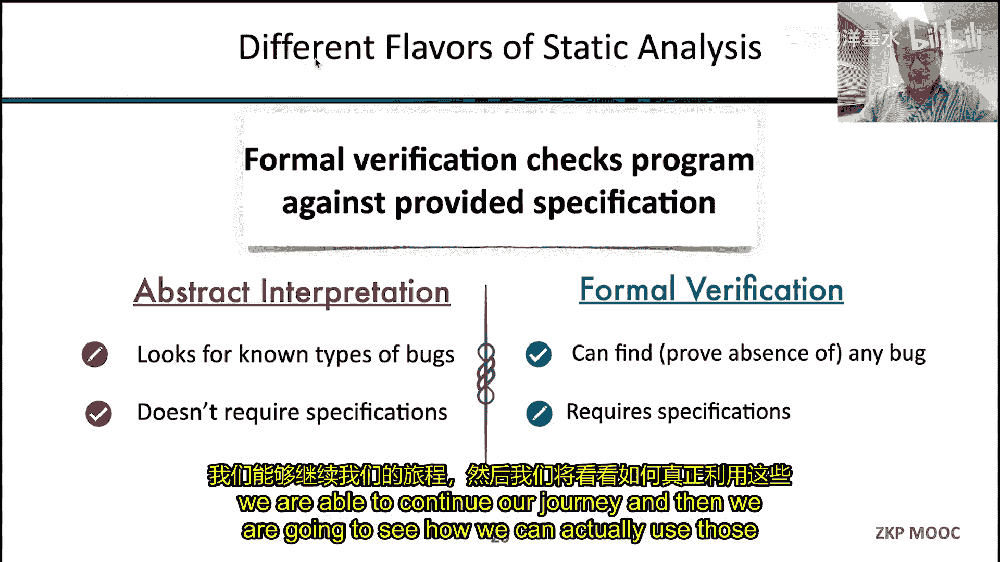

Let's continue。 So in these sections I'm going to start by review some basic components of a typical Zk circuits。

 So here I want to point out that even though you might observe that most of the example as well as evaluations are based on Sil and Hlo2 So our underlying technique was actually language agnostic in a sense that our technique was actually based on the semantics of the circuit as well as the proven systems。

 not based on the syntax feature of the Zk DSL， so which means that with sufficient amount of engineering effort the presented technique should be able to extend it to other DSL and proven system as well。

So we are going to first get started by share some basic components in Zk as well。

 and then I'm going to share a taxonomy of Zk bugs based on our large scale study on the existing popular ZK projects。

And then finally， we are going to propose a system based on abstract interpretations。

 which allow us to quickly identify those vulnerabilities from large scale like ZK projects。

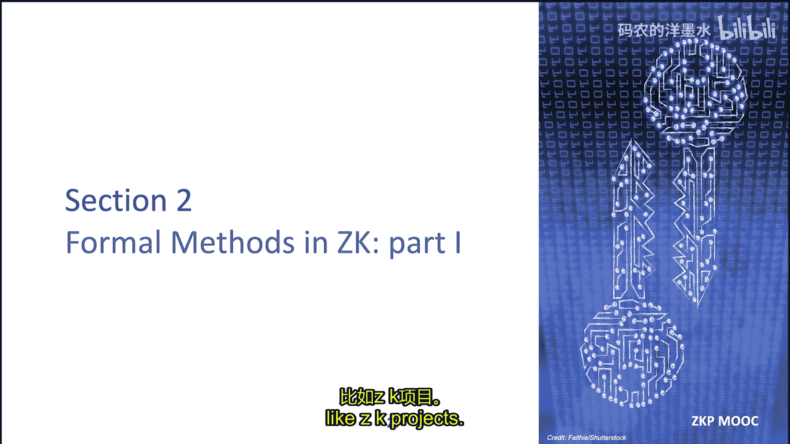

To start， I will give a brief introductions of how CK circuit is constructed and how it works。

So first， the developer write their design programs in the source languages in let's say。

 Cis or Hadlo2。So the source code consists of two components， the witness computations。

 as well as constraint。So here the the program is then compile into two parts。The witness generator。

 which is obtained by translate the original witness computations。

As well as polynomial field equations。 So here， the polynomial field equation， you can think of。

 It's a set of quagetic equations over inputs， output。

 as well as intermediate variables that appear in your Zk circuit。And finally。

 the reason that we need those kind of polynomial fuel equation is that those equations will be transformed into Zki sn。

 which is comprised of approvalr， as well as a verifier。

So notice that here the verifier in theKn is different from the program verifier that introduced in the previous sections。

So here a key challenge for ZK developer is that writing their design programs require writing both weakness generation code。

 as well as maintaining a set of constraintsstrain。

Which are used by the compiler to produce a polynomial equation。

And in order to write a correct ZK program， the winning generations。

 as well as the constraints should be equivalent。And what do we mean for those weak generations。

 as well as constrained to be equivalent。So let me define that formally。So here。

 let me introduce some notations。 Let's use a program P on the left hand side to represent a witness generation code。

 Okay， and here the program P is going to take input as some input variable X。

And then it's going to return some output very wide。And then further。

 we are going to use capital C to represent a system of constrain over x and Y。Okay。

And then here the constraint is constructed in a way such that for some concrete assignment of x and y。

 So the constrained system C is going to produce true if it's satisifiable or false otherwise。

So given these definitions， what does it mean for a program P， as well as a con C to be equivalent。

So formal speaking， we say that P and C are equivalent if for any input x to P。

Such that P of x is going to equal to y。And X and Y also satisfied conency。In other words。

 the definitions come into two requirements， okay。So first。

 for any input output pair of the witness computations program P。You must satisfied。

The set of contrain systems on capital C。ok。And then similarly。

 the second requirement stated for any pair of x and Y， which already satisfy the con C。

It also be a valid input output pair of the original program P。

 which essentially does the witness generations。So the important question is that how can this be violated。

 it's actually feasible that those get violated。So we are going to like like look into these kind of possible violations in a bit formal way。

 And then we are going to break down the violations of these equivalencies properly into two classes since it actually involve like two parties。

So once so on one side， we have the first type of violations。

 which is what we refer as an over constrained box。

And which happens when there is some input output pair of the programs。 Okay。

 valid input output pair that satisfy the Windows computation P。However。

 it does not satisfy the conency。So in this case， we call it as an over constraint。However。

 in practice， we barely see such kind of over constrained bugs， and it was mostly due to two reasons。

And first， like the。ZK developer， they are not incentivized to like overconstrain their variables in the circuit because like the pro generations actually like it's cost it。

 okay。And most importantly， so in most Z K programming languages such as Silcom and title 2。

 So those few equations and constraint are actually in coal as assertion to the circuit。

So which means that once an over constrained bugs happens。

 which means that like it satisfied the original original computation， but violate those constraints。

 you can immediately see the assertions during the execution of the circuit。

 so which means that a lot of them are actually being identified during the development phase。

However， on the other hand。The second title box， which what we call on the contrain bug。

 is actually much， much trickier。So， the second line of violations。Happens when there exist。

 some pairs。Of x and y。Such that is satisfied con system C。However。So this X and Y。

 they are not a value input our pair of the program。 In a sense that if youre plugging P of x。

 So the return value is not going to equal to y。So basically。

 if that's the case as an attacker or malicious user。

 you can basically claim any bogus fact on some any random computations because those computations are accepted。

 are all accepted by the contrain system。And this bugs in practice is actually quite dangerous。 So。

 and why do we care。

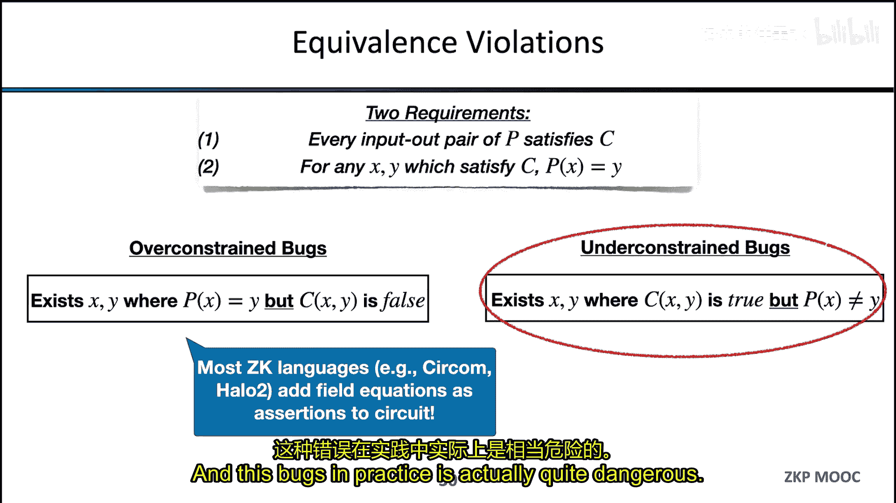

So to understand this， let's review the original workflow of Zk circuits from sourceco to Z K Snug。

So in the end， so the Zki circuit is going to produce a snug which is comprised of a prover and a verifier。

So which means that in this case。If there is an under constrained box in the original source code of the Z K circuit。

The verifier can basically accept bad input output repair。

 They are not supposed to be accepted originally。And this is not just hypothetical， like a bugs。

 And this can actually lead to serious vulnerabilities in applications。

 including enabled the attacker to train all of the tokens of the protocol。

 as well as allow the user for double spending。So how do we deal with those kind of like scenario。

 right？Because this is actually a fundamental problem。 in a sense。

 it require reason about the equis between。Weiness computation of the ZK circuit as well as constraining system。

 And before we actually dive into how can we do that using formal verification which can provide the strongest mathematical guarantee。

 So let's take a look at like how the existing bugs look like and then whether we can actually capture some of the bugs with some lightweightway staticgon。

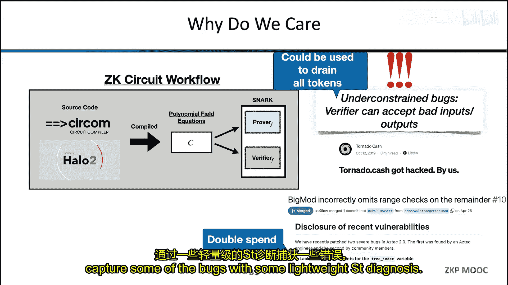

Okay， so from the previous sections， we know that a lightweightway analysis based on abstract interpretations。

 it's very effective in finding bugs for like known vulnerabilities。However。

 to use an existing like a tool， like a using abstract interpretation， As I mentioned earlier。

 it require us to have some sort of like a prior knowledge about the patterns of the bugs。

 like the patterns can either be syntax patterns or semantic patterns。So therefore。

 in order to tackle these problems。What we do at first is a century。

 we firstlarate through the collaborations from researchers in Ze Xo and Ehiium foundations。

 we first like draw a taxonomy of ZK bugs based on systematic studies over large scale ZK open source projects。

And here， so our taxonomy contain multiple category。

 and each category has several variants of the bugs that identify。

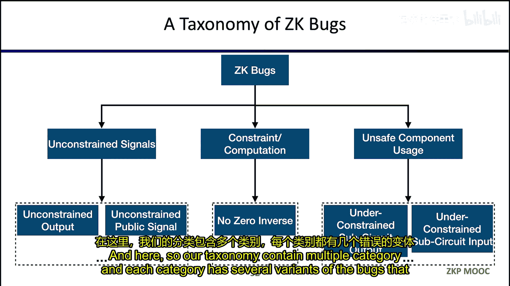

So the first categories is called under constrained signal。 So as the name indicate。

 So another signals under constrained signal happens。

When a constraint was evaluated to be true and so in this case。

 so the circuit was able to is essentially like accept everything because like a and then because there's no constraint over those signal。

 and then here the signal can be either output signal or any public signal that can be accessed by by the participants。

And let's go over a concrete example。So here， take a buggy implementations of non to。

From the second library。So here a nutro bit take as input a prime field n。

And then it's going to return its corresponding binary representations using a array of n elements。

And here， every element is going to be either 0 or  one。 Okay， you con an。

You convert a few elements into its corresponding like a binary representation， as the name indicate。

So here， one thing I want to highlight is that so during the implementationation of the code。

 So the developer actually tried to use this kind of triple equal。Operator to indicate that。

 So they want to constrain the values of the output elements。 Okay， basically for every。

 what these constraintstrain is saying that for every elements in output array。

 it should either be 0 or one， right， Everything looks so far。 looks good so far。 However。

 so there is a subtle of by ones errors in this case， in a sense that in this implementationation。

 the loop bodies use n -1 as the loop bang， but the correct version should be n。

And then if you actually combine those original circuits into the corresponding con system。

 as you can see， so using。An element of size 4。So basically， if you look at the constrain systems。

 So basically， output 0 and output one， they。All being like constrained properly in the sense that both outputs are either supposed to be 0 or one。

 However， theres no constraints over the last elements， which is output 2。

Because of the off by one errors introduce an individual source code。So what does that mean。

 meaning that because there is no constraint over the last elements of the ray。

 so the attackers can basically pass any value to the last elements。

 And then so the proof system is going to accept it because there's no constraint that it's essential to prevent from accepting this guy。

And this can be extremely dangerous in practice。And the second categories that I'm going to introduce is called unsafe component usage。

So as we probably know that a big or large ZK circuit is typically composed of many small and reusable like gadgets or components。

 just like you play Lego blocks。So why？Each individual component or gadgets may look safe on its own。

 okay。But a box may still happens at the boundary because of incorrect assumptions。

So that's what we mean by unsafe component usage， which include those under constrained sub circuit output。

 as well as。Under contrain sub circuit input。

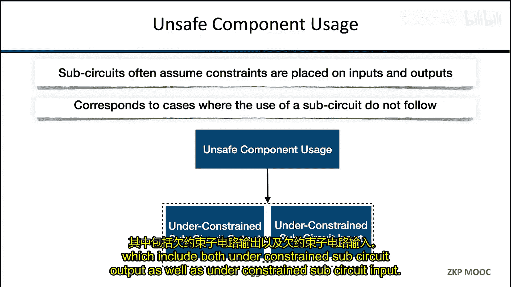

And so let's take a look at concrete example as well。 So in this example。

 the developer trying to implement the withdrawal functions。

And and then here the withdrawal function， is's very easy to understand in the sense that you're trying to withdraw a certain amount from your balance。

And then so when。So developer was trying to implement the withdrawal functions。

 is trying to invoke the less than component that essentially compare against the value between the amount and the balance。

Okay。And， of course， like， you want to always ensure that the amount should always less or less than the the the balance。

However， so because of developers。Forget to constrain the output values of the lesson return。

So in a sense that the original， like the correct constraint should be added to assert that liger。

 there should be an actual constraint to enforce the output value to be always equal to0 in the sense that which essentially state that amount should always less than balance。

 however， because the developer forget about this constraint。

 which means that basically there's no restrictions on the restore amount。 And then as a result。

 the attacker can restore more funds than he deserve。

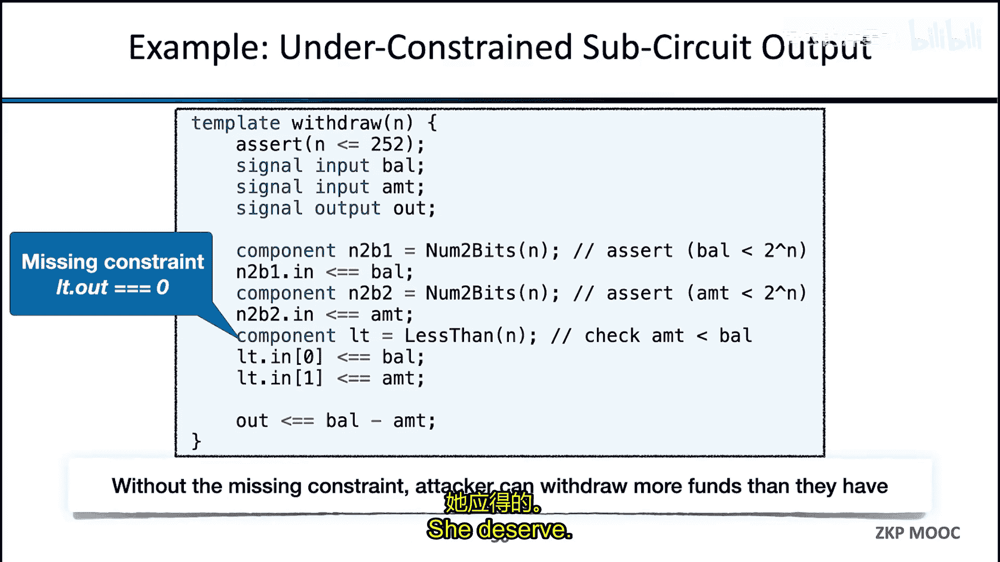

So last but not least， is the discrepancies between constrain， as well as witness computations。

And due to the design of Zki s。 So not all computation can be directly expressed as constraint in the proof system。

So as a result， a bug can rise when the constraint does not faithfully capture a computation semantics。

And then here I'm going to use a non zero inverse as an example to illustrate this box。

 and then in practice， there's many， many such kind of variants。

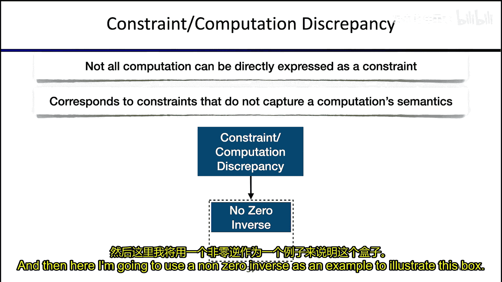

Okay， so here let's take a look at a very simple circuit。

Which is essentially trying to implement multiply inverse functions。

And the function is very simple in a sense that it's trying to do the divisions。Between A and B。

 however， because the division operator is not direct support by the polynormmal equations。

 so the developer need to construct and simulate this kind of division operator using multi。

 for instance， a divided to B B equal to output is going to be equivalent to you do a multi between you assert that multi between output and B is going to equal to a。

However， this looks fine， except that she actually missed a con case。

In the sense that so this will looks equivalent for most of the cases。

 except one corner cases in the sense that when B is equal to 0 in the original witness computations。

When you do like a division by  zero， this is actually an undefined behavior that should be rejected and that should be disallowed during the execution of the program。

 however， because you is essentially mimic this kind of computation using multis so the multis that appear in the current cont system which will actually allow B equal to0。

So which means that in that case， so the circuits and the proof is' going to essentially allow some additional behavior that should be undefined in the original witness computation。

And so now we see the problems。 But how can we like detect those bugs that that might potentially like appear in。

 in a bunch of like other like circuit as well。So and in particular。

 how can we like use like the abstract interpretation technique that we learned earlier。To do so。

 we first need an abstractstructions。To quantify the key semantics of Z K circuit。

 they are potentially relevant to our bug。In particular。

 we introduce a semantic representations called circuit dependence graph。And as the name indicate。

 it's a graph represent。ZK circuits where note represent signals of different type inputs and output。

 And here the edges represent dependencies。 here， we use directed solid error to represent data dependencies。

Like， for instance， in this case， if you have a witness computation that try to assign I to O。

Then we are going to put an edges between from I to O， which is essentially in in code dashs。 So O。

 in order to compute O， it actually has a data dependence of to y。And similarly。

 we also introduced a second type of edges called constrained edges。

 So here the constrained edges which represent as dash line。

 and the line is also the edge is actually undirected in a sense that let's say if you have a constrained system that establish the relations between a signal O and I。

 So we are going to pull a constrained edges to connect those two signal together。ok。

So now let's take a look at example and how we can actually use like circuit dependence graph to represent some kind of a key semantics of ZK circuit。

So given the circuit on the left side。What we do is the essentially。

 we first construct node for every single signals that appear in your original circuit。 For instance。

 you have a bunch of input signals and output signals。

 and we are going to allocate a node for every single signal。

 and then we use different color to represent whether they are input and output as well。

So once we draw the node， we also need to construct edges， right， for instance。

 here we construct the data dependence edges based on the witness computations in this case。

 in order compute value of V signal V。 So it you are going to do a computation that require B1 B2 and carry。

So as a result， so you can see a direct edge that pointed from carry B1 B2。

 and both of them will point to the B。And similarly， because in addition to data dependence edge。

 we also have constrained edges。 So in this case， we are trying to establish a constraint that involve variable V as well as himself itself。

 So in this case， we are going to put an ondirect self loop to the signal V。

 and we are going to do the same thing for C underscore the score out。

And this is the way that we construct a circuit dependence graph based on the original program。

So once we obtain the abstractions of the of the original circuit using our circuit dependence graph。

 we can reduce the vulnerability detections as an instance of query over the graph。For instance。

 this is this query at the bottom。Is to encode the patterns of under contraining output signal that I mention in the first patterns of these sections。

So we encode this query in terms of data log。 So the detail。

 you don't have to understand the details。 but in English。

 So what I try to say is essentially I'm trying to make a query。

 and what this query is saying that I'm trying to look for whether they exist an under constrained output signal。

And in order to be an under constrained output signal， what I'm looking for is that first。

 I'm looking for a signal V that is going to be the output signal。

And I'm trying to check whether this we is constrained by some constants。 Okay。

 through in the original， like a circuit dependence graph。

 And if this output signal is not constrained by any constants。And it is also not。

Either directed or indirect constraint by any input signal。In this case。

 we say that we identify a potential on the country' opposite signal。

And now once you understand those examples， let's group them together and see how a big picture works。

Okay， we implement the proposed idea as a part of the Vanga framework。

Would take as inputs of the Zki circuit， either in Silon or Had 2。And so what we do is essentially。

 we are going to take those as the inputs and then convert them into its corresponding circuit dependence graph。

 like what we did in the previous example。So after that。

 we are going to perform query on the generated circuit dependenceence graph using a list of query that represent the semantic about patterns that we learned earlier。

And then finally， the tool is going to report any potential violations。On the programme sourceco。

And to evaluate the effectiveness of this approach。

 we actually collect 258 circuits from 17 popular ZK projects on open source Github。

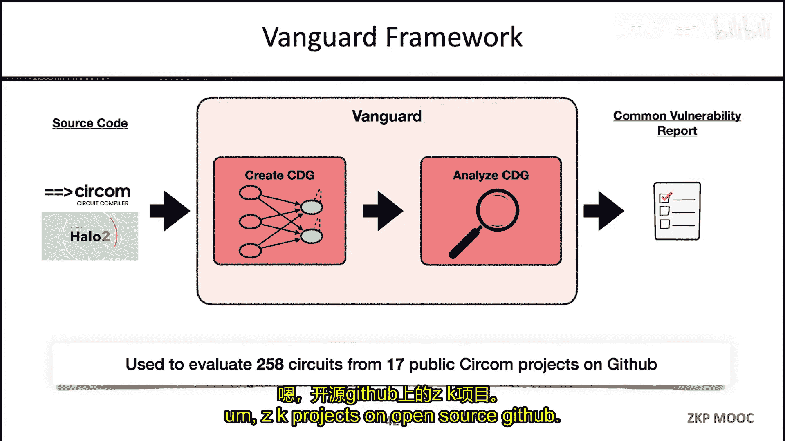

And the preliminary result is actually quite promising in the sense that the tool was able to identify a bunch of bugs and among those bugs identified by the tools。

 it was able to identify 32 previous unknown vulnerabilities and weve reported all those bug to the project developer and all of most of them are being acknowledged。

And， in addition to the bugs， we also， like a draw the。

 use this bar chart to its essentially give some insight about the distributions of different bugs。

 So as you can see， it is not very surprising that。The developer actually have。

The most difficulty in maintaining the semantic consistency between a con systems。

 as well as the witness computations。

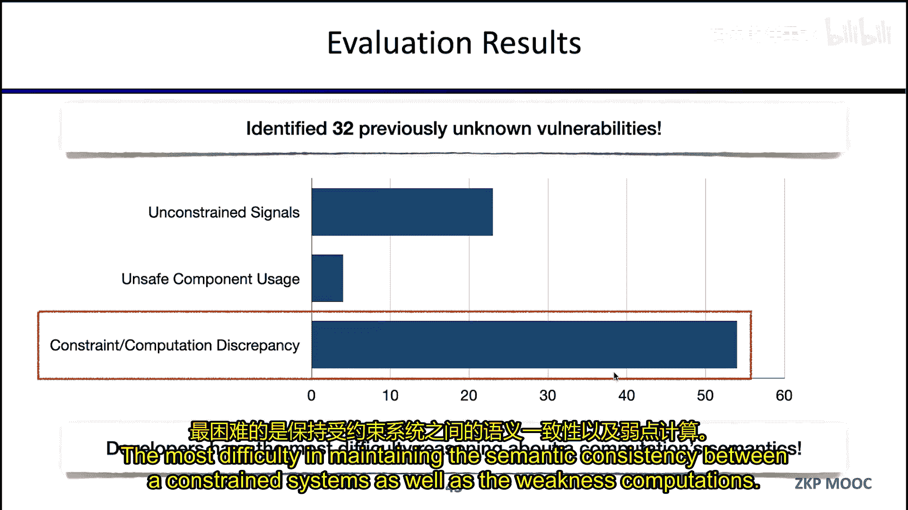

Excellent， now we see an effectiveness of the static analyzer for capturing common ZK bugs。

 and let's revisit the early non topy example。As I indicate earlier。

 so here there's a bug that lead to under constrained problems in which the developer forgot to constrain the value of the last elements in the upper array。

 As a result this will enable the attacker to supply the last elements with arbitrary value and then it will still be accepted by the verifier。

So suppose the developer use our tool to identify these problems and then she suggests。

The following fix on the right hand side。And what you want to do is essentially to figure out whether the conversion is in the correct I。

e。 It's actually free from on contrained problem。In this case。

 we cannot just rerunund the previous static analyzer and then draw the conclusion that the current circuits say based on the fact that the static analyzer can found anything。

 because we know that static analysis is based on common patterns or prior knowledge。 However。

 what the developer want right now is actually a stronger guarantee。

 which require doing formal verification。

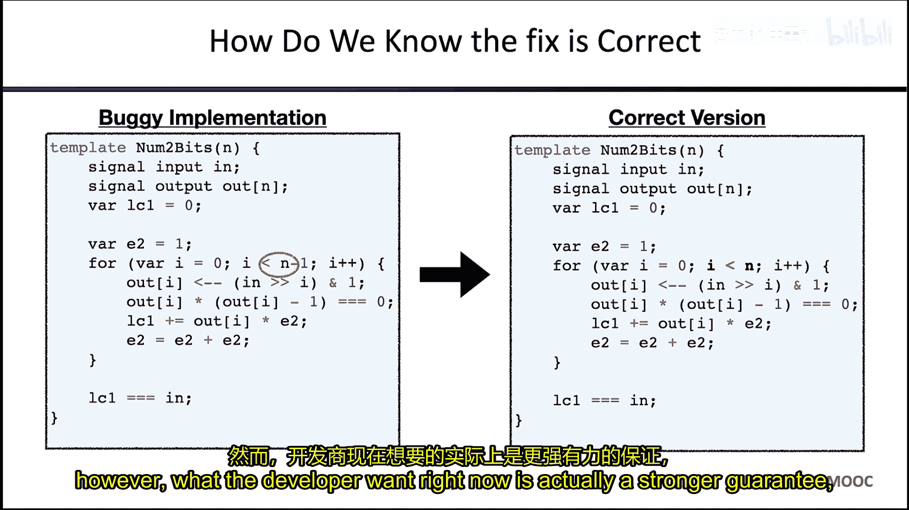

And this is where the last sections come into play。

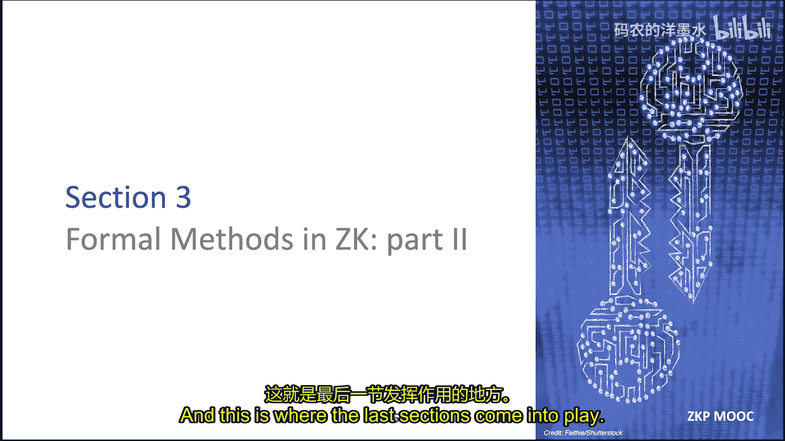

So before we state the solutions， I would like to revisit the under constrained problems former。

As I mentioned in the earlier sections。Of the previous slide。So basically。

 let's say we have a circuit that contains two parts， the Wi computation P， as well as the con C。

And both of them take S and Y as x as the input and Y as the output。

 And here we say that an under contraining bug happens。If we have a pair of X Y， such that X， Y。

 satisfied con C， however， they are not a valid pair for programming。So in this case。

 what we want to do is essentially we want to formally prove that a circuit is not under constrain。

And there are multiple solutions for doing this， and there two naive approach is that one you can essentially perform static analysis and what we mean by static analysis is that you can is essentially define a set of predefined root。

 which allow you to reason about properties of signal variables。Like， for instance， in this case。

 we have a simple circuit with input X and output Y and two equations on the coning systems。

Assuming that we know that x input X is going to be properly constrained。

And so because we know that Z is a linear combinations of x。An X is well constrained。 As a result。

 Z is also constrained。And because y is a linear combination of z and x， as a result。

 we can conclude that y is also properly constrained。 Therefore。

 we conclude that the entire circuit is free from under constrained problem。

And if we don't want to come up with such kind of predefined rules。

 a general solution is to formalize the problem as an S&T query。In this case。

 because the under constrained property can be formalized as a first or logical formula。

In the theory of finite feel。And the solve can directly answer this query。 And in this case。

 if the solver returns a satisifiable answer， it means that it managed found a counter example that demonstrate the under constrained problem。

Both approach have their pros and cons。Static and analyzing the constraint。

 it very scalable and can allow us to verify large circuits They are safely constrained。 However。

 they oftentimes suffer from false positive。In that， if they say that a circuit is under constraint。

 it might not be the case。On the other hand， ST solve does not suffer the false positive problems because it's based on very precise symbolic reasoning。

It has a hard time to scale to large circuits with just a few hundreds of country。In these sections。

 I'm going to propose a new system called Pis， which take as input a set of polynomial field equations。

And automatically trying to verify that the circuit is well constrained。In this case。

 if P Pro P is well constrained， it will return a check mark。Indicating that the circuits safe。

And it can also prove the circuit is under constraint that it's going to return across map。

If none of the above case happens， it's going to return unknown。

So the key idea behind Pi is that it combine the strengths and power of static analysis and SMT。

Allowed it to scale to large circuits while maintaining reasonable precision。At a high level。

The study analyze。And S T face or Pirs interact in the loop。

 Given each other informations that allowed them to make progress that they could not otherwise do on their own。

And let's take a look at the details and see how it works。

The study analysis phase or pi take as input。Polynomial field equation P。

 along with a set of signal K they have proved to be well constrained by P so far。

And at the very beginning， the algorithm will initialize K as an empty。And given those input。

 the static analysis engine will generate an updated set of contrain K prime。Saying that those。

 all the signals in those set has to prove to be welltrain。

So here the invariance is that k prime should always larger than k to demonstrate that at every iterations。

 it will grow the set of signals prove to be well constrain to demonstrate that it is actually making progress。

So in this case， if the set constraint。It's going to contain the output signal。

 then we are going to return a checkm， meaning that Piika is going to terminate and return the conclusion that the circuit is properly constrained。

On the other hand， because。In my。Lead to certain scenario there cannot be reasons using static analysis。

 It's going to pass K prime as the input to the S T phase。So the S&T phase has a similar interface。

In that， it take as input。Of the constrained P， as well as a set K that proved to be well constrained。

And it's going to return a K double prime， which essentially contain a set of signals that proved to be well constrained。

As well as K under contrain， which essentially demonstrate a set of signal that prove to be under contrain。

The first conditions， it's very similar to the previous one in the sense that if the output signal is going to be the subset of K prime。

 then we are done in the sense that we just return that circuit is safe。

And the second conditions state that if any of the output signal is going to have a non empty intersections with the with a set of signal that prove to be under constrain。

 then we are going to return cross， indicate that the circuit is unsafe。And in the third case。

 if k is actually equal to k prime， meaning that theres no way that SMT solve can make progress。

And then the reason for that lead to this kind of situation is very much because of the limitations of existing finite view solve。

In that case， we are going to return question mark indicated that unknown。

And if none of those three cases happens， we are going to propagate those information K prime back to the study analysis phase and repeat those process until。

The two lead to a decisive answer。And here is the output of Pis when we evaluated two on the fixed version of the circuit that I mentioned earlier。

As you can see the， the， the tool is going to output certain statistics regarding the number of constraints of the of the circuit。

 and then finally， its going to print save。And here the safe meanings that Pirs has formally verified that the given circuit is guaranteed to have no on constrained signals。

To evaluate the effectiveness of Pirs， we rounded on 163 circuits collected from popular C Library。

 including 5 night from Cir U2 and 104 from Ci corere。So the table at the top。

Shows a relevant statistics in terms of number of contrain， as well as number of output signals。

And as we can see why the circuits in the U library is relatively small。

 the circuits in the second core library is actually very， very big。

And to compare against the effectiveness of the two， we also compare P again to baseline。

 namely the one that just used that analysis in the middle， as well as the one that just use SMT。

And the blue one correspond to the result of Pigas。

 And here the bar chart shows the performance of three twos on two different benchmark set。

 namely Ci YouTube2， as well as Ci core。And then Y axis is essentially correspond to the percentage of benchmark that are being solve and the higher。

 the better。And the conclusion is that P consistently outperform both the baseline that based on static analysis as well as ST solve。

And if you look at the chart result a little bit closer。

 you realize that while Y SMMD So is effective on solving simple benchmark。

 its performance actually drop dramatically once you increase the complexity of the circuit。

That basically conclude those two projects I mainly want to discuss today。

 and here I want to bring the early figure of a program verifier again。

So while the idea of formalifications is very general。

 it has a lot of challenges while applying to complex domains such as ZK circuits。And for instance。

 there are many， many open problems such as how do we express specificplificationation that involve complex crypto primitives。

And as we mentioned earlier， most formal application2 rely on its underlying theorying prover for checking validity of logical formula。

 In that case， how can we design more efficient prover that can efficiently reason about finite few there are everywhere in the K circuit。

In the case when verifications cannot proceed， in the sense that it cannot produce a valid proof。

How can we actually generate concrete evidence to show the problematics of the circuit？And finally。

 as I mentioned earlier， so in this world， we mostly essentially our techniques in the context of Silone as well as a Hlo2。

 and it will be interesting and they're excited to support other system as well as HGs， Pro2， Nova。

 etc。To conclude， we did a very brief survey about formal method。

 which provide powerful tool for ensuring software robustness。

And then I went over two projects which demonstrate that how formal method can help with identifying common vulabilities。

 as well as proving the absence of certain bugs in ZK circuit。

I personally believe that ZK security is an extremely important topic。

Yet understued by the research community。 So which means that if you are interested in the problem domain。

 feel free to reach out to me。And here are the references of the talk。

 And thank you so much for watching the lecture。 Have a good day。

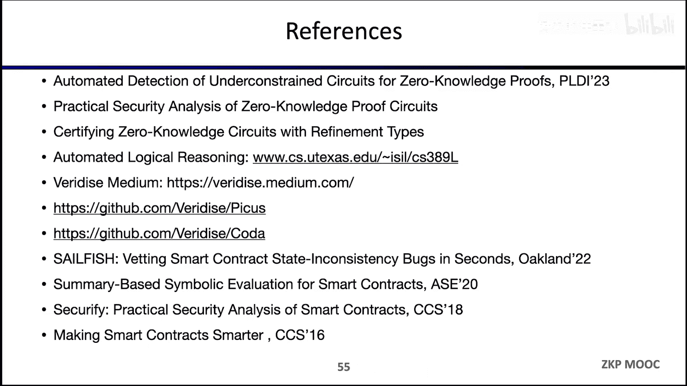