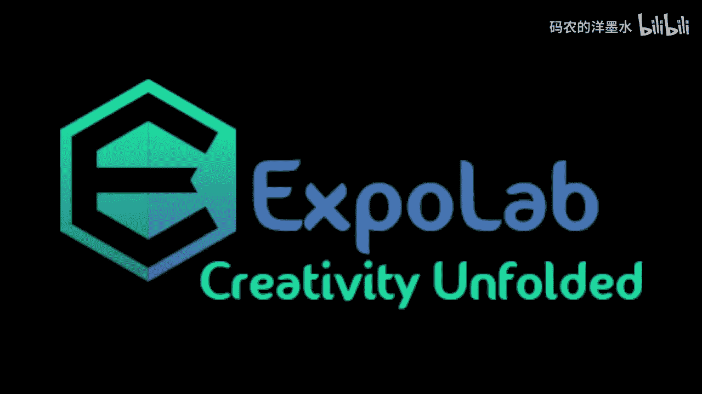
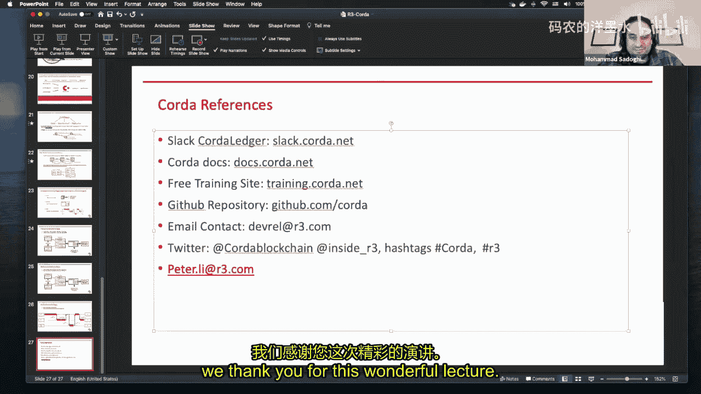
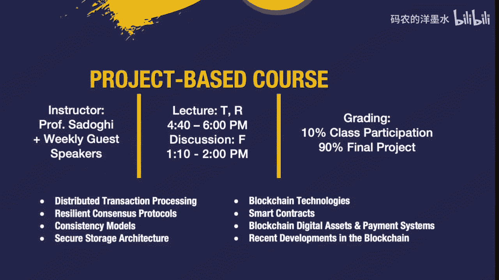

# 【全集】加州大学戴维斯分校 分布式交易与区块链架构 中英字幕 完整课程 p18 Lecture 14 - R3 Corda的核心原理 -BV18YFVzME2f_p18-

Hello everyone， welcome to another session of Expo Lab Block Speaker seriesius and today is my great pleasure to have Peter Lee from R3 joining us。

 he is in charge of the whole blockchain development community of R3 based in New York City and he has been the blockchainlock enthusiast for some time right now and so with that please take it away and we're all excited and thank you for joining us today。

Thank you， Professor Mo。 So hello everyone。 So my name is Peter。 I work for the company R 3。

 So we are an enterprise enterprise level blockchain platform company and me personally。

 I work in the developer relations team。 I basically help foster and like support the open source community of our open source product called Corda。

 So in today's lecture。Or to this talk， make it less informal， so。

The first half going be a little bit introduction about our company R3 and then our vision of like how this like blockchain industry is going right now and I gonna start talking about our product。

 our architecture the network consensus notary and node and the second half starting from 520 all the way to like to the end of a session gonna to be the sort of like more technical sessions I gonna talk about the smart contract on our platform and I mean if we have time I gonna show you guys the applications。

InIn real action， like how to run it， because our product does not need to a lot of does not need to a lot of learning。

 You can quickly get your hands on it within like couple hours。 So yeah， let's begin。

 So let me introduce our three。 So like basically who we are。

So the company R3 originally is started as a consortium。

 or you can think it as a workshop just like today so。Originally，8 banks in New York City。

 they come together and then sit in like a nice meeting room somewhere， you know。

 from the Empire Building or something。 So they they can come together in the early in the late 2014 and then。

They sit down and then say， okay， there's a new technology called blockchainlock。

And it's started by someone called Saoshi， right， And we don't know who that is， but it looks pretty。

 basically， they think it's legit。However， the question they have is how can they benefit from this new technology because？

You might be surprised that banking industry has a lot of technology involved in their system。

 even though like their their leisure keeping system。

 or you think every time you go to the bank it's like a， you know。

 it's such a pain to go through a lot of process。 However。

 they still have the state of the art technology。So late 2014。

 they come together and then sit in the room， they want to figure out what's blockchain。

And then that's the first roundtable。And that actually is the beginning of the company。 R 3。

 So R 3 was formed from that round table on one mission to figure out what's blockchain。

And by the end of 2015， basically the whole roundtable of the workshop starting getting more bank members。

 and then we finally looking at like by end of 2015 by 42 bank members。

And we actually basically submit a report and tell the all the members said， okay。

 what is blockchain， blockchainlock is the DT system is a distributed ledger technology that basically lets what you see。

But basically like what I see is what you see， so it's a mutual trust and frictionless business sharing or information sharing system。

And after we submit that report， all those bank members say， okay， okay。

 it sounds pretty interesting。 It sounds nice。 So can you give me one。

 Can you give me like a good candidate either to use Bitcoin network or Ethere network to basically let us benefit from it。

 the answer is no， because if you guys notice the seven week of your course。

 All those Bitcoin or those are all public networks And for the banks。

 there's no way they're gonna put their information broadcasts to every single node on the network。

 So。Our three shift our mission to start in research and development by the end of 2016。

 quarter open source general announced。 And then that's just like free version of the software。

 but it doesn't meet all those bank requirement or high regulations。

 So we continue to invest invest and then develop。 So we have quarter enterprise by the July of 2018。

 and then the story continues on Now we are a company with more than it says 200 plus financial institution by the August of 2018。

 but now we are looking at almost 300 plus to 400。So that's like the timeline of our three。

 So basically， you can think of。Originally started as a membership。Working group。

 but now since we have our product， now we are a partnership company who offers a product which is now we call what we call quota。

So we discovered the power of blockchain， which is remove the costly friction in the business transaction by enabling institutions to transact directly using smart contract。

And that's basically。The result that we told our bank members and that' actually is the。

 the mission where that's like the， the foundation that we are stepping on today to offer a frictionless business transing scheme。

So that's basically our mission and our vision of blockchain technology。

Next slide is on basically what we are offering。 We are offering quarterta and quarterta enterprise。

 So this is more like sales pitch， but I'm not gonna to go too far。 So the primary product。

 the free version is the quo open source in the in the middle。

 But if you talking about going into the industry really going。

 lets your application deploy in the production environment。

 you got all use the benefit on the outside circle。

 So that's also like our revenue model if you guys are interested。

This slide is the same on the left we are open source on the right we have a quarter enterprise。

So this is goes on like how we can basically run the ecosystem。 So we are a platform company。

 That means we do not develop applications。 We only offer software developer kits。

 So those are like the S DKs。 So students like you guys or company as those like independent software vendors。

 those are our partners。 So they develop applications。

 And then when they develop applications they deploy on the network and then the ecosystem runs like that。

 So we are not。We are not application company， We are only doing the platform。So， yeah。

 so that's like a very quick introduction of the company。 Any questions， any。People are like。

 want to know like how we make money or stuff like that。An entrepreneur here。Okay， cool。

 so so we also have a like QA session at end。 So let me know if you have a question。 So yeah。

 let's talk about quota quota， we think ourselves， like we call ourselves the third generation blockchain platform why we why we call ourselves the third because before we have the first generation and the second generation I mean like by our standard So let's talk about the first generation first generation we think the Bitcoin and Ethereum they belongs to in the first generation because they are they do not have strong privacy。

 meaning they are on a broadcast model they the information is encrypted of course。

 but all the block or all the encrypted information is broadcast through the whole network。To。

 to ensure a consensus or a mutual understanding of the information。 So that's the first generation。

 So the。The downside is no privacy， secondwise network inefficiency the Bitcoin according to the according to its algorithmmatic rule is every 10 minute to generate a block。

 so all the transaction happens between the 10 minutes get pack in one one block。

 but that just doesn't work in a real business system or a financial system。

 the transaction cannot wait 10 minutes for finality。average， like。

Right now we're talking about like the future we want for business transaction is real time。

 real settlement， real conliation so。That's just one work so the second generation is a modified above of the first generation and more focus on the privacy so we're talking about hyperliger fabric or other like other chains in the hyperledger。

呃。Ecosystem and also the quorum， which is the private version of Ethereum developed by the J Morgan。

 However， they also have their issues。 Their issue is back then， when they were developed。

 they are very strong in。Develop a network in one industry or one ecosystem。

 That means they are creating silos。 So they are not。 they are not that good with interopability。

 meaning。meaninganing， like， for example， if you are in。A medicaled records。Sort of network。

Your information is transacted all about insurance or your medical writer， your patient information。

 However， if you want to get any information or any data allocate out of that network iss little bit difficult because or is or let's say it's quite difficult because network is set to do one thing。

So in our vision， in our mind， all those networks should be connected， for example。

 the medical record or the patient record system or network need needed。

And should have connected with the insurance network。Meaning， all those information should be flow。

Sly， and there should not be any caveat setting up those networks。So， that's。

How like that's our focus。 and then basically the purpose we have in mind when we develop quota。

 what we call third generation。It's a private but interopable business network with transferable assets。

And。Right and also， we are able to do deliver versus payment。

 So that means like you take the asset and then you can have a。

A ledger were asset to settle it in real time。就。你 a quick quick summary is。

Third generation blockchain quarter is the blockchain for business。

Because we focus on privacy is's a private chain and it has a sc because。No。

 I can talk about in the next slide。 and lastly， interrbability。

 because we do not want to create silos within industry。

 We're looking to build a whole ecosystem that everybody can talk to each other across a different business network。

Second one applicable to all industries， so it's also one of our strengths is we design quota aiming to comply to the highest regulated industry。

 which is the banking industry and we did it so that means all from compliance level and from the application or like the applicable levels quota is able to apply to any industry from the regulations or from the implementation。

Lastly， is what I have been saying over over again is our vision is to create a cross industry ecosystem。

So yeah， so let's actually talk about what we are really good at。

 So the first one is strong identity。 So with quota its a private permission blockchain。

Or you can say a private permission distributed ledger technology system。So private meaning。

 we have a doorman in our。In in the network。 So like when you implemented in the code。

 it's called a network identity manager。 That means when you want to onboard a client into your network。

All those information of the client can be ordered and when they are onboarded into the network。

 all the other network participant know exactly who he who he or she is as a as a participant of the network。

 So that's the first thing because all the customers that we are dealing with all the clients we are dealing with and even let's say。

 like in real life how business goes is you never do business with someone。You don't trust。

 We talking about million dollar deals。 We are not talking about Craiglist deals。

 So you never buy something from the people you don't know。 So with quota system。

 strong identity is what we guarantee to our clients。 The first thing。 Second thing is privacy， so。

Of course， everything is encrypted， but also。In the quarter system。

 the messaging scheme or the transaction scheme is peer to peer is from or you can you can call it point to point。

I's only getting the information shared around。Relevant。Coterparties， so there's no broadcast。

 your information never leaves you and your counterparty database。 Nobody gonna see it What I mean。

 unless you want them to see， you can like purposely send to them。

So that's the second thing we guarantee。The next thing that is sort of outstanding is how we have a basically two layers of consensus mechanism。

 The first one is you can， you can think of largerger consensus。

 And that's actually tied back to the first one， the strong identity。

 So thinking about private chain， that means everybody knows who's on the network。

 if they want to find out if they don't， if they never care。

 they just never find try to like look up the network map。

 But if they want to know who's on the network， they can look at。 So that means。The consensus。

 the business consensus or business logic consensus is like 50% reached there because you know who you are dealing with and。

If you just don't want to do business with him， you just don't。 So that's like how， you know。

 people do business today anyway。 So right， like， you know who you're dealing with and you trust your counterpart。

 So that's like， that's the off ledger consensus we talking about。

 That's the first more intuitive layer of trust that we talking about。

 The second layer is the like the blockchain stuff， which is the on ledger consensus。 We have us。

We have a system of notarizations and in the notary pool， you can deploy your consensus algorithm。

 For example， you can deploy a BFT， you can deploy like a raft。

 you can deploy like a simple version of like a wrong rubber like that that's just like the simple list。

Simple is the consensus protocol is wrong， Rob。 It's like you just every time you use the next authorarization worker and then it's all going around the circle。

 So that's our own largerger consensus layer。 So with both layer， we we guaranteed consensus。

I can talk about a little bit more about consensus in the， in the later slide。

Next one is performance and sc so for this one， we have a report so you know if I start talking about performance。

 then you will think it's like I work for the company， but in 2018。

 the New York one of the New York clearinghouse So if you are in the financial industry you know a clearinghouse is a key institution in in the like trade finance system so a report then by clearhouse called DTCC did a report of using a multiple blockchain platform including Ethereum fabric quota and back then there was another platform called demo and they put them all four platform into a stress test and quoda is it's the only one that can pass the test of a NASdaq stock。

Marke end of the closing scenario。 So the report， I can send you guys the full report。

 I can just like send a link to Professor Mo after the lecture。 So that's basically a third part。

 third party auditor saying that we are definitely have a strong performance and scability。

 And with quarterta4 right now all there in in the in the。In the field。

 I think with the correct configuration and the enterprise level of the software。

 we can do at least 40，000 transaction per second for the network， 40，000 transaction per network。

So that's that next one is global intertroerability。 So for this one， there are two also two layers。

 So let's talk about intererability in in the in a way that your blockchain software。

 your blockchain application need to interoper need to inter operate with your existing system。

 So quarter， the source code of the project quo is column。

 which is basically a a little bit more simpler version of Java or you can call it advanced lazy version of it。

 So。But you can definitely write your quarter application in Java。 So basically。

 we are a Java support language。 And on the the system is a is a is running。

 quarter system is your quarter node is running a Java virtual environment， A GM。 So that means。

We are， we are basically interoperable with any legacy system at today。 So a lot of bank use。

 Java in their backend system， a lot of like insurance company， medical record company， hospitals。

 So anywhere with Java。 We can， you can， you can deploy a court application。

And then make it interoperable with the legacy system if you think about fabric。

 if you think about Ethereum。The develop language is either solidity or go。

 fabric also has Java  too， but。But that's only they only， I think they develop as as a。

 as a second language， not， not their primary language， though。 But， but anyway， so that means。

If use other platform， you might run into an issue of。

Does your blockchain applications is able to talk to your backend system？

So with us now is of advantage because we don't need to worry about it with quota applications is just seamlessly intererate with your legacy system。

 So that's the first layer of the global intererability。

 The second layer of global improability is the things I talk about in the previous couple slide is what we are looking to build is not just one streamline of application in one industry。

 What we are looking to build is in。It's the ecosystem。And in with the next slide， yeah。

 let me let me just actually go to the next slide。With the next slide。

 you can actually see that quarterta is。It hass multiple industries on the On the left。

 We have the capital market， trade finance， healthcare care， bottom educations， bottomom right。

 government insurance。Commodity top right finance。 We are very strong in finance。 You can like。

 you can find some interesting logo there like Thompson Retorors， Well Fargo Mastercard， etc cetera。

 So that's the second layer of global intererability is。Any application that you develop。

Will sit on a node。On that specific note also at the same time。

 has other applications where you can now have your application talk to each other。

 So that's why that's how we reach like a true global intertroability is your application is not only serving one purpose。

 your application can actually talk to other application or like through your note。

So that's a second layer of intertroerability。So let me go back a little bit to my last slide just to finish off there。

 So lastly is open source。 You know back then， like 3， four years ago， open source。

M be a thing to brag about， but now it's almost an industry standard， so nothing too much there。

 but the network is the quota platform has a global network called the quota network。

 the TCN it's run by the quarterta Foundation， not by us right we are the company of R3 So we are a platform company。

 we are tech we are tech company， but the the quota network is run by basically a foundation。

 or you can think is a committee， So R3 only has two members in that committee。And。

And so we don't make a say on what to be able to change on the network so we can make a suggestion。

 we can make a proposal， but。Excuse me。 But if we want to make a change to the network。

 then it has to get approved。 So the quarter network also is another thing thats benefit The quarter ecosystem is that's basically give you the place to deploy your application on。

So， that's the last thing。Also going to quickly ask a question like is there any questions？嗯。

Am I going too fast Now I think everything is good So I think what would also be interesting is to I mean you mentioned you're gonna to talk about the consensus protocol itself and perhaps this cross blockchain or this interoperability that you refer to is that is that would like be similar to a cross chain transaction or atomic swapwab and maybe at a protocol level。

 how do you connect， for example， a hyperlegger and R3 for example， some of the sits an hyperlegger。

 some assets sits in R3 and then how does at a protocol level， how does that being achieved。

 for example I don't supposedively have a slide for that but I can answer your a question so we did have cross chain transaction or like a pilot project done before is actually quite famous is a project Jasper is is a CBDC project is the central bank。

Currency project then start developing by the Bank of Canada a couple years ago。

 So their goal is to have the assets。Like basically。

 have the system managed by the by the quarter system。

 but have the bank finally settled the transaction or settled the payment via quorum。

 like they there are just also like trying it out。 So the quorum is。

 is a private version of Ethereum developed by JP Morgan。 They wanted to make it The bank block。 But。

 I think a couple months ago， they have announcement， basically， they dropped the project， but。

But the thing is。A year ago or so， we were actually by client demand that want to intererate quota with quoin。

And we did it， so how we achieved it， can you can think it as。When a asset is issued on both leisure。

 basically a method where a function is triggered on both network and asset is basically image on both network。

 and they can do start doing whatever they want。 And when you want to consume the asset and they basically get spend because quarter use the UTSO model and spend transaction model。

 and spend transaction output model。 So basically if you want to take any asset or any data data out of the blockchain。

 you need to spend it。 So with that with that mechanism。

 So if you want to move the asset from quarter to the other one， you basically you mirror it。

 you image it and on the quarter network on the quarterger， you spend it。

 And then that that asset basically move to the otherger。 So that's how we can basically trick it。

But if you thinking about the atomic level of。Aset question。 I think we。

 we do not actively research into that aspect。 We only， we only fulfill customer demand。

 case by case。But， yeah。because like， if you think about the different assets on different chain is basically is a different type of representation。

 So in quarterta， actually， in the second half the of the talk， I got talk。

 I gonna explain how is data or how is assets represented in the quarter network。

 So I'm not too familiar with other blockchain platform。So how they are represented。

 but definitely it's different。Right now， if you want to know is there an atomic way。

 I think maybe not， and people are still researching into that。

So yeah and in terms of so from what it sounds like from earlier on just looking at a consensus within the R3 network。

 so you can kind of be a plugable choice， you can like put the raft in there or CAf going there or PFD in there what are the different choices that one kind of has so let let me actually jump right here I gonna skip a couple slides so that's is about like the use case but we can talk about Ed so thinking about the quota architecture so。

Qu is， again， a permission network provides peer to peer communication on a need basis。 So all。

 all of the consensus is plugable in the not tree。 So the no tree provides basically three functionality。

 The first one is double spend see on on the screen like the buyer  one。

1 S S split into seller1 seller seller A S seller B。 So this is double spend。

 And second one is a time stamp。 That's just a some simple functionality。

 The the last one is a validation。So how how is the consensus protocol deployed into the notary is if you just want to go through。

The maximum performance， the maximum transaction per second。

You do not use any consensus mechanism because we are a private permission network。

 Everybody already know who they are， and they already have the offledger trust from the beginning。

 So they use this network just to share information on a more private。privateriv way。

 So in that case， there's no consensus deployed to the not。 However。

 if we are talking about a little bit， less trusted environment that。The participant star， you know。

 not feeling comfortable using just let the notary only check for doubles only check for unique consensus。

They can start basically saying that， okay， I want dedicate a service worker into the notary and make the notary a notary pool。

 So that means so in this example， you see in the network， we have three participant。

 the Colorado River Author Titan technology partners and base trust group， right， So one regulator。

 otherwise just like some companies。 So those companies。

 they don't trust each other and they like they start thinking the the not is a compromise， right。

 they want to have their not service worker to be in part of the notarization process。

 So they can dedicated one notary worker in and then make a notary pool。

 So inside of having one node as the notary。 you can have。

 you can start having like let me actually draw draw on this。So。Well。Let see so。A pen color， red。

 okay， so inside of a no tree， you can start having a no tree pool。And。

It become a group of different nu workers。And one of them is from the Titan technology partners。

 and otherwise is from base transform group。 I mean， right now， we only have a two。 So。

 so it doesn't very apply to any consensus mechanism。 But if we thinking a large network have like。

 let's say 1020 participant and they don't trust each other。 And then they don't trust the not。

 So they we gonna start seeing more and more not workers in the not pool。 And that's how you。

 that's where you deploy your BFT， your ra your PBFT。Con。 So transaction， for example。

 now we are talking about transaction between Titan technology partners and base Trans。

 That transaction is gonna sent to the notary pool to do double spend。 This。

 This is a double spend validation。Oh， or like。Double spend check， right。

So that's the primary primary functions of the not。 So that's， that's what we are doing here。

 So this transaction is going to the notary pool。 But how is the not trick going to speed out a result。

It's through those consensus， so。Well as as I mentioned， like if it's a total issue free。

 like no problems。 Everybody trusts each other。 the no just one single service worker。

 And then it's check for。It check for doubles spend and then a speed out result。 Okay， is。

 if there're doubles spend。 But in a little bit more chaotic situation。

 there are multiple notious workers， and then we can start having B，FT， P， B，FT。

 And then you just deploy them into this smaller network of notaries。

 And when a transaction coming in， they all start doing stuff。 And then。

They're gonna altogether speed out result and then that result will be the validity check of the transaction does that help Yeah so yeah no that's excellent so so basically you have these different node that kind of join together to form the R3 network they all have potentially a copy of a ledger but the one who's certifying the transaction or endorsing a transaction it goes to this notary service and this notary service could be a single node or in some deployment it could be many nodes and if there's many nodes then they're probably running a consensus you could be a crash tolerance like a ra or it could have yes exactly。

I see okay so so that's that's also like what I talk about is we have a two layers of consensus。

 So one is like in the in the perfect scenario trust each other。

 the offledger consensus already make everybody satisfy。

 So they aim for the maximum T because the transaction coming into notary and come out， that's it。

 But if we talking about a more futuristic scenario that distrust the parties start doing business with each other。

 they can chip in their notary service worker to have a notary pool and then they can deploy whatever consensus protocol into the notary pool and then basically trust that trust that result instead of the offleger consensus save them some time but the T actually gonna become lower because this work actually requires time。

 of course。So excellent so two questions so in terms of this network so once a transaction gets certified then know the service then when is it that the transaction becomes committed I mean it's certified but when is it actually now becomes executed and committed is it the case that all these three other notess needs to agree on the commitment of it or as long as one of them does how does that part work so good question but's actually jump around but I can quickly answer a question and then let's go back to the flow no no no I don't want to distract flow so you're going be talking about that later let's go with the that you have I don't want to correct so let me ask you one more question I guess on that figure Sure that so now。

In terms of sort of kind of understanding sort of the characteristic is that。

Either in a regular deployment or in extreme deployments。

 how many nodes can they sort of join as these like Colorado Colorado River so how many nodes can it scale to as it are we talking about 2050001000 what is the kind of the scale so。

So if you talk about the network， the network is unlimited。 So there's no upper boundary。 but。

 but you gotta consider about the performance， because if you gonna have a more node into the network。

 you gonna start having more notary。 because otherwise。

 all the transaction gonna coming into the notary。 The notary gonna become exhausted。 So right now。

 we have a like a。Basically， a test version of our network called Tesla。But。

So that's what we use for like in internal testing。 We have 5000 quarter node on the testnet。

 and we have a roughly  five notary on the testnet network。

 So that's running completely hasle free on the publicly available global quarter network。

 we have a couple less than1 thousand a couple hundred live node who's actually actively doing production or preproduction transaction。

 And for that one， globally， we have five publicly available notaries for them to use。

 So if you think about upper boundary no， there's no upper boundary。

 But you got to find the equilibrium between a not and the parties because if you want to bring more onboarding more。

Parties were node into network， you got to start thinking about the TPS of your notary and what is the sort of the transaction tripput you get for those deployment。

 What is the TPS。for， I mean， that's just case by case。 we we don't know。 It depends on how。

 maybe me just take one example， just I guess one。Roughly speaking。

 I'm talking about 10000 transaction per second for one of those cases you mentioned 500 transaction per second what is the。

1 one deployment， I mean， any deployment that you want to kind of share the data。 Okay， okay， so。

 so if you're talking about deployment is one business deployment。

 like one business logic deployment or the whole network， because on the whole network。

 we have a multiple business deployment。Is that like being sharded？Yeah， yeah。

 it's shared because there's only one network。 No no noted it like is it shed is that you have the same infrastructure and you deploy multiple network。

 but these transactions doesn't have to be replicated in the entire network is only no no no no all the transaction is only within their own network。

 but the notary is shared and their parent node who's actually doing those transaction is also shared。

 So if you want a number I got give you at the performance number is roughly0202020000 transaction per second for the enterprise level network for the open source。

 you will not get that number， but for enterprise。 Yes。

 and that's the bottomneck by the notary service。No， no， so。

 so the notary service is actually a different mechanism of the node。

 So the notary doesn't understand what's a smart contract。

 It doesn't understand like what's going on is's only is， its completely doing different thing。

 So the notary has a different performance measurement。 But but for that one， actually。

 I don't have the number。 We only we only the publicly available information we only have for the node。

 not the notary。But but the no trade is maybe 10 times or 20 times faster because it doesn't。

 It doesn't do anything。 It just sees the transaction hashes and then record it and then check it with a with a hash that it has seen。

 it has seen before to prevent double spend。 So that's all the no trade do。感そ。Thank you。 Al right。

 so next slide， so。I think you already actually said it for me。

 So each node of the letterger actually sees a sees a letter differently。

 So in a simple network of Alice， Bob， Carl Ed and Demi。

 so they can freely do transaction with each other peer to peer。

 So in that scenario information like the number one and7 is only shared between Alice and Bob。

 That means Carl Ed or Demi， they will never see what's going on in transaction number one。

 transaction number7。😊，And looks like Carl is a popular guy， so it has a transaction 2，3，4，5。

6 and nine， so。Hes friends with everybody， so on his node in his database。

 he's storing the transaction or the information or all those transactions。

So that's basically the largerger season for。The quota platform that provides again， the privacy。

So let me just ask you that so I was a very nice figure。

 let me just ask you one more question here so in terms of。

The redundancy of the data getting propagated in the network is it then proportional to。

 I guess the relevance of the transaction so the transaction once since it's only related to Alice and Bob it only going to be stored in the Alice and Bob Leger or yeah。

 yeah， it's only going to store at Alice and Bob's leisureger and I think you said redundant it's actually not redundant because when Alice and Bob is actually doing the transaction。

 both Alice and Alice and Bob is basically need to see that data so it's not like a redundancy but it's just like it's a need to have。

Oh no， no， redundancy in terms of that information gets redundantly stored two places as as a good Oh oh yeah yeah。

 that that sort also sort replicate that information is stored in two different places。

 so if Alice loses。It's leisureger。 There is also for the data recovery purpose。 Yeah， yes。

 that's what I'm get。 So， but then so in terms of So， if you want to have a。

A higher degree of replication and redundancy。And what do you do if I want to kind of。

Make sure always I have at least 10 copies of the data then。What's the means to achieve it。

 I will just have multiple version of Alices and Bob， is that the way to do it？You。

 you talking about like data disaster recovery， like， like， for example， Alice。

 when the Alice node won crash。 Sure， yeah， so， so we do have a mechanism that you can recover your transaction from your counterpart。

 So if Alice know when completely crush Alice can start a new node wejo the network and identify herself and then reach out to Bob saying that hi。

 Im Alice I'm like I'm the legit Alice so I can start a function and then to retrieve all those transaction that she did with Bob。

 So I'm how about the transaction that Alice just delivered herself。啊。Okay。So two scenario，2。

 two outcomes。 The first outcome is if she just do a transaction with herself and never use that transaction to do any further transaction。

 And so that's the first scenario In that scenario， she's like， she's done。 she， she。

 she gonna lost that transaction because。She basically she did a transaction and shes not using that she's not like utilizing that transaction anywhere else in the network show that means she's only having the copy to herself。

So that transaction， that copy of the data is gone。 However。

 she can mimic the exact same transaction to create a exact same copy of it。

 It may sounds a little bit strange， but quarter use deterministic Java。 that means。

Even you use like generate a hash， like regenerate hash。 If you use all the same input。

 the hash is the same。 So that's something that we sort of develop and and in like inject into the quota system is if your transaction is gone。

 You can basically create。Basically， a new transaction。

 And that new transaction is exactly the same that you created 1010 minutes ago。So given the fact。

 so the second scenario is Alice， do a self issue， right， to issue herself like some like 10 bucks。

 And then she's using that 10 buck with Carl， so。And then her node went， went down。 She saw a node。

She can go to Carl saying that。 Okay， since I did the second part of the transaction with you。

You should you should have a copy of basically everything from also including my first part first part of selfissuance。

 So， I mean， it doesn't sound that secure， but， but that's like。

 that's the level of transparency that we are having in this DLT system is if。

 if I'm giving Carl some asset。 Carl needs to know where I'm getting that asset。

 because that's just what we are promising in this DLT system。 So in that case。

 Alice can ask Carl to send back her copy of selfissuance。All right， thank you。

So the next one is about the quarter network。 So that actually covers quite a little bit stuff that we already talk about。

 So I just gonna quickly go over that。 So on the outer ring we have the identity manager what we call the doorman thats the offledger auditing thats make sure everybody has their clear identity。

 they strong identity of the network and in the middle you see a cluster of like random dots So those are just like small business network that connect connect to each other that are able to talk to each other and in between you see some yellow dot。

 those are the notaries or can be notary pool and the green dot are those quarters by other organizations。

So that's just a simple snapshot of a quarter network。Oh， by the way。

 like you can completely start a private quarter network by yourself。 For example， Professor Mo。

 if you want to start a quarter network with all your students in the class。

 everybody have a note on their home laptop。 You can also do that。

 And then then you will become the identity manager， create a whole network， etc cetera。 So。

 so it's not just like you have to use a public network， You can also have a the private network。

 We also offer that。So enough talking about the network， Let's talk about the quarter node。

 So what exactly can the node can do。 So the quarter node in a simple way it abstract away the complexity of updating the ledger。

 So you can treat it as a as a engine that help you do all those things， messaging concurrency。

 storage， disaster recovery， we also talk a little bit about that peer discovery， key mandarin。

 So if if you think about a true。Ablock system what you have is basically a public key and private key and then some encryption going on so it's very difficult that you try to deploy some business use。

 try to remember other people's 256 bit off public key and then also remember your private key for every transaction。

So the quarter node help you do all that you need to need to worry about it。

 So how it does it is it takes the instruction from you。 you write your smart contract。

 It can be a token issue flow， create mortgage flow or quarter funding flow iss an instruction。

 The instruction is sent to the quarter node and the quarter node give you a sign transaction The sign transaction。

 including both your signatures and your counterparty signatures if you have any regulator signatures。

 they also like go there and collect them all day for you and then give you you this sign transaction。

And the sign transaction now also in part of like the process going send to the notary for notarization is gonna coming back and the last stop is the finality。

 meaning ledger update。 So the quarter notes， take the sign transaction and then just recorded or attach to the previous block of your data data stream。

 So that's what the quarter note does。Yeah， so that's it for the quarter architecture and quarter。

 basically platform introduction。 any， I gonna stop right here， any questions。 So so the next part。

 I gonna talk about smart contract。过o，Alright， sounds we are， we are good。 iss also a 30。 Okay。

 so we have like 30 minutes。So let's talk about core app。

 So cord apps stands for quarter decentralized applications。

 So you people also refers the Sp contract and cord appss are just like binary results that are stored inside of the quarter node。

 So in the previous slide， we talk about the quarter nodes are the abstract engine that help you basically do everything。

 right， So the core app。Or the quarter decentralized application is the instruction right。

 basically all the functions you write， all the contract rules that is required in the business logic are all in this quarter quarter shop。

And also to fulfill our vision of creating an intererable ecosystem。You can have multiple jars。

 You can have meaning multiple cord apps。In your quarter。 So in this very simple chart at the bottom。

 you see we have node A， node B， No C。 And if you think it think it does called a network。

 you also need notary， but I I just don't have it。In in in the chart。 But you see A， B and C。

 they both have hollow world Cor jar。 So that means they can do all the functionalities and follow the contract rules for hollow world Cordex。

So that's like one application。 However， part node B and node C。

 they decide also deploy a whistleblowing code apps in their node so they can maybe like tell something behind node is back。

 So that's also doable。 that's actually a good scenario is like you can maybe opt in into a whistleblowing program of a blockchain system So so you can help monitoring whatever the the network business system or something。

So yeah， so that's basically the relationship between the core appss。And the court no。

So let's now talk about how the blocks change up in a quarter。

And also like how is data represented in the quota system。

 So data are stored as states like literally state you're gonna see in the code。

 if called state in quo no database and states are updated via transactions。 So in this chart。

 you can see it as the state use transactions to chain up and the back is easy because you just need to find the latest state and from the state information。

 you're gonna see， okay， it's gonna tell you which transaction that generated state and then you just use the transaction has to find the previous state。

 which is already consumed state and continue to origin to get to get to the genesesis state。

 meaning like the first state。Quorta adopts a U T X O model and spend transaction output model。

 So data is never deleted from the database。 Hence。

 quarterta holds the immutable nature of the DLD system in the bottom chart。

Its explain like what's the U T XO model。 also like the the Bitcoin model。

 is's like you never delete stuff。 you only use what is computed into the next block， so。For example。

 transaction， the first transaction， you have input and output input 0， input 0， output 0， output 1。

And you used the output zero。Into the second transaction as the input。 and like you， you。

Computers like some output。 It doesn't really matter。

 And also for the output one that is generated from transaction 1。

 you use them in the the search transaction as input。 And then you can have like some other output。

So that's how the data is connected and how like the block chains up in the quarter。呃。Okay。

 so any question， any question there。Cool。嗯。Components of a quarterta， smart contract and quota。

 So we talk about state， which is the data the representation of data。

 like the data representation in the quota platform， it can get consumed。

 updated and eventually stored， meaning like stored to the ledger。Or like chain up。

 The second important component of the quarter smart contract is the contract。So。

Its like playing a word game because we use the word contract again in the smart contract。

 But this contract is actually the more intuitive contract。

 iss the actual rules of your business logic。 For example。

 if I said I want to borrow a book from Professor Moore and one of the rules is Professor Professor Mo applied to me is you have to return the book within a week。

 So the contract is actually gonna just state that the asset。

 which is the book need to be returned from the date of the borrower or like the date that Professor lend it to me。

 and that rule is gonna get strictly it enforce when I return the book in a different flow。

So if I do not follow the rules or like， for example， I pass the time window。

 the contract actually going to reflect the note saying that I declined this transaction so。

My proposal to the letterger writing， meaning that， okay， I return the book。 I want to， you know。

 update it on the letterger will get the get reject。So that's the second component。

 The third component is the flow。🎼So that's actually Profesor one of your question earlier is after the notarization。

 how is the transaction committed to the ledger， so there's the chart I can talk about in the later slide in the bigger slide。

So。That's a， that's a flow。 Those are the third three components。So the first。

 the first component is very easy。 So let me actually go to the get into more detail of the quarter contract。

 So the letter update is then through transaction。 we seen that in the previous slide and contract verify the validity of transaction。

So if you， if you want if like， if you think about a quarter transaction， what does it mean。

 The quarter transaction just meaning an input and an output。And， and like a comment。

That's explained the intent of the transaction， but I'm not having here。It's not that important。

 So you have the input， which is existing state。 You do some calculations。

You's going to have an output， which is a desired output state。

You encapulate them into a transaction， which looks like that and that transaction need to go through certain certain rules when it's all passed。

 meaning that okay， so for in the book boring scenario， I return my book in like in good condition。

 That means I didn't draw on the book where I didn't like tear off like the first page or something。

Everything looks fine and also returned it in the within the time window Le updated the return of the book action is recorded。

 However， if I do not return it with satisfy one of the rules。

 the court notes gonna according to the contract， reject my。Leger update transaction。 So that means。

The contract will now declare。I would not let that transaction come into the ledger。

 So it's a rejection。So that's basically how quota contract works in the applications。

The lastly now were finally looking at the bigger image is how does the quarterflow works so the quarterflow execute the business logic so flow normally consists of two class is one initiator that's does the proposal and one responder that responded to the proposal so the business flow goes noday the initiator proposed update himself checked the update using the contract right like one two。

3 contract and then he signs a contract so basically this is a self signing and then he passes half sign transaction to the counterparty。

And the counterparty check everything。 Also check the contract。

 And then the counterparty signs a transaction thing like okay， everything looks good， right。

 based on our knowledge， because there's a third crucial part。

 notarization part that they don't have the information。 So the second party said， okay。

 everything looks fine so far。 I gonna send this transaction back to the initiator。

 The iniators after collecting the signature from the counterparty now signs a transaction to the no trim。

 check for double spend。So here's no trick going to do the no tree going to look for all the consumed transaction before。

 meaning like all the transaction coming prior to this transaction。

Looking for all the op no looking for out。The input of the previous transaction。

 because like they sort the input transaction。 So all the input。Ipro。transaction呃。

 transaction transaction input hash。Is stored at not。 And this new transaction coming in， right。

 This new T X coming in， this new T X coming in with the input hash and an output hash， right。

 And then it looks for the input hash and then look for this bigger list of input hash。

So ifs make sure that the new transaction input is not spent before。

 So that's how the not provide prevent double spend。 And if not says， okay。

 it's a new input coming in， right， I never seen this before。 Okay， now I gonna add this to my list。

 So to prevent more people， other people to do a double spend。 right， So let's call it too， right。

 This is like two。 So the not gonna record this new input hash and then tell no the initiative say。

 okay， it you're good to go， I never seen this input。 There's no double spend。

 You can record an update your letter。 So。And then initially gonna send a message to the relevant counterpart same。

 Okay now， also， you can update your leisure。 We， this is finalized。 We are good to go。

 So this is what happened at last。 So technically this things should happen simultaneously。But。

 but we we do see just a network lag just couple nanosecond because initiative does need to let the color party know so we make it like a step but but it's not like note a has to finish and then note B does it no but it's like they just do a it's a it's just a network latency issue。

So just kind a kind of quick question here so who I mean in terms of I guess take an example double spending。

 who really checks for the double spending is it just note A and B not in short the double spending is checked by the notary which is the publicly public service worker so you can you can think like that nobody is owning the notary。

The notary is started when the network is started。 So everybody in the network come together。

 they sit down and then work this notary pull out。 So then but that does it mean that the notary has access to all the data the notary only stored hash the notary doesn't care what's coming in and the notary doesn't know what's coming in。

 It only knows a piece of data and it hashes is stored in the not。

 the information is not stored in how does it then determine if there's a double spending so the notary sees a new transaction coming in and and going back to this chart。

 So the transaction has input and output。 and the notary will look the hass of the input and stored in this little is And so for this transaction is input。

 let's say is a X04。And and this transaction gets executed updated。 So this is a U T X model。 So you。

 input can only be used once exactly yeah， so if in the scenario of like asset like functional。

 So if let's say I have 100。 And I go to transaction， I only like spend 50 of them。 So in this。

 I my input is 10。 and my output is like $2501 goes back to myself and one goes to the counterparty。

 So， so that's so that's like guarantees the U T X model will consume00。

 and now I only have like the 50 the new has。 the new hash yeah。but so again。

 well I guess that's a transaction but if you want to do more。Expressive kind of transaction。

 like smart contracts， it doesn't really rely on this fact。

That a right one model so then how does would that be possible or that's not in the scope you can you explain more on that like like a standard transaction so a standard transaction model in a database is that I have $100 and I only have one account I spend $50 of it and I still have one my account and I have $50 remaining my account I don't have to。

Create a new account to put my balance I can just oh oh I mean it's a there's no account creation it's just like。

Your hundred dollars。 The actual data is being marked as consumed。

 You're getting a replacement of your original data。

 So it's like it's continuously replacing the same data with a new， basically new hash。

 Everything else is the same。 It's just the notary need to have a way to keep track of what is spent and what is not spent。

 So you， you provide those passion。 We provide those passion。part， who provides the hash。

 who provides the hash is when you create the state， so technically to answer your question。

 the node， the node the node will generate the hashes。

And also assuming that the node is not malicious。But iss your note， so。Sure， I mean， I could。I mean。

So for example， I spent $100， but I still keep $100 in my account。啊。有。You， you can。 So that's when。

 that's when the contract rules is gonna coming， because the contract， your transaction gonna say。

 So okay， let's let let's do the math here。 So the your transaction gonna say， okay， I have 100。

 and that's your input。 Your output is。 I gonna keep the 00。

 but I give my friends like say Peter $50。 So technically， you。

What's gonna to happen is you try to keep your $100 right Can you do that Yes。

 you can because you just read a bad contract because a good contract need to identify that your output。

 your output adds up to your input So that's no， but that's that's fine is that I write a good contract but I'm the one who's is anybody else is storing my balance or is I'm the only one who's stor my balance。

呃。If you do a transaction with others and you begin with 100。

 other people will know that you're going to have 50 left because he's the relevant party of your transactions。

So， so put it this way。 So now I spend 100， I have 100 bucks。 Yeah， and then I gave 50， I gave 100。

Let's say $50。 I get $50 to Bob and I do this。 I write I write a well form contract。

 and then Bob gets $50 I get。Yeah， all all good and the the notary system as far as the notary system knows。

 is that I had an initial hash。And know。I have a new hash。And and I give what the new hashe is。

 And if I am acting。呃。Non maliciously， I put $50 in that new hash。

But now I come to you and I say no what， I'm going to give $80 to Peter and I say from that new hash。

I give you $80 Bob is not involved in this transaction the notary service looks at it and says okay。

 this is a new hash hasn't been used before and I claim that there's $80 money in that in that that in that account and the contract looks good I give $80 to Peter and maybe some reminder in there but but the issue is where is the $80 coming from you need to have an input into your transaction。

Okay okay， so is is I can I how do I erase everything Okay， maybe maybe I go to this slide， so。

You need to have an input of your transaction。 Like， you claim that you have $80 for， for this， like。

A new transaction so I need to so after that transaction that I did with Bob I had $50 yeah so so that's your new existing state like you can so so the notary has a proof who generates a proof for that。

Okay， what do you mean， who， who generate the proof So， so let， let's say that you want to give， you。

 you want to give a new $80 to Peter into a new transaction。

 But since you don't have that in your existing state。So I mean I can change my state。

 how does anybody know that I tamered with my state？呃。You can if I if if so the question， if。

 if the no is malicious and if it can change the state。 So how does it。

What do I need to show if I change the state， I should have only $50， but I okay。

 you can't change the state because if you change the state。

 the action of changing the state will be on the record。Like you cannot just go into the database。

 make 50 becomes 80。 So if you do that。 I guess that's the question。

 so so your node raising the database。 So you have your $50 coming out of the previous transaction。

 So the hash of of that state is its like in the in the database form is is a block is a hash， right。

 But if you go into your database go to yourQ database change a 50 to 80 is a different hash。

 The object in the database actually changes like after you encrypt like it's gonna be a small little bit change。

50 become 80。 and your quarter notes doesn't recognize it anymore， because it says someone。

I'm not saying is you or some employee of your company is actually messing with your data and as a node I don't recognize that piece of data anymore Okay。

 so then so basically what the notary does， the notary doesn't keep track of the data。

 but it keeps track hashes of all the data so yeah yeah， and if I were to。And the notary essentially。

 yes， so notary is the ground truth， it knows the hashs every account and after every transaction。

 the notary will recompute the new hash。And。And if I don't abide by that well the notary find that will dis doesn't match。

 And that's where itpl So the notary primarily cares about the hash of the transaction is valid or not。

 So the level of malicious attack that youre talking about is controlled by the node。

 So the node's gonna look into the database is like wait a minute。

 That's not the state that I previously received。 you definitely mess something up。

 which is like the 50 becomes 80。 So that's a different state。

 That's not that your old state and I don't have a ledger of you changing from 50 to 80。

 No no is the entire node is malicious。The flat that's not controlled by you。

 That's controlled by quarter。 So the quarter node， like you。

 then you got to go to the source code to to make the note。 So again， it's。

 I'm talking about being malicious。 So that node， something is malicious。 So at any later。

So then the assumption is that that no cannot be acted maliciously。呃。

Could be you think about but now I see your point like the entire node is corrupted and it's not calling out the 50 becomes 80 like it's not calling it out it could be just a bug just maybe it's not even it's not a malicious intent。

But the thing is if that node is the only one who has that data and that the only one who niche。

You have to trust that node then if something goes wrong in there for whatever reason。Then。

Nobody else can。SaYeah， I might need to look into that because if it's just another transaction with Bob。

 then Bob gonna to figure it out because Bob has a record。 But if it's a different person。

 let say Peter， then Peter doesn't know any transaction that that it does so。I， I need to。

 I need to look into it。上岁。Co， but actually， that's all， all I prepare for today's talk。 I mean。

 that's why I say like mean， if I have more time， I can talk about code， but actually。

 the time is up。 Do you want to call it today， professor。😊。

It's a very exciting talk so that's just maybe I think maybe there are more questions from our audience I mean thank you so much that's been very insightful。

Sure， so then I guess let me finish off with Amy。 feel free to drop the question in the chat。

 You know， I am watching like， or if you raise a hand。 So I gotta finish up with some like reference。

 So you can join our community。 I go to the select do than that。

 like it's basically's a self invite website。 It's like you go on into our email。

 and then it's gonna send an invitation link。 Our documentation is than that。

Training side is training according that Github repository。Is a Github dot com slash a quarter。

The team email contact is De at R 3 dot com。 And I can also gonna drop my personal email here。

So if anyone want to reach out。I'm also a bilingual。 I speak Chinese Mandarin。啊。

If you want to add me we also have like a wechat group for for Chinese quarterta community Def yeah so that's all for today Thank you Professor Mo for having me look forward to continue to work with you。

Thank you so much， it was a wonderful and we really appreciate and on behalf of Expo Lab at UC Davis。

 we thank you for this wonderful lecture。

